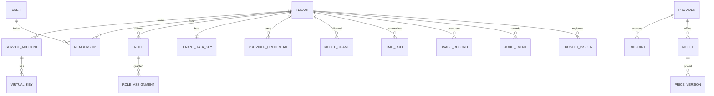

# Data model and isolation

- Status: high-level design, 2026-11-11
- Decisions: [ADR 0004](../adr/0004-postgresql-and-rls.md), [ADR 0013](../adr/0013-ledger-and-audit.md)

Table and column names here are indicative. The exact schema is written with the sprint that
introduces each table; the rules on this page are binding.

## Entities



| Group | Tables | Scope |
|---|---|---|
| Platform | `tenant`, `platform_role_assignment`, `provider`, `endpoint`, `model`, `price_version`, `rating_rule`, `platform_credential`, `platform_issuer`, `kek_version` | global |
| Identity | `app_user`, `membership`, `service_account`, `virtual_key`, `trusted_issuer`, `subject_mapping`, `role`, `role_permission`, `role_assignment` | tenant (`app_user` is global, memberships are tenant-scoped) |
| Vault | `tenant_data_key`, `provider_credential` | tenant |
| Policy | `model_grant`, `funding_mode`, `limit_rule` | tenant |
| Records | `usage_record`, `usage_correction`, `audit_event`, `platform_audit_event` | tenant, except the platform audit |
| Delivery | `outbox_event`, `outbox_delivery` | tenant |

## Rules

1. **Every tenant-scoped table has a non-null `tenant_id`**, part of its primary key or of a
   unique index, and of every foreign key to another tenant-scoped table. A row cannot reference a
   row of another tenant even by mistake.
2. **Row-level security is enabled and forced** on every tenant-scoped table.
3. **The tenant comes from the session, not from the query.** Each transaction sets
   `app.tenant_id` with `set_config(..., true)`, which lasts until the transaction ends and so is
   safe behind a transaction-mode connection pooler. When the setting is absent the policy
   compares with `NULL` and no row is visible: the failure mode is an empty result, never a leak.
4. **Runtime roles own nothing and cannot bypass policies.** Only the migration role owns tables.
5. **Identifiers are random** (UUIDv7), so they cannot be enumerated or guessed across tenants.
6. **Money is decimal**, never floating point. Token counts are 64-bit integers.

```sql
ALTER TABLE provider_credential ENABLE ROW LEVEL SECURITY;
ALTER TABLE provider_credential FORCE ROW LEVEL SECURITY;

CREATE POLICY tenant_isolation ON provider_credential
    USING      (tenant_id = current_setting('app.tenant_id', true)::uuid)
    WITH CHECK (tenant_id = current_setting('app.tenant_id', true)::uuid);
```

## Database roles

| Role | Used by | Can | Cannot |
|---|---|---|---|
| `pandokos_owner` | `migrate` only | Own and alter the schema | Be used at run time |
| `pandokos_gateway` | gateway | Read identities, catalogue, policy and credentials of the session tenant; call the key lookup function; insert usage and outbox rows | Write identities, catalogue or credentials; read or change audit; update or delete usage |
| `pandokos_admin` | admin API | Read and write the session tenant's configuration; write platform tables when acting as platform; insert audit rows; read usage and audit | Read the ciphertext of tenant credentials when acting as platform; update or delete usage or audit |
| `pandokos_worker` | worker | List tenants; run one job for one tenant inside that tenant's session; manage outbox deliveries | Run a statement over several tenants' data at once |

Three details make this hold:

- **Finding a key before the tenant is known.** A virtual key must be looked up before there is
  a tenant session. The gateway calls a `SECURITY DEFINER` function that takes a key ID and
  returns exactly one row with the key hash, tenant and constraints. The function is the only
  path that crosses the policy, it is narrow, and it cannot list keys.
- **Platform administrators and tenant secrets.** When the admin API acts for a platform
  administrator it uses a session without a tenant and reads credential metadata through a view
  that omits the ciphertext columns. The rule "the platform admin cannot read tenant secrets"
  (AZ-08) is therefore enforced by column privileges as well as by the API.
- **Append-only records.** `usage_record` and `audit_event` grant `INSERT` and `SELECT` only. No
  runtime role holds `UPDATE`, `DELETE` or `TRUNCATE` on them. Retention is carried out by the
  worker dropping whole expired partitions through a dedicated, audited function.

## Usage ledger

`usage_record` is partitioned by month on the request time. One row per request (USE-01), with
three groups of columns kept apart (USE-04):

- **attribution**: record ID, request ID, trace ID, tenant, principal, virtual key or token
  subject, credential ID, funding mode, caller metadata;
- **what was called**: provider, endpoint, model as requested, model as reported by the provider,
  API family, operation, streaming flag, start time, time to first byte, duration, outcome,
  upstream status;
- **measurement**: tokens by category as reported by the provider, the source of each value
  (`provider` or `estimated`), other billed units, price version, estimated upstream cost,
  currency; and, for platform-funded calls, rating rule version and chargeable amount.

Outcomes: `ok`, `upstream_error`, `cancelled`, `timeout`, `rejected_limit`, `rejected_policy`,
`internal_error`.

Corrections go to `usage_correction`, which references the original record and carries the
difference. Reports read both.

## Audit log

`audit_event` holds one row per administrative or security event (AUD-02) and is written in the
same transaction as the change (AUD-03). Each row stores the hash of the previous row of the same
tenant, forming a chain that makes removal or alteration detectable (AUD-04). Platform-level
events have their own table and chain.

## Outbox

`outbox_event` rows are inserted in the transaction that produces the fact they describe. The
worker claims them with `FOR UPDATE SKIP LOCKED`, delivers, and records the attempt in
`outbox_delivery`. An event's ID is stable and is the idempotency key for the receiver.

## Tenant deletion

1. The tenant moves to `deleting`: inference and administration stop.
2. Virtual keys, issuer registrations and memberships are removed.
3. The tenant data key is destroyed. Every credential ciphertext of the tenant, in the database
   and in any backup, is now unreadable.
4. Configuration rows are deleted. Usage and audit rows are kept for the configured retention,
   with the principal fields pseudonymized, then dropped.
5. A completion record goes to the platform audit log; the tenant becomes `deleted` and its ID is
   never reused.

## Testing isolation

The isolation suite (TEN-07) runs against a real PostgreSQL in CI and has three layers:

1. **Schema lint.** Every table is either on the list of global tables or has `tenant_id`, forced
   row-level security and a policy. A new table that is neither fails the build.
2. **SQL-level tests.** For each tenant table and each runtime role: with tenant A's session,
   select, insert, update and delete against tenant B's rows must see nothing and change nothing;
   with no session, the same.
3. **API-level tests.** For each route: a principal of tenant A addressing a resource of tenant B
   by ID receives the same response as for a resource that does not exist.
