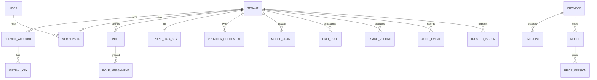

# Data model and isolation

- Status: high-level design, 2026-11-11
- Decisions: [ADR 0004](../adr/0004-postgresql-and-rls.md), [ADR 0013](../adr/0013-ledger-and-audit.md)

Table and column names here are indicative. The exact schema is written with the sprint that
introduces each table; the rules on this page are binding.

## Entities



| Group | Tables | Scope |
|---|---|---|
| Platform | `tenant`, `platform_key`, `virtual_key_directory` (no grant to any runtime role), `platform_role_assignment`, `provider`, `endpoint`, `model`, `price_version`, `rating_rule`, `platform_credential`, `platform_issuer`, `kek_version` | global |
| Identity | `app_user`, `local_account`, `console_session`, `membership`, `service_account`, `virtual_key`, `trusted_issuer`, `subject_mapping`, `role`, `role_permission`, `role_assignment` | tenant (`app_user`, `local_account` and `console_session` are global, memberships are tenant-scoped) |
| Vault | `tenant_data_key`, `provider_credential` | tenant |
| Policy | `model_grant`, `funding_mode`, `limit_rule` | tenant |
| Records | `usage_record`, `usage_correction`, `audit_event`, `platform_audit_event` | tenant, except the platform audit |
| Delivery | `outbox_event`, `outbox_delivery` | tenant |

## Rules

1. **Every tenant-scoped table has a non-null `tenant_id`**, part of its primary key or of a
   unique index, and of every foreign key to another tenant-scoped table. A row cannot reference a
   row of another tenant even by mistake.
2. **Row-level security is enabled and forced** on every tenant-scoped table.
3. **The tenant comes from the session, not from the query.** Each transaction sets
   `app.tenant_id` with `set_config(..., true)`, which lasts until the transaction ends and so is
   safe behind a transaction-mode connection pooler. When the setting is absent the policy
   compares with `NULL` and no row is visible: the failure mode is an empty result, never a leak.
   This protects against a missing application filter, not against arbitrary SQL on a runtime
   connection: the application names the tenant, so SQL injected into a statement could name
   another. Product queries are therefore static SQL, never built from strings.
4. **Runtime roles own nothing and cannot bypass policies.** Only the migration role owns tables.
5. **Identifiers are random** (UUIDv7), so they cannot be enumerated or guessed across tenants.
6. **Money is decimal**, never floating point. Token counts are 64-bit integers.
7. **Global tables are listed, and those that describe tenants have explicit policies.** A
   transaction acts for a tenant, or in platform scope, or sees nothing, or, while a tenant is
   being created, both (`store.Provision`).

```sql
ALTER TABLE pandokos.service_account ENABLE ROW LEVEL SECURITY;
ALTER TABLE pandokos.service_account FORCE ROW LEVEL SECURITY;

CREATE POLICY tenant_isolation ON pandokos.service_account
    USING      (tenant_id = (SELECT pandokos.current_tenant_id()))
    WITH CHECK (tenant_id = (SELECT pandokos.current_tenant_id()));
```

The policy reads the tenant through `pandokos.current_tenant_id()` and not through
`current_setting('app.tenant_id', true)::uuid`: after a transaction that set the value, a reused
connection reports the setting as the empty string, not as absent, and an empty string is not a
UUID. The function returns `NULL` for an empty setting and fails on a malformed one. The scalar
sub-select makes PostgreSQL evaluate the function once per statement. A second transaction-local
setting, `app.scope = 'platform'`, read through `pandokos.platform_scope()`, marks a platform
session; the policies of the `tenant` table are written in terms of it
([ADR 0027](../adr/0027-database-roles-and-session-context.md)).

## Database roles

The four names below are **privilege roles**: they cannot log in and have no password. The
database users that Pandokos connects as are members of exactly one of them, and the privileges
are granted to the role, so users and passwords can change without a migration. The
[database guide](../operations/database.md) shows how to create them.

| Role | Used by | Can | Cannot |
|---|---|---|---|
| `pandokos_owner` | `migrate` only | Own and alter the schema | Be used at run time |
| `pandokos_gateway` | gateway | Read identities, catalogue, policy and credentials of the session tenant (not platform keys); call the key lookup function, which crosses the policy for one fact only: the tenant of a key ID; insert usage and outbox rows | Write identities, catalogue or credentials; read or change audit; update or delete usage |
| `pandokos_admin` | admin API | Read and write the session tenant's configuration; write platform tables when acting as platform; insert audit rows (it cannot read them yet); read usage | Read the sealed secret of a credential, in any session (it holds no `SELECT` on that column); update or delete usage or audit |
| `pandokos_worker` | worker | List tenants (in platform scope); run one job for one tenant inside that tenant's session; manage outbox deliveries | Run a statement over several tenants' data at once |

Three details make this hold:

- **Finding a key before the tenant is known.** Forced row-level security binds the owner too, so
  a definer function cannot read `virtual_key` before a tenant is known. A `SECURITY DEFINER`
  function therefore reads a directory that holds nothing but (key ID, tenant ID), which no runtime
  role can read or write directly, and returns only the tenant of a key ID. Everything else about
  the key (hash, scopes, expiry, service account, roles) is then read in that tenant's session,
  under the ordinary policy. The function takes one key ID and returns at most one tenant ID: it
  cannot list, and a key ID is 80 random bits.
- **Platform administrators and tenant secrets.** The admin role holds no `SELECT` on the sealed
  secret of a credential in any session, so the rule "the platform admin cannot read tenant secrets"
  (AZ-08) rests on the database and not on handler code ([ADR 0034](../adr/0034-credential-model-and-platform-oversight.md)).
  A platform administrator names a tenant: the operation runs in that tenant's session, reads
  metadata through the view `provider_credential_metadata` (which runs with the caller's rights) and
  writes its audit row in the tenant's log. Vault tables carry the canonical tenant policy only, so a
  transaction in platform scope sees none of their rows; the price is that a platform administrator
  cannot search all tenants by fingerprint or hint. If incident response needs it, it will come later
  as one audited `SECURITY DEFINER` function (maintainer decision on open point O-1, sprint 2.1).
  `kek_version` stays in the platform group: it is global and readable by every runtime role.
- **Pinning a key to a credential.** `virtual_key.credential_id` is set when a key is created, can
  only be cleared afterwards (deleting the credential clears it), and is read with the key into the
  principal; a pinned key uses that credential for its provider and the default for any other.
- **Append-only records.** `usage_record` and `audit_event` grant `INSERT` and `SELECT` only. No
  runtime role holds `UPDATE`, `DELETE` or `TRUNCATE` on them. Retention is carried out by the
  worker dropping whole expired partitions through a dedicated, audited function.

## People and sessions

A person is one `app_user` row, global because a person can belong to several tenants. How they
sign in is either a federated identity (issuer and subject) or a `local_account` row: username,
password hash with its parameters, a must-change flag, failure counters. A user has one sign-in
method.

`console_session` holds one row per open session: the hash of the session token, the user, the
creation and last-use times, and the sign-in method. The token itself exists only in the browser's
cookie.

These three tables are readable and writable by the admin database role only. The gateway role
has no grant on them: the data plane cannot see passwords or sessions, which is what makes
"a console session never authenticates inference" a property of the database and not only of the
code.

What a user may do in a tenant is still in `membership` and `role_assignment`, under row-level
security like every other tenant table.

## Usage ledger

`usage_record` is partitioned by month on the request time. One row per request (USE-01), with
three groups of columns kept apart (USE-04):

- **attribution**: record ID, request ID, trace ID, tenant, principal, virtual key or token
  subject, credential ID, funding mode, caller metadata;
- **what was called**: provider, endpoint, model as requested, model as reported by the provider,
  API family, operation, streaming flag, start time, time to first byte, duration, outcome,
  upstream status;
- **measurement**: tokens by category as reported by the provider, the source of each value
  (`provider` or `estimated`), other billed units, price version, estimated upstream cost,
  currency; and, for platform-funded calls, rating rule version and chargeable amount.

Outcomes: `ok`, `upstream_error`, `cancelled`, `timeout`, `rejected_limit`, `rejected_policy`,
`internal_error`.

Corrections go to `usage_correction`, which references the original record and carries the
difference. Reports read both.

## Audit log

`audit_event` holds one row per administrative or security event (AUD-02) and is written in the
same transaction as the change (AUD-03). Each row stores the hash of the previous row of the same
tenant, forming a chain that makes removal or alteration detectable (AUD-04). Platform-level
events have their own table and chain.

## Outbox

`outbox_event` rows are inserted in the transaction that produces the fact they describe. The
worker claims them with `FOR UPDATE SKIP LOCKED`, delivers, and records the attempt in
`outbox_delivery`. An event's ID is stable and is the idempotency key for the receiver.

## Tenant deletion

1. The tenant moves to `deleting`: inference and administration stop.
2. Virtual keys, issuer registrations and memberships are removed.
3. The tenant data key is destroyed. Every credential ciphertext of the tenant, in the database
   and in any backup, is now unreadable.
4. Configuration rows are deleted. Usage and audit rows are kept for the configured retention,
   with the principal fields pseudonymized, then dropped.
5. A completion record goes to the platform audit log; the tenant becomes `deleted` and its ID is
   never reused.

## Testing isolation

The isolation suite (TEN-07) runs against a real PostgreSQL in CI and has three layers:

1. **Schema lint** ([`test/isolation`](../../test/isolation)). Every table is either on the list of
   global tables or has `tenant_id`, forced row-level security and a policy. A new table that is
   neither fails the build, and so does a tenant table without an entry in the isolation tests.
2. **SQL-level tests.** For each tenant table, taken from the catalogue, and each runtime role:
   with tenant A's session, select, insert, update and delete against tenant B's rows must see
   nothing and change nothing; with no session, the same. They run directly and through a
   transaction-mode pooler.
3. **API-level tests.** For each route: a principal of tenant A addressing a resource of tenant B
   by ID receives the same response as for a resource that does not exist.
