# Data model and isolation

- Status: high-level design, 2026-11-11
- Decisions: [ADR 0004](../adr/0004-postgresql-and-rls.md), [ADR 0013](../adr/0013-ledger-and-audit.md)

Table and column names here are indicative. The exact schema is written with the sprint that
introduces each table; the rules on this page are binding.

## Entities

```mermaid
erDiagram
    TENANT ||--o{ SERVICE_ACCOUNT : owns
    TENANT ||--o{ MEMBERSHIP : has
    USER ||--o{ MEMBERSHIP : holds
    MEMBERSHIP ||--|{ MEMBERSHIP_ROLE : roles
    USER ||--o| LOCAL_ACCOUNT : signs_in_with
    USER ||--o| USER_IDENTITY : signs_in_with
    USER ||--o{ USER_SESSION : opens
    USER ||--o{ PLATFORM_ROLE_ASSIGNMENT : holds
    SERVICE_ACCOUNT ||--o{ VIRTUAL_KEY : has
    TENANT ||--o{ TENANT_ROLE : defines
    TENANT_ROLE ||--o{ ROLE_ASSIGNMENT : named_by
    TENANT_ROLE ||--o{ MEMBERSHIP_ROLE : named_by
    TENANT ||--o{ SUPPORT_ACTION : receives
    SUPPORT_ACTION ||--o{ AUDIT_EVENT : named_by
    TENANT ||--|| TENANT_DATA_KEY : has
    TENANT ||--o{ PROVIDER_CREDENTIAL : owns
    PROVIDER ||--o{ ENDPOINT : exposes
    PROVIDER ||--o{ MODEL : offers
    MODEL ||--o{ PRICE_VERSION : priced
    TENANT ||--o{ TENANT_PRICE_VERSION : prices
    MODEL ||--o{ TENANT_PRICE_VERSION : priced_by_tenant
    TENANT_PRICE_VERSION ||--|{ TENANT_PRICE_RATE : has
    TENANT ||--o{ MODEL_TENANT_GRANT : granted
    TENANT ||--o| TENANT_MODEL_RESTRICTION : restricts
    TENANT ||--o{ LIMIT_RULE : constrained
    TENANT ||--o{ USAGE_RECORD : produces
    TENANT ||--o{ AUDIT_EVENT : records
    TENANT ||--o{ TRUSTED_ISSUER : registers
    TRUSTED_ISSUER ||--o{ SUBJECT_MAPPING : maps
    SERVICE_ACCOUNT ||--o{ SUBJECT_MAPPING : acts_as
```



| Group | Tables | Scope |
|---|---|---|
| Platform | `tenant`, `platform_key`, `virtual_key_directory` (no grant to any runtime role), `platform_role_assignment`, `provider`, `provider_endpoint`, `model`, `model_tenant_grant`, `price_version`, `price_rate`, `price_import`, `platform_issuer`, `platform_issuer_tenant` (a tenant's session sees its own rows), `platform_limit_rule` (a tenant's session sees the defaults and its own rows), `issuer_directory` (no grant to any runtime role), `kek_version` | global |
| Identity | `service_account`, `virtual_key`, `trusted_issuer`, `subject_mapping`, `tenant_role` (custom roles), `role_assignment` (service accounts), `membership`, `membership_role` | tenant |
| Support | `support_action` (global, three policies, a grant to the admin role only) | platform scope and the tenant of the row |
| People | `app_user`, `local_account`, `user_identity`, `user_session`, `signin_throttle`, `oidc_login`, `idempotency_key` (global, with explicit policies and a grant to the admin role only), `membership_directory` (global, no grant to any runtime role) | global; the gateway and worker roles hold nothing on them |
| Vault | `tenant_data_key`, `provider_credential` | tenant |
| Policy | `tenant_model_restriction`, `limit_rule` | tenant |
| Tenant prices | `tenant_price_version`, `tenant_price_rate` | tenant; no policy shows them to the platform scope |
| Records | `usage_record`, `audit_event`, `platform_audit_event` | tenant, except the platform audit |
| Delivery | `outbox_event`, `outbox_delivery` | tenant |

## The catalogue (sprint 2.2)

The catalogue tables of the platform group (`provider`, `provider_endpoint`, `model`,
`model_tenant_grant`, `price_version`, `price_rate`, `price_import`) are **restricted global tables**:
row-level security is forced, every runtime role that needs a table reads all its rows in any session
(a tenant's session included), and only the admin role in platform scope writes them; the worker
inserts prices, price rates and imports, also in platform scope. A handler that forgot the scope could
not change the catalogue. Two tables are not plain catalogue tables:

- `model_tenant_grant` (the `model_grant` of the first design, moved from the policy group to the
  platform group) grants a model of availability `selected` to a tenant. It describes tenants, so a
  tenant's session sees only its own rows; in platform scope the admin role sees all.
- `tenant_model_restriction` is in the policy group with the canonical tenant policy: at most one row
  per tenant, listing the model references the tenant narrows itself to.

A virtual key gains `models` (a list of `provider/name` references, or NULL for no list), fixed when
the key is issued. A price version belongs to a model and never changes; its rates, one per category
and tier, are `numeric(24,12)` per million units. `price_import` is append-only and keeps the report
of each run. Details: [database guide](../operations/database.md), [catalogue guide](../operations/catalogue.md),
[ADR 0035](../adr/0035-catalogue-and-model-access.md) and [ADR 0036](../adr/0036-prices-costs-and-importer.md).

## Rules

1. **Every tenant-scoped table has a non-null `tenant_id`**, part of its primary key or of a
   unique index, and of every foreign key to another tenant-scoped table. A row cannot reference a
   row of another tenant even by mistake.
2. **Row-level security is enabled and forced** on every tenant-scoped table.
3. **The tenant comes from the session, not from the query.** Each transaction sets
   `app.tenant_id` with `set_config(..., true)`, which lasts until the transaction ends and so is
   safe behind a transaction-mode connection pooler. When the setting is absent the policy
   compares with `NULL` and no row is visible: the failure mode is an empty result, never a leak.
   This protects against a missing application filter, not against arbitrary SQL on a runtime
   connection: the application names the tenant, so SQL injected into a statement could name
   another. Product queries are therefore static SQL, never built from strings.
4. **Runtime roles own nothing and cannot bypass policies.** Only the migration role owns tables.
5. **Identifiers are random** (UUIDv7), so they cannot be enumerated or guessed across tenants.
6. **Money is decimal**, never floating point. Token counts are 64-bit integers.
7. **Global tables are listed, and those that describe tenants have explicit policies.** A
   transaction acts for a tenant, or in platform scope, or sees nothing, or, while a tenant is
   being created, both (`store.Provision`).

```sql
ALTER TABLE pandokos.service_account ENABLE ROW LEVEL SECURITY;
ALTER TABLE pandokos.service_account FORCE ROW LEVEL SECURITY;

CREATE POLICY tenant_isolation ON pandokos.service_account
    USING      (tenant_id = (SELECT pandokos.current_tenant_id()))
    WITH CHECK (tenant_id = (SELECT pandokos.current_tenant_id()));
```

The policy reads the tenant through `pandokos.current_tenant_id()` and not through
`current_setting('app.tenant_id', true)::uuid`: after a transaction that set the value, a reused
connection reports the setting as the empty string, not as absent, and an empty string is not a
UUID. The function returns `NULL` for an empty setting and fails on a malformed one. The scalar
sub-select makes PostgreSQL evaluate the function once per statement. A second transaction-local
setting, `app.scope = 'platform'`, read through `pandokos.platform_scope()`, marks a platform
session; the policies of the `tenant` table are written in terms of it
([ADR 0027](../adr/0027-database-roles-and-session-context.md)).

## Database roles

The four names below are **privilege roles**: they cannot log in and have no password. The
database users that Pandokos connects as are members of exactly one of them, and the privileges
are granted to the role, so users and passwords can change without a migration. The
[database guide](../operations/database.md) shows how to create them.

| Role | Used by | Can | Cannot |
|---|---|---|---|
| `pandokos_owner` | `migrate` only | Own and alter the schema | Be used at run time |
| `pandokos_gateway` | gateway | Read identities, catalogue, policy and credentials of the session tenant (not platform keys); call the key lookup function, which crosses the policy for one fact only: the tenant of a key ID; insert usage and outbox rows; execute `record_auth_failure`, which writes one `auth.failure` audit row in the session tenant | Write identities, catalogue or credentials; hold any privilege on the audit tables (it can only call that function); update or delete usage |
| `pandokos_admin` | admin API | Read and write the session tenant's configuration; write platform tables when acting as platform; insert audit rows (it cannot read them yet); read usage; read and write the tables of people and sessions (sprint 4.2), and execute the five definer functions of migration 0013 and the two issuer lookups that tokens on the administration listener need | Read the sealed secret of a credential, in any session (it holds no `SELECT` on that column); update or delete usage or audit |
| `pandokos_worker` | worker | List tenants (in platform scope); run one job for one tenant inside that tenant's session; manage outbox deliveries; import prices in platform scope (prices, rates, imports and the platform audit rows of the refresh job) | Run a statement over several tenants' data at once |

Three details make this hold:

- **Finding a key before the tenant is known.** Forced row-level security binds the owner too, so
  a definer function cannot read `virtual_key` before a tenant is known. A `SECURITY DEFINER`
  function therefore reads a directory that holds nothing but (key ID, tenant ID), which no runtime
  role can read or write directly, and returns only the tenant of a key ID. Everything else about
  the key (hash, scopes, expiry, service account, roles) is then read in that tenant's session,
  under the ordinary policy. The function takes one key ID and returns at most one tenant ID: it
  cannot list, and a key ID is 80 random bits.
- **Platform administrators and tenant secrets.** The admin role holds no `SELECT` on the sealed
  secret of a credential in any session, so the rule "the platform admin cannot read tenant secrets"
  (AZ-08) rests on the database and not on handler code ([ADR 0034](../adr/0034-credential-model-and-platform-oversight.md)).
  A platform administrator names a tenant: the operation runs in that tenant's session, reads
  metadata through the view `provider_credential_metadata` (which runs with the caller's rights) and
  writes its audit row in the tenant's log. Vault tables carry the canonical tenant policy only, so a
  transaction in platform scope sees none of their rows; the price is that a platform administrator
  cannot search all tenants by fingerprint or hint. If incident response needs it, it will come later
  as one audited `SECURITY DEFINER` function (maintainer decision on open point O-1, sprint 2.1).
  `kek_version` stays in the platform group: it is global and readable by every runtime role.
- **Pinning a key to a credential.** `virtual_key.credential_id` is set when a key is created, can
  only be cleared afterwards (deleting the credential clears it), and is read with the key into the
  principal; a pinned key uses that credential for its provider and the default for any other.
- **Append-only records.** `usage_record` and `audit_event` are append-only: no runtime role holds
  `UPDATE`, `DELETE` or `TRUNCATE` on them, and triggers stop the owner too. The gateway role holds
  `INSERT` on `usage_record` and no `SELECT`; the admin and worker roles read it. Retention is carried out by the
  worker dropping whole expired partitions through a dedicated, audited function.

## People and sessions

Migration 0013 ([ADR 0056](../adr/0056-users-memberships-and-sessions-as-principals.md),
[ADR 0057](../adr/0057-local-accounts-and-sessions-formats-and-numbers.md)) holds eleven tables for
people, sessions and idempotency, five definer functions and two `EXECUTE` grants for tokens. The
columns of each are exactly what the sign-in guide says is stored: no address, no user agent, no token.

**A person.** `app_user` is global, because a person can belong to several tenants: display name,
e-mail address, `state` (`active`, `disabled`), `sign_in` (`local` or `oidc`, exactly one, immutable) and
`tenant_id`, the tenant that manages the account (null: the platform; immutable). A `local_account` (a
lower-case username unique in the installation, the Argon2id PHC hash with its parameters, a must-change
flag, the expiry of a generated password) or a `user_identity` (issuer and subject) hangs on the user; a
composite foreign key on (`id`, `sign_in`) makes the two exclusive without a trigger. **The managing
rule**, two triggers: a user that a tenant manages is a member of that tenant only and holds no platform
role; a federated user is always managed by the platform.

**Roles of people, in tables of their own.** The earlier text of this page kept the roles of members in
`role_assignment` with a user column; sprint 4.2 departs from it (decision D-2): `membership` (tenant,
user, `source`) and `membership_role` are tenant-scoped tables with forced row-level security and the one
policy `tenant_isolation`, and `platform_role_assignment` holds the platform roles of users. The source of
a row is `manual` (an administrator) or `idp` (kept by the group rules at sign-in). `role_assignment`
stays the table of service accounts, which the gateway reads; keeping people out of it means the gateway
never sees a role row about a person, and the isolation harness, which allows one policy per tenant table,
needs no policy that hides a column. `membership_directory` (user, tenant), kept by a trigger, is read
only through `user_tenants`, a definer function that answers in the platform scope: the one path from a
user to its tenants across the tenant policy. `platform_user_lookup` is its counterpart: it finds one
platform-managed user by ID or username for a tenant's session. The roles themselves are read in each
tenant's session, under the ordinary policy.

**Sessions and sign-in state.** `user_session` has one row per open session: the SHA-256 of the token, the
user, the method, the times (creation, last use, absolute expiry); the token exists only in the browser's
cookie, and a session ends by deleting the row. `signin_throttle` has one row per digest of a typed
username and one per digest of a source prefix (failures, window, lock). `oidc_login` holds the SHA-256 of
the `state` of a sign-in in progress for ten minutes. `idempotency_key` holds the scope, the operation, a
salted hash of the request, the commit mark and the stored response of a create operation, without the
members shown once ([ADR 0059](../adr/0059-idempotency-keys.md)). The admin role purges the expired rows
of the last four tables, and of sessions, every five minutes.

**Visibility.** The platform scope sees every user (sign-in happens there, before any tenant is known).
A tenant's session sees the users it manages and its members, and writes only the former. An unscoped
session sees nothing. Sessions, identities, throttle rows and platform roles are visible in the platform
scope only. The gateway and worker roles have no privilege on any of these tables or functions in any
session, which is what makes "a session never authenticates inference" a property of the database and not
only of the code. The audit constraint accepts the actor type `host`, for the commands run on the host.

## Custom roles and support actions (sprint 4.3)

Migration 0014 ([ADR 0060](../adr/0060-built-in-roles-custom-roles-and-the-rule-against-escalation.md),
[ADR 0061](../adr/0061-support-actions-and-reasons-how-the-platform-acts-inside-a-tenant.md)) adds two
tables and one column. No function of it is `SECURITY DEFINER`.

**Custom roles.** The catalogue and the built-in roles are in code. `tenant_role` is a tenant-scoped table
with the one policy `tenant_isolation`: `name` (unique in the tenant, immutable, never the name of a
built-in role or starting with `platform-` or `pandokos-`), `description`, `permissions` (1 to 64 names,
sorted, checked by format), `state` (`active` or `inactive`). `role_assignment.role` and
`membership_role.role` hold the name of a built-in role or of a row of this table, as they always held
a name; **there is no foreign key**, because built-in roles are not rows. This departs from the plan of
sprint 4.2 that three tables would reference the roles: `platform_role_assignment` holds built-in platform
roles only, since custom roles are the tenant's. A trigger refuses to rename a role and to delete one that
is assigned (the handler checks first, under a row lock); another sends the tenant's cache notification on
every change, because the **gateway role reads `tenant_role`** (`SELECT` and nothing else) in the statement
that already reads the roles of a service account. The worker has no privilege on it. A name without a
row gives nothing: the default is deny.

**Support actions.** `support_action` is global: the actor (a platform key or a user, with the key's ID
and the actor's name as they were), the tenant, the reason, the permissions, the request ID, the times of
opening and expiry (at most 24 hours after opening, by constraint) and, once, of closing, with who closed
it (`platform`, `tenant` or `expiry`) and why. One open action per actor and tenant (a unique index). A
trigger lets a row change once, when it is closed. Three policies: the platform scope sees and writes
every row; a tenant's session reads its tenant's rows and may close them as the tenant. A row is never
deleted before tenant deletion (sprint 6.3).

**Audit.** `audit_event` gains the nullable column `support_action_id`, filled for what a support
principal changes in a tenant. Opening and closing write one event in the tenant's chain and one in the
platform's, in the same transaction as the action's row.

## Trusted issuers, the directory and subject mappings (sprint 4.1)

A registration of a token issuer is a row of `trusted_issuer` (tenant-scoped, canonical policy) or of
`platform_issuer` (global, with a list of tenants in `platform_issuer_tenant`). A **subject mapping**
(`subject_mapping`, tenant-scoped) names one registration of either kind, one subject and one service
account of the tenant; it never changes and is deleted with its registration (cascade).
[ADR 0045](../adr/0045-trusted-token-issuers.md) gives the reasons.

- **Why two tables.** A tenant's registration is tenant data; a platform-level one describes tenants and
  belongs to no one. Keeping them apart lets forced row-level security hold for the first without an
  exception, and keeps the second writable in platform scope only. `platform_issuer_tenant` maps the
  claim value that designates a tenant to that tenant; the value defaults to the tenant's ID and is
  unique in the registration; there is no wildcard row.
- **The directory.** `issuer_directory` has one row per registration, kept by triggers, with the
  primary key (`issuer`, `audience`): the pair is unique in the whole installation, over both kinds, and
  a token selects its registration by that pair. No runtime role can read or write it; the gateway
  reaches it only through `issuer_lookup`, a definer function that takes an issuer and up to 16 exact
  audiences and returns the matching rows. This is the one path from a token to a tenant-bound
  registration that crosses the tenant policy, and it returns only what the pair names.
- **After the lookup** every read of a tenant's registration, mapping and service account happens in
  that tenant's session. The tenant of a platform-level token is found with
  `platform_issuer_tenant_lookup`, which takes one registration and one claim value and returns one
  tenant ID or nothing.
- **The usage ledger** accepts `principal_kind` `token`: `principal_id` is the service account and
  `key_id` the mapping.
- **Mappings count of a platform-level deletion.** The platform session cannot see mappings, so the
  admin role executes the definer function `platform_issuer_mapping_count`, which returns only the
  number of mappings of the registration across the tenants named by the caller; the audit row of
  the deletion records it as `mappings_deleted`.

## Limit rules (sprint 5.1)

Two tables hold the rules that the gateway enforces ([limits guide](../operations/limits.md),
[ADR 0049](../adr/0049-limit-rules.md)). `limit_rule` is tenant-scoped: a rule names a subject (the
tenant, a service account, or a key: a virtual key by its key ID, a caller with a token by its subject
mapping), a metric and a value. `platform_limit_rule` is global: a row without a tenant is the
default ceiling of every tenant, a row with a tenant replaces it for that tenant, and only the
platform scope writes it. The gateway role only reads them; both tables notify `pandokos_cache`.
*Sprint 5.3 replaced the subject by typed identifiers with foreign keys: see "Integrity of limit rules".*

## Quotas, budgets and limit events (sprint 5.2)

Migration 0010 gives both rule tables the same new columns ([database guide](../operations/database.md),
[ADR 0050](../adr/0050-quotas-and-budgets-periods-attribution-currencies.md),
[ADR 0052](../adr/0052-administration-of-limits.md)): `provider` and `model` (the scope: names of the
catalogue, empty meaning all; replaced by `provider_id` and `model_id` in sprint 5.3),
`currency` (three capital letters for a cost metric, empty otherwise), `enforce` (false: the rule never
refuses and only records its thresholds) and `thresholds` (up to four percentages). The metrics
include six per period, and `limit_value` of a cost metric is in **millionths** of the currency. The
key is tenant, subject, scope and metric: one rule per metric and scope.

`limit_event` is tenant-scoped (policy `tenant_isolation`) and append-only for every role. A row records
that a threshold was reached (`threshold_reached`, with its percentage) or that an enforced limit
refused for the first time in a period (`exhausted`): rule and level, subject, scope, metric, currency,
period, the value of the rule and the value observed. It names no request, caller or content and has no
foreign key to the rule, so an event outlives it. One row exists per tenant, rule, period start, kind
and percentage (a unique key), which makes recording idempotent. The gateway role inserts the listed
columns, the admin role reads, the worker role has no grant. `model.default_output_tokens` (1 to
1,000,000, null by default) is the per-model default output reservation. No column was added to
`usage_record`: the limiter counts what the ledger already holds.

## Provider stream usage option (sprint 3.3)

`provider.stream_usage_option` is `add` (default) or `omit` ([ADR 0042](../adr/0042-openai-compatible-providers-and-stream-usage-option.md)):
whether the gateway adds the usage option to chat streams of a provider of the `openai` family. It is
read with the catalogue snapshot. The administration API now also reads `usage_record`, as the admin
role in a tenant session, to list a tenant's records ([ADR 0043](../adr/0043-tenant-capability-check-and-usage-list.md)).

## Usage ledger

`usage_record` is partitioned by calendar month (UTC) on the request start `started_at`, with a
default partition; the gateway's writer creates no table, the worker's hourly job creates the
partitions ahead of time through a definer function ([usage guide](../operations/usage.md),
[ADR 0039](../adr/0039-usage-record-admission-and-ledger-writer.md)). There is **one row for every
admitted, that is authenticated, request** (USE-01), whatever its outcome. The one authenticated
request without a row is the one refused because the writer's buffer is full. The primary key is
`(tenant_id, started_at, id)`; the gateway makes the ID (a UUID version 7) and a repeated insert
stores the row once. No column holds content, and every text column is format-checked. Columns fall
into five groups, with provider values and Pandokos's estimates kept apart (USE-04):

- **attribution**: tenant, record ID, start and commit time, request ID, trace ID, principal kind
  and ID, virtual key ID, credential ID, caller metadata and the count of dropped
  entries;
- **what was called**: provider, API family, operation, endpoint, model as named in the catalogue
  (`model`), the catalogue model ID, `upstream_model` (the identifier the provider received; the
  provider's own reply is not recorded), streaming flag, outcome, error code, upstream status, time
  to first body byte, duration, request and response bytes;
- **measured by the provider**: the source of each of the two totals (`provider`, `estimated` or
  `none`), input and output tokens, cache and reasoning counts, other billed units, and the
  provider's own integer counters; empty unless the source is `provider`;
- **estimated by Pandokos**: estimated input and output tokens; empty unless the source is
  `estimated`;
- **cost**: status (`known`, `unknown` with a reason, `none`), the exact amount, currency, the price
  version in force when the request started, the list it belongs to (`price_source`: `catalogue` or `tenant`; NULL when no price was used or before sprint 5.4), and the categories priced by fallback. The cost is
  informational: the provider's invoice is the authority.

Check constraints enforce the sources: a provider column is null unless its source is `provider`, an
estimate column unless it is `estimated`. The only foreign key is `tenant_id`; a record outlives the
key, the credential, the model and the price it names.

Outcomes: `ok`, `upstream_error`, `cancelled`, `timeout`, `rejected_limit`, `rejected_policy`,
`internal_error`. (`rejected_limit` is written for a request refused by a limit, with no usage and no cost.)

## The usage rollup and reports (sprint 6.2)

Migration 0015 ([database guide](../operations/database.md#20-grants-of-migration-0015),
[ADR 0064](../adr/0064-usage-rollup-reports-and-exports.md)).

- **`usage_rollup`** (tenant-scoped, forced row-level security, canonical policy) has one row per UTC hour
  of the request start and per principal, key, provider, model, model ID, currency, price source, outcome
  and whether a credential was opened, with the request count, the seven token sums as recorded, the sum
  of the known costs and the counts of known and unknown costs. Currencies and price sources are never
  merged. It is derived from the ledger and rebuildable, so it is not append-only.
- **`usage_rollup_state`** holds one `watermark` per tenant: every record recorded before it is in the
  rollup, none at or after it. The worker moves it in the tenant's session, one minute behind the clock.
- **The exact reader** (`AggregateUsageForLimits`, `UsageReport`) takes the rollup for whole hours that no
  period boundary cuts plus the ledger records of those hours recorded since the watermark, and the
  ledger for everything else, in one statement. A stopped rollup makes it slower, never wrong. The limit
  counters and the capability check read through it.
- **`usage_record_recorded_idx`** on `(tenant_id, recorded_at)` serves the rollup.
- **`metadata_key_policy`** is a tenant's list of the caller metadata keys it accepts (no row: every key
  of the format); the gateway reads it with the tenant's catalogue view.
- **Retention** (`usage_months`, `audit_months`, both off by default): usage by dropping monthly
  partitions and removing a tenant's rollup and default-partition rows; audit by removing the oldest rows of
  a chain and moving its anchor. Two audited functions of the database do it, run by the worker; see the
  audit section.

## Audit log

`audit_event` holds one row per administrative or security event (AUD-02) and is written in the
same transaction as the change (AUD-03). Each row stores the hash of the previous row of the same
tenant, forming a chain that makes removal or alteration detectable (AUD-04). Platform-level
events have their own table and chain.

**The chain as built (sprint 6.2, [ADR 0065](../adr/0065-the-audit-hash-chain-reading-and-retention.md)).**
A `BEFORE INSERT` trigger that runs as the owner seals every row: it gives it its ID, time, a `seq`
per chain, the previous hash and its own hash, under a lock of the chain's head row (`audit_chain` per
tenant, `platform_audit_chain`: last `seq` and `hash`, and the anchor). A row that is not inserted leaves
the head as it was, so numbers are consecutive in commit order. The hash is SHA-256 over a length-prefixed
canonical encoding of the row (version 1) and the digest of its detail; it is defined in SQL and in Go
(`internal/auditchain`) and verified client-side by `pandokos audit verify`. Rows that existed before
migration 0015 were sealed once by it. The admin role reads the logs (`audit:read`,
`platform_audit:read`); the details of price actions are withheld, with their digest, from a reader
without `price_list:read`.

**Retention as built.** The audit tables are not partitioned. `append_only` lets a `DELETE` through only
under the setting `pandokos.retention`, which two definer functions alone set (`tenant_retention`,
`platform_retention`, executable by the worker role): they remove the oldest rows of a chain as a prefix,
move its anchor to the hash of the last removed row and write `audit.retention` in the chain, and the
second also drops usage partitions and writes `usage.retention`. Sprint 6.3 reuses the switch for tenant
deletion.

## Outbox

`outbox_event` rows are inserted in the transaction that produces the fact they describe. The
worker claims them with `FOR UPDATE SKIP LOCKED`, delivers, and records the attempt in
`outbox_delivery`. An event's ID is stable and is the idempotency key for the receiver.

## Tenant deletion

1. The tenant moves to `deleting`: inference and administration stop.
2. Virtual keys, issuer registrations and memberships are removed.
3. The tenant data key is destroyed. Every credential ciphertext of the tenant, in the database
   and in any backup, is now unreadable.
4. Configuration rows are deleted. Usage and audit rows are kept for the configured retention,
   with the principal fields pseudonymized, then dropped.
5. A completion record goes to the platform audit log; the tenant becomes `deleted` and its ID is
   never reused.

## Testing isolation

The isolation suite (TEN-07) runs against a real PostgreSQL in CI and has three layers:

1. **Schema lint** ([`test/isolation`](../../test/isolation)). Every table is either on the list of
   global tables or has `tenant_id`, forced row-level security and a policy. A new table that is
   neither fails the build, and so does a tenant table without an entry in the isolation tests.
2. **SQL-level tests.** For each tenant table, taken from the catalogue, and each runtime role:
   with tenant A's session, select, insert, update and delete against tenant B's rows must see
   nothing and change nothing; with no session, the same. They run directly and through a
   transaction-mode pooler.
3. **API-level tests.** For each route: a principal of tenant A addressing a resource of tenant B
   by ID receives the same response as for a resource that does not exist.

## Integrity of limit rules (sprint 5.3)

Migration 0011 ([database guide](../operations/database.md), section 16;
[ADR 0049](../adr/0049-limit-rules.md), [ADR 0050](../adr/0050-quotas-and-budgets-periods-attribution-currencies.md),
[ADR 0052](../adr/0052-administration-of-limits.md), each with an amendment of this sprint).

- **A rule references its subject and scope.** `limit_rule` holds `service_account_id`, `virtual_key_id`
  and `subject_mapping_id` (a `key` rule has exactly one of the last two; `subject_kind` is unchanged)
  with composite foreign keys `(tenant_id, id)`, so a subject of another tenant cannot be named, and
  `provider_id` and `model_id`; `platform_limit_rule` holds the last two. Every key is `ON DELETE
  RESTRICT`: the deletions are audited by the application, so nothing cascades, and a subject, provider
  or model that a rule names cannot be deleted by any role. A revoked key has no rule (two triggers,
  since keys are never deleted). Subject, scope, metric and currency never change. `limit_event` keeps
  its names and has no foreign key: it is history.
- **Matching is by identifier** in the gateway and the counters; names are for display. A model created
  later with the name of a deleted one is another model.
- **A time zone per tenant.** `tenant.time_zone`, `time_zone_previous` and `time_zone_effective_from`;
  the zone in force changes only through a pending change that takes effect at the start of the next month
  in the zone in force. A tenant's own session may update its row (policy `tenant_self_update`); a guard
  trigger leaves it the three columns.
- **`usage_record.limit_state`** (`limited`, `unlimited`, `unverified`, `not_evaluated`; NULL before this
  sprint), added without rewriting a partition; the check is `NOT VALID`.
- **Two functions cross the tenant boundary** (see the security model): one for the rules of a
  platform-level issuer's mappings, one for the audit row of unlimited traffic. Two partial unique indexes
  on the audit logs make that row once per tenant and day.

## Tenant price lists and the active currency (sprint 5.4)

Migration 0012 ([database guide](../operations/database.md), section 17;
[ADR 0053](../adr/0053-tenant-price-lists-and-active-currency.md),
[ADR 0054](../adr/0054-usage-data-is-the-tenants.md)).

- **`tenant_price_version` and `tenant_price_rate`** are tenant-scoped tables with forced row-level
  security and the canonical policy only. A version belongs to a tenant and a model and has a currency,
  a start, a kind (`price` or `end`) and a note; the versions of one tenant and currency are its list in
  that currency. Its rates, one per category and tier, are `numeric(24,12)` per million units. The same
  rules as the catalogue's versions hold for every role, the owner included: never updated, never
  started in the past, deleted only before they start; the shape (a base rate for every category priced,
  none for an end) is checked at commit. `tenant_price_version_model_fkey` references `model` with `ON
  DELETE RESTRICT`. The gateway and the admin role read them, the admin role writes them, the worker holds
  nothing, and the platform scope sees no row.
- **`tenant.active_currency`**, `active_currency_previous` and `active_currency_effective_from` (`''` is
  the default of the installation, `pricing.default_currency`); the currency in force changes only through
  a pending change that takes effect at the start of the next month in the tenant's zone, and only from
  the tenant's own session (guard trigger).
- **One rule per subject, scope, metric and currency**: the unique keys of `limit_rule` and
  `platform_limit_rule` gain `currency`.
- **`usage_record.price_source`** names the table `price_version_id` refers to; there is still no
  foreign key from the ledger.
- No function is added and none crosses the tenant boundary: a tenant's usage, limit events and prices
  are read by the tenant only through the product.
