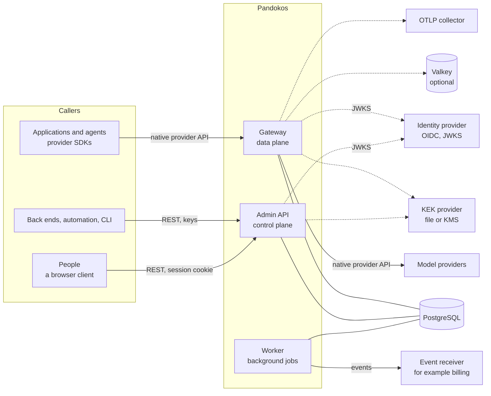
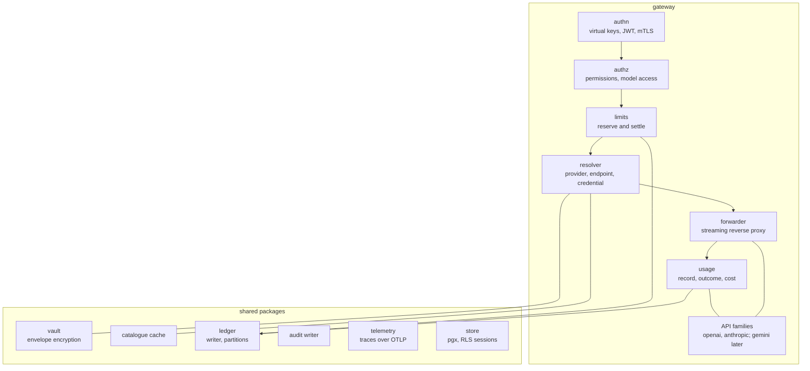
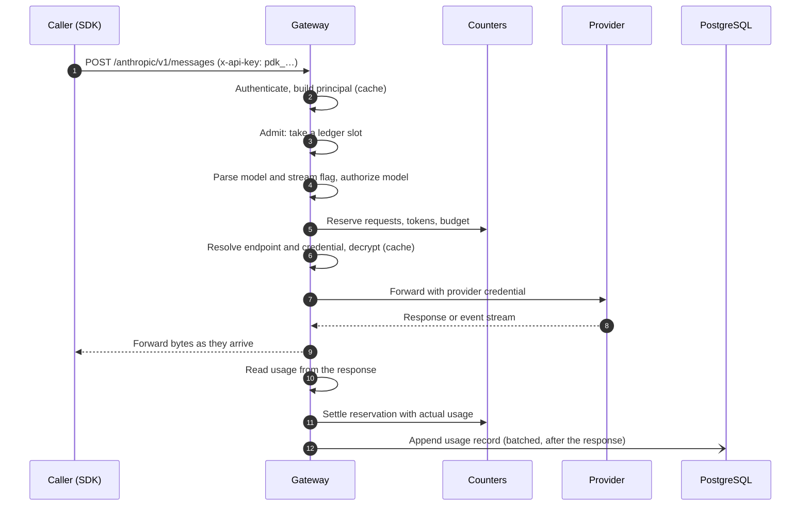
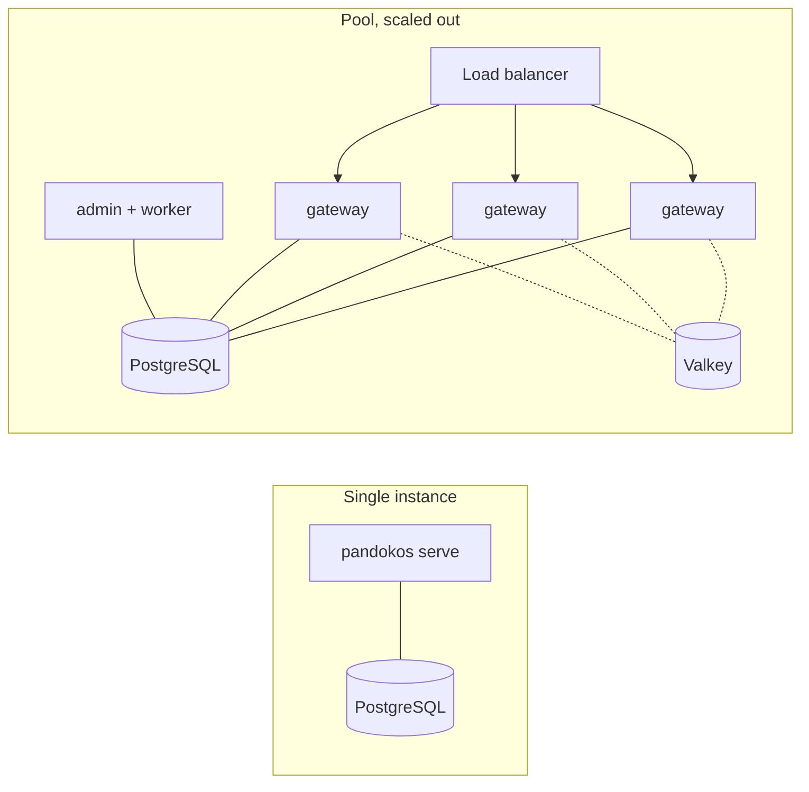
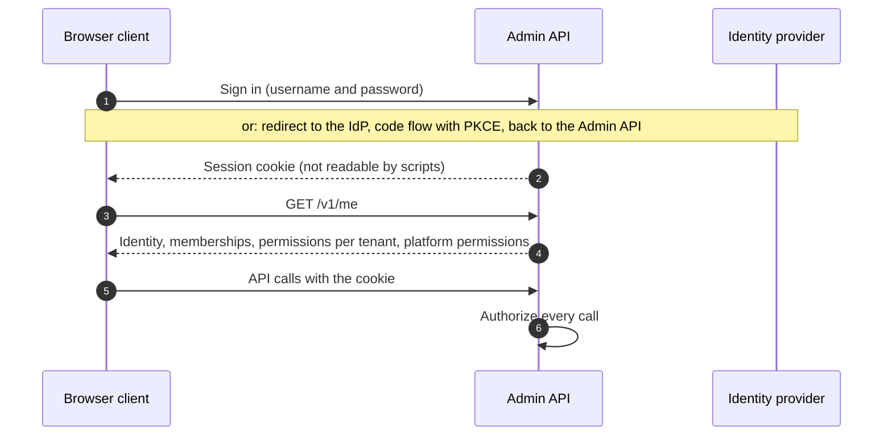

# Architecture overview

- Status: high-level design, 2026-11-11
- Scope: the whole product up to 1.0, with more detail for the first release
- Companions: [data model](data-model.md), [security model](security-model.md),
  [requirements](../requirements/README.md), [decision records](../adr/)

This document describes the shape of the system and the reasons behind it. Each choice that had a
real alternative is recorded in an ADR, linked where it is discussed.

## 1. What drives the design

Four properties of the problem decide most of the architecture.

**The workload waits; it does not compute.** A model response takes seconds, during which the
proxy copies bytes. The work Pandokos adds to a request (verify a credential, pick a key, check a
counter, parse usage) takes microseconds to a few milliseconds. The data plane therefore has to
hold many long-lived streaming connections cheaply, and must not touch the database on the hot
path once its caches are warm.

**The component holds every tenant's provider keys.** That makes the size of the trusted code
base and of its dependency tree a first-order concern, more than raw speed.

**Isolation must survive a bug.** One forgotten filter in one query must not leak data. The
database has to enforce the tenant boundary on its own.

**A single container must be a complete product.** Anything beyond PostgreSQL is optional and
appears only when the deployment needs it.

## 2. System context



## 3. One binary, three roles

Pandokos is a single Go program ([ADR 0002](../adr/0002-implementation-language-go.md)) that can
run any combination of three roles ([ADR 0003](../adr/0003-single-binary-with-roles.md)):

| Role | Plane | Does | Listens |
|---|---|---|---|
| `gateway` | data | Authenticates callers, authorizes, enforces limits, injects the provider credential, forwards, extracts usage | inference port |
| `admin` | control | Administration API for tenants, identities, roles, catalogue, credentials, limits, reports. Handles sign-in and sessions | admin port |
| `worker` | background | Event delivery, retention, tenant deletion, price refresh, key re-wrapping, counter reconciliation | none |

Two more commands exist: `migrate` (schema changes, with owner credentials) and `init` (first
platform admin credential).

`pandokos serve` runs all three roles in one process: this is the single-container installation.
`pandokos serve --role gateway` and so on run them apart when a deployment wants to scale the
data plane on its own, keep the admin API off the public network, or give each role its own
database credentials. The roles share code but not privileges: each uses its own database role
(see the [data model](data-model.md#database-roles)), so the gateway cannot change the catalogue
and the admin API cannot append usage.

The two planes never share a listener. The inference port is meant for callers; the admin port is
meant for a private network.

## 4. Components



- **authn** turns a credential into a *principal*: tenant, identity, roles, scopes, constraints.
  Three mechanisms produce the same principal: virtual keys, tokens from trusted issuers, and
  (later) client certificates ([ADR 0005](../adr/0005-data-plane-authentication.md)). The
  **administration plane** has four authenticators: platform and virtual keys, tokens of trusted
  issuers when `tokens.admin_listener` is on (service accounts only), and, for people, the session
  cookie (`internal/session`, `internal/account`, `internal/oidc`; the principal of a session is built
  for each request from the permission and the tenant of the path,
  [ADR 0056](../adr/0056-users-memberships-and-sessions-as-principals.md)). The gateway uses none of
  the people's packages.
- **authz** evaluates `resource:action` permissions in process
  ([ADR 0007](../adr/0007-authorization-rbac.md)).
- **limits** reserves capacity before forwarding and settles after: requests, tokens and cost per
  minute, day and month, and requests in flight, with rules scoped to a provider or model
  ([ADR 0012](../adr/0012-limits-and-budget-reservation.md), [ADR 0050](../adr/0050-quotas-and-budgets-periods-attribution-currencies.md),
  [ADR 0051](../adr/0051-period-counters-and-the-ledger.md)). The counters of a day or month are
  rebuilt from the usage ledger: the ledger is their source, a reconciliation that runs with the
  worker's database role reads it at first use of a tenant, folds it in every few minutes and rebases
  hourly, and a failure to read it is governed by `limits.on_store_failure`.
  Periods follow each tenant's time zone, and cost is measured in the tenant's active currency with
  its own price list or the catalogue's ([ADR 0053](../adr/0053-tenant-price-lists-and-active-currency.md));
  usage, limit events and price lists are the tenant's alone ([ADR 0054](../adr/0054-usage-data-is-the-tenants.md)).
- **resolver** (`internal/resolver`) maps the request to a provider endpoint and a credential, both
  taken from the catalogue, never from the request, and records authentication failures
  ([ADR 0037](../adr/0037-request-pipeline-and-resolution.md)).
- **forwarder** is a streaming reverse proxy with a fixed set of destinations.
- **egress guard** (`internal/egress`) makes every outbound connection of the server: two transports
  (public and private endpoints) that classify the address actually dialled, never follow redirects,
  verify certificates and use the configured proxy only
  ([ADR 0038](../adr/0038-egress-guard-upstream-tls-and-proxy.md)).
- **API families** hold everything that is specific to a wire protocol: which paths are
  supported, where the model name is, how the credential is sent, how usage is read from a
  response or a stream, and what an error looks like
  ([ADR 0009](../adr/0009-native-passthrough-by-api-family.md),
  [ADR 0010](../adr/0010-usage-extraction.md)). As built: `openai` and `anthropic` ([ADR 0041](../adr/0041-anthropic-api-family.md)); a provider that speaks the `openai` wire is configuration ([ADR 0042](../adr/0042-openai-compatible-providers-and-stream-usage-option.md)). The administration API reads usage for the first time: the usage record list and the capability check ([ADR 0043](../adr/0043-tenant-capability-check-and-usage-list.md)).
- **vault** encrypts and decrypts provider credentials
  ([ADR 0008](../adr/0008-vault-envelope-encryption.md)).
- **usage** (`internal/usage`) is the record of one request, the identifier of a record and the
  parsing of caller metadata; it holds no content ([ADR 0039](../adr/0039-usage-record-admission-and-ledger-writer.md)).
- **ledger** (`internal/ledger`) admits requests by buffer slots, batches records per tenant into the
  database and keeps the monthly partitions; **audit** appends audit records
  ([ADR 0013](../adr/0013-ledger-and-audit.md)). The gateway knows the ledger only through the
  `Recorder` interface; `cmd/pandokos` wires it.
- **telemetry** (`internal/telemetry`) builds the trace provider with the OpenTelemetry SDK and the
  OTLP/HTTP exporter; the gateway uses only the API packages
  ([ADR 0040](../adr/0040-traces.md)).

## 5. The life of a request



1. **Route.** The first path segment names a provider in the catalogue: `/openai/v1/…`,
   `/anthropic/v1/…`, `/my-vllm/v1/…`. An SDK is configured with that prefix as its base URL.
   The rest of the path must be on the allow-list of the provider's API family.
2. **Authenticate.** The credential is read from the header the API family uses natively
   (`Authorization: Bearer` for OpenAI, `x-api-key` for Anthropic), so stock SDKs work unchanged.
   A value with the `pdk_` prefix is a virtual key; any other value of the shape of a JWT is a token
   of a trusted issuer, in whichever header the family reads, and is verified offline against the keys
   of the registration that its issuer and audience select ([tokens guide](../operations/tokens.md)).
   Both end as the principal of a service account. The lookup result is cached in memory for a short
   time. Tokens are accepted on the inference listener only; the administration API takes virtual
   keys and platform keys until sprint 4.2 decides for users and sessions.
3. **Admit and attribute.** Right after authentication the request takes a slot of the ledger buffer
   (step 3a, `Admit`); without a free slot it is refused with `unavailable` and has no record. Then
   caller metadata and trace context are read and the server span is started (step 3b). Nothing of
   this runs for an unauthenticated request. From here on exactly one usage record is written,
   whatever happens.
4. **Authorize.** Both `model:invoke` and `credential:use` are decided from the principal before
   the body is read. Then the body is read up to a size limit and only the fields Pandokos needs are
   parsed: model, stream flag and the output-token limit. The model must be
   available to the tenant and allowed by the key.
5. **Reserve.** An estimate of the request's tokens (and cost) is reserved against every applicable
   limit, in one atomic step, after the counters of the periods it falls in are known. If any limit
   would be exceeded the request ends here with a 429 (`rate_limited` or `quota_exceeded`) in the
   API family's error shape, or with 409 `no_price` when a budget cannot measure it ([limits guide](../operations/limits.md), [ADR 0048](../adr/0048-reserve-and-settle.md)).
6. **Resolve.** Endpoint and credential come from the catalogue and the vault. In the code the
   order is: model check, reserve (step 5), then the credential; a request refused by a limit has
   opened no credential. The credential is decrypted, or taken from a short-lived in-memory cache.
7. **Forward.** Inbound credentials are stripped, the provider credential is injected, the
   request goes to the catalogue host and nowhere else. The response is copied to the caller as
   it arrives; a copy feeds the usage reader without delaying the stream, and a failure of the reader never changes what the caller receives ([gateway guide](../operations/gateway.md)).
8. **Finish** (settle). Whichever way the request ends, the outcome, the usage and its sources
   (provider figures, or a marked estimate when the provider answered 2xx without readable usage)
   and the cost are decided once; the record is handed to the ledger writer, which never blocks the
   caller. From v0.3 the usage event is written in the same transaction as the record.
9. **Trace.** The server span covers the request and a child span the provider call; both are
   children of the caller's trace when it sent one, and end at step 8.

A client that disconnects cancels the upstream request; the reservation is settled with whatever
usage was observed.

**Latency budget.** With warm caches, steps 2 to 6 involve no network round trip in a
single-instance installation and one round trip to Valkey in a multi-instance one. The ledger
write happens after the response has been delivered.

## 6. Data stores

| Store | Required | Holds | Notes |
|---|---|---|---|
| PostgreSQL 16+ | always | Everything durable: tenants, identities, roles, catalogue, encrypted credentials, limits, usage ledger, audit log, outbox | System of record. Row-level security on every tenant table ([ADR 0004](../adr/0004-postgresql-and-rls.md)) |
| Valkey (Redis protocol) | with more than one gateway instance | Rate-limit windows, budget reservations (planned, epic 8: counters are in process today) | Never the source of truth: counters are rebuilt from the ledger ([ADR 0012](../adr/0012-limits-and-budget-reservation.md)) |
| KEK provider | always | The key-encryption key | A local key file by default; KMS or transit service optionally |
| Process memory | — | Caches of principals, catalogue, data keys, decrypted credentials | Bounded lifetime; see below |

There is no message broker. Events for external systems leave through a transactional outbox in
PostgreSQL ([ADR 0014](../adr/0014-events-outbox.md)).

## 7. Caches and revocation

The hot path reads from memory. What bounds the staleness of each cache is what bounds the time a
revocation takes, so these numbers are part of the product's contract (IAM-05, VLT-08, TEN-10).

| Cache | Default lifetime | Invalidation |
|---|---|---|
| Principal for a virtual key (gateway only; lifetime `cache.principal_ttl`; the admin API does not cache) | 30 s (5 s for unknown keys) | PostgreSQL `NOTIFY` on change, lifetime as upper bound |
| Registration of a trusted issuer, and the principal of a token (gateway only; lifetime `cache.principal_ttl`; 5 s for "unknown" and "not mapped") | 30 s | `tenant:<id>` for a tenant's registrations and mappings; `issuers` for platform-level ones |
| Keys of a trusted issuer (JWKS) | refreshed every 15 min (`tokens.jwks.refresh_interval`); used for at most 6 h after the last successful fetch (`tokens.jwks.max_stale`); the issuer's cache headers are not read | Refetch on unknown key ID, at most once per source per 10 s; not by notifications. The administration role keeps a cache of its own, for the configured identity provider and, with `tokens.admin_listener`, for registered issuers |
| Catalogue (providers, endpoints, models, prices) and each tenant's model access | 30 s (`cache.catalog_ttl`, at most 5 m) | `NOTIFY` (`catalog`, `catalog:<tenant>`) |
| Limit rules of a tenant (gateway only) | 30 s (`cache.limits_ttl`, 1 s to 5 m) | `NOTIFY` (`limits`, `limits:<tenant>`, `tenant:<tenant>`) |
| Unwrapped tenant data key | 5 min | `NOTIFY` on tenant deletion or key rotation |
| Decrypted provider credential | 60 s | `NOTIFY` on credential change |
| Session of a signed-in user | **none**: the session and its user are read from the database at every request of the administration listener, as is the membership of a tenant operation | not needed: sign-out, password change, disabling and revocation delete the row, and the next request fails |

**Documented bound: a revocation of a key or a credential takes effect within 60 seconds on every instance**, and in
practice within a second when notifications are flowing. The bound is tested.

When the connection that carries the notifications is lost, the caches are **not** emptied: the
gateway keeps serving from them while the database is stopped, and empties them when the listener
connects again, since notifications may have been missed. The bound stays the cache lifetimes above
(`cache.principal_ttl` and `cache.credential_ttl`, at most 60 s; `cache.catalog_ttl`).

## 8. Deployment topologies



| Topology | Compose | Kubernetes | Adds |
|---|---|---|---|
| Single instance | yes | yes | nothing |
| Pool with replicas | yes | yes | Valkey, a load balancer |
| Silo cell for one tenant | yes, static | yes | a second installation pinned to the tenant |
| Bridge (pool and silo cells) | yes, static | yes | routing by host name at the edge |

A **cell** is a complete installation: gateway instances, database, key-encryption key
([ADR 0016](../adr/0016-cells-pool-silo-bridge.md)). A silo cell is configured with the one tenant
it may serve and refuses everything else. In a bridge platform an edge proxy sends each tenant's
host name to its cell. Pandokos does not create or scale cells; the operator's tooling does.

## 9. Failure behaviour

The rule: when Pandokos cannot verify that a request is allowed, it does not forward it.

| Dependency down | Inference | Administration |
|---|---|---|
| PostgreSQL | Continues from caches until they expire, then refuses; the caches are not emptied when the notification connection is lost, so the bound is their lifetimes. Usage records wait in a bounded memory buffer whose slots are taken at admission: when it is full, `/readyz` fails and new authenticated requests are refused with 503, and those are the only ones without a record | Unavailable |
| Valkey | Refuses by default. Configurable to continue with per-instance counters | Unaffected |
| The usage ledger, when a counter of a day or month has to be loaded | Refuses with 503 by default, or admits without the limits that could not be verified (`limits.on_store_failure`); a counter already loaded keeps counting | Unaffected |
| KEK provider | Continues while data keys are cached, then refuses | Credential writes fail |
| Identity provider | Tokens verify while the keys are cached, up to 6 h after the last fetch; then a call with a token is answered 503, never 401. Virtual keys unaffected | Sign-in through the IdP is unavailable (from sprint 4.2). Open sessions, local accounts and keys are unaffected |
| OTLP collector | Unaffected; spans are dropped when the export queue is full | Unaffected |
| Event destination | Unaffected; events wait in the outbox | Unaffected |
| Provider | The provider's error is returned unchanged | Credential validation fails |

## 10. Technology choices

| Concern | Choice | Decision |
|---|---|---|
| Language | Go, current stable release | [0002](../adr/0002-implementation-language-go.md) |
| HTTP server and proxy | Standard library `net/http` and `httputil.ReverseProxy` | [0002](../adr/0002-implementation-language-go.md), [0018](../adr/0018-supply-chain.md) |
| Database | PostgreSQL 16+, `pgx` driver, SQL in files compiled with `sqlc`, migrations embedded in the binary | [0004](../adr/0004-postgresql-and-rls.md) |
| Counters | In process for one instance, with the periods rebuilt from the ledger; Valkey for several | [0012](../adr/0012-limits-and-budget-reservation.md), [0050](../adr/0050-quotas-and-budgets-periods-attribution-currencies.md), [0051](../adr/0051-period-counters-and-the-ledger.md) |
| Cryptography | Go standard library: AES-256-GCM, HKDF, SHA-256 | [0008](../adr/0008-vault-envelope-encryption.md) |
| Tokens | OIDC discovery and JWKS fetched through the egress guard; compact JWS and JWK by `go-jose` v4, claims checked by Pandokos | [0005](../adr/0005-data-plane-authentication.md), [0045](../adr/0045-trusted-token-issuers.md), [0046](../adr/0046-issuer-key-retrieval-and-caching.md) |
| People sign-in | External OIDC or local accounts (Argon2id), server-side sessions | [0006](../adr/0006-human-authentication-external-oidc.md), [0022](../adr/0022-local-accounts-and-sessions.md) |
| Admin API | OpenAPI 3.1 written first; server interfaces, validation and client generated by an in-repository generator (`internal/apigen`) | [0017](../adr/0017-admin-api-spec-first.md) |
| Telemetry | OpenTelemetry Go SDK, OTLP, `log/slog` | [0015](../adr/0015-observability.md) |
| Prices | Open price dataset, imported and versioned, with overrides; a tenant's own price lists per currency | [0011](../adr/0011-pricing-source.md), [0053](../adr/0053-tenant-price-lists-and-active-currency.md) |
| Events | Transactional outbox, CloudEvents over signed webhooks | [0014](../adr/0014-events-outbox.md) |
| Packaging | Static binary in a distroless non-root image; signed, with SBOM and provenance | [0018](../adr/0018-supply-chain.md) |
| Configuration | One YAML file plus environment variables; dynamic state in the database | [0019](../adr/0019-configuration.md) |
| Errors | The called API family's own error shape; RFC 9457 on the admin API | [0020](../adr/0020-error-contract.md) |

## 11. Repository layout

```
cmd/pandokos/            entry point and subcommands
internal/
  buildinfo/             version and commit set at link time
  secret/                a string type that cannot be printed, secret files
  health/                liveness and readiness
  server/                listeners, wiring, graceful shutdown
  gateway/               request pipeline of the data plane
  egress/  resolver/     outbound connections and their address checks; catalogue, vault and audit adapters of the gateway
  family/                one package per API family: openai, anthropic, gemini
  authn/  authz/         key format, token validation and authenticator with the principal caches; permission catalogue, roles, decision
  jwks/                  discovery, retrieval and cache of the keys of trusted issuers
  adminapi/  apigen/     generated administration API (types, router, client) and its generator
  cli/  requestid/       API commands of the CLI; request ID shared by both listeners
  tenant/  identity/     tenants, users, service accounts, keys, roles
  catalog/               providers, endpoints, models, access rule, gateway cache, price importer, remote fetch
  pricing/               exact decimals, price versions, cost of a usage; pricing/genaiprices reads the price dataset (embedded snapshot)
  vault/                 envelope encryption, key providers, sealer, opener, validator
  limits/                rules, their cache, counters in memory (Valkey with epic 8)
  usage/  ledger/        the usage record; its writer, admission and partition keeper
  audit/                 append-only writer and reader of the audit log
  outbox/                event relay and destinations
  admin/                 administration API handlers (change and audit in one transaction)
  worker/                background jobs
  store/                 database access: pools per role, tenant transactions, migrator, embedded migrations
  telemetry/  config/    traces over OTLP (OpenTelemetry SDK); settings
api/openapi/             administration API specification (admin.v1.yaml)
sqlc.yaml                configuration of the SQL generator; queries in internal/store/queries/sql
deploy/compose/  deploy/helm/  deploy/postgres/   (postgres: the SQL that creates the privilege roles)
docs/                    requirements, architecture, ADRs
planning/                roadmap, epics, sprints
test/                    isolation suite, SDK compatibility suite, fixtures
  fakeprovider/  e2e/    fake upstream used by every level; tests of the built binary
  db/  dbtest/           PostgreSQL and PgBouncer for tests; one database per test
  isolation/             schema lint and SQL-level isolation tests
  repo/  container/      repository conformance tests; tests against a built image
  sdk/                   nested Go module: official provider SDK suites
docs/operations/         configuration reference, running and verifying the container image
```

Everything under `internal/` is private: the only public contracts are the HTTP APIs, the
configuration file and the event format.

## 12. Interactive sign-in

People administer Pandokos through the administration API: with the CLI, or with an interface
built on the API and served on the same origin as the administration listener. Pandokos ships no
such interface; the sign-in and session endpoints are part of the documented API so that one can
be built without any private path (API-08).



**Sign-in.** People are the only ones who sign in. They use a local account or an external
identity provider ([ADR 0006](../adr/0006-human-authentication-external-oidc.md),
[ADR 0022](../adr/0022-local-accounts-and-sessions.md)); either way the result is the same
server-side session, carried by a cookie. A session is accepted only by the administration API.
The gateway does not know what a session is, so signing in can never be used to call a model.
Service accounts and virtual keys cannot sign in. Disabling a user, ending a session and changing a
password take effect at the next request: there is no session cache (IAM-11). The guide for operators
and client authors is [signing people in](../operations/sign-in.md).

**What a user may do.** `GET /v1/me` tells a signed-in user who they are and which permissions
they hold, platform-wide and in each tenant, as the same `resource:action` strings the API
operations require. A client can use the answer to offer only what is allowed. This is a
convenience, not the control: the API authorizes each call on its own, so a modified client gains
nothing.

## 13. Open questions

These do not block the first release and are tracked for the sprint that needs the answer.

1. **Sealing credentials on write.** Encrypting to a per-tenant public key would let the admin
   role write secrets it cannot decrypt, so only the gateway could ever read them. It is a
   hardening worth considering once the symmetric design is in place.
2. **Batch and file endpoints.** Asynchronous provider APIs report usage out of band and need
   their own metering design.
