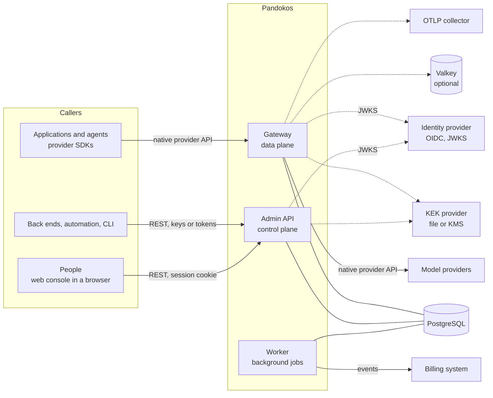
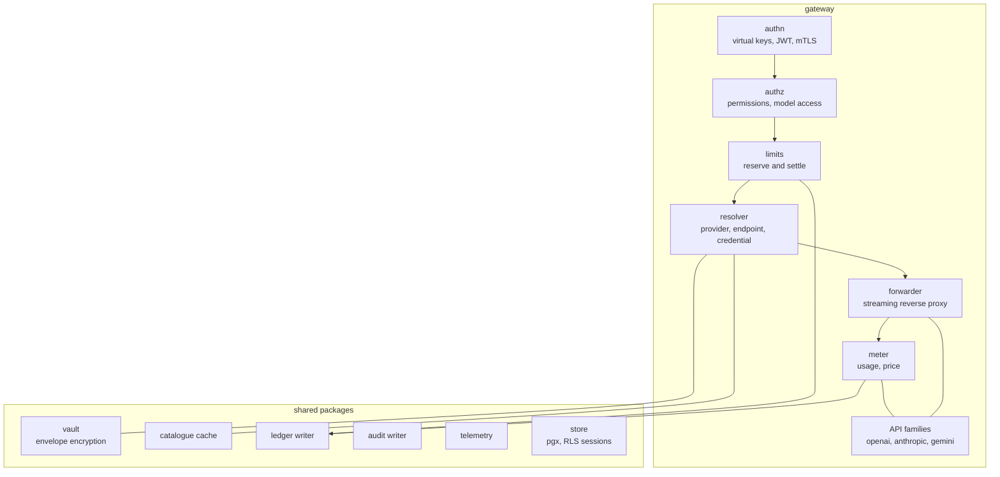
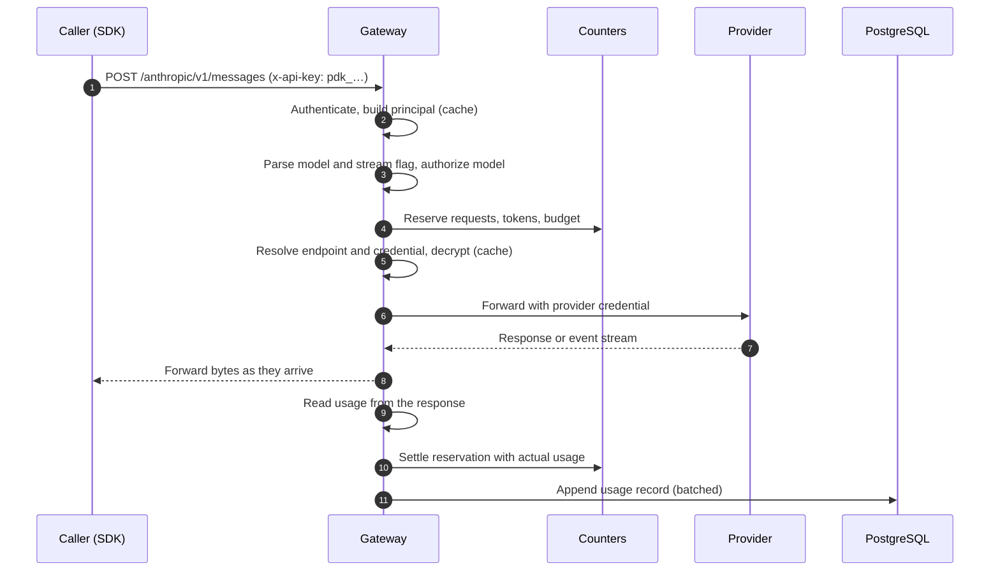
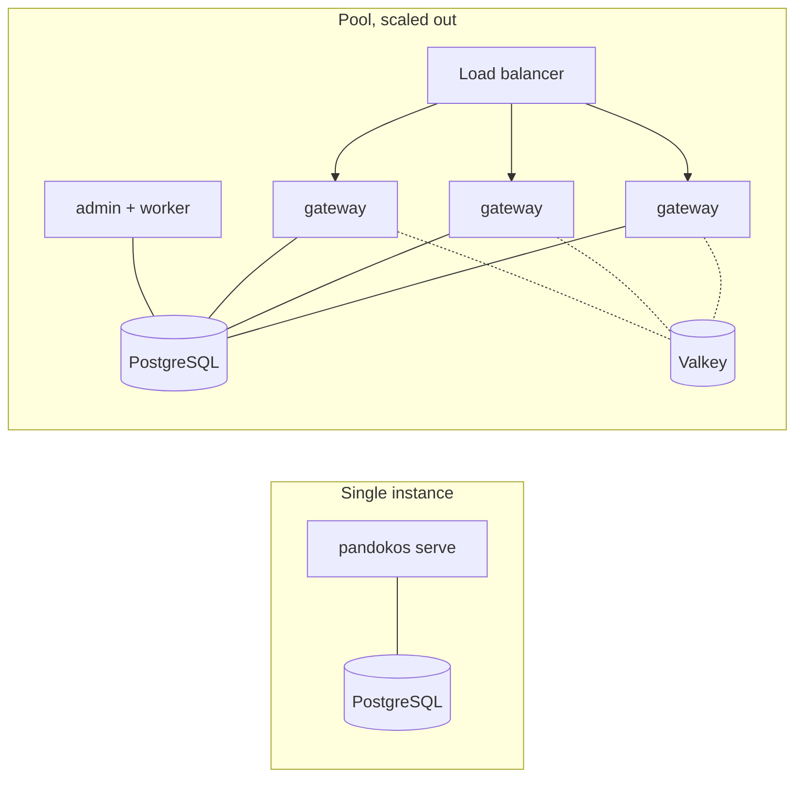
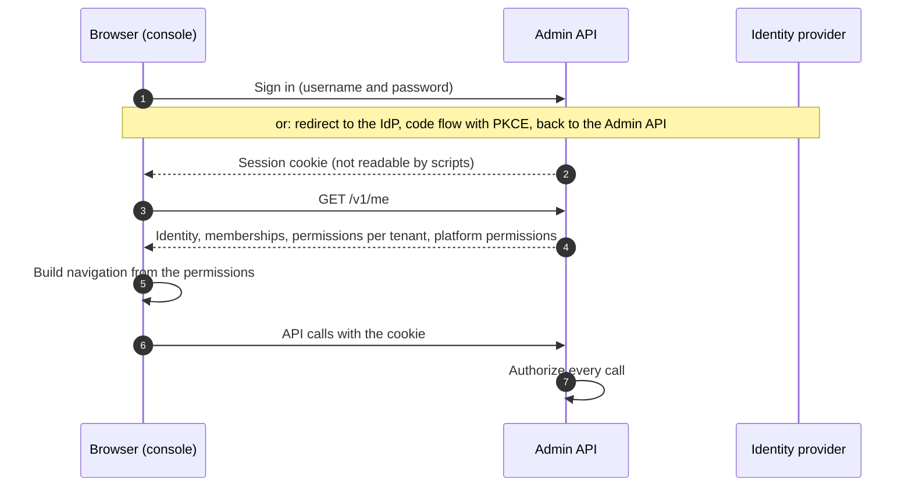

# Architecture overview

- Status: high-level design, 2026-11-11
- Scope: the whole product up to 1.0, with more detail for the first release
- Companions: [data model](data-model.md), [security model](security-model.md),
  [requirements](../requirements/README.md), [decision records](../adr/)

This document describes the shape of the system and the reasons behind it. Each choice that had a
real alternative is recorded in an ADR, linked where it is discussed.

## 1. What drives the design

Four properties of the problem decide most of the architecture.

**The workload waits; it does not compute.** A model response takes seconds, during which the
proxy copies bytes. The work Pandokos adds to a request (verify a credential, pick a key, check a
counter, parse usage) takes microseconds to a few milliseconds. The data plane therefore has to
hold many long-lived streaming connections cheaply, and must not touch the database on the hot
path once its caches are warm.

**The component holds every tenant's provider keys.** That makes the size of the trusted code
base and of its dependency tree a first-order concern, more than raw speed.

**Isolation must survive a bug.** One forgotten filter in one query must not leak data. The
database has to enforce the tenant boundary on its own.

**A single container must be a complete product.** Anything beyond PostgreSQL is optional and
appears only when the deployment needs it.

## 2. System context



## 3. One binary, three roles

Pandokos is a single Go program ([ADR 0002](../adr/0002-implementation-language-go.md)) that can
run any combination of three roles ([ADR 0003](../adr/0003-single-binary-with-roles.md)):

| Role | Plane | Does | Listens |
|---|---|---|---|
| `gateway` | data | Authenticates callers, authorizes, enforces limits, injects the provider credential, forwards, extracts usage | inference port |
| `admin` | control | Administration API for tenants, identities, roles, catalogue, credentials, limits, reports. Serves the web console and handles sign-in and sessions | admin port |
| `worker` | background | Billing delivery, retention, tenant deletion, price refresh, key re-wrapping, counter reconciliation | none |

Two more commands exist: `migrate` (schema changes, with owner credentials) and `init` (first
platform admin credential).

`pandokos serve` runs all three roles in one process: this is the single-container installation.
`pandokos serve --role gateway` and so on run them apart when a deployment wants to scale the
data plane on its own, keep the admin API off the public network, or give each role its own
database credentials. The roles share code but not privileges: each uses its own database role
(see the [data model](data-model.md#database-roles)), so the gateway cannot change the catalogue
and the admin API cannot append usage.

The two planes never share a listener. The inference port is meant for callers; the admin port is
meant for a private network.

## 4. Components



- **authn** turns a credential into a *principal*: tenant, identity, roles, scopes, constraints.
  Three mechanisms produce the same principal: virtual keys, tokens from trusted issuers, and
  (later) client certificates ([ADR 0005](../adr/0005-data-plane-authentication.md)).
- **authz** evaluates `resource:action` permissions in process
  ([ADR 0007](../adr/0007-authorization-rbac.md)).
- **limits** reserves capacity before forwarding and settles after
  ([ADR 0012](../adr/0012-limits-and-budget-reservation.md)).
- **resolver** maps the request to a provider endpoint and a credential, both taken from the
  catalogue, never from the request.
- **forwarder** is a streaming reverse proxy with a fixed set of destinations.
- **API families** hold everything that is specific to a wire protocol: which paths are
  supported, where the model name is, how the credential is sent, how usage is read from a
  response or a stream, and what an error looks like
  ([ADR 0009](../adr/0009-native-passthrough-by-api-family.md),
  [ADR 0010](../adr/0010-usage-extraction.md)).
- **vault** encrypts and decrypts provider credentials
  ([ADR 0008](../adr/0008-vault-envelope-encryption.md)).
- **ledger** and **audit** append records ([ADR 0013](../adr/0013-ledger-and-audit.md)).

## 5. The life of a request



1. **Route.** The first path segment names a provider in the catalogue: `/openai/v1/…`,
   `/anthropic/v1/…`, `/my-vllm/v1/…`. An SDK is configured with that prefix as its base URL.
   The rest of the path must be on the allow-list of the provider's API family.
2. **Authenticate.** The credential is read from the header the API family uses natively
   (`Authorization: Bearer` for OpenAI, `x-api-key` for Anthropic), so stock SDKs work unchanged.
   A value with the `pdk_` prefix is a virtual key; anything else is treated as a JWT. The lookup
   result is cached in memory for a short time.
3. **Authorize.** The body is read up to a size limit and only the fields Pandokos needs are
   parsed: model, stream flag, output-token limit. The model must be available to the tenant and
   allowed by the key.
4. **Reserve.** An estimate of the request's cost is reserved against every applicable limit. If
   any limit would be exceeded the request ends here with a 429 in the API family's error shape.
5. **Resolve.** Funding mode, endpoint and credential come from the catalogue. The credential is
   decrypted, or taken from a short-lived in-memory cache.
6. **Forward.** Inbound credentials are stripped, the provider credential is injected, the
   request goes to the catalogue host and nowhere else. The response is copied to the caller as
   it arrives; a tee feeds the usage reader without delaying the stream.
7. **Settle.** Usage read from the response replaces the estimate. A usage record is queued for
   the ledger; for platform-funded calls the billable event is written in the same transaction.
8. **Trace.** One span covers the provider call and is a child of the caller's trace.

A client that disconnects cancels the upstream request; the reservation is settled with whatever
usage was observed.

**Latency budget.** With warm caches, steps 2 to 5 involve no network round trip in a
single-instance installation and one round trip to Valkey in a multi-instance one. The ledger
write happens after the response has been delivered.

## 6. Data stores

| Store | Required | Holds | Notes |
|---|---|---|---|
| PostgreSQL 16+ | always | Everything durable: tenants, identities, roles, catalogue, encrypted credentials, limits, usage ledger, audit log, outbox | System of record. Row-level security on every tenant table ([ADR 0004](../adr/0004-postgresql-and-rls.md)) |
| Valkey (Redis protocol) | with more than one gateway instance | Rate-limit windows, budget reservations | Never the source of truth: counters are rebuilt from the ledger ([ADR 0012](../adr/0012-limits-and-budget-reservation.md)) |
| KEK provider | always | The key-encryption key | A local key file by default; KMS or transit service optionally |
| Process memory | — | Caches of principals, catalogue, data keys, decrypted credentials | Bounded lifetime; see below |

There is no message broker. Events for external systems leave through a transactional outbox in
PostgreSQL ([ADR 0014](../adr/0014-billing-outbox.md)).

## 7. Caches and revocation

The hot path reads from memory. What bounds the staleness of each cache is what bounds the time a
revocation takes, so these numbers are part of the product's contract (IAM-05, VLT-08, TEN-10).

| Cache | Default lifetime | Invalidation |
|---|---|---|
| Principal for a virtual key (gateway only; lifetime `cache.principal_ttl`; the admin API does not cache) | 30 s (5 s for unknown keys) | PostgreSQL `NOTIFY` on change, lifetime as upper bound |
| JWKS of a trusted issuer | as the issuer's cache headers say, at most 1 h | Refetch on unknown key ID, rate limited |
| Catalogue (providers, endpoints, models, prices) and each tenant's model access | 30 s (`cache.catalog_ttl`, at most 5 m) | `NOTIFY` (`catalog`, `catalog:<tenant>`) |
| Unwrapped tenant data key | 5 min | `NOTIFY` on tenant deletion or key rotation |
| Decrypted provider credential | 60 s | `NOTIFY` on credential change |
| Console session | 30 s | `NOTIFY` on sign-out, password change or disabling of the user |

**Documented bound: a revocation takes effect within 60 seconds on every instance**, and in
practice within a second when notifications are flowing. The bound is tested.

## 8. Deployment topologies



| Topology | Compose | Kubernetes | Adds |
|---|---|---|---|
| Single instance | yes | yes | nothing |
| Pool with replicas | yes | yes | Valkey, a load balancer |
| Silo cell for one tenant | yes, static | yes | a second installation pinned to the tenant |
| Bridge (pool and silo cells) | yes, static | yes | routing by host name at the edge |

A **cell** is a complete installation: gateway instances, database, key-encryption key
([ADR 0016](../adr/0016-cells-pool-silo-bridge.md)). A silo cell is configured with the one tenant
it may serve and refuses everything else. In a bridge platform an edge proxy sends each tenant's
host name to its cell. Pandokos does not create or scale cells; the operator's tooling does.

## 9. Failure behaviour

The rule: when Pandokos cannot verify that a request is allowed, it does not forward it.

| Dependency down | Inference | Administration |
|---|---|---|
| PostgreSQL | Continues from caches until they expire, then refuses. Usage records wait in a bounded memory buffer; when it fills, the instance reports not ready and refuses new requests | Unavailable |
| Valkey | Refuses by default. Configurable to continue with per-instance counters | Unaffected |
| KEK provider | Continues while data keys are cached, then refuses | Credential writes fail |
| Identity provider | Tokens verify while the JWKS is cached. Virtual keys unaffected | Sign-in through the IdP is unavailable. Open sessions, local accounts and keys are unaffected |
| OTLP collector | Unaffected; telemetry is dropped | Unaffected |
| Billing destination | Unaffected; events wait in the outbox | Unaffected |
| Provider | The provider's error is returned unchanged | Credential validation fails |

## 10. Technology choices

| Concern | Choice | Decision |
|---|---|---|
| Language | Go, current stable release | [0002](../adr/0002-implementation-language-go.md) |
| HTTP server and proxy | Standard library `net/http` and `httputil.ReverseProxy` | [0002](../adr/0002-implementation-language-go.md), [0018](../adr/0018-supply-chain.md) |
| Database | PostgreSQL 16+, `pgx` driver, SQL in files compiled with `sqlc`, migrations embedded in the binary | [0004](../adr/0004-postgresql-and-rls.md) |
| Counters | In process for one instance; Valkey for several | [0012](../adr/0012-limits-and-budget-reservation.md) |
| Cryptography | Go standard library: AES-256-GCM, HKDF, SHA-256 | [0008](../adr/0008-vault-envelope-encryption.md) |
| Tokens | OIDC discovery and JWKS with a small, widely used library | [0005](../adr/0005-data-plane-authentication.md), [0006](../adr/0006-human-authentication-external-oidc.md) |
| People sign-in | External OIDC or local accounts (Argon2id), server-side sessions | [0006](../adr/0006-human-authentication-external-oidc.md), [0022](../adr/0022-local-accounts-and-sessions.md) |
| Console | React and TypeScript single-page application, built to static files embedded in the binary; client generated from the OpenAPI document | [0021](../adr/0021-web-console.md) |
| Admin API | OpenAPI 3.1 written first; server interfaces, validation and client generated by an in-repository generator (`internal/apigen`) | [0017](../adr/0017-admin-api-spec-first.md) |
| Telemetry | OpenTelemetry Go SDK, OTLP, `log/slog` | [0015](../adr/0015-observability.md) |
| Prices | Open price dataset, imported and versioned, with overrides | [0011](../adr/0011-pricing-source.md) |
| Events | Transactional outbox, CloudEvents over signed webhooks | [0014](../adr/0014-billing-outbox.md) |
| Packaging | Static binary in a distroless non-root image; signed, with SBOM and provenance | [0018](../adr/0018-supply-chain.md) |
| Configuration | One YAML file plus environment variables; dynamic state in the database | [0019](../adr/0019-configuration.md) |
| Errors | The called API family's own error shape; RFC 9457 on the admin API | [0020](../adr/0020-error-contract.md) |

## 11. Repository layout

```
cmd/pandokos/            entry point and subcommands
internal/
  buildinfo/             version and commit set at link time
  secret/                a string type that cannot be printed, secret files
  health/                liveness and readiness
  server/                listeners, wiring, graceful shutdown
  gateway/               request pipeline of the data plane
  family/                one package per API family: openai, anthropic, gemini
  authn/  authz/         key format and authenticator with the principal cache; permission catalogue, roles, decision
  adminapi/  apigen/     generated administration API (types, router, client) and its generator
  cli/  requestid/       API commands of the CLI; request ID shared by both listeners
  tenant/  identity/     tenants, users, service accounts, keys, roles
  catalog/               providers, endpoints, models, access rule, gateway cache, price importer, remote fetch
  pricing/               exact decimals, price versions, cost of a usage; pricing/genaiprices reads the price dataset (embedded snapshot)
  vault/                 envelope encryption, key providers, sealer, opener, validator
  limits/                counters: memory and Valkey
  ledger/  audit/        append-only writers and readers
  outbox/  billing/      event relay and destinations
  admin/                 administration API handlers (change and audit in one transaction)
  worker/                background jobs
  store/                 database access: pools per role, tenant transactions, migrator, embedded migrations
  telemetry/  config/
api/openapi/             administration API specification (admin.v1.yaml)
sqlc.yaml                configuration of the SQL generator; queries in internal/store/queries/sql
web/console/             console source; its build output is embedded in the binary
deploy/compose/  deploy/helm/  deploy/postgres/   (postgres: the SQL that creates the privilege roles)
docs/                    requirements, architecture, ADRs
planning/                roadmap, epics, sprints
test/                    isolation suite, SDK compatibility suite, fixtures
  fakeprovider/  e2e/    fake upstream used by every level; tests of the built binary
  db/  dbtest/           PostgreSQL and PgBouncer for tests; one database per test
  isolation/             schema lint and SQL-level isolation tests
  repo/  container/      repository conformance tests; tests against a built image
  sdk/                   nested Go module: official provider SDK suites
docs/operations/         configuration reference, running and verifying the container image
```

Everything under `internal/` is private: the only public contracts are the HTTP APIs, the
configuration file and the event format.

## 12. Web console

The console is how people administer Pandokos ([ADR 0021](../adr/0021-web-console.md)). It is a
single-page application whose built files are embedded in the binary and served by the `admin`
role on the administration listener, so the single container stays single.



**Two areas.** The *platform area* is for platform roles: tenants, catalogue and prices, users and
platform roles, platform limits and audit. The *tenant area* is for tenant roles: members and
roles, service accounts and keys, provider credentials, model access, limits, usage, audit. A
user sees the areas their roles give them; someone who belongs to several tenants switches
between them.

**Sign-in.** People are the only ones who sign in. They use a local account or an external
identity provider ([ADR 0006](../adr/0006-human-authentication-external-oidc.md),
[ADR 0022](../adr/0022-local-accounts-and-sessions.md)); either way the result is the same
server-side session, carried by a cookie. A session is accepted only by the administration API.
The gateway does not know what a session is, so signing in to the console can never be used to
call a model. Service accounts and virtual keys cannot sign in.

**Profiling.** After sign-in the console asks the API who the user is and which permissions they
hold (`GET /v1/me`). Every route, page and button of the console declares the permission it
needs, the same `resource:action` string that the corresponding API operation requires, and is
shown only if the user holds it. This is a convenience, not the control: the API authorizes each
call on its own, so a modified console gains nothing.

**No privileges of its own.** The console calls only the documented administration API. It holds
no key, and there is no endpoint reserved for it.

## 13. Open questions

These do not block the first release and are tracked for the sprint that needs the answer.

1. **Sealing credentials on write.** Encrypting to a per-tenant public key would let the admin
   role write secrets it cannot decrypt, so only the gateway could ever read them. It is a
   hardening worth considering once the symmetric design is in place.
2. **Durable intent for platform-funded calls.** Writing a pending ledger row before forwarding
   would close the window in which a crash loses a billable record, at the cost of one database
   round trip per call. To be decided with the billing epic.
3. **Batch and file endpoints.** Asynchronous provider APIs report usage out of band and need
   their own metering design.
