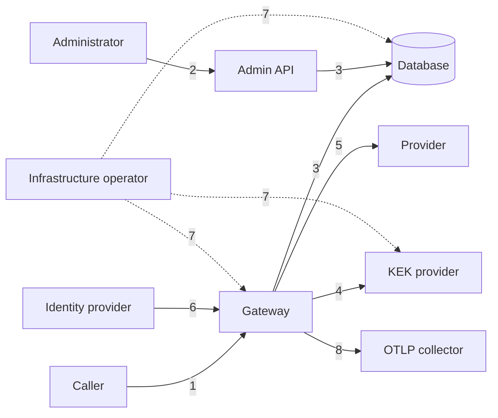
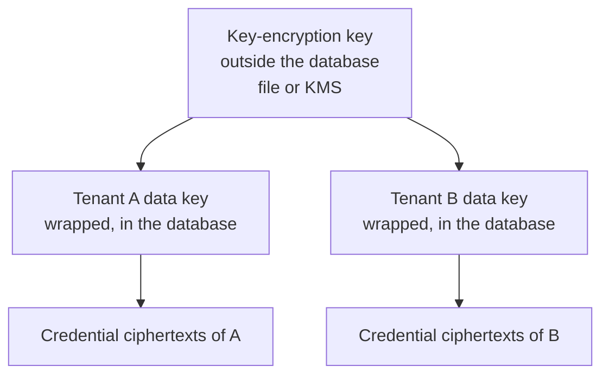

# Security model

- Status: initial threat model, 2026-11-11. It is reviewed at every release and independently
  before 1.0 (SEC-05, SEC-09).
- Decisions: [ADR 0005](../adr/0005-data-plane-authentication.md),
  [ADR 0008](../adr/0008-vault-envelope-encryption.md),
  [ADR 0018](../adr/0018-supply-chain.md)

## What is protected

| Asset | Why it matters |
|---|---|
| Provider credentials of tenants | They are spendable money and access to the tenant's provider account. They cannot be recreated by the platform |
| Provider credentials of the platform | The operator's money |
| Tenant separation | One tenant must not see or affect another's configuration, usage or spend |
| Usage ledger and audit log | They are the evidence for billing and for investigations |
| Content in transit | Prompts and completions pass through memory and must leave no trace |
| Availability and spend | A caller must not exhaust the service or a budget that is not theirs |

## Trust boundaries

1. **Caller to gateway.** Untrusted. Everything the caller sends is input: path, headers, body,
   metadata, trace context. Only a verified credential establishes identity and tenant.
2. **Administrator to admin API.** People hold a console session, obtained through the identity
   provider or a local account. Automation uses admin keys or tokens. Every operation is
   authorized. The console runs in the user's browser and is untrusted: what it hides is not a
   control. The admin port is not meant for the public internet.
3. **Process to database.** Each role connects with its own least-privileged database role. The
   database enforces tenant isolation independently of the application.
4. **Process to KEK provider.** Whoever holds the key-encryption key and the database can decrypt
   every credential. The two are stored and backed up apart.
5. **Gateway to provider.** Outbound only, to hosts in the catalogue, with certificate
   verification.
6. **Identity provider.** Trusted to assert identities, and, for platform-level issuers, tenants.
   A compromised identity provider can impersonate what it is trusted to assert, which is why
   issuers are scoped (IAM-07).
7. **Infrastructure operator.** See the next section.
8. **Gateway to trace collector.** Outbound only, to the one URL the operator configured, through
   the same guard as provider calls (certificates verified, no proxy, no redirect, forbidden
   addresses refused). It receives spans made of identifiers and measurements, never content,
   a header value or caller metadata ([telemetry guide](../operations/telemetry.md),
   [ADR 0040](../adr/0040-traces.md)); what each destination receives is listed in
   [data flows](../reference/data-flows.md).

## What Pandokos does not protect against

A person or process that controls the host, the container runtime, the database, the backups and
the key-encryption key can read tenant credentials: by decrypting them, or by reading the memory
of a running gateway. The rule that platform administrators cannot read tenant secrets is an
application and database control. It removes the capability from the product's interfaces and
makes misuse visible; it is not cryptographic separation from the organization that runs the
installation.

A tenant that needs separation from the operator's infrastructure needs its own cell, with its
own key-encryption key held where it decides.

Pandokos reduces this exposure by keeping plaintext in memory for a bounded time, by not storing
the key-encryption key with the data, by supporting an external KMS so the key never reaches a
disk the operator's database administrators can read, and by auditing every administrative act.

## Threats and controls

| Threat | Controls |
|---|---|
| A caller claims another tenant | The tenant derives only from the credential (TEN-02). Tenant headers and parameters are ignored |
| A bug omits a tenant filter | Forced row-level security under non-owner roles (TEN-04, TEN-05). The isolation suite (TEN-07) |
| A stolen virtual key | Keys are scoped, can expire, carry limits, are revocable within a bound, and have a detectable format so scanners find leaks (IAM-03 to 05) |
| A stolen bearer token | Short lifetimes, audience validation. Mutual TLS for stronger binding (IAM-15, IAM-16) |
| Password guessing against local accounts | Throttling per account and source, uniform responses, audit of failures (IAM-20). Memory-hard hashes (IAM-19). No default credentials (IAM-14). Local accounts can be switched off (IAM-18) |
| A stolen or forged console session | Random 256-bit tokens stored as hashes; cookie not readable by scripts, sent over TLS only and never cross-site; idle and absolute lifetimes; revocation (IAM-21) |
| Cross-site request forgery against the console | Same-site cookie, plus a required custom header and an origin check on every state-changing request (IAM-21) |
| Script injection in the console | A strict content security policy without inline script, no third-party resources, a framework that escapes output by default, no credential in browser storage (CON-07) |
| A console user reaches functions beyond their role | The API authorizes every call. The console's profiling is derived from the same permissions and is tested against them (AZ-11, CON-04) |
| A console session is used to call models | Sessions are accepted only on the administration listener; the gateway's database role cannot read them (IAM-22) |
| The database or a backup is copied | Credentials are ciphertext under per-tenant keys wrapped by a key that is not in the database (VLT-09, VLT-13). Virtual keys are stored as hashes |
| The key-encryption key leaks | Rotation by re-wrapping (VLT-10). The leak alone exposes nothing without the database |
| A ciphertext is copied onto another tenant's row | The tenant and credential IDs are bound into the ciphertext as associated data, so decryption fails (VLT-07) |
| An attacker with the database guesses a credential from its fingerprint or hint | The fingerprint is a keyed hash under a key derived from the tenant's data key, which needs the key-encryption key; fingerprints differ between tenants. The hint is four characters and absent for short secrets |
| A platform administrator abuses the role | No read path for secrets in API or database grants (AZ-08). Support actions inside a tenant need a reason and are audited in the tenant's log (AZ-09) |
| The proxy is used to reach internal services (SSRF) | Destinations come from the catalogue only: scheme, host, port and path of the outbound request are catalogue values. Redirects are not followed. The address actually dialled is classified in the dialer's control hook, after name resolution, for every connection attempt; forbidden addresses (unspecified, multicast, reserved, instance-metadata) are refused for every endpoint. Behind `upstream.proxy.url` the connection checked is the one to the proxy and target names are resolved by the proxy, which is then the control point (GW-05, GW-06, [ADR 0038](../adr/0038-egress-guard-upstream-tls-and-proxy.md)) |
| A private endpoint is used to reach internal services | An endpoint may use `http` or a private address only when an administrator declared it `private`; a public endpoint is refused any private address when it is dialled, whatever its name resolved to when it was written. Private endpoints never use the proxy and can never be on a metadata address |
| A body with two `model` members is used to pass the model check | Refused with `invalid_request`: exactly one top-level string member `model` is accepted, so the model that is authorized is the one the provider sees ([ADR 0037](../adr/0037-request-pipeline-and-resolution.md)) |
| A poisoned or hijacked price dataset (R-3) | The dataset is data, never code: it is parsed with a size limit, its regular expressions run in RE2, and it can only price models the catalogue already holds, never create one or name a destination. The embedded snapshot is pinned to a commit with its checksum. The download is off by default, goes only to an operator-configured `https` URL (no proxy, no redirects, bounded in size and time) and no request can set that URL. A changed price becomes a new immutable version with an audit record, and an operator override is never touched by an import. The worst a bad dataset does is wrong cost estimates, which the operator can see in the import report and correct with an override |
| The provider credential is sent elsewhere | It is attached only to requests for the registered host (GW-05) |
| Request smuggling, header injection | Strict parsing by the Go HTTP stack, a header allow-list, removal of hop-by-hop headers (GW-07) |
| Secrets or content end up in logs or traces | No code path logs bodies or credential headers. Canary tests search every output (VLT-14, OBS-04) |
| A tenant overspends through concurrency | Reservation before forwarding, settlement after (LIM-07) |
| Usage is evaded through unmetered endpoints | Only endpoints Pandokos can meter are exposed (GW-09) |
| Resource exhaustion | Limits on body size, duration and concurrency (GW-16). Bounded buffers everywhere |
| The audit log is altered | No update or delete grants. Hash chain (AUD-04) |
| A dependency or the build is compromised | A small dependency set, pinned and scanned. Signed artefacts with provenance and SBOM (SEC-06) |
| A caller forges trace or metadata to mislead | Metadata headers and trace context are read only after authentication, so an anonymous caller causes no span and no stored value. Both are recorded as declared by the caller, within bounds (eight short ASCII entries; a sampled flag only makes the caller's own requests sampled), and never used in a decision or forwarded (GW-13, OBS-02, [ADR 0039](../adr/0039-usage-record-admission-and-ledger-writer.md)) |
| The gateway is used to rewrite or read the usage ledger | The gateway role holds `INSERT` on the listed columns of `usage_record` and nothing else: it cannot read, change or delete a row, even one it wrote; triggers stop the owner too. Rows of every tenant are written in that tenant's session under forced row-level security |
| A provider smuggles text into the ledger through its usage object | Only non-negative integer members, at most 32, are kept, under keys of a fixed alphabet; every text column of a record is format-checked by the database |
| The trace collector is used as a way out | The exporter uses the egress guard: one operator-configured URL, certificates verified, no proxy, no redirect, forbidden and metadata addresses refused |

## Replay exposure

A virtual key is a bearer credential (SEC-02): whoever holds it can use it. It is protected in transit
by TLS on the listener or in front of it. A captured key can be replayed until it expires or is
revoked, within the bound of the principal cache ([ADR 0030](../adr/0030-keys-format-storage-lookup.md)).
There is no nonce and no request signature. Scopes, the tenant's model list and limits bound what a
replay can do. Sender-constrained mechanisms, which would make a captured key useless to anyone else,
are IAM-15 and IAM-16 and are not built yet.

## Key hierarchy

- The data key is a 32-byte root and is never used directly: HKDF-SHA-256 derives from it an
  encryption key (AES-256-GCM) and a separate fingerprint key. A credential is sealed with a random
  nonce and with associated data that name the tenant, the credential and the data key version.
- A credential shows a fingerprint (the first 16 bytes of an HMAC under the fingerprint key) and a
  hint (the last four characters, withheld for secrets shorter than 16 characters). The fingerprint
  is keyed per tenant: it identifies a secret within a tenant, and the fingerprints of one secret
  in two tenants cannot be compared. Formats and numbers: [ADR 0033](../adr/0033-vault-formats-and-key-identifiers.md).
- One data key per tenant limits the effect of a leaked data key to one tenant and makes
  cryptographic erasure a single deletion.
- Rotating the key-encryption key re-wraps the data keys; credentials are not touched.
- Losing the key-encryption key makes every tenant credential unrecoverable. Tenants must then
  re-enter them. This is stated in the operations guide and is the reason the key has its own
  backup procedure.
- Backups and erasure: a database backup also holds the wrapped data key. Destroying a data key
  therefore makes older backups unreadable only once the key-encryption key version that wrapped it
  is retired, or when the backups have expired (open point O-8; the remedy is designed with tenant
  deletion). The [vault guide](../operations/vault.md) states the limit.

## Credentials issued by Pandokos

A virtual key looks like `pdk_<key id>_<secret><checksum>`. The key ID is public and is how the
key is found and named in logs. The secret has 256 bits of entropy, which is why a plain SHA-256
hash is sufficient storage: there is nothing to brute-force. The checksum lets scanners and the
gateway reject malformed strings without a lookup. The layout is 81 characters: `pdk_`, a key ID of
17 characters (kind letter `t` or `p`, 16 characters), `_`, a 52-character secret and a 7-character
CRC-32 checksum, in lower-case base32; the pattern is in [keys](../operations/keys.md). Only the
SHA-256 of the secret is stored, and only a key ID can be looked up without a tenant: the lookup
function returns the tenant of a key ID and nothing else.

A local account's password is chosen by a person and is therefore guessable: it is stored with
Argon2id, a deliberately slow, memory-hard hash, with a per-account salt. This is the opposite
trade-off from virtual keys, and the reason the two are never verified by the same code path.
