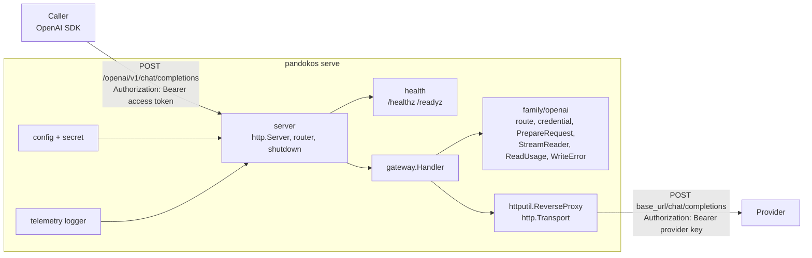

# Sprint 1.1 — Walking skeleton

- Epic: [1 — Foundations](../epic.md)
- Implementation plan: [plan.md](plan.md)
- Decisions implemented: ADR [0002](../../../../docs/adr/0002-implementation-language-go.md),
  [0003](../../../../docs/adr/0003-single-binary-with-roles.md) (listener separation only),
  [0009](../../../../docs/adr/0009-native-passthrough-by-api-family.md),
  [0010](../../../../docs/adr/0010-usage-extraction.md),
  [0015](../../../../docs/adr/0015-observability.md) (logs only),
  [0018](../../../../docs/adr/0018-supply-chain.md),
  [0019](../../../../docs/adr/0019-configuration.md) (static part),
  [0020](../../../../docs/adr/0020-error-contract.md) (inference side, six codes)
- New decision records written by this sprint: 0023, 0024, 0025 (content in [plan.md](plan.md), part E)

This document is the frozen design. The implementer follows [plan.md](plan.md); a gap in either
document is raised as a question, not filled silently
([planning/README.md](../../../README.md)).

## 1. Outcome

A signed container forwards a streaming OpenAI chat completions call with a provider key read
from a file and logs the usage it read. CI, scans and the release pipeline exist.

The sprint is a deliberate test of three assumptions (see the [roadmap](../../../roadmap.md)):
that `net/http/httputil.ReverseProxy` handles provider streams, that cancellation propagates from
caller to provider, and that usage can be read from a stream without delaying it. Section 12
states what a prototype already showed and what the sprint's tests must confirm.

**Exit criteria** (from the epic):

1. the test with the official OpenAI SDK passes with streaming;
2. cancelling the client closes the upstream request;
3. a tagged build yields a verifiable signed image.

## 2. Scope

### In scope

1. Go module `github.com/pandokos/pandokos`, repository layout, lint configuration, Makefile.
2. `pandokos serve`, `pandokos config check`, `pandokos version`, `pandokos help`.
3. Static configuration: defaults, one YAML file, environment variables, secrets as file paths,
   validation of the whole configuration, warnings.
4. One listener (inference). On it: `GET /healthz`, `GET /readyz`, and exactly one proxied
   route, `POST /openai/v1/chat/completions`.
5. Forwarding with `httputil.ReverseProxy`: streaming, cancellation on client disconnect,
   configurable timeouts, request and response header allow-lists, provider key injection.
6. A usage reader for the OpenAI chat completions protocol, streaming and non-streaming,
   including the request option that makes the provider report usage in a stream and the removal
   of the resulting usage-only event (ADR 0010). Usage is written to the log.
7. Errors raised by Pandokos in the OpenAI error shape with `x-pandokos-error` and
   `x-pandokos-request-id` (ADR 0020), for the six codes the skeleton can raise.
8. Structured JSON logs on standard output with a redacting handler.
9. Graceful shutdown: readiness goes down, in-flight requests drain up to a deadline.
10. Container image (distroless, static, non-root, amd64 and arm64), image scan, SBOM, CI
    workflow, release workflow that signs the image and attaches SBOM and provenance.
11. Tests: unit, in-process integration against a fake upstream, binary end-to-end with canaries,
    official OpenAI Go SDK suite, container test, repository conformance tests.
12. Documentation: configuration reference, container and verification guide, three ADRs,
    vulnerability response process in `SECURITY.md`.

### Not in scope

| Not in this sprint | Where it lands |
|---|---|
| PostgreSQL, migrations, tenants, row-level security | 1.2 |
| Admin listener, admin API, OpenAPI, CLI client, `init`, audit | 1.3 |
| Virtual keys, principals, permissions, JWT issuers | 1.3, 4.1 |
| Vault, catalogue, provider endpoints from the database, model checks | 2.1, 2.2, 3.1 |
| Egress guard (private address check on the dialled address, GW-06), full header policy (GW-07), request metadata (GW-13), W3C Trace Context (GW-12, OBS-02) | 3.1, 3.2 |
| Usage estimation when the provider reports nothing, cost, ledger, storing original provider values | 3.2 |
| OpenTelemetry SDK, traces, metrics, Prometheus endpoint | 3.2, 6.1 |
| Any other OpenAI endpoint (responses, embeddings), Anthropic, unified `/v1` endpoint | 3.1, 3.3, 9.1 |
| TLS on the listener (SEC-01), mutual TLS | not assigned in epic 1; see open point O-3 |
| Compose reference | 3.3 |
| Release of binaries as archives (ADR 0018 mentions "images and binaries") | see open point O-4 |
| `--role`, roles other than the gateway slice | 1.3 |

Nothing in the list above is stubbed, scaffolded or given an empty package in this sprint.

## 3. Requirements claimed

Wording quoted from [docs/requirements](../../../../docs/requirements/README.md).

| ID | Requirement (quoted) | What this sprint delivers | Claim |
|---|---|---|---|
| SEC-06 | "The build produces a minimal, non-root image, with pinned dependencies, vulnerability scanning, an SBOM, and signed artefacts with verifiable provenance" | Distroless static image running as UID 65532; `go.sum`, base images pinned by digest, Actions pinned by commit; `govulncheck` and image scan gate every pull request; SPDX SBOM; on a tag the image is signed with cosign keyless and carries SBOM and SLSA provenance attestations; the release workflow verifies all of it before it succeeds | full |
| SEC-07 | "A vulnerability disclosure policy and a response process exist" | `SECURITY.md` already holds the disclosure policy; this sprint adds the response process (acknowledgement and triage targets, fix and release path, advisory) and the maintainer enables private vulnerability reporting on the repository | full |
| OPS-01 | "Pandokos ships as one multi-architecture container image that runs without an orchestrator. PostgreSQL is the only mandatory dependency" | One image for linux/amd64 and linux/arm64, started with `docker run`. The skeleton has no dependency at all; the statement about PostgreSQL becomes testable in 1.2 and is re-checked there | full for the image; the PostgreSQL clause is re-verified in 1.2 |
| OPS-08 | "Static settings come from a file and environment variables; secrets are referenced as files. Dynamic settings live in the database and are managed through the API" | The static part: file, environment, precedence, secret files, whole-configuration validation, `config check` | static part only |
| OBS-08 | "Liveness and readiness endpoints reflect the state of critical dependencies" | `/healthz` and `/readyz`; readiness is the conjunction of "listeners bound", "not draining" and every registered dependency check. The skeleton registers no dependency (it has none: a provider is not a readiness dependency, see D-12); the check mechanism is tested with a failing check and is what 1.2 plugs the database into | full |
| GW-03 | "Streaming responses are forwarded event by event, without buffering the whole response" | Proven for OpenAI chat completions by a test in which the upstream withholds the second event until the caller has received the first | first evidence |
| GW-04 | "When the caller disconnects the upstream request is cancelled. Timeouts are configurable. Nothing stays reserved or locked afterwards" | Disconnect cancels the upstream request over HTTP/1.1 and HTTP/2, before and after response headers; connect, body-read, total-duration, header-read, idle and drain timeouts are configuration keys. "Nothing stays reserved" has no object yet (no limiter): goroutine and connection release is tested instead | first evidence |

Requirements this sprint touches but **does not claim**, so that later sprints do not assume them
done: GW-05 (the destination is fixed by configuration and redirects are not followed, but there
is no catalogue), GW-07, GW-08, GW-09, GW-10, GW-12, GW-14, GW-16, OPS-12, VLT-14, OBS-01, OBS-04,
SEC-03, SEC-04. The canary test of this sprint is the first instance of the VLT-14 and OBS-04
method.

## 4. Repository layout

Only what 1.1 needs is created. The names follow
[architecture §11](../../../../docs/architecture/overview.md#11-repository-layout); additions
to that list are marked *new* and justified in section 11.

```
.github/
  dependabot.yml
  workflows/ci.yml  release.yml
cmd/pandokos/                 package main: entry point and subcommands
internal/
  buildinfo/                  version and commit set at link time                    (new)
  secret/                     a string type that cannot be printed, secret files     (new)
  config/                     static configuration: schema, load, validate
  telemetry/                  the logger and its redaction (OpenTelemetry comes later)
  health/                     liveness and readiness                                 (new)
  family/                     types shared by API families: Usage, error codes
  family/openai/              OpenAI family: route, credential, request option, usage readers, error shape
  gateway/                    the inference handler: routing, authentication stub, proxy, request log
  server/                     listeners, wiring, graceful shutdown                   (new)
test/
  fixtures/                   recorded-shaped provider responses, canary constants (Go package with embed)
  fakeprovider/               the fake OpenAI upstream used by every test level
  e2e/                        tests that build and run the real binary
  repo/                       repository conformance tests (pins, Dockerfile, policy, docs)
  container/                  tests against a built image (build tag `container`)
  sdk/                        nested Go module: official OpenAI SDK suite
docs/operations/              configuration.md, container.md                         (new)
docs/adr/                     0023, 0024, 0025
Dockerfile  .dockerignore  Makefile  .golangci.yml  .go-version  go.mod  go.sum
```

Import rules, enforced by `depguard` in `.golangci.yml` and by test T-R2:

- the product module imports only the standard library, its own packages and
  `go.yaml.in/yaml/v3`;
- `internal/family/...` does not import `internal/gateway`, `internal/server` or
  `internal/config`;
- `internal/gateway` does not import `internal/server` or `internal/config` (it receives plain
  values through `gateway.Options`);
- nothing under `cmd/` or `internal/` imports anything under `test/`.

## 5. Architecture of the slice



### 5.1 Commands

`cmd/pandokos` is package `main`. All logic is in
`func run(ctx context.Context, args []string, stdout, stderr io.Writer, environ []string) int`
so that it is testable; `main` only calls it with `os.Args[1:]`, `os.Stdout`, `os.Stderr`,
`os.Environ()` and passes the result to `os.Exit`. Argument parsing uses the standard `flag`
package (ADR 0018: the CLI is written by hand).

| Command | Behaviour | Exit code |
|---|---|---|
| `pandokos serve [--config FILE]` | Loads and validates the configuration, starts the listener, serves until SIGINT or SIGTERM, then shuts down (section 5.9) | 0 after a shutdown that was requested by signal, also when the drain deadline forced connections closed; 1 on configuration error, listen failure or serve failure |
| `pandokos config check [--config FILE]` | Same loading and validation as `serve`, including reading the secret files; opens no socket. Prints `configuration OK` to stdout and each warning as `warning: <key>: <message>` to stderr; on failure prints each problem as `error: <key>: <message>` to stderr | 0 valid, 1 invalid |
| `pandokos version` | Prints one line: `pandokos <version> (commit <commit>, <go version>, <os>/<arch>)` | 0 |
| `pandokos help`, `-h`, `--help`, no arguments | Prints usage to stdout | 0 (no arguments: usage to stderr, exit 2) |
| anything else, unknown flag | Prints `pandokos: unknown command "<x>"` (or the flag error) and usage to stderr | 2 |

Configuration file path: `--config` if given, else environment variable `PANDOKOS_CONFIG`, else
no file (defaults and environment only). A path that is given but cannot be read is an error.

`serve` handles signals with `signal.NotifyContext(ctx, os.Interrupt, syscall.SIGTERM)`. As soon
as the context is done it calls the `stop` function, so a second signal terminates the process
with the Go default behaviour.

When `serve` fails before the configured logger exists, each configuration problem is logged
through a bootstrap JSON logger (level info, stdout) as
`{"level":"ERROR","msg":"configuration error","key":"<key>","problem":"<message>"}`.

### 5.2 `internal/buildinfo`

```go
// Set with -ldflags "-X github.com/pandokos/pandokos/internal/buildinfo.Version=... -X ...Commit=..."
var (
    Version = "dev"
    Commit  = "unknown"
)

// String returns "pandokos <Version> (commit <Commit>, <runtime.Version()>, <GOOS>/<GOARCH>)".
func String() string
```

No build date: it would make builds non-reproducible.

### 5.3 `internal/secret`

```go
// Secret holds a sensitive string. Every formatting, logging and marshalling path yields Redacted.
type Secret struct{ v string }

const Redacted = "[REDACTED]"

func New(v string) Secret
func (s Secret) Reveal() string             // the only way to obtain the value
func (s Secret) IsZero() bool
func (s Secret) Equal(candidate string) bool // constant time: compares SHA-256 digests with crypto/subtle
func (s Secret) String() string              // Redacted
func (s Secret) GoString() string            // Redacted
func (s Secret) Format(f fmt.State, verb rune) // writes Redacted for every verb
func (s Secret) LogValue() slog.Value        // slog.StringValue(Redacted)
func (s Secret) MarshalText() ([]byte, error) // Redacted
func (s Secret) MarshalJSON() ([]byte, error) // "\"[REDACTED]\""

// ReadFile reads a secret from a file. Leading and trailing ASCII white space is removed.
// Errors never contain file content.
func ReadFile(path string) (Secret, error)
```

`ReadFile` rules, each an error: path empty; file missing or unreadable (the error wraps the OS
error, which names the path, not the content); size over 8192 bytes (checked with `io.LimitReader`
of 8193 bytes); empty after trimming; any byte below 0x20 or equal to 0x7F after trimming (a
secret goes into a header value). The file is read once, at start; changing it needs a restart.

### 5.4 `internal/config`

#### Sources and precedence

1. Built-in defaults.
2. The YAML file, if a path was given. Decoded with `go.yaml.in/yaml/v3`, `KnownFields(true)`:
   an unknown key is an error. An empty file is valid. A second YAML document in the file is an
   error.
3. Environment variables. A variable whose value is the empty string is treated as unset.

Environment variables win over the file (ADR 0019).

Environment variable name of a key: `PANDOKOS_` followed by the key in upper case with every `.`
replaced by `_` (`listeners.inference.address` → `PANDOKOS_LISTENERS_INFERENCE_ADDRESS`). The
mapping is a table in code (`config.Keys()`), not reflection, and a test asserts that the names
are unique.

Unknown variables that start with `PANDOKOS_`: those starting with `PANDOKOS_SERVICE_` or
`PANDOKOS_PORT` are ignored silently (Kubernetes injects them for a Service named `pandokos`);
`PANDOKOS_CONFIG` is the file path; any other produces a warning with key `environment` and
message `unknown variable <NAME> ignored` (the value is never printed). No configuration key may
ever start with `service` or `port` at the top level; a test asserts it.

#### Keys

Durations are strings in Go syntax (`"30s"`, `"10m"`); a YAML number is rejected for a duration.
Sizes are integers in bytes.

| Key | Type | Default | Meaning |
|---|---|---|---|
| `log.level` | `debug`, `info`, `warn`, `error` | `info` | Minimum level written |
| `listeners.inference.address` | `host:port` | `0.0.0.0:8080` | Listen address of the inference API |
| `listeners.inference.read_header_timeout` | duration | `10s` | Time allowed to read request headers |
| `listeners.inference.idle_timeout` | duration | `120s` | Keep-alive idle time |
| `listeners.inference.max_header_bytes` | integer | `65536` | Maximum size of request headers |
| `limits.max_request_body_bytes` | integer | `10485760` | Larger bodies get 413 `request_too_large` |
| `limits.request_body_read_timeout` | duration | `30s` | Time allowed to read the request body |
| `limits.max_request_duration` | duration | `10m` | Total time for one proxied request, stream included, measured from the end of the body read |
| `upstream.connect_timeout` | duration | `10s` | TCP connect timeout, and separately TLS handshake timeout, towards the provider |
| `shutdown.drain_timeout` | duration | `30s` | Time in-flight requests get to finish after a termination signal |
| `skeleton.access_token_file` | path | none, required | File with the static token callers must present (D-2) |
| `skeleton.openai.base_url` | URL | `https://api.openai.com/v1` | Provider base URL, in the form SDKs use (ends with `/v1`) |
| `skeleton.openai.api_key_file` | path | none, required | File with the provider API key |

The `skeleton` section is temporary by name and by design: it is deleted in 1.3 (access token)
and 3.1 (provider endpoint and key), when principals and the catalogue replace it. There is no
key that holds a secret value; `skeleton.openai.api_key: ...` is an unknown key and fails.

#### Go types

```go
type Duration time.Duration        // UnmarshalYAML accepts only a string scalar parsed by time.ParseDuration

type Config struct {
    Log       Log       `yaml:"log"`
    Listeners Listeners `yaml:"listeners"`
    Limits    Limits    `yaml:"limits"`
    Upstream  Upstream  `yaml:"upstream"`
    Shutdown  Shutdown  `yaml:"shutdown"`
    Skeleton  Skeleton  `yaml:"skeleton"`
}
type Log struct {
    Level string `yaml:"level"`
}
type Listeners struct {
    Inference Listener `yaml:"inference"`
}
type Listener struct {
    Address           string   `yaml:"address"`
    ReadHeaderTimeout Duration `yaml:"read_header_timeout"`
    IdleTimeout       Duration `yaml:"idle_timeout"`
    MaxHeaderBytes    int      `yaml:"max_header_bytes"`
}
type Limits struct {
    MaxRequestBodyBytes    int64    `yaml:"max_request_body_bytes"`
    RequestBodyReadTimeout Duration `yaml:"request_body_read_timeout"`
    MaxRequestDuration     Duration `yaml:"max_request_duration"`
}
type Upstream struct {
    ConnectTimeout Duration `yaml:"connect_timeout"`
}
type Shutdown struct {
    DrainTimeout Duration `yaml:"drain_timeout"`
}
type Skeleton struct {
    AccessTokenFile string         `yaml:"access_token_file"`
    OpenAI          SkeletonOpenAI `yaml:"openai"`

    AccessToken secret.Secret `yaml:"-"` // filled by Load
}
type SkeletonOpenAI struct {
    BaseURL    string `yaml:"base_url"`
    APIKeyFile string `yaml:"api_key_file"`

    ParsedBaseURL *url.URL      `yaml:"-"` // filled by Load
    APIKey        secret.Secret `yaml:"-"` // filled by Load
}

type Source struct {
    File    string   // "" means no file
    Environ []string // "NAME=value" pairs, as os.Environ()
}
type Warning struct{ Key, Message string }
type Problem struct{ Key, Message string }
type ValidationError struct{ Problems []Problem } // Error() joins "key: message" with "; "

type Key struct{ Name, Env, Type, Default, Description string }

func Defaults() *Config
func Keys() []Key                                    // every key, in the order of the table above
func FileFromEnviron(environ []string) string        // value of PANDOKOS_CONFIG or ""
func Load(src Source) (*Config, []Warning, error)    // error is *ValidationError for every configuration problem
```

`Load` reports **all** problems it finds, not the first. A problem in the YAML itself is reported
with key `file`.

YAML error hygiene: a message from the YAML decoder is passed on only if it is of the form
`line N: field X not found in type ...` (rewritten to `line N: unknown key X`); every other
decoder message is replaced by `line N: invalid value` (or `invalid YAML` when no line is
known), because type-mismatch messages quote the offending value, which could be a secret typed
in the wrong place.

#### Validation rules (each violation is a `Problem` under the key shown)

| Key | Rule |
|---|---|
| `log.level` | one of the four values |
| `listeners.inference.address` | `net.SplitHostPort` succeeds; port is an integer 0–65535 (0 is allowed: tests use it); host is empty, an IP literal or a host name |
| every duration | greater than zero |
| `listeners.inference.max_header_bytes` | 4096 to 1048576 |
| `limits.max_request_body_bytes` | 1 to 104857600 |
| `skeleton.openai.base_url` | parses as an absolute URL; scheme `http` or `https`; non-empty host; no user info, no query, no fragment. A trailing `/` on the path is removed |
| `skeleton.access_token_file` | set; `secret.ReadFile` succeeds; the token is at least 32 bytes long |
| `skeleton.openai.api_key_file` | set; `secret.ReadFile` succeeds |
| `skeleton.access_token_file` | the token differs from the provider key (otherwise the provider key would be accepted as an inbound credential) |

Problem messages never contain a secret value or file content.

#### Warnings (do not prevent start)

| Key | Condition | Message |
|---|---|---|
| `skeleton.openai.base_url` | scheme is `http` and the host is not a loopback address or `localhost` | `the provider key is sent without TLS` |
| `listeners.inference.address` | host is not a loopback address or `localhost` | `the listener serves plain HTTP; terminate TLS in front of it` |
| `environment` | unknown `PANDOKOS_` variable | `unknown variable <NAME> ignored` |

`serve` logs each warning at level warn with message `configuration warning` and fields `key`,
`warning`.

### 5.5 `internal/telemetry` (logging)

```go
// NewLogger returns a JSON logger writing to w at the given level ("debug", "info", "warn", "error").
func NewLogger(w io.Writer, level string) *slog.Logger

// IsSensitiveKey reports whether a log attribute key must have its value redacted.
func IsSensitiveKey(key string) bool
```

- Handler: `slog.NewJSONHandler` with `ReplaceAttr`. Output: one JSON object per line on stdout.
- Built-in keys: `time` (UTC, RFC 3339 with nanoseconds), `level` (`DEBUG`, `INFO`, `WARN`,
  `ERROR`), `msg`. No `source`.
- Redaction (ADR 0015): `ReplaceAttr` replaces the value of an attribute with `[REDACTED]`, at
  any group depth, when its key, lower-cased, is one of `authorization`,
  `proxy-authorization`, `cookie`, `set-cookie`, `x-api-key`, `api-key`, `apikey`, `password`,
  `passwd`, `secret`, `token`, `credential`, or ends with `_secret`, `_password`, `_token` or
  `_key`. Plural `_tokens` (`input_tokens`) is not matched.
- Redaction is the last line of defence, not the mechanism. The mechanism is: no code path
  passes a header map, a body, a URL with query, or a `secret.Secret` value to a logger, and
  `secret.Secret` cannot be printed. There is no log level that changes this.
- `http.Server.ErrorLog` and `ReverseProxy.ErrorLog` are set to
  `slog.NewLogLogger(logger.Handler(), slog.LevelWarn)` so the standard library's own messages
  are JSON too. Those messages contain addresses and error text, never headers or bodies.

#### Log lines

| `msg` | Level | Fields |
|---|---|---|
| `starting` | info | `version`, `commit`, `go_version` |
| `configuration warning` | warn | `key`, `warning` |
| `configuration error` | error | `key`, `problem` |
| `listening` | info | `listener` (`inference`), `address` (the bound address) |
| `request` | info; debug for `/healthz` and `/readyz` | see below |
| `panic recovered` | error | `request_id`, `panic_type` (`%T` of the value, never the value), `stack` |
| `readiness check failed` | warn | `check`, `error` |
| `shutdown started` | info | `drain_timeout_ms` |
| `shutdown complete` | info, or warn when forced | `forced` (bool), `duration_ms` |
| `startup failed` | error | `error` |

Fields of the `request` line:

| Field | Type | Present | Value |
|---|---|---|---|
| `request_id` | string | always | 32 lower-case hex characters |
| `method` | string | always | one of `GET`, `HEAD`, `POST`, `PUT`, `PATCH`, `DELETE`, `OPTIONS`; anything else is logged as `OTHER` |
| `route` | string | always | `POST /openai/v1/chat/completions`, `GET /healthz`, `GET /readyz` or `unmatched`. The raw path and query are never logged |
| `status` | int | always | status sent to the caller; 0 if none was sent |
| `outcome` | string | always | `ok`, `pandokos_error`, `client_cancelled`, `client_error`, `timeout`, `upstream_aborted`, `shutdown_aborted` (section 5.8) |
| `error_code` | string | when Pandokos raised the error | the `x-pandokos-error` code |
| `duration_ms` | int | always | wall time of the handler |
| `provider` | string | proxied route | `openai` |
| `operation` | string | proxied route | `chat.completions` |
| `stream` | bool | proxied route, after the body was read | whether the request asked for a stream |
| `usage_injected` | bool | proxied route, after the body was read | whether Pandokos added the usage option |
| `upstream_status` | int | when the provider answered | provider status |
| `ttfb_ms` | int | when the provider answered | time from handler start to provider response headers |
| `request_bytes` | int | proxied route, after the body was read | body size received from the caller |
| `response_bytes` | int | when the provider answered | body bytes written towards the caller |
| `usage_source` | string | proxied route, after the body was read | `provider` or `none` |
| `usage` | group | when `usage_source` is `provider` | `input_tokens`, `output_tokens`, `cache_read_tokens`, `cache_write_tokens`, `reasoning_tokens` (ints), and one int per non-zero entry of `Usage.Extra` |

Nothing derived from the body other than the two booleans and the usage counters is logged. The
model name is not logged in this sprint.

### 5.6 `internal/health`

```go
type Check func(ctx context.Context) error

type State struct{ /* mutex, started, draining, checks */ }

func New(logger *slog.Logger) *State
func (s *State) AddCheck(name string, c Check) // call before serving
func (s *State) SetStarted()                   // listeners are bound
func (s *State) SetDraining()                  // shutdown began; irreversible
func (s *State) Ready(ctx context.Context) bool
func (s *State) Handler() http.Handler         // serves /healthz and /readyz
```

| Endpoint | Method | Response |
|---|---|---|
| `/healthz` | GET, HEAD | 200, `{"status":"ok"}`. Liveness: true whenever the process answers HTTP |
| `/readyz` | GET, HEAD | 200 `{"status":"ready"}` when started, not draining and every check returns nil; otherwise 503 `{"status":"not_ready"}` |

Both set `Content-Type: application/json` and `Cache-Control: no-store`. Each check runs at
request time with a 2 s timeout. The response never names the failing check (the port is
caller-facing); the name and error go to the log line `readiness check failed`. Other methods
on these paths are not handled by `health` and fall through to the gateway's 404.

The health endpoints are served on the inference listener (D-11). `healthz` and `readyz` are
therefore reserved first path segments.

### 5.7 `internal/family` and `internal/family/openai`

`internal/family` holds what is common to all families:

```go
// Usage is the normalized form of ADR 0010. InputTokens includes CacheReadTokens and
// CacheWriteTokens; OutputTokens includes ReasoningTokens (see D-9).
type Usage struct {
    InputTokens      int64
    OutputTokens     int64
    CacheReadTokens  int64
    CacheWriteTokens int64
    ReasoningTokens  int64
    Extra            map[string]int64 // provider-specific categories, non-zero entries only; nil if none
}

// ErrorCode is a stable code of ADR 0020.
type ErrorCode string

const (
    CodeUnauthenticated      ErrorCode = "unauthenticated"       // 401
    CodeEndpointNotSupported ErrorCode = "endpoint_not_supported" // 404
    CodeRequestTooLarge      ErrorCode = "request_too_large"     // 413
    CodeUpstreamUnreachable  ErrorCode = "upstream_unreachable"  // 502
    CodeUpstreamTimeout      ErrorCode = "upstream_timeout"      // 504
    CodeInternal             ErrorCode = "internal"              // 500
)

func (c ErrorCode) Status() int     // the status in the comment above
func (c ErrorCode) Message() string // the fixed message of section 5.8

const (
    HeaderError     = "X-Pandokos-Error"
    HeaderRequestID = "X-Pandokos-Request-Id"
)
```

Only the six codes the skeleton raises are defined; the others of ADR 0020 are added by the
sprints that raise them. No `Family` interface is defined yet: with one family it would be a
guess (D-8).

`internal/family/openai`:

```go
const (
    Name                     = "openai"
    OperationChatCompletions = "chat.completions"
    PathChatCompletions      = "/chat/completions" // relative to the provider base URL
)

// Match reports the operation for a method and a path relative to "/<provider>/v1".
// Only ("POST", "/chat/completions") matches.
func Match(method, path string) (operation string, ok bool)

// InboundCredential returns the credential a caller presented: the value of
// "Authorization: Bearer <value>". The scheme is matched case-insensitively.
func InboundCredential(h http.Header) (string, bool)

// AttachCredential sets "Authorization: Bearer <key>" on an outbound header.
func AttachCredential(h http.Header, key string)

// RequestHeaders is the allow-list of caller headers forwarded to the provider.
var RequestHeaders = []string{"Accept", "Content-Type", "User-Agent"}

// AllowResponseHeader reports whether a provider response header is passed to the caller:
// Content-Type, Content-Length, Retry-After, X-Request-Id, and any header whose canonical
// name starts with "X-Ratelimit-" or "Openai-".
func AllowResponseHeader(canonicalName string) bool

// PrepareRequest inspects a chat completions request body. For a stream that does not ask
// for usage it returns the body with the option added and strip=true. In every other case
// it returns body unchanged (the same slice).
func PrepareRequest(body []byte) (out []byte, stream, strip bool)

// ReadUsage reads usage from a complete chat completion JSON response.
// ok is false when the response is valid JSON without a usage object.
func ReadUsage(body []byte) (u family.Usage, ok bool, err error)

// StreamReader reads usage from a chat completions event stream, incrementally.
type StreamReader struct{ /* ... */ }
func NewStreamReader(strip bool) *StreamReader
func (r *StreamReader) Filter(p []byte) []byte // bytes to forward; valid until the next call
func (r *StreamReader) Flush() []byte          // bytes still held at end of stream
func (r *StreamReader) Usage() (family.Usage, bool)
func (r *StreamReader) Failed() bool           // the reader gave up (oversized event)

// WriteError writes a Pandokos error in the OpenAI error shape. It sets Content-Type,
// X-Pandokos-Error and the status of the code. The request ID header is set by the gateway.
func WriteError(w http.ResponseWriter, code family.ErrorCode)
```

#### Request preparation (ADR 0010, detailed in ADR 0024)

`PrepareRequest` decides from the top-level members `stream` and `stream_options` only.

| Body | Result |
|---|---|
| not exactly one JSON object (invalid JSON, array, trailing data) | unchanged, `stream=false`, `strip=false`; the provider will answer with its own error |
| no `stream`, or `stream` is anything but the literal `true` | unchanged, `false`, `false` |
| `stream: true`, no `stream_options` | `,"stream_options":{"include_usage":true}` inserted immediately before the closing brace of the top-level object; `true`, `true` |
| `stream: true`, `stream_options: null` | the `null` replaced by `{"include_usage":true}`; `true`, `true` |
| `stream: true`, `stream_options` an object without `include_usage` | `"include_usage":true` inserted immediately after the opening brace of that object, followed by `,` if the object has members; `true`, `true` |
| `stream: true`, `stream_options.include_usage` is the literal `true` | unchanged; `true`, `false` (the caller asked: nothing is stripped) |
| `stream: true`, `stream_options.include_usage` is anything else | that value replaced by `true`; `true`, `true` |
| `stream: true`, `stream_options` is neither null nor an object | unchanged; `true`, `false` |

The change is a **splice**: every byte of the caller's body outside the inserted or replaced
range is forwarded as received (key order, white space, number formatting, escapes). The body is
not re-serialized. When a key is repeated, the last occurrence is the one considered, as in
`encoding/json`.

#### Stream reader

Input is a `text/event-stream` body. An event ends at an empty line; lines end with `\n`, an
optional `\r` before it is tolerated. The data of an event is the concatenation of its `data:`
lines (one leading space removed), joined by `\n`.

For each complete event whose data starts with `{`, the reader decodes only:

```go
type chunk struct {
    Choices []struct{} `json:"choices"` // counted, never retained
    Usage   *wireUsage `json:"usage"`
}
```

- If `usage` is a non-null object it becomes the current usage (the last one wins).
- The event is a **usage-only event** when `usage` is non-null **and** `choices` is present and
  empty.
- With `strip=false`, `Filter` returns its argument unchanged, immediately: the reader is a pure
  tee and adds no delay.
- With `strip=true`, `Filter` returns the complete events received so far, except usage-only
  events; an incomplete trailing event is held until its end arrives. `Flush` returns what is
  held when the stream ends (a truncated stream is forwarded as truncated).
- Comment events, `data: [DONE]`, events that are not JSON and events without usage pass
  through untouched.
- Bound: the bytes held for one incomplete event are limited to 1 MiB (`maxEventBytes`). Beyond
  it the reader gives up: it returns everything it holds, forwards the rest of the stream
  unchanged, `Failed()` reports true and no usage is reported unless one was already read.
- The reader keeps counters and at most one incomplete event; it never keeps a completed event.

What the caller sees when `strip=true`: the same events the provider sent, minus the usage-only
event. The other chunks carry a `"usage":null` member that the provider adds when the option is
on; it is not removed (D-6, ADR 0024).

#### Usage mapping (OpenAI chat completions)

| Provider field | `family.Usage` |
|---|---|
| `usage.prompt_tokens` | `InputTokens` (the provider's figure includes cached tokens) |
| `usage.completion_tokens` | `OutputTokens` (the provider's figure includes reasoning tokens) |
| `usage.prompt_tokens_details.cached_tokens` | `CacheReadTokens` |
| — (the provider does not report cache writes) | `CacheWriteTokens` = 0 |
| `usage.completion_tokens_details.reasoning_tokens` | `ReasoningTokens` |
| `usage.prompt_tokens_details.audio_tokens` | `Extra["input_audio_tokens"]` |
| `usage.completion_tokens_details.audio_tokens` | `Extra["output_audio_tokens"]` |
| `usage.completion_tokens_details.accepted_prediction_tokens` | `Extra["accepted_prediction_tokens"]` |
| `usage.completion_tokens_details.rejected_prediction_tokens` | `Extra["rejected_prediction_tokens"]` |

Missing detail objects mean zero. `total_tokens` is not stored. Negative values make the usage
invalid (`ReadUsage` returns an error; the stream reader ignores that event's usage).

`ReadUsage` is used for a response with status 200 and content type `application/json`. The
gateway collects the response body for it in a buffer limited to 4 MiB while forwarding; if the
body is larger the buffer is dropped and no usage is reported.

#### Error shape

```json
{"error":{"message":"Pandokos: missing or invalid credential.","type":"pandokos_error","param":null,"code":"unauthenticated"}}
```

`Content-Type: application/json`. `type` is always `pandokos_error`; `code` equals the
`x-pandokos-error` header; `param` is always `null`. The body is exactly the JSON above for the
given code, with no trailing newline.

### 5.8 `internal/gateway`

```go
type Options struct {
    Logger                 *slog.Logger      // required
    BaseURL                *url.URL          // provider base URL, path without trailing slash
    ProviderKey            secret.Secret     // required
    AccessToken            secret.Secret     // required
    MaxRequestBodyBytes    int64
    RequestBodyReadTimeout time.Duration
    MaxRequestDuration     time.Duration
    Transport              http.RoundTripper // required; production value from NewTransport
}

func New(o Options) (*Handler, error) // error when a required field is missing or a limit is not positive
func (h *Handler) ServeHTTP(w http.ResponseWriter, r *http.Request)

// NewTransport returns the outbound transport of the gateway.
func NewTransport(connectTimeout time.Duration) *http.Transport
```

`NewTransport` settings, all fixed except the timeout: `Proxy: nil` (the process environment
does not redirect provider traffic, O-2); `DialContext` from
`net.Dialer{Timeout: connectTimeout, KeepAlive: 30 * time.Second}`;
`TLSHandshakeTimeout: connectTimeout`; `TLSClientConfig: &tls.Config{MinVersion: tls.VersionTLS12}`
(certificates are always verified; there is no option to skip verification);
`ForceAttemptHTTP2: true`; `MaxIdleConns: 256`; `MaxIdleConnsPerHost: 256`;
`IdleConnTimeout: 90 * time.Second`; `ExpectContinueTimeout: time.Second`;
`DisableCompression: true` (D-5); `ResponseHeaderTimeout: 0` (bounded by
`limits.max_request_duration`).

#### Routing

Hand-written, exact match on `r.URL.Path` (not `http.ServeMux`, which answers non-canonical
paths with its own redirect). In `internal/server`:

1. path `/healthz` or `/readyz` with method GET or HEAD → `health`;
2. everything else → `gateway.Handler`.

In `gateway.Handler`: the path must start with `/openai/v1` and
`openai.Match(r.Method, rest)` must succeed; otherwise 404 `endpoint_not_supported`. The query
string is ignored and never forwarded (D-4).

#### Request handling, in order

1. Generate the request ID (16 bytes from `crypto/rand`, hex) and set
   `X-Pandokos-Request-Id` on the response. A request ID sent by the caller is ignored.
2. Install the deferred function that recovers panics and writes the `request` log line
   (see "Outcome").
3. Route. No match → 404 `endpoint_not_supported`.
4. Authenticate: `openai.InboundCredential` then `AccessToken.Equal`. Missing, malformed or
   wrong → 401 `unauthenticated`, the same response in every case. The provider is not contacted.
5. If `r.ContentLength` exceeds the limit → 413 `request_too_large` without reading.
6. Read the body: set the read deadline with
   `http.NewResponseController(w).SetReadDeadline(now + RequestBodyReadTimeout)`, read through
   `http.MaxBytesReader(w, r.Body, MaxRequestBodyBytes)`, then clear the deadline with
   `SetReadDeadline(time.Time{})`. `*http.MaxBytesError` → 413 `request_too_large`. Any other
   read error (caller stalled or went away) → no response; the connection is aborted with
   `panic(http.ErrAbortHandler)`; outcome `client_error`. `http.Server.ReadTimeout` is not used
   (D-10).
7. `openai.PrepareRequest(body)`; record `stream`, `strip`.
8. Derive the outbound context: `context.WithTimeout(r.Context(), MaxRequestDuration)`.
   Replace the request body with the prepared bytes and set `ContentLength`.
9. `ReverseProxy.ServeHTTP`.

#### Reverse proxy configuration

- `Rewrite` (not `Director`): the outbound URL is a copy of `BaseURL` with
  `Path = BaseURL.Path + "/chat/completions"`, empty `RawPath` and empty `RawQuery`;
  `Out.Host = BaseURL.Host`. The outbound header is built **from an empty header**: the values of
  the headers in `openai.RequestHeaders` are copied from the inbound request, then
  `openai.AttachCredential` sets the provider key. Nothing else from the caller is forwarded: no
  inbound `Authorization`, no cookies, no `X-Forwarded-*`, no `Accept-Encoding`. `Rewrite` does
  not call `SetXForwarded`.
- `Transport`: `Options.Transport`. `ReverseProxy` calls `RoundTrip` directly, so redirects are
  never followed: a provider 3xx is returned to the caller as it is.
- `FlushInterval: -1`: every write is flushed.
- `ModifyResponse`: (a) record `upstream_status` and `ttfb_ms`; (b) replace the response header
  with only the headers for which `openai.AllowResponseHeader` is true; (c) if status is 200 and
  the content type starts with `text/event-stream`, wrap the body in the stream filter (below)
  and, when `strip` is true, delete `Content-Length` and set `resp.ContentLength = -1`; (d) if
  status is 200 and the content type starts with `application/json`, wrap the body in the
  bounded tee for `ReadUsage`; (e) otherwise wrap the body only to count bytes.
- `ErrorHandler` (the provider did not answer): if the caller's context was cancelled → write
  nothing, outcome `client_cancelled`; if the outbound context's deadline was exceeded → 504
  `upstream_timeout`; otherwise → 502 `upstream_unreachable`. The error text is never sent to the
  caller and never logged with the request (it may contain addresses; the standard library logs
  none here because `ErrorHandler` is set).
- `ErrorLog`: the slog adapter of section 5.5.

**Provider responses pass through unchanged**: status, body bytes and allow-listed headers, for
every status including errors. Pandokos adds only `X-Pandokos-Request-Id`. A provider error never
carries `X-Pandokos-Error` (a header of that name sent by the provider is dropped by the
allow-list).

#### Stream filter body

A `io.ReadCloser` around the provider body:

```
Read(p):
  while nothing is pending:
     if a previous read returned an error: return it
     n, err = upstream.Read(tmp)                 // tmp is a 32 KiB buffer owned by the wrapper
     if n > 0: pending = reader.Filter(tmp[:n])
     if err != nil: remember err; pending = pending + reader.Flush()
  copy pending into p, count the bytes, return
```

It returns as soon as it has bytes to forward and never waits for more input while holding
output. With `strip=false` the bytes returned are exactly the bytes read.

#### Outcome and the request log

`ReverseProxy` ends a response that fails in mid-copy by panicking with
`http.ErrAbortHandler`; `net/http` recovers it and closes the connection, which is how the
caller learns the stream was cut. The gateway's deferred function therefore:

1. calls `recover()`;
2. determines the outcome, first match wins:

   | Condition | `outcome` | `status` logged |
   |---|---|---|
   | Pandokos wrote an error | `pandokos_error` (with `error_code`) | that status |
   | body read failed (step 6) | `client_error` | 0 |
   | `context.Cause` of the caller's context is the server's forced-shutdown cause | `shutdown_aborted` | as sent, or 0 |
   | the caller's context is cancelled | `client_cancelled` | as sent, or 0 |
   | the outbound deadline was exceeded after the provider answered | `timeout` | as sent |
   | a panic with `http.ErrAbortHandler` for any other reason | `upstream_aborted` | as sent |
   | any other panic | `pandokos_error`, `error_code=internal` | 500 if nothing was written yet, else as sent |
   | none of the above | `ok` | as sent |

3. reads the usage from the stream reader or from the tee buffer (`ReadUsage`); a failure to
   read is not an error of the request: `usage_source=none`;
4. writes the `request` line;
5. for a panic other than `http.ErrAbortHandler`: logs `panic recovered`, and if no status was
   written sends 500 `internal`; otherwise re-panics with `http.ErrAbortHandler`. For
   `http.ErrAbortHandler`: re-panics with the same value.

`status` and "was anything written" come from a small `http.ResponseWriter` wrapper that records
the first `WriteHeader`; it implements `Unwrap() http.ResponseWriter` so that
`http.ResponseController` (flush, read deadline) reaches the real writer.

A reading failure in the usage reader never affects the response: the stream reader fails open
(`Failed`), and `ReadUsage` runs after the response was sent.

#### Errors raised by the skeleton

| Condition | Status | `x-pandokos-error` | Message (fixed) |
|---|---|---|---|
| Path or method not supported | 404 | `endpoint_not_supported` | `Pandokos: this endpoint is not supported.` |
| Missing, malformed or wrong access token | 401 | `unauthenticated` | `Pandokos: missing or invalid credential.` |
| Body over `limits.max_request_body_bytes` | 413 | `request_too_large` | `Pandokos: the request body exceeds the configured limit.` |
| Provider not reachable (DNS, connect, TLS, connection reset before a response) | 502 | `upstream_unreachable` | `Pandokos: the provider could not be reached.` |
| `limits.max_request_duration` elapsed before the provider answered | 504 | `upstream_timeout` | `Pandokos: the provider did not answer in time.` |
| Unexpected failure (recovered panic) before anything was sent | 500 | `internal` | `Pandokos: internal error.` |

Messages are constants. They contain no detail of the failure, no address, no configuration
value. Every Pandokos error also carries `X-Pandokos-Request-Id`.

Conditions with **no response** (the connection is closed): body read failure; caller
disconnect; a stream cut by timeout, provider failure or forced shutdown after the status line
was sent. ADR 0020 has no code for a stalled request body; none is added here (O-5).

### 5.9 `internal/server` and the shutdown sequence

```go
type Server struct{ /* ... */ }

// New wires logger, health, gateway and the HTTP server. It performs no I/O.
func New(cfg *config.Config, logger *slog.Logger) (*Server, error)

// Listen binds the inference listener. After it returns, InferenceAddr is valid.
func (s *Server) Listen() error
func (s *Server) InferenceAddr() net.Addr

// Health returns the health state, so that callers (tests, later sprints) can add checks before Serve.
func (s *Server) Health() *health.State

// Serve serves until ctx is done, then shuts down as described below. It returns nil after a
// shutdown caused by ctx, and an error if the HTTP server fails for any other reason.
func (s *Server) Serve(ctx context.Context) error
```

`http.Server` settings: `ReadHeaderTimeout`, `IdleTimeout`, `MaxHeaderBytes` from configuration;
`ReadTimeout` and `WriteTimeout` zero; `ErrorLog` the slog adapter; `BaseContext` returns a
context created with `context.WithCancelCause`, cancelled only at forced shutdown with the
package-level cause `ErrForcedShutdown`.

`serve` start sequence: load configuration → logger → `starting` → warnings → `server.New` →
`Listen` → `listening` → `Health().SetStarted()` (inside `Serve`, before accepting) → serve.

Shutdown sequence, when `ctx` is done:

1. Log `shutdown started`.
2. `health.SetDraining()`: `/readyz` answers 503 from now on.
3. `http.Server.Shutdown(drainCtx)` with `drainCtx` = background context with timeout
   `shutdown.drain_timeout`. The listener closes, idle connections close, in-flight requests,
   streams included, continue.
4. If `Shutdown` returns nil: all requests finished. `forced=false`.
5. If the drain deadline passes: cancel the base context with `ErrForcedShutdown` (every
   outbound request is cancelled, so every upstream connection is released), then
   `http.Server.Close()`. `forced=true`.
6. Close idle upstream connections (`Transport.CloseIdleConnections`).
7. Log `shutdown complete` and return nil.

A second signal during the drain terminates the process immediately (section 5.1).

## 6. Container image

- Build stage: the official `golang` image at the version in `.go-version`, pinned by digest, run
  on the build platform (`--platform=$BUILDPLATFORM`) and cross-compiling with `GOOS`/`GOARCH`
  from `TARGETOS`/`TARGETARCH`. `CGO_ENABLED=0`, `GOTOOLCHAIN=local`, `GOFLAGS=-mod=readonly`,
  `go build -trimpath -buildvcs=false -ldflags "-s -w -buildid= -X …Version -X …Commit"`.
  No emulation is needed, because the final stage runs no command.
- Final stage: `gcr.io/distroless/static-debian13:nonroot`, pinned by digest. Contents added:
  one file, `/pandokos`. `USER 65532:65532`, `EXPOSE 8080`, `ENTRYPOINT ["/pandokos"]`,
  `CMD ["serve"]`. No shell, no package manager. The process writes nothing to disk: the image
  runs with a read-only root file system and all capabilities dropped (tested).
- Platforms: `linux/amd64`, `linux/arm64`.
- Name: `ghcr.io/pandokos/pandokos`. Tags on release: the version without `v` (`0.1.0`); for a
  non-prerelease also `0.1` and `latest`.

## 7. CI and release

All workflows: top-level `permissions: contents: read`; every action pinned to a commit SHA with
the tag in a comment (the SHAs are in plan.md, resolved on 2026-11-11); no `pull_request_target`.

**`ci.yml`** — on pull requests, on pushes to `main`, and callable from the release workflow.

| Job | Toolchain | Does |
|---|---|---|
| `lint` | Go 1.24.7 | `gofmt` check, `go vet ./...`, `golangci-lint run` (v2.5.0), `go mod tidy -diff` |
| `test` | matrix: Go 1.24.7 (`GOTOOLCHAIN=local`) and the release toolchain | `go build ./...`, `go test -race -count=1 ./...` (unit, integration, e2e, repository conformance, fuzz seeds) |
| `sdk` | release toolchain | in `test/sdk`: `go vet ./...`, `go test -race -count=1 ./...` |
| `vuln` | release toolchain | `govulncheck ./...` for the product module and for `test/sdk`; any finding fails the job |
| `image` | Docker Buildx | builds amd64 and arm64; loads amd64; runs the container tests; generates the SBOM (SPDX JSON, uploaded as an artifact); scans the image and fails on a fixable vulnerability of severity high or critical |

**`release.yml`** — on tags matching `v*`.

1. `check-tag`: the tag is a semantic version (`vMAJOR.MINOR.PATCH` with optional pre-release)
   and its commit is an ancestor of `origin/main` or of a `release/*` branch.
2. `ci`: the whole of `ci.yml`.
3. `image` (permissions `packages: write`, `id-token: write`, `attestations: write`): build and
   push both platforms as one image index; `cosign sign` the index digest (keyless, GitHub OIDC);
   generate the SBOM and attach it with `cosign attest --type spdxjson`; create the SLSA build
   provenance attestation with `actions/attest-build-provenance` and push it to the registry.
4. `verify` (no write permission): `cosign verify` and `cosign verify-attestation` with the
   expected workflow identity and issuer; `gh attestation verify`; `docker buildx imagetools
   inspect` shows both platforms; `docker run <image> version` prints the tag's version. **This
   job is the automated form of exit criterion 3.**
5. `publish` (permission `contents: write`): creates the GitHub release for the tag (marked
   pre-release when the version has a pre-release part) with the SBOM file attached.

Releases are built only here (ADR 0018). The first tag is `v0.1.0-alpha.1`, pushed by the
maintainer after the sprint's pull request is merged; it is a pre-release in the sense of
CONTRIBUTING.md and is the evidence for exit criterion 3.

Dependency updates: Dependabot for Go modules (`/` and `/test/sdk`), GitHub Actions and the
Dockerfile, weekly.

## 8. Decisions

Decisions with an effect beyond this sprint get an ADR (text in plan.md, part E). The others are
recorded here; each says why it is not an ADR.

| # | Decision | Reason | Record |
|---|---|---|---|
| D-1 | **Two toolchain pins.** `go.mod` declares `go 1.24.0` (the language floor; the development environment has go1.24.7). Everything that is shipped or gated on vulnerabilities uses the *release toolchain* named in `.go-version` (1.27.4 at the baseline). CI tests on both | Go 1.24 left upstream support in 2026: `govulncheck` under go1.24.7 reports more than twenty reachable standard-library vulnerabilities (measured at the baseline), so a 1.24 build can neither pass the gate nor be shipped. ADR 0002 already says "current stable release" | **ADR 0025** |
| D-2 | **A static access token protects the skeleton.** Callers present `Authorization: Bearer <token>`; the token comes from `skeleton.access_token_file`, is at least 32 bytes and is compared in constant time. It is removed in 1.3 | Without it the skeleton would forward any request with the operator's provider key. It also makes "remove the inbound credential, attach the provider's" real from the first day, and gives the 401 path of ADR 0020 a test | sprint decision; temporary, deleted in 1.3 |
| D-3 | **The official SDK suite lives in a nested module** `test/sdk` with its own `go.mod`, linked to the product by a `replace` directive | The SDK brings five transitive modules and requires Go 1.26; neither may enter the product's `go.mod`, `go.sum`, SBOM or vulnerability scope. The same module will host the Anthropic SDK in 3.3 | **ADR 0023** |
| D-4 | **The query string is not forwarded.** | Chat completions takes no query parameter; a caller must not influence the outbound URL (GW-05) | sprint decision; the general rule belongs to 3.1 |
| D-5 | **No compression towards the provider.** `Accept-Encoding` is not forwarded and the transport does not ask for gzip | The usage reader needs plain bytes; decompressing in the tee is avoidable complexity at this stage | sprint decision; revisit in 3.2 if bandwidth matters |
| D-6 | **Usage option by splice; only the usage-only event is removed.** The request body is changed by inserting or replacing bytes, never re-serialized. In the response the usage-only event is dropped; the `"usage":null` member the provider adds to the other chunks stays | Splicing keeps ADR 0009's "byte for byte". Removing `"usage":null` would mean rewriting every event of every stream, against GW-03; SDKs treat the member as optional. This is a precise statement of ADR 0010, whose text says the caller "sees exactly what it would have seen" | **ADR 0024** |
| D-7 | **The usage reader runs in line, not in a parallel goroutine.** It does bounded work per chunk, holds at most one incomplete event (1 MiB), fails open, and with `strip=false` returns the input untouched | When stripping, the reader must be on the data path anyway. In-line code has no queue to bound and no ordering problem; ADR 0010's requirement is that a slow or failing reader cannot hold back the stream, which the bound and fail-open give. A benchmark records the cost per event | **ADR 0024** |
| D-8 | **No `Family` interface yet.** The gateway calls `family/openai` directly | One implementation does not show what the interface is. It is extracted in 3.3 with the second family | sprint decision; reversible |
| D-9 | **`Usage` totals are inclusive.** `InputTokens` includes cache-read and cache-write tokens, `OutputTokens` includes reasoning tokens; the detail fields are "of which" | It is what OpenAI reports and what the OpenTelemetry GenAI attributes mean. ADR 0010 requires the rule to be documented per family, and leaves the form open | sprint decision, **provisional**: 3.2 confirms or changes it with the ledger and pricing (risk R-5) |
| D-10 | **Body read deadline per request, not `Server.ReadTimeout`.** | A connection-level read deadline stays armed while a long stream is being answered and interferes with the server's detection of a caller disconnect, on which GW-04 depends. The per-request deadline is cleared before forwarding | sprint decision; implementation detail |
| D-11 | **Health endpoints on the inference listener**, at `/healthz` and `/readyz`; these two names are reserved first path segments | It is the only listener, and an orchestrator must probe the port that serves traffic. Each later listener serves its own | sprint decision; 2.2 must refuse `healthz` and `readyz` as provider names |
| D-12 | **A provider is not a readiness dependency.** | Architecture §9: when a provider is down its error is returned unchanged; taking the instance out of rotation would help nobody | sprint decision; follows the architecture |
| D-13 | **Unknown paths get 404 before authentication.** | The set of routes is public; answering 401 first would not hide anything | sprint decision; 3.1 revisits it when provider names become tenant data |
| D-14 | **Fixtures are synthetic.** They follow the documented wire format of the provider and contain only canary strings | No provider key is available to the project's tests, and CONTRIBUTING.md forbids real prompts and completions in fixtures | sprint decision; risk R-4 |
| D-15 | **Four small packages are added to the layout of the architecture document**: `internal/buildinfo`, `internal/secret`, `internal/health`, `internal/server` | Each has one job that the listed packages should not own; `secret` in particular must be importable by `config`, `gateway` and later `vault` without cycles | sprint decision; the architecture document's layout list is updated |
| D-16 | **YAML library: `go.yaml.in/yaml/v3`.** | It is the maintained continuation of `gopkg.in/yaml.v3` (which is archived), has no dependencies, and supports strict decoding. YAML is one of the dependencies ADR 0002 expects | pull-request justification (ADR 0018) |
| D-17 | **Image scan and SBOM with Syft and Grype (Anchore actions); provenance with GitHub artifact attestations.** | One vendor for SBOM and scan; provenance generated by the platform that runs the build is what SLSA asks for, and it is Sigstore-signed like the cosign signature | sprint decision; tools are replaceable without design impact |
| D-18 | **Provider informational (1xx) responses and trailers are dropped.** The response writer ignores any status below 200 and re-sets `X-Pandokos-Request-Id` before the final status; the gateway clears `resp.Trailer` and again at the end of each body | Both would carry provider headers around the response allow-list (D-6 and §5.8), and `ReverseProxy` clears the header map after a 1xx, which removed the request ID | sprint decision; found in review round 1; tests `TestInformationalResponsesAreDropped`, `TestProviderTrailersAreDropped` |

## 9. Test strategy

Principles:

- **Hermetic.** No test contacts a real provider or needs a real key. Every level uses
  `test/fakeprovider` on a loopback address.
- **Tests first.** Every test below is written before the code it tests and is seen failing
  (plan.md, part B).
- **Canaries.** Four constants in `test/fixtures`: provider key, access token, prompt, completion.
  They are the only "secrets" and "content" that exist in the repository, and they are searched
  for in every output.
- Levels: **U** unit (one package, no network beyond `httptest`), **I** in-process integration
  (`gateway` or `server` with the fake upstream), **E** end-to-end (the built binary),
  **S** official SDK (nested module), **C** container (needs Docker; build tag `container`),
  **R** repository conformance (reads files of the repository).

The fake upstream (`test/fakeprovider`) answers `POST /v1/chat/completions` only, requires
`Authorization: Bearer <provider key canary>` (otherwise 401 in the provider's shape), and picks
its behaviour from the `model` field: `fake-basic`, `fake-details`, `fake-gated-stream` (sends the
first event, then waits for the test to release it or for cancellation), `fake-hang` (never
answers), `fake-error-429`, `fake-error-500-echo` (error body that echoes a canary),
`fake-usage-on-last-chunk`. Like the real provider, a stream includes the usage-only event and
`"usage":null` members only when the request asks for them. It records every request it
receives and signals when a handler saw its request context cancelled.

### Tests

| ID | Test | Level | Proves | Requirement |
|---|---|---|---|---|
| T-01 | `secret.TestSecretNeverPrints` | U | `%v`, `%+v`, `%#v`, `%s`, `%q`, `%x`, `%d`, `json.Marshal`, `slog` text and JSON handlers, and a struct containing a `Secret`, all print `[REDACTED]` | OPS-08 (canary method) |
| T-02 | `secret.TestRevealAndEqual` | U | `Reveal` returns the value; `Equal` is true only for the same string; `IsZero` | — |
| T-03 | `secret.TestReadFile` | U | Trimming; errors for missing path, missing file, empty, over 8192 bytes, control characters; no error contains file content | OPS-08 |
| T-04 | `config.TestDefaults` | U | `Defaults()` equals the table of section 5.4, key by key | OPS-08 |
| T-05 | `config.TestKeysTable` | U | `Keys()` lists every key of the table in order; every `Env` is `PANDOKOS_` + upper-case key with `.`→`_`; names unique; no key starts with `service` or `port`; every leaf field of `Config` with a `yaml` tag has a key (reflection) | OPS-08 |
| T-06 | `config.TestLoadFile` | U | A file that sets every key is read into the right fields | OPS-08 |
| T-07 | `config.TestEnvironmentOverridesFile` | U | For every key: the environment value wins over the file value; an empty variable is ignored | OPS-08 |
| T-08 | `config.TestNoFile` | U | With no file, defaults plus environment give a valid configuration | OPS-08 |
| T-09 | `config.TestUnknownKeyRejected` | U | An unknown YAML key, a secret value given as `skeleton.openai.api_key`, and a second YAML document are errors under key `file`; the secret value is not in the error | OPS-08 |
| T-10 | `config.TestYAMLErrorsDoNotQuoteValues` | U | A canary placed where a mapping or number is expected does not appear in the error text | OPS-08 |
| T-11 | `config.TestUnknownEnvironment` | U | `PANDOKOS_FOO` gives a warning naming the variable but not its value; `PANDOKOS_SERVICE_HOST`, `PANDOKOS_PORT`, `PANDOKOS_PORT_8080_TCP` give none | OPS-08 |
| T-12 | `config.TestValidation` | U | Table: one case per rule of section 5.4, each producing a problem under the stated key | OPS-08 |
| T-13 | `config.TestAllProblemsReported` | U | A configuration with three faults yields three problems | OPS-08 |
| T-14 | `config.TestSecretFiles` | U | Secrets are read from files and trimmed; missing, empty and short-token files are problems; token equal to provider key is a problem; no problem text contains a secret | OPS-08 |
| T-15 | `config.TestWarnings` | U | The three warnings of section 5.4, and their absence for loopback | OPS-08 |
| T-16 | `config.TestDuration` | U | `"30s"` accepted; `30`, `"abc"`, `"-1s"`, `"0s"` rejected | OPS-08 |
| T-17 | `telemetry.TestLoggerShape` | U | One JSON object per line; `time` in UTC RFC 3339; `level`; `msg`; level filter | — |
| T-18 | `telemetry.TestRedaction` | U | Table of sensitive keys, at top level and in groups, in mixed case, are redacted; `input_tokens`, `output_tokens`, `request_id`, `status` are not | — (canary method) |
| T-19 | `health.TestLiveness` | U | `/healthz` is 200 before start, when ready and when draining; GET and HEAD; headers and body | OBS-08 |
| T-20 | `health.TestReadiness` | U | 503 before `SetStarted`; 200 after; 503 after `SetDraining`; body values | OBS-08 |
| T-21 | `health.TestReadinessReflectsChecks` | U | A failing check makes `/readyz` 503 and is logged with its name; the body does not name it; when the check recovers readiness returns; a check that blocks is cut at the timeout | OBS-08 |
| T-22 | `family.TestErrorCodes` | U | Status and message of each code match section 5.8 | — |
| T-23 | `openai.TestMatch` | U | Only `POST /chat/completions` matches; other methods, trailing slash, other paths do not | — |
| T-24 | `openai.TestInboundCredential` | U | `Bearer x`, `bearer x` accepted; missing, empty, `Basic`, no space rejected | — |
| T-25 | `openai.TestAllowResponseHeader` | U | Table of allowed and refused names | — |
| T-26 | `openai.TestPrepareRequest` | U | Every row of the table in section 5.7, with exact expected bytes, including white space, duplicate keys and non-ASCII content | GW-03 (precondition of usage in streams) |
| T-27 | `openai.FuzzPrepareRequest` | U | Never panics; output differs from input only when `strip`; when `strip`, the output is valid JSON, decodes to `stream_options.include_usage == true`, and every other top-level member has the same raw value as in the input | — |
| T-28 | `openai.TestReadUsage` | U | Fixtures `chat_completion.json` and `chat_completion_details.json` give the expected `Usage` (mapping table); a response without usage gives `ok=false`; invalid JSON and negative counts give an error | — |
| T-29 | `openai.FuzzReadUsage` | U | Never panics | — |
| T-30 | `openai.TestStreamReaderTee` | U | `strip=false`: for every chunk size from 1 to the fixture length, the output equals the input and the usage is read | GW-03 |
| T-31 | `openai.TestStreamReaderStrip` | U | `strip=true`: for every chunk size, the output equals the fixture minus exactly the usage-only event, and the usage is read | GW-03 |
| T-32 | `openai.TestStreamReaderVariants` | U | CRLF line endings; comment events; multi-line data; stream without usage (`ok=false`); usage on a chunk with choices (kept, usage read); truncated stream (held bytes come out of `Flush`); non-JSON data | GW-03 |
| T-33 | `openai.TestStreamReaderBounded` | U | An event over 1 MiB without terminator: output still equals input, `Failed()` is true, no panic; after each completed event the reader holds zero bytes | GW-03 |
| T-34 | `openai.FuzzStreamReader` | U | For any input (under 1 MiB) and any chunking: never panics; `strip=false` output equals input; `strip=true` output and usage do not depend on the chunking; output is never longer than input | GW-03 |
| T-35 | `openai.BenchmarkStreamReader` | U | Records time and allocations per event in both modes (no threshold; the figure goes into the sprint review) | — |
| T-36 | `openai.TestWriteError` | U | Status, `Content-Type`, `X-Pandokos-Error` and the exact body for each code | — |
| T-37 | `gateway.TestForwardNonStreaming` | I | The provider receives the caller's body byte for byte; the caller receives the provider's body byte for byte and its status; the log line has `usage_source=provider` and the fixture's counts | GW-03 (baseline), exit 1 |
| T-38 | `gateway.TestStreamingEventByEvent` | I | With `fake-gated-stream`, the caller reads the first event while the provider has not yet sent the second (the provider waits for the test to say it received the first) | **GW-03** |
| T-39 | `gateway.TestStreamUsageInjectedAndStripped` | I | Caller did not ask for usage: the provider receives the spliced body; the caller's stream has no usage-only event and ends with `data: [DONE]`; the log has `usage_injected=true` and the counts | GW-03 |
| T-40 | `gateway.TestStreamUsageRequestedByCaller` | I | Caller asked: body unchanged, usage-only event delivered, `usage_injected=false`, counts logged | GW-03 |
| T-41 | `gateway.TestClientDisconnectCancelsUpstream` | I | Sub-tests `http1` and `http2` (fake upstream with TLS and HTTP/2): the caller cancels after the first event; the provider handler sees its context cancelled within 2 s; log outcome `client_cancelled` | **GW-04**, exit 2 |
| T-42 | `gateway.TestClientDisconnectBeforeResponse` | I | With `fake-hang`: the caller cancels while waiting; the provider handler sees cancellation; outcome `client_cancelled` | **GW-04** |
| T-43 | `gateway.TestMaxRequestDuration` | I | Sub-test `before_headers`: `fake-hang` and a 200 ms limit give 504 `upstream_timeout`, provider cancelled. Sub-test `mid_stream`: gated stream and a 300 ms limit: the caller's stream is cut, the provider is cancelled, outcome `timeout` | **GW-04** |
| T-44 | `gateway.TestSlowRequestBody` | I | A caller that sends headers and half a body is disconnected after `RequestBodyReadTimeout`; the provider is never contacted; outcome `client_error` | GW-04 |
| T-45 | `gateway.TestNothingLeaksAfterCancel` | I | After 50 cancelled streams the number of goroutines returns to the baseline (polled for up to 5 s) and the fake upstream has no open request | GW-04 ("nothing stays reserved or locked") |
| T-46 | `gateway.TestUpstreamUnreachable` | I | Base URL on a closed port: 502 `upstream_unreachable` in the OpenAI shape; the body and headers contain no address | — |
| T-47 | `gateway.TestUnauthenticated` | I | No header, `Basic`, wrong token, the provider key used as token: identical 401 responses; the provider is never contacted | — |
| T-48 | `gateway.TestCredentialSwap` | I | The provider receives `Authorization: Bearer <provider key>` and never the access token | — |
| T-49 | `gateway.TestRequestHeaderAllowList` | I | `Cookie`, `X-Api-Key`, `X-Forwarded-For`, `Accept-Encoding`, `OpenAI-Organization` and a custom header do not reach the provider; `Accept`, `Content-Type`, `User-Agent` do | — |
| T-50 | `gateway.TestResponseHeaderAllowList` | I | `Set-Cookie`, `Server`, and a provider-sent `X-Pandokos-Error` do not reach the caller; `X-Ratelimit-*`, `Openai-*`, `X-Request-Id`, `Retry-After` do | — |
| T-51 | `gateway.TestQueryNotForwarded` | I | `?a=b` on the inbound URL: the provider sees no query | — |
| T-52 | `gateway.TestEndpointNotSupported` | I | `GET` on the route, trailing slash, `/openai/v1/embeddings`, `/v1/chat/completions`, `/`, `//openai/v1/chat/completions`, `POST /healthz`: 404 in the OpenAI shape with the header | — |
| T-53 | `gateway.TestRequestTooLarge` | I | Declared length over the limit, and a chunked body over the limit: 413 `request_too_large`; provider not contacted | — |
| T-54 | `gateway.TestProviderErrorPassesThrough` | I | A provider 429 reaches the caller with the same status, body and `Retry-After`, and without `X-Pandokos-Error`; outcome `ok`, `upstream_status=429` | — |
| T-55 | `gateway.TestRequestID` | I | Present on success, on Pandokos errors and on provider errors; 32 hex characters; different per request; a caller-sent value is ignored; equals the `request_id` of the log line | — |
| T-56 | `gateway.TestPanicRecovered` | I | A transport that panics gives 500 `internal`; the log has `panic recovered` with `panic_type` and no panic value | — |
| T-57 | `gateway.TestRequestLogFields` | I | For a successful stream the `request` line has exactly the field set of section 5.5, with the right types; no field holds the path, the query, a header value or body text | — |
| T-58 | `server.TestHealthOnInferenceListener` | I | `/healthz` and `/readyz` answer on the listener bound by `Listen`; `listening` is logged with the real port | OBS-08 |
| T-59 | `server.TestGracefulShutdownDrains` | I | With a gated stream in flight, cancelling the context makes readiness false and closes the listener, the stream still completes after release, `Serve` returns nil, `shutdown complete` has `forced=false` | OBS-08 (draining state) |
| T-60 | `server.TestShutdownDeadlineForces` | I | With `drain_timeout` 200 ms and a stream never released: `Serve` returns nil within 3 s, the provider sees cancellation, log has `forced=true` and the request outcome `shutdown_aborted` | GW-04 |
| T-61 | `server.TestListenFailure` | I | A busy address makes `Listen` return an error | — |
| T-62 | `main.TestVersion`, `TestHelp`, `TestUnknownCommand` | U | Output and exit codes of section 5.1 | — |
| T-63 | `main.TestConfigCheck` | U | Valid file: exit 0 and `configuration OK`; invalid: exit 1, every problem on stderr as `error: key: message`; warnings as `warning: …`; `--config` beats `PANDOKOS_CONFIG`; no secret in any output | **OPS-08** |
| T-64 | `main.TestServeRejectsInvalidConfiguration` | U | `serve` with an invalid configuration exits 1 and logs `configuration error` lines as JSON | OPS-08 |
| T-65 | `e2e.TestServeStreamAndSigterm` | E | The built binary, configured by a YAML file plus one environment override, becomes ready, forwards a non-streaming and a streaming call, and on SIGTERM exits with code 0 within the drain timeout; every stdout line is a JSON object; stderr is empty | OPS-08, OBS-08, GW-03 |
| T-66 | `e2e.TestCanaries` | E | Run at `log.level` `info` and `debug`. After: successful stream and non-stream calls carrying the prompt canary, 401, 404, 413, a provider 500 that echoes canaries, an unreachable provider, `config check`, and SIGTERM — stdout and stderr of the process contain none of the four canaries; no response to the caller contains the provider key; Pandokos-raised error responses contain none of the four | **Definition of done: canary tests** (first instance of VLT-14, OBS-04) |
| T-67 | `sdk.TestChatCompletion` | S | The official SDK, given only base URL and key, gets a non-streaming completion with content and usage | exit 1 |
| T-68 | `sdk.TestChatCompletionStream` | S | The SDK's streaming iterator yields the fixture's chunks in order, the accumulated content equals the fixture's, no chunk has empty choices (the usage-only event was removed), no error | **GW-03**, exit 1 |
| T-69 | `sdk.TestChatCompletionStreamIncludeUsage` | S | When the SDK asks for usage, the final chunk carries it | exit 1 |
| T-70 | `sdk.TestErrorsAreSDKErrors` | S | A wrong key surfaces as the SDK's API error type with status 401 and code `unauthenticated`; a provider 429 surfaces with status 429 | — |
| T-71 | `sdk.TestCancelStream` | S | Cancelling the SDK call's context in mid-stream cancels the provider request | **GW-04**, exit 2 |
| T-72 | `container.TestImage` | C | The image's configured user is `65532:65532`; entrypoint and command as designed; started with `--read-only --cap-drop ALL --security-opt no-new-privileges` and secrets mounted as files, it becomes ready, forwards a streaming call to the fake upstream, stops with exit code 0 on `docker stop`; its logs contain no canary; `docker run <image> version` works | **OPS-01**, **SEC-06** (minimal, non-root) |
| T-R1 | `repo.TestActionsPinned` | R | Every `uses:` in `.github/workflows/*.yml` is pinned to a 40-character commit SHA followed by a `# vX.Y.Z` comment; every workflow has a top-level `permissions:` with `contents: read`; no `pull_request_target` | **SEC-06** (pinned) |
| T-R2 | `repo.TestDependencies` | R | Direct requirements of `go.mod` are exactly the allow-list (`go.yaml.in/yaml/v3`); `go.mod` has `go 1.24.0` and no `toolchain` line; `go.sum` exists; `test/sdk/go.mod` is the only place that names the SDK | **SEC-06** (pinned dependencies), ADR 0018 |
| T-R3 | `repo.TestDockerfile` | R | Every `FROM` is pinned by `@sha256:` digest; the builder tag equals `.go-version`; the final base is `gcr.io/distroless/static-debian13:nonroot`; `USER 65532:65532`; `CGO_ENABLED=0`; `-trimpath`; no `RUN` in the final stage | **SEC-06** (minimal, non-root) |
| T-R4 | `repo.TestSecurityPolicy` | R | `SECURITY.md` has the sections "Reporting a vulnerability", "Response process", "Supported versions"; the response process states an acknowledgement target and a triage target in days | **SEC-07** |
| T-R5 | `repo.TestConfigurationReference` | R | `docs/operations/configuration.md` mentions every key and every environment variable name of `config.Keys()` and its default | OPS-08 (documented) |
| T-R6 | `repo.TestReleaseWorkflowShape` | R | `release.yml` triggers on tags `v*`; contains `cosign sign`, `cosign attest`, the provenance attestation step, both platforms, and a `verify` job with `cosign verify` | **SEC-06** (signed, provenance) |
| T-R7 | `repo.TestNoForbiddenStrings` | R | No file under `cmd/`, `internal/` contains a canary constant's value or a string matching `sk-[A-Za-z0-9]{20,}` | canary method |

CI-only evidence, not expressible as a Go test: the `vuln` job (SEC-06, vulnerability scanning),
the image scan and SBOM steps of the `image` job (SEC-06), the multi-platform build (OPS-01), and
the `verify` job of the release workflow (SEC-06, exit 3).

### Requirement coverage

| Requirement | Automated evidence |
|---|---|
| SEC-06 | T-R1, T-R2, T-R3, T-R6, T-72; CI jobs `vuln` and `image`; release job `verify` |
| SEC-07 | T-R4; repository setting checked in the definition of done |
| OPS-01 | T-72; CI multi-platform build; release job `verify` (both platforms) |
| OPS-08 (static) | T-03 to T-16, T-63, T-64, T-65, T-R5 |
| OBS-08 | T-19, T-20, T-21, T-58, T-59, T-65 |
| GW-03 (first evidence) | T-38, T-30 to T-34, T-39, T-40, T-68 |
| GW-04 (first evidence) | T-41, T-42, T-43, T-44, T-45, T-60, T-71 |

## 10. Definition of done for this sprint

Derived item by item from [planning/README.md](../../../README.md).

**Requirements and tests**

- [ ] Every test of section 9 exists under the stated name and passes.
- [ ] Each claimed requirement has the evidence of the coverage table, and the table is repeated,
      with links to the CI run, in the pull request description.
- [ ] The tests-first record exists: the commit that adds the tests precedes the implementation
      commits, and the pull request quotes the failing `go test ./...` output of that commit.

**Isolation and permissions** — *not applicable, with reasons*

- [ ] The sprint creates no table: there is nothing to give a policy to. (Checked: no SQL in the
      diff.)
- [ ] The sprint's only routes are the two health endpoints and one proxied route. Permissions
      and tenants do not exist before 1.3; the route is protected by the static token (D-2) and
      has negative tests (T-47). The pull request states this explicitly so that 1.3 inherits the
      obligation to declare a permission for the route and add the cross-tenant negative test.

**No secret or content in any output**

- [ ] T-66 (canaries, at info and debug level), T-72 (container logs), T-01, T-09, T-10, T-14,
      T-18 and T-R7 pass.
- [ ] `grep` of the whole diff for the four canary values finds them only under `test/`.

**Lint, vulnerability check, tests in CI**

- [ ] `ci.yml` is green on the pull request: jobs `lint`, `test` (both toolchains), `sdk`, `vuln`,
      `image`.
- [ ] `govulncheck` reports no finding with the release toolchain.
- [ ] The image scan reports no fixable high or critical vulnerability.
- [ ] Locally, the commands of plan.md part F all succeed.

**Console** — not applicable before v0.3 and the sprint has no administrative surface.

**Documentation, OpenAPI, ADRs**

- [ ] `docs/operations/configuration.md` and `docs/operations/container.md` exist and match the
      behaviour (T-R5 for the former).
- [ ] `README.md` status and the layout list of `docs/architecture/overview.md` §11 are updated.
- [ ] OpenAPI: not applicable, the sprint has no administration API.
- [ ] ADR 0023, 0024 and 0025 are in `docs/adr/` with status *proposed* and listed in
      `docs/adr/README.md`; they become *accepted* when the maintainer merges.
- [ ] `SECURITY.md` has the response process (T-R4).

**Exit criteria of the epic**

- [ ] Exit 1: T-67 to T-70 pass in CI.
- [ ] Exit 2: T-41, T-42 and T-71 pass in CI.
- [ ] Exit 3: after merge the maintainer pushes the signed tag `v0.1.0-alpha.1`; the release
      workflow succeeds including its `verify` job; the verification commands of
      `docs/operations/container.md` are run once by hand from a machine outside CI and their
      output is attached to the sprint's closing note.

**Repository settings** (maintainer, outside the diff; required by ADR 0018 and SEC-07)

- [ ] Private vulnerability reporting is enabled.
- [ ] `main` is protected with the five CI jobs as required checks; `v*` tags are protected.
- [ ] Secret scanning and push protection are on. (The `pdk_` pattern is registered in 1.3, when
      the key format exists.)
- [ ] The `ghcr.io/pandokos/pandokos` package is public after the first release.

**Close**

- [ ] The `status:` of this file is `done`, the epic's is `in-progress`, and the sprint review
      records the findings on the three assumptions of section 12.

## 11. Consequences for later sprints

- **1.2** adds the database as a readiness check through `health.State.AddCheck`, and extends
  `config` with `database.*` keys using the same key table, environment mapping and
  `secret.ReadFile`. It re-verifies the PostgreSQL clause of OPS-01.
- **1.3** removes `skeleton.access_token_file` and D-2, replaces step 4 of the request handling
  with the principal, declares the route's permission, registers the `pdk_` secret-scanning
  pattern, and adds the admin listener as a second listener in `internal/server`.
- **2.2** refuses `healthz` and `readyz` as provider names.
- **3.1** removes `skeleton.openai.*`, takes endpoint and credential from the catalogue and the
  vault, adds the egress guard to `NewTransport` (and decides O-2), parses the model, and takes
  over D-4, D-13 and the full header policy.
- **3.2** adds estimation, the ledger, spans; confirms or changes D-5 and D-9.
- **3.3** extracts the `Family` interface (D-8) and adds the Anthropic SDK to `test/sdk`.

## 12. Risks and open points

### What the prototype showed

Before freezing this design the three risky mechanisms were prototyped outside the repository
with go1.24.7 and re-run with go1.27.4:

- `ReverseProxy` with `Rewrite`, `FlushInterval: -1` and a body wrapper installed in
  `ModifyResponse` forwards each event as it arrives.
- Cancelling the caller cancels the provider request within milliseconds, over HTTP/1.1
  (connection closed) and HTTP/2 (stream reset); the handler observes it as a panic with
  `http.ErrAbortHandler`, which the outcome logic of section 5.8 relies on.
- The splice of the usage option and the stream filter behave as specified, including under 20
  seconds of fuzzing; the official SDK (v3.98.0) consumes the filtered stream and maps a
  Pandokos 401 to its API error type.

The sprint's tests must confirm these in the real code. If any fails for a reason in the design
and not in the implementation, work stops and ADR 0002, 0009 or 0010 is revisited, as the roadmap
says.

### Risks

| # | Risk | Mitigation |
|---|---|---|
| R-1 | **Toolchain.** The development environment has go1.24.7, which is out of support; `govulncheck` fails under it. If the release toolchain cannot be downloaded where the implementer works (`GOTOOLCHAIN=go1.27.4` through the module proxy), `make vuln` and the SDK suite cannot run locally | D-1 and ADR 0025. CI is authoritative for those two gates. If the download is impossible locally, the implementer says so in the pull request instead of weakening the gate |
| R-2 | **Version drift between 1.24 and 1.27** in `net/http` or `httputil` behaviour (panic on copy error, flush behaviour) | CI runs the whole suite on both toolchains |
| R-3 | **GitHub-side release mechanics cannot be tested before a tag exists**: registry permissions, OIDC identity string, attestation push, action inputs at the pinned versions | The `verify` job fails the release if anything is not verifiable; the first tag is an alpha pre-release made for this purpose; a failed release is fixed forward with `v0.1.0-alpha.2` (tags are never moved) |
| R-4 | **Synthetic fixtures** may differ from what the provider really sends (field order, extra fields, keep-alive comments, CRLF) | The readers ignore unknown fields and are fuzzed; variants are tested (T-32). A recording made with a real key by the maintainer, scrubbed of content, should replace the fixtures before 3.2; this is tracked in the epic |
| R-5 | **`Usage` semantics** (D-9) are fixed before pricing exists | Marked provisional; only the log depends on it in this sprint |
| R-6 | **`"usage":null` stays visible** to callers whose streams were given the option (D-6). A caller with a strict schema could object | Documented in ADR 0024 and the operations guide; the official SDK is tested. If it proves a problem, rewriting events is a contained change in `StreamReader` |
| R-7 | **In-line reader** (D-7) adds its parsing time to each chunk | Benchmark T-35; the cost is one small JSON decode per event. Measured targets are GW-17's business (epic 10) |
| R-8 | **The container test needs Docker with host networking**; it may not run in every developer environment | It is behind a build tag and required only in CI (`image` job) |
| R-9 | **SBOM of a multi-platform image** is generated from the amd64 variant and attested against the index digest | Stated in the guide. The Go dependencies are identical on both platforms; the base image packages are the same set. Per-platform SBOMs can be added without design change |
| R-10 | **The static token is a shared secret with no rotation**, and plain HTTP is the default transport | It exists for one sprint and two more of development; the start-up warning says to terminate TLS in front; no release meant for users ships with it (v0.1 needs 1.3) |

### Open points (raised to the maintainer; none blocks the sprint)

| # | Point |
|---|---|
| O-1 | The baseline constraint named Go 1.24; this design builds releases with 1.27.4 (D-1). Confirm, or supply a supported toolchain in the development environment and raise the floor |
| O-2 | Should provider traffic honour `HTTPS_PROXY` from the environment? The skeleton does not. Enterprises with an egress proxy will ask; it interacts with the egress guard of 3.1 |
| O-3 | SEC-01 (native TLS on listeners, R1) is not assigned to any sprint of epic 1 or 3 in the epic files. It should be named in one |
| O-4 | ADR 0018 says releases sign "images and binaries". This sprint releases the image only, as the epic lists. If binary archives are wanted for v0.1 they need a sprint item |
| O-5 | ADR 0020 has no code for a request the caller never finishes sending, nor for a malformed body. The skeleton closes the connection in the first case and lets the provider answer in the second. 3.1 needs the model from the body and will need a `bad_request`-like code: an ADR 0020 amendment |
| O-6 | OPS-12 (drain on shutdown) and GW-16 (size and duration limits) are implemented here but claimed by no sprint in the epic files; they should be claimed where they are completed |

### Maintainer decisions on the open points (2026-11-12)

| # | Decision |
|---|---|
| O-1 | Confirmed: releases build with the toolchain of ADR 0025 (1.27.4). The floor was raised to Go 1.25 by sprint 1.2 |
| O-2 | Provider traffic does not honour `HTTPS_PROXY` until sprint 3.1, which decides it together with the egress guard |
| O-3 | SEC-01 (native TLS on listeners) is assigned to sprint 1.3, together with the admin listener |
| O-4 | v0.1 releases the signed image only; binary archives are not in v0.1 |
| O-5 | The ADR 0020 amendment (a `bad_request`-like code) is made in sprint 3.1 |
| O-6 | OPS-12 and GW-16 are claimed by sprint 3.1, which completes them |
