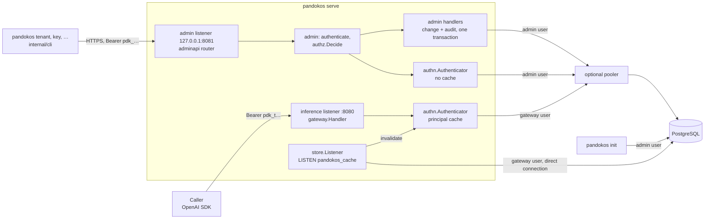

# Sprint 1.3 — Service accounts, virtual keys, authorization core, audit

- Epic: [1 — Foundations](../epic.md)
- Implementation plan: [plan.md](plan.md)
- Previous sprints: [1.1 — Walking skeleton](../1.1-walking-skeleton/sprint.md),
  [1.2 — Persistence and tenant isolation](../1.2-persistence-and-tenant-isolation/sprint.md)
- Decisions implemented: ADR [0003](../../../../docs/adr/0003-single-binary-with-roles.md) (the
  admin listener, `init`, the import rule between the planes),
  [0004](../../../../docs/adr/0004-postgresql-and-rls.md) (the key lookup function, `sqlc`),
  [0005](../../../../docs/adr/0005-data-plane-authentication.md) (virtual keys, the principal,
  the cache), [0007](../../../../docs/adr/0007-authorization-rbac.md) (the core: catalogue, first
  roles, evaluation), [0013](../../../../docs/adr/0013-ledger-and-audit.md) (audit log, without
  the hash chain), [0017](../../../../docs/adr/0017-admin-api-spec-first.md),
  [0018](../../../../docs/adr/0018-supply-chain.md) (no new dependency),
  [0019](../../../../docs/adr/0019-configuration.md) (listeners and TLS),
  [0020](../../../../docs/adr/0020-error-contract.md) (administration side),
  [0027](../../../../docs/adr/0027-database-roles-and-session-context.md)
- New decision records written by this sprint: 0028 to 0032 (content in [plan.md](plan.md),
  part E)

This document is the frozen design. The implementer follows [plan.md](plan.md); a gap in either
document is raised as a question, not filled silently
([planning/README.md](../../../README.md)).

The decisions of the maintainer on the open points of sprints 1.1 and 1.2 are taken as given:
SEC-01 is delivered here for both listeners (1.1 O-3); TLS towards PostgreSQL stays
`verify-full` or `disable` and gets an end-to-end test that shares the certificate generator of
the listener tests (1.2 O-2, closes 1.2 R-6); one installation per PostgreSQL cluster (1.2 O-3);
the `tenant.name` rule is the API contract (1.2 O-4); service accounts are disabled, not deleted
(1.2 O-5); provider traffic and `HTTPS_PROXY`, the `bad_request` code of the inference side,
OPS-12 and GW-16 belong to sprint 3.1 (1.1 O-2, O-5, O-6); v0.1 releases the image only
(1.1 O-4).

## 1. Outcome

A platform that can be administered. From an empty database, `pandokos init` issues an expiring
platform key; with it the CLI, which is a client of the new administration API, creates tenants;
each tenant gets a first service account and a virtual key, and with that key the tenant creates
further service accounts and keys. Every request on both listeners is authenticated with a
key, authorized against a permission that the route declares, and refused by default. Every
change is written to an append-only audit log in the transaction that makes it. The inference
route of the walking skeleton now accepts virtual keys instead of the static token, through a
principal cache that a database notification invalidates. Both listeners can serve TLS.

**Exit criteria** (from the epic):

1. from an empty database, the CLI creates two tenants, each with a service account and a key;
2. a key of one tenant cannot address the other;
3. a revoked key stops working within the bound;
4. each step appears in the audit log.

All four are automated: criteria 1, 2 and 4 by T-290, criterion 2 also by T-270 and T-271,
criterion 3 by T-262, T-263 and T-291 (section 9).

## 2. Scope

### In scope

1. The OpenAPI 3.1 document of the administration API, version 1, for: the caller's identity,
   tenants, service accounts, virtual keys, platform keys (appendix A).
2. `internal/apigen`, an in-repository generator, and `internal/adminapi`, the types, server
   interface, router, validation and client that it generates; `make generate` and the CI check
   that generated code is current.
3. The admin listener, separate from the inference listener, with its own router; native TLS on
   both listeners.
4. `pandokos init` and the bootstrap platform key; platform keys.
5. Tenants: create (with the first administrator of the tenant), read, list, update, suspend,
   reactivate.
6. Service accounts: create, read, list, update, disable, enable; role assignments.
7. Virtual keys: format, generation, hashing, the lookup function, scopes, expiry, several
   active keys per service account, revocation.
8. `internal/authz`: the permission catalogue, the built-in roles `platform-admin`,
   `tenant-admin` and `inference`, the principal, the decision function. Every route declares a
   permission; tests prove that none lacks one.
9. `internal/authn`: the authenticator and the principal cache of the gateway, invalidated by
   PostgreSQL `LISTEN`/`NOTIFY`; the documented revocation and suspension bound.
10. The inference route authenticates with virtual keys; `skeleton.access_token_file` is
    removed.
11. Audit: `audit_event` and `platform_audit_event`, written in the transaction of each change,
    append-only in the database.
12. Migration `0002_identity_audit`; `sqlc` for every domain query; the test that forbids SQL
    built from strings.
13. CLI commands for every operation of the API, through the generated client.
14. API-level isolation tests, the third layer of the isolation suite.
15. Test infrastructure: a certificate generator for tests, TLS on the test PostgreSQL, the
    end-to-end TLS test towards PostgreSQL.
16. Documentation, five ADRs.

### Not in scope

| Not in this sprint | Where it lands |
|---|---|
| `serve --role`: running a subset of the roles (OPS-05 is R4 for separate processes). `serve` keeps opening the three pools (1.2 D-10) | 8.2 |
| Reading the audit log through the API or the CLI (AUD-05), the hash chain and its verification (AUD-04, second half), retention (AUD-06) | 6.2 |
| Model allow-list, limits and pinned credential of a key (the rest of IAM-04) | 2.2, 5.1, 2.1 |
| Users, local accounts, sessions, `GET /v1/me` for people (AZ-11) | 4.2, 4.3 |
| The other built-in roles, custom roles, the no-escalation rule (AZ-03 R2, AZ-04, AZ-05) | 4.3 |
| Support actions of a platform admin inside a tenant, with reason (AZ-09); recovery of a tenant whose last administrator key is lost (open point O-2) | 4.3 |
| Trusted token issuers (IAM-06 to IAM-08), mutual TLS for callers (IAM-15) | 4.1, 8.3 |
| Idempotency keys (API-05), the capability check (API-07), `export` and `apply` (ADR 0019) | 4.2, 3.3, later |
| Catalogue, vault, credential, model and price resources of the API | 2.1, 2.2 |
| Audit of authentication failures on the inference listener (they are logged; open point O-3) | 3.1 |
| Reloading a renewed listener certificate without a restart (open point O-5) | 8.2 |
| Tenant deletion; the states `deleting` and `deleted` have no operation | 6.3 |
| The model, the catalogue and the vault in the inference path: the route still forwards with the one provider key of `skeleton.openai.*` | 3.1 |
| Registering the `pdk_` pattern in the repository's secret scanning (a repository setting: maintainer action, section 10) | maintainer |

Nothing in the list above is stubbed, scaffolded or given an empty package in this sprint.

## 3. Requirements claimed

Wording quoted from [docs/requirements](../../../../docs/requirements/README.md).

| ID | Requirement (quoted) | What it means here | What this sprint delivers | Claim |
|---|---|---|---|---|
| TEN-02 | "The tenant of a request derives only from the verified credential or a server-side association. A tenant identifier supplied by the caller neither establishes nor overrides it" | The tenant of a principal is the tenant of the key row that verified. The `{tenant}` path segment selects what to act on and is compared with the principal; nothing else in a request can name a tenant | The principal's tenant comes from `virtual_key_lookup` and the row read in that tenant's session. On the admin API a tenant principal whose `{tenant}` differs gets 404; a platform principal has no tenant permission. Headers are never read for a tenant; an unknown query parameter or body member (`tenant_id` included) is `invalid_request`; on the inference listener the query is ignored (1.1 D-4) | full for virtual keys; tokens are 4.1 |
| TEN-08 | "Responses never reveal whether a resource of another tenant exists, through status codes, errors, identifiers or metadata" | For any route, a caller of tenant A that names a resource of tenant B gets the same bytes as for a resource that does not exist | Tenant-scoped handlers read through the tenant session only, so another tenant's row is `not found` by construction; malformed identifiers do not match a route; tenant principals get the same 403 on every platform route whatever identifier they send; identifiers are random. T-270 compares the two responses for every route | full for the routes that exist; each later route inherits T-270 |
| TEN-09 | "A tenant has a lifecycle: provisioning, active, suspended, deleting, deleted. The platform admin can create, suspend and reactivate it" | The three operations exist in the API and the CLI | `createTenant` (provisioning to active in one transaction), `suspendTenant`, `reactivateTenant`, with the model and the trigger of 1.2 | full (the model was 1.2) |
| TEN-10 | "Suspension blocks inference and tenant administration within a documented maximum time, and preserves data" | After the suspension commits, a key of the tenant is refused with `tenant_suspended`: at once on the admin API, within the principal cache lifetime on the inference listener. No row is deleted | The tenant state is part of the principal and of every decision; the admin API does not cache principals; the gateway cache is invalidated by notification and bounded by `cache.principal_ttl` (default 30 s, at most 60 s). Documented in `docs/operations/keys.md`; tested by T-264, T-291 | full |
| IAM-01 | "Pandokos is not an identity provider for other systems: it issues no tokens for third-party applications and offers no self-registration, no account recovery by email and no MFA of its own. Installations that need those use an external IdP" | The API surface has no such operation, and nothing can be created without a credential | Every operation of the document needs a key (T-232); the document has no sign-up, recovery or token operation; the first credential comes only from `init` on the host | full for R1 surfaces |
| IAM-02 | "A tenant can create service accounts with an identifier, status, roles and validity dates" | CRUD without delete, roles as assignments, validity enforced at authentication | Service account operations; `role_assignment`; a key of a disabled service account, or outside `valid_from`/`valid_until`, does not authenticate | full |
| IAM-03 | "Pandokos issues virtual keys for service accounts. A key is shown once, stored only as a hash, identified by a non-secret key ID, and carries a recognizable prefix and checksum so secret scanners can detect it" | Section 5.7 | Format `pdk_<key id>_<secret><checksum>`; the secret is returned by the create response only; SHA-256 in the database; the key ID is the resource identifier; CRC-32 checksum; the regular expression is documented and tested against generated keys | full |
| IAM-04 | "A virtual key always belongs to exactly one tenant and can be restricted by scope, model allow-list, expiry and limits" | The tenant binding, scopes and expiry now; the other restrictions with the things they restrict | `virtual_key.tenant_id` (not null, in every key), `scopes`, `expires_at` | tenant, scope, expiry; model allow-list 2.2, limits 5.1 |
| IAM-05 | "A service account can hold several active keys, so rotation needs no downtime. Each key can be revoked on its own; revocation takes effect within a documented bound" | No limit of one key; revocation per key; the bound of TEN-10 | No uniqueness on (service account); `revokeVirtualKey`; bound documented and tested (T-262, T-263, T-291) | full |
| IAM-13 | "An installation without an IdP is fully usable: automation and the CLI use admin-scoped virtual keys, people use local accounts in the console" | Everything this sprint offers works with keys alone | Platform keys and tenant-admin keys; T-290 runs with nothing but the binary and PostgreSQL | keys (R1); accounts are 4.2 |
| IAM-14 | "The first platform admin is created by an explicit initialization command: an expiring admin key and, from R2, a local account whose generated password must be changed at first sign-in. There are no default credentials. Pandokos warns while the bootstrap key is still active" | `pandokos init`; the key always expires; a fresh installation accepts nothing; a warning at start, hourly, on each response and in the CLI | Section 5.14 | key (R1); account is 4.2 |
| AZ-01 | "Every request is authorized after it is authenticated, on the inference API, the administration API and background jobs. The default is deny" | One decision function, called for every matched route, that allows only what a role grants | `authz.Decide`; the generated router calls the `Before` hook for every operation and cannot be built without it; the gateway route requires `model:invoke`; an operation without a permission does not generate, and a permission outside the catalogue denies. No background job exists yet | inference and administration; jobs when they exist |
| AZ-02 | "Permissions are `resource:action` pairs defined and documented by the product. A decision considers identity, tenant, permission, target resource and tenant state. Read, write, delete, rotate and use are distinct" | Section 5.6 | Catalogue in `internal/authz`, documented in `docs/reference/permissions.md` (checked by T-R14); `Decide(principal, permission, target)` uses kind, tenant, tenant state, roles, scopes; read, write, revoke, suspend and invoke are separate permissions | full for the permissions that exist |
| AZ-03 (first roles) | "Pandokos ships immutable built-in tenant roles: owner, admin, credential manager, usage viewer, auditor, developer, inference, read-only" | `tenant-admin` (the *admin* role) and `inference`, defined in code | `authz.Roles()`; no operation changes a role; assigning an unknown role is refused | admin, inference; the others 4.3 |
| AZ-06 (platform admin) | "Platform roles are separate from tenant roles and imply no tenant membership: platform admin, platform auditor, platform billing operator" | A platform principal has no tenant and no tenant permission | `platform-admin` is a role of platform keys only; a platform key gets 403 on every tenant-scoped operation (T-272); a tenant role cannot be given to a platform key and the reverse | platform admin; the others 4.3 |
| AZ-07 (platform admin) | "The platform admin manages the tenant lifecycle, the provider and model catalogue, platform credentials and platform-wide limits" | The lifecycle part | `tenant:read`, `tenant:write`, `tenant:suspend` belong to `platform-admin` only | tenant lifecycle; catalogue 2.2, platform credentials 7.1, limits 5.x |
| AUD-01 | "Pandokos audits authentication failures and every creation, change, disabling, revocation and deletion of tenants, identities, keys, roles, catalogue entries, credentials and limits" | Every mutating operation of this sprint, `init`, and failed authentication on the admin API | Table of actions in section 5.11; T-281 walks every mutating operation and finds its row | tenants, identities, keys, roles, admin-side authentication failures; the rest with their resources; inference-side failures: open point O-3 |
| AUD-02 | "An audit record holds: actor and actor type (user, service account, platform), tenant or platform scope, action, resource, time, outcome, request ID, the reason when one is required, and a redacted description of what changed" | The columns of the two tables | Section 5.11 | full |
| AUD-03 | "The audit record is written atomically with the change it describes" | Same transaction; no audit row, no change | Handlers write the change and the row inside one `store` transaction; T-282 makes the audit insert fail and shows the change rolled back | full |
| AUD-04 (append-only) | "Audit records cannot be changed or deleted by runtime identities, and tampering is detectable" | The first half | No `UPDATE`, `DELETE` or `TRUNCATE` grant; triggers that refuse all three for every role, the owner included; lint rule L-17 | append-only; detection (hash chain) is 6.2 |
| AUD-07 | "Audit log, usage ledger and telemetry are three separate records with shared correlation IDs. Telemetry is never the source of accounting" | The audit row, the log line and the response of one request carry the same request ID; no code reads logs | `request_id` column; T-283 | audit and telemetry; the ledger is 3.2 |
| API-01 | "The administration API listens separately from the inference API and can be bound to a private network" | A second listener with its own address, server and router | `listeners.admin.*`, default `127.0.0.1:8081`; T-240 shows each listener refusing the other's routes | full |
| API-02 | "The administration API is versioned, and its OpenAPI specification is the source of truth, published with every release" | Paths under `/v1`; code is generated from the document and CI fails when they differ; the document is a release asset | Appendix A; `make generate-check` in CI; `release.yml` attaches the document to the release | full |
| API-03 | "Everything is achievable through the API. A CLI wraps the API; no web console is required" | Every operation has a CLI command that only calls the generated client | Section 5.15; T-219 maps every `operationId` to a command; the CLI package cannot import the store (depguard) | full for the resources that exist; `migrate` and `init` are the two local commands of ADR 0017 |
| API-04 | "Collections support pagination, filtering and sorting. Errors share one documented format" | Cursor pagination, `limit`, filters, `sort`; RFC 9457 problems | Section 5.4; T-233, T-234 | full |
| API-06 | "A tenant can be administered by an external system through a tenant-scoped service account that holds no platform privilege" | The role `tenant-admin` | T-273: a tenant-admin key performs every tenant operation of its tenant and is refused every platform operation | full for the resources that exist |
| SEC-01 (native TLS on listeners) | "Every listener can serve TLS natively or run behind a terminating proxy. Certificates of upstream providers are always verified" | Certificate and key files per listener; plain HTTP stays possible | `listeners.*.tls.*`; T-241 to T-244. The second sentence was delivered by 1.1 | listeners |
| SEC-03 | "Error messages reveal no secrets, internal configuration or data of other tenants" | Problem details are fixed sentences per code; validation messages name the member and the rule, never the value; nothing from the database reaches a response | `internal/admin/problem.go`; T-235, T-292 | full for the admin API (the inference side was 1.1) |
| SEC-04 | "Defaults are secure. At start-up Pandokos validates its configuration and refuses or warns about weak settings" | The admin listener is on loopback by default and refuses a non-loopback address without TLS unless acknowledged; TLS files are checked at start; keys of `init` expire; the bootstrap key warns | Validation rules and warnings of section 5.2; with the database user check of 1.2 | full for the settings that exist |

Requirements this sprint touches but **does not claim**: TEN-03 (claimed by 1.2 for the store;
the request layer is completed here: a request without a principal is refused on both
listeners, T-232 and T-250), TEN-07 (claimed by 1.2; the route half is completed here: T-270 and
T-274), OPS-05 (the two planes stay one process), SEC-02 (bearer replay exposure is documented
in `docs/operations/keys.md`; claimed by 3.1), IAM-22 and AZ-08 (the gateway role has no grant
on `platform_key`: the same construction).

## 4. Repository layout

Additions to the layout of sprints 1.1 and 1.2. Names follow
[architecture §11](../../../../docs/architecture/overview.md#11-repository-layout); additions to
that list are marked *new*.

```
api/openapi/admin.v1.yaml       the administration API, source of truth
sqlc.yaml                       configuration of the SQL generator                    (new)
cmd/pandokos/
  init.go                       the init command                                      (new file)
  client.go                     dispatch of the API commands to internal/cli          (new file)
internal/
  apigen/                       generator: OpenAPI document to internal/adminapi      (new)
  adminapi/                     types, Server interface, router, validation, client   (new)
    adminapi.gen.go             generated; never edited
    runtime.go                  hand-written part the generated code relies on
  admin/                        handlers of the administration API
  authn/                        key format, authenticator, principal cache
  authz/                        permission catalogue, built-in roles, principal, decision
  audit/                        the audit event and its two writers
  cli/                          the API commands of the CLI                           (new)
  requestid/                    request ID generator and header name                  (new)
  store/listen.go               the notification listener                             (new file)
  store/queries/                sqlc: sql/*.sql and the generated package queries     (new)
  store/migrations/sql/0002_identity_audit.sql
test/
  testcert/                     certificate authority and certificates for tests      (new)
    cmd/testcert/               the same generator as a command, for test/db/up.sh
  apitest/                      helper: a migrated database with a running admin API  (new)
docs/operations/keys.md         keys, init, revocation bound                          (new)
docs/operations/tls.md          TLS on the listeners and towards PostgreSQL           (new)
docs/reference/admin-api.md     conventions of the API and the accepted OpenAPI subset (new)
docs/reference/permissions.md   permissions and built-in roles                        (new)
docs/adr/                       0028 to 0032
```

Import rules added to `depguard` in `.golangci.yml`, and checked by T-R13:

- `internal/gateway` does not import `internal/admin`, `internal/adminapi`, `internal/authn`,
  `internal/cli` or `internal/store`; it sees authentication through an interface and
  `internal/authz`. `internal/admin` does not import `internal/gateway`, `internal/family`,
  `internal/server` or `internal/config` (ADR 0003: the planes do not import each other);
- `internal/authz` and `internal/requestid` import only the standard library and
  `internal/tenant`;
- `internal/adminapi` imports only the standard library;
- `internal/cli` imports `internal/adminapi`, `internal/secret`, `internal/buildinfo` and the
  standard library: never the store, the handlers or the configuration;
- `internal/apigen` is the only product package that imports `go/format`; the `go/*` packages
  must be named in the `allow` list of rule `all`, because `$gostd` does not cover them in
  golangci-lint v2.5.0 (verified while designing);
- the product module gains **no** dependency: `go.mod` and `go.sum` are unchanged (T-R2).

## 5. Architecture



### 5.1 Commands

Additions to the tables of sprints 1.1 and 1.2. Everything stays in
`run(ctx, args, stdout, stderr, environ) int`.

| Command | Behaviour | Exit code |
|---|---|---|
| `pandokos serve [--config FILE]` | As in 1.2, and: builds the two authenticators, starts the notification listener, binds the inference and the admin listener (with TLS when configured), starts the bootstrap-key warning (section 5.14) | unchanged |
| `pandokos init [--config FILE] [--ttl DURATION] [--description TEXT] [--key-out FILE] [--recover]` | Local command (section 5.14): connects as the admin database user and issues the bootstrap platform key | 0 issued; 1 on configuration error, connection failure, schema mismatch, or when a usable platform key exists and `--recover` is absent; 2 on a usage error |
| `pandokos config check [--config FILE] [--for serve\|migrate\|init]` | As in 1.2, with the purpose `init` | unchanged |
| `pandokos whoami`, `pandokos tenant …`, `pandokos service-account …`, `pandokos key …`, `pandokos platform-key …` | API commands (section 5.15): clients of the administration API | 0 success; 1 when the API answers with a problem or cannot be reached; 2 on a usage error |

The usage text gains these lines, after `migrate status` and before `config check`:

```
  init [--config FILE] [--ttl DURATION] [--description TEXT] [--key-out FILE] [--recover]
                                   Issue the bootstrap platform key, then exit
  whoami                           Show the identity of the key in use
  tenant list|create|get|update|suspend|reactivate
  service-account list|create|get|update|disable|enable
  key list|create|get|revoke
  platform-key list|create|get|revoke
                                   Administer through the administration API;
                                   "pandokos <command> --help" lists the flags
```

`config check [--config FILE] [--for serve|migrate]` becomes
`config check [--config FILE] [--for serve|migrate|init]`, and the closing paragraph gains:
`API commands read PANDOKOS_CLI_SERVER, PANDOKOS_CLI_KEY_FILE and PANDOKOS_CLI_CA_FILE.`

### 5.2 Configuration

#### Removed key

`skeleton.access_token_file` is deleted, with the field `Skeleton.AccessTokenFile`, the field
`Skeleton.AccessToken`, the minimum-length rule and the rule that the token differs from the
provider key (1.1 D-2 ends). A file that still names the key fails as an unknown key.
`skeleton.openai.*` stays until 3.1.

#### New keys

In this order: the three `tls` keys of the inference listener after
`listeners.inference.max_header_bytes`; then the admin listener; `cache.principal_ttl` after
`shutdown.drain_timeout`; `database.direct_address` after `database.address`.

| Key | Type | Default | Meaning |
|---|---|---|---|
| `listeners.inference.tls.cert_file` | path | none | PEM file with the server certificate and, after it, any intermediate certificates. With `key_file`, turns TLS on for the listener |
| `listeners.inference.tls.key_file` | path | none | PEM file with the private key of the certificate |
| `listeners.inference.tls.min_version` | `TLS1.2`, `TLS1.3` | `TLS1.2` | Lowest protocol version accepted |
| `listeners.admin.address` | `host:port` | `127.0.0.1:8081` | Listen address of the administration API |
| `listeners.admin.read_header_timeout` | duration | `10s` | Time allowed to read request headers |
| `listeners.admin.idle_timeout` | duration | `120s` | Keep-alive idle time |
| `listeners.admin.max_header_bytes` | integer | `65536` | Maximum size of request headers |
| `listeners.admin.tls.cert_file` | path | none | As for the inference listener |
| `listeners.admin.tls.key_file` | path | none | As for the inference listener |
| `listeners.admin.tls.min_version` | `TLS1.2`, `TLS1.3` | `TLS1.2` | As for the inference listener |
| `listeners.admin.allow_plaintext` | boolean | `false` | Acknowledges that the administration API is served without TLS on an address that is not loopback, because TLS ends in front of it |
| `cache.principal_ttl` | duration | `30s` | Lifetime of a cached principal in the gateway: the upper bound on the time a revocation or a suspension takes to reach the inference listener |
| `database.direct_address` | `host:port` | none | Address of PostgreSQL itself, used only by the notification listener. Set it when `database.address` is a pooler in transaction mode |

Environment variables follow the rule of 1.1
(`listeners.admin.tls.cert_file` → `PANDOKOS_LISTENERS_ADMIN_TLS_CERT_FILE`). No key has `port` as
its last segment or a segment that starts with `service_` (1.2 D-12), and from this sprint none
starts with `cli` (see below).

There is no key for cipher suites (the defaults of the Go standard library apply), for client
certificates (IAM-15, 8.3) or for the body limit of the admin API (fixed at 1048576 bytes).

#### Go types

Changes to `internal/config` (types not shown are unchanged):

```go
type Config struct {
    Log       Log       `yaml:"log"`
    Listeners Listeners `yaml:"listeners"`
    Limits    Limits    `yaml:"limits"`
    Upstream  Upstream  `yaml:"upstream"`
    Shutdown  Shutdown  `yaml:"shutdown"`
    Cache     Cache     `yaml:"cache"`    // new
    Database  Database  `yaml:"database"`
    Skeleton  Skeleton  `yaml:"skeleton"`
}
type Listeners struct {
    Inference Listener      `yaml:"inference"`
    Admin     AdminListener `yaml:"admin"` // new
}
type Listener struct {
    Address           string      `yaml:"address"`
    ReadHeaderTimeout Duration    `yaml:"read_header_timeout"`
    IdleTimeout       Duration    `yaml:"idle_timeout"`
    MaxHeaderBytes    int         `yaml:"max_header_bytes"`
    TLS               ListenerTLS `yaml:"tls"` // new
}
type AdminListener struct {
    Address           string      `yaml:"address"`
    ReadHeaderTimeout Duration    `yaml:"read_header_timeout"`
    IdleTimeout       Duration    `yaml:"idle_timeout"`
    MaxHeaderBytes    int         `yaml:"max_header_bytes"`
    TLS               ListenerTLS `yaml:"tls"`
    AllowPlaintext    bool        `yaml:"allow_plaintext"`
}
type ListenerTLS struct {
    CertFile   string `yaml:"cert_file"`
    KeyFile    string `yaml:"key_file"`
    MinVersion string `yaml:"min_version"`

    Certificate *tls.Certificate `yaml:"-"` // filled by Load when the purpose is serve and both files are set
}
type Cache struct {
    PrincipalTTL Duration `yaml:"principal_ttl"`
}
type Database struct {
    // ... fields of sprint 1.2, and after Address:
    DirectAddress string `yaml:"direct_address"`

    DirectHost string `yaml:"-"` // filled by Load; equal to Host when DirectAddress is empty
    DirectPort int    `yaml:"-"`
}
type Skeleton struct {
    OpenAI SkeletonOpenAI `yaml:"openai"`
}

const (
    PurposeServe Purpose = iota
    PurposeMigrate
    PurposeInit // new
)
```

`internal/config` imports `crypto/tls` for the certificate type and for loading the pair; it
still imports no other Pandokos package than `internal/secret`.

#### Purpose

| | `PurposeServe` | `PurposeMigrate` | `PurposeInit` (`init`, `config check --for init`) |
|---|---|---|---|
| `skeleton.openai.api_key_file` | required, read | not read | not read |
| `database.gateway.password_file`, `database.worker.password_file` | required, read | not read | not read |
| `database.admin.password_file` | required, read | not read | required, read |
| `database.owner.password_file` | not read | required, read | not read |
| listener certificate and key files | checked and loaded | format rules only, files not opened | format rules only, files not opened |

#### Validation rules

| Key | Rule | Problem message |
|---|---|---|
| `listeners.admin.address` | as `listeners.inference.address` in 1.1 | as in 1.1 |
| `listeners.admin.address` | differs from `listeners.inference.address` when both ports are not 0 and the two strings are equal | `must differ from listeners.inference.address` |
| `listeners.admin.read_header_timeout`, `listeners.admin.idle_timeout` | greater than zero | `must be greater than zero` |
| `listeners.admin.max_header_bytes` | 4096 to 1048576 | `must be between 4096 and 1048576` |
| `listeners.<l>.tls.min_version` (two keys) | `TLS1.2` or `TLS1.3` | `must be TLS1.2 or TLS1.3` |
| `listeners.<l>.tls.cert_file`, `listeners.<l>.tls.key_file` | both set or both empty; the problem is reported on the one that is empty | `must be set when listeners.<l>.tls.<other> is set` |
| `listeners.<l>.tls.cert_file` (serve only) | the file is readable and at most 1048576 bytes | `cannot read the file: <OS error>` or `the file is larger than 1048576 bytes` |
| `listeners.<l>.tls.key_file` (serve only) | the file is readable and at most 1048576 bytes | the same two messages |
| `listeners.<l>.tls.cert_file` (serve only) | `tls.X509KeyPair` accepts the two files | `the certificate and the key are not a valid pair` (the library's text is not passed on) |
| `listeners.<l>.tls.cert_file` (serve only) | the leaf certificate is valid now (`NotBefore` ≤ now ≤ `NotAfter`) | `the certificate is not valid before <RFC 3339 date>` or `the certificate expired on <RFC 3339 date>` |
| `listeners.admin.address` | when the host is not loopback (not a loopback IP, not `localhost`; an empty host is not loopback) and TLS is not configured: `listeners.admin.allow_plaintext` is true | `the administration API must not be served without TLS on a non-loopback address: set listeners.admin.tls.cert_file and key_file, or set listeners.admin.allow_plaintext when TLS ends in front of it` |
| `cache.principal_ttl` | 1 s to 60 s | `must be between 1s and 60s` |
| `database.direct_address` | when set: the three address rules of `database.address` (1.2) | the 1.2 messages |

`Load` fills `Database.DirectHost` and `DirectPort`, and for the purpose `serve` the
`Certificate` of each listener that has both files. A key file is read with `os.ReadFile`, not
with `secret.ReadFile` (a PEM file has several lines); its content is never part of a message.

#### Warnings

| Key | Condition | Message |
|---|---|---|
| `listeners.inference.address` | no TLS and the host is not loopback (replaces the 1.1 warning) | `the listener serves plain HTTP; set listeners.inference.tls.cert_file and key_file, or terminate TLS in front of it` |
| `listeners.admin.address` | no TLS, host not loopback, `allow_plaintext` true | `the administration API is served without TLS; keys travel in clear text unless TLS ends in front of it` |
| `listeners.admin.allow_plaintext` | true while TLS is configured or the host is loopback | `has no effect` |
| `listeners.<l>.tls.cert_file` (serve only) | the leaf certificate expires in less than 14 days | `the certificate expires on <RFC 3339 date>` |

#### Unknown environment variables

Variables that start with `PANDOKOS_CLI_` belong to the API commands (section 5.15) and are
ignored silently by `Load`, like the Kubernetes patterns of 1.2. No configuration key may start
with `cli` (T-05 is extended).

### 5.3 Listeners and TLS

`internal/server` serves two listeners with two `http.Server` values and two handlers. They share
only the health state, the logger and the shutdown sequence.

```go
type Options struct {
    Config        *config.Config        // required
    Logger        *slog.Logger          // required
    Authenticator gateway.Authenticator // required: authenticates inference requests
    Admin         http.Handler          // required: the administration API (admin.New)
}

// New wires health, gateway and the two HTTP servers. It performs no I/O.
func New(o Options) (*Server, error)

// Listen binds the inference listener and then the admin listener. If the second fails the
// first is closed.
func (s *Server) Listen() error
func (s *Server) InferenceAddr() net.Addr
func (s *Server) AdminAddr() net.Addr // new
func (s *Server) Health() *health.State
func (s *Server) Serve(ctx context.Context) error
```

| | Inference listener | Admin listener |
|---|---|---|
| Handler | `/healthz`, `/readyz` (GET, HEAD) to `health`; everything else to `gateway.Handler` (unchanged) | `/healthz`, `/readyz` (GET, HEAD) to `health`; everything else to the `Admin` handler |
| Timeouts | as in 1.1 | `ReadHeaderTimeout`, `IdleTimeout`, `MaxHeaderBytes` from configuration; `ReadTimeout` 30 s and `WriteTimeout` 60 s, fixed (no streaming on this listener) |
| A route of the other plane | 404 `endpoint_not_supported` in the OpenAI shape (unchanged) | 404 problem `not_found` |

TLS, the same for both: when `ListenerTLS.Certificate` is set the server is started with
`http.Server.ServeTLS(listener, "", "")` and
`TLSConfig = &tls.Config{Certificates: []tls.Certificate{*cert}, MinVersion: <from min_version>}`;
otherwise with `Serve`. `ServeTLS` enables HTTP/2 over TLS. Nothing else of `tls.Config` is set:
no client certificate is requested, the cipher suites are the library's. The certificate is read
once, at start (open point O-5). A plain HTTP request to a TLS listener gets the standard
library's answer (400 on the HTTP/1 path); it never reaches a handler.

The log line `listening` gains the listener `admin` and a boolean field `tls`.

`Serve` runs both servers. If either stops with an error other than `http.ErrServerClosed`, the
other is shut down and `Serve` returns the error. The shutdown sequence of 1.1 §5.9 applies to
both with one shared drain deadline: readiness goes down, both servers `Shutdown`, at the
deadline the base context is cancelled and both are closed. `shutdown complete` is logged once.

`serve` start sequence, after the three database checks of 1.2: build the gateway authenticator
(gateway pool, cache) and the admin authenticator (admin pool, no cache); start the notification
listener; build `admin.New`; `server.New`; add the readiness checks; `Listen`; start the
bootstrap-key warning; `Serve`. On return: stop the listener and the warning, close the pools.

### 5.4 The administration API

The complete document is appendix A and is the file `api/openapi/admin.v1.yaml`. This section
states its rules; where the two disagree the appendix wins and the disagreement is a defect to
raise.

**Conventions** (also `docs/reference/admin-api.md`):

- Base path `/v1`. Platform resources at the top (`/v1/tenants`, `/v1/platform-keys`), tenant
  resources under the tenant (`/v1/tenants/{tenant}/service-accounts`, `…/virtual-keys`), the
  caller at `/v1/me`.
- `{tenant}` and `{service_account}` are IDs (UUID, canonical lower case). `{key}` is the key ID,
  the public part of a key. Names are attributes, found with the `name` filter; the CLI accepts
  names and resolves them.
- Authentication: `Authorization: Bearer <key>`. Nothing else is read: no cookie, no query
  parameter, no other header.
- JSON only. Members are `snake_case`. Times are RFC 3339 in UTC. An absent optional member is
  left out of responses, not sent as `null`.
- Bodies are strict: an unknown member is an error. Queries are strict: an unknown or repeated
  parameter is an error.
- Changes that are not a replacement of attributes are `POST` on a sub-resource named by the
  verb (`…/suspend`, `…/reactivate`, `…/disable`, `…/enable`, `…/revoke`). They take an optional
  body `{"reason": "…"}`, return the resource, and are idempotent: repeating one succeeds,
  changes nothing and writes no audit record.
- `PATCH` changes the members that are present. Only `valid_from` and `valid_until` of a service
  account accept `null`, which removes the bound. `roles` replaces the whole set.
- Nothing is deleted through the API in this sprint.
- Every successful response has a body: 200, or 201 for the three create operations.
- A secret (`secret` of `VirtualKeyCreated` and `PlatformKeyCreated`) is returned by the create
  response only. No other operation returns it, and no operation returns a hash.
- Every response carries `X-Pandokos-Request-Id` and `Cache-Control: no-store`. A response to a
  request authenticated with the bootstrap key also carries
  `X-Pandokos-Warning: bootstrap-key-active`.
- Each operation names its permission in `x-pandokos-permission`. The generator refuses an
  operation without one.

**Operations.**

| Operation | Method and path | Permission | Success | Problems (status `code`) |
|---|---|---|---|---|
| `getMe` | `GET /v1/me` | `identity:read` | 200 `Me` | 401, 403, 500, 503 |
| `listTenants` | `GET /v1/tenants` | `tenant:read` | 200 `TenantList` | 400, 401, 403, 500, 503 |
| `createTenant` | `POST /v1/tenants` | `tenant:write` | 201 `TenantCreated` | 400, 401, 403, 409 `conflict`, 413, 415, 500, 503 |
| `getTenant` | `GET /v1/tenants/{tenant}` | `tenant:read` | 200 `Tenant` | 401, 403, 404, 500, 503 |
| `updateTenant` | `PATCH /v1/tenants/{tenant}` | `tenant:write` | 200 `Tenant` | 400, 401, 403, 404, 409 `conflict` or `invalid_state`, 413, 415, 500, 503 |
| `suspendTenant` | `POST /v1/tenants/{tenant}/suspend` | `tenant:suspend` | 200 `Tenant` | 400, 401, 403, 404, 409 `invalid_state`, 413, 415, 500, 503 |
| `reactivateTenant` | `POST /v1/tenants/{tenant}/reactivate` | `tenant:suspend` | 200 `Tenant` | as `suspendTenant` |
| `listServiceAccounts` | `GET /v1/tenants/{tenant}/service-accounts` | `service_account:read` | 200 `ServiceAccountList` | 400, 401, 403, 404, 500, 503 |
| `createServiceAccount` | `POST /v1/tenants/{tenant}/service-accounts` | `service_account:write` | 201 `ServiceAccount` | 400, 401, 403, 404, 409 `conflict`, 413, 415, 500, 503 |
| `getServiceAccount` | `GET /v1/tenants/{tenant}/service-accounts/{service_account}` | `service_account:read` | 200 `ServiceAccount` | 401, 403, 404, 500, 503 |
| `updateServiceAccount` | `PATCH …/{service_account}` | `service_account:write` | 200 `ServiceAccount` | 400, 401, 403, 404, 409 `conflict`, 413, 415, 500, 503 |
| `disableServiceAccount` | `POST …/{service_account}/disable` | `service_account:write` | 200 `ServiceAccount` | 400, 401, 403, 404, 413, 415, 500, 503 |
| `enableServiceAccount` | `POST …/{service_account}/enable` | `service_account:write` | 200 `ServiceAccount` | as `disableServiceAccount` |
| `listVirtualKeys` | `GET /v1/tenants/{tenant}/virtual-keys` | `virtual_key:read` | 200 `VirtualKeyList` | 400, 401, 403, 404, 500, 503 |
| `createVirtualKey` | `POST /v1/tenants/{tenant}/virtual-keys` | `virtual_key:write` | 201 `VirtualKeyCreated` | 400, 401, 403, 404, 413, 415, 500, 503 |
| `getVirtualKey` | `GET /v1/tenants/{tenant}/virtual-keys/{key}` | `virtual_key:read` | 200 `VirtualKey` | 401, 403, 404, 500, 503 |
| `revokeVirtualKey` | `POST …/virtual-keys/{key}/revoke` | `virtual_key:revoke` | 200 `VirtualKey` | 400, 401, 403, 404, 413, 415, 500, 503 |
| `listPlatformKeys` | `GET /v1/platform-keys` | `platform_key:read` | 200 `PlatformKeyList` | 400, 401, 403, 500, 503 |
| `createPlatformKey` | `POST /v1/platform-keys` | `platform_key:write` | 201 `PlatformKeyCreated` | 400, 401, 403, 413, 415, 500, 503 |
| `getPlatformKey` | `GET /v1/platform-keys/{key}` | `platform_key:read` | 200 `PlatformKey` | 401, 403, 404, 500, 503 |
| `revokePlatformKey` | `POST /v1/platform-keys/{key}/revoke` | `platform_key:revoke` | 200 `PlatformKey` | 400, 401, 403, 404, 413, 415, 500, 503 |

**Collections** (API-04). Query parameters: `limit` (1 to 200, default 50), `cursor`, `sort`, and
the filters of the table. A response is `{"items": [...], "next_cursor": "..."}`; `items` is
always an array; `next_cursor` is absent on the last page. The cursor is opaque: base64url,
without padding, of the JSON object `{"s": <sort>, "n": <name of the last item, for the name
sorts>, "i": <ID of the last item>}`. A cursor that does not decode, or whose `s` differs from
the request's `sort`, is `invalid_request` on the member `cursor`. `sort=created_at` orders by
the ID, which is a UUID version 7: creation order to the millisecond (1.2 R-12). The handler
asks the database for `limit + 1` rows to know whether a next page exists.

| Collection | `sort` values (default first) | Filters |
|---|---|---|
| tenants | `created_at`, `-created_at`, `name`, `-name` | `state`, `name` (exact) |
| service accounts | the same four | `state`, `name` (exact) |
| virtual keys | `created_at`, `-created_at` | `state` (`active`, `expired`, `revoked`), `service_account_id` |
| platform keys | `created_at`, `-created_at` | `state` |

**Errors** (ADR 0020, RFC 9457). Media type `application/problem+json`. Body:

```json
{
  "type": "urn:pandokos:problem:not_found",
  "title": "Not found",
  "status": 404,
  "code": "not_found",
  "detail": "The resource does not exist.",
  "request_id": "5f0c…32 hexadecimal characters",
  "errors": [{"field": "name", "message": "must match ^[a-z0-9]([a-z0-9-]{0,61}[a-z0-9])?$"}]
}
```

`errors` is present only with `invalid_request`. `title` and `detail` are constants per code:

| `code` | Status | `title` | `detail` | Raised when |
|---|---|---|---|---|
| `invalid_request` | 400 | `Invalid request` | `The request does not match the API description.` | Malformed JSON; unknown or missing member; a rule of the document broken; unknown or repeated query parameter; bad cursor; a role, a scope or a service account that the request names and that cannot be used; neither member in an update; a date in the past where a future one is required |
| `unauthenticated` | 401 | `Unauthenticated` | `Missing or invalid credential.` | No `Authorization` header, a scheme other than `Bearer`, a malformed, unknown, revoked or expired key, a disabled or not-yet or no-longer valid service account. The response is the same in every case and carries `WWW-Authenticate: Bearer` |
| `forbidden` | 403 | `Forbidden` | `The credential does not allow this operation.` | The principal lacks the permission |
| `tenant_suspended` | 403 | `Tenant not active` | `The tenant is not active.` | The principal's tenant is in any state but `active` |
| `not_found` | 404 | `Not found` | `The resource does not exist.` | No route; an identifier that does not have the form of its kind; a resource that does not exist or belongs to another tenant |
| `conflict` | 409 | `Conflict` | `The name is already in use.` | Unique name of a tenant (among tenants not deleted) or of a service account (in its tenant) |
| `invalid_state` | 409 | `Invalid state` | `The resource is in a state that does not allow this operation.` | Suspending or reactivating a tenant that is `provisioning`, `deleting` or `deleted`; updating a `deleted` tenant |
| `request_too_large` | 413 | `Request too large` | `The request body exceeds 1048576 bytes.` | |
| `unsupported_media_type` | 415 | `Unsupported media type` | `The request body must be application/json.` | A non-empty body with another content type |
| `internal` | 500 | `Internal error` | `Internal error.` | Unexpected failure, recovered panic |
| `unavailable` | 503 | `Unavailable` | `The request cannot be verified or recorded right now.` | The database cannot be reached, or a transaction could not be completed for a reason of the database (connection lost, timeout) |

The inference listener gains three codes of ADR 0020, in the OpenAI shape of 1.1
(`internal/family`):

| Code | Status | Message |
|---|---|---|
| `forbidden` | 403 | `Pandokos: the credential does not allow this operation.` |
| `tenant_suspended` | 403 | `Pandokos: the tenant is not active.` |
| `unavailable` | 503 | `Pandokos: the request cannot be verified right now.` |

**Order of checks on the admin listener.** (1) request ID, panic recovery, log line; (2) route:
method and path against the document, each path parameter against its pattern, else 404
`not_found`; (3) authentication, else 401; (4) authorization by `authz.Decide` with the
operation's permission and, for a tenant permission, the `{tenant}` of the path, else 403
`tenant_suspended`, 404 `not_found` or 403 `forbidden` (section 5.6); (5) query, then body:
size, media type, JSON, required members, unknown members, rules, else 413, 415 or 400;
(6) the handler. An unauthenticated caller therefore learns only which routes exist, which the
document says anyway, and a caller of tenant A learns nothing about tenant B from the order.

### 5.5 `internal/apigen` and `internal/adminapi`

The server interface, the router, the request validation and the client are generated from the
document by `internal/apigen`, a program of about 800 lines in this repository (decision D-1,
ADR 0028). Its source is in plan.md, appendix A, and was run against appendix A of this document while this
design was written: the output compiles, passes the repository's linter configuration and a
round-trip test between the generated client and router.

```
make generate      # go run ./internal/apigen … and sqlc generate (section 5.9)
```

`internal/adminapi/adminapi.gen.go` is committed. CI regenerates and fails on any difference
(section 7.4).

**The accepted subset of OpenAPI 3.1.** The generator decodes the document strictly
(`KnownFields`): a keyword it does not know is an error, so the document cannot state a rule
that the generated code does not enforce.

| Construct | Accepted form |
|---|---|
| Document | `openapi: 3.1.0`, `info`, `security`, `tags`, `paths`, `components` (`securitySchemes`, `parameters`, `responses`, `schemas`) |
| Path item | `parameters`, `get`, `post`, `patch`, `put`, `delete` |
| Operation | `operationId` (unique, lowerCamelCase), `tags`, `summary`, `description`, `x-pandokos-permission` (required, `resource:action`), `parameters`, `requestBody`, `responses` |
| Parameter | inline or a reference to `components.parameters`. Path: required, a string with a `pattern`. Query: optional; a string, an enumeration or an integer |
| Request body | `application/json` with a reference to a component object; `required` true or false; the object is flat (no member is an object or an array of objects) |
| Responses | each a reference to `components.responses`. Exactly one 2xx, with `application/json` and a component object. Every other one `application/problem+json` with the schema `Problem` |
| Component schema | an object (`properties`, `required`, `additionalProperties: false`, which is mandatory); a string enumeration; a named string or integer |
| Member schema | a reference; `string` (`pattern`, `minLength`, `maxLength`, `format: date-time`); `[string, "null"]` inline (optional members only); `integer` (`minimum`, `maximum`); `boolean`; `array` of plain strings (`minItems`, `maxItems`, `uniqueItems`, item `pattern`) or of component objects |

**What is generated**, all in package `adminapi`:

```go
// One struct per object schema; members in document order. An optional member has omitempty
// and, for a date, a pointer type. A [string, "null"] member is a Nullable.
type ServiceAccountUpdate struct {
    Name        string              `json:"name,omitempty"`
    Description string              `json:"description,omitempty"`
    ValidFrom   Nullable[time.Time] `json:"valid_from,omitzero"`
    ValidUntil  Nullable[time.Time] `json:"valid_until,omitzero"`
    Roles       []string            `json:"roles,omitempty"`
}
func (v *ServiceAccountUpdate) Validate() []FieldError // the rules of the document

// One string type per enumeration, with constants and Valid().
type TenantState string
const TenantStateActive TenantState = "active" // …

// One entry per operation, sorted by path and method.
var Operations = []Operation{ /* ID, Method, Path, Permission, Status, HasBody, PathParams */ }

// One input struct per operation: path parameters, query parameters, Body.
type ListTenantsInput struct {
    Limit  int
    Cursor string
    Sort   NamedSort
    State  TenantState
    Name   string
}

// One method per operation.
type Server interface {
    ListTenants(ctx context.Context, in ListTenantsInput) (*TenantList, error)
    // … 21 methods
}

// One method per operation, with the same input and output types.
func (c *Client) ListTenants(ctx context.Context, in ListTenantsInput) (*TenantList, error)
```

**What is hand-written**, in `internal/adminapi/runtime.go` (plan.md, appendix B):

```go
type Operation struct {
    ID, Method, Path, Permission string
    Status     int
    HasBody    bool
    PathParams []PathParam
}
type PathParam struct { Name string; Pattern *regexp.Regexp }

type Nullable[T any] struct { Set, Null bool; Value T }

// RequestError is a request the router refuses before the Server sees it.
type RequestError struct { Status int; Code ProblemCode; Fields []FieldError }
var ErrNoRoute *RequestError // 404 not_found

type Hooks struct {
    Before       func(ctx context.Context, r *http.Request, op *Operation, params map[string]string) (context.Context, error)
    Error        func(w http.ResponseWriter, r *http.Request, op *Operation, err error)
    MaxBodyBytes int64
}
func NewHandler(s Server, h Hooks) http.Handler // panics when a hook is missing
func Match(method, path string) (*Operation, map[string]string)

type ProblemError struct{ Problem Problem } // what the client returns for a problem response
type Client struct {
    BaseURL    string
    HTTP       *http.Client
    Key        func() string
    OnResponse func(*http.Response)
    UserAgent  string
}
```

The router matches whole path segments, exactly: a trailing slash, an empty segment or a path
parameter that does not match its pattern is no route. It calls `Before` (authentication and
authorization) before it reads the query or the body, then decodes and validates, then calls the
`Server`, then writes the JSON of the result with the status of the document. Every failure,
whatever its origin, goes to `Error`, which is the only place that writes an error response
(`internal/admin/problem.go`). A `Server` method returns exactly one non-nil value.

The package imports only the standard library, so the client can be used by the CLI without
pulling the server's dependencies, and a later sprint can move it to a public path if
integrators ask for a Go client.

### 5.6 `internal/authz` — permissions, roles, principal, decision

```go
// Scope says where a permission applies.
type Scope string

const (
    ScopePlatform Scope = "platform" // the installation; held by platform principals only
    ScopeTenant   Scope = "tenant"   // one tenant; held by principals of that tenant only
    ScopeSelf     Scope = "self"     // the caller itself
)

type Permission struct {
    Name        string // "resource:action"
    Scope       Scope
    Description string
}

const (
    IdentityRead        = "identity:read"
    TenantRead          = "tenant:read"
    TenantWrite         = "tenant:write"
    TenantSuspend       = "tenant:suspend"
    PlatformKeyRead     = "platform_key:read"
    PlatformKeyWrite    = "platform_key:write"
    PlatformKeyRevoke   = "platform_key:revoke"
    ServiceAccountRead  = "service_account:read"
    ServiceAccountWrite = "service_account:write"
    VirtualKeyRead      = "virtual_key:read"
    VirtualKeyWrite     = "virtual_key:write"
    VirtualKeyRevoke    = "virtual_key:revoke"
    ModelInvoke         = "model:invoke"
)

func Catalogue() []Permission              // the thirteen, in the order of the table below
func Lookup(name string) (Permission, bool)

type Kind string

const (
    KindPlatform       Kind = "platform"
    KindServiceAccount Kind = "service_account"
)

type Role struct {
    Name        string
    Kind        Kind     // which kind of principal can hold it
    Permissions []string // sorted
    Description string
}

const (
    RolePlatformAdmin = "platform-admin"
    RoleTenantAdmin   = "tenant-admin"
    RoleInference     = "inference"
)

func Roles() []Role // the three, in the order above; the returned slices are copies
func RoleByName(name string) (Role, bool)

// Principal is who a request acts as. Every authentication mechanism produces one (ADR 0005).
type Principal struct {
    Kind        Kind
    ID          string       // service account ID, or the key ID of the platform key
    Name        string       // service account name, or the description of the platform key
    KeyID       string       // key ID of the credential in use
    Bootstrap   bool         // the credential is the bootstrap key
    TenantID    tenant.ID    // zero for a platform principal
    TenantName  string
    TenantState tenant.State
    Roles       []string
    Scopes      []string     // nil: no restriction; otherwise the permissions the key is limited to
}

// Effective returns the permissions p holds: the union of the permissions of its roles that
// exist and are of p's kind, intersected with Scopes when Scopes is not nil. Sorted.
func (p Principal) Effective() []string

// Target is what a request acts on. TenantID is set for a tenant permission, zero otherwise.
type Target struct{ TenantID tenant.ID }

type Decision int

const (
    Deny            Decision = iota // 403 forbidden; the zero value
    Allow
    DenyNotFound                    // 404 not_found: the target is another tenant
    DenyTenantState                 // 403 tenant_suspended
)

func Decide(p Principal, permission string, t Target) Decision

func WithPrincipal(ctx context.Context, p Principal) context.Context
func FromContext(ctx context.Context) (Principal, bool)

var (
    ErrUnauthenticated = errors.New("authz: unauthenticated")
    ErrUnavailable     = errors.New("authz: cannot verify the credential now")
)
```

**Catalogue.**

| Permission | Scope | Allows |
|---|---|---|
| `identity:read` | self | Reading one's own identity, roles and permissions |
| `tenant:read` | platform | Reading and listing tenants |
| `tenant:write` | platform | Creating a tenant with its first administrator; changing its name and display name |
| `tenant:suspend` | platform | Suspending and reactivating a tenant |
| `platform_key:read` | platform | Reading and listing platform keys (metadata) |
| `platform_key:write` | platform | Issuing a platform key |
| `platform_key:revoke` | platform | Revoking a platform key |
| `service_account:read` | tenant | Reading and listing service accounts and their roles |
| `service_account:write` | tenant | Creating, changing, disabling and enabling service accounts; assigning roles |
| `virtual_key:read` | tenant | Reading and listing virtual keys (metadata) |
| `virtual_key:write` | tenant | Issuing a virtual key |
| `virtual_key:revoke` | tenant | Revoking a virtual key |
| `model:invoke` | tenant | Calling a model through the inference listener |

**Built-in roles.** Defined in code, immutable (AZ-03); nothing in the database describes a
role, and `role_assignment.role` holds a name.

| Role | Kind | Permissions |
|---|---|---|
| `platform-admin` | platform | `identity:read` and the six platform permissions |
| `tenant-admin` | service account | `identity:read` and the six tenant permissions, `model:invoke` included |
| `inference` | service account | `model:invoke` |

**Decision**, in this order; the first rule that applies wins:

1. the permission is not in the catalogue → `Deny`;
2. scope *platform*: `p.Kind` is not platform → `Deny`; the permission is not in
   `p.Effective()` → `Deny`; else `Allow`. The target is not looked at;
3. for a service account principal (scopes *tenant* and *self*): `p.TenantID` is zero → `Deny`;
   `p.TenantState` is not `active` → `DenyTenantState`;
4. scope *tenant*: `p.Kind` is platform → `Deny` (a platform role implies no tenant permission,
   AZ-06); `t.TenantID` is zero → `Deny`; `t.TenantID != p.TenantID` → `DenyNotFound`; the
   permission is not in `p.Effective()` → `Deny`; else `Allow`;
5. scope *self*: the permission is in `p.Effective()` → `Allow`; else `Deny`.

A tenant principal that addresses another tenant gets `DenyNotFound` whether or not it holds the
permission and whether or not that tenant exists: the decision uses only the two IDs. A role
name that is unknown, or of the other kind, grants nothing. Constraints that are not roles (a
key's model allow-list, later) are checked by the component that owns the resource (ADR 0007).

Scopes of a key are permission names of scope *tenant* or *self*; `createVirtualKey` refuses
any other. A key limited to `["virtual_key:read"]` of a `tenant-admin` service account can only
list and read keys.

### 5.7 Keys and `internal/authn`

**Format** (IAM-03, ADR 0005, refined by ADR 0030):

```
pdk_<key id>_<secret><checksum>

pdk_   fixed prefix
key id 17 characters: a kind letter, then 16 characters that encode 10 random bytes
         t  virtual key of a tenant's service account
         p  platform key
secret 52 characters that encode 32 random bytes (256 bits)
checksum 7 characters that encode the CRC-32 (IEEE) of everything before it, as 4 big-endian bytes
```

The encoding is base32 with the alphabet `abcdefghijklmnopqrstuvwxyz234567`, without padding
(`base32.NewEncoding(alphabet).WithPadding(base32.NoPadding)`). A key is 81 characters long and
matches `^pdk_[tp][a-z2-7]{16}_[a-z2-7]{59}$`; that expression, without the anchors and between
word boundaries, is the pattern for secret scanners. Random bytes come from `crypto/rand`.

- **Key ID.** Public: it is the identifier of the key in the API, in logs and in audit records.
- **Storage.** `secret_hash` = SHA-256 of the 32 secret bytes. Nothing else derived from the
  secret is stored. Comparison uses `subtle.ConstantTimeCompare`.
- **Shown once.** The full key exists in the create response (or in the output of `init`) and
  nowhere else. In Go it is a `secret.Secret` from generation until it is written to the
  response.
- **Never logged.** Neither the key, nor the secret part, nor the hash appears in a log line, an
  error, a problem response or an audit record (T-292).

```go
type Kind byte

const (
    KindTenant   Kind = 't'
    KindPlatform Kind = 'p'
)

var ErrMalformed = errors.New("authn: malformed key")

// Generate returns a new key, its key ID and the hash to store.
func Generate(kind Kind) (key secret.Secret, keyID string, hash [32]byte, err error)

// Parse checks length, prefix, alphabet and checksum, without any lookup.
func Parse(presented string) (keyID string, kind Kind, hash [32]byte, err error)

// Pattern is the regular expression of a key, for documentation and scanners.
const Pattern = `pdk_[tp][a-z2-7]{16}_[a-z2-7]{59}`

// Failure says why a credential was refused. It wraps authz.ErrUnauthenticated. The reason
// goes to the log and to the audit record, never to the response.
type Failure struct {
    Reason   string    // see the table below
    KeyID    string    // when the key parsed
    TenantID tenant.ID // when the key ID belongs to a tenant
}

type Options struct {
    DB       *store.DB     // the pool of the role that authenticates
    Logger   *slog.Logger
    Kinds    []Kind        // kinds this authenticator accepts
    CacheTTL time.Duration // 0: no cache
    Now      func() time.Time // time.Now when nil
}

func New(o Options) (*Authenticator, error)
func (a *Authenticator) Authenticate(ctx context.Context, presented string) (authz.Principal, error)
func (a *Authenticator) Invalidate(payload string) // a notification payload (section 5.8)
func (a *Authenticator) Flush()
```

| | Gateway authenticator | Admin authenticator |
|---|---|---|
| Pool | gateway | admin |
| Kinds | `t` | `t`, `p` |
| Cache | `cache.principal_ttl` | none: every request reads the database |

**Authentication of a virtual key** (kind `t`):

1. `Parse`. Failure → reason `malformed`. A kind the authenticator does not accept → reason
   `kind_not_accepted`. Neither touches the database.
2. Cache (when enabled): a negative entry for the key ID → reason `unknown_key`; a positive
   entry → step 5.
3. `db.Unscoped`: `LookupVirtualKeyTenant(key ID)`. No tenant → negative entry for 5 s, reason
   `unknown_key`.
4. `db.WithTenant(tenant)`: `GetKeyPrincipal(key ID)`: the key, its service account, the roles
   and the tenant's name and state in one statement, under the tenant's policy. No row → as
   step 3. The result is cached for the lifetime.
5. Checks on the entry, each time, with the current time: the hash equals the stored one, else
   `wrong_secret`; `revoked_at` is null, else `revoked`; `expires_at` is null or in the future,
   else `expired`; the service account is `active`, else `service_account_disabled`; now is
   inside `valid_from` and `valid_until` when they are set, else `service_account_not_valid`.
6. The principal: kind service account, the IDs and names of the entry, `Roles`, `Scopes` (nil
   when the key has none), `TenantState`. The tenant state is not checked here: it is part of
   the decision, so that a suspended tenant gets `tenant_suspended` and not 401.

**Authentication of a platform key** (kind `p`, admin authenticator only): `db.Platform`:
`GetPlatformKey(key ID)`; no row → `unknown_key`; then the hash, revocation and expiry checks
of step 5. The principal: kind platform, `ID` and `KeyID` the key ID, `Name` the description,
`Roles` the role of the row, `Bootstrap` from the row. The gateway role has no grant on
`platform_key`: the data plane cannot read a platform key even by mistake.

A database error in steps 3 or 4 is `authz.ErrUnavailable` (503 `unavailable`), never a
refusal that looks like a wrong key and never an acceptance.

### 5.8 Principal cache, invalidation and the revocation bound

**Cache** (gateway authenticator only). A map from key ID to entry, guarded by a mutex, with an
index from tenant ID to key IDs.

| | Value |
|---|---|
| Positive entry lifetime | `cache.principal_ttl`, default 30 s, at most 60 s |
| Negative entry lifetime (unknown key ID) | 5 s, fixed |
| Capacity | 10000 positive and 10000 negative entries, fixed. When a map is full it is emptied (debug log `principal cache flushed`, `reason` = `full`) |
| Extension on use | none: an entry expires at its creation time plus the lifetime, however often it is used |
| Database failure | entries are served until they expire, never longer (architecture §9) |

**Notifications.** Triggers of migration 0002 call `pg_notify('pandokos_cache', payload)` in the
transaction of the change; PostgreSQL delivers at commit and merges equal payloads of one
transaction.

| Change | Payload | Effect in the cache |
|---|---|---|
| A virtual key is updated (revoked); a service account is updated; a role assignment is inserted or deleted; a tenant's state or name changes | `tenant:<tenant ID>` | every entry of that tenant is removed |
| A platform key is updated | `platform` | none in this sprint (the admin API has no cache); reserved |
| A listener probe | `probe:<nonce>` | none |
| Anything else | | the whole cache is flushed (forward compatibility) |

A payload names a tenant, never a key, a secret or a name.

**Listener** (`internal/store/listen.go`):

```go
type ListenerOptions struct {
    Conn     ConnOptions          // the gateway user; Host and Port are the direct address
    Role     Role
    Logger   *slog.Logger
    OnNotify func(payload string) // called for every payload that is not this listener's probe
    OnReset  func()               // called when notifications may have been missed
}
func NewListener(o ListenerOptions) (*Listener, error)

// Run connects, listens and reconnects until ctx is done. It never returns an error: the
// cache lifetime is the guarantee, the listener only shortens it.
func (l *Listener) Run(ctx context.Context)
```

- **Which connection listens.** One dedicated connection, outside the pool, opened as the
  **gateway** database user (the only role with a cache; `LISTEN` needs no privilege) to
  `database.direct_address` when it is set, else to `database.address`, with the TLS settings of
  `database.tls.*` and `application_name` `pandokos-gateway-listen`. `LISTEN` is session state,
  the one exception to the rule of 1.2 §5.9, and it lives on this connection only. Queries keep
  going through `database.address`, pooler or not.
- **Loop.** Connect; `LISTEN pandokos_cache`; call `OnReset`; probe; then wait for
  notifications. After 30 s without one, probe again. A probe is
  `SELECT pg_catalog.pg_notify('pandokos_cache', 'probe:' || <16 random hex characters>)` on the
  listening connection, followed by a wait of at most 5 s for that payload.
- **Probe fails or the connection breaks.** Close the connection, call `OnReset`, wait (1 s,
  doubling to at most 30 s, reset after a successful probe), reconnect.
- **Behind a transaction-mode pooler without `database.direct_address`.** `LISTEN` reaches some
  server connection that the pooler then gives to someone else, and the probe does not come
  back. That is the same failure as above; the log says so once per state change:
  `cache invalidation unavailable` (warn) with the fixed text
  `notifications do not arrive on this connection; revocation takes up to cache.principal_ttl; set database.direct_address when database.address is a pooler in transaction mode`.
  Readiness is not affected.
- `OnReset` flushes the cache: whatever changed while nobody listened is read again.

**The documented bound** (IAM-05, TEN-10; `docs/operations/keys.md`):

| Event | Admin listener | Inference listener |
|---|---|---|
| A virtual key is revoked or expires; a service account is disabled or leaves its validity; a role is removed | the next request | at most `cache.principal_ttl` after the commit (default 30 s; cannot be configured above 60 s, the bound of architecture §7); normally under one second when notifications arrive. Expiry and validity are checked at every request and are exact |
| A tenant is suspended | the next request | the same |
| A platform key is revoked | the next request | not accepted there at all |

A request that was authenticated before the event is not interrupted: a stream that is running
finishes. The bound holds with no listener at all; T-262 proves it with notifications cut off,
T-263 the fast path, T-266 the pooler case.

### 5.9 `internal/store` additions and `sqlc`

```go
// Unscoped runs fn in one transaction with neither a tenant nor the platform scope: every
// protected table shows no row. It exists for the key lookup function.
func (db *DB) Unscoped(ctx context.Context, fn func(ctx context.Context, tx Tx) error) error

// Provision runs fn in one transaction in platform scope. fn may call bind once, with the ID
// of the tenant it has just created; from then on the transaction is also that tenant's
// session. Admin role only (ErrNotAdmin). It exists for creating a tenant with its first rows.
func (db *DB) Provision(ctx context.Context,
    fn func(ctx context.Context, tx Tx, bind func(ctx context.Context, id tenant.ID) error) error) error

var (
    ErrNotAdmin = errors.New("store: only the admin role provisions tenants")
    ErrNoRows   = pgx.ErrNoRows // what a :one query returns when there is no row
)

// Classification of database errors, so that no other package imports the driver.
func ConstraintViolation(err error) (kind, constraint string, ok bool) // kind: "unique", "check", "foreign_key", "restrict", "not_null"
func IsUnavailable(err error) bool // connection failure, timeout, cancelled context, administrator shutdown
func SQLState(err error) string    // "" when err is not a database error
```

`Provision` is the one place where a transaction carries both settings (decision D-8). It does
not widen what the admin role can reach: platform scope already shows every tenant, and the
tenant setting shows one tenant's rows. `bind` refuses a zero ID and a second call. The two
setting names stay in `internal/store/tx.go` only (T-R10).

**`sqlc`** (decision D-3, ADR 0029). Every statement that touches a domain table is written in
a file under `internal/store/queries/sql/`, compiled by `sqlc` v1.31.1 into the package
`internal/store/queries`, and called as `queries.New(tx)` with the `store.Tx` of a helper. The
generated code depends on `pgx` only, which is why the package sits under `internal/store`
(1.2: only the store imports the driver). The schema `sqlc` reads is the migrations directory
itself.

`sqlc.yaml`:

```yaml
version: "2"
sql:
  - engine: postgresql
    schema: internal/store/migrations/sql
    queries: internal/store/queries/sql
    gen:
      go:
        package: queries
        out: internal/store/queries
        sql_package: pgx/v5
        emit_pointers_for_null_types: true
        emit_empty_slices: true
        overrides:
          - db_type: uuid
            go_type: string
          - db_type: uuid
            nullable: true
            go_type: {type: string, pointer: true}
          - db_type: pg_catalog.timestamptz
            go_type: time.Time
          - db_type: pg_catalog.timestamptz
            nullable: true
            go_type: {import: time, type: Time, pointer: true}
          - db_type: jsonb
            go_type: string
```

Rules for query files, which follow from the driver mode of ADR 0027 (no prepared statements,
parameters in text form):

- every parameter is `sqlc.arg(name)` or `sqlc.narg(name)` with an explicit cast
  (`sqlc.arg(id)::uuid`); every computed column has an explicit cast and an alias;
- every object is schema-qualified;
- IDs are `string` in Go, times `time.Time` or `*time.Time`, hashes `[]byte`, JSON `string`
  cast in SQL (`sqlc.arg(detail)::text::jsonb`): no `pgtype` type appears in a generated
  signature, so callers outside the store do not import the driver;
- a statement on a tenant-scoped table has no `tenant_id` in its `WHERE` clause: the policy is
  the filter (TEN-04), and T-270 would show a statement that relied on the wrong one.
  `tenant_id` appears where a row is inserted.

The 28 statements are in plan.md, appendix C. With `sqlc.arg` replaced by numbered parameters,
each was prepared and executed against the schema of appendix B on PostgreSQL 16.15, as the
admin role, while this design was written. `sqlc` itself could not be run in the design
environment (risk R-1).

**No SQL built from strings** (data model rule 3, 1.2 R-3). Enforced three ways:

1. T-R12 parses every non-test Go file under `cmd/` and `internal/` (the generated
   `internal/store/queries/*.go` excepted) and fails on a call of a method named `Exec`,
   `Query`, `QueryRow`, `SendBatch`, `CopyFrom` or `Prepare` whose SQL argument is not a string
   literal or a package-level constant made of literals; and on any such call outside
   `internal/store/`;
2. `gosec` rules G201 and G202 (already enabled) flag SQL made with `fmt.Sprintf` or
   concatenation;
3. `depguard` keeps the driver inside `internal/store`.

### 5.10 Migration `0002_identity_audit`

The complete file is appendix B. It was applied to PostgreSQL 16.15 after `0001_init`, in one
transaction under `SET LOCAL ROLE pandokos_owner`, and every behaviour this section states was
observed.

| Object | Kind | Purpose |
|---|---|---|
| `service_account` | change | `DELETE` revoked from `pandokos_admin` (1.2 O-5). No runtime path deletes a service account: the API disables; tenant deletion (6.3) is a worker job that brings its own grant |
| `role_assignment` | tenant-scoped table | Service account, role name. Unique per (service account, role) |
| `virtual_key` | tenant-scoped table | Key ID (unique in the installation), service account, hash, scopes, expiry, revocation |
| `virtual_key_directory` | global table, no grant | Key ID to tenant. Filled by a trigger on `virtual_key` |
| `virtual_key_lookup(text)` | `SECURITY DEFINER` function | Returns the tenant of a key ID or NULL. Executable by gateway and admin |
| `platform_key` | global table with policies | Platform keys. Admin role, platform scope only |
| `audit_event` | tenant-scoped table, append-only | Audit log of a tenant |
| `platform_audit_event` | global table with policies, append-only | Audit log of the platform |
| `global_row_guard()`, `key_guard()`, `append_only()`, `audit_stamp()`, `notify_cache()`, `virtual_key_directory_add()` | trigger functions | Timestamps and immutable IDs of global rows; a key changes only by being revoked, once, at the database's time; audit rows cannot be updated, deleted or truncated; the ID and time of an audit row are the database's; cache notifications; the directory |

**The lookup crosses the policy for one fact only.** Forced row-level security binds the owner
too (1.2, T-148), so a `SECURITY DEFINER` function owned by `pandokos_owner` cannot read
`virtual_key` before a tenant is known. The function therefore reads a directory that holds
nothing but (key ID, tenant ID), which no runtime role can read or write directly, and returns
the tenant ID. Everything else about the key (hash, scopes, expiry, service account, roles) is
then read in that tenant's session, under the ordinary policy. The function takes one key ID
and returns at most one tenant ID: it cannot list, and a key ID is 80 random bits. This is
narrower than the function of the data model page, which returned the hash (ADR 0030).

**Exact grants after migration 0002** (the lint's matrix, `DefaultSpec().Grants`; rows of 1.2
that do not change are not repeated):

| Object | `pandokos_gateway` | `pandokos_admin` | `pandokos_worker` |
|---|---|---|---|
| `service_account` | `SELECT` | `SELECT`, `INSERT (tenant_id, name, description, state, valid_from, valid_until)`, `UPDATE (name, description, state, valid_from, valid_until)` | none |
| `role_assignment` | `SELECT` | `SELECT`, `INSERT (tenant_id, service_account_id, role)`, `DELETE` | none |
| `virtual_key` | `SELECT` | `SELECT`, `INSERT (tenant_id, service_account_id, key_id, description, secret_hash, scopes, expires_at)`, `UPDATE (revoked_at)` | none |
| `virtual_key_directory` | none | none | none |
| `platform_key` | none | `SELECT`, `INSERT (key_id, description, role, secret_hash, bootstrap, expires_at)`, `UPDATE (revoked_at)` | none |
| `audit_event` | none | `INSERT (tenant_id, actor_type, actor_id, actor_name, key_id, action, resource_type, resource_id, outcome, request_id, reason, detail)` | none |
| `platform_audit_event` | none | `INSERT` of the same columns without `tenant_id` | none |
| `virtual_key_lookup(text)` | `EXECUTE` | `EXECUTE` | none |
| the six trigger functions | none | none | none |

The admin role has no `SELECT` on the audit tables: nothing reads them until 6.2, which adds the
grant with the read API. `PUBLIC` has nothing.

Notes on the SQL, each a rule for later migrations:

- **Platform tables** follow the `tenant` table of 1.2: forced row-level security and policies
  in terms of `pandokos.platform_scope()`, granted to the roles that need them.
- **Keys are immutable except for revocation.** Column grants let the admin role update
  `revoked_at` only; `key_guard` makes the revocation happen once, at `now()` whatever value was
  sent, and refuses any other change for every role.
- **Append-only** is enforced twice: no grant, and triggers that also bind the owner. A later
  retention design (6.2) changes the triggers by migration; nothing at run time can.
- **Audit rows do not reference** service accounts or keys by foreign key: they hold IDs as
  text and must outlive what they describe.
- **No hash chain and no partitions yet** (ADR 0032): both belong to the reading and retention
  design of 6.2, which must cope with forced row-level security when it changes these tables.

### 5.11 Audit

```go
package audit

type ActorType string // "platform", "service_account", "anonymous", "host"

type Actor struct {
    Type  ActorType
    ID    string // service account ID or key ID of the platform key; "" when unknown
    Name  string
    KeyID string // key ID of the credential used; "" for the host
}
func ActorOf(p authz.Principal) Actor

type Event struct {
    Actor        Actor
    Action       string         // "tenant.create"
    ResourceType string         // "tenant"
    ResourceID   string
    Outcome      string         // "success" or "failure"
    RequestID    string
    Reason       string         // from the request body, when given
    Detail       map[string]any // redacted description of the change
}

// RecordTenant writes e to the audit log of the tenant whose session tx is.
func RecordTenant(ctx context.Context, tx store.Tx, id tenant.ID, e Event) error
// RecordPlatform writes e to the platform audit log; tx is in platform scope.
func RecordPlatform(ctx context.Context, tx store.Tx, e Event) error
```

Both functions marshal `Detail` to JSON and refuse, with an error that aborts the caller's
transaction, a detail over 8192 bytes or one in which any key, at any depth, is a sensitive key
of `telemetry.IsSensitiveKey` or is `secret_hash` or `hash`. The ID and the time of a row are
set by the database.

**Atomicity** (AUD-03). A handler that changes something does it like this, and in no other
way:

```go
err := db.WithTenant(ctx, tenantID, func(ctx context.Context, tx store.Tx) error {
    q := queries.New(tx)
    // … the change, through q …
    return audit.RecordTenant(ctx, tx, tenantID, event)
})
```

One transaction, one commit. If the audit row cannot be written the function returns an error
and the store rolls the change back.

**What is recorded.** Reads are not audited. An idempotent repeat that changes nothing is not
audited.

| Action | Log | Resource | Written by | `detail` |
|---|---|---|---|---|
| `platform_key.bootstrap` | platform | `platform_key`, key ID | `init`; actor type `host`, name `pandokos init` | `expires_at`, `recover` |
| `platform_key.create` | platform | `platform_key`, key ID | `createPlatformKey` | `description`, `expires_at` |
| `platform_key.revoke` | platform | `platform_key`, key ID | `revokePlatformKey` | `bootstrap` |
| `tenant.create` | platform | `tenant`, tenant ID | `createTenant` | `name`, `display_name`, `admin_service_account_id`, `admin_key_id` |
| `tenant.update` | platform | `tenant`, tenant ID | `updateTenant` | for each changed member `{"from": …, "to": …}` |
| `tenant.suspend`, `tenant.reactivate` | platform | `tenant`, tenant ID | the two operations | `from`, `to` |
| `service_account.create` | tenant | `service_account`, ID | `createServiceAccount`, `createTenant` | `name`, `roles`, `valid_from`, `valid_until` |
| `service_account.update` | tenant | `service_account`, ID | `updateServiceAccount` | for each changed member `{"from": …, "to": …}`, `roles` included |
| `service_account.disable`, `service_account.enable` | tenant | `service_account`, ID | the two operations | none |
| `virtual_key.create` | tenant | `virtual_key`, key ID | `createVirtualKey`, `createTenant` | `service_account_id`, `scopes`, `expires_at` |
| `virtual_key.revoke` | tenant | `virtual_key`, key ID | `revokeVirtualKey` | `service_account_id` |
| `auth.failure` | tenant, when the key ID belongs to a tenant; else platform | `virtual_key` or `platform_key` with the key ID, or `credential` with no ID | the admin listener; actor type `anonymous`; outcome `failure` | `reason` (section 5.7), `listener` |

`reason` is the optional member of the request body of the verb operations. The actor of the two
tenant-log rows of `createTenant` is the platform principal.

**Authentication failures** (AUD-01) on the admin listener are written in a transaction of
their own, after the 401 was decided and before it is sent, with a 2 s limit. Because they can
be caused by anyone who reaches the listener, at most 60 are written per minute per instance
(a token bucket: capacity 60, one token per second); beyond that the failure is only logged,
with `audited: false`. A failure to write one is logged and does not change the response.

**Three records, shared IDs** (AUD-07). The `request_id` of an audit row is the
`X-Pandokos-Request-Id` of the response and the `request_id` of the log line. Nothing reads log
lines to answer a question.

### 5.12 `internal/admin` — the handlers

```go
type Options struct {
    Logger        *slog.Logger         // required
    DB            *store.DB            // required: the admin pool
    Authenticator *authn.Authenticator // required: the admin authenticator
    Now           func() time.Time     // time.Now when nil
}

// New returns the handler of the administration API: adminapi.NewHandler with the hooks below.
func New(o Options) (http.Handler, error)
```

The outer handler: creates the request ID (`requestid.New`), sets `X-Pandokos-Request-Id` and
`Cache-Control: no-store`, recovers panics (500 `internal`, log `panic recovered` as in 1.1),
writes the log line `admin request` (section 5.16), and calls the generated router with
`MaxBodyBytes` 1048576.

`Before`: reads `Authorization`; the scheme must be `Bearer` (any case) followed by one space
and the key; `Authenticate`; on a `*authn.Failure`, logs `authentication failed` and writes the
audit record (section 5.11); then `authz.Decide` with the operation's permission and, when the
permission's scope is *tenant*, the `tenant` path parameter parsed with `tenant.ParseID`.
`Allow` puts the principal in the context; the other decisions become the errors of section
5.4. For a bootstrap principal it sets `X-Pandokos-Warning`.

`Error`: the only writer of problems. It maps `*adminapi.RequestError`, the authentication and
authorization errors, the handler errors `errNotFound`, `errConflict`, `errInvalidState`,
`*invalidError` (with fields), `store.IsUnavailable` → 503, and anything else → 500 with the log
line `internal error` (`request_id`, `operation`, `sqlstate` when there is one, else `error`
with the Go error text of a non-database error; a database error's own message and detail are
never logged or returned: they can quote row values).

**Operations.** `P` = `db.Platform`, `T` = `db.WithTenant(the path's tenant)`. Each mutating
row ends with the audit record of section 5.11 in the same transaction.

| Operation | Transaction and steps | Errors beyond section 5.4 |
|---|---|---|
| `getMe` | none: built from the principal. `tenant` only for a service account. `permissions` = `Effective()` | |
| `listTenants`, `getTenant` | `P`: `ListTenants` / `GetTenant` | no row → `not_found` |
| `createTenant` | `db.Provision`: `CreateTenant`; `bind`; `CreateServiceAccount` (name `admin_service_account_name`, default `admin`); `CreateRoleAssignment` `tenant-admin`; `authn.Generate(KindTenant)`; `CreateVirtualKey` (expiry `admin_key_expires_at`); two tenant audit rows; `SetTenantState` `active`; platform audit row | unique `tenant_name_key` → `conflict`; `admin_key_expires_at` not in the future → `invalid_request` |
| `updateTenant` | `P`: `GetTenantForUpdate`; body with neither member → `invalid_request`; state `deleted` → `invalid_state`; nothing differs → return, no audit; `UpdateTenant` | unique → `conflict` |
| `suspendTenant` | `P`: `GetTenantForUpdate`; `suspended` → return; `active` → `SetTenantState`; else `invalid_state` | |
| `reactivateTenant` | `P`: the mirror image: `active` → return; `suspended` → `active`; else `invalid_state` | |
| `listServiceAccounts`, `getServiceAccount` | `T` | no row → `not_found` |
| `createServiceAccount` | `T`: every role is a role of kind service account, else `invalid_request` on `roles`; `CreateServiceAccount`; one `CreateRoleAssignment` per role; `GetServiceAccount` | unique `service_account_name_key` → `conflict`; check `service_account_validity_order` → `invalid_request` on `valid_until` |
| `updateServiceAccount` | `T`: `LockServiceAccount`; body with no member → `invalid_request`; `UpdateServiceAccount` for the members present; when `roles` is present (an empty array removes all): validate, `DeleteRoleAssignments`, insert; `GetServiceAccount`; audit only what differs | as create |
| `disableServiceAccount`, `enableServiceAccount` | `T`: `LockServiceAccount`; already in the state → return; `SetServiceAccountState` | |
| `listVirtualKeys`, `getVirtualKey` | `T` | no row → `not_found` |
| `createVirtualKey` | `T`: `LockServiceAccount(service_account_id)`, no row → `invalid_request` on `service_account_id` (the same for a service account of another tenant: it is not visible); every scope is a permission of scope tenant or self, else `invalid_request` on `scopes`; `expires_at` in the future; `Generate`; `CreateVirtualKey` | unique `virtual_key_key_id_key` → generate again, once |
| `revokeVirtualKey` | `T`: `RevokeVirtualKey`; one row → audit; no row → `GetVirtualKey`: none → `not_found`, else return it unchanged | |
| `listPlatformKeys`, `getPlatformKey`, `createPlatformKey`, `revokePlatformKey` | `P`: as the virtual key operations; the role is `platform-admin`, `bootstrap` false | |

A key may be issued for a disabled service account; it does not authenticate until the account
is enabled. Lists return `items` as an empty array, never null, and so do `roles` and
`permissions`; `scopes` is left out when the key has none.

### 5.13 Gateway changes

`gateway.Options.AccessToken` is replaced by:

```go
// Authenticator turns the presented credential into a principal. It returns an error that
// wraps authz.ErrUnauthenticated or authz.ErrUnavailable.
type Authenticator interface {
    Authenticate(ctx context.Context, presented string) (authz.Principal, error)
}
```

Step 4 of the request handling of 1.1 §5.8 becomes:

4. `openai.InboundCredential`, then `Authenticator.Authenticate`. Missing or malformed header,
   or `ErrUnauthenticated` → 401 `unauthenticated`, the same response in every case;
   `ErrUnavailable` → 503 `unavailable`. Then
   `authz.Decide(principal, authz.ModelInvoke, authz.Target{TenantID: principal.TenantID})`:
   `DenyTenantState` → 403 `tenant_suspended`; any other denial → 403 `forbidden`. The provider
   is not contacted in any of these cases.

The route table of the gateway is one entry that names its permission
(`routes = []route{{Method: "POST", Path: "/openai/v1/chat/completions", Permission: authz.ModelInvoke}}`),
so that T-274 can assert it. 1.1 D-13 stays: an unknown path is 404 before authentication.

The `request` log line gains `tenant_id`, `service_account_id` and `key_id` once the request is
authenticated, and on a failed authentication `key_id` when the key parsed. An authentication
failure is also logged as `authentication failed` (section 5.16); it is not audited (O-3).

Until 3.1 the route forwards with the single provider key of `skeleton.openai.*` for every
tenant, and writes no usage record: the skeleton stays a development slice (risk R-9).

### 5.14 `pandokos init` and the bootstrap key

`init` runs on the host, with the configuration of the installation and the **admin** database
user (decision D-12): it needs no listener and no credential of Pandokos.

1. `config.Load` with `PurposeInit`; `store.Open` for the admin role and `Check` (the user and
   schema checks of 1.2).
2. One `db.Platform` transaction:
   1. `LockPlatformKeys` (a transaction-level advisory lock): two `init` runs do not interleave;
   2. `CountUsablePlatformKeys`: keys neither revoked nor expired. If there is one and
      `--recover` was not given, stop:
      `error: a usable platform key exists; create further keys with it, or run "pandokos init --recover" if every platform key is lost`;
   3. `authn.Generate(KindPlatform)`; `CreatePlatformKey` with `bootstrap` true, `expires_at`
      now plus `--ttl`, the description of `--description` (default `bootstrap`);
   4. `audit.RecordPlatform`: `platform_key.bootstrap`.
3. Output, on stdout:

   ```
   bootstrap platform key created
   key id:  p<16 characters>
   expires: <RFC 3339, UTC, seconds>
   key:     pdk_p…
   ```

   With `--key-out FILE` the last line is `key written to FILE`, and the key and a newline are
   written to the file, created with mode 0600 and `O_EXCL` (an existing file is an error, and
   the transaction is rolled back). On stderr, always:
   `warning: this is a bootstrap key: create a platform key with "pandokos platform-key create", then revoke this one`.

`--ttl` is a Go duration from `5m` to `720h`, default `24h`; outside the range is a usage error.
There is no way to issue a bootstrap key that does not expire: the table has a check constraint.

**No default credentials.** A migrated database has no key. Until `init` runs, every request on
both listeners is refused (T-250).

**Warnings while a bootstrap key is usable** (IAM-14):

- `serve` logs `bootstrap key active` (warn; `key_id`, `expires_at`) at start and then every
  hour, from a goroutine that runs `CountUsablePlatformKeys` in `db.Platform` on the admin pool;
  a failure of that query is logged at debug and tried again at the next hour;
- every response to a request authenticated with it carries
  `X-Pandokos-Warning: bootstrap-key-active`; `getMe` reports `bootstrap: true`;
- the CLI prints
  `warning: you are using the bootstrap key; create a platform key and revoke this one` on
  stderr when it sees the header.

**Losing every platform key** is repaired on the host with `init --recover`, which is audited
with `recover: true`.

### 5.15 CLI

`internal/cli` holds the API commands. `cmd/pandokos/client.go` passes the five command words
to `cli.Run(ctx, args, stdout, stderr, environ) int`. Every command builds an
`adminapi.Client` and calls generated methods; the package can import nothing else that reaches
the system (section 4).

**Connection**, the same for every command:

| Flag | Environment variable | Default | Meaning |
|---|---|---|---|
| `--server URL` | `PANDOKOS_CLI_SERVER` | `http://127.0.0.1:8081` | Base URL of the admin listener. Scheme `http` or `https`; no path, query or user info |
| `--key-file FILE` | `PANDOKOS_CLI_KEY_FILE` | none, required | File with the key, read with `secret.ReadFile` |
| `--ca-file FILE` | `PANDOKOS_CLI_CA_FILE` | system roots | PEM file with the authorities to trust for `https` |
| `-o text\|json` | | `text` | `json` prints the response body of the API, indented |

A flag wins over its variable. There is no flag and no variable that holds the key itself
(ADR 0019: secrets are files), and none that turns certificate verification off. The HTTP
client: 30 s timeout, TLS 1.2 minimum, `Proxy: nil`. With an `http` URL whose host is not
loopback the command prints `warning: the key is sent without TLS` on stderr and goes on.

**Commands.** `TENANT` is a tenant ID or name; a name is resolved with
`listTenants(name=…)`, which needs a platform key. `--tenant` may be omitted with a tenant key:
the command then calls `getMe` and uses its tenant. `SERVICE_ACCOUNT` is an ID or a name
(resolved with `listServiceAccounts(name=…)`).

| Command | Operation | Flags and arguments |
|---|---|---|
| `whoami` | `getMe` | |
| `tenant list` | `listTenants` | `--state`, `--name`, `--sort`, `--limit`, `--all` |
| `tenant create NAME` | `createTenant` | `--display-name`, `--admin-name`, `--admin-key-expires-at`, `--admin-key-out FILE` |
| `tenant get TENANT` | `getTenant` | |
| `tenant update TENANT` | `updateTenant` | `--name`, `--display-name` |
| `tenant suspend TENANT`, `tenant reactivate TENANT` | `suspendTenant`, `reactivateTenant` | `--reason` |
| `service-account list` | `listServiceAccounts` | `--tenant`, `--state`, `--name`, `--sort`, `--limit`, `--all` |
| `service-account create NAME` | `createServiceAccount` | `--tenant`, `--description`, `--role` (repeatable), `--valid-from`, `--valid-until` |
| `service-account get SERVICE_ACCOUNT` | `getServiceAccount` | `--tenant` |
| `service-account update SERVICE_ACCOUNT` | `updateServiceAccount` | `--tenant`, `--name`, `--description`, `--role` (repeatable; replaces the set), `--no-roles`, `--valid-from`, `--valid-until`, `--no-valid-from`, `--no-valid-until` |
| `service-account disable\|enable SERVICE_ACCOUNT` | `disableServiceAccount`, `enableServiceAccount` | `--tenant`, `--reason` |
| `key list` | `listVirtualKeys` | `--tenant`, `--service-account`, `--state`, `--sort`, `--limit`, `--all` |
| `key create` | `createVirtualKey` | `--tenant`, `--service-account` (required), `--description`, `--scope` (repeatable), `--expires-at`, `--key-out FILE` |
| `key get KEY_ID`, `key revoke KEY_ID` | `getVirtualKey`, `revokeVirtualKey` | `--tenant`; `--reason` for revoke |
| `platform-key list` | `listPlatformKeys` | `--state`, `--sort`, `--limit`, `--all` |
| `platform-key create` | `createPlatformKey` | `--description`, `--expires-at`, `--key-out FILE` |
| `platform-key get KEY_ID`, `platform-key revoke KEY_ID` | `getPlatformKey`, `revokePlatformKey` | `--reason` for revoke |

Times are RFC 3339. `--all` follows `next_cursor` to the end; without it a list prints one page
and, when there is more, `more: --cursor <value>` on stderr (`--cursor` is accepted by every
list command).

**Output.** Text: one resource as `name: value` lines, a list as a table with a header
(`text/tabwriter`). A create command that returns a secret prints the resource and then
`key:     pdk_…`, or with the `…-out FILE` flag writes the key to the file (mode 0600, `O_EXCL`)
and prints `key written to FILE`; the secret is printed nowhere else, and with `-o json` and an
out-file flag the `secret` member is replaced by the empty string. A problem is printed on
stderr as `error: <code>: <detail> (request <request_id>)`, followed by one
`  <field>: <message>` line per entry of `errors`; exit code 1. A transport failure is
`error: the server could not be reached: <cause>`; exit code 1. The cause never contains the
key.

### 5.16 Log lines

New and changed lines; the rules of 1.1 §5.5 apply (no header, body, query or secret is ever
passed to the logger).

| `msg` | Level | Fields |
|---|---|---|
| `listening` | info | `listener` (`inference`, `admin`), `address`, `tls` (bool) |
| `request` (inference) | as 1.1 | adds `tenant_id`, `service_account_id`, `key_id` when known |
| `admin request` | info; debug for `/healthz` and `/readyz` | `request_id`, `method`, `operation` (the `operationId`, `healthz`, `readyz` or `unmatched`), `status`, `duration_ms`; `error_code` on a problem; `principal_type`, `principal_id`, `key_id`, and `tenant_id` for a service account, once authenticated. The path is never logged |
| `authentication failed` | warn | `listener`, `request_id`, `reason`, `key_id` and `tenant_id` when known; on the admin listener `audited` (bool) |
| `internal error` | error | `request_id`, `operation`, `sqlstate` or `error` |
| `bootstrap key active` | warn | `key_id`, `expires_at` |
| `cache listener connected` | info | `role`, `direct` (bool: `database.direct_address` is set) |
| `cache listener disconnected` | warn | `role`, `error` (the driver's text; it never holds a password, 1.2 T-165) |
| `cache invalidation unavailable` | warn | `role`, `detail` (the fixed text of section 5.8) |
| `principal cache flushed` | debug | `reason` (`reset`, `full`, `unknown_payload`) |

## 6. The isolation harness

### 6.1 Schema lint

`DefaultSpec()` grows with the migration; the lint gains two rules and one field.

```go
type Spec struct {
    // ... fields of sprint 1.2
    AppendOnly []string // tables whose rows are never changed or removed
}
```

| Global table | Restricted | Reason recorded in the spec |
|---|---|---|
| `virtual_key_directory` | no | Key ID to tenant, for the lookup function; no runtime role has any privilege on it |
| `platform_key` | yes | Credentials of the platform; protected by its own policies |
| `platform_audit_event` | yes | Audit log of the platform; protected by its own policies |

`Spec.Grants` is the matrix of section 5.10. `Spec.SecurityDefiner` is
`virtual_key_lookup`, `virtual_key_directory_add`. `Spec.AppendOnly` is `audit_event`,
`platform_audit_event`.

| Rule | Applies to | Violation |
|---|---|---|
| L-17 | tables of `Spec.AppendOnly` | a runtime role or `PUBLIC` holds `UPDATE`, `DELETE` or `TRUNCATE`, at table or column level; or the table lacks an enabled `BEFORE UPDATE OR DELETE` row trigger or an enabled `BEFORE TRUNCATE` statement trigger that executes `pandokos.append_only()` |
| L-18 | `SECURITY DEFINER` functions | the function has no `search_path` setting equal to `pg_catalog, pg_temp` |

Fixtures (section 6.2 of 1.2) for the three new tenant-scoped tables; each is one statement with
`$1` = tenant ID, run by the superuser connection of the harness:

| Table | `Insert` | `Update` |
|---|---|---|
| `role_assignment` | a CTE that inserts a service account and then the assignment of role `inference` to it | `role = 'changed'` |
| `virtual_key` | a CTE that inserts a service account and then a key with key ID `'t' \|\| translate(substr(md5(random()::text), 1, 16), '0189', 'ghij')` and hash `sha256(random()::text::bytea)` | `description = 'changed'` |
| `audit_event` | one row: actor type `platform`, action `test.fixture`, resource type `test`, outcome `success` | `reason = 'changed'` |

With them the matrix of T-143 runs for the three tables with no further code. For
`audit_event` every `UPDATE`, `DELETE` and `TRUNCATE` of the matrix is refused with `42501` for
every role, which the matrix accepts; T-280 adds the owner and the positive control.

### 6.2 API-level tests: the third layer

Package `test/isolation`, file `api_test.go`, on `test/apitest`: a migrated database, the admin
handler of `admin.New` behind `httptest`, two tenants A and B created through the API, each with
a `tenant-admin` key, one more service account and one more key, and a platform key.

**T-270, the cross-tenant test, is driven by `adminapi.Operations`**, not by a list in the test:

- for every operation whose path has `{tenant}`: A's key calls it with B's tenant ID and with a
  random tenant ID that does not exist, with a valid body where one is needed. The two responses
  must be equal in status, in every header except `X-Pandokos-Request-Id` and `Date`, and in
  body once `request_id` is removed; and both must be 404 `not_found`;
- for every operation whose path has a second parameter: A's key calls it in A's own tenant
  with the ID of B's resource of that kind and with a random ID of the right form: equal
  responses, 404;
- for every operation with a body member that names a resource (`service_account_id`): B's ID
  against a random one: equal responses, 400;
- after each call the rows of B, read through the superuser connection as one JSON text, are
  unchanged (the snapshot method of 1.2);
- for every operation without `{tenant}`: it must be in the test's table of platform and self
  operations, and A's key gets 403 `forbidden` (or 200 for `getMe`), the same for an existing
  and a missing identifier.

An operation added later is covered without touching the test if its path has `{tenant}`; if it
has not, the test fails until the operation is classified. That is the route half of TEN-07.

T-274 is the companion for permissions: every entry of `Operations` names a permission of
`authz.Catalogue()`; a principal with no role gets a denial on every operation and a success on
none; the gateway's route table names `model:invoke`; the only paths that answer without a
credential are `/healthz` and `/readyz` on each listener.

## 7. Test infrastructure and CI

### 7.1 Certificates for tests

`test/testcert` is the one certificate generator of the test suite:

```go
// CA is a throw-away certificate authority (ECDSA P-256).
type CA struct{ /* certificate, key */ }

func NewCA(validFor time.Duration) (*CA, error)
func (c *CA) CertPEM() []byte

// Issue returns a server certificate and its key, as PEM, for the given DNS names and IP
// addresses, valid from notBefore to notAfter.
func (c *CA) Issue(dns []string, ips []net.IP, notBefore, notAfter time.Time) (certPEM, keyPEM []byte, err error)

// Files writes ca.pem, server.pem and server.key (mode 0600) into dir and returns the paths.
func Files(tb testing.TB, dns []string, ips []net.IP) (caFile, certFile, keyFile string)
```

`test/testcert/cmd/testcert` wraps it for the shell:
`go run ./test/testcert/cmd/testcert -dir DIR -dns NAME[,NAME] -ip ADDR[,ADDR] -days N` writes the
three files into `DIR` unless a `server.pem` is there that stays valid for more than a day.
Listener TLS tests call `Files` with a temporary directory; `test/db/up.sh` calls the command.
No certificate or key is committed (`local/` is git-ignored, T-R19).

### 7.2 TLS on the test PostgreSQL

The one PostgreSQL of `test/db/compose.yaml` serves TLS and plain connections on the same port:
the existing tests keep `disable`, the new one uses `verify-full`.

- `test/db/up.sh`, before `docker compose up`, runs the generator into `local/testdb/tls/` for
  the DNS name `pandokos-test-db` and the IP address `127.0.0.1`, 30 days. `localhost` is
  deliberately not in the certificate: T-245 uses it for the host name mismatch.
- The `postgres` service mounts that directory read-only at `/tls` and starts through a wrapper
  entrypoint that copies the certificate and the key to `/run/pandokos-tls/` with the owner
  `postgres` and mode 0600 (PostgreSQL refuses a key owned by another user), then executes the
  image's entrypoint with `-c ssl=on -c ssl_cert_file=… -c ssl_key_file=…` added to the command.
- `test/db/pgbouncer.ini` gains `server_tls_sslmode = disable`, so that the pooler's connection
  to the server stays as it was.
- `local/testdb/env` gains `PANDOKOS_TEST_DATABASE_CA_FILE=<absolute path of ca.pem>`.
- `test/dbtest` gains `CAFile(tb) string` under the gate of 1.2 §7.1: the variable missing is a
  failure; `PANDOKOS_TEST_NO_DATABASE_TLS=1` skips locally and is refused in CI.

CI and local runs are the same: the script generates the certificate where it runs, after
`setup-go` in CI. The compose change could not be run while designing (risk R-3); plan.md gives
the check.

TLS between Pandokos and a pooler is not tested: the test PgBouncer has no certificate. The
same `tls.Config` is used whatever answers at the address.

### 7.3 Helpers

| Helper | Does |
|---|---|
| `testutil.StaticAuthenticator(map[string]authz.Principal)` | A `gateway.Authenticator` for in-process tests of the gateway, the server and the SDK suite: the map key is the presented key. Tests generate keys with `authn.Generate` at run time; the constant `fixtures.CanaryAccessToken` is deleted, and no key-shaped constant replaces it |
| `test/apitest` | `New(tb) *API`: migrated database, admin handler behind `httptest`, a bootstrap platform key made with the product's own `init` code path; `Client(key)`; `Tenant(name)` creates a tenant and returns its admin key; `Secrets()` returns every key issued, for absence assertions |
| `test/e2e` | `bootstrap(t, proc)` runs the binary's `init` and returns the key; `cli(t, proc, key, args...)` runs an API command of the binary |

### 7.4 CI

| Job | Change |
|---|---|
| `generate` (new) | release toolchain; `make generate-check`: runs `make generate`, then fails if `git status --porcelain` shows a change under `internal/adminapi` or `internal/store/queries` |
| `lint` | unchanged; the linter configuration gains the rules of section 4 |
| `test`, `image` | unchanged steps; `test/db/up.sh` now also makes the certificate. The container test follows T-72 below |
| `sdk`, `vuln` | unchanged |

`release.yml`: the `publish` job checks the repository out and attaches
`api/openapi/admin.v1.yaml` to the release, next to the SBOM (API-02). No new action is used.

`make generate` runs `sqlc` with `CGO_ENABLED=0` and the release toolchain: `sqlc` v1.31.1 needs
Go 1.26 to build, and without cgo it uses its WebAssembly build of the PostgreSQL parser, so no
C compiler is needed. It is a tool, fetched by version through the Go checksum database; it is
never a requirement of `go.mod`.

## 8. Decisions

Decisions with an effect beyond this sprint get an ADR (text in plan.md, part E).

| # | Decision | Reason | Record |
|---|---|---|---|
| D-1 | **The API code is generated by an in-repository generator**, `internal/apigen`, that emits code using only the standard library | Verified on 2026-11-12: `oapi-codegen` v2.8.2 reads OpenAPI 3.1, but what it generates needs the module `github.com/oapi-codegen/runtime` at v1.8.0 or later; v1.8.0 names gin, echo and iris in its `go.mod`, and v1.9.0, which does not, requires Go 1.26, above the floor of ADR 0025. It generates no request validation (that needs `kin-openapi` at run time) and cannot carry the permission of a route. `ogen` brings a larger runtime. ADR 0018 puts the dependency tree first and already has routing written by hand; ADR 0017 wants interfaces, validation and client generated. A generator of 800 lines for a fixed subset satisfies both, as the in-house migrator did (1.2 D-3). The price is owning it and the subset | **ADR 0028** |
| D-2 | **API conventions**: IDs in paths, strict bodies and queries, verb sub-resources that return the resource and are idempotent, `PATCH` with `null` only where a bound is removed, problems with a fixed sentence per code, permission in `x-pandokos-permission` | Section 5.4. They become the contract integrators build on | **ADR 0028** |
| D-3 | **`sqlc` v1.31.1 is adopted** for every domain statement, as a tool; overrides keep driver types out of generated signatures | ADR 0004 prescribes it and 1.2 D-13 deferred it to the first access code. It emits code that needs only `pgx`, so the rule of D-1 (generators may not add run-time dependencies) holds. Static SQL in files is what data model rule 3 asks | **ADR 0029** |
| D-4 | **No SQL from strings is a test** (T-R12), with `gosec` and `depguard` behind it | A convention would not survive the first deadline | **ADR 0029** |
| D-5 | **Key format**: base32 lower case, key ID with a kind letter, 256-bit secret, CRC-32 checksum, 81 characters | Section 5.7. One alphabet without separators or case; the kind letter lets each listener refuse the other kind without a lookup; the checksum is the one GitHub's own tokens use, so scanners can validate | **ADR 0030** |
| D-6 | **The lookup function returns only the tenant of a key ID**, from a directory table; the rest is read in the tenant's session | Section 5.10: forced row-level security binds the owner, and the less a definer function returns the better | **ADR 0030** |
| D-7 | **Platform keys are their own global table; there is no platform account.** A platform key carries its role | The glossary gives service accounts to tenants and makes the platform admin belong to none. A tenant-less row in `virtual_key` would break the rule that every tenant table has a tenant. Users with platform roles arrive in 4.2 and 4.3 | **ADR 0030** |
| D-8 | **Creating a tenant provisions its first administrator in the same transaction** (`store.Provision`: platform scope, then also the new tenant's session), and returns that key once | A platform admin has no permission inside a tenant (AZ-06) and tenants cannot register themselves (IAM-01): somebody must create the first identity, and UC-15 gives that to the platform admin. One transaction means a tenant is never active without an administrator, and 2.1 needs the same step for the tenant's data key | **ADR 0031**; data model rule 7 is amended |
| D-9 | **Permission scopes** (platform, tenant, self); a permission has one scope; a platform principal never passes a tenant permission; **`tenant-admin` holds every tenant permission, `model:invoke` included** | One scope per permission makes the 403 and 404 rules mechanical. Leaving `model:invoke` out of `tenant-admin` would make it unable to grant `inference` once AZ-04 arrives; a key that should not call models gets scopes | **ADR 0031** |
| D-10 | **The admin API does not cache principals; the gateway does**, for `cache.principal_ttl` | Administration is rare and already writes to the database; an uncached check makes revocation and suspension immediate there. The data plane is where the cache pays (architecture §1) | **ADR 0030** |
| D-11 | **The notification listener is one direct connection of the gateway user**, to `database.direct_address` when set; it proves itself with probes; the cache lifetime is the guarantee | Section 5.8. `LISTEN` cannot cross a transaction-mode pooler and nothing announces that it does not work, so the listener tests itself | **ADR 0030**; ADR 0027 gains a history line |
| D-12 | **`init` connects as the admin database user**, not as the owner | 1.2 §11 left the choice. The owner is bound by forced row-level security and would need a policy of its own on `platform_key`; the admin role can already insert platform keys, because the API does. ADR 0003 allows `init` to use owner credentials; it does not need them | **ADR 0030** |
| D-13 | **Audit, first version**: two tables, append-only by grants and by triggers that bind every role, no hash chain, no partitions, no read grant; authentication failures of the admin listener are recorded up to 60 a minute | Section 5.11 and 5.10. The chain and retention are 6.2's design and both change how rows are written | **ADR 0032** |
| D-14 | **TLS on listeners**: certificate and key files per listener, TLS 1.2 minimum, library cipher suites, read once at start; **the admin listener defaults to `127.0.0.1:8081` and refuses a non-loopback address without TLS** unless `allow_plaintext` | SEC-01, SEC-04 and the example of ADR 0019. A loopback default is safe on a host and forces a decision in a container, where the operator must choose an address anyway | sprint decision; follows ADR 0019 |
| D-15 | **The CLI takes its key from a file**, never from a flag or a variable, and has no switch to skip certificate verification; its variables are `PANDOKOS_CLI_*` | The rule of ADR 0019 for secrets, applied to the client; 1.2 D-18 for verification. A prefix of its own keeps them apart from server configuration | sprint decision |
| D-16 | **Service accounts are never deleted**; the `DELETE` grant is revoked | 1.2 O-5. No runtime path needs it (section 5.10) | sprint decision; migration 0002 |
| D-17 | **`serve --role` is not built now** | OPS-05 puts separate processes in R4, and a worker without a listener needs a health design. The listener, the caches and the pools are written per role, so 8.2 adds the flag without redesign | sprint decision |
| D-18 | **The static access token is removed and the inference route requires `model:invoke`** | 1.1 §11; TEN-10 cannot be claimed while inference ignores the tenant | sprint decision; ends 1.1 D-2 |
| D-19 | **One PostgreSQL for tests, with TLS switched on**, and `test/testcert` as the only generator | 1.2 O-2 as decided by the maintainer; a second server would double the start time of every job | sprint decision |
| D-20 | **Path identifiers are IDs; names are filters** | A tenant name can be changed (1.2 O-4), and a name that has the form of a UUID would be ambiguous in a path | **ADR 0028** |

## 9. Test strategy

Principles, in addition to those of 1.1 and 1.2:

- **Through the front door.** Behaviour of the API is tested through HTTP with the generated
  client or raw requests, against the real handlers and a real database. Only the generated
  router and the CLI are tested against a fake `Server`.
- **Driven by the catalogue.** Tests that must cover "every operation" iterate over
  `adminapi.Operations`, "every permission" over `authz.Catalogue()`, "every table" over the
  database catalogue.
- **Keys are made at run time.** No key-shaped constant exists in the repository. A test that
  asserts absence passes the keys it created to `testutil.AssertAbsent`, with their secret part
  and their hash in hexadecimal and in both base64 forms.
- **Time.** Bounds are tested with a short `cache.principal_ttl` and polling with a deadline,
  never with a sleep that is expected to be long enough.
- Levels as in 1.2: **U**, **I**, **D**, **D+P**, **E**, **C**, **R**.

Test IDs of this sprint start at T-201.

### New tests

| ID | Test | Level | Proves | Requirement |
|---|---|---|---|---|
| T-201 | `authz.TestCatalogue` | U | Thirteen permissions, in the order of section 5.6, each `resource:action`, unique, with a scope and a description; `Lookup` | **AZ-02** |
| T-202 | `authz.TestRoles` | U | The three roles with exactly the permissions of section 5.6; every permission of a role is in the catalogue and of a scope its kind can hold; changing a returned slice does not change the next call | **AZ-03**, AZ-06 |
| T-203 | `authz.TestDecide` | U | One case per rule of the decision, among them: unknown permission; platform permission with a tenant principal; tenant permission with a platform principal; other tenant → `DenyNotFound` with and without the permission; each of the four non-active states → `DenyTenantState`; zero tenant | **AZ-01**, **AZ-02**, AZ-06, TEN-08 |
| T-204 | `authz.TestEffective` | U | Union of roles; scopes intersect; an unknown role and a role of the other kind grant nothing; nil scopes versus an empty list | AZ-02, IAM-04 |
| T-205 | `authn.TestGenerateAndParse` | U | Length 81; matches `Pattern` anchored; kind letter; `Parse` returns the key ID and SHA-256 of the 32 secret bytes; 1000 keys are distinct; the key is a `secret.Secret` | **IAM-03** |
| T-206 | `authn.TestParseRejects` | U | Wrong length, prefix, kind letter, alphabet (upper case included), one changed character anywhere (checksum), missing separator: `ErrMalformed` | **IAM-03** |
| T-207 | `authn.FuzzParse` | U | Never panics; accepts only strings that match `Pattern` | — |
| T-208 | `authn.TestCache` | U | With an injected clock: an entry expires at creation plus lifetime however often it is read; negative entries last 5 s; `Invalidate("tenant:<id>")` removes that tenant's entries only; `platform` and probes remove nothing; an unknown payload and `Flush` remove all; a full map is emptied | IAM-05, TEN-10 |
| T-209 | `audit.TestDetailGuard` | U | A detail with a key `secret`, `secret_hash`, `token` or `password`, at depth one and three, and a detail over 8192 bytes, are refused; an ordinary one is marshalled | AUD-02 (redacted) |
| T-210 | `apigen.TestGeneratedCodeIsCurrent` | U | Generating from `api/openapi/admin.v1.yaml` gives exactly the bytes of `internal/adminapi/adminapi.gen.go` | **API-02** |
| T-211 | `apigen.TestRejectsOutsideTheSubset` | U | Each of: an operation without `x-pandokos-permission`; an unknown keyword; an object without `additionalProperties: false`; two 2xx responses; an error response that is not `Problem`; an object member in a request body; a path parameter without a pattern; a duplicate `operationId`; `openapi: 3.0.3` — is an error that names the place | **AZ-01** (no route without a permission), API-02 |
| T-212 | `adminapi.TestRouterAndClient` | U | With a fake `Server`: every operation round-trips through client and router; unknown member, missing required member, wrong type, second JSON value, non-object, unknown and repeated query parameter → 400 with the member named and no value quoted; `text/plain` → 415; over the limit → 413; malformed ID, trailing slash, empty segment → `ErrNoRoute`; an optional body may be empty; `Nullable` distinguishes absent, null and value; defaults of `limit` and `sort`; `Before` runs before the body is read | API-04, SEC-03 |
| T-213 | `config.TestListenerTLS` | U | Every row of the TLS rules of section 5.2: one file without the other, unreadable, too large, mismatched pair, not yet valid, expired, bad `min_version`; a valid pair fills `Certificate`; for the purposes migrate and init the files are not opened | **SEC-04**, SEC-01 |
| T-214 | `config.TestAdminListener` | U | Default `127.0.0.1:8081`; `0.0.0.0:8081`, `:8081` and a host name without TLS are a problem; with `allow_plaintext` a warning; with TLS neither; `allow_plaintext` on loopback warns `has no effect`; equal to the inference address is a problem | **SEC-04**, **API-01** |
| T-215 | `config.TestInitPurposeAndNewKeys` | U | `PurposeInit` needs only the admin password file; `cache.principal_ttl` outside 1 s to 60 s; `database.direct_address` rules and `DirectHost`; `skeleton.access_token_file` is an unknown key; `PANDOKOS_CLI_SERVER` gives no warning | SEC-04, OPS-08 |
| T-216 | `main.TestInitAndClientUsage` | U | `init --ttl 1m`, `--ttl 721h`, an extra argument: exit 2; `help` lists the new lines; `tenant` without a sub-command: exit 2; `config check --for init` | — |
| T-217 | `cli.TestCommands` | U | Against a fake `Server` behind `httptest`: each row of the command table calls its operation with the stated input; text and JSON output; a problem prints `error: code: detail (request id)` and the field lines, exit 1; an unreachable server exits 1; `--all` follows cursors | **API-03** |
| T-218 | `cli.TestConnectionAndSecrets` | U | Flag over variable; missing key file is a usage error; `--ca-file` verifies a TLS test server and a server signed by another authority is refused; the plain-HTTP warning for a non-loopback host; a created key is printed once, or written with mode 0600 and not printed with `--key-out`; an existing out-file is an error; the key file's content is in no output; the bootstrap warning is printed when the header is present | API-03, IAM-03, IAM-14 |
| T-219 | `cli.TestEveryOperationHasACommand` | U | The table of commands in the package covers every `ID` of `adminapi.Operations`, and names none that does not exist | **API-03** |
| T-230 | `queries_test.TestEveryStatement` | D+P | Each of the 28 generated methods is called through a `store` helper, directly and through the pooler: IDs, times, null times, arrays, null arrays, hashes and JSON go in and come back unchanged; `pg_prepared_statements` stays empty | pooler; ADR 0027 |
| T-231 | `store_test.TestUnscopedAndProvision` | D+P | `Unscoped` sees no tenant, no service account, no key, and can call the lookup; `Provision` creates a tenant and, after `bind`, rows of that tenant, in one transaction that rolls back whole; `bind` twice, with zero, or on the gateway or worker pool is an error; neither setting survives on the connection | TEN-03, TEN-06 |
| T-232 | `admin_test.TestEveryOperationNeedsACredential` | D | For every operation: no header, `Basic`, a malformed key, a well-formed unknown key, a key with a wrong secret, a revoked key, an expired key, a key of a disabled service account, of one not yet valid: the same 401 body and `WWW-Authenticate: Bearer`, and no row of any table changes | **IAM-01**, **AZ-01**, TEN-03 |
| T-233 | `admin_test.TestPagination` | D | 25 tenants, `limit` 10: three pages without gap or repeat in each of the four sorts; `next_cursor` absent on the last; a cursor used with another sort, a truncated cursor and `limit` 0 and 201 are 400; `items` is `[]` when empty | **API-04** |
| T-234 | `admin_test.TestFilters` | D | `state` and `name` on tenants and service accounts; `state` and `service_account_id` on keys, with one active, one expired and one revoked key | **API-04** |
| T-235 | `admin_test.TestProblems` | D | Each code of section 5.4 is produced once and has exactly the status, `type`, `title` and `detail` of the table, the media type, a request ID equal to the header; a forced database error (the admin user loses a privilege through the superuser connection) gives 500 `internal` whose body contains neither SQL, nor a table name, nor the database's message; a stopped database gives 503 | **API-04**, **SEC-03** |
| T-236 | `admin_test.TestTenants` | D | Create returns the tenant active, the service account with role `tenant-admin` and a key that works; the name rule of 1.2 O-4 (format, uniqueness among non-deleted, change by update, reuse after the superuser marks a tenant deleted); suspend and reactivate, their idempotence, `invalid_state` from `provisioning`, `deleting` and `deleted` | **TEN-09**, AZ-07 |
| T-237 | `admin_test.TestServiceAccounts` | D | Create with roles and validity; unknown role and a platform role are 400; duplicate name 409; update of each member alone; `null` removes a bound; `roles: []` removes all; validity order 400; disable and enable; no operation deletes, and the admin database role cannot (`42501`) | **IAM-02**, AZ-03 |
| T-238 | `admin_test.TestVirtualKeys` | D | Three keys of one service account all work; revoking one leaves the others; the secret is in the create response and in no later response; the database holds the SHA-256 and nothing that contains the secret; scopes outside the catalogue or of platform scope are 400; expiry in the past is 400; a key with `expires_at` stops at that time; a scoped key is refused what its scope excludes | **IAM-03**, **IAM-04**, **IAM-05** |
| T-239 | `admin_test.TestPlatformKeys` | D | Create, list, get, revoke; a second platform key works after the first is revoked; a platform key is refused on the inference handler without a database lookup | IAM-13, AZ-06 |
| T-240 | `server.TestListenersAreSeparate` | I | Two bound addresses; an admin path on the inference listener is 404 in the OpenAI shape; the inference path on the admin listener is 404 `not_found`; health on both; closing the context drains both | **API-01** |
| T-241 | `server.TestTLSOnBothListeners` | I | With certificates from `testcert`: a client that trusts the authority reaches both listeners, HTTP/2 is negotiated, `listening` logs `tls: true`; a client that does not trust it fails; a plain HTTP request reaches no handler | **SEC-01** |
| T-242 | `server.TestTLSMinimumVersion` | I | Default: a TLS 1.1 client is refused, 1.2 accepted; with `TLS1.3` a 1.2 client is refused | SEC-01, SEC-04 |
| T-243 | `server.TestMixedListeners` | I | TLS on the admin listener and none on the inference listener, and the reverse, both work | SEC-01 |
| T-244 | `e2e.TestServeWithTLS` | E | The binary with both listeners on TLS: readiness over HTTPS, a CLI command with `--ca-file`, an inference call; the key file's content is in no output | **SEC-01** |
| T-245 | `e2e.TestDatabaseTLS` | E | `verify-full` with the test authority: `migrate`, `init` and `serve` work and the server reports the connection as encrypted (`pg_stat_ssl` through the superuser connection); with another authority, and with `localhost` as host, `serve` exits 1 with `cannot connect` and never listens | closes 1.2 R-6; SEC-04 |
| T-250 | `e2e.TestNoDefaultCredentials` | E | After `migrate` and before `init`: the three key tables are empty, an inference call and every admin operation are 401, including with the 1.1 canary values and an empty bearer | **IAM-14** |
| T-251 | `e2e.TestInit` | E | `init` prints the four lines and the warning, the key authenticates as `platform-admin` with `bootstrap: true`, `expires_at` is now plus the TTL, the platform audit log has `platform_key.bootstrap`; a second `init` exits 1 with the stated message and creates nothing; `--recover` creates one; `--key-out` writes mode 0600 and prints no key; four concurrent `init` runs create one key; a key past its expiry is refused | **IAM-14**, AUD-01 |
| T-252 | `e2e.TestBootstrapWarnings` | E | `serve` logs `bootstrap key active` at start; responses carry the header; after the key is revoked a restart does not log it | **IAM-14** |
| T-260 | `authn_test.TestAuthenticate` | D+P | One case per reason of section 5.7, each with the stated `Reason`, `KeyID` and `TenantID`; a good key gives the principal with roles, scopes and tenant state; a stopped database gives `ErrUnavailable` | IAM-02, IAM-05, **TEN-02** |
| T-261 | `authn_test.TestTenantComesFromTheKey` | D | Two tenants with service accounts of the same name: each key yields its own tenant; a key row copied by the superuser into the other tenant with the same key ID is impossible (unique); a directory entry pointed at the other tenant makes the key unknown, not valid for that tenant | **TEN-02** |
| T-262 | `authn_test.TestRevocationBoundWithoutNotifications` | D | Lifetime 2 s, no listener: after a revocation commits, the cached key is still accepted at once (the cache is in use) and is refused within 2 s plus 500 ms; the same for a disabled service account and a removed role | **IAM-05**, exit 3 |
| T-263 | `authn_test.TestRevocationByNotification` | D | Lifetime 60 s, listener on the direct connection: a revoked key is refused within 2 s; so is a key of a suspended tenant (`tenant_suspended`), and it works again within 2 s of reactivation | **IAM-05**, **TEN-10**, exit 3 |
| T-264 | `admin_test.TestSuspensionBlocksAdministration` | D | After `suspendTenant` the tenant's admin key gets 403 `tenant_suspended` on the next request, on every tenant operation and on `getMe`; all rows of the tenant are unchanged; after reactivation it works | **TEN-10** |
| T-265 | `store_test.TestListener` | D | Notifications reach `OnNotify`; probes do not; `OnReset` at connect; after the superuser terminates the backend the listener reconnects, calls `OnReset` and receives again; `Run` returns when the context ends | IAM-05 |
| T-266 | `store_test.TestListenerAndPooler` | D+P | Through the pooler with no direct address: `cache invalidation unavailable` is logged and `OnReset` is called, nothing panics; with the direct address notifications arrive while the queries of the same test go through the pooler | pooler |
| T-267 | `gateway.TestAuthorization` | I | With the static authenticator: a principal without `model:invoke`, one whose scopes exclude it, one of a suspended tenant, an authenticator that returns `ErrUnavailable`: 403 `forbidden`, 403 `forbidden`, 403 `tenant_suspended`, 503 `unavailable` in the OpenAI shape, provider never contacted; a good one is forwarded and the log line has the three new fields | **AZ-01**, TEN-10 |
| T-270 | `isolation.TestCrossTenantIndistinguishable` | D | Section 6.2 | **TEN-08**, TEN-07, exit 2 |
| T-271 | `isolation.TestKeyOfOneTenantCannotAddressAnother` | D | A's admin key does every tenant operation in A (positive control) and none in B; the inference handler attributes each key to its own tenant | **TEN-02**, exit 2 |
| T-272 | `isolation.TestPlatformKeyHasNoTenantPermission` | D | A platform key gets 403 `forbidden` on every operation with a tenant permission, for an existing and a missing tenant alike, and is refused on inference | **AZ-06** |
| T-273 | `isolation.TestTenantAdminIsEnoughAndNoMore` | D | A `tenant-admin` key performs every tenant operation of its tenant and `getMe`, and gets 403 on every platform operation | **API-06** |
| T-274 | `isolation.TestEveryRouteDeclaresAPermission` | D | Section 6.2 | **AZ-01**, TEN-07 |
| T-275 | `isolation.TestCallerCannotNameTheTenant` | D | With A's key: headers `X-Tenant-Id`, `X-Pandokos-Tenant` naming B change nothing; `?tenant_id=` and a body member `tenant_id` are 400; on the inference handler the same headers and query change nothing | **TEN-02** |
| T-280 | `isolation.TestAuditIsAppendOnly` | D | For both tables: each runtime role gets `42501` on `UPDATE`, `DELETE`, `TRUNCATE` and, the admin role included, on `SELECT`; the owner and the superuser are stopped by the triggers (`23001`); the admin role inserts (positive control); it cannot choose `id` or `occurred_at`; the gateway cannot insert | **AUD-04** |
| T-281 | `admin_test.TestEveryChangeIsAudited` | D | For every operation whose method is not `GET`, taken from `adminapi.Operations`: after a call that changes something, exactly the rows of section 5.11 exist, in the stated log, with actor, key ID, action, resource, outcome, request ID, reason and detail; an idempotent repeat adds none; `GET` operations add none | **AUD-01**, **AUD-02** |
| T-282 | `admin_test.TestAuditIsAtomic` | D | With a trigger added by the superuser that makes audit inserts fail: every mutating operation answers 500 and leaves every table as it was | **AUD-03** |
| T-283 | `admin_test.TestCorrelation` | D | For one change: the response header, the `admin request` log line and the audit row hold the same request ID | **AUD-07** |
| T-284 | `admin_test.TestAuthenticationFailuresAreAudited` | D | A wrong secret for a tenant key writes `auth.failure` in that tenant's log; for a platform key and for an unknown key in the platform log; no row holds the presented key; 100 failures in a burst write 60 rows and log the rest with `audited: false` | **AUD-01** |
| T-286 | `isolation.TestKeyTables` | D | No runtime role reads or writes `virtual_key_directory`; the lookup returns the tenant for a key ID and NULL otherwise, for gateway and admin, and the worker cannot call it; a key row changes only by revocation, once, at the database's time, even for the superuser; `platform_key` shows the admin role nothing without platform scope and the gateway and worker nothing at all; a bootstrap key without expiry is refused | IAM-03, TEN-05 |
| T-290 | `e2e.TestExitScenario` | E | From an empty database with the binary only: `migrate`, `init`, `serve`; `platform-key create`; `tenant create` twice; with each tenant's key `service-account create --role inference` and `key create`; each inference key calls the model; tenant A's keys get `not_found` for B through the CLI and the API; every step is in the audit logs, read through the superuser connection, in order | **exit 1, 2, 4**; IAM-13, UC-01, UC-02, UC-07 |
| T-291 | `e2e.TestRevocationAndSuspensionEndToEnd` | E | `cache.principal_ttl` 2 s; sub-tests `direct` and `pooler with direct address` (notifications: refused within 2 s with a 60 s lifetime) and `pooler without direct address` (refused within the lifetime, warning logged): `key revoke` and `tenant suspend` through the CLI stop inference calls; `tenant reactivate` restores them | **exit 3**; IAM-05, TEN-10 |
| T-292 | `e2e.TestKeyCanaries` | E | At `debug`: the scenario of T-290 plus wrong, revoked and malformed keys, a forced 500 and a CLI failure. Every key issued, its secret part and its hash in three encodings, and the database passwords, are absent from the server's output, the CLI's stderr, every problem body, every response other than the create response of that key, and the text of both audit tables. Each key appears exactly once in the stdout of the command that created it | definition of done: no secret in any output; IAM-03, VLT-14 method |
| T-R12 | `repo.TestNoSQLFromStrings` | R | Section 5.9, with one listed exception: the migrator executes the content of a migration file; the test's own negative cases (a concatenation, a `Sprintf`, a variable) are detected in a synthetic file | data model rule 3 |
| T-R13 | `repo.TestPlanesDoNotImportEachOther` | R | From `go list -deps`: `internal/gateway` does not reach `internal/admin`, `internal/adminapi`, `internal/authn`, `internal/cli` or `internal/store`; `internal/admin` does not reach `internal/gateway` or `internal/family`; `internal/cli` reaches no `internal/store`, `internal/admin` or `internal/config`; `internal/adminapi` reaches no module but the standard library | ADR 0003, API-03 |
| T-R14 | `repo.TestReferenceDocuments` | R | `docs/reference/permissions.md` names every permission with its scope and every role with its permissions; `docs/operations/keys.md` contains `authn.Pattern`, the bound table of section 5.8 with the default lifetime, and `pandokos init`; `docs/operations/tls.md` names every `tls` key | **AZ-02** (documented), IAM-05 (documented), TEN-10 |
| T-R15 | `repo.TestOpenAPIDocument` | R | The document is `openapi: 3.1.0`; every path starts with `/v1/`; every operation's `x-pandokos-permission` is in `authz.Catalogue()` and equals the generated `Operations` entry; every operation lists 401, 403, 500 and 503; no schema has a member whose name contains `hash`; `secret` occurs only in the two `…Created` schemas | **API-02**, AZ-01 |
| T-R16 | `repo.TestGenerationIsCheckedInCI` | R | `ci.yml` has a job that runs `make generate-check`; the Makefile pins `sqlc` by version; `release.yml` attaches `api/openapi/admin.v1.yaml` | **API-02** |
| T-R19 | `repo.TestNoKeyMaterialInTheRepository` | R | No tracked file outside `planning/` matches `authn.Pattern` or the PEM armour of a private key or a certificate (five hyphens, `BEGIN`, the label); the compose file mounts the TLS directory from `local/` | canary method |

### Changed tests of sprints 1.1 and 1.2

| ID | Change |
|---|---|
| T-04 to T-08, T-12, T-14, T-15 | New keys, removed key, new defaults and warnings; the token rules are deleted |
| T-05 | Also: no key starts with `cli` |
| T-37 to T-57 | The gateway is built with `testutil.StaticAuthenticator` and a key generated in the test. T-47 keeps its meaning: every refused credential gives the same 401. T-57: the field set gains the three fields |
| T-58 to T-61 | `server.New(Options)`; both listeners |
| T-62 to T-66 | Usage text; the valid configuration; the binary is started after `migrate` and `init`, and calls use a virtual key created through the CLI |
| T-67 to T-71 (`test/sdk`) | `server.New(Options)` with the static authenticator; the SDK is given a generated key |
| T-72 | The container runs `migrate`, `init`, `serve`; a tenant, a service account and a key are created with the image's own CLI through `docker exec`; the admin listener stays on loopback inside the container |
| T-113, T-114, T-118 | The purpose `init` |
| T-140, T-142 | The new specification |
| T-141 | Cases for L-17 (a grant, a missing trigger) and L-18 |
| T-143 | Runs for four tenant-scoped tables through the new fixtures |
| T-144 | The admin role's `DELETE` on `service_account` is now refused |
| T-165 | Also covers `init` |
| T-R2 | Unchanged in code: proves that no dependency was added |
| T-R5, T-R9 | Pass only with the new keys and commands documented |
| T-R7 | The list of canaries has three values |
| T-R10 | The setting names stay in `internal/store/tx.go`; `internal/store/queries` is under `internal/store` |

### Requirement coverage

| Requirement | Automated evidence |
|---|---|
| TEN-02 | T-261, T-275, T-271, T-260 |
| TEN-08 | T-270, T-203 |
| TEN-09 | T-236, T-290 |
| TEN-10 | T-263, T-264, T-291, T-267, T-R14 |
| IAM-01 | T-232, T-250, T-R15 |
| IAM-02 | T-237, T-260 |
| IAM-03 | T-205, T-206, T-238, T-292, T-R14 |
| IAM-04 | T-238, T-204 |
| IAM-05 | T-238, T-262, T-263, T-291 |
| IAM-13 | T-290, T-239 |
| IAM-14 | T-250, T-251, T-252, T-218 |
| AZ-01 | T-274, T-232, T-211, T-267, T-203 |
| AZ-02 | T-201, T-203, T-R14 |
| AZ-03 | T-202, T-237 |
| AZ-06, AZ-07 | T-272, T-202, T-236 |
| AUD-01 | T-281, T-284, T-251 |
| AUD-02 | T-281, T-209 |
| AUD-03 | T-282 |
| AUD-04 | T-280, T-140 (L-17) |
| AUD-07 | T-283 |
| API-01 | T-240, T-214 |
| API-02 | T-210, T-R15, T-R16 |
| API-03 | T-217, T-219, T-R13, T-290 |
| API-04 | T-233, T-234, T-235, T-212 |
| API-06 | T-273 |
| SEC-01 | T-241 to T-244 |
| SEC-03 | T-235, T-212, T-292 |
| SEC-04 | T-213, T-214, T-215, T-245, T-250 |
| 1.2 R-6 (TLS towards PostgreSQL) | T-245 |
| Pooler | T-230, T-231, T-260, T-266, T-291 |
| Exit 1, 2, 4 | T-290; 2 also T-270, T-271 |
| Exit 3 | T-262, T-263, T-291 |

## 10. Definition of done for this sprint

Derived item by item from [planning/README.md](../../../README.md).

**Requirements and tests**

- [ ] Every test of section 9 exists under the stated name and passes; the changed tests pass.
- [ ] The coverage table is repeated, with links to the CI run, in the pull request description.
- [ ] The tests-first record exists: the commit that adds the tests precedes the implementation
      commits, and the pull request quotes the failing output of that commit.

**Isolation and permissions**

- [ ] Each of `role_assignment`, `virtual_key`, `audit_event` has the canonical policy, forced
      row-level security and a fixture; T-140 reports zero findings; T-143 runs for them in both
      modes.
- [ ] Every operation of the document declares a permission (T-274, T-R15) and is covered by
      T-270; the gateway route declares `model:invoke`.
- [ ] The CI log shows T-143, T-270 and T-274 as run, not skipped.

**No secret or content in any output**

- [ ] T-292 passes, with the extended T-66, T-72 and T-165.
- [ ] `git grep -nE 'pdk_[tp][a-z2-7]{16}_[a-z2-7]{59}'` finds nothing; no file under `local/` is
      in the diff.

**Lint, vulnerability check, tests in CI**

- [ ] `ci.yml` is green: `lint`, `generate`, `test` (both toolchains), `sdk`, `vuln`, `image`.
- [ ] `go.mod` and `go.sum` of the product module are byte-identical to `main`.
- [ ] Locally, the commands of plan.md part F all succeed.

**Console** — not applicable before v0.3.

**Documentation, OpenAPI, ADRs**

- [ ] `api/openapi/admin.v1.yaml` equals appendix A; the generated code is current (T-210).
- [ ] `docs/operations/keys.md`, `docs/operations/tls.md`, `docs/reference/admin-api.md`,
      `docs/reference/permissions.md` exist (T-R14); `configuration.md`, `container.md`,
      `database.md`, the data model, the overview and the security model are current.
- [ ] ADR 0028 to 0032 are in `docs/adr/` with status *proposed* and in the index; ADR 0027 has
      its history line.

**Exit criteria of the epic**

- [ ] Exit 1, 2, 4: T-290 passes in CI. Exit 3: T-262, T-263 and T-291 pass in CI.

**Maintainer actions** (not the implementer's)

- [ ] The pattern of `docs/operations/keys.md` is registered as a custom secret-scanning pattern
      of the repository (ADR 0018).

**Close**

- [ ] The `status:` of this file is `done`, and the sprint review records: the duration of the
      `test` and `generate` jobs; whether `sqlc` needed any change to the query files (R-1);
      whether the compose change worked as designed (R-3); the answers to the open points.

## 11. Consequences for later sprints

- **Every later route** is an operation of the OpenAPI document with a permission from the
  catalogue; if its path has `{tenant}` it is covered by T-270 at once. A construct the
  generator does not accept is added to the generator, with a test, in the sprint that needs it
  (likely first: object members in request bodies, for limits in 5.x).
- **Every later statement** is a `sqlc` query with explicit casts; every later table has its
  grants in the lint matrix, and an append-only table an entry in `Spec.AppendOnly`.
- **2.1 (vault)** adds the tenant data key to `createTenant`, inside `store.Provision`; adds
  credential operations with permissions `credential:read`, `credential:write`,
  `credential:use`; audits them with `audit.RecordTenant` and a fingerprint in `detail`; pins a
  credential to a key by a new nullable column of `virtual_key` (the key guard must then allow
  nothing new: a pin is set at creation). Its caches subscribe to the same listener with new
  payloads; an instance that does not know a payload flushes, which is safe.
- **2.2 (catalogue)** adds platform resources under `tenant`-less paths, the model allow-list of
  a key (IAM-04) and of a tenant, and `catalog:*` permissions for `platform-admin`; it reserves
  `healthz` and `readyz` (1.1 D-11).
- **3.1 (gateway pipeline)** authenticates inference with the gateway authenticator as it is:
  the principal already carries tenant, service account, key ID, roles and scopes. It replaces
  the single route by the route table of the families, each entry with `model:invoke`; adds the
  model check after `Decide`; takes the provider key from the vault instead of
  `skeleton.openai.*`, which closes R-9; decides the audit of inference-side authentication
  failures (O-3), which needs either an insert grant for the gateway role or the usage ledger;
  and puts `tenant_id`, `service_account_id` and `key_id` on the usage record (USE-03).
- **3.2** writes usage with the same request ID as the audit row and the log line (AUD-07).
- **4.1** adds tokens as a second mechanism behind `gateway.Authenticator`; the principal and
  `Decide` do not change. **4.2 and 4.3** add users, the principal kind `user`, platform role
  assignments, the remaining roles, custom roles (rows that name catalogue permissions), the
  no-escalation rule, support actions, the full `/v1/me`, and sessions on the admin listener
  only; `role_assignment` gains a user column.
- **6.2** adds the audit read API (`audit:read`, a `SELECT` grant), the hash chain and
  retention. It changes append-only tables by migration under forced row-level security: the
  data migration must set the tenant per row or use a definer function.
- **6.3** deletes tenants: it removes directory rows, keys and assignments with worker grants
  it adds, and keeps audit rows.
- **8.2** adds `serve --role`, certificate reload (O-5), and may give each role its own
  listener connection.
- **11.x** generates the console's client from the same document with a TypeScript generator;
  the document stays inside the subset or the subset grows.

## 12. Risks and open points

### What was verified while designing

On PostgreSQL 16.15, Go 1.25.0, golangci-lint 2.5.0:

- migration `0002_identity_audit` applies after `0001_init` in one transaction under
  `SET LOCAL ROLE pandokos_owner`; the provisioning transaction with both settings; the lookup
  function for the gateway role and its refusal to read the directory; `platform_key` and the
  audit tables per role; append-only for the admin role (privilege) and the owner (trigger);
  the key guard; the revoked `DELETE`; notifications arriving at commit, merged per tenant;
- the 28 statements of plan.md appendix C, prepared and executed with positional parameters,
  including the keyset pagination in four orders;
- `internal/apigen` on appendix A: 21 operations, 1734 generated lines that compile, pass
  `go vet` and the repository's linter configuration, and a client-to-router test of the cases
  of T-212 with the race detector;
- that `$gostd` of `depguard` does not cover the `go/*` packages in this linter version;
- the module facts of D-1 and D-3: `oapi-codegen` v2.8.2 (2026-10-31), its runtime v1.8.0 and
  v1.9.0 and their `go.mod` files; `sqlc` v1.31.1 (2026-04-22), its Go requirement and its
  cgo-free parser build.

**Not verified**, because the design environment does not run third-party programs or pull
images: `sqlc generate` itself (R-1), the compose change for TLS (R-3), PgBouncer's behaviour
on `LISTEN` (R-4), and everything with the release toolchain.

### Risks

| # | Risk | Mitigation |
|---|---|---|
| R-1 | **`sqlc` was not run.** It may reject a construct of the migrations (functions with a `RETURN` body, policies) or generate a type that does not survive text-mode parameters | The statements themselves are proven against PostgreSQL. Step C4 of the plan runs `sqlc` before anything depends on it and says what may be adjusted (a cast, an override) and what is a question (a migration it cannot read: a merged migration is not edited). T-230 exercises every method in both modes |
| R-2 | **Owning a generator.** Each new construct of the API costs generator work, and a defect in it is a defect in every route | It is strict: what it does not know it refuses, so the cost shows at design time. T-211 and T-212 test it; the output is committed and reviewed like code. If the subset grows past what is reasonable, D-1 is revisited with the runtime module's state at that time |
| R-3 | **The TLS wrapper of the test PostgreSQL was not run.** Entry point, ownership of the key and the pooler's server-side TLS mode may need adjusting | Step A6 has an explicit check; a failure there is a question to raise, with the server log, not something to work around by weakening `verify-full` |
| R-4 | **`LISTEN` through a pooler** is assumed to be silently useless; some poolers may answer with an error instead | Both cases end in the same state: probe failure, warning, lifetime as bound. T-266 runs against the test PgBouncer and asserts only that state |
| R-5 | **Two extra round trips on a cache miss** (lookup, then the tenant session) and no single-flight: a burst of first requests for one key does the work several times | Bounded by the gateway pool. Measured in epic 10; a single-flight per key ID is a contained change |
| R-6 | **A cache flush on reconnect or on a full map** sends every active key to the database at once | The pool bounds it; the admin API is not affected. Stated in the operations guide |
| R-7 | **A tenant can lock itself out** by revoking or disabling its last `tenant-admin` identity, and a platform admin cannot act inside it in R1 | Open point O-2. `init --recover` covers the platform side |
| R-8 | **The first admin key of a tenant passes through the platform admin** | Inherent while tenants have no other way in (D-8); the tenant can issue a new key and revoke the first, and both acts are in its audit log. Stated in `docs/operations/keys.md` |
| R-9 | **Until 3.1 every tenant's `inference` key spends the operator's skeleton provider key**, with no usage record | Carried over from 1.1 R-10; no release for users is cut before 3.1 |
| R-10 | **Audit tables grow without retention** until 6.2, and authentication failures can add 60 rows a minute per instance | The cap bounds the rate; the admin listener is not meant for public networks; 6.2 designs retention |
| R-11 | **Certificates are read once.** A renewed certificate needs a restart | Start-up warning 14 days before expiry; O-5 |
| R-12 | **The sprint is large**: two generators, two listeners, five packages, eighty tests | The plan is in resumable steps with a check after each; parts C1 to C8 have no HTTP in them and can be reviewed alone |
| R-13 | **`--key-out` and `init` print a key on a terminal** when no file is asked for | The default serves the first-run case; the file option exists and the documentation recommends it |

### Open points (raised to the maintainer; none blocks the sprint)

| # | Point |
|---|---|
| O-1 | D-1 chooses an in-repository generator over `oapi-codegen` because of the runtime module it needs. If the Go floor is raised to 1.26 (1.2 O-1 considered it), `oapi-codegen` with runtime v1.9.0 becomes a clean alternative at the price of four small modules in the binary. Confirm the choice, or ask for the comparison to be repeated when the floor moves |
| O-2 | A tenant that loses its last `tenant-admin` key cannot be administered until AZ-09 (support actions, 4.3). Should 1.3 or 2.x add a platform operation that issues a new `tenant-admin` key for a tenant, with a mandatory reason, audited in both logs? The design leaves it out because AZ-06 separates the roles |
| O-3 | Authentication failures on the inference listener are logged, not audited: the gateway role has no audit grant (data model), and unauthenticated traffic could write without bound. AUD-01 says "authentication failures" without naming a listener. 3.1 should decide between a capped insert grant and a counter in the usage pipeline |
| O-4 | `tenant-admin` includes `model:invoke` (D-9). The alternative, an admin role that cannot call models, needs AZ-04 to distinguish "may grant" from "holds" |
| O-5 | Listener certificates are not reloaded. Kubernetes deployments (8.2) will want it; it can come earlier if the maintainer prefers |
| O-6 | The admin listener defaults to loopback (D-14). In a container this means the operator must set an address and either TLS or `allow_plaintext` before the API is reachable from outside; `docker exec … pandokos …` works without either. The Compose reference of 3.3 must choose. Confirm the default |
| O-7 | Data model rule 7 ("a transaction acts for a tenant, or in platform scope, or sees nothing") gains the provisioning case (D-8), and the lookup function returns less than the page says (D-6). Both are written as refinements; since the page says its rules are binding, the maintainer should confirm |
| O-8 | The CLI does not honour `HTTPS_PROXY` (as the gateway, 1.1 O-2) and cannot take the key from an environment variable (D-15). Automation in CI systems usually has secrets as variables; a `--key-stdin` flag would serve it without breaking the rule. Not designed |

### Maintainer decisions on the open points (2026-11-13)

| # | Decision |
|---|---|
| O-1 | Confirmed: the in-repository generator. Repeat the comparison with `oapi-codegen` when the floor moves to Go 1.26 |
| O-2 | Not in 1.3. Recovery of a tenant without a `tenant-admin` key is handled by the support actions of AZ-09 (4.3) |
| O-3 | Confirmed: logged, not audited, on the inference listener; sprint 3.1 decides |
| O-4 | Confirmed: `tenant-admin` includes `model:invoke` |
| O-5 | Not in 1.3: certificate reload comes with 8.2 |
| O-6 | Confirmed: loopback by default; the Compose reference of 3.3 chooses an explicit address and TLS |
| O-7 | Confirmed as refinements, not changes of rule |
| O-8 | Not in 1.3: `--key-stdin` and proxy support for the CLI are deferred |

## Appendix A — `api/openapi/admin.v1.yaml`

The complete file. It is copied exactly (plan.md, step A3).

```yaml
# Pandokos administration API, version 1. This document is the source of truth (ADR 0017):
# internal/adminapi is generated from it by `make generate`. It uses the subset of OpenAPI 3.1
# that internal/apigen accepts (docs/reference/admin-api.md).
openapi: 3.1.0
info:
  title: Pandokos administration API
  version: 0.1.0
  description: >-
    Control plane of Pandokos. Every operation needs a virtual key or a platform key in the
    Authorization header and one permission, named in x-pandokos-permission.
  license:
    name: Apache-2.0
    identifier: Apache-2.0
security:
  - key: []
tags:
  - name: identity
  - name: tenants
  - name: service-accounts
  - name: virtual-keys
  - name: platform-keys
paths:
  /v1/me:
    get:
      operationId: getMe
      tags: [identity]
      summary: Who the caller is and what it may do
      x-pandokos-permission: identity:read
      responses:
        "200": {$ref: '#/components/responses/Me'}
        "401": {$ref: '#/components/responses/Unauthenticated'}
        "403": {$ref: '#/components/responses/Forbidden'}
        "500": {$ref: '#/components/responses/Internal'}
        "503": {$ref: '#/components/responses/Unavailable'}
  /v1/tenants:
    get:
      operationId: listTenants
      tags: [tenants]
      summary: List tenants
      x-pandokos-permission: tenant:read
      parameters:
        - {$ref: '#/components/parameters/Limit'}
        - {$ref: '#/components/parameters/Cursor'}
        - {$ref: '#/components/parameters/NamedSort'}
        - name: state
          in: query
          description: Only tenants in this state.
          schema: {$ref: '#/components/schemas/TenantState'}
        - name: name
          in: query
          description: Only the tenant with exactly this name.
          schema: {$ref: '#/components/schemas/Name'}
      responses:
        "200": {$ref: '#/components/responses/TenantList'}
        "400": {$ref: '#/components/responses/InvalidRequest'}
        "401": {$ref: '#/components/responses/Unauthenticated'}
        "403": {$ref: '#/components/responses/Forbidden'}
        "500": {$ref: '#/components/responses/Internal'}
        "503": {$ref: '#/components/responses/Unavailable'}
    post:
      operationId: createTenant
      tags: [tenants]
      summary: Create a tenant with its first administrator
      description: >-
        Creates the tenant, a service account with the role tenant-admin and one virtual key for
        it, and activates the tenant, in one transaction. The key is returned once.
      x-pandokos-permission: tenant:write
      requestBody:
        required: true
        content:
          application/json:
            schema: {$ref: '#/components/schemas/TenantCreate'}
      responses:
        "201": {$ref: '#/components/responses/TenantCreated'}
        "400": {$ref: '#/components/responses/InvalidRequest'}
        "401": {$ref: '#/components/responses/Unauthenticated'}
        "403": {$ref: '#/components/responses/Forbidden'}
        "409": {$ref: '#/components/responses/Conflict'}
        "413": {$ref: '#/components/responses/RequestTooLarge'}
        "415": {$ref: '#/components/responses/UnsupportedMediaType'}
        "500": {$ref: '#/components/responses/Internal'}
        "503": {$ref: '#/components/responses/Unavailable'}
  /v1/tenants/{tenant}:
    parameters:
      - {$ref: '#/components/parameters/Tenant'}
    get:
      operationId: getTenant
      tags: [tenants]
      summary: Read a tenant
      x-pandokos-permission: tenant:read
      responses:
        "200": {$ref: '#/components/responses/Tenant'}
        "401": {$ref: '#/components/responses/Unauthenticated'}
        "403": {$ref: '#/components/responses/Forbidden'}
        "404": {$ref: '#/components/responses/NotFound'}
        "500": {$ref: '#/components/responses/Internal'}
        "503": {$ref: '#/components/responses/Unavailable'}
    patch:
      operationId: updateTenant
      tags: [tenants]
      summary: Change the name or the display name of a tenant
      x-pandokos-permission: tenant:write
      requestBody:
        required: true
        content:
          application/json:
            schema: {$ref: '#/components/schemas/TenantUpdate'}
      responses:
        "200": {$ref: '#/components/responses/Tenant'}
        "400": {$ref: '#/components/responses/InvalidRequest'}
        "401": {$ref: '#/components/responses/Unauthenticated'}
        "403": {$ref: '#/components/responses/Forbidden'}
        "404": {$ref: '#/components/responses/NotFound'}
        "409": {$ref: '#/components/responses/Conflict'}
        "413": {$ref: '#/components/responses/RequestTooLarge'}
        "415": {$ref: '#/components/responses/UnsupportedMediaType'}
        "500": {$ref: '#/components/responses/Internal'}
        "503": {$ref: '#/components/responses/Unavailable'}
  /v1/tenants/{tenant}/suspend:
    parameters:
      - {$ref: '#/components/parameters/Tenant'}
    post:
      operationId: suspendTenant
      tags: [tenants]
      summary: Suspend a tenant
      description: >-
        Blocks inference and administration by the tenant's identities and keeps its data.
        Suspending a suspended tenant succeeds and changes nothing.
      x-pandokos-permission: tenant:suspend
      requestBody:
        required: false
        content:
          application/json:
            schema: {$ref: '#/components/schemas/Reason'}
      responses:
        "200": {$ref: '#/components/responses/Tenant'}
        "400": {$ref: '#/components/responses/InvalidRequest'}
        "401": {$ref: '#/components/responses/Unauthenticated'}
        "403": {$ref: '#/components/responses/Forbidden'}
        "404": {$ref: '#/components/responses/NotFound'}
        "409": {$ref: '#/components/responses/Conflict'}
        "413": {$ref: '#/components/responses/RequestTooLarge'}
        "415": {$ref: '#/components/responses/UnsupportedMediaType'}
        "500": {$ref: '#/components/responses/Internal'}
        "503": {$ref: '#/components/responses/Unavailable'}
  /v1/tenants/{tenant}/reactivate:
    parameters:
      - {$ref: '#/components/parameters/Tenant'}
    post:
      operationId: reactivateTenant
      tags: [tenants]
      summary: Reactivate a suspended tenant
      description: Reactivating an active tenant succeeds and changes nothing.
      x-pandokos-permission: tenant:suspend
      requestBody:
        required: false
        content:
          application/json:
            schema: {$ref: '#/components/schemas/Reason'}
      responses:
        "200": {$ref: '#/components/responses/Tenant'}
        "400": {$ref: '#/components/responses/InvalidRequest'}
        "401": {$ref: '#/components/responses/Unauthenticated'}
        "403": {$ref: '#/components/responses/Forbidden'}
        "404": {$ref: '#/components/responses/NotFound'}
        "409": {$ref: '#/components/responses/Conflict'}
        "413": {$ref: '#/components/responses/RequestTooLarge'}
        "415": {$ref: '#/components/responses/UnsupportedMediaType'}
        "500": {$ref: '#/components/responses/Internal'}
        "503": {$ref: '#/components/responses/Unavailable'}
  /v1/tenants/{tenant}/service-accounts:
    parameters:
      - {$ref: '#/components/parameters/Tenant'}
    get:
      operationId: listServiceAccounts
      tags: [service-accounts]
      summary: List the service accounts of a tenant
      x-pandokos-permission: service_account:read
      parameters:
        - {$ref: '#/components/parameters/Limit'}
        - {$ref: '#/components/parameters/Cursor'}
        - {$ref: '#/components/parameters/NamedSort'}
        - name: state
          in: query
          description: Only service accounts in this state.
          schema: {$ref: '#/components/schemas/ServiceAccountState'}
        - name: name
          in: query
          description: Only the service account with exactly this name.
          schema: {$ref: '#/components/schemas/Name'}
      responses:
        "200": {$ref: '#/components/responses/ServiceAccountList'}
        "400": {$ref: '#/components/responses/InvalidRequest'}
        "401": {$ref: '#/components/responses/Unauthenticated'}
        "403": {$ref: '#/components/responses/Forbidden'}
        "404": {$ref: '#/components/responses/NotFound'}
        "500": {$ref: '#/components/responses/Internal'}
        "503": {$ref: '#/components/responses/Unavailable'}
    post:
      operationId: createServiceAccount
      tags: [service-accounts]
      summary: Create a service account
      x-pandokos-permission: service_account:write
      requestBody:
        required: true
        content:
          application/json:
            schema: {$ref: '#/components/schemas/ServiceAccountCreate'}
      responses:
        "201": {$ref: '#/components/responses/ServiceAccountCreated'}
        "400": {$ref: '#/components/responses/InvalidRequest'}
        "401": {$ref: '#/components/responses/Unauthenticated'}
        "403": {$ref: '#/components/responses/Forbidden'}
        "404": {$ref: '#/components/responses/NotFound'}
        "409": {$ref: '#/components/responses/Conflict'}
        "413": {$ref: '#/components/responses/RequestTooLarge'}
        "415": {$ref: '#/components/responses/UnsupportedMediaType'}
        "500": {$ref: '#/components/responses/Internal'}
        "503": {$ref: '#/components/responses/Unavailable'}
  /v1/tenants/{tenant}/service-accounts/{service_account}:
    parameters:
      - {$ref: '#/components/parameters/Tenant'}
      - {$ref: '#/components/parameters/ServiceAccount'}
    get:
      operationId: getServiceAccount
      tags: [service-accounts]
      summary: Read a service account
      x-pandokos-permission: service_account:read
      responses:
        "200": {$ref: '#/components/responses/ServiceAccount'}
        "401": {$ref: '#/components/responses/Unauthenticated'}
        "403": {$ref: '#/components/responses/Forbidden'}
        "404": {$ref: '#/components/responses/NotFound'}
        "500": {$ref: '#/components/responses/Internal'}
        "503": {$ref: '#/components/responses/Unavailable'}
    patch:
      operationId: updateServiceAccount
      tags: [service-accounts]
      summary: Change a service account
      description: >-
        Members that are absent are left as they are. valid_from and valid_until accept null,
        which removes the bound. roles replaces the whole set of roles.
      x-pandokos-permission: service_account:write
      requestBody:
        required: true
        content:
          application/json:
            schema: {$ref: '#/components/schemas/ServiceAccountUpdate'}
      responses:
        "200": {$ref: '#/components/responses/ServiceAccount'}
        "400": {$ref: '#/components/responses/InvalidRequest'}
        "401": {$ref: '#/components/responses/Unauthenticated'}
        "403": {$ref: '#/components/responses/Forbidden'}
        "404": {$ref: '#/components/responses/NotFound'}
        "409": {$ref: '#/components/responses/Conflict'}
        "413": {$ref: '#/components/responses/RequestTooLarge'}
        "415": {$ref: '#/components/responses/UnsupportedMediaType'}
        "500": {$ref: '#/components/responses/Internal'}
        "503": {$ref: '#/components/responses/Unavailable'}
  /v1/tenants/{tenant}/service-accounts/{service_account}/disable:
    parameters:
      - {$ref: '#/components/parameters/Tenant'}
      - {$ref: '#/components/parameters/ServiceAccount'}
    post:
      operationId: disableServiceAccount
      tags: [service-accounts]
      summary: Disable a service account
      description: >-
        Every key of the service account stops working. A service account is never deleted.
        Disabling a disabled service account succeeds and changes nothing.
      x-pandokos-permission: service_account:write
      requestBody:
        required: false
        content:
          application/json:
            schema: {$ref: '#/components/schemas/Reason'}
      responses:
        "200": {$ref: '#/components/responses/ServiceAccount'}
        "400": {$ref: '#/components/responses/InvalidRequest'}
        "401": {$ref: '#/components/responses/Unauthenticated'}
        "403": {$ref: '#/components/responses/Forbidden'}
        "404": {$ref: '#/components/responses/NotFound'}
        "413": {$ref: '#/components/responses/RequestTooLarge'}
        "415": {$ref: '#/components/responses/UnsupportedMediaType'}
        "500": {$ref: '#/components/responses/Internal'}
        "503": {$ref: '#/components/responses/Unavailable'}
  /v1/tenants/{tenant}/service-accounts/{service_account}/enable:
    parameters:
      - {$ref: '#/components/parameters/Tenant'}
      - {$ref: '#/components/parameters/ServiceAccount'}
    post:
      operationId: enableServiceAccount
      tags: [service-accounts]
      summary: Enable a disabled service account
      description: Enabling an active service account succeeds and changes nothing.
      x-pandokos-permission: service_account:write
      requestBody:
        required: false
        content:
          application/json:
            schema: {$ref: '#/components/schemas/Reason'}
      responses:
        "200": {$ref: '#/components/responses/ServiceAccount'}
        "400": {$ref: '#/components/responses/InvalidRequest'}
        "401": {$ref: '#/components/responses/Unauthenticated'}
        "403": {$ref: '#/components/responses/Forbidden'}
        "404": {$ref: '#/components/responses/NotFound'}
        "413": {$ref: '#/components/responses/RequestTooLarge'}
        "415": {$ref: '#/components/responses/UnsupportedMediaType'}
        "500": {$ref: '#/components/responses/Internal'}
        "503": {$ref: '#/components/responses/Unavailable'}
  /v1/tenants/{tenant}/virtual-keys:
    parameters:
      - {$ref: '#/components/parameters/Tenant'}
    get:
      operationId: listVirtualKeys
      tags: [virtual-keys]
      summary: List the virtual keys of a tenant
      x-pandokos-permission: virtual_key:read
      parameters:
        - {$ref: '#/components/parameters/Limit'}
        - {$ref: '#/components/parameters/Cursor'}
        - {$ref: '#/components/parameters/Sort'}
        - name: state
          in: query
          description: Only keys in this state.
          schema: {$ref: '#/components/schemas/KeyState'}
        - name: service_account_id
          in: query
          description: Only the keys of this service account.
          schema: {$ref: '#/components/schemas/ID'}
      responses:
        "200": {$ref: '#/components/responses/VirtualKeyList'}
        "400": {$ref: '#/components/responses/InvalidRequest'}
        "401": {$ref: '#/components/responses/Unauthenticated'}
        "403": {$ref: '#/components/responses/Forbidden'}
        "404": {$ref: '#/components/responses/NotFound'}
        "500": {$ref: '#/components/responses/Internal'}
        "503": {$ref: '#/components/responses/Unavailable'}
    post:
      operationId: createVirtualKey
      tags: [virtual-keys]
      summary: Issue a virtual key for a service account
      description: >-
        The key is returned once and is stored only as a hash. A service account can hold
        several active keys.
      x-pandokos-permission: virtual_key:write
      requestBody:
        required: true
        content:
          application/json:
            schema: {$ref: '#/components/schemas/VirtualKeyCreate'}
      responses:
        "201": {$ref: '#/components/responses/VirtualKeyCreated'}
        "400": {$ref: '#/components/responses/InvalidRequest'}
        "401": {$ref: '#/components/responses/Unauthenticated'}
        "403": {$ref: '#/components/responses/Forbidden'}
        "404": {$ref: '#/components/responses/NotFound'}
        "413": {$ref: '#/components/responses/RequestTooLarge'}
        "415": {$ref: '#/components/responses/UnsupportedMediaType'}
        "500": {$ref: '#/components/responses/Internal'}
        "503": {$ref: '#/components/responses/Unavailable'}
  /v1/tenants/{tenant}/virtual-keys/{key}:
    parameters:
      - {$ref: '#/components/parameters/Tenant'}
      - {$ref: '#/components/parameters/VirtualKey'}
    get:
      operationId: getVirtualKey
      tags: [virtual-keys]
      summary: Read the metadata of a virtual key
      x-pandokos-permission: virtual_key:read
      responses:
        "200": {$ref: '#/components/responses/VirtualKey'}
        "401": {$ref: '#/components/responses/Unauthenticated'}
        "403": {$ref: '#/components/responses/Forbidden'}
        "404": {$ref: '#/components/responses/NotFound'}
        "500": {$ref: '#/components/responses/Internal'}
        "503": {$ref: '#/components/responses/Unavailable'}
  /v1/tenants/{tenant}/virtual-keys/{key}/revoke:
    parameters:
      - {$ref: '#/components/parameters/Tenant'}
      - {$ref: '#/components/parameters/VirtualKey'}
    post:
      operationId: revokeVirtualKey
      tags: [virtual-keys]
      summary: Revoke a virtual key
      description: >-
        Takes effect on every instance within the documented bound. A revocation cannot be
        undone. Revoking a revoked key succeeds and changes nothing.
      x-pandokos-permission: virtual_key:revoke
      requestBody:
        required: false
        content:
          application/json:
            schema: {$ref: '#/components/schemas/Reason'}
      responses:
        "200": {$ref: '#/components/responses/VirtualKey'}
        "400": {$ref: '#/components/responses/InvalidRequest'}
        "401": {$ref: '#/components/responses/Unauthenticated'}
        "403": {$ref: '#/components/responses/Forbidden'}
        "404": {$ref: '#/components/responses/NotFound'}
        "413": {$ref: '#/components/responses/RequestTooLarge'}
        "415": {$ref: '#/components/responses/UnsupportedMediaType'}
        "500": {$ref: '#/components/responses/Internal'}
        "503": {$ref: '#/components/responses/Unavailable'}
  /v1/platform-keys:
    get:
      operationId: listPlatformKeys
      tags: [platform-keys]
      summary: List platform keys
      x-pandokos-permission: platform_key:read
      parameters:
        - {$ref: '#/components/parameters/Limit'}
        - {$ref: '#/components/parameters/Cursor'}
        - {$ref: '#/components/parameters/Sort'}
        - name: state
          in: query
          description: Only keys in this state.
          schema: {$ref: '#/components/schemas/KeyState'}
      responses:
        "200": {$ref: '#/components/responses/PlatformKeyList'}
        "400": {$ref: '#/components/responses/InvalidRequest'}
        "401": {$ref: '#/components/responses/Unauthenticated'}
        "403": {$ref: '#/components/responses/Forbidden'}
        "500": {$ref: '#/components/responses/Internal'}
        "503": {$ref: '#/components/responses/Unavailable'}
    post:
      operationId: createPlatformKey
      tags: [platform-keys]
      summary: Issue a platform key with the role platform-admin
      description: The key is returned once and is stored only as a hash.
      x-pandokos-permission: platform_key:write
      requestBody:
        required: true
        content:
          application/json:
            schema: {$ref: '#/components/schemas/PlatformKeyCreate'}
      responses:
        "201": {$ref: '#/components/responses/PlatformKeyCreated'}
        "400": {$ref: '#/components/responses/InvalidRequest'}
        "401": {$ref: '#/components/responses/Unauthenticated'}
        "403": {$ref: '#/components/responses/Forbidden'}
        "413": {$ref: '#/components/responses/RequestTooLarge'}
        "415": {$ref: '#/components/responses/UnsupportedMediaType'}
        "500": {$ref: '#/components/responses/Internal'}
        "503": {$ref: '#/components/responses/Unavailable'}
  /v1/platform-keys/{key}:
    parameters:
      - {$ref: '#/components/parameters/PlatformKey'}
    get:
      operationId: getPlatformKey
      tags: [platform-keys]
      summary: Read the metadata of a platform key
      x-pandokos-permission: platform_key:read
      responses:
        "200": {$ref: '#/components/responses/PlatformKey'}
        "401": {$ref: '#/components/responses/Unauthenticated'}
        "403": {$ref: '#/components/responses/Forbidden'}
        "404": {$ref: '#/components/responses/NotFound'}
        "500": {$ref: '#/components/responses/Internal'}
        "503": {$ref: '#/components/responses/Unavailable'}
  /v1/platform-keys/{key}/revoke:
    parameters:
      - {$ref: '#/components/parameters/PlatformKey'}
    post:
      operationId: revokePlatformKey
      tags: [platform-keys]
      summary: Revoke a platform key
      description: A revocation cannot be undone. Revoking a revoked key succeeds and changes nothing.
      x-pandokos-permission: platform_key:revoke
      requestBody:
        required: false
        content:
          application/json:
            schema: {$ref: '#/components/schemas/Reason'}
      responses:
        "200": {$ref: '#/components/responses/PlatformKey'}
        "400": {$ref: '#/components/responses/InvalidRequest'}
        "401": {$ref: '#/components/responses/Unauthenticated'}
        "403": {$ref: '#/components/responses/Forbidden'}
        "404": {$ref: '#/components/responses/NotFound'}
        "413": {$ref: '#/components/responses/RequestTooLarge'}
        "415": {$ref: '#/components/responses/UnsupportedMediaType'}
        "500": {$ref: '#/components/responses/Internal'}
        "503": {$ref: '#/components/responses/Unavailable'}
components:
  securitySchemes:
    key:
      type: http
      scheme: bearer
      description: A virtual key or a platform key (pdk_…).
  parameters:
    Tenant:
      name: tenant
      in: path
      required: true
      description: Tenant ID.
      schema: {$ref: '#/components/schemas/ID'}
    ServiceAccount:
      name: service_account
      in: path
      required: true
      description: Service account ID.
      schema: {$ref: '#/components/schemas/ID'}
    VirtualKey:
      name: key
      in: path
      required: true
      description: Key ID of a virtual key (the public part of the key).
      schema: {$ref: '#/components/schemas/VirtualKeyID'}
    PlatformKey:
      name: key
      in: path
      required: true
      description: Key ID of a platform key (the public part of the key).
      schema: {$ref: '#/components/schemas/PlatformKeyID'}
    Limit:
      name: limit
      in: query
      description: Maximum number of items in the page.
      schema: {type: integer, minimum: 1, maximum: 200, default: 50}
    Cursor:
      name: cursor
      in: query
      description: The next_cursor of the previous page. It is valid only with the same sort and filters.
      schema: {type: string, minLength: 1, maxLength: 512}
    Sort:
      name: sort
      in: query
      description: Order of the items. A leading minus means descending.
      schema: {$ref: '#/components/schemas/Sort'}
    NamedSort:
      name: sort
      in: query
      description: Order of the items. A leading minus means descending.
      schema: {$ref: '#/components/schemas/NamedSort'}
  responses:
    Me:
      description: The caller.
      content:
        application/json:
          schema: {$ref: '#/components/schemas/Me'}
    Tenant:
      description: The tenant.
      content:
        application/json:
          schema: {$ref: '#/components/schemas/Tenant'}
    TenantCreated:
      description: The tenant, its first service account and that account's key.
      content:
        application/json:
          schema: {$ref: '#/components/schemas/TenantCreated'}
    TenantList:
      description: One page of tenants.
      content:
        application/json:
          schema: {$ref: '#/components/schemas/TenantList'}
    ServiceAccount:
      description: The service account.
      content:
        application/json:
          schema: {$ref: '#/components/schemas/ServiceAccount'}
    ServiceAccountCreated:
      description: The new service account.
      content:
        application/json:
          schema: {$ref: '#/components/schemas/ServiceAccount'}
    ServiceAccountList:
      description: One page of service accounts.
      content:
        application/json:
          schema: {$ref: '#/components/schemas/ServiceAccountList'}
    VirtualKey:
      description: The metadata of the key. The secret is never returned.
      content:
        application/json:
          schema: {$ref: '#/components/schemas/VirtualKey'}
    VirtualKeyCreated:
      description: The new key and, this once, its secret.
      content:
        application/json:
          schema: {$ref: '#/components/schemas/VirtualKeyCreated'}
    VirtualKeyList:
      description: One page of virtual keys.
      content:
        application/json:
          schema: {$ref: '#/components/schemas/VirtualKeyList'}
    PlatformKey:
      description: The metadata of the key. The secret is never returned.
      content:
        application/json:
          schema: {$ref: '#/components/schemas/PlatformKey'}
    PlatformKeyCreated:
      description: The new key and, this once, its secret.
      content:
        application/json:
          schema: {$ref: '#/components/schemas/PlatformKeyCreated'}
    PlatformKeyList:
      description: One page of platform keys.
      content:
        application/json:
          schema: {$ref: '#/components/schemas/PlatformKeyList'}
    InvalidRequest:
      description: 'The request is malformed or breaks a rule of this document. Code: invalid_request.'
      content:
        application/problem+json:
          schema: {$ref: '#/components/schemas/Problem'}
    Unauthenticated:
      description: 'The credential is missing, malformed, unknown, expired or revoked. Code: unauthenticated.'
      content:
        application/problem+json:
          schema: {$ref: '#/components/schemas/Problem'}
    Forbidden:
      description: 'The caller lacks the permission (code forbidden) or its tenant is not active (code tenant_suspended).'
      content:
        application/problem+json:
          schema: {$ref: '#/components/schemas/Problem'}
    NotFound:
      description: 'The resource does not exist or belongs to another tenant; the two cases are identical. Code: not_found.'
      content:
        application/problem+json:
          schema: {$ref: '#/components/schemas/Problem'}
    Conflict:
      description: 'The name is taken (code conflict) or the resource is in a state that does not allow the operation (code invalid_state).'
      content:
        application/problem+json:
          schema: {$ref: '#/components/schemas/Problem'}
    RequestTooLarge:
      description: 'The body is larger than 1048576 bytes. Code: request_too_large.'
      content:
        application/problem+json:
          schema: {$ref: '#/components/schemas/Problem'}
    UnsupportedMediaType:
      description: 'The body is not application/json. Code: unsupported_media_type.'
      content:
        application/problem+json:
          schema: {$ref: '#/components/schemas/Problem'}
    Internal:
      description: 'Unexpected failure. Code: internal.'
      content:
        application/problem+json:
          schema: {$ref: '#/components/schemas/Problem'}
    Unavailable:
      description: 'Pandokos cannot verify or record the request right now. Code: unavailable.'
      content:
        application/problem+json:
          schema: {$ref: '#/components/schemas/Problem'}
  schemas:
    ID:
      type: string
      description: A UUID in canonical lower-case form.
      pattern: '^[0-9a-f]{8}-[0-9a-f]{4}-[0-9a-f]{4}-[0-9a-f]{4}-[0-9a-f]{12}$'
    Name:
      type: string
      description: Lower-case letters, digits and hyphens; 1 to 63 characters; no hyphen at either end.
      pattern: '^[a-z0-9]([a-z0-9-]{0,61}[a-z0-9])?$'
    VirtualKeyID:
      type: string
      pattern: '^t[a-z2-7]{16}$'
    PlatformKeyID:
      type: string
      pattern: '^p[a-z2-7]{16}$'
    Sort:
      type: string
      enum: [created_at, -created_at]
      default: created_at
    NamedSort:
      type: string
      enum: [created_at, -created_at, name, -name]
      default: created_at
    TenantState:
      type: string
      enum: [provisioning, active, suspended, deleting, deleted]
    ServiceAccountState:
      type: string
      enum: [active, disabled]
    KeyState:
      type: string
      description: active, expired (expires_at has passed) or revoked. A revoked key is revoked whatever its expiry.
      enum: [active, expired, revoked]
    PrincipalType:
      type: string
      enum: [platform, service_account]
    ProblemCode:
      type: string
      description: Stable machine-readable code. Clients must tolerate codes added later.
      enum:
        - invalid_request
        - unauthenticated
        - forbidden
        - tenant_suspended
        - not_found
        - conflict
        - invalid_state
        - request_too_large
        - unsupported_media_type
        - internal
        - unavailable
    Problem:
      type: object
      description: RFC 9457 problem details with the members code, request_id and errors.
      additionalProperties: false
      required: [type, title, status, code, detail, request_id]
      properties:
        type: {type: string, description: 'urn:pandokos:problem:<code>'}
        title: {type: string}
        status: {type: integer}
        code: {$ref: '#/components/schemas/ProblemCode'}
        detail: {type: string, description: A fixed sentence for the code. It never holds data of the request or of the system.}
        request_id: {type: string}
        errors:
          type: array
          description: Present with invalid_request when single members are at fault.
          items: {$ref: '#/components/schemas/FieldError'}
    FieldError:
      type: object
      additionalProperties: false
      required: [field, message]
      properties:
        field: {type: string, description: 'Name of the body member or of the parameter.'}
        message: {type: string, description: 'The rule that was broken. It never repeats the value.'}
    Reason:
      type: object
      additionalProperties: false
      properties:
        reason: {type: string, maxLength: 500, description: Recorded in the audit log.}
    TenantRef:
      type: object
      additionalProperties: false
      required: [id, name, state]
      properties:
        id: {$ref: '#/components/schemas/ID'}
        name: {$ref: '#/components/schemas/Name'}
        state: {$ref: '#/components/schemas/TenantState'}
    Me:
      type: object
      additionalProperties: false
      required: [principal_type, id, name, key_id, bootstrap, roles, permissions]
      properties:
        principal_type: {$ref: '#/components/schemas/PrincipalType'}
        id: {type: string, description: Service account ID, or the key ID of the platform key.}
        name: {type: string}
        key_id: {type: string, description: Key ID of the credential in use.}
        bootstrap: {type: boolean, description: True when the credential is the bootstrap key created by pandokos init.}
        tenant: {$ref: '#/components/schemas/TenantRef'}
        roles:
          type: array
          items: {type: string}
        permissions:
          type: array
          description: Effective permissions, after the scopes of the key are applied.
          items: {type: string}
    Tenant:
      type: object
      additionalProperties: false
      required: [id, name, display_name, state, created_at, updated_at, state_changed_at]
      properties:
        id: {$ref: '#/components/schemas/ID'}
        name: {$ref: '#/components/schemas/Name'}
        display_name: {type: string}
        state: {$ref: '#/components/schemas/TenantState'}
        created_at: {type: string, format: date-time}
        updated_at: {type: string, format: date-time}
        state_changed_at: {type: string, format: date-time}
    TenantCreate:
      type: object
      additionalProperties: false
      required: [name]
      properties:
        name: {$ref: '#/components/schemas/Name'}
        display_name: {type: string, maxLength: 200}
        admin_service_account_name:
          description: Name of the first service account. Default admin.
          $ref: '#/components/schemas/Name'
        admin_key_expires_at:
          type: string
          format: date-time
          description: Expiry of the first key. Absent means that it does not expire.
    TenantCreated:
      type: object
      additionalProperties: false
      required: [tenant, admin_service_account, admin_key]
      properties:
        tenant: {$ref: '#/components/schemas/Tenant'}
        admin_service_account: {$ref: '#/components/schemas/ServiceAccount'}
        admin_key: {$ref: '#/components/schemas/VirtualKeyCreated'}
    TenantUpdate:
      type: object
      additionalProperties: false
      properties:
        name: {$ref: '#/components/schemas/Name'}
        display_name: {type: string, maxLength: 200}
    TenantList:
      type: object
      additionalProperties: false
      required: [items]
      properties:
        items:
          type: array
          items: {$ref: '#/components/schemas/Tenant'}
        next_cursor: {type: string, description: Absent on the last page.}
    ServiceAccount:
      type: object
      additionalProperties: false
      required: [id, tenant_id, name, description, state, roles, created_at, updated_at]
      properties:
        id: {$ref: '#/components/schemas/ID'}
        tenant_id: {$ref: '#/components/schemas/ID'}
        name: {$ref: '#/components/schemas/Name'}
        description: {type: string}
        state: {$ref: '#/components/schemas/ServiceAccountState'}
        valid_from: {type: string, format: date-time}
        valid_until: {type: string, format: date-time}
        roles:
          type: array
          items: {type: string}
        created_at: {type: string, format: date-time}
        updated_at: {type: string, format: date-time}
    ServiceAccountCreate:
      type: object
      additionalProperties: false
      required: [name]
      properties:
        name: {$ref: '#/components/schemas/Name'}
        description: {type: string, maxLength: 500}
        valid_from: {type: string, format: date-time}
        valid_until: {type: string, format: date-time}
        roles:
          type: array
          description: Names of built-in tenant roles.
          maxItems: 16
          uniqueItems: true
          items: {type: string, pattern: '^[a-z][a-z0-9-]{0,62}$'}
    ServiceAccountUpdate:
      type: object
      additionalProperties: false
      properties:
        name: {$ref: '#/components/schemas/Name'}
        description: {type: string, maxLength: 500}
        valid_from: {type: [string, "null"], format: date-time}
        valid_until: {type: [string, "null"], format: date-time}
        roles:
          type: array
          maxItems: 16
          uniqueItems: true
          items: {type: string, pattern: '^[a-z][a-z0-9-]{0,62}$'}
    ServiceAccountList:
      type: object
      additionalProperties: false
      required: [items]
      properties:
        items:
          type: array
          items: {$ref: '#/components/schemas/ServiceAccount'}
        next_cursor: {type: string, description: Absent on the last page.}
    VirtualKey:
      type: object
      additionalProperties: false
      required: [id, tenant_id, service_account_id, description, state, created_at]
      properties:
        id: {$ref: '#/components/schemas/VirtualKeyID'}
        tenant_id: {$ref: '#/components/schemas/ID'}
        service_account_id: {$ref: '#/components/schemas/ID'}
        description: {type: string}
        scopes:
          type: array
          description: Permissions the key is limited to. Absent means every permission of the service account's roles.
          items: {type: string}
        state: {$ref: '#/components/schemas/KeyState'}
        expires_at: {type: string, format: date-time}
        revoked_at: {type: string, format: date-time}
        created_at: {type: string, format: date-time}
    VirtualKeyCreate:
      type: object
      additionalProperties: false
      required: [service_account_id]
      properties:
        service_account_id: {$ref: '#/components/schemas/ID'}
        description: {type: string, maxLength: 200}
        scopes:
          type: array
          minItems: 1
          maxItems: 32
          uniqueItems: true
          items: {type: string, pattern: '^[a-z_]+:[a-z_]+$'}
        expires_at: {type: string, format: date-time}
    VirtualKeyCreated:
      type: object
      additionalProperties: false
      required: [key, secret]
      properties:
        key: {$ref: '#/components/schemas/VirtualKey'}
        secret: {type: string, description: 'The complete key (pdk_…). It is returned by this response only.'}
    VirtualKeyList:
      type: object
      additionalProperties: false
      required: [items]
      properties:
        items:
          type: array
          items: {$ref: '#/components/schemas/VirtualKey'}
        next_cursor: {type: string, description: Absent on the last page.}
    PlatformKey:
      type: object
      additionalProperties: false
      required: [id, description, role, bootstrap, state, created_at]
      properties:
        id: {$ref: '#/components/schemas/PlatformKeyID'}
        description: {type: string}
        role: {type: string}
        bootstrap: {type: boolean}
        state: {$ref: '#/components/schemas/KeyState'}
        expires_at: {type: string, format: date-time}
        revoked_at: {type: string, format: date-time}
        created_at: {type: string, format: date-time}
    PlatformKeyCreate:
      type: object
      additionalProperties: false
      properties:
        description: {type: string, maxLength: 200}
        expires_at: {type: string, format: date-time}
    PlatformKeyCreated:
      type: object
      additionalProperties: false
      required: [key, secret]
      properties:
        key: {$ref: '#/components/schemas/PlatformKey'}
        secret: {type: string, description: 'The complete key (pdk_…). It is returned by this response only.'}
    PlatformKeyList:
      type: object
      additionalProperties: false
      required: [items]
      properties:
        items:
          type: array
          items: {$ref: '#/components/schemas/PlatformKey'}
        next_cursor: {type: string, description: Absent on the last page.}
```

## Appendix B — `internal/store/migrations/sql/0002_identity_audit.sql`

The complete file. It is copied exactly (plan.md, step C3).

```sql
-- 0002_identity_audit: role assignments, virtual keys and their lookup, platform keys, audit
-- logs, cache notifications. Runs in one transaction as pandokos_owner. Every name is
-- schema-qualified.

-- Service accounts are disabled, never deleted, once audit records refer to them (sprint 1.2, O-5).
REVOKE DELETE ON pandokos.service_account FROM pandokos_admin;

-- Timestamps and immutable identity of rows of global tables.
CREATE FUNCTION pandokos.global_row_guard() RETURNS trigger
    LANGUAGE plpgsql
    SET search_path = pg_catalog, pg_temp
AS $$
BEGIN
    IF TG_OP = 'INSERT' THEN
        NEW.created_at := now();
        NEW.updated_at := now();
        RETURN NEW;
    END IF;
    IF NEW.id <> OLD.id THEN
        RAISE EXCEPTION 'id is immutable' USING ERRCODE = 'check_violation';
    END IF;
    NEW.created_at := OLD.created_at;
    NEW.updated_at := now();
    RETURN NEW;
END
$$;

-- A key is revoked once, at the time of the database, and never un-revoked. Nothing else of a
-- key changes after it is created.
CREATE FUNCTION pandokos.key_guard() RETURNS trigger
    LANGUAGE plpgsql
    SET search_path = pg_catalog, pg_temp
AS $$
BEGIN
    IF NEW.key_id <> OLD.key_id OR NEW.secret_hash <> OLD.secret_hash
       OR NEW.expires_at IS DISTINCT FROM OLD.expires_at THEN
        RAISE EXCEPTION 'a key is immutable except for its revocation' USING ERRCODE = 'check_violation';
    END IF;
    IF OLD.revoked_at IS NOT NULL THEN
        IF NEW.revoked_at IS DISTINCT FROM OLD.revoked_at THEN
            RAISE EXCEPTION 'a revocation cannot be changed' USING ERRCODE = 'check_violation';
        END IF;
    ELSIF NEW.revoked_at IS NOT NULL THEN
        NEW.revoked_at := now();
    END IF;
    RETURN NEW;
END
$$;

-- Audit rows are never changed or removed, by any role.
CREATE FUNCTION pandokos.append_only() RETURNS trigger
    LANGUAGE plpgsql
    SET search_path = pg_catalog, pg_temp
AS $$
BEGIN
    RAISE EXCEPTION '% is append-only', TG_TABLE_NAME USING ERRCODE = 'restrict_violation';
END
$$;

-- Identity and time of an audit row are set by the database.
CREATE FUNCTION pandokos.audit_stamp() RETURNS trigger
    LANGUAGE plpgsql
    SET search_path = pg_catalog, pg_temp
AS $$
BEGIN
    NEW.id := pandokos.uuid_v7();
    NEW.occurred_at := now();
    RETURN NEW;
END
$$;

-- Tells the instances that cached identity data changed. The payload names a tenant or the
-- platform, never a key or a secret. TG_ARGV[0]: 'scoped' (row has tenant_id), 'tenant' (row
-- is a tenant), 'platform'.
CREATE FUNCTION pandokos.notify_cache() RETURNS trigger
    LANGUAGE plpgsql
    SET search_path = pg_catalog, pg_temp
AS $$
DECLARE
    rec jsonb;
BEGIN
    IF TG_OP = 'DELETE' THEN
        rec := to_jsonb(OLD);
    ELSE
        rec := to_jsonb(NEW);
    END IF;
    IF TG_ARGV[0] = 'platform' THEN
        PERFORM pg_catalog.pg_notify('pandokos_cache', 'platform');
    ELSIF TG_ARGV[0] = 'tenant' THEN
        PERFORM pg_catalog.pg_notify('pandokos_cache', 'tenant:' || (rec ->> 'id'));
    ELSE
        PERFORM pg_catalog.pg_notify('pandokos_cache', 'tenant:' || (rec ->> 'tenant_id'));
    END IF;
    RETURN NULL;
END
$$;

CREATE TRIGGER tenant_notify AFTER UPDATE ON pandokos.tenant
    FOR EACH ROW WHEN (OLD.state IS DISTINCT FROM NEW.state OR OLD.name IS DISTINCT FROM NEW.name)
    EXECUTE FUNCTION pandokos.notify_cache('tenant');
CREATE TRIGGER service_account_notify AFTER UPDATE ON pandokos.service_account
    FOR EACH ROW EXECUTE FUNCTION pandokos.notify_cache('scoped');

-- Role assignments (tenant-scoped table). The role is the name of a built-in role; the
-- catalogue of roles is in code (ADR 0007).
CREATE TABLE pandokos.role_assignment (
    tenant_id          uuid        NOT NULL,
    id                 uuid        NOT NULL DEFAULT pandokos.uuid_v7(),
    service_account_id uuid        NOT NULL,
    role               text        NOT NULL,
    created_at         timestamptz NOT NULL DEFAULT now(),
    updated_at         timestamptz NOT NULL DEFAULT now(),
    CONSTRAINT role_assignment_pkey PRIMARY KEY (tenant_id, id),
    CONSTRAINT role_assignment_tenant_fkey FOREIGN KEY (tenant_id) REFERENCES pandokos.tenant (id),
    CONSTRAINT role_assignment_service_account_fkey FOREIGN KEY (tenant_id, service_account_id)
        REFERENCES pandokos.service_account (tenant_id, id),
    CONSTRAINT role_assignment_key UNIQUE (tenant_id, service_account_id, role),
    CONSTRAINT role_assignment_role_format CHECK (role ~ '^[a-z][a-z0-9-]{0,62}$')
);

CREATE TRIGGER role_assignment_guard BEFORE INSERT OR UPDATE ON pandokos.role_assignment
    FOR EACH ROW EXECUTE FUNCTION pandokos.row_guard();
CREATE TRIGGER role_assignment_notify AFTER INSERT OR DELETE ON pandokos.role_assignment
    FOR EACH ROW EXECUTE FUNCTION pandokos.notify_cache('scoped');

ALTER TABLE pandokos.role_assignment ENABLE ROW LEVEL SECURITY;
ALTER TABLE pandokos.role_assignment FORCE ROW LEVEL SECURITY;

CREATE POLICY tenant_isolation ON pandokos.role_assignment
    USING (tenant_id = (SELECT pandokos.current_tenant_id()))
    WITH CHECK (tenant_id = (SELECT pandokos.current_tenant_id()));

GRANT SELECT ON pandokos.role_assignment TO pandokos_gateway, pandokos_admin;
GRANT INSERT (tenant_id, service_account_id, role) ON pandokos.role_assignment TO pandokos_admin;
GRANT DELETE ON pandokos.role_assignment TO pandokos_admin;

-- Virtual keys (tenant-scoped table). Only the SHA-256 of the secret is stored.
CREATE TABLE pandokos.virtual_key (
    tenant_id          uuid        NOT NULL,
    id                 uuid        NOT NULL DEFAULT pandokos.uuid_v7(),
    service_account_id uuid        NOT NULL,
    key_id             text        NOT NULL,
    description        text        NOT NULL DEFAULT '',
    secret_hash        bytea       NOT NULL,
    scopes             text[],
    expires_at         timestamptz,
    revoked_at         timestamptz,
    created_at         timestamptz NOT NULL DEFAULT now(),
    updated_at         timestamptz NOT NULL DEFAULT now(),
    CONSTRAINT virtual_key_pkey PRIMARY KEY (tenant_id, id),
    CONSTRAINT virtual_key_tenant_fkey FOREIGN KEY (tenant_id) REFERENCES pandokos.tenant (id),
    CONSTRAINT virtual_key_service_account_fkey FOREIGN KEY (tenant_id, service_account_id)
        REFERENCES pandokos.service_account (tenant_id, id),
    CONSTRAINT virtual_key_key_id_key UNIQUE (key_id),
    CONSTRAINT virtual_key_key_id_format CHECK (key_id ~ '^t[a-z2-7]{16}$'),
    CONSTRAINT virtual_key_description_length CHECK (char_length(description) <= 200),
    CONSTRAINT virtual_key_secret_hash_length CHECK (octet_length(secret_hash) = 32),
    CONSTRAINT virtual_key_scopes_size CHECK (scopes IS NULL OR cardinality(scopes) BETWEEN 1 AND 32)
);
CREATE INDEX virtual_key_service_account_idx ON pandokos.virtual_key (tenant_id, service_account_id);

CREATE TRIGGER virtual_key_guard BEFORE INSERT OR UPDATE ON pandokos.virtual_key
    FOR EACH ROW EXECUTE FUNCTION pandokos.row_guard();
CREATE TRIGGER virtual_key_key_guard BEFORE UPDATE ON pandokos.virtual_key
    FOR EACH ROW EXECUTE FUNCTION pandokos.key_guard();
CREATE TRIGGER virtual_key_notify AFTER UPDATE ON pandokos.virtual_key
    FOR EACH ROW EXECUTE FUNCTION pandokos.notify_cache('scoped');

ALTER TABLE pandokos.virtual_key ENABLE ROW LEVEL SECURITY;
ALTER TABLE pandokos.virtual_key FORCE ROW LEVEL SECURITY;

CREATE POLICY tenant_isolation ON pandokos.virtual_key
    USING (tenant_id = (SELECT pandokos.current_tenant_id()))
    WITH CHECK (tenant_id = (SELECT pandokos.current_tenant_id()));

GRANT SELECT ON pandokos.virtual_key TO pandokos_gateway, pandokos_admin;
GRANT INSERT (tenant_id, service_account_id, key_id, description, secret_hash, scopes, expires_at)
    ON pandokos.virtual_key TO pandokos_admin;
GRANT UPDATE (revoked_at) ON pandokos.virtual_key TO pandokos_admin;

-- Which tenant a key ID belongs to (global table, no grant to any runtime role). It is the
-- only thing that can be learnt without a tenant session, and only through the function below.
CREATE TABLE pandokos.virtual_key_directory (
    key_id    text NOT NULL,
    tenant_id uuid NOT NULL,
    CONSTRAINT virtual_key_directory_pkey PRIMARY KEY (key_id),
    CONSTRAINT virtual_key_directory_tenant_fkey FOREIGN KEY (tenant_id) REFERENCES pandokos.tenant (id)
);

CREATE FUNCTION pandokos.virtual_key_directory_add() RETURNS trigger
    LANGUAGE plpgsql SECURITY DEFINER
    SET search_path = pg_catalog, pg_temp
AS $$
BEGIN
    INSERT INTO pandokos.virtual_key_directory (key_id, tenant_id) VALUES (NEW.key_id, NEW.tenant_id);
    RETURN NULL;
END
$$;

CREATE TRIGGER virtual_key_directory_add AFTER INSERT ON pandokos.virtual_key
    FOR EACH ROW EXECUTE FUNCTION pandokos.virtual_key_directory_add();

-- The tenant of a key ID, or NULL. The one path that crosses the tenant policy: it takes one
-- key ID, returns one tenant ID, and cannot list.
CREATE FUNCTION pandokos.virtual_key_lookup(p_key_id text) RETURNS uuid
    LANGUAGE sql STABLE SECURITY DEFINER
    SET search_path = pg_catalog, pg_temp
    RETURN (SELECT d.tenant_id FROM pandokos.virtual_key_directory d WHERE d.key_id = p_key_id);

GRANT EXECUTE ON FUNCTION pandokos.virtual_key_lookup(text) TO pandokos_gateway, pandokos_admin;

-- Platform keys (global table with explicit policies): credentials of platform administrators.
-- The gateway role has no grant on it.
CREATE TABLE pandokos.platform_key (
    id          uuid        NOT NULL DEFAULT pandokos.uuid_v7(),
    key_id      text        NOT NULL,
    description text        NOT NULL DEFAULT '',
    role        text        NOT NULL DEFAULT 'platform-admin',
    secret_hash bytea       NOT NULL,
    bootstrap   boolean     NOT NULL DEFAULT false,
    expires_at  timestamptz,
    revoked_at  timestamptz,
    created_at  timestamptz NOT NULL DEFAULT now(),
    updated_at  timestamptz NOT NULL DEFAULT now(),
    CONSTRAINT platform_key_pkey PRIMARY KEY (id),
    CONSTRAINT platform_key_key_id_key UNIQUE (key_id),
    CONSTRAINT platform_key_key_id_format CHECK (key_id ~ '^p[a-z2-7]{16}$'),
    CONSTRAINT platform_key_description_length CHECK (char_length(description) <= 200),
    CONSTRAINT platform_key_role_format CHECK (role ~ '^[a-z][a-z0-9-]{0,62}$'),
    CONSTRAINT platform_key_secret_hash_length CHECK (octet_length(secret_hash) = 32),
    CONSTRAINT platform_key_bootstrap_expires CHECK (NOT bootstrap OR expires_at IS NOT NULL)
);

CREATE TRIGGER platform_key_guard BEFORE INSERT OR UPDATE ON pandokos.platform_key
    FOR EACH ROW EXECUTE FUNCTION pandokos.global_row_guard();
CREATE TRIGGER platform_key_key_guard BEFORE UPDATE ON pandokos.platform_key
    FOR EACH ROW EXECUTE FUNCTION pandokos.key_guard();
CREATE TRIGGER platform_key_notify AFTER UPDATE ON pandokos.platform_key
    FOR EACH ROW EXECUTE FUNCTION pandokos.notify_cache('platform');

ALTER TABLE pandokos.platform_key ENABLE ROW LEVEL SECURITY;
ALTER TABLE pandokos.platform_key FORCE ROW LEVEL SECURITY;

CREATE POLICY platform_key_select ON pandokos.platform_key
    FOR SELECT TO pandokos_admin
    USING ((SELECT pandokos.platform_scope()));
CREATE POLICY platform_key_insert ON pandokos.platform_key
    FOR INSERT TO pandokos_admin
    WITH CHECK ((SELECT pandokos.platform_scope()));
CREATE POLICY platform_key_update ON pandokos.platform_key
    FOR UPDATE TO pandokos_admin
    USING ((SELECT pandokos.platform_scope()))
    WITH CHECK ((SELECT pandokos.platform_scope()));

GRANT SELECT ON pandokos.platform_key TO pandokos_admin;
GRANT INSERT (key_id, description, role, secret_hash, bootstrap, expires_at) ON pandokos.platform_key TO pandokos_admin;
GRANT UPDATE (revoked_at) ON pandokos.platform_key TO pandokos_admin;

-- Audit log of a tenant (tenant-scoped table, append-only).
CREATE TABLE pandokos.audit_event (
    tenant_id     uuid        NOT NULL,
    id            uuid        NOT NULL DEFAULT pandokos.uuid_v7(),
    occurred_at   timestamptz NOT NULL DEFAULT now(),
    actor_type    text        NOT NULL,
    actor_id      text        NOT NULL DEFAULT '',
    actor_name    text        NOT NULL DEFAULT '',
    key_id        text        NOT NULL DEFAULT '',
    action        text        NOT NULL,
    resource_type text        NOT NULL,
    resource_id   text        NOT NULL DEFAULT '',
    outcome       text        NOT NULL,
    request_id    text        NOT NULL DEFAULT '',
    reason        text        NOT NULL DEFAULT '',
    detail        jsonb       NOT NULL DEFAULT '{}'::jsonb,
    CONSTRAINT audit_event_pkey PRIMARY KEY (tenant_id, id),
    CONSTRAINT audit_event_tenant_fkey FOREIGN KEY (tenant_id) REFERENCES pandokos.tenant (id),
    CONSTRAINT audit_event_actor_type_valid CHECK (actor_type IN ('platform', 'service_account', 'user', 'anonymous')),
    CONSTRAINT audit_event_action_format CHECK (action ~ '^[a-z_]+\.[a-z_]+$'),
    CONSTRAINT audit_event_resource_type_format CHECK (resource_type ~ '^[a-z_]+$'),
    CONSTRAINT audit_event_outcome_valid CHECK (outcome IN ('success', 'failure')),
    CONSTRAINT audit_event_reason_length CHECK (char_length(reason) <= 500),
    CONSTRAINT audit_event_detail_object CHECK (jsonb_typeof(detail) = 'object' AND pg_column_size(detail) <= 8192)
);

CREATE TRIGGER audit_event_stamp BEFORE INSERT ON pandokos.audit_event
    FOR EACH ROW EXECUTE FUNCTION pandokos.audit_stamp();
CREATE TRIGGER audit_event_append_only BEFORE UPDATE OR DELETE ON pandokos.audit_event
    FOR EACH ROW EXECUTE FUNCTION pandokos.append_only();
CREATE TRIGGER audit_event_no_truncate BEFORE TRUNCATE ON pandokos.audit_event
    FOR EACH STATEMENT EXECUTE FUNCTION pandokos.append_only();

ALTER TABLE pandokos.audit_event ENABLE ROW LEVEL SECURITY;
ALTER TABLE pandokos.audit_event FORCE ROW LEVEL SECURITY;

CREATE POLICY tenant_isolation ON pandokos.audit_event
    USING (tenant_id = (SELECT pandokos.current_tenant_id()))
    WITH CHECK (tenant_id = (SELECT pandokos.current_tenant_id()));

GRANT INSERT (tenant_id, actor_type, actor_id, actor_name, key_id, action, resource_type, resource_id, outcome, request_id, reason, detail)
    ON pandokos.audit_event TO pandokos_admin;

-- Audit log of the platform (global table with explicit policies, append-only).
CREATE TABLE pandokos.platform_audit_event (
    id            uuid        NOT NULL DEFAULT pandokos.uuid_v7(),
    occurred_at   timestamptz NOT NULL DEFAULT now(),
    actor_type    text        NOT NULL,
    actor_id      text        NOT NULL DEFAULT '',
    actor_name    text        NOT NULL DEFAULT '',
    key_id        text        NOT NULL DEFAULT '',
    action        text        NOT NULL,
    resource_type text        NOT NULL,
    resource_id   text        NOT NULL DEFAULT '',
    outcome       text        NOT NULL,
    request_id    text        NOT NULL DEFAULT '',
    reason        text        NOT NULL DEFAULT '',
    detail        jsonb       NOT NULL DEFAULT '{}'::jsonb,
    CONSTRAINT platform_audit_event_pkey PRIMARY KEY (id),
    CONSTRAINT platform_audit_event_actor_type_valid CHECK (actor_type IN ('platform', 'service_account', 'user', 'anonymous', 'host')),
    CONSTRAINT platform_audit_event_action_format CHECK (action ~ '^[a-z_]+\.[a-z_]+$'),
    CONSTRAINT platform_audit_event_resource_type_format CHECK (resource_type ~ '^[a-z_]+$'),
    CONSTRAINT platform_audit_event_outcome_valid CHECK (outcome IN ('success', 'failure')),
    CONSTRAINT platform_audit_event_reason_length CHECK (char_length(reason) <= 500),
    CONSTRAINT platform_audit_event_detail_object CHECK (jsonb_typeof(detail) = 'object' AND pg_column_size(detail) <= 8192)
);

CREATE TRIGGER platform_audit_event_stamp BEFORE INSERT ON pandokos.platform_audit_event
    FOR EACH ROW EXECUTE FUNCTION pandokos.audit_stamp();
CREATE TRIGGER platform_audit_event_append_only BEFORE UPDATE OR DELETE ON pandokos.platform_audit_event
    FOR EACH ROW EXECUTE FUNCTION pandokos.append_only();
CREATE TRIGGER platform_audit_event_no_truncate BEFORE TRUNCATE ON pandokos.platform_audit_event
    FOR EACH STATEMENT EXECUTE FUNCTION pandokos.append_only();

ALTER TABLE pandokos.platform_audit_event ENABLE ROW LEVEL SECURITY;
ALTER TABLE pandokos.platform_audit_event FORCE ROW LEVEL SECURITY;

CREATE POLICY platform_audit_event_insert ON pandokos.platform_audit_event
    FOR INSERT TO pandokos_admin
    WITH CHECK ((SELECT pandokos.platform_scope()));

GRANT INSERT (actor_type, actor_id, actor_name, key_id, action, resource_type, resource_id, outcome, request_id, reason, detail)
    ON pandokos.platform_audit_event TO pandokos_admin;
```
