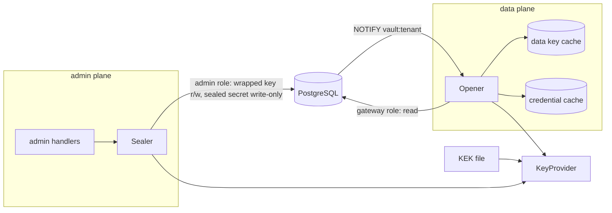

# Sprint 2.1 — Vault

- Epic: [2 — Vault and catalogue](../epic.md)
- Implementation plan: [plan.md](plan.md)
- Previous sprint: [1.3 — Service accounts, virtual keys, authorization core, audit](../../01-foundations/1.3-service-accounts-keys-authz-audit/sprint.md)
- Decisions implemented: ADR [0008](../../../../docs/adr/0008-vault-envelope-encryption.md)
  (primary), [0004](../../../../docs/adr/0004-postgresql-and-rls.md) and
  [0027](../../../../docs/adr/0027-database-roles-and-session-context.md) (tables, roles, session),
  [0007](../../../../docs/adr/0007-authorization-rbac.md) and
  [0031](../../../../docs/adr/0031-authorization-core-and-provisioning.md) (permissions,
  provisioning), [0030](../../../../docs/adr/0030-keys-format-storage-lookup.md) (listener, cache
  pattern), [0032](../../../../docs/adr/0032-audit-log-first-version.md),
  [0017](../../../../docs/adr/0017-admin-api-spec-first.md),
  [0019](../../../../docs/adr/0019-configuration.md),
  [0020](../../../../docs/adr/0020-error-contract.md),
  [0018](../../../../docs/adr/0018-supply-chain.md) (no new dependency)
- New decision records written by this sprint: 0033 and 0034 (content in [plan.md](plan.md),
  part E)

This document is the design. The implementer follows [plan.md](plan.md); a gap in either document
is raised as a question, not filled silently ([planning/README.md](../../../README.md)).

Maintainer decisions of epic 1 taken as given: database TLS is `verify-full` or `disable` only;
one installation per PostgreSQL cluster; service accounts are disabled, not deleted; certificate
reload is 8.2; `--key-stdin` and proxy support for the CLI are deferred; provider traffic does
not honour `HTTPS_PROXY` until 3.1; the in-repository API generator stays.

## 1. Outcome

A tenant registers provider credentials through the administration API and the CLI. Each secret
is sealed with AES-256-GCM under a key derived from the tenant's data key, which is itself
wrapped by a key-encryption key that lives in a file outside the database. After the write no
API operation, no log line, no audit row and no database role other than the gateway's can
return the secret; the admin role cannot read even the sealed bytes. The gateway side can open a
credential for an authenticated and authorized principal through bounded caches whose lifetime
is the documented revocation bound. A platform administrator sees metadata and can disable or
revoke with a reason, and nothing else.

At the end of the sprint: `pandokos kek generate`, `serve` with `vault.kek.local.key_file`,
`pandokos credential create --secret-file …` and the fourteen new operations work; the canary
suite finds no secret in any output; a sealed secret copied onto another row does not open.
The inference route still uses `skeleton.openai.*` (section 2).

## 2. Scope

### In scope

- `internal/vault`: the `KeyProvider` interface, the local-file provider with key versions, the
  envelope (seal, open, fingerprint), the admin-side `Sealer`, the gateway-side `Opener` with
  its two caches, the provider validator.
- Migration `0003_vault`: `kek_version`, `tenant_data_key`, `provider_credential`, the view
  `provider_credential_metadata`, `virtual_key.credential_id`, vault notifications.
- The data key of a tenant, created inside `createTenant` and, for tenants that predate this
  sprint, at their first credential write.
- Credential operations (create, read, list, update, replace secret, disable, enable, set
  default, revoke, delete), platform oversight operations (read, list, disable, revoke), the
  pin of a virtual key, their CLI commands, permissions, audit actions.
- Optional validation at write time, for the one provider whose endpoint the installation knows.
- Configuration keys, start-up check of the key-encryption key, `pandokos kek generate`.
- Lint rule L-19 (views), isolation fixtures, canary suite, operations guide with the recovery
  procedure (draft).

### Not in scope

| Item | Sprint |
|---|---|
| The inference route taking the provider key from the vault; mapping `Opener` errors to `no_credential` and the other codes of ADR 0020; removal of `skeleton.openai.*` | 3.1 |
| Provider egress guard, `HTTPS_PROXY`, validation against catalogue endpoints and for more providers | 3.1 (with 2.2's endpoints) |
| The `provider` table and the foreign key from `provider_credential.provider` | 2.2 |
| Usage record carrying the credential ID (the durable half of VLT-15); spans, hence canaries in traces | 3.2 |
| Key-encryption key rotation and the re-wrap job (VLT-10); more than one configured key file | 6.x (R2) |
| Cryptographic erasure on tenant deletion (VLT-11); removal of data keys | 6.3 |
| External KMS or transit provider (the S half of VLT-12) | 8.x (R4) |
| Platform-owned credentials (the R3 half of VLT-02) | 7.1 |
| Audit read API (a tenant reads the reason of a platform action on the credential itself until then) | 6.2 |
| Roles *credential manager* and the other built-in roles (AZ-03, AZ-10) | 4.3 |
| `serve --role`: admin and gateway in separate processes | 8.2 |
| Console pages | 11.x |

## 3. Requirements claimed

Wording quoted from [docs/requirements](../../../../docs/requirements/README.md).

| ID | Requirement (quoted) | What this sprint delivers | Claim |
|---|---|---|---|
| VLT-01 | "A tenant can register several labelled credentials per provider. Exactly one is the default for each provider; a virtual key can be pinned to a specific credential. Pandokos never chooses between credentials on its own" | `label` unique per tenant and provider; the first credential of a provider is its default and the default moves only by `setDefaultCredential`; a disabled or revoked default makes `Open` fail, never fall back; `virtual_key.credential_id`; resolution rule of section 5.6 | full |
| VLT-02 | "Credentials owned by a tenant (BYOK) and by the platform are distinguishable in ownership, cost responsibility and policy" | `owner: tenant` in every metadata response; `provider_credential` holds tenant-owned credentials only | BYOK (R1) |
| VLT-03 | "A credential can be created, validated, replaced, disabled, revoked and deleted without recreating the tenant or its permissions" | The operations of section 5.4; replacing keeps ID, label, default and pins | full |
| VLT-04 | "No API returns a secret after it is written. Only metadata is readable: provider, label, fingerprint, status, owner, timestamps of creation, validation and rotation, expiry if known" | The schema `Credential` has exactly those members plus the state bookkeeping; the admin database role has no `SELECT` on the sealed column, so a handler cannot return it even by mistake (T-321, T-341) | full |
| VLT-05 | "A credential can be checked against the provider when it is written, without being logged" | `validate: true` on create and replace, for `openai` (section 5.8); T-307, T-344 | `openai`; other providers 3.1 |
| VLT-06 | "A secret is decrypted only by the data plane, only after the request is authenticated and authorized, and only for the time needed to call the provider plus a bounded cache lifetime" | Only the gateway role can read sealed secrets; `Opener.Open` takes a principal and checks `credential:use`; plaintext is cached for `cache.credential_ttl` (at most 60 s). The admin plane encrypts and never decrypts a credential | full for the vault; the caller is 3.1 |
| VLT-07 | "A credential cannot be used for another tenant: it is bound to its tenant cryptographically and by row-level security" | Per-tenant keys; associated data with tenant, credential and key version; forced row-level security on both tables; T-302, T-325 | full |
| VLT-08 | "Disabling or revoking a credential takes effect within a documented maximum time" | At most `cache.credential_ttl` after the commit (default 30 s, cannot exceed 60 s), normally under one second; `docs/operations/vault.md`; T-326, T-327 | full |
| VLT-09 | "Secrets are encrypted at rest with authenticated encryption under a per-tenant data key, itself wrapped by a key-encryption key that is never stored in the database" | Section 5.2; T-300 to T-303, T-361 (no key material in any table) | full |
| VLT-12 | "The key-encryption key comes from a pluggable provider: a local key file by default, an external KMS or transit service optionally" | `vault.KeyProvider`, `vault.LocalProvider`, `vault.kek.provider: local` | local (M, R1) |
| VLT-13 | "Database backups contain only ciphertext and wrapped keys. The key-encryption key is backed up separately, and the procedure is documented" | T-361 scans every column of every table for the canary and for the key-encryption key; `docs/operations/vault.md` | full |
| VLT-14 | "Secrets never appear in logs, traces, metrics, error messages, events or diagnostics. Automated tests plant canary secrets and search every output for them" | T-341, T-344, T-361, T-362 over responses, logs at debug level, CLI output, audit rows, every table; types that cannot be printed (T-304) | full for the outputs that exist (no traces, metrics or events yet) |
| VLT-15 | "Each use of a credential is attributable to a request, tenant and caller" | `Open` cannot be called without a principal and a request ID and returns the credential ID; debug line `credential opened` | the seam; completed by 3.1 (request log) and 3.2 (usage record) |
| VLT-16 | "The security limits of the vault and the recovery procedure for lost or compromised keys are documented, distinguishing recoverable secrets from those the owner must re-enter" | `docs/operations/vault.md` with `deploy/postgres/recover-lost-kek.sql`, exercised by T-329 | draft (R1) |
| AZ-08 | "No platform role can read, export or replace a tenant's secret. A platform admin can see credential metadata and can disable or revoke a tenant credential, with a reason, on the audit record" | Four platform operations with `tenant_credential:read` and `tenant_credential:revoke`; mandatory reason; audit row in the tenant's log with actor type `platform`; no platform operation writes a secret; column privileges (T-321, T-342) | full |

Touched, not claimed: **IAM-04** (the pin is one more restriction of a key); **AZ-02** (rotate,
delete and use become distinct permissions for credentials); **AUD-01** (credentials join the
audited resources); **TEN-06** (vault and its caches are tenant-keyed); **VLT-10**, **VLT-11**
(seams only: `kek_version`, `Available`, the data key row).

## 4. Repository layout

```
internal/vault/                      new
  provider.go    KeyProvider, errors
  local.go       LocalProvider, GenerateLocalKey
  envelope.go    DataKey: derive, Seal, Open, Fingerprint; Hint; associated data
  sealer.go      Sealer (admin plane): data keys and sealing inside a store.Tx
  opener.go      Opener (data plane): Open, caches, Invalidate, Flush
  check.go       Check: start-up self-test and key version check
  validate.go    Validator, NewOpenAIValidator
internal/admin/credentials.go        new: tenant operations
internal/admin/tenant_credentials.go new: platform operations
internal/store/migrations/sql/0003_vault.sql
internal/store/queries/sql/vault.sql, credentials.sql   (and virtual_keys.sql changed)
cmd/pandokos/kek.go                  new: `kek generate`
deploy/postgres/recover-lost-kek.sql new
docs/operations/vault.md             new
```

Import rules (extended T-R13): `internal/vault` may import `authz`, `secret`, `store`,
`store/queries`, `tenant` and the standard library; it must not reach `admin`, `adminapi`,
`gateway`, `family`, `server`, `cli`, `config`. `internal/admin` may import `vault`.
`internal/gateway` still cannot reach `store`, hence not `vault`: 3.1 gives it an interface.
`crypto/aes`, `crypto/cipher` and `crypto/hkdf` are imported by `internal/vault` only (T-R21).

## 5. Architecture



### 5.1 Key provider and the local provider

```go
// KeyProvider wraps and unwraps data keys with a key-encryption key that it never reveals.
type KeyProvider interface {
    Name() string // "local"
    // Wrap encrypts plaintext under the active key version and binds aad.
    Wrap(ctx context.Context, plaintext, aad []byte) (version string, wrapped []byte, err error)
    // Unwrap fails with ErrKeyVersionUnknown or ErrUnwrap; it never returns partial data.
    Unwrap(ctx context.Context, version string, wrapped, aad []byte) ([]byte, error)
    // Available reports whether Unwrap can serve that version now.
    Available(ctx context.Context, version string) error
}

func NewLocalProvider(key secret.Secret) (*LocalProvider, error) // the content of the key file
func GenerateLocalKey() (secret.Secret, error)                    // for `kek generate`
```

- **Key file.** One line: the standard base64 encoding, with padding, of 32 bytes from
  `crypto/rand` (44 characters). It is read with `secret.ReadFile` (white space trimmed, at most
  8192 bytes, no control character). Anything that does not decode to exactly 32 bytes is a
  configuration error that quotes nothing.
- **Version identifier.** `local-` followed by the first 8 bytes, in hexadecimal, of
  `SHA-256("pandokos kek id v1" ‖ 0x00 ‖ key)`. It is derived, not chosen, so a wrong file can
  never be taken for the right one. It reveals nothing useful: the key is 256 uniformly random
  bits, and a wrapped data key already lets a holder of the database test a guess.
- **Wrapping.** AES-256-GCM with the key-encryption key as the key and a random 96-bit nonce
  (`cipher.NewGCMWithRandomNonce`, Go 1.24+). The stored bytes are
  `0x01 ‖ nonce(12) ‖ ciphertext(32) ‖ tag(16)`: 61 bytes. The format byte belongs to the
  provider; the vault treats `wrapped` as opaque.
- **Versions.** The provider holds a map from identifier to key and one active identifier. This
  sprint loads one key, so the map has one entry; VLT-10 adds retired keys by adding entries.
  `Unwrap` selects by the identifier stored with the row.
- **File permissions.** `config` warns, and does not refuse, when the file grants any
  permission to *other* (`mode & 0o007 != 0`) (open point O-2). Symbolic links are followed
  (Kubernetes mounts secrets that way). The file must be a regular file.

### 5.2 Envelope

All of it is `crypto/aes`, `crypto/cipher`, `crypto/hkdf`, `crypto/hmac`, `crypto/sha256`,
`crypto/rand`.

**Data key.** 32 bytes from `crypto/rand`, one per tenant, `version` 1. It is never used
directly: two subkeys are derived with HKDF-SHA-256 (`hkdf.Key`, no salt, 32 bytes each):

| Subkey | `info` | Use |
|---|---|---|
| encryption | `pandokos/vault/v1/credential-encryption` | AES-256-GCM key for the tenant's credentials |
| fingerprint | `pandokos/vault/v1/credential-fingerprint` | HMAC-SHA-256 key for fingerprints |

**Associated data**, fixed-length fields after a NUL-terminated label, so no two inputs encode
alike:

```
data key:    "pandokos/dek/v1"        0x00  tenant_id[16]  be32(data_key_version)
credential:  "pandokos/credential/v1" 0x00  tenant_id[16]  credential_id[16]  be32(data_key_version)
```

`tenant_id` and `credential_id` are the 16 raw bytes of the UUID. The key version bound into a
credential is the version of the **data key** (ADR 0008 says "key version"): the version of the
key-encryption key is not bound, because re-wrapping must not touch credentials.

**Sealed secret**: `0x01 ‖ nonce(12) ‖ ciphertext ‖ tag(16)`, nonce random per seal
(`NewGCMWithRandomNonce`), so 29 bytes longer than the plaintext. An unknown format byte, a
short input or a failed tag is one error, `ErrUndecryptable`, with no detail.

**Nonce bound.** With random 96-bit nonces a key must not seal more than 2^32 messages (NIST
SP 800-38D; the Go documentation states the same bound). A tenant's encryption key seals one
message per credential write; a key-encryption key wraps one message per tenant. Both stay
many orders of magnitude below the bound; no counter is kept.

**Fingerprint**: the first 16 bytes of `HMAC-SHA-256(fingerprint key, secret)`, as 32
hexadecimal characters. Because the key is derived from the tenant's data key, a fingerprint
cannot be tested against candidate secrets by somebody who holds only the database, and equal
secrets in two tenants have different fingerprints, so the platform cannot correlate them.
**Hint**: the last four characters of the secret, or the empty string when the secret has fewer
than 16 characters.

```go
type DataKey struct{ /* subkeys; no exported field; every formatting path prints "[REDACTED]" */ }

func NewDataKey(raw []byte, id tenant.ID, version int32) (*DataKey, error) // len(raw) must be 32
func (k *DataKey) Seal(credentialID string, plaintext []byte) ([]byte, error)
func (k *DataKey) Open(credentialID string, sealed []byte) ([]byte, error)
func (k *DataKey) Fingerprint(plaintext []byte) string
func Hint(secret string) string
```

**Memory.** What Go allows, no more: transient byte slices the vault owns (the raw data key
after derivation, the plaintext after it became a `secret.Secret`, the decoded key file) are
overwritten with `clear`. Cached material is immutable and is dropped, not overwritten: another
goroutine may be using it. Strings cannot be wiped, memory is not locked, and a core dump or a
debugger on a running gateway exposes the secrets in use; ADR 0008 already states this limit and
the operations guide repeats it.

### 5.3 Schema

Full SQL in plan.md appendix A; verified on PostgreSQL 16.

| Table | Scope | Columns of note | Grants |
|---|---|---|---|
| `kek_version` | global, unrestricted (it describes the installation) | `id`, `provider`, `created_at` | all three roles `SELECT`; admin `INSERT (id, provider)` |
| `tenant_data_key` | tenant | `version` (1), `kek_version` → `kek_version.id`, `wrapped_key` | gateway `SELECT`; admin `SELECT`, `INSERT (tenant_id, version, kek_version, wrapped_key)`. Nobody updates or deletes yet |
| `provider_credential` | tenant | `provider`, `label`, `state`, `is_default`, `key_version`, `secret` (sealed, `NULL` once revoked), `fingerprint`, `hint`, `expires_at`, `validated_at`, `rotated_at`, `state_changed_at`, `state_changed_by`, `state_reason` | gateway `SELECT`; admin `SELECT` on every column **except `secret`**, `INSERT` and `UPDATE` on listed columns, `DELETE`; worker nothing |
| `provider_credential_metadata` | view, `security_invoker`, `security_barrier` | every column of `provider_credential` except `secret` | admin `SELECT` |
| `virtual_key` | tenant | new `credential_id`, foreign key `(tenant_id, credential_id)` with `ON DELETE SET NULL (credential_id)` | admin `INSERT (credential_id)` added |

- Both new tenant tables have `tenant_id` in the primary key, forced row-level security and the
  canonical `tenant_isolation` policy. No other policy is added: **a transaction in platform
  scope, or with no scope, sees no row of either table and none of the view**, for every role.
- `provider_credential_guard` (trigger) enforces the lifecycle in the database: created
  `active`; `active` and `disabled` alternate; `revoked` is final and sets `secret` to `NULL` in
  the same statement; only a revocation removes the secret; the provider is immutable;
  `rotated_at` and `state_changed_at` are the database's; a replaced secret loses
  `validated_at` unless the statement sets it; a revoked credential cannot become the default.
- A partial unique index allows at most one default per tenant and provider.
- `virtual_key_pin_guard` lets `credential_id` change only to `NULL`, which is what the foreign
  key does when the credential is deleted. The admin role has no `UPDATE` on the column.
- `notify_vault()` sends `vault:<tenant id>` on `pandokos_cache` after any change of a
  credential and after an update or removal of a data key.
- **Lint.** `Spec.Views` gets `provider_credential_metadata`; `Spec.Global` gets `kek_version`;
  new rule **L-19**: every view has `security_invoker=true`. The grants matrix (L-12) pins the
  column lists above, so a later grant of `secret` to the admin role fails the build.

### 5.4 Administration API

Full additions in plan.md appendix B; `internal/apigen` accepts them unchanged (35 operations).

| Operation | Method and path | Permission | Notes |
|---|---|---|---|
| `listCredentials` | `GET /v1/tenants/{tenant}/credentials` | `credential:read` | filters `state`, `provider`; `sort` `created_at`, `-created_at` |
| `createCredential` | `POST` same | `credential:write` | 201; `validate` optional |
| `getCredential` | `GET …/credentials/{credential}` | `credential:read` | |
| `updateCredential` | `PATCH` same | `credential:write` | `label`, `description`, `expires_at` (nullable) |
| `deleteCredential` | `DELETE` same | `credential:delete` | 200 with the metadata as it was |
| `replaceCredentialSecret` | `PUT …/{credential}/secret` | `credential:rotate` | `validate` optional |
| `disableCredential`, `enableCredential`, `setDefaultCredential` | `POST …/{credential}/disable`, `/enable`, `/set-default` | `credential:write` | optional reason; idempotent |
| `revokeCredential` | `POST …/{credential}/revoke` | `credential:delete` | optional reason; idempotent; final |
| `listTenantCredentials`, `getTenantCredential` | `GET /v1/tenant-credentials/{tenant}`, `…/{tenant}/{credential}` | `tenant_credential:read` | platform |
| `disableTenantCredential`, `revokeTenantCredential` | `POST /v1/tenant-credentials/{tenant}/{credential}/disable`, `/revoke` | `tenant_credential:revoke` | platform; **reason required** |

`VirtualKey` and `VirtualKeyCreate` gain the optional `credential_id`.

**Rules of the handlers.**

- `provider` must be in `vault.Providers()`, this sprint `openai` and `anthropic`, else
  `invalid_request` on `provider` (D-9).
- `secret`: 8 to 8192 bytes, no control character, no white space at either end. A message
  names the member and the rule, never the value.
- `label` taken → `conflict`. A credential that does not exist or belongs to another tenant →
  `not_found`, identical.
- State changes: the row is locked (`LockCredential`), then:

  | Operation | `active` | `disabled` | `revoked` |
  |---|---|---|---|
  | disable | → `disabled` | no change, 200 | `invalid_state` |
  | enable | no change, 200 | → `active` | `invalid_state` |
  | revoke | → `revoked` | → `revoked` | no change, 200 |
  | replace secret | allowed | allowed | `invalid_state` |
  | set default | allowed | allowed | `invalid_state` |

  An operation that changes nothing writes no audit row. A tenant may enable a credential that
  the platform disabled (open point O-5).
- Default: the first credential of a provider is created with `is_default = true` (decided in
  the `INSERT` itself; a lost race on the unique index is retried once). `setDefaultCredential`
  clears the old default and sets the new one in one transaction. Revoking or disabling the
  default does not move it.
- Delete: `invalid_state` while a virtual key that is neither revoked nor expired is pinned to
  it, and while it is the default and another credential of the provider is not revoked. The
  row is locked before the pins are counted. Pins of revoked and expired keys are cleared by the
  foreign key.
- `createVirtualKey` with `credential_id`: the credential must exist in the tenant and not be
  revoked, else `invalid_request` on `credential_id`, the same for a credential of another
  tenant and a missing one.
- Platform operations authorize with the platform permission, then run in the session of the
  tenant named in the path (`WithTenant`), read through the view, verify that the tenant exists
  (`not_found` otherwise) and write the audit row in that tenant's log (D-7).

**Problem codes added** (ADR 0020, administration side):

| `code` | Status | Title | Detail (fixed) | Raised when |
|---|---|---|---|---|
| `credential_rejected` | 422 | Credential rejected | The provider did not accept the credential. Nothing was stored. | `validate` and the provider answered 401 or 403 |
| `validation_unavailable` | 502 | Validation unavailable | The provider could not confirm the credential. Nothing was stored. | `validate` and anything else but 2xx, 401, 403 |

A key-encryption key version that is not available, or a data key that does not unwrap, is
`unavailable` (503) on a write, with the error log line of section 5.10.

### 5.5 Permissions and roles

| Permission | Scope | Allows |
|---|---|---|
| `credential:read` | tenant | Reading and listing provider credentials (metadata) |
| `credential:write` | tenant | Registering a credential; changing its label, description and expiry; disabling and enabling it; choosing the default |
| `credential:rotate` | tenant | Replacing the secret of a credential |
| `credential:delete` | tenant | Revoking and deleting a credential |
| `credential:use` | tenant | Having one's model calls authenticated to the provider with a credential of the tenant |
| `tenant_credential:read` | platform | Reading and listing the credentials of a tenant (metadata) |
| `tenant_credential:revoke` | platform | Disabling or revoking a credential of a tenant, with a reason |

Appended to the catalogue in this order (20 permissions). `tenant-admin` gains the five tenant
permissions; `inference` gains `credential:use`; `platform-admin` gains the two platform ones.
A key limited by `scopes` needs `credential:use` next to `model:invoke` once 3.1 opens
credentials for inference (open point O-4); `docs/operations/keys.md` says so now.
`authz.Principal` gains `CredentialID string` (the pin of the key in use; empty for none),
filled by `authn` from `GetKeyPrincipal`.

### 5.6 Gateway side: `Opener`

```go
type OpenerOptions struct {
    DB            *store.DB     // the gateway pool
    Provider      KeyProvider
    Logger        *slog.Logger
    Now           func() time.Time // time.Now when nil
    CredentialTTL time.Duration    // cache.credential_ttl
    DataKeyTTL    time.Duration    // cache.data_key_ttl
}
type Use struct {
    Principal authz.Principal // the authenticated caller
    RequestID string          // required
    Provider  string          // provider of the call
}
type Opened struct {
    ID, Provider, Label, Fingerprint string
    Pinned bool
    Secret secret.Secret
}
func NewOpener(o OpenerOptions) (*Opener, error)
func (o *Opener) Open(ctx context.Context, u Use) (Opened, error)
func (o *Opener) Invalidate(payload string) // listener OnNotify
func (o *Opener) Flush()                    // listener OnReset
```

**Order inside `Open`.** (1) `u.RequestID` and `u.Provider` are set, else an error.
(2) `authz.Decide(u.Principal, credential:use, Target{TenantID: u.Principal.TenantID})` must
allow: `ErrDenied` otherwise; this is where VLT-06's "after the request is authenticated and
authorized" is enforced, by the shape of the function. (3) Resolution. (4) Cache or database.

**Resolution** (D-6). If the principal's key is pinned and the pinned credential's provider is
`u.Provider`, that credential is used and nothing else: if it is disabled or revoked the call
fails. Otherwise the default of `(tenant, u.Provider)` is used; no default, or a default that is
not `active`, fails. There is no third rule.

**Errors**: `ErrDenied`; `ErrNoCredential` (no default, or the ID is not visible in the
tenant); `*NotUsableError{State}` (`disabled`, `revoked`); `ErrUnavailable` (database or
key-encryption key out of reach; wraps the cause class); `ErrUndecryptable` (the data key does
not unwrap or the tag fails). 3.1 maps them to ADR 0020 codes.

**Caches.** Same construction as the principal cache of 1.3: a map under a mutex, an entry
lives for the lifetime from its creation however often it is read, a full map is emptied.

| Cache | Key | Value | Lifetime | Size |
|---|---|---|---|---|
| credential | tenant, credential ID; plus an alias tenant, provider → ID for the default | `Opened` | `cache.credential_ttl`: default 30 s, 1 s to 60 s | 10 000 entries |
| data key | tenant, version | the derived `*DataKey` | `cache.data_key_ttl`: default 5 m, 1 s to 15 m | 10 000 entries |

Only successful opens are cached. On a miss one tenant transaction of the gateway role reads the
credential row (`GetCredentialForUse` or `GetDefaultCredentialForUse`) and, if the data key is
not cached, `GetDataKey`. There is no single-flight (R-2).

**Invalidation** (payloads on `pandokos_cache`):

| Payload | `Opener` | Principal cache (`authn`) |
|---|---|---|
| `vault:<tenant>` | drops that tenant's credentials and data keys | **ignores it** (changed: before this sprint an unknown payload flushed) |
| `tenant:<tenant>` | drops that tenant's credentials and data keys | drops that tenant's principals (unchanged) |
| `platform`, `probe:…` | nothing | nothing |
| anything else | flushes | flushes |

`serve` gives the one listener of 1.3 an `OnNotify` that calls both caches and an `OnReset`
that flushes both. When the listener is down or behind a transaction pooler without
`database.direct_address`, nothing changes in the code path: the lifetime is the bound.

**Revocation bound (VLT-08)**, documented in `docs/operations/vault.md`:

| Event | Admin API | `Opener` |
|---|---|---|
| A credential is disabled, revoked, deleted or replaced; the default moves | the next request | at most `cache.credential_ttl` after the commit (default 30 s; cannot be configured above 60 s); normally under one second when notifications arrive. A call that already holds the secret completes |
| A data key is removed or re-wrapped (later sprints) | — | at most `cache.data_key_ttl` plus `cache.credential_ttl` |

`serve` constructs the `Opener` and subscribes it; nothing calls `Open` in the running binary
until 3.1.

### 5.7 Admin side: `Sealer`, data keys, start-up check

```go
func NewSealer(p KeyProvider) (*Sealer, error)
// EnsureDataKey creates version 1 of the tenant's data key if it is missing. tx is a session
// of that tenant (or the provisioning transaction after bind).
func (s *Sealer) EnsureDataKey(ctx context.Context, tx store.Tx, id tenant.ID) (created bool, kekVersion string, err error)
// Seal ensures the data key, unwraps it, seals plaintext for credentialID and computes the
// fingerprint and the hint.
func (s *Sealer) Seal(ctx context.Context, tx store.Tx, id tenant.ID, credentialID string, plaintext secret.Secret) (Sealed, error)
type Sealed struct {
    KeyVersion        int32
    Secret            []byte // sealed
    Fingerprint, Hint string
    DataKeyCreated    bool
    KEKVersion        string
}
// Check runs at start: a wrap and unwrap of random bytes, then every row of kek_version must
// name p and be Available. It returns the active version for the log line.
func Check(ctx context.Context, db *store.DB, p KeyProvider) (version string, err error)
```

- `EnsureDataKey`: `RegisterKEKVersion` (insert, do nothing on conflict), then `CreateDataKey`
  (insert, do nothing on conflict of tenant and version). Two concurrent first writes both
  wrap a fresh key; one row wins, the loser reads it back. The admin plane does not cache data
  keys.
- `createTenant` calls `EnsureDataKey` inside `store.Provision`, after `bind`, and audits
  `data_key.create`. A tenant that predates migration 0003 (or was seeded by a test) gets its
  key at its first credential write, with the same audit row.
- `Check` fails start-up when the database registers a version the provider cannot serve:
  `startup failed`, `error: "the database holds data keys wrapped by key-encryption key version
  local-… which this configuration does not provide; see docs/operations/vault.md"`. A fresh
  database has no row and passes. (Open point O-3.)
- A create or replace: read and validate the body; optional validation call (no transaction is
  open); then one tenant transaction: `NewCredentialID` (the ID must be known before sealing,
  it is in the associated data), `Seal`, the `INSERT` or `UPDATE`, audit rows.

### 5.8 Validation at write time

```go
type Verdict int // Accepted, Rejected, Indeterminate
type Validator interface {
    Validate(ctx context.Context, s secret.Secret) (v Verdict, upstreamStatus int)
}
func NewOpenAIValidator(base *url.URL, timeout time.Duration) Validator
```

- Asked per request (`validate: true`), never implied. `admin.Options.Validators` maps a
  provider identifier to a validator; `serve` registers one, for `openai`, built on
  `skeleton.openai.base_url`: the only provider endpoint an installation knows before the
  catalogue (D-10). `validate: true` for a provider without a validator is `invalid_request` on
  `validate`.
- The call: `GET <base>/models`, header `Authorization: Bearer <secret>`, nothing else of the
  request or the tenant. Its own `http.Transport`: no proxy from the environment, certificates
  verified, TLS 1.2 or later, redirects not followed, no connection reuse, total timeout 10 s,
  at most 64 KiB of the response read and discarded.
- 2xx → `Accepted` (`validated_at = now()`); 401 or 403 → `Rejected` → `credential_rejected`;
  everything else, including a redirect, a timeout and a network error → `Indeterminate` →
  `validation_unavailable`. In the last two cases nothing is stored and nothing is audited.
- The provider's response body and the error text of the HTTP client are never logged, returned
  or stored: providers echo parts of the key in error bodies. One log line carries the outcome
  and the status (section 5.10).
- The destination is operator configuration, never caller input: no request-forgery surface is
  added before the egress guard of 3.1.

### 5.9 Configuration, commands, CLI

| Key | Type | Default | Rule |
|---|---|---|---|
| `vault.kek.provider` | `local` | `local` | only `local` |
| `vault.kek.local.key_file` | path | — | required by `serve` and `config check --for serve`; not read for `migrate` or `init` |
| `cache.credential_ttl` | duration | `30s` | 1 s to 60 s |
| `cache.data_key_ttl` | duration | `5m` | 1 s to 15 m |

Environment names follow the existing rule (`PANDOKOS_VAULT_KEK_LOCAL_KEY_FILE`). The file
content lands in `Config.Vault.KEK.Local.Key secret.Secret`; `config` checks that it decodes to
32 bytes and warns about the mode (section 5.1). ADR 0019's example name `kek.file` is
illustrative; the key is the one above.

`pandokos kek generate --out FILE`: creates `FILE` exclusively with mode `0600`, writes a new
key and prints `key-encryption key written to FILE; version local-…`. It refuses an existing
file, and has no way to print the key.

API commands (each only calls the generated client): `credential list|create|get|update|replace|
disable|enable|set-default|revoke|delete` and `tenant-credential list|get|disable|revoke`.
`create` and `replace` take `--secret-file FILE` (read with `secret.ReadFile`); there is no flag
or variable that holds the secret. `key create` gains `--credential`.

### 5.10 Audit actions and log lines

Audit rows go to the tenant's log (`audit.RecordTenant`); details never hold the secret or the
sealed bytes, and `audit.marshalDetail` already refuses a member named `secret`.

| Action | Resource | Detail |
|---|---|---|
| `data_key.create` | `data_key`, ID = version | `version`, `kek_version` |
| `credential.create` | `credential` | `provider`, `label`, `fingerprint`, `hint`, `is_default`, `validated`, `expires_at` when set |
| `credential.update` | `credential` | changed members as `{from, to}` |
| `credential.rotate` | `credential` | `provider`, `label`, `fingerprint: {from, to}`, `hint`, `validated` |
| `credential.disable`, `credential.enable`, `credential.revoke` | `credential` | `provider`, `label`, `fingerprint`; `reason` column; actor type `platform` when a platform administrator did it |
| `credential.set_default` | `credential` | `provider`, `label`, `previous` (ID or empty) |
| `credential.delete` | `credential` | `provider`, `label`, `fingerprint`, `state`, `cleared_pins` |
| `virtual_key.create` | (existing) | gains `credential_id` when pinned |

| Message | Level | Fields |
|---|---|---|
| `vault ready` | info | `kek_provider`, `kek_version` |
| `credential validation` | info | `request_id`, `tenant_id`, `provider`, `outcome` (`accepted`, `rejected`, `unavailable`), `upstream_status` (0 when none), `duration_ms` |
| `credential opened` | debug | `request_id`, `tenant_id`, `principal_id`, `key_id`, `credential_id`, `provider`, `pinned`, `cache` (`hit`, `miss`) |
| `credential cannot be opened` | error | `request_id`, `tenant_id`, `credential_id`, `data_key_version`, `kek_version`, `cause` (`kek_unavailable`, `data_key_missing`, `data_key_unwrap`, `authentication`) |
| `credential cannot be sealed` | error | `request_id`, `operation`, `tenant_id`, `credential_id` (when known), `data_key_version` and `kek_version` (when known), `cause` (`kek_unavailable`, `data_key_unwrap`); the write-side counterpart, added at review |
| `vault cache flushed` | debug | `reason` (`full`, `reset`, `unknown_payload`) |

No field name ends in `_key`, `_secret`, `_token` or `_password`, so none is redacted by the
logger by accident and none needs to be.

## 6. Isolation harness

- `DefaultSpec`: grants of section 5.3; fixtures for `tenant_data_key` and
  `provider_credential` (plan.md B2); `Views`; `Global`. T-143 then runs its ten statements for
  both tables, every role, both sessions, directly and through the pooler.
- T-270 to T-274 cover the new operations once `apitest.CallFor`, `apitest.Params.Credential`
  and `platformAndSelf` know them; T-270's second-parameter check extends to `{credential}` and
  its body-member check to `credential_id` of `createVirtualKey`.

## 7. Test infrastructure and CI

- `fixtures.CanaryCredential`, a fourth canary, in `Canaries()`.
- `test/fakeprovider`: `GET /v1/models` answers 200 to the credentials it is told to accept and
  401 **with the presented key echoed in the body** to others; switches for 403, 429, 500, a
  redirect and a stall.
- `testutil.WriteKEK(tb)` returns the path of a key file generated for the test; `apitest`
  builds a `Sealer` from one; `dbtest.Env` and the e2e and container helpers pass
  `PANDOKOS_VAULT_KEK_LOCAL_KEY_FILE`. No key material is committed (T-R19 stays green).
- CI needs no new job or service: the suites run in the existing `test` and `image` jobs.

## 8. Decisions

| # | Decision | Reason |
|---|---|---|
| D-1 | **AES-256-GCM with random 96-bit nonces through `cipher.NewGCMWithRandomNonce`; a format byte in front of every sealed value** | ADR 0008 fixes the algorithm. The constructor (Go 1.24, the floor is 1.25) owns nonce generation and placement, which removes the one mistake that breaks GCM. The format byte lets a later version change algorithm without guessing |
| D-2 | **The data key is a root: an encryption key and a fingerprint key are derived from it with HKDF-SHA-256** | One key, one purpose. The fingerprint needs a key that is per tenant and absent from a stolen database; deriving it avoids a second wrapped object. ADR 0008 said "encrypted with the tenant DEK": refined in ADR 0033; the architecture overview already lists HKDF |
| D-3 | **Associated data are fixed-length binary fields after a versioned label, and bind the data key version, not the key-encryption key version** | Unambiguous without a parser. Re-wrapping (VLT-10) must leave credentials untouched, so the outer key's version cannot be inside them; it is bound to nothing but the wrapped data key's row |
| D-4 | **The identifier of a local key-encryption key is derived from the key** | An operator-chosen label can be attached to the wrong file. With a derived identifier a wrong file is always a different version, which `Check` reports at start instead of failing tenant by tenant |
| D-5 | **`kek_version` exists now, and `serve` refuses to start when the database names a version the configuration lacks** | Runtime roles cannot look across tenants, so without a global registry nobody can tell at start that the key file is wrong. Starting anyway would create new tenants under a second key while every older credential fails. The table is also the record VLT-10 asks for |
| D-6 | **A key has one pin; a pinned key uses its pin for that credential's provider and the tenant's default for any other provider; nothing falls back** | 1.3 reserved one nullable column. The default is the tenant's own explicit choice, so using it is not "choosing on its own" (VLT-01). A disabled or revoked credential fails closed. Open point O-6 |
| D-7 | **The admin role holds no `SELECT` on the sealed secret in any session. Platform operations name a tenant and run in that tenant's session through the metadata view; no platform-scope policy is added to vault tables** | Stronger than the data model's "cannot read ciphertext when acting as platform": the API process cannot read it at all, so AZ-08 does not rest on handler code. The canonical single policy and lint rule L-09 stay intact, and a platform-scope transaction sees nothing of the vault. The price is no cross-tenant search by fingerprint or hint. The view is the named allow-list of metadata columns. Amends the data model page; open point O-1 |
| D-8 | **Revocation destroys the sealed secret in the same statement and keeps the metadata; deletion removes the row** | A revoked credential must not be recoverable from the live database, and its fingerprint must stay recognizable in the list and the audit log. Deletion is then housekeeping, and can be refused for consistency reasons without weakening a revocation |
| D-9 | **A credential names its provider by a stable identifier checked against a list in code (`openai`, `anthropic`)** | The catalogue is 2.2. The identifiers are the names 2.2 will seed; 2.2 adds the foreign key and deletes the list (section 11) |
| D-10 | **Validation is implemented for `openai` only, against `skeleton.openai.base_url`, from the admin plane, and only when the request asks** | It is the one endpoint the installation knows. A fixed operator-configured destination needs no egress guard. Other providers answer `invalid_request` instead of pretending. Open point O-7 |
| D-11 | **Permissions `credential:read`, `write`, `rotate`, `delete`, `use`; platform `tenant_credential:read`, `revoke`** | AZ-02 requires read, write, delete, rotate and use to be distinct. 1.3 foresaw three; the two extra cost nothing and AZ-10 needs them. A platform principal is denied every tenant permission (ADR 0031), so oversight needs platform permissions and its own paths |
| D-12 | **`credential:use` is checked inside `Opener.Open`, which takes the principal** | The vault cannot be asked for a secret without saying for whom; 3.1 cannot forget the check |
| D-13 | **Caches copy the principal cache: fixed lifetime from creation, flush when full, no single-flight; the lifetime is the bound, notifications only shorten it** | One mechanism to understand and test; ADR 0030 already argues it |
| D-14 | **New payload `vault:<tenant>`; the principal cache learns to ignore it** | A credential change must not drop principals, and a service-account change dropping the tenant's vault entries is harmless. Unknown payloads still flush |
| D-15 | **Data keys are created with the tenant and, when missing, at the first credential write** | 1.3 asked for creation in `Provision`. Tenants created before migration 0003 exist in every development and test database, and a migration cannot create keys (it has no key-encryption key) |
| D-16 | **No foreign key from a credential to its data key** | The order in which 6.3 destroys the data key and removes credentials stays open. A credential without its data key fails closed |
| D-17 | **`DELETE` returns 200 with the metadata as it was** | The generator requires one 2xx response with a JSON body; no generator change for a cosmetic 204 |
| D-18 | **The key file is warned about, not refused, when readable by others** | Kubernetes secret volumes default to mode 0644 and Docker secrets to 0444; a refusal would break the two deployments the product targets. Open point O-2 |

## 9. Tests

Levels: U unit, D database (`make db-up`), A in-process API (`test/apitest`), E end-to-end
with the built binary, C container, R repository. IDs continue after T-292 and T-R19.

### New tests

| ID | Test | Level | Proves | Requirement |
|---|---|---|---|---|
| T-300 | `vault.TestLocalProvider` | U | Key file content: accepts 44-character standard base64 of 32 bytes; refuses other lengths, the URL alphabet, hexadecimal, inner white space, with errors that quote nothing. Identifier is `local-` plus 16 hexadecimal characters, stable, different per key. Wrap then unwrap returns the input; output is 61 bytes starting `0x01`; two wraps differ. Unwrap fails for: other associated data, a flipped bit in each region, truncation, another format byte (`ErrUnwrap`), an unknown version (`ErrKeyVersionUnknown`). `Available` | **VLT-09**, **VLT-12** |
| T-301 | `vault.TestFormatsAreFrozen` | U | The two associated-data encodings equal literal expected bytes for fixed inputs; the two HKDF `info` strings; a literal sealed value and a literal wrapped key, made once from synthetic byte sequences, still open | VLT-09 |
| T-302 | `vault.TestSealOpen` | U | Round trip; 1000 seals of one plaintext are distinct; **under the same data key**, opening fails when the tenant, the credential ID or the key version differs; bit flips, truncation, format byte; empty plaintext refused | **VLT-07**, **VLT-09** |
| T-303 | `vault.TestFingerprintAndHint` | U | Deterministic per data key; different across data keys for one secret; 32 hexadecimal characters; not equal to an HMAC under the encryption subkey or to a plain SHA-256; hint rules (16 characters and more: last four, counted in characters; fewer: empty) | **VLT-04**, VLT-09 |
| T-304 | `vault.TestNothingPrints` | U | `DataKey`, `LocalProvider`, `Sealed`, `Opened`, `Use` under `%v`, `%+v`, `%#v`, `slog` and `encoding/json` show no key, secret or sealed byte | **VLT-14** |
| T-305 | `vault.TestOpenerCache` | U | With an injected clock and a fake source: lifetime from creation; default alias; pinned and default resolution, every row of section 5.6; `ErrDenied` without `credential:use`, for a platform principal and for a suspended tenant, before any read; `vault:` and `tenant:` drop one tenant only; `platform` and probes nothing; unknown payload and `Flush` everything; full map emptied; failures not cached; data key lifetime independent | **VLT-06**, **VLT-08**, VLT-01 |
| T-306 | `authn.TestCache` (extended) | U | `vault:<tenant>` removes no principal | TEN-10 |
| T-307 | `vault.TestOpenAIValidator` | U | Against `httptest`: 200 → accepted; 401, 403 → rejected; 429, 500, 302 (not followed), stall past the timeout, refused connection → indeterminate; the request is `GET /models` with only the bearer header added; `HTTPS_PROXY` in the environment is not used; a response body that echoes the key reaches no return value; at most 64 KiB read | **VLT-05**, VLT-14 |
| T-308 | `config` tests (extended) | U | The four keys: defaults, bounds, environment names; the key file is required for serve and not read for migrate and init; bad content, a directory, a missing file are problems that quote nothing; a file readable by others is a warning; `Keys()` and the reference stay in step | SEC-04, VLT-12 |
| T-309 | `authz.TestCatalogue`, `TestRoles` (changed) | U | Twenty permissions in order; the three roles with the permissions of section 5.5 | AZ-02 |
| T-310 | `isolation.TestSchemaLintDetects` (extended), `TestDefaultSpecMatchesDesign` (changed) | D | L-19 fires for a view without `security_invoker`; the spec is the one of sections 5.3 and 6 | TEN-07, AZ-08 |
| T-311 | `cli` tests (extended) | U | Every new operation has a command (T-219); `create` and `replace` read the secret from `--secret-file` only; no flag, variable or output carries it; `key create --credential` | API-03, VLT-14 |
| T-312 | `main.TestKEKGenerate` | U | Mode 0600; refuses an existing file; content decodes to 32 bytes; output names the version and not the key; two runs differ; without `--out` exit 2 | VLT-12, VLT-13 |
| T-320 | `isolation.TestSchemaLint` (existing T-140) | D | Zero findings with migration 0003 | TEN-05 |
| T-321 | `isolation.TestVaultColumnPrivileges` | D | Admin role in the tenant's session: `secret` is refused in a select list, `SELECT *`, `RETURNING`, `WHERE`, `COPY` (SQLSTATE 42501), and the view has no such column. Platform scope and no scope, admin and worker: zero rows from both tables and the view, or 42501. Gateway: reads `secret` in its tenant's session only, writes nothing, has no platform scope. Worker: no privilege. `kek_version`: readable by all, insertable by admin only, never updated | **AZ-08**, **VLT-04**, **VLT-06** |
| T-322 | `isolation.TestCredentialGuards` | D | The lifecycle of section 5.3 at the database, for the admin role and for the owner: each allowed and each refused transition; revocation nulls the secret; one default per provider; the pin guard; a pin to another tenant's credential violates the foreign key; deleting a credential clears pins and sends `tenant:` and `vault:` notifications; every change sends `vault:<tenant>` and nothing else in the payload | VLT-03, VLT-07, VLT-08 |
| T-323 | `queries.TestEveryStatement` (existing T-230, extended) | D | Every new `sqlc` method, directly and through the pooler | — |
| T-324 | `vault.TestSealerDB` | D | `EnsureDataKey` inside `Provision`; for a seeded tenant at first `Seal`; twenty concurrent first seals leave one data key and twenty credentials that open; `kek_version` holds the version once; the admin role never issued a statement that names `secret` in a read position | **VLT-09** |
| T-325 | `vault.TestOpenerDB` | D | Sealed through `Sealer` as admin, opened through `Opener` as gateway: the secret comes back. **A sealed secret copied by a superuser onto another tenant's row, onto another credential of the same tenant, or kept while `key_version` is changed, does not open; a wrapped data key copied to another tenant does not unwrap**; a principal of tenant B gets `ErrNoCredential` for A's ID, as for a missing one; disabled and revoked; pin and default; the error log line holds no byte of the secret or the sealed value | **VLT-06**, **VLT-07** |
| T-326 | `vault.TestRevocationWithNotifications` | D | Real listener on a direct connection, lifetime 60 s: after the commit of disable, revoke, delete, replace and set-default through the API, `Open` reflects it within 2 s | **VLT-08** |
| T-327 | `vault.TestRevocationBound` | D | No listener (and once through the pooler, where the probe fails): `Open` returns the cached result until the injected clock passes `cache.credential_ttl`, then the new state; the same for a removed data key and `cache.data_key_ttl` | **VLT-08** |
| T-328 | `vault.TestCheck` | D | Empty database passes; a registered version of another key fails with an error that names the version and holds no key byte; a registered version of another provider name fails | VLT-12, VLT-16 |
| T-329 | `vault.TestLostKeyRecovery` | D | `deploy/postgres/recover-lost-kek.sql`, run as superuser for one of two key versions: credentials sealed under it are revoked with a reason, its data keys and its `kek_version` row are gone, the other version's tenants still open their credentials, and an affected tenant can register a credential again | **VLT-16** |
| T-340 | `admin.TestCredentialLifecycle` | A | The whole table of section 5.4: create, get, list with filters and pagination, update, replace, disable, enable, set default, revoke, delete; the first is the default; every `invalid_state`, `conflict` and `invalid_request` case; idempotent repeats write no audit row; replace keeps ID, label, default and pins and changes fingerprint and `rotated_at` | **VLT-01**, **VLT-02**, **VLT-03** |
| T-341 | `admin.TestNoResponseHoldsASecret` | A | Every response of every credential operation, success and each error, and every `Location`-like header: no canary in plain, base64 or hexadecimal form, and no run of the sealed bytes read from the database by a superuser | **VLT-04**, **VLT-14**, AZ-08 |
| T-342 | `admin.TestPlatformOversight` | A | A platform key lists and reads metadata of a tenant; disable and revoke need a reason (`invalid_request` without); the row changes, `state_changed_by` is `platform`, the tenant reads the reason; the audit row is in the tenant's log with actor type `platform`; an unknown tenant is `not_found`; no operation with a platform permission accepts a member named `secret`; a platform key is refused all ten tenant operations | **AZ-08** |
| T-343 | `admin.TestCredentialAudit` (with T-281, T-282 extended) | A | Every mutating operation writes the row of section 5.10 with the request ID of the response; `data_key.create` at `createTenant` and at a lazy creation; a failing audit insert rolls the credential change back; no detail holds the canary | AUD-01, AUD-03, VLT-14 |
| T-344 | `admin.TestValidationAtWrite` | A | With the fake provider: accepted → stored, `validated_at` set; rejected → 422, no row, the body is the fixed problem; indeterminate (500, stall) → 502, no row; `validate` for `anthropic` → 400; without `validate` the provider receives no request; the log line of section 5.10; logs at debug hold no canary although the provider echoed it | **VLT-05**, VLT-14 |
| T-345 | `admin.TestPinnedKey`, `authn` database test (extended) | A, D | `createVirtualKey` with `credential_id`; another tenant's, a missing and a revoked credential give the same 400; the key shows the pin; the principal carries it; deleting is refused while the key is usable and allowed after its revocation | **VLT-01**, IAM-04 |
| T-346 | `admin.TestCredentialPermissions` | A | A key scoped to `credential:read` lists and cannot create; one scoped to `credential:write` cannot replace or revoke; `inference` holds `credential:use` and reads nothing | AZ-02 |
| T-360 | `e2e.TestVault` | E | `kek generate`, `serve`, `tenant create`, `credential create --secret-file`, `credential list`; restart with the same key: metadata intact; start with another key: exit 1, `startup failed` with the version; start without the key: `configuration error` on `vault.kek.local.key_file` | VLT-12, SEC-04 |
| T-361 | `e2e.TestVaultCanaries` | E | At log level debug, with validation against a fake provider that echoes keys: every credential operation and failure through the CLI and the API, then a scan of process output, every response, every CLI output, and **every column of every table read as superuser** for the canary (plain, base64, hexadecimal) and for the key-encryption key (raw, base64, hexadecimal) | **VLT-13**, **VLT-14**, VLT-09 |
| T-362 | `container` test (extended) | C | The image starts with a mounted key file; its logs hold neither canary nor key | VLT-14 |
| T-R20 | `repo.TestPlanesDoNotImportEachOther` (T-R13, extended) | R | The import rules of section 4 | — |
| T-R21 | `repo.TestCryptographyInOnePlace` | R | Only `internal/vault` imports `crypto/aes`, `crypto/cipher`, `crypto/hkdf`; no package imports a cryptography module outside the standard library | VLT-09 |
| T-R22 | `repo.TestVaultGuide` | R | `docs/operations/vault.md` names each configuration key, both bounds with their numbers, the backup rule, the recovery script and the phrase that losing the key means re-entering credentials; `docs/reference` lists the new permissions, commands and codes (T-R14 extended) | VLT-13, VLT-16 |

### Changed tests of epic 1

T-140, T-142, T-143 (new tables through the spec); T-201, T-202; T-208; T-219; T-230; T-270 to
T-274 (`CallFor`, `Params.Credential`, `platformAndSelf` with the four platform operations);
T-281, T-282; T-R13, T-R14, T-R15; every test that starts `serve` or builds `admin.Options`
(a key file, a `Sealer`).

### Requirement coverage

| Requirement | Tests |
|---|---|
| VLT-01 | T-305, T-340, T-345 |
| VLT-02 | T-340 |
| VLT-03 | T-322, T-340 |
| VLT-04 | T-303, T-321, T-341 |
| VLT-05 | T-307, T-344 |
| VLT-06 | T-305, T-321, T-325 |
| VLT-07 | T-302, T-322, T-325, T-143 |
| VLT-08 | T-305, T-326, T-327 |
| VLT-09 | T-300 to T-303, T-324, T-361 |
| VLT-12 | T-300, T-308, T-312, T-328, T-360 |
| VLT-13 | T-361, T-R22 |
| VLT-14 | T-304, T-307, T-341, T-343, T-344, T-361, T-362 |
| VLT-15 | T-305 (the log line and the required fields) |
| VLT-16 | T-328, T-329, T-R22 |
| AZ-08 | T-321, T-341, T-342, T-270, T-272 |

## 10. Definition of done for this sprint

**Requirements and tests**

- [ ] Every test of section 9 exists under the stated name and passes; the changed tests pass.
- [ ] The tests-first record exists: the commit of part B precedes the implementation commits
      and the pull request quotes its failing output.
- [ ] The coverage table is repeated in the pull request with links to the CI run.

**Isolation and permissions**

- [ ] `tenant_data_key` and `provider_credential` have the canonical policy, forced row-level
      security and a fixture; T-140 reports zero findings; T-143 runs for both in both modes.
- [ ] Each of the fourteen operations names a permission of the catalogue and is exercised by
      T-270 (cross-tenant or platform classification), T-272 and T-273.
- [ ] The admin role's grants on `provider_credential` do not include `secret` (T-321).

**Secrets**

- [ ] T-341, T-344, T-361 and T-362 pass; `make secrets` passes; no key file, canary-free
      fixture or generated vector containing real key material is committed.
- [ ] The three exit conditions of the epic hold: no API path and no runtime role in platform
      scope returns a secret or its sealed form (T-321, T-341, T-342); a sealed secret copied
      to another tenant's row does not open (T-325); the canary suite finds nothing (T-361).

**Quality gates**

- [ ] `make check` passes locally and in CI (format, vet, lint, tidy, generate-check, secrets,
      tests, SDK suite, vulnerability check); `make image` and `make test-container` pass.
- [ ] `go.mod` and `go.sum` are unchanged.

**Documentation and decisions**

- [ ] `docs/operations/vault.md` exists; configuration, database, keys, container, permissions
      and admin API pages, the data model, the security model and the architecture overview are
      updated as plan.md part E lists.
- [ ] `api/openapi/admin.v1.yaml` is current and `make generate-check` passes.
- [ ] ADR 0033 and 0034 are added, ADR 0008, 0027 and 0030 carry their history lines, the ADR
      index lists the new records.
- [ ] `migrations.sum` has the line of `0003_vault.sql`.
- [ ] `status:` of this file is `done`; the review records the answers to section 12.

## 11. Consequences for later sprints

- **2.2 (catalogue)** creates `provider` with a unique, immutable name and seeds `openai` and
  `anthropic` under exactly those names; adds
  `provider_credential_provider_fkey (provider) REFERENCES provider (name)`; replaces
  `vault.Providers()` by a catalogue lookup; its cache subscribes to the same listener with its
  own payload, which the principal cache and the `Opener` must learn to ignore.
- **3.1 (gateway)** defines the interface through which `internal/gateway` receives the
  `Opener` (it cannot import `vault`); calls `Open` after `Decide` and the model check with the
  request ID; maps `ErrNoCredential` and `NotUsableError` to `no_credential` (409),
  `ErrDenied` to `forbidden`, `ErrUnavailable` and `ErrUndecryptable` to `unavailable`; puts
  `credential_id` on the request log line; removes `skeleton.openai.*` and moves the validator
  onto catalogue endpoints behind the egress guard, adding validators per provider; confirms or
  changes the pin rule of D-6; decides what a key scoped to `model:invoke` alone may do (O-4).
- **Generator**: it lacks a presence-aware optional string. `adminapi.EmptyDescription` (a `"\x00"`
  sentinel with a hand-written `CredentialUpdate.MarshalJSON`) is a stop-gap, to be replaced by that
  generator feature in the first sprint that needs another such field. The 1.3 principal cache now
  also stamps its lifetimes from the start of the lookup, as the vault caches do.
- **3.2** puts `credential_id` on the usage record (VLT-15) and adds spans: the canary suite's
  list of outputs gains traces.
- **4.3** defines *credential manager* from the five credential permissions (AZ-10).
- **6.x (VLT-10)** adds retired key files to the local provider, a worker job that re-wraps
  (grants `SELECT`, `UPDATE (kek_version, wrapped_key)` on `tenant_data_key` to the worker, per
  tenant session), and removal of a `kek_version` row once nothing references it. The trigger
  already notifies on update.
- **6.3 (deletion)** destroys the data key. It must: stop `EnsureDataKey` from recreating one
  (the tenant is `deleting`, and principals of such a tenant are already refused); decide the
  order with credential rows (D-16); and state honestly what erasure means for old backups
  (open point O-8).
- **7.1** adds platform-owned credentials in their own global table and `owner: platform`.
- **8.2** separates the processes: only then is "the admin plane cannot decrypt" a property of
  the deployment and not only of database grants (R-5). External key providers implement
  `KeyProvider`; `Available` and `Check` are their start-up hook.
- **11.x** builds the credential pages on the fourteen operations; the secret field is
  write-only in the console as in the API.

## 12. Risks and open points

### What was verified while designing

- On the test PostgreSQL 16 of `make db-up`, in a scratch database: migration `0003_vault`
  applies after 0001 and 0002 as `pandokos_owner`; the admin role is refused `secret` in a
  select list, `SELECT *`, `RETURNING`, `WHERE` and `COPY`, and can still lock a row and update
  it; the view returns rows in a tenant session and none in platform scope or without scope;
  the gateway role reads sealed secrets in its tenant only; the worker role is refused; every
  transition of the lifecycle trigger; the default index; `ON DELETE SET NULL (credential_id)`
  under forced row-level security, with the `tenant:` notification of the existing key trigger;
  the `vault:` notifications; the recovery statements as superuser.
- `sqlc` v1.31.1 (`make generate` works in the design environment) parses the migration,
  including the view options and the column-list foreign key action, and generates the query
  files of plan.md appendix C; the generated package compiles.
- `internal/apigen` generates from the document with appendix B spliced in: 35 operations.
- With Go 1.25.0: `go doc crypto/cipher.NewGCMWithRandomNonce` (96-bit nonce prepended,
  overhead 28 bytes, 2^32 bound) and `go doc crypto/hkdf` (`Key`, `Extract`, `Expand`).

**Not verified**: the Go code of `internal/vault` (not written); the behaviour of real provider
`/models` endpoints (the validator is tested against the fake provider only); file modes of
secret mounts on Kubernetes and Docker (taken from their documentation, R-8).

### Risks

| # | Risk | Mitigation |
|---|---|---|
| R-1 | **The sprint is large**: a new package with cryptography, a migration, fourteen operations, forty tests | Parts C1 to C4 have no HTTP and are reviewable alone; the formats are frozen by T-301 before anything stores data |
| R-2 | **No single-flight on a cache miss, and a full or reset cache empties at once**: a burst unwraps and reads several times | Bounded by the gateway pool; the local provider is microseconds. An external provider (8.x) must add single-flight per tenant first |
| R-3 | **Go cannot guarantee that a secret leaves memory** | Stated in ADR 0008 and the guide; transient buffers are cleared; lifetimes are short and bounded |
| R-4 | **The hint stores four characters of the secret in clear** | ADR 0008 chose it; it is withheld for secrets under 16 characters; provider keys carry far more entropy than four characters remove |
| R-5 | **In v0.1 one process holds both the admin and the gateway database users**, so a compromised process can read sealed secrets and unwrap data keys | Inherent to the single binary; the grants make the separation real as soon as 8.2 splits the roles. The security model's section on what Pandokos does not protect against covers the host |
| R-6 | **No key rotation before VLT-10 (R2)**: in v0.1 a leaked key file has no remedy inside the product except the loss procedure | Documented as a limit; the leak alone exposes nothing without the database. Open point O-10 |
| R-7 | **Validation lets a tenant administrator make the admin plane call the provider**, at the provider's rate limits | One call per authenticated write, a fixed destination, a 10 s cap; no secret but the caller's own is sent |
| R-8 | **The mode warning may be noise or may be missed** depending on how the platform mounts secrets | A warning, not a refusal (D-18); the guide shows the Kubernetes `defaultMode` and Compose settings that silence it properly |
| R-9 | **A lazily created data key** could reappear after an erasure | 6.3 owns the state check (section 11); principals of a tenant that is not active cannot write |
| R-10 | **An instance of an older build flushes its whole principal cache on every `vault:` payload** during a mixed-version roll-out | Safe by design (ADR 0030); no release exists before this sprint |
| R-11 | **The start-up refusal turns a wrong key file into a full outage** instead of a partial one | Deliberate (D-5): the message names the version and the guide; `config check` cannot see the database, so the guide tells operators to keep the old file until they have seen `vault ready` |

### Open points (raised to the maintainer; none blocks the sprint)

| # | Point | Recommendation |
|---|---|---|
| O-1 | D-7 departs from the data model page, which describes platform reads in a tenant-less session through a view. The design keeps vault tables invisible in platform scope and makes the admin role unable to read sealed secrets in any session; a platform administrator therefore always names a tenant and cannot search all tenants for a fingerprint or hint | Accept D-7 and amend the page. If cross-tenant search is wanted for incident response, add it later as one `SECURITY DEFINER` function that returns tenant and credential IDs for a hint, audited in the platform log |
| O-2 | Key file readable by others: warn or refuse | Warn in v0.1; revisit in epic 10 with a strict switch |
| O-3 | `serve` refuses to start when the database registers a key version that is not configured | Refuse (D-5) |
| O-4 | `credential:use` is separate from `model:invoke`, so a key restricted by `scopes` needs both from 3.1 on | Keep it separate (AZ-02; platform-funded calls in R3 will not need it); 3.1 documents the pair |
| O-5 | A tenant can enable a credential that a platform administrator disabled | Allow it: the platform's hard stops are revocation and tenant suspension. A lock would need a new state and AZ-08 does not ask for one |
| O-6 | One pin per key; other providers use the tenant's default (D-6). The alternative is that a pinned key may call only its credential's provider | Keep D-6 for 2.1; 3.1 confirms when the model check exists |
| O-7 | Validation exists for `openai` only and dials from the admin plane (D-10). The alternative is to ship the contract now and no call until 3.1 | Ship D-10: VLT-05 is claimed for R1 and the mechanism is the hard part |
| O-8 | ADR 0008 and VLT-11 say that destroying a data key makes ciphertext unreadable "including in backups taken before the deletion". A backup also holds the wrapped data key, so this is true only once the key-encryption key version that wrapped it is retired, or the backup has expired | Record the limit in `docs/operations/vault.md` now; correct the ADR wording and design the remedy (rotation at deletion, or retention of backups shorter than the promise) in 6.3 |
| O-9 | A secret is one opaque string of 8 to 8192 bytes. Multi-part credentials (an access key pair, a service-account document) fit as text, but the hint and the validator assume an API key | Keep; epic 9 defines structured credentials when the first such provider arrives |
| O-10 | Rotation of the key-encryption key is R2. Should it move into v0.1 (for example 3.3) given R-6? | Keep R2; the seams are in place and the limit is documented |

### Maintainer decisions on the open points (2026-11-13)

| # | Decision |
|---|---|
| O-1 | Confirmed: D-7, platform reads run in the named tenant's session; the data model page is amended. Cross-tenant search by hint, if wanted, comes later as one audited `SECURITY DEFINER` function |
| O-2 | Confirmed: warn in v0.1; a strict switch is considered in epic 10 |
| O-3 | Confirmed: `serve` refuses to start (D-5) |
| O-4 | Confirmed: `credential:use` stays separate from `model:invoke`; 3.1 documents the pair |
| O-5 | Confirmed: a tenant may re-enable a credential the platform disabled; the platform's hard stops are revocation and suspension |
| O-6 | Confirmed for 2.1 (D-6); 3.1 confirms once the model check exists |
| O-7 | Confirmed: D-10 ships now, `openai` only, from the admin plane |
| O-8 | Confirmed: the limit is documented in `docs/operations/vault.md` now; the ADR 0008 wording and the remedy are 6.3 |
| O-9 | Confirmed: one opaque string of 8 to 8192 bytes; structured credentials come with epic 9 |
| O-10 | Confirmed: rotation of the key-encryption key stays R2; the limit is documented |
