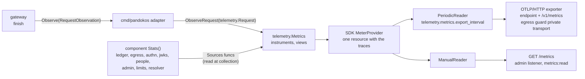

# Sprint 6.1 — Metrics and conventions

- Epic: [6 — Observability, reports and lifecycle](../epic.md)
- Implementation plan: [plan.md](plan.md)
- Previous sprint of the release: [4.3 — Roles](../../../../docs/history/epic-04-identity-and-rbac/4.3-roles/sprint.md)
- Scope: the epic file, section 6.1, with the items carried forward to 6.1 by the closed epics
  ([epic 3](../../../../docs/history/epic-03-gateway/README.md),
  [epic 4](../../../../docs/history/epic-04-identity-and-rbac/README.md),
  [epic 5](../../../../docs/history/epic-05-limits-and-budgets/README.md)) and issue #32 (the
  provider's 429 per credential). Issue #52 (a tenant dimension of telemetry) is out of scope.
- Risk class: **medium-high** (two new modules of the OpenTelemetry family; instrumentation on the
  hot path of every request; a new read path, with a new platform permission, on the
  administration listener; and the question of what operational telemetry may say about a tenant,
  which ADR 0054 and ADR 0055 settle and this sprint must not reopen)
- Decisions implemented: [ADR 0015](../../../../docs/adr/0015-observability.md) (metrics, the
  Prometheus endpoint, pinned GenAI conventions, logs);
  [0055](../../../../docs/adr/0055-operational-telemetry-holds-no-tenant-data.md) and
  [0054](../../../../docs/adr/0054-usage-data-is-the-tenants.md) (no tenant in telemetry; no cost or
  token figure per tenant); [0040](../../../../docs/adr/0040-traces.md) (the SDK, the explicit
  configuration, the collector connection, which metrics reuse);
  [0018](../../../../docs/adr/0018-supply-chain.md) (two modules);
  [0019](../../../../docs/adr/0019-configuration.md) (three keys);
  [0020](../../../../docs/adr/0020-error-contract.md) (no new code);
  [0031](../../../../docs/adr/0031-authorization-core-and-provisioning.md) and
  [0060](../../../../docs/adr/0060-built-in-roles-custom-roles-and-the-rule-against-escalation.md)
  (one platform permission); [0053](../../../../docs/adr/0053-tenant-price-lists-and-active-currency.md)
  (one cost per request, never converted or added).
- Decision records changed by this sprint: new **ADR 0062** (metrics: instruments, attributes,
  cardinality, export and the scrape endpoint) and **ADR 0063** (the log: redaction and the log
  reference); history lines on 0015, 0018, 0019, 0040, 0054, 0055 and 0060. Text in
  [plan.md](plan.md), part E.

This document is the design. The implementer follows [plan.md](plan.md); a gap in either document is
raised as a question, not filled silently ([planning/README.md](../../../README.md)).

| Given by the epic and the closed sprints | Designed in |
|---|---|
| OTLP metrics: requests, errors, time to first byte, duration, tokens, cost, limit refusals | §5.3, D-2, D-6 to D-8 |
| GenAI attributes on metrics at a pinned convention version; spans keep the Required attributes only | §5.4, §5.10, D-4, D-5 |
| No tenant label; cost and tokens per installation only; a tenant dimension is issue #52 | §5.5, D-9 |
| Prometheus endpoint on the admin listener | §5.7, D-11 |
| Redacting log handler; log reference; logs and spans hold no tenant data | §5.8, §5.9, D-15, D-16 |
| Example dashboards | §5.11, D-17 |
| The provider's 429 per provider credential, never as a tenant label (issue #32) | §5.3, D-10 |
| Carried forward by epics 3, 4 and 5 (the lists of §5.3, rows M12 to M41) | §5.3, D-3, D-19 |
| Exit: the dashboard shows latency, tokens and cost by model from a collector; with the collector stopped, inference latency is unchanged | T-931, T-932, T-929 |

## 1. Outcome

1. Pandokos **exports metrics over OTLP/HTTP** to the collector that already receives its traces,
   and, when the operator turns it on, serves them for **scraping on the administration listener**
   at `GET /metrics`, to a platform principal holding `metrics:read`.
2. The metrics of an inference request follow the **OpenTelemetry GenAI semantic conventions at
   version 1.41.0**, pinned by the import path of the Go package that defines them, reported as the
   schema URL of the meter and documented: operation duration, time to first chunk and token usage
   by provider, operation and model, plus the HTTP server duration of every request of the
   inference listener, request counts by outcome and error code, estimated cost by model and
   currency, limit refusals, and the provider's own 429 answers per provider credential.
3. Every component that the closed epics named reports its indicators: the ledger, the egress
   guard, authentication, issuer keys, sign-ins and sessions, idempotency, support actions and
   refused grants, the limiter, the reconciler, the limit events, the unlimited-traffic recorder and
   telemetry itself.
4. **No metric names a tenant**: no tenant, principal, service account, key, issuer, subject, user,
   request or trace identifier, and no setting adds one. Costs and token counts exist per
   installation only. The one identifier on a metric is the provider credential on the 429 counter.
5. Every log line goes through a **redacting handler** that removes sensitive keys and, in any value,
   the shapes of Pandokos secrets (virtual keys, session tokens, bearer values, compact JWS). Every
   log line the product writes is listed in a **log reference**, and a test fails on a line or a
   field that is not in it.
6. **Example dashboards** (Grafana, over Prometheus fed by an OpenTelemetry Collector) show latency,
   tokens and cost by model; a Compose overlay runs them next to the reference deployment.
7. With the collector stopped or stalled, inference latency is unchanged, and the process stops
   within the existing flush deadline.

## 2. Scope

### In scope

- `internal/telemetry`: the meter provider with an OTLP periodic reader and a manual reader for the
  scrape endpoint; the instrument catalogue; the Prometheus text exposition; self-observability of
  telemetry; the redacting handler.
- `internal/gateway`: one observation per request through a new port (`Metrics`), with no tenant
  field by construction.
- Counters and snapshots (`Stats()`) in `internal/ledger`, `internal/egress`, `internal/authn`,
  `internal/jwks`, `internal/account`, `internal/password`, `internal/session`, `internal/idem`,
  `internal/admin`, `internal/limits` and `internal/resolver`; one query that counts open sessions.
- `internal/server`: `GET /metrics` on the administration listener.
- `internal/authz`: the platform permission `metrics:read`.
- `internal/config`: three keys under `telemetry.metrics`.
- `cmd/pandokos`: wiring and the adapters between the components and `internal/telemetry`.
- `deploy/compose/observability/`: the overlay (collector, Prometheus, Grafana) and two dashboards.
- Tests at every level, the Compose exit test, repository tests.
- Documentation: the telemetry guide, a metrics reference, a log reference, configuration, data
  flows, the security model, the architecture overview, requirements OBS-07, ADR 0062 and 0063,
  history lines, the draft release notes of v0.2.0.

### Not in scope

| Item | Where |
|---|---|
| A tenant dimension of logs, traces or metrics, pseudonymised or not | issue #52 (ADR 0055 §9) |
| Token counts, models or any `gen_ai.*` attribute beyond the Required ones on spans (3.2 O-16) | not planned: ADR 0055 §7 supersedes it |
| `gen_ai.response.model`, `server.address`, `server.port`; `gen_ai.client.operation.time_per_output_chunk`; the `gen_ai.server.*` metrics | not emitted (D-5, D-6) |
| OTLP over gRPC; delta temporality; exemplars | not offered (3.2 O-2; D-12; D-9) |
| Usage rollups and reports; the default partition; `auth.failure` reading | 6.2 |
| The OTLP log signal (logs stay on standard output) | not planned |
| Alerting rules | the operator's; the guide names the signals worth alerting on |
| Limit rules scoped to a credential (the rest of issue #32) | after 1.0 (roadmap) |
| Reducing the allocations of the budget path (5.2: about 105 per request) | measured here (T-915), reduced in epic 8 if needed (§11) |
| A gauge of support actions open | not provided (D-19) |
| Helm values for scraping | sprint 8.2 (§11) |

## 3. Requirements claimed

The meaning is quoted from [docs/requirements](../../../../docs/requirements/README.md). OBS-07 is
reworded by this sprint (plan part E); the new wording is quoted.

| ID | Meaning | Delivered here | Extent |
|---|---|---|---|
| OBS-01 | "Pandokos is instrumented with OpenTelemetry and exports traces and metrics over OTLP. Logs are structured and written to standard output" | Metrics over OTLP/HTTP (§5.6); the redacting JSON handler on standard output (§5.8) | metrics (R2); completes it |
| OBS-03 | "Metrics follow the OpenTelemetry GenAI semantic conventions; spans carry only the attributes the conventions mark Required, and nothing of a tenant's usage (ADR 0055). The adopted version is pinned and documented, and changes are announced in release notes" | v1.41.0 pinned by import path and schema URL (§5.4); spans unchanged (§5.10); the release notes of v0.2.0 announce the version | full |
| OBS-06 | "Metrics cover requests, errors, time to first byte, total latency, tokens, estimated cost and limit rejections, by provider, model and outcome" | M1 to M11 (§5.3) | full |
| **OBS-07** (reworded) | "Tenant, caller and request identifiers are never metric labels, and no setting adds them. A tenant dimension of operational telemetry, without the tenant's identity in clear, is designed in issue #52 (ADR 0055)" | §5.5; T-900, T-925 | full |
| OBS-04 | "Telemetry holds no content and no secrets" | The redacting handler (§5.8); canaries in metrics, logs and spans (T-925, T-930) | touched |
| OBS-05 | "Endpoint, protocol, headers, sampling and resource attributes are configurable. A failing collector never blocks or slows inference" | The metrics share the collector settings; T-905, T-929, T-932 | touched (metrics) |
| USE-07 | "Tenant roles read their tenant's usage. Platform roles read no usage of a tenant: they see operational indicators of the installation, with no tenant and no cost" | The scrape endpoint and the OTLP export carry no tenant and no cost per tenant | metrics |

Not claimed: OBS-02 and OBS-08 (unchanged), USE-*, AUD-*.

## 4. Repository layout

New:

```
internal/telemetry/metrics.go          meter provider, readers, views, Sources, the Metrics type
internal/telemetry/instruments.go      the instrument catalogue (§5.3) and attribute sets
internal/telemetry/request.go          telemetry.Request and its recording (M1 to M11)
internal/telemetry/sources.go          the observable instruments over Sources (M12 to M41)
internal/telemetry/prometheus.go       text exposition 0.0.4 from a manual reader
internal/telemetry/selfobs.go          counting span processor, metric reporting exporter
internal/telemetry/redact.go           the redacting handler (value patterns, counter)
internal/telemetry/*_test.go           T-897 to T-909, T-923
cmd/pandokos/metrics.go                adapters: gateway.Metrics and the Sources of every component
deploy/compose/observability/          compose.yaml (overlay), otel-collector.yaml, prometheus.yaml,
                                       grafana/provisioning/{datasources,dashboards}/*.yaml,
                                       grafana/dashboards/pandokos-inference.json,
                                       grafana/dashboards/pandokos-internals.json
test/compose/observability_test.go     T-931, T-932
test/e2e/metrics_test.go               T-924, T-925, T-928, T-929
test/e2e/logref_test.go                the log-reference check of every e2e process (T-930)
test/repo/telemetry_test.go            T-R64 to T-R70
docs/reference/metrics.md              the instrument catalogue for operators
docs/reference/logs.md                 the log reference
docs/adr/0062-metrics-instruments-attributes-cardinality-and-scrape.md
docs/adr/0063-the-log-redaction-and-the-log-reference.md
```

Changed: `internal/telemetry/{log,traces}.go`, `internal/gateway/{handler,ports,limits}.go`,
`internal/server/server.go`, `internal/config/{config,keys,telemetry}.go`,
`internal/authz/{authz,roles}.go` and `internal/authz/testdata/roles.golden`, `internal/permdoc`,
`internal/ledger/writer.go`, `internal/egress/guard.go`, `internal/authn/{authn,token,tokens,jwt}.go`
(and a new `reasons.go`), `internal/jwks/{jwks,metadata}.go`, `internal/account`, `internal/password/password.go`,
`internal/session/session.go`, `internal/idem`, `internal/admin/{grant,support*}.go`,
`internal/limits/{memory,reconcile,events,cache}.go`, `internal/resolver/{limits,unlimited}.go`,
`internal/store/queries/sql/sessions.sql` (and the generated file), `cmd/pandokos/{serve,people}.go`,
`test/otlptest/otlptest.go` (metrics), `go.mod`, `go.sum`, the documents of plan part E.

## 5. Architecture

### 5.1 The telemetry runtime (D-1, D-12, D-13)



- `telemetry.NewMetrics(MetricsOptions) (*Metrics, error)` builds one SDK `MeterProvider` with the
  same resource as the trace provider (one `service.instance.id` per process: the resource is built
  once, `telemetry.NewResource`, and passed to both).
- Readers: a `PeriodicReader` over the OTLP/HTTP metric exporter when `telemetry.otlp.endpoint` is set
  and `telemetry.metrics.otlp` is true; a `ManualReader` when `telemetry.metrics.prometheus` is true.
  **With neither, `NewMetrics` returns a `Metrics` over the no-op meter provider**
  (`go.opentelemetry.io/otel/metric/noop`): no SDK provider, no goroutine, no aggregation; every
  recording is a no-op (T-906).
- The meter: scope name `github.com/pandokos/pandokos` (as the tracer), version
  `MetricsOptions.ServiceVersion` (the build version, as for traces), schema URL `https://opentelemetry.io/schemas/1.41.0` (the constant
  `SchemaURL` of `go.opentelemetry.io/otel/semconv/v1.41.0`).
- SDK options, all explicit: views with the bucket boundaries of §5.4; cardinality limit 2000 per
  instrument (`sdkmetric.WithCardinalityLimit(2000)`, the SDK default made explicit so that
  `OTEL_GO_X_CARDINALITY_LIMIT` cannot change it); exemplars off
  (`sdkmetric.WithExemplarFilter(exemplar.AlwaysOffFilter)`, so that
  `OTEL_METRICS_EXEMPLAR_FILTER` cannot turn them on). Cumulative temporality (the exporter's
  default, which Prometheus's OTLP receiver expects).
- Exporter: `otlpmetrichttp` with `WithEndpointURL(<endpoint>/v1/metrics)`, the headers of
  `telemetry.otlp.headers_file`, `telemetry.otlp.timeout`, no compression, no retry, and the HTTP
  client of the traces (the egress guard's private transport, no redirect). As ADR 0040 §2, no
  `OTEL_*` variable configures it; `serve` warns when `OTEL_EXPORTER_OTLP_METRICS_ENDPOINT` is set
  while `telemetry.otlp.endpoint` is empty, and when `OTEL_METRIC_EXPORT_INTERVAL` or
  `OTEL_METRIC_EXPORT_TIMEOUT` is set (ignored: Pandokos passes the interval and the timeout).
- Export failures: the exporter is wrapped (`reportingMetricExporter`, as `reportingExporter` for
  spans) and reports to a handler of its own that logs **`metric export failing`** (warn, at most
  once a minute, `count`, `error_class`). The process-wide SDK error handler, today the traces'
  `trace export failing`, becomes **`telemetry error`** (same fields): an error that reaches it is
  not attributable to one signal (D-12, O-7).
- Shutdown: `Metrics.Shutdown(ctx)` runs with `Traces.Shutdown` inside the flush deadline of
  `ledger.shutdown_flush_timeout` (the periodic reader exports once more; what cannot be sent is
  lost).

### 5.2 How measurements reach the instruments (D-2, D-3)

Two ways in, and only two:

1. **The gateway pushes one observation per request.** A new port in `internal/gateway/ports.go`:

   ```go
   // Metrics receives one observation per request of the inference listener, at its end.
   // Observe does not block and does not fail.
   type Metrics interface {
       Observe(o RequestObservation)
   }
   ```

   `RequestObservation` (§5.2.1) holds plain values and **no field that identifies a tenant, a
   caller, a key, a request or a trace**: no principal, no request ID, no trace ID, no metadata. Its
   field list is closed and checked by T-911. `finish` calls `Observe` after `logRequest`, inside a
   recover that logs `metrics observation failed` (error, `request_id`, `panic_type`) and never
   reaches the response. `Options.Metrics` is optional; nil records nothing.

   `cmd/pandokos/metrics.go` adapts it: `gatewayMetrics{m *telemetry.Metrics}` copies the struct
   into `telemetry.Request` (the same fields, owned by `internal/telemetry`) and calls
   `m.ObserveRequest`. `internal/telemetry` does not import `internal/gateway`, and the gateway does
   not import `internal/telemetry`, the SDK or `go.opentelemetry.io/otel/metric` (T-R64).

2. **Everything else is read at collection.** Each component keeps its counters (atomic, keyed by
   closed sets fixed at construction) and offers `Stats()` returning a snapshot of plain values, as
   `ledger.Writer.Stats` does today. `telemetry.MetricsOptions.Sources` is a struct of functions,
   one per component, each returning a snapshot type defined in `internal/telemetry`
   (`LedgerStats`, `EgressStats`, …); `cmd/pandokos/metrics.go` converts the component's own
   snapshot into it. Observable instruments call these functions on the reader's goroutine at each
   collection (every interval and every scrape). A nil function leaves its instruments out. No
   component imports `internal/telemetry` or the metric API, and no component does work on its own
   path for metrics beyond an atomic increment.

#### 5.2.1 The observation (contract)

```go
// RequestObservation is what the gateway measures of one request of the inference listener.
// It holds no identifier of a tenant, caller, key, request or trace (ADR 0055, ADR 0062).
type RequestObservation struct {
	Method     string        // http.request.method: the method, or "_OTHER" (logMethod's set)
	Scheme     string        // "http" or "https"
	Route      string        // the route label "/{provider}/v1/…" when matched; "" otherwise
	Status     int           // the status written; 0 when none
	Outcome    string        // the request line's outcome (§5.3, A2)
	ErrorCode  string        // the Pandokos error code; "" when none
	LimitState string        // not_evaluated, unlimited, limited, unverified
	Provider   string        // catalogue provider name; "" when the route did not match
	Family     string        // API family; "" when the route did not match
	Operation  string        // gen_ai.operation.name of the matched operation; ""
	Model      string        // catalogue model name of the resolved target; "" when not resolved
	Duration   time.Duration // the whole request, start to finish

	Forwarded      bool          // step 9 ran: the call was handed to the provider
	Call           time.Duration // from the start of step 9 to the end of the response body
	FirstChunk     time.Duration // stream calls with a first body byte: step 9 to that byte; else 0
	Stream         bool
	CallError      string        // error.type of the provider call (§5.3, A3); "" when not in error
	UpstreamStatus int           // 0 when none
	CredentialID   string        // set only when UpstreamStatus == 429

	InputTokens, OutputTokens int64  // the usage record's figures, provider or estimated
	InputSource, OutputSource string // "provider", "estimated" or "none"
	CostKnown    bool
	CostAmount   float64 // the record's cost, when known
	CostCurrency string  // ISO 4217, when known
	CostReason   string  // no_price, category_unpriced, inconsistent_usage, when not known

	Refusal  *LimitRefusalObservation // a refusal of the limits; nil otherwise
	Estimate *EstimateObservation     // a settled reservation; nil otherwise
}

// LimitRefusalObservation names the kind of limit that refused, never the rule or its subject.
type LimitRefusalObservation struct{ Code, Metric, Level, SubjectKind, Scope string }

// EstimateObservation compares what was reserved with what was settled.
type EstimateObservation struct {
	ReservedTokens, SettledTokens int64
	ReservedCost, SettledCost     float64 // same currency (one cost per request); 0 when unknown
	CostComparable                bool
}
```

`pricing.Decimal` gains `Float64() float64` (through `big.Rat`), used only to fill `CostAmount`
and `ReservedCost`/`SettledCost`; the record and the counters keep exact decimals.

### 5.3 The instrument catalogue (D-6 to D-10, D-14, D-19)

The complete list. Kinds: H histogram, C counter, G gauge (observable gauge), OC observable
counter. A `?` marks an attribute present only when it applies. The Prometheus names follow §5.7.
Every value of an attribute comes from a closed set (§5.3.1) or from the platform catalogue (the
provider and model names).

**Inference, pushed by the gateway (one `Observe` per request):**

| # | Name | Kind | Unit | Attributes | Recorded |
|---|---|---|---|---|---|
| M1 | `http.server.request.duration` | H | `s` | `http.request.method`, `url.scheme`, `http.response.status_code`?, `http.route`?, `error.type`? | every request of the inference listener except `/healthz`, `/readyz`; `Duration`; `error.type` = the status as text when ≥ 500, or the outcome when no status was written |
| M2 | `pandokos.gateway.requests` | C | `{request}` | `pandokos.outcome`, `pandokos.error_code`?, `pandokos.limit_state`, `gen_ai.provider.name`?, `pandokos.api_family`?, `gen_ai.operation.name`?, `gen_ai.request.model`? | every request of the inference listener; provider, family and operation once the route matched; model once resolved |
| M3 | `gen_ai.client.operation.duration` | H | `s` | `gen_ai.operation.name`, `gen_ai.provider.name`, `gen_ai.request.model`, `error.type`? | `Forwarded`; `Call` |
| M4 | `gen_ai.client.operation.time_to_first_chunk` | H | `s` | `gen_ai.operation.name`, `gen_ai.provider.name`, `gen_ai.request.model` | `Forwarded && Stream && FirstChunk > 0` |
| M5 | `gen_ai.client.token.usage` | H | `{token}` | `gen_ai.operation.name`, `gen_ai.provider.name`, `gen_ai.token.type`, `gen_ai.request.model` | once per side whose source is `provider` |
| M6 | `pandokos.gen_ai.client.estimated_tokens` | C | `{token}` | as M5 | once per side whose source is `estimated`, the estimate added |
| M7 | `pandokos.gen_ai.client.cost` | C (float) | `{cost}` | `gen_ai.operation.name`, `gen_ai.provider.name`, `gen_ai.request.model`, `pandokos.currency` | `CostKnown`; `CostAmount` added |
| M8 | `pandokos.gen_ai.client.cost_unknown` | C | `{request}` | `gen_ai.operation.name`, `gen_ai.provider.name`, `gen_ai.request.model`, `pandokos.cost.reason` | a record with usage and an unknown cost |
| M9 | `pandokos.provider.rate_limited` | C | `{response}` | `gen_ai.provider.name`, `pandokos.credential.id` | `UpstreamStatus == 429` |
| M10 | `pandokos.limits.refusals` | C | `{request}` | `pandokos.limit.code`, `pandokos.limit.metric`, `pandokos.limit.level`, `pandokos.limit.subject`, `pandokos.limit.scope` | `Refusal != nil` |
| M11 | `pandokos.limits.estimate_ratio` | H | `1` | `pandokos.limit.quantity` (`tokens`, `cost`) | `Estimate != nil`: settled ÷ reserved, per quantity, when reserved > 0 (cost only when `CostComparable`) |

**Read at collection (`Sources`):**

| # | Name | Kind | Unit | Attributes | Source (snapshot field) |
|---|---|---|---|---|---|
| M12 | `pandokos.ledger.records` | OC | `{record}` | `pandokos.result` (`written`, `rejected`, `lost`) | `ledger.Stats.Written`, `Rejected`, `Unwritten` |
| M13 | `pandokos.ledger.admission_refused` | OC | `{request}` | — | new `ledger.Stats.Refused` (`Admit` returned false) |
| M14 | `pandokos.ledger.buffer.usage` | G | `{record}` | `pandokos.ledger.state` (`in_use`, `queued`) | `Stats.InUse`, `Queued` |
| M15 | `pandokos.ledger.buffer.limit` | G | `{record}` | — | `ledger.buffer_size` |
| M16 | `pandokos.egress.blocked` | OC | `{connection}` | `pandokos.egress.reason` | new `egress.Guard.Stats()`: refusals by `BlockedError.Reason` |
| M17 | `pandokos.authn.attempts` | OC | `{attempt}` | `pandokos.listener` (`inference`, `admin`), `pandokos.authn.kind` (`key`, `token`, `unknown`), `pandokos.authn.result` (`ok`, `failed`, `unavailable`), `pandokos.authn.reason`? | new `authn.Authenticator.Stats()`; the listener is the instance (gateway's or admin's) |
| M18 | `pandokos.jwks.fetches` | OC | `{fetch}` | `pandokos.jwks.document` (`keys`, `metadata`), `pandokos.result` (`ok` or a fetch class) | new `jwks.Cache.Stats()` |
| M19 | `pandokos.jwks.sources` | G | `{source}` | `pandokos.jwks.state` (`fresh`, `stale`, `missing`) | the same snapshot: sources by state |
| M20 | `pandokos.jwks.staleness` | G | `s` | — | the same snapshot: age of the oldest last success among stale sources; 0 when none |
| M21 | `pandokos.signin.attempts` | OC | `{attempt}` | `pandokos.signin.method` (`password`, `oidc`), `pandokos.result` (the closed list of §5.3.1) | new `account.Service.Stats()` and `admin` (the OIDC callback) |
| M22 | `pandokos.account.locks` | OC | `{lock}` | — | `account.Service.Stats().Locks` |
| M23 | `pandokos.sessions.open` | G | `{session}` | — | the last count of the purge loop (D-19) |
| M24 | `pandokos.password.hashes` | G | `{hash}` | `pandokos.password.state` (`active`, `waiting`) | new `password.Hasher.Stats()` |
| M25 | `pandokos.idempotency.replays` | OC | `{request}` | — | new `idem.Store.Stats()` |
| M26 | `pandokos.authz.grants_refused` | OC | `{request}` | — | `internal/admin`: the line `grant refused` |
| M27 | `pandokos.support_actions.opened` | OC | `{action}` | — | `internal/admin`: `openSupportAction` committed |
| M28 | `pandokos.support_actions.ended` | OC | `{action}` | `pandokos.support.cause` (`closed`, `ended`) | `closeSupportAction` (platform) and `endSupportAction` (tenant) committed |
| M29 | `pandokos.limits.reservations` | G | `{reservation}` | — | `limits.Memory.Outstanding()` |
| M30 | `pandokos.limits.counters` | G | `{counter}` | — | `limits.Memory.Counters()` |
| M31 | `pandokos.limits.reservations_expired` | OC | `{reservation}` | — | new count in `Memory.Sweep` (must stay at zero) |
| M32 | `pandokos.limits.reconciliations` | OC | `{run}` | `pandokos.result` (`ok`, `failed`) | new `limits.Reconciler.Stats()`, per tenant reconciled |
| M33 | `pandokos.limits.reconciliation.last_duration` | G | `s` | — | the same: duration of the last `Tick` |
| M34 | `pandokos.limits.cut_lag` | G | `s` | — | the same: now − the last cut; a value that grows is an alert |
| M35 | `pandokos.limits.events` | OC | `{event}` | `pandokos.result` (`recorded`, `dropped`, `failed`) | new `limits.EventWriter.Stats()` (dropped: `Offer` false; failed: insert failed; plus `Close`'s unwritten) |
| M36 | `pandokos.limits.rule_loads` | OC | `{load}` | `pandokos.result` (`ok`, `failed`) | new `limits.RuleCache.Stats()` |
| M37 | `pandokos.limits.admitted_unpriced` | OC | `{request}` | — | new `resolver` limits port stats: admitted with an unknown estimate cost under `limits.on_unknown_price: allow` |
| M38 | `pandokos.limits.unlimited_traffic` | OC | `{row}` | `pandokos.result` (`written`, `skipped`, `failed`) | new `resolver.UnlimitedAuditor.Stats()` |
| M39 | `pandokos.telemetry.spans` | OC | `{span}` | `pandokos.telemetry.state` (`ended`, `exported`, `failed`) | counting span processor and the span reporting exporter (D-14) |
| M40 | `pandokos.telemetry.export_failures` | OC | `{export}` | `pandokos.telemetry.signal` (`traces`, `metrics`), `error.type` (`timeout`, `status`, `connection`, `other`) | the two reporting exporters |
| M41 | `pandokos.log.redactions` | OC | `{value}` | — | the redacting handler: values rewritten by a pattern (§5.8); any non-zero value is a bug to report |

`target_info` (the resource as a gauge of value 1) is added by the scrape endpoint (§5.7) and by
Prometheus's OTLP receiver.

Carried items and where they land: by family (M2), by source mix (M5 against M6), by `error_code`
(M2), egress blocks by reason (M16), authentication failures (M17), dropped spans (M39: ended −
exported − failed, D-14), refused admissions (M13), rejected and unwritten records (M12); sign-ins by
method and outcome (M21), lock events (M22), sessions open (M23), hash computations waiting (M24),
idempotent replays (M25), support actions opened and ended by cause (M27, M28), refused grants (M26),
token authentications by reason (M17 with `kind=token`), key fetches by class and staleness (M18 to
M20); refusals by code, metric, subject kind and scope (M10), admitted unverified (M2
`limit_state=unverified`) or unpriced (M37), reservations outstanding and counters held (M29, M30),
expired reservations (M31), reconciliation runs, duration and failures (M32, M33), the lag of the cut
(M34), limit events recorded and dropped (M35), reserved against settled (M11), rule-cache loads
(M36), requests by `limit_state` (M2), unlimited-traffic rows written, skipped and failed (M38); cost
with a currency dimension (M7).

#### 5.3.1 Closed attribute values

| Attribute | Values |
|---|---|
| `pandokos.outcome` (A2) | `ok`, `pandokos_error`, `client_error`, `client_cancelled`, `shutdown_aborted`, `timeout`, `upstream_aborted` (the request line's outcomes) |
| `pandokos.error_code` | the error codes of ADR 0020 (`family.ErrorCode` constants) |
| `pandokos.limit_state` | `not_evaluated`, `unlimited`, `limited`, `unverified` |
| `pandokos.api_family` | the keys of `gateway.Families()` (`openai`, `anthropic`) |
| `gen_ai.operation.name` | the `GenAI` names of the families' operations (`chat`, `embeddings`, `messages.count_tokens`), as on the provider span |
| `error.type` on M3 (A3) | the upstream status as three digits when ≥ 400 (`429`, `500`, …); `timeout` (the call deadline or `upstream_timeout`); `upstream_unreachable` (refused by the guard or not reached); `upstream_aborted` (the body broke); `cancelled` (the caller left or a forced shutdown); `_OTHER` |
| `error.type` on M1 | the status as three digits when ≥ 500; otherwise, when no status was written, the outcome |
| `gen_ai.token.type` | `input`, `output` (input includes cached tokens and output reasoning tokens, as the usage record does) |
| `pandokos.currency` | ISO 4217 codes of the recorded costs |
| `pandokos.cost.reason` | `no_price`, `category_unpriced`, `inconsistent_usage` |
| `pandokos.limit.code` | `rate_limited`, `quota_exceeded`, `no_price` |
| `pandokos.limit.metric` | the `limits.Metric` constants |
| `pandokos.limit.level` | `platform`, `tenant` |
| `pandokos.limit.subject` | the subject **kind**: `tenant`, `service_account`, `key` — never a subject ID |
| `pandokos.limit.scope` | `all`, `provider`, `model` |
| `pandokos.egress.reason` | `not_tcp`, `unparsable`, `forbidden_address`, `private_address`, `scheme`, `user_info` |
| `pandokos.authn.reason` | the closed list of `authn` failure reasons, made constants in `internal/authn/reasons.go` (plan A4) |
| `pandokos.result` of M18 | `ok` and the classes of `internal/jwks/fetch.go` (`blocked`, `timeout`, `status`, `too_large`, `invalid_document`, `issuer_mismatch`, `no_usable_key`, `network`) |
| `pandokos.result` of M21 | `ok`, `failed` (wrong credentials or unknown user), `locked`, `disabled`, `unavailable` (the hasher or the database), `refused` (OIDC: state, nonce, token or mapping refused) |

### 5.4 The GenAI conventions, pinned (D-4, D-5, D-7)

- **Version 1.41.0** of the OpenTelemetry semantic conventions. Its Go package
  `go.opentelemetry.io/otel/semconv/v1.41.0` (with `genaiconv` and `httpconv`) ships in the root
  module `go.opentelemetry.io/otel` v1.47.0, already a dependency. It is the last Go semconv package
  with the GenAI conventions: v1.42.0 removed them, since the conventions moved to their own
  repository (verified, §12). The instruments M1, M3, M4 and M5 are created with the constructors of
  `genaiconv` and `httpconv` (`NewClientOperationDuration`, `NewClientOperationTimeToFirstChunk`,
  `NewClientTokenUsage`, `httpconv.NewServerRequestDuration`), so that name, unit and description
  come from the pinned package; they are recorded with `RecordSet` over cached attribute sets
  (D-20). A later change of version is a change of import path, a line in the release notes and,
  where practical, both names for one minor release (ADR 0015).
- Attributes of the GenAI metrics: the Required `gen_ai.operation.name`, `gen_ai.provider.name`,
  `gen_ai.token.type`; the Conditionally Required `gen_ai.request.model` (available: the catalogue
  model of the resolved target) and `error.type` (when the call ended in error). Not emitted:
  `gen_ai.response.model` (its value comes from the provider, unbounded), `server.address` and
  `server.port` (the endpoint is the operator's; one more dimension for nothing an operator needs on
  these charts).
- `gen_ai.provider.name` is the catalogue provider name, as on the provider span. Where the
  catalogue uses a well-known value (`openai`, `anthropic`, `groq`, `mistral_ai`, …) it matches the
  conventions; the guide recommends those names.
- Bucket boundaries (explicit views), from the advice of the pinned specification:
  - M3, M4: `[0.01, 0.02, 0.04, 0.08, 0.16, 0.32, 0.64, 1.28, 2.56, 5.12, 10.24, 20.48, 40.96, 81.92]`
  - M5: `[1, 4, 16, 64, 256, 1024, 4096, 16384, 65536, 262144, 1048576, 4194304, 16777216, 67108864]`
  - M1: the GenAI duration boundaries above, **not** the HTTP advice
    (`[0.005 … 10]`), which ends at 10 s where an inference call often lasts a minute (deviation,
    documented, O-5)
  - M11: `[0.1, 0.25, 0.5, 0.75, 0.9, 1, 1.1, 1.25, 1.5, 2, 4]`
- Token usage follows the conventions' rule that a usage metric reports counts the provider gave
  (or counted offline at the user's request): **estimated sides are not in M5**; they go to M6, so
  that M5 is the conventional series and M5 + M6 the whole (O-6).

### 5.5 Cardinality and what a metric may name (D-9, D-10)

1. No attribute holds a tenant, principal, service account, key, token registration, issuer,
   subject, user, membership, session, support action, rule, request or trace identifier, a
   metadata key or value, a URL, a host, an address, a body or a header value. No setting adds one;
   `telemetry.metrics.*` has no such key.
2. Every attribute value is from a closed set (§5.3.1) or a name of the platform's catalogue
   (provider, model). The provider and the model are set only after the catalogue resolved them
   (`st.matched`, `st.resolved`): a path or a body cannot create a series (T-901).
3. **The one identifier is the provider credential ID on M9**, with the provider and nothing else,
   and only when the provider answered 429. It is how an operator sees which credential is
   saturated (issue #32). It is a narrow exception to ADR 0055 §2, recorded in ADR 0062: the ID
   says nothing of usage, cost or caller; the operator can resolve it only through
   `tenant_credential:read` on a named tenant, which is audited in that tenant's log, and the
   platform cannot search credentials across tenants (ADR 0034). O-1 asks the maintainer to confirm.
4. Costs and token counts exist per installation, provider, operation, model and currency. They
   are never split by tenant or caller. Where one tenant alone uses a model or a currency, the
   aggregate is that tenant's: this residual exposure is accepted and stated in the security model
   (R-7, O-9).
5. The SDK caps every instrument at 2000 attribute sets per collection; beyond, measurements go to
   the set `otel.metric.overflow=true` (T-901). Exemplars are off (they would carry trace IDs and
   attributes that views drop).
6. OBS-07's "tenant labels are an opt-in for small installations" is withdrawn: ADR 0055 §8 left no
   setting that brings tenant data back, and #52 designs the dimension properly.

### 5.6 OTLP export of metrics and the collector away (D-12)

- `telemetry.otlp.endpoint` set and `telemetry.metrics.otlp` true (the default): metrics are
  exported every `telemetry.metrics.export_interval` (default `60s`, 5 s to 10 min) to
  `<endpoint>/v1/metrics`, as described in §5.1.
- Recording is an in-memory aggregation under the SDK's locks; collection and export run on the
  periodic reader's goroutine. **Nothing on the request path waits for the network**: a stalled
  collector holds one export for at most `telemetry.otlp.timeout`, the next interval starts a new
  one, and failed exports drop their data (cumulative counters recover the totals at the next
  successful export). T-905 stalls the collector and measures `Observe`; T-929 and T-932 measure
  calls.

### 5.7 The scrape endpoint (D-11)

- **`GET /metrics` on the administration listener**, when `telemetry.metrics.prometheus` is true.
  Off by default: the path then gets the administration API's 404. Not served on the inference
  listener (there `/metrics` is a provider-shaped path and fails as `endpoint_not_supported`). `HEAD`
  is served as `GET`; any other method: 405 with `Allow: GET, HEAD`.
- It is served by `internal/server` next to `/healthz` and `/readyz`, outside the OpenAPI document
  (apigen generates JSON operations only; ADR 0017 governs the API, not the scrape format), but
  unlike them it is **authenticated and authorized**: `Authorization: Bearer` with a platform key or
  a token of a platform-level issuer, through the administration listener's `Authenticator`; the
  principal must hold the new platform permission **`metrics:read`** (`authz.Decide` with an empty
  target). A tenant principal, of any role, is refused. Session cookies are not accepted (a scraper
  is not a browser). Errors use the administration error contract (ADR 0020): 401
  `unauthenticated` with `WWW-Authenticate: Bearer`, 403 `forbidden`, 503 `unavailable` when the
  credential cannot be verified. The line `admin request` is written at debug with `operation:
  metrics`, as for health; authentication failures are counted (M17) and logged as on the API.
- `metrics:read` is a platform permission without attributes, held by `platform-admin` and
  `platform-auditor`; a platform key can be scoped to it alone (`pandokos platform-key create
  --scope metrics:read`), which is what the guide tells operators to give the scraper (O-2).
- **The format is written by Pandokos** (`internal/telemetry/prometheus.go`), from a `ManualReader`
  collected per scrape: Prometheus text exposition 0.0.4, `Content-Type: text/plain; version=0.0.4;
  charset=utf-8`; per family a `# HELP` (the instrument description, `\` and newline escaped) and a
  `# TYPE`; families and series sorted; label values escaped (`\\`, `\"`, `\n`); counters as
  `<name>_total`; histograms as cumulative `_bucket{le="…"}` lines ending with `le="+Inf"`, then
  `_sum` and `_count`; floats with `strconv.FormatFloat(v, 'g', -1, 64)` and `+Inf`/`-Inf`/`NaN`;
  `target_info` with the resource attributes as labels. No timestamps. Scrapes are serialised by a
  mutex; one scrape is bounded by the listener's write timeout. No Prometheus client module (O-4).
- **Names** (rule R): dots and other characters outside `[a-zA-Z0-9_:]` become `_`; unit suffix
  `s` → `_seconds`, `By` → `_bytes`, `1` → nothing on histograms and counters (`_ratio` on gauges),
  annotations `{…}` → nothing; the suffix is not added when the name already ends with it; counters
  get `_total`; attribute keys follow the same character rule. Rule R is the translation of
  Prometheus's OTLP receiver with `translation_strategy: UnderscoreEscapingWithSuffixes`, so that a
  dashboard works on both paths; T-931 compares the names Prometheus derives from the OTLP export
  with those of the endpoint and fails on any difference. The table of `docs/reference/metrics.md`
  gives each Prometheus name (for example `gen_ai_client_operation_duration_seconds`,
  `gen_ai_client_token_usage`, `pandokos_gen_ai_client_cost_total`,
  `pandokos_provider_rate_limited_total`, label `gen_ai_request_model`).

### 5.8 The redacting handler (D-15)

`telemetry.NewLogger(w, level)` keeps its signature and its JSON shape; the handler it returns
is a `redactingHandler` wrapping the JSON handler:

1. **By key** (unchanged): the keys of `IsSensitiveKey`, at any depth, have their value replaced
   by `[REDACTED]`.
2. **By value** (new): in the message and in every string value at any depth, including values of
   kind `Any` resolved to a string (an `error`'s `Error()`, a `fmt.Stringer`), every match of the
   patterns below is replaced by `[REDACTED]`, keeping the rest of the text:

   | Pattern | Stands for |
   |---|---|
   | `pdk_[tp][a-z2-7]{16}_[a-z2-7]{59}` (`authn.Pattern`) | a virtual or platform key |
   | `pds_[A-Za-z0-9_-]{43}` (`session.TokenPrefix` and 32 bytes in base64url) | a session token |
   | `(?i)\bbearer\s+[A-Za-z0-9._~+/=-]+` → `Bearer [REDACTED]` | a bearer value |
   | `eyJ[A-Za-z0-9_-]{8,}\.[A-Za-z0-9_-]{8,}\.[A-Za-z0-9_-]*` | a compact JWS (an issuer's token, an ID token) |

   A cheap prefilter (`strings.Contains` of `pdk_`, `pds_`, `eyJ`, and a case-insensitive `bearer`)
   runs before any regular expression, so a line without such text costs one scan per string.
   `telemetry` defines the patterns itself; a test (T-907) checks they match what `authn.NewKey` and
   `session.NewToken` produce, so the shapes cannot drift.
3. Each value rewritten by a pattern increments M41. A redaction by pattern means that a secret
   reached a logger: the handler is a net, not the design (secrets travel as `secret.Secret`).
4. The handler is the only handler of the product: the boot logger of `serve`, every component's
   logger and the `log.Logger` adapters given to `http.Server.ErrorLog` and the reverse proxy are
   built from it (T-R66 checks that no other `slog` handler is constructed in product code).
5. What it does not do: it does not decide what may be logged about a tenant. That is the log
   reference's job (§5.9), enforced by tests, because a tenant ID is not a secret shape.

### 5.9 The log reference (D-16)

- `docs/reference/logs.md` lists **every message** the product writes: the message, its level, the
  component, when it is written, and **its fields**, each with its meaning. Fields are given once in
  a glossary (`request_id`, `route`, `error_class`, `sqlstate`, …) and referenced by name from each
  message's row. A short section restates the rule of ADR 0055 and names the only identifiers that
  appear: `request_id`, `trace_id`, and platform identities in `admin request` and `bootstrap key
  active`.
- The reference is a contract checked in two ways:
  - **statically** (T-R66): every message literal of a log call in `cmd/` and `internal/` is a row;
    every key literal passed to a log call, or placed in an `attrs` slice literal that is passed to
    one, is in the glossary; the keys `tenant_id`, `tenant`, `key_id`, `principal_id`,
    `service_account_id`, `credential_id`, `issuer_id`, `subject`, `model`, `upstream_model`,
    `cost`, `currency`, `input_tokens`, `output_tokens` appear only in the rows that the reference
    marks as platform identities (today `key_id` in `bootstrap key active`, `principal_id` in `admin
    request`);
  - **at run time** (T-930): every process started by the end-to-end suite has its standard output
    checked when it stops: each line is JSON, its `msg` is a row of the reference, each field is a
    field of that row (or one of `time`, `level`, `msg`), and no line contains a tenant ID, key ID,
    service account ID or credential ID of the test's fixtures, or a canary of `test/fixtures`.
- Adding a log line therefore means adding a row in the same pull request.
- The renamed SDK line (`telemetry error`) and the new lines `metric export failing` and `metrics
  observation failed` are rows.

### 5.10 Spans (unchanged)

Spans keep exactly the attributes of ADR 0055 §7. Nothing of this sprint adds an attribute, an
event or a link. The counting span processor (D-14) reads no attribute. 3.2 O-16 ("token counts on
spans in 6.1") is closed by ADR 0055 and not done (D-21).

### 5.11 Example dashboards and the observability overlay (D-17)

`deploy/compose/observability/` holds an overlay for the reference deployment:

```
docker compose -f compose.yaml -f observability/compose.yaml up -d --wait
```

- `otel-collector` (the core distribution of the OpenTelemetry Collector, pinned by digest):
  receiver `otlp` (HTTP on 4318), processor `batch`, exporters `otlphttp/prometheus`
  (`endpoint: http://prometheus:9090/api/v1/otlp`, metrics pipeline) and `debug` with
  `verbosity: basic` (traces pipeline). No logs pipeline. Published on no host port.
- `prometheus` (pinned by digest): `--web.enable-otlp-receiver`, `otlp.translation_strategy:
  UnderscoreEscapingWithSuffixes`, `otlp.promote_resource_attributes: [service.instance.id]`,
  retention 2 days, published on `127.0.0.1:9090`.
- `grafana` (pinned by digest): the Prometheus data source and the two dashboards provisioned from
  files, anonymous access as `Viewer`, the admin password from the secret file
  `secrets/grafana_admin` that `setup.sh` creates with the others, published on `127.0.0.1:3000`.
- `pandokos` gains `PANDOKOS_TELEMETRY_OTLP_ENDPOINT=http://otel-collector:4318`,
  `PANDOKOS_TELEMETRY_METRICS_EXPORT_INTERVAL=10s`, `PANDOKOS_TELEMETRY_METRICS_PROMETHEUS=true`.
  The collector is reached on the `egress` network through the guard (a private address, allowed
  for the collector, ADR 0040 §3).
- **Dashboards** (`grafana/dashboards/*.json`, Grafana schema, a `${datasource}` variable, a
  `model` and a `provider` variable built from `label_values(gen_ai_client_operation_duration_seconds_count, …)`):
  - *Pandokos — Inference*: request rate by outcome and by error code (M2); p50/p95/p99 of the
    whole request (M1) and of the provider call by model (M3); time to first chunk by model (M4);
    input and output tokens per second by model (M5), and the estimated share (M6 ÷ (M5 + M6));
    cost per hour by model and currency (M7), with unknown-cost requests (M8); limit refusals by
    code and metric (M10); provider 429 by credential (M9).
  - *Pandokos — Internals*: ledger buffer and outcomes (M12 to M15), egress blocks (M16),
    authentication (M17), issuer keys (M18 to M20), sign-ins, locks, sessions, hashes (M21 to M24),
    limiter and reconciler (M29 to M38), telemetry (M39 to M41).
  - No panel groups by anything but the attributes of §5.3; no panel uses a label the catalogue does
    not define (T-R67). Cost panels sum within a currency, never across (`sum by (pandokos_currency, gen_ai_request_model)`).
- A scrape configuration example for Prometheus (bearer from a file holding a platform key scoped to
  `metrics:read`) is in the telemetry guide; the overlay itself uses the OTLP path.

### 5.12 Configuration (D-18)

| Key | Type | Default | Rule |
|---|---|---|---|
| `telemetry.metrics.otlp` | boolean | `true` | export metrics over OTLP when `telemetry.otlp.endpoint` is set |
| `telemetry.metrics.export_interval` | duration | `60s` | 5s to 10m; and at least `telemetry.otlp.timeout` |
| `telemetry.metrics.prometheus` | boolean | `false` | serve `GET /metrics` on the administration listener |

Environment variables `PANDOKOS_TELEMETRY_METRICS_OTLP`, `…_EXPORT_INTERVAL`, `…_PROMETHEUS`; read by
`serve` only, checked by `config check --for serve`. Warnings: `telemetry.metrics.export_interval`
set while no OTLP export runs ("has no effect"); `telemetry.metrics.prometheus` true while the
administration listener has no TLS and is not on loopback is not a warning of its own (the existing
listener warning covers it); the `OTEL_*` warnings of §5.1.

### 5.13 Requirements, records and plans that change

- OBS-07 reworded (§3). ADR 0015: history line (metrics delivered; the tenant opt-in withdrawn; the
  scrape endpoint authenticated). ADR 0055: history line (metrics carry the model; the credential
  exception on M9). ADR 0054: history line (cost and token metrics per installation). ADR 0040:
  history line (the resource and the collector connection shared with metrics; `telemetry error`).
  ADR 0018: history line (two modules). ADR 0019: history line (three keys). ADR 0060: history line
  (`metrics:read`).
- The epic file is not changed; the roadmap row of 6.1 is set to done at the close.

## 6. Isolation and permissions

No table is added; the only database change is one read-only query in platform scope on
`pandokos.user_session` (a platform table), counted by the purge loop. The scrape endpoint is a new
route: it declares `metrics:read`, and its negative tests cover a tenant key of each built-in tenant
role, a platform key without the scope, a token of a tenant issuer and no credential (T-924). The
golden file of roles gains the permission (T-846, T-847 changed).

## 7. Test infrastructure and CI

- `test/otlptest`: the collector also accepts `POST <base>/v1/metrics`
  (`ExportMetricsServiceRequest`, `go.opentelemetry.io/proto/otlp/collector/metrics/v1`, already in
  the module graph through `go.opentelemetry.io/proto/otlp`) and keeps the decoded metrics;
  `Metrics()` returns them; `Stall`, `Fail` and `Close` apply to both paths.
- `internal/telemetry` tests use an SDK `ManualReader` directly to read what was recorded.
- `test/e2e`: `startBinary` gains `metricsPrometheus bool` and `exportInterval string`; at stop, the
  log-reference check of T-930 runs on the captured standard output.
- `test/compose/observability_test.go` (build tag `compose`) runs in the existing CI job `image`
  after the quick-start test; the job pulls the three pinned images. Nothing else changes in CI.
- `make bench` gains the request-path benchmark of T-915.

## 8. Decisions

| # | Decision |
|---|---|
| D-1 | One SDK meter provider in `internal/telemetry`, with the traces' resource; an OTLP periodic reader and a manual reader for the scrape endpoint, each only when configured; with neither, the no-op provider |
| D-2 | The gateway pushes one `RequestObservation` per request through the port `gateway.Metrics`; the struct has no tenant, caller, key, request or trace field; `cmd/pandokos` adapts it to `telemetry.Request` |
| D-3 | Every other indicator is read at collection from `Stats()` snapshots through `telemetry.Sources`; components import neither the metric API nor `internal/telemetry`; `internal/telemetry` imports no component |
| D-4 | GenAI conventions v1.41.0, pinned by the import path `go.opentelemetry.io/otel/semconv/v1.41.0` (the last with GenAI in the Go module) and reported as the meter's schema URL; instruments built with `genaiconv` and `httpconv` |
| D-5 | `gen_ai.request.model` is the catalogue name of the resolved model; `gen_ai.response.model`, `server.address`, `server.port` are not emitted; `gen_ai.provider.name` is the catalogue provider name |
| D-6 | GenAI metrics measure the provider call from the start of forwarding to the end of the body; time to first chunk for streams only; M5 holds provider-reported tokens only, estimates go to M6; `error.type` from a closed list |
| D-7 | `http.server.request.duration` for every inference request (not health), with the GenAI duration boundaries instead of the HTTP advice |
| D-8 | Cost: the recorded cost of a request (one cost, ADR 0053), with its currency, added per model and currency, never converted or added across currencies; no price-source attribute; unknown costs counted by reason |
| D-9 | No identifier of a tenant, caller, key, request or trace on any metric, and no setting to add one; values from closed sets or the platform catalogue; cardinality limit 2000 per instrument; exemplars off; OBS-07's tenant opt-in withdrawn |
| D-10 | The provider's 429 is counted per provider credential ID and provider, on that counter alone: the one identifier on a metric, an exception to ADR 0055 §2 recorded in ADR 0062 |
| D-11 | `GET /metrics` on the administration listener, off by default, outside the OpenAPI document, authenticated by bearer and authorized by the new platform permission `metrics:read` (`platform-admin`, `platform-auditor`); text format 0.0.4 written by Pandokos; names by rule R, equal to Prometheus's OTLP translation |
| D-12 | Metrics over OTLP/HTTP protobuf to `<endpoint>/v1/metrics` with the traces' transport, headers and timeout; cumulative; no retry; failures logged as `metric export failing`; the process-wide SDK error line becomes `telemetry error` |
| D-13 | Two new modules, `go.opentelemetry.io/otel/sdk/metric` and `go.opentelemetry.io/otel/exporters/otlp/otlpmetrichttp`, both v1.47.0 like the rest of the family; `go.opentelemetry.io/otel/metric` becomes direct; no Prometheus module |
| D-14 | Telemetry observes itself: a counting span processor (spans ended) and the reporting exporters (exported, failed; export failures by signal and class); dropped spans are ended − exported − failed; no experimental SDK switch |
| D-15 | One redacting handler for every logger: sensitive keys, and in every value the shapes of virtual keys, session tokens, bearer values and compact JWS; counted by M41 |
| D-16 | `docs/reference/logs.md` is the contract of the log: every message and field; checked statically over the code and at run time over every end-to-end process |
| D-17 | Two Grafana dashboards and a Compose overlay (collector core distribution, Prometheus with its OTLP receiver, Grafana), images pinned by digest, ports on loopback |
| D-18 | Three keys: `telemetry.metrics.otlp` (true), `telemetry.metrics.export_interval` (60s), `telemetry.metrics.prometheus` (false) |
| D-19 | Sessions open are counted by the purge loop with one platform-scope query; support actions are counted as opened and ended by cause, with no gauge of those open (it would need a read across tenants) |
| D-20 | Recording costs at most 8 allocations per request over the no-op: attribute sets are cached per (provider, operation, model) and per closed combination; T-915 holds the bound |
| D-21 | 3.2 O-16 (token counts on spans) is closed without change, by ADR 0055 §7 |
| D-22 | Issuer keys are reported without a source label: sources by state and the largest staleness |

## 9. Tests

Levels: U unit, I integration (in-process, may use the test database), E end to end (the binary),
C Compose, R repository.

### New tests

| ID | Test | Level | Asserts | Requirement |
|---|---|---|---|---|
| T-897 | `telemetry.TestInstrumentCatalogue` | U | Every instrument of §5.3 exists with its name, kind, unit and description after one exercise of every recording path and every source; no other instrument exists; `docs/reference/metrics.md` is not read here (T-R65) | OBS-06 |
| T-898 | `telemetry.TestGenAIPin` | U | M1, M3, M4, M5 have the `Name()`, `Unit()` and `Description()` of `genaiconv`/`httpconv` v1.41.0; the meter's scope has schema URL `https://opentelemetry.io/schemas/1.41.0`, name `github.com/pandokos/pandokos` and the build version | OBS-03 |
| T-899 | `telemetry.TestBucketBoundaries` | U | The histograms carry the boundaries of §5.4 exactly | OBS-03 |
| T-900 | `telemetry.TestAttributesAreClosed` | U | Across a table of observations (every outcome, every error code, refusals, costs known and unknown, 429): each data point's attribute keys are a subset of its instrument's list in §5.3; each value is in §5.3.1 or is the catalogue name given; no key outside the lists, and no value equal to any of the canary IDs placed in fields that `telemetry.Request` does not have (the adapter test feeds a full gateway observation built from a principal with canary IDs) | OBS-07 |
| T-901 | `telemetry.TestCardinality` | U | 2500 distinct models on M3 give 2000 sets plus one `otel.metric.overflow=true`; an observation without `Model` records no model attribute; exemplars are absent from collected data even with `OTEL_METRICS_EXEMPLAR_FILTER=always_on` and `OTEL_GO_X_CARDINALITY_LIMIT=5` set | OBS-07 |
| T-902 | `telemetry.TestPrometheusExposition` | U | Golden output for a fixed set (a counter, a float counter, a gauge, a histogram with values in the first and last buckets, a label value with `"`, `\` and a newline, a description with a newline, `target_info`): HELP/TYPE lines, sorting, escaping, cumulative buckets ending in `+Inf`, `_sum`, `_count`, `_total`, float formatting; content type | — (D-11) |
| T-903 | `telemetry.TestPrometheusNames` | U | Rule R over every instrument of §5.3 gives the names of the table of `docs/reference/metrics.md` (read from the file) | — (D-11) |
| T-904 | `telemetry.TestMetricExport` | I | To `otlptest`: protobuf on `<path>/v1/metrics` with the configured headers, uncompressed, through the given transport; the resource equals the traces' (same `service.instance.id`); no redirect followed; `OTEL_EXPORTER_OTLP_METRICS_ENDPOINT`, `OTEL_EXPORTER_OTLP_HEADERS` and `OTEL_METRIC_EXPORT_INTERVAL` set to other values change nothing | OBS-01, OBS-05 |
| T-905 | `telemetry.TestCollectorAwayNeverBlocks` | I | With the collector stalled, then closed, then failing: 10,000 `ObserveRequest` calls each finish within 1 ms (p99 measured, bound asserted) and the total is within 2× of the same calls with a healthy collector + 50 ms; `metric export failing` appears at most once per minute with `count` and `error_class`; nothing on standard error; `Shutdown` returns within its context | OBS-05 |
| T-906 | `telemetry.TestNoReaderNoProvider` | U | Without an endpoint and without the scrape switch: the meter provider is the no-op one, no goroutine is started (count before and after), `Handler()` is nil; with `telemetry.metrics.otlp: false` and an endpoint, traces are exported and metrics are not | OBS-01 |
| T-907 | `telemetry.TestRedactingHandler` | U | A key from `authn.NewKey`, a token from `session.NewToken`, `Bearer abc.def`, a compact JWS made by the fake identity provider, each placed in the message, in a string value, in a group two levels deep, in an `error` value and in a `fmt.Stringer`: the output holds `[REDACTED]` and not the secret, the rest of the text is kept; M41 counts each rewritten value; the key-based redaction of the existing test still holds | OBS-04 |
| T-908 | `telemetry.TestRedactionKeepsOperationalValues` | U | Request IDs, 32-hex trace IDs, UUIDs, `pdk_` alone, `eyJ` alone, the word "bearer" in a sentence without a value, durations and SQLSTATEs are not changed and not counted | OBS-04 |
| T-909 | `telemetry.TestSDKErrorLine` | U | An error given to `otel.Handle` is logged as `telemetry error` (rate-limited, `count`, `error_class`), an export failure of spans as `trace export failing` and of metrics as `metric export failing`, each from its own handler | OBS-01 |
| T-910 | `gateway.TestObservation` | I | One `Observe` per request, with the fields of §5.2.1, for: an unmatched path; a missing key; a ledger refusal; an invalid body; a model not allowed; a 429 of the limits; no credential; a 200 answer; a 200 stream; a provider 429; a provider 500; a call timeout; a caller that leaves mid-stream; a body that breaks; a panic in a usage reader (the observation still arrives, from the recovered path) | OBS-06 |
| T-911 | `gateway.TestObservationHasNoTenant` | U | The fields of `RequestObservation` and of its nested types are exactly the list of §5.2.1 (reflection); a request authenticated with canary tenant, key, service account and credential IDs and canary metadata yields an observation in which no string field holds any of them, except `CredentialID` on a provider 429 | OBS-07 |
| T-912 | `gateway.TestObservationCallTimes` | I | With a fake provider that answers headers at once and the first body byte 200 ms later and the end 400 ms later: `Call` ≥ 400 ms and < `Duration`; `FirstChunk` ≥ 200 ms for a stream and 0 for a non-stream; a request refused before step 9 has `Forwarded` false and zero times | OBS-06 |
| T-913 | `telemetry.TestRequestRecording` | U | From observations: M3/M4 only when forwarded (M4 streams only); M5 one point per provider-reported side; M6 for estimated sides; M7 added in its currency, two currencies kept apart; M8 by reason; M9 only for 429 with the credential ID; M10 with the kinds of the refusal; M11 ratios; M1 `error.type` and M3 `error.type` per §5.3.1 | OBS-06 |
| T-914 | `gateway.TestRefusalObservation` | I | A refusal by a key-level rule scoped to a model gives `SubjectKind=key`, `Scope=model`, the metric and code of the rule, `Level=tenant`; a platform ceiling gives `Level=platform`; no field holds the rule ID, the subject ID or the limit value | OBS-06, OBS-07 |
| T-915 | `gateway.TestMetricsAllocations` and `BenchmarkRequestWithMetrics` | U | `testing.AllocsPerRun` of a 200 chat request through the in-process harness with the real `telemetry.Metrics` (manual reader) exceeds the same with a no-op `Metrics` by at most 8; the benchmark reports both | OBS-05 (D-20) |
| T-916 | `ledger.TestStatsRefused` and `telemetry.TestLedgerSource` | U | `Admit` false increments `Refused`; M12 to M15 report the snapshot values | OBS-06 |
| T-917 | `egress.TestStats` | U | Each reason of the guard, provoked, is counted once by reason; M16 reports them | OBS-06 |
| T-918 | `authn.TestStats` | I | Per listener instance: a good key, a good token, each failure reason, an unavailable database are counted by kind, result and reason; the snapshot holds no key, tenant, issuer or subject value | OBS-06, OBS-07 |
| T-919 | `jwks.TestStats` | I | Fetches by document and result (ok, each class provoked); sources by state; staleness grows while a source fails and is 0 after a success; no issuer ID or URL in the snapshot | OBS-06 |
| T-920 | `account.TestSignInStats`, `password.TestHasherStats`, `idem.TestReplayStats`, `cmd/pandokos.TestSessionsOpen` | I | Sign-ins by method and result (each result of §5.3.1 provoked for passwords; OIDC ok and refused); locks; active and waiting hashes under a held slot; replays; the purge loop's count equals the rows of live sessions | OBS-06 |
| T-921 | `admin.TestSupportAndGrantStats` | I | Opening, closing (platform) and ending (tenant) a support action, and a refused grant, are counted after commit only (a rolled-back transaction counts nothing) | OBS-06 |
| T-922 | `limits.TestStats`, `resolver.TestLimitsStats` | I | Reservations outstanding and counters held; an expired reservation counted; reconciliations ok and failed, last duration and cut lag; events recorded, dropped (full queue), failed; rule loads ok and failed; admitted unpriced; unlimited traffic written, skipped and failed | OBS-06 |
| T-923 | `telemetry.TestSelfObservation` | I | Spans ended, exported and failed against `otlptest` with `Fail(n)`; export failures by signal and class; with the collector stalled and the queue full, ended − exported − failed equals the spans dropped by the batcher, after shutdown | OBS-06 |
| T-924 | `e2e.TestScrapeEndpoint` | E | `GET /metrics` on the admin listener: 200 with a platform key scoped to `metrics:read` and with an unscoped `platform-admin` key, the content type of §5.7, and `pandokos_gateway_requests_total` after a call; `HEAD` 200 without body; `POST` 405; 401 without credential and with a malformed one; 403 for a tenant key of each built-in tenant role, for a platform key scoped to `catalog:read`, and for a token of a tenant-level issuer; 404 when `telemetry.metrics.prometheus` is false; on the inference listener `/metrics` answers `endpoint_not_supported` | OBS-01, OBS-07 |
| T-925 | `e2e.TestMetricsHoldNoTenantData` | E | Two tenants with canary names, display names, service-account names, key IDs, credential secrets, metadata values and prompt; calls of both, including a provider 429 and a limit refusal; the scrape body and every OTLP export contain none of the tenant IDs, names, key IDs, service-account IDs, principal IDs, metadata canaries, `fixtures.Canaries()`; credential IDs appear only on `pandokos_provider_rate_limited_total` | OBS-04, OBS-07, USE-07 |
| T-926 | `authz.TestMetricsPermission` | U | `metrics:read` is a platform permission without attributes, held by `platform-admin` and `platform-auditor` only; a platform key can be scoped to it | — (D-11) |
| T-927 | `config.TestMetricsKeys` | U | The three keys: types, defaults, bounds, environment names, `serve`-only, the interval rule against the timeout, the warnings of §5.1 and §5.12 (a variable's value never shown) | — (D-18) |
| T-928 | `e2e.TestMetricsOverOTLP` | E | The binary with `otlptest` and a 1 s interval: after a chat call and a stream call to the fake provider on two models, the collector holds M1, M2, M3, M4 (stream only), M5 with `gen_ai.request.model` equal to the catalogue names, M7 with the catalogue currency; the resource has `service.name=pandokos` | OBS-01, OBS-03, OBS-06 |
| T-929 | `e2e.TestCollectorStoppedLatencyUnchanged` | E | As T-511 with metrics on (1 s interval) and the scrape endpoint on: 20 calls with the collector, then the collector closed, then 20 calls: the second run takes at most 3× the first + 500 ms; then stalled: the same; scrapes keep working; the process exits 0 within `ledger.shutdown_flush_timeout` + 5 s | OBS-05 |
| T-930 | `e2e.checkLogReference` (run at the stop of every `startBinary` process) | E | Every line of the process's standard output is a JSON object whose `msg` is a row of `docs/reference/logs.md` and whose fields are those of the row; no line holds an ID of the test's tenants, keys, service accounts or credentials, or a canary | OBS-04, OBS-07 |
| T-931 | `compose.TestObservabilityDashboards` | C | The reference plus the overlay with the built image and the fake provider for two models: after 40 calls (streams and not), every panel query of both dashboards (read from the JSON, the variables expanded to `.*`) returns at least one series from Prometheus; the latency, token and cost panels of *Inference* return one series per model and their `gen_ai_request_model` values are the two catalogue names; Grafana lists both dashboards (`/api/search`); the set of metric names from Prometheus equals the set from `GET /metrics` (taken with a platform key scoped to `metrics:read`), `target_info` aside | **exit** |
| T-932 | `compose.TestObservabilityCollectorStopped` | C | Median and p95 of 30 calls before and after `docker compose stop otel-collector`: the median after is at most 1.5× the median before + 50 ms, p95 at most 2× + 100 ms; every call succeeds; the Pandokos log has `metric export failing` within two intervals and no line at error level; after `start` the series resume | **exit** |

Repository tests:

| ID | Test | Asserts |
|---|---|---|
| T-R64 | `repo.TestMetricsImports` | `go.opentelemetry.io/otel/sdk/metric`, the metric exporter and `go.opentelemetry.io/otel/semconv/…` are imported by `internal/telemetry` only; `go.opentelemetry.io/otel/metric` by `internal/telemetry` only; outside its tests, `internal/telemetry` imports no package of `internal/` but `secret` (its tests that need `authn` or `session` are in the external package `telemetry_test`, since `session` reaches `telemetry` through `audit`); `internal/gateway` still imports only the four API packages (T-R28 kept) |
| T-R65 | `repo.TestMetricsReference` | `docs/reference/metrics.md` lists exactly the instruments of `telemetry.Catalogue()` (name, kind, unit, attributes, Prometheus name) and states the pinned version 1.41.0 |
| T-R66 | `repo.TestLogReference` | The static rules of §5.9; and no `slog.NewJSONHandler`, `slog.NewTextHandler` or `slog.New(` with another handler than the redacting one outside `internal/telemetry` (discard handlers allowed) |
| T-R67 | `repo.TestDashboards` | Both JSON files parse; each panel has a query; every metric name in a query is a Prometheus name of the catalogue; every label used in `by (…)`, a matcher or a variable is an attribute of that metric (after rule R) or `job`/`instance`; no query adds costs across `pandokos_currency`; the data source is the variable |
| T-R68 | `repo.TestObservabilityOverlay` | The overlay's images are pinned by digest; every published port is on `127.0.0.1`; the collector config has no `logs` pipeline and no exporter but `otlphttp/prometheus` and `debug`; Prometheus's translation strategy is `UnderscoreEscapingWithSuffixes`; the Pandokos service of the overlay keeps the hardening of the reference (T-R of `TestComposeReference` reused) |
| T-R69 | `repo.TestMetricsRecords` | ADR 0062 and 0063 exist and are in the index; ADR 0062 names `1.41.0`, `metrics:read`, `pandokos.credential.id`, `#52`, `#32`; 0015, 0018, 0019, 0040, 0054, 0055, 0060 have a history line naming 0062 or 0063 |
| T-R70 | `repo.TestObservabilityDocuments` | OBS-07 has the new wording; the data-flows reference has a row for the metrics export and for the scrape endpoint; the telemetry guide names the three keys, the version, the endpoint, the permission and the dashboards; the draft release notes of v0.2.0 announce the version, the keys, the permission and the renamed line |

### Changed tests of earlier sprints

| Test | Change |
|---|---|
| T-503 `telemetry.TestDiagnosticsGoToTheLogger` | The error given to `otel.Handle` is logged as `telemetry error`; the export failure stays `trace export failing` |
| T-R28 `repo.TestTelemetryImports` | `go.opentelemetry.io/otel/metric` and `…/semconv/…` join the packages only `internal/telemetry` imports; the check that telemetry imports the SDK, the exporter and logr is kept |
| `repo.TestDependencies` | The direct list gains `go.opentelemetry.io/otel/exporters/otlp/otlpmetric/otlpmetrichttp`, `go.opentelemetry.io/otel/metric`, `go.opentelemetry.io/otel/sdk/metric` |
| T-846, T-847 (golden of roles and attributes) | `metrics:read` placed: platform scope, no attribute, `platform-admin` and `platform-auditor` |
| `repo.TestConfigurationReference` | The three keys |
| `repo.TestReferenceDocuments` / data flows | The two new rows |
| `telemetry.TestLoggerShape`, `TestRedaction` | Unchanged assertions; they run against the redacting handler |

### Requirement coverage

| Requirement | Tests |
|---|---|
| OBS-01 (metrics) | T-904, T-906, T-909, T-924, T-928 |
| OBS-03 | T-898, T-899, T-928, T-R65 |
| OBS-06 | T-897, T-910, T-912, T-913, T-914, T-916 to T-923, T-928 |
| OBS-07 | T-900, T-901, T-911, T-914, T-918, T-925, T-930 |
| OBS-04, OBS-05 (touched) | T-905, T-907, T-908, T-915, T-925, T-929, T-930, T-932 |
| Exit | T-931, T-932 (and T-929 in process) |

## 10. Definition of done for this sprint

- [ ] Every test of §9 exists under its name, failed before its implementation, and passes; the
      changed tests are changed as listed.
- [ ] OBS-01 (metrics), OBS-03, OBS-06 and OBS-07 are met and covered (requirement coverage table).
- [ ] The new route `GET /metrics` declares `metrics:read` and has its negative tests for tenant
      principals of every built-in tenant role (T-924); no tenant-scoped table is added.
- [ ] No secret, content, or tenant, caller or key identifier appears in a metric, a log line or a
      span (T-911, T-925, T-930, the canary tests of earlier sprints); the credential ID appears only
      on M9.
- [ ] With the collector stopped, stalled or failing, inference latency is unchanged (T-905, T-929,
      T-932); the dashboards show latency, tokens and cost by model from a collector (T-931).
- [ ] Recording adds at most 8 allocations per request (T-915); the figure is in the pull request.
- [ ] `make check` passes (lint, vet, generated code, vulnerability check with the two new modules,
      secret scan, the full test suite with the race detector); the `image` job runs T-931 and T-932.
- [ ] The telemetry guide, the metrics and log references, the configuration reference, the data
      flows, the security model, the architecture overview, OBS-07, ADR 0062 and 0063, the history
      lines, the permissions reference (generated) and the draft release notes of v0.2.0 are current.
- [ ] The images of the overlay are pinned by digests resolved in part D, with the commands and the
      date in the pull request.

## 11. Consequences for later sprints

- **Scraper credential.** Platform keys carry no scopes, so the `platform-auditor` key of the
  scraper can also read tenants, users, platform keys, issuers and support actions; the guide says to
  protect it as an auditor credential. Narrowing it (platform-key scopes, or a dedicated scraper role
  that holds `metrics:read` alone) is a follow-up to schedule before the credential is widely
  distributed.
- **6.2 (reports).** Reports are the tenant's and are built on the rollup; nothing reads metrics for
  reports. M2 gives the platform the installation-wide count of `rejected_limit` traffic that 5.1
  O-11 asked to measure; the decision on the volume of those rows is taken in 6.2 with these
  figures. A platform permission to read the platform's audit log follows `metrics:read`'s pattern
  (two platform roles).
- **6.3 (deletion).** Metrics hold no tenant data: nothing to erase. The credential IDs on M9 of a
  deleted tenant's credentials stay in the operator's time series until their retention ends; the
  deletion guide says so.
- **6.4 (events).** The outbox relay adds its instruments to the catalogue (relay lag, deliveries by
  result, dead letters) under the same rules; adding an instrument means a row in the reference and
  in `telemetry.Catalogue()` (T-R65 fails otherwise).
- **Issue #52.** A tenant dimension, if designed, is a new attribute with its own ADR; the closed
  attribute lists and T-900, T-911, T-925 are the places that will have to change, on purpose.
- **Epic 8.** Each instance exports its own series (`service.instance.id` promoted to a label by
  the overlay's Prometheus); dashboards sum over instances. Shared counters (8.1) add store
  latency and failures to the catalogue. Sprint 8.2 (split roles): the gateway process registers
  the gateway, ledger, egress and limiter sources, the admin process the people, support and
  grant sources and the scrape endpoint of its own; the chart exposes `telemetry.metrics.*` and a
  `ServiceMonitor` example with a bearer file. The allocation figure of T-915 and the 105
  allocations of the budget path (5.2) are revisited with the load tests of 10.1.
- **Release v0.2.0.** The notes announce the GenAI conventions v1.41.0, the three keys, the
  permission `metrics:read` and the renamed line `telemetry error`.
- **Epic 9 (providers).** A new family adds its operation names to §5.3.1 (`generate_content` for
  Gemini, as the conventions name it).
- **A move of the GenAI conventions** past v1.41.0 needs a source other than the Go semconv package
  (removed in v1.42.0): the package of the conventions' own repository if one exists for Go then,
  or a table kept in `internal/telemetry` and checked against the specification by a test.

## 12. Risks and open points

### What was verified while designing

| Fact | How |
|---|---|
| `go.opentelemetry.io/otel/sdk/metric` and `…/exporters/otlp/otlpmetric/otlpmetrichttp` exist at v1.47.0 (the release of the rest of the family in `go.mod`) | `go list -m -versions` on both modules |
| Adding them to a copy of `go.mod` and tidying adds exactly these two modules (and makes `go.opentelemetry.io/otel/metric` direct); nothing else enters the graph | `go get …@v1.47.0` and `go mod tidy` in a scratch copy, diff of `go.mod` |
| The OpenTelemetry Prometheus exporter (`go.opentelemetry.io/otel/exporters/prometheus`, latest v0.69.0, pre-1.0) would add seven modules: `prometheus/client_golang` v1.24.1, `client_model`, `common`, `otlptranslator`, `procfs`, `beorn7/perks`, `munnerz/goautoneg` (a pseudo-version) | the same experiment |
| `go.opentelemetry.io/otel` v1.47.0 contains `semconv/v1.37.0` to `v1.43.0`; `genaiconv` exists up to `v1.41.0`; `v1.42.0/MIGRATION.md` lists the GenAI declarations as removed; `v1.41.0` has `SchemaURL = "https://opentelemetry.io/schemas/1.41.0"`, `genaiconv.NewClientOperationDuration`, `NewClientOperationTimeToFirstChunk`, `NewClientTokenUsage`, and `httpconv.NewServerRequestDuration` | the module's files after `go mod download go.opentelemetry.io/otel@v1.47.0` |
| The bucket advice of §5.4 and the requirement levels of §5.4 (operation and provider Required; model Conditionally Required "if available"; `error.type` Conditionally Required "if the operation ended in an error"; response model and server address Recommended; time to first chunk "SHOULD be reported for streaming calls and SHOULD NOT be reported otherwise"; usage "MUST NOT" be reported when counts cannot be obtained unless offline counting is enabled) | `docs/gen-ai/gen-ai-metrics.md` and `docs/http/http-metrics.md` at tag `v1.41.0` of `open-telemetry/semantic-conventions` (raw.githubusercontent.com) |
| The SDK reads `OTEL_METRICS_EXEMPLAR_FILTER` and `OTEL_GO_X_CARDINALITY_LIMIT`, and explicit options override them; `WithCardinalityLimit`, `WithExemplarFilter`, `exemplar.AlwaysOffFilter`, `NewManualReader`, `NewPeriodicReader`/`WithInterval` exist | `sdk/metric@v1.47.0/config.go`, `exemplar/filter.go`, `manual_reader.go`, `periodic_reader.go` |
| apigen accepts only `application/json` responses (so the scrape endpoint is outside the OpenAPI document) | `internal/apigen/main.go` |
| The provider segment, the operation and the model reach the request state only after the catalogue resolved them (`route`, step 7) | `internal/gateway/handler.go` |
| Issues #32 and #52, as summarised in the epic | the issues, read through the REST API |

Not verified: the image tags and digests of the collector, Prometheus and Grafana (no registry
access from the design session; part D resolves them with the commands it gives), the exact names
Prometheus derives (T-931 is the check), the allocation bound of D-20 (T-915 measures it; if 8 is
not reachable, the implementer stops and reports the figure).

### Risks

| # | Risk | Mitigation |
|---|---|---|
| R-1 | The GenAI conventions are in Development and moving; the Go package that pins them no longer ships them after v1.41.0 | Pinned by import path; names, units and boundaries asserted (T-898, T-899); the move is planned in §11 |
| R-2 | A large catalogue multiplies series (provider × operation × model × token type) | Bounded by the operator's catalogue; cap 2000 per instrument with overflow (T-901); the guide states the arithmetic |
| R-3 | Instrumentation slows the hot path | Cached attribute sets, one observation per request, aggregation in memory; bound of T-915; latency tests T-905, T-929, T-932 |
| R-4 | The hand-written exposition or rule R differs from what Prometheus does | Golden test (T-902), names compared end to end (T-931), `promtool`-compatible format kept minimal (no exemplars, no timestamps, no native histograms) |
| R-5 | The redacting patterns miss a secret shape or rewrite an operational value | The patterns are checked against the generators (T-907) and against operational values (T-908); key-based redaction stays; M41 makes a hit visible |
| R-6 | Image digests are not verified at design time | Part D resolves and records them; T-R68 rejects a tag without digest |
| R-7 | Aggregates by model or currency reveal one tenant when it alone uses that model or currency | Accepted as residual and stated in the security model and the guide (O-9); the operator controls the catalogue; #52 is where finer control would go |
| R-8 | Latency comparisons in Compose are noisy on CI runners | Medians and generous bounds; the in-process T-905 and T-929 carry the strict part |
| R-9 | The credential ID on M9 is a tenant-scoped identifier in the operator's time series | Limited to M9, with the provider only, and only on 429; ADR 0062 records the exception; O-1 |

### Open points (raised to the maintainer; none blocks the sprint)

| # | Question | Recommendation |
|---|---|---|
| O-1 | M9 carries the provider credential ID in clear. Confirm, or replace it by a keyed pseudonym (which needs the key, rotation and re-identification of issue #52)? | Confirm the clear ID on M9 only, as designed: it is resolvable only through the audited `tenant_credential:read` on a named tenant; revisit with #52 |
| O-2 | Should the scrape endpoint also be offered without authentication (for a scraper inside a private network)? | No: always authenticated, with a platform key scoped to `metrics:read`; a setting can be added when an operator asks |
| O-3 | M7 adds each request's recorded cost, which for a tenant with its own price list is at the tenant's price (in the tenant's active currency). Keep, or count only costs priced from the catalogue? | Keep, as designed and as 5.4 §11 asked ("cost metrics carry a currency dimension"): one cost per request, no price-source attribute, so the metric does not tell tenant prices from catalogue prices |
| O-4 | Write the Prometheus exposition (about 250 lines) or take the OpenTelemetry Prometheus exporter (seven modules, pre-1.0)? | Write it (ADR 0018: the equivalent is small and less risky than the dependency) |
| O-5 | `http.server.request.duration` with the GenAI boundaries (to 81.92 s) instead of the HTTP advice (to 10 s)? | Yes, documented as a deviation |
| O-6 | Estimated tokens outside `gen_ai.client.token.usage`, in `pandokos.gen_ai.client.estimated_tokens`? | Yes, so that the conventional series means what the conventions say |
| O-7 | Rename the process-wide SDK error line from `trace export failing` to `telemetry error` (a change of the log contract, announced in the release notes)? | Yes |
| O-8 | Default `telemetry.metrics.export_interval` of 60 s (the SDK's default) or shorter? | 60 s; the overlay uses 10 s |
| O-9 | Accept the residual of R-7 (an aggregate by model or currency used by a single tenant)? | Accept and document; it is the same exposure as the catalogue the operator configures |
| O-10 | No gauge of support actions open (it would need a read across tenants)? | Accept; opened and ended counters, and the platform's audit log, answer the question |

### Maintainer decisions on the open points (2026-11-22)

| Open point | Decision |
|---|---|
| O-1 | Confirmed: the credential ID is shown in clear on the provider 429 counter; it maps back to a tenant only through the audited `tenant_credential:read`; revisited with issue #52 |
| O-2 | Confirmed: no unauthenticated scraping; `/metrics` always requires a platform credential with `metrics:read` |
| O-3 | Confirmed: the cost metric includes costs at tenants' own prices, with no price-source attribute |
| O-4 | Confirmed: Pandokos writes the Prometheus text format itself; no official exporter module |
| O-5 | Confirmed: GenAI duration buckets on `http.server.request.duration` |
| O-6 | Confirmed: estimated tokens stay out of `gen_ai.client.token.usage` and have their own counter |
| O-7 | Confirmed: the SDK-wide error line is renamed `telemetry error`, announced in the v0.2.0 release notes |
| O-8 | Confirmed: default export interval 60s; the observability overlay uses 10s |
| O-9 | Accepted and documented: model or currency totals can reveal a tenant that is the only one using them |
| O-10 | Accepted: no gauge of open support actions |
