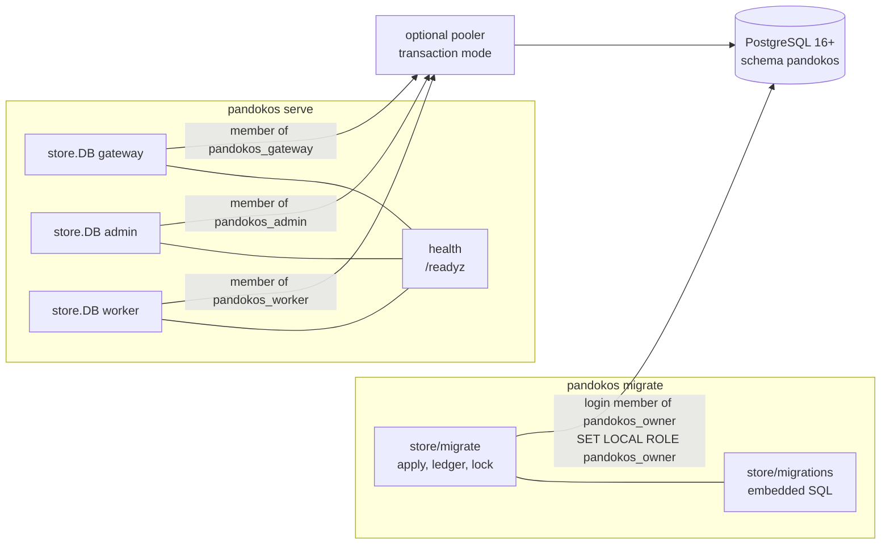
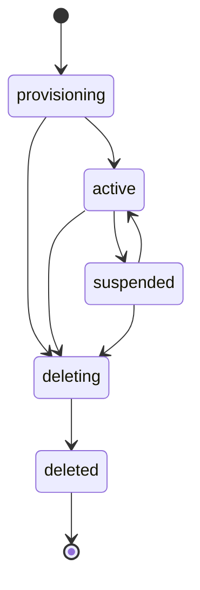

# Sprint 1.2 — Persistence and tenant isolation

- Epic: [1 — Foundations](../epic.md)
- Implementation plan: [plan.md](plan.md)
- Previous sprint: [1.1 — Walking skeleton](../1.1-walking-skeleton/sprint.md)
- Decisions implemented: ADR [0003](../../../../docs/adr/0003-single-binary-with-roles.md) (one
  database role per process role; `migrate` as a separate command),
  [0004](../../../../docs/adr/0004-postgresql-and-rls.md) (all of it except the key lookup
  function, the credential column privileges and `sqlc`, which arrive with the tables that need
  them), [0019](../../../../docs/adr/0019-configuration.md) (database settings and secret files),
  [0018](../../../../docs/adr/0018-supply-chain.md) (one new dependency, justified),
  [0025](../../../../docs/adr/0025-go-toolchain.md) (the language floor is raised)
- New decision records written by this sprint: 0026, 0027 (content in [plan.md](plan.md), part E)

This document is the frozen design. The implementer follows [plan.md](plan.md); a gap in either
document is raised as a question, not filled silently
([planning/README.md](../../../README.md)).

The decisions of the maintainer on the open points of sprint 1.1 are taken as given. Only two
touch this sprint: the release toolchain of ADR 0025 is confirmed (O-1), and the PostgreSQL
clause of OPS-01 is re-verified here (1.1, section 11).

## 1. Outcome

A database whose tenant isolation is proven by tests. `pandokos migrate` creates the schema from
SQL files embedded in the binary; `pandokos serve` refuses to start against a schema it does not
match, connects with three unprivileged database roles and reports the database in its
readiness. Every tenant-scoped table is protected by forced row-level security, and a test suite
that runs against PostgreSQL in CI, directly and through a transaction-mode connection pooler,
shows that no runtime role can read or change another tenant's rows.

**Exit criteria** (from the epic):

1. a table without a policy fails the build;
2. with tenant A's session or with none, every runtime role is shown unable to read or change
   tenant B's rows.

Both are automated: criterion 1 by T-140 and T-141, criterion 2 by T-143 (section 9).

## 2. Scope

### In scope

1. A PostgreSQL driver (`pgx` v5) and the raising of the Go language floor that it requires.
2. `pandokos migrate` and `pandokos migrate status`; an in-house migrator; SQL migrations
   embedded in the binary; a checksum file that freezes them.
3. Migration `0001_init`: schema `pandokos`, the migration ledger, three helper functions, the
   `tenant` table with its lifecycle, the `service_account` table, policies and grants.
4. Four database privilege roles (`pandokos_owner`, `pandokos_gateway`, `pandokos_admin`,
   `pandokos_worker`) and the SQL that creates them.
5. `internal/store`: one connection pool per runtime role, the transaction helpers that set the
   tenant or the platform scope, the start-up check of schema and database user, the readiness
   check.
6. `internal/tenant`: tenant identifier, lifecycle states and allowed transitions.
7. Configuration keys `database.*`, with passwords as secret files.
8. `pandokos serve` requires the database: start-up check, readiness.
9. The isolation harness: schema lint, SQL-level negative tests per role, lifecycle tests.
10. Test infrastructure: a Compose file with PostgreSQL 16 and PgBouncer, a test helper that
    creates one database per test, CI changes.
11. Documentation: database operations guide, configuration reference, updates to the data
    model and architecture pages, two ADRs.

### Not in scope

| Not in this sprint | Where it lands |
|---|---|
| Admin listener, admin API, OpenAPI, CLI client, `init`, `--role` | 1.3 |
| Creating, suspending and reactivating tenants through a product interface (the table, the states and the grants exist; no command or route uses them) | 1.3 |
| Virtual keys, the key lookup function (`SECURITY DEFINER`), principals, permissions, role assignments | 1.3 |
| Audit tables, hash chain | 1.3, 6.2 |
| Enforcing the tenant state on requests (suspension blocks traffic, TEN-10) | 1.3 |
| `sqlc` and generated query code (this sprint has no domain query in product code, see D-13) | 1.3 |
| `LISTEN`/`NOTIFY` cache invalidation | 1.3 |
| API-level isolation tests (third layer of the isolation suite) | 1.3 |
| Vault tables, catalogue tables, usage ledger, outbox | 2.1, 2.2, 3.2, 7.x |
| Tenant deletion job, retention, partitions | 6.3 |
| Compose reference for users (the Compose file of this sprint is for tests only) | 3.3 |
| Rolling upgrades with two schema versions live (OPS-13) | epic 10 |
| Backup and restore (OPS-10) | epic 6, epic 10 |

Nothing in the list above is stubbed, scaffolded or given an empty package in this sprint. The
gateway of sprint 1.1 is not changed: it does not read the database yet.

## 3. Requirements claimed

Wording quoted from [docs/requirements](../../../../docs/requirements/README.md).

| ID | Requirement (quoted) | What it means here | What this sprint delivers | Claim |
|---|---|---|---|---|
| TEN-01 | "Every tenant-owned resource carries its tenant. Platform-global data is stored separately and governed by explicit policies" | A table is either tenant-scoped (it has `tenant_id`) or on a short, justified list of global tables; nothing is in between | The schema lint classifies every table of schema `pandokos`: tenant-scoped tables must have a non-null `tenant_id` referencing `tenant`; global tables are listed by name with a reason. The one global table that holds tenant information, `tenant`, has its own explicit policies (a tenant session sees its own row, a platform session of the admin or worker role sees all, any other session sees none) | full for the tables that exist; the lint makes it hold for every later table |
| TEN-03 | "A missing or unverifiable tenant context rejects the request. There is no default or global fallback" | No code path reaches tenant data without naming a tenant; when the tenant is absent the answer is an error or nothing, never somebody's data | `store.WithTenant` refuses a zero tenant ID with `ErrNoTenant` before using a connection; there is no other way to obtain a connection; in the database an absent or empty `app.tenant_id` matches no row and a malformed one is an error | database and store layer; the request layer (rejecting a request without a principal) is 1.3 |
| TEN-04 | "Tenant data is protected by row-level security in the database, in addition to application checks. A missing application filter must not be enough to expose another tenant's rows" | Statements without any `WHERE` clause on the tenant still see and change only the session tenant's rows | Row-level security enabled **and forced** on every tenant-scoped table, one policy with `USING` and `WITH CHECK`; the negative tests run unfiltered statements | full |
| TEN-05 | "Runtime database roles own no tables and cannot bypass row-level security. Schema changes use separate credentials" | The gateway, admin and worker connections are not owners, not superusers, have no `BYPASSRLS`; only `migrate` uses the owner | Four privilege roles; everything is owned by `pandokos_owner`; `serve` checks at start that each of its database users is unprivileged and refuses to start otherwise; `serve` never reads the owner password; the lint checks ownership and role attributes; tests show a runtime role cannot switch role, disable a policy or turn row security off | full |
| TEN-06 | "Isolation holds uniformly for APIs, vault, audit, usage, limit counters, caches, exports and background jobs. A job carries the tenant and the identity that originated it; there is no unscoped system identity" | No database identity is exempt, the worker included; the platform scope is not a way into tenant data | The same policy applies to all three runtime roles and to the owner (forced); the worker role has no grant that works across tenants; the platform scope gives access to global tables only; the negative tests run for every role | mechanism and database layer; each later surface (vault, audit, usage, jobs) adds its tables to the same harness |
| TEN-07 | "An automated suite proves isolation with negative tests for every tenant-scoped table and API route. The build fails when a tenant-scoped table has no policy or no tests" | Adding a table without a policy, or without an entry in the isolation tests, makes CI red | The schema lint (policy) and its `no-fixture` rule (tests); table-driven negative tests that enumerate the tenant-scoped tables from the catalogue; CI runs them against PostgreSQL 16 and cannot skip them | tables; routes are 1.3 |
| TEN-09 (model) | "A tenant has a lifecycle: provisioning, active, suspended, deleting, deleted. The platform admin can create, suspend and reactivate it" | The five states and the allowed moves between them exist as data rules | `tenant.state` with a check constraint; a trigger that allows only the seven transitions of section 5.3 and makes a deleted tenant immutable; the same table in Go (`tenant.CanTransition`), tested against the database; grants that let only the admin role in platform scope create and change tenants | the model; the operations (create, suspend, reactivate) are 1.3 |
| OPS-09 | "Schema migrations are versioned and run by an explicit command. An instance refuses to start against a schema it does not match" | Numbered migrations, applied only by `pandokos migrate`; `serve` compares the ledger with the migrations in the binary and exits when they differ in either direction | The migrator, the ledger with checksums, `migrate` and `migrate status`, the start-up check with one message per kind of mismatch, a readiness check that turns not-ready if the schema changes under a running instance | full |

Requirements this sprint touches but **does not claim**: OPS-01 (the clause "PostgreSQL is the
only mandatory dependency" is re-verified by T-160, T-65 and T-72: from this sprint on `serve`
needs PostgreSQL and nothing else), OBS-08 (already claimed by 1.1; the database is now a real
dependency behind `/readyz`, T-138 and T-162), OPS-08 (new static keys follow the 1.1 rules),
TEN-08 (the composite foreign key rule of section 6.1 is its precondition; the claim is 1.3's),
TEN-10, AZ-08, SEC-04 (the start-up check refuses unsafe database users; claimed by 1.3).

## 4. Repository layout

Additions to the layout of sprint 1.1. Names follow
[architecture §11](../../../../docs/architecture/overview.md#11-repository-layout); additions
to that list are marked *new*.

```
cmd/pandokos/
  migrate.go                    the migrate command                                  (new file)
internal/
  tenant/                       tenant ID, lifecycle states and transitions
  store/                        pools per role, transaction helpers, start-up and readiness checks
  store/migrate/                the migrator: load, apply, status, compare           (new)
  store/migrations/             embedded SQL files and their checksum file           (new)
    sql/0001_init.sql
    migrations.sum
deploy/
  postgres/roles.sql            the SQL that creates the four privilege roles        (new)
test/
  db/                           compose.yaml, pgbouncer.ini, up.sh: PostgreSQL and PgBouncer for tests (new)
  dbtest/                       Go helper: one database and four logins per test     (new)
  isolation/                    schema lint and SQL-level isolation tests
docs/operations/database.md                                                          (new)
docs/adr/                       0026, 0027
.gitattributes                                                                       (new)
```

Import rules added to `depguard` in `.golangci.yml`, and checked by T-R10:

- the product module may also import `github.com/jackc/pgx/v5` (and its sub-packages);
- inside `cmd/` and `internal/`, only `internal/store/...` imports `pgx`. Every other package
  reaches the database through `store.DB`. (Code that receives a `store.Tx` uses the `pgx` row
  types through that interface without importing them.)
- `internal/store/...` does not import `internal/config`, `internal/server` or
  `internal/gateway`: it receives plain values (`store.ConnOptions`);
- `internal/tenant` imports only the standard library.

## 5. Architecture



### 5.1 Commands

Additions to the table of sprint 1.1, section 5.1. Everything stays in
`run(ctx, args, stdout, stderr, environ) int`.

| Command | Behaviour | Exit code |
|---|---|---|
| `pandokos migrate [--config FILE]` | Loads the configuration for the purpose *migrate* (section 5.2), connects with the owner user, applies every pending migration in order, each in its own transaction. Prints `applied <NNNN>_<name>` to stdout for each migration it applied, then `schema is at version <N>`. Applies nothing and prints only the last line when the schema is current | 0 on success; 1 on configuration error, connection failure, failed preflight, failed migration or ledger mismatch; 2 on a usage error |
| `pandokos migrate status [--config FILE]` | Same loading and connection. Prints one line per migration in the binary, `<NNNN>_<name>  applied <time>` (UTC, RFC 3339, seconds) or `<NNNN>_<name>  pending`, then `schema is at version <N>; this binary needs version <M>`. Changes nothing | 0 when the schema matches the binary; 1 when migrations are pending, on a mismatch or on any failure; 2 on a usage error |
| `pandokos serve [--config FILE]` | As in 1.1, and before listening: opens the three runtime pools and runs the start-up check on each (section 5.8). Any failure is logged as `startup failed` and the process exits | adds: 1 when the database is unreachable, the schema does not match or a database user is not acceptable |
| `pandokos config check [--config FILE] [--for serve\|migrate]` | As in 1.1. `--for` selects the purpose; the default is `serve` | adds: 2 for an unknown `--for` value |

Output conventions of `migrate` and `migrate status`: results on stdout as plain text;
configuration warnings on stderr as `warning: <key>: <message>`; every failure on stderr as
`error: <key>: <message>` for configuration problems and `error: <message>` otherwise. Nothing
printed contains a password.

`migrate` with anything after it other than `status` or flags is a usage error:
`pandokos: migrate takes no argument other than status`, then the usage text, exit 2.

`migrate` listens for SIGINT and SIGTERM like `serve`: the context is cancelled, the running
migration's transaction is rolled back by the server, the exit code is 1.

The usage text gains two lines:

```
  migrate [--config FILE]          Apply pending schema migrations, then exit
  migrate status [--config FILE]   Show applied and pending migrations, then exit
```

and `config check [--config FILE]` becomes `config check [--config FILE] [--for serve|migrate]`.

### 5.2 Configuration

#### New keys

Inserted in the key table after `shutdown.drain_timeout` and before `skeleton.access_token_file`,
in this order. The environment variable follows the 1.1 rule
(`database.gateway.password_file` → `PANDOKOS_DATABASE_GATEWAY_PASSWORD_FILE`).

| Key | Type | Default | Meaning |
|---|---|---|---|
| `database.address` | `host:port` | none, required | Address of PostgreSQL or of the connection pooler in front of it |
| `database.name` | name | `pandokos` | Database name |
| `database.tls.mode` | `verify-full`, `disable` | `verify-full` | `verify-full`: TLS with verification of the certificate chain and of the host name. `disable`: no TLS |
| `database.tls.ca_file` | path | none | PEM file with the certificate authorities to trust; when empty the system roots are used |
| `database.connect_timeout` | duration | `5s` | Time allowed to establish one connection |
| `database.gateway.user` | name | `pandokos_gateway` | Database user of the gateway role |
| `database.gateway.password_file` | path | none, required by `serve` | File with that user's password |
| `database.gateway.max_connections` | integer | `10` | Size limit of the gateway pool |
| `database.admin.user` | name | `pandokos_admin` | Database user of the admin role |
| `database.admin.password_file` | path | none, required by `serve` | File with that user's password |
| `database.admin.max_connections` | integer | `10` | Size limit of the admin pool |
| `database.worker.user` | name | `pandokos_worker` | Database user of the worker role |
| `database.worker.password_file` | path | none, required by `serve` | File with that user's password |
| `database.worker.max_connections` | integer | `5` | Size limit of the worker pool |
| `database.owner.user` | name | `pandokos_owner` | Database user of `pandokos migrate` |
| `database.owner.password_file` | path | none, required by `migrate` | File with that user's password. Never read by `serve` |

There is no key that holds a password and no key that takes a connection URL (a URL would invite
a password inside it). The address is one key, not `host` and `port`, on purpose: see D-12.

#### Go types

Added to `internal/config` (the existing types are unchanged except `Config` and `Source`):

```go
type Config struct {
    // ... fields of sprint 1.1, then:
    Database Database `yaml:"database"`
    // Skeleton stays last
}

type Database struct {
    Address        string        `yaml:"address"`
    Name           string        `yaml:"name"`
    TLS            DatabaseTLS   `yaml:"tls"`
    ConnectTimeout Duration      `yaml:"connect_timeout"`
    Gateway        DatabaseRole  `yaml:"gateway"`
    Admin          DatabaseRole  `yaml:"admin"`
    Worker         DatabaseRole  `yaml:"worker"`
    Owner          DatabaseOwner `yaml:"owner"`

    Host string `yaml:"-"` // filled by Load from Address
    Port int    `yaml:"-"` // filled by Load from Address
}
type DatabaseTLS struct {
    Mode   string `yaml:"mode"`
    CAFile string `yaml:"ca_file"`
}
type DatabaseRole struct {
    User           string `yaml:"user"`
    PasswordFile   string `yaml:"password_file"`
    MaxConnections int    `yaml:"max_connections"`

    Password secret.Secret `yaml:"-"` // filled by Load when the purpose is serve
}
type DatabaseOwner struct {
    User         string `yaml:"user"`
    PasswordFile string `yaml:"password_file"`

    Password secret.Secret `yaml:"-"` // filled by Load when the purpose is migrate
}

// Purpose says which command the configuration is loaded for. It decides which secrets are
// required and read. The zero value is PurposeServe.
type Purpose int

const (
    PurposeServe Purpose = iota
    PurposeMigrate
)

type Source struct {
    File    string
    Environ []string
    Purpose Purpose // new
}
```

In the struct `Config` the field order is `Log`, `Listeners`, `Limits`, `Upstream`, `Shutdown`,
`Database`, `Skeleton`, the order of the key table.

#### Purpose

All format rules below apply for both purposes. What differs is which secret files are required
and read:

| | `PurposeServe` (`serve`, `config check`) | `PurposeMigrate` (`migrate`, `migrate status`, `config check --for migrate`) |
|---|---|---|
| `skeleton.access_token_file`, `skeleton.openai.api_key_file` | required, read, cross-checked (as in 1.1) | not required, not read |
| `database.gateway.password_file`, `database.admin.password_file`, `database.worker.password_file` | required, read | not required, not read |
| `database.owner.password_file` | **not read**, whether set or not; the file may be absent | required, read |

So one configuration file serves both commands, and the owner's password file needs to exist
only where `migrate` runs.

#### Validation rules

| Key | Rule | Problem message |
|---|---|---|
| `database.address` | not empty | `must be set` |
| `database.address` | `net.SplitHostPort` succeeds | `must be host:port` |
| `database.address` | the port is an integer 1 to 65535 | `the port must be an integer between 1 and 65535` |
| `database.address` | the host is an IP literal or a host name (the 1.1 `hostName` expression); not empty | `the host must be an IP address or a host name` |
| `database.name`, `database.gateway.user`, `database.admin.user`, `database.worker.user`, `database.owner.user` | matches `^[A-Za-z0-9_][A-Za-z0-9_.-]{0,62}$` | `must be 1 to 63 characters: letters, digits, underscore, dot, hyphen` |
| `database.tls.mode` | `verify-full` or `disable` | `must be verify-full or disable` |
| `database.tls.ca_file` | empty unless the mode is `verify-full` | `is only used when database.tls.mode is verify-full` |
| `database.tls.ca_file` | when set: the file is readable and at most 1048576 bytes | `cannot read the file: <OS error>` or `the file is larger than 1048576 bytes` |
| `database.tls.ca_file` | when set: `x509.CertPool.AppendCertsFromPEM` accepts at least one certificate | `the file contains no PEM certificate` |
| `database.connect_timeout` | greater than zero | `must be greater than zero` |
| `database.<role>.max_connections` (three keys) | 1 to 1000 | `must be between 1 and 1000` |
| `database.admin.user`, `database.worker.user`, `database.owner.user` | differs from each user that precedes it in the order gateway, admin, worker, owner | `must differ from database.<other>.user: each role needs its own database user` (one problem per clash, on the later key) |
| each password file required by the purpose | set | `must be set` |
| each password file required by the purpose | `secret.ReadFile` succeeds | the `secret.ReadFile` error (it names the file, never the content) |

`Load` fills `Database.Host` and `Database.Port` when the address is valid.

#### Warnings

| Key | Condition | Message |
|---|---|---|
| `database.tls.mode` | the mode is `disable` and the host of `database.address` is not a loopback address or `localhost` | `the database connection is not encrypted` |

#### Unknown environment variables: Kubernetes service links

Sprint 1.1 ignores `PANDOKOS_SERVICE_*` and `PANDOKOS_PORT*` silently, because Kubernetes injects
them for a Service named `pandokos`. A Service named `pandokos-database` would inject
`PANDOKOS_DATABASE_SERVICE_HOST`, `PANDOKOS_DATABASE_PORT=tcp://…` and others. Two rules follow:

1. No configuration key may have `port` as its last segment or a segment that starts with
   `service_` (test T-05 is extended). This is why the database address is a single key.
2. In addition to the two prefixes of 1.1, an unknown `PANDOKOS_` variable is ignored silently
   when its name matches
   `^PANDOKOS_[A-Z0-9_]*(_SERVICE_HOST|_SERVICE_PORT(_[A-Z0-9_]+)?|_PORT|_PORT_[0-9]+_(TCP|UDP)(_(PROTO|PORT|ADDR))?)$`.
   Every other unknown variable still produces the warning `unknown variable <NAME> ignored`.

### 5.3 `internal/tenant`

```go
// ID identifies a tenant. The zero value is "no tenant" and is never a valid tenant.
type ID [16]byte

var ErrInvalidID = errors.New("tenant: invalid id")

// ParseID parses the canonical text form of a UUID: 36 characters, lower-case hexadecimal,
// hyphens at positions 8, 13, 18 and 23. Anything else, and the all-zero UUID, is ErrInvalidID.
func ParseID(s string) (ID, error)
func (id ID) String() string // canonical text form
func (id ID) IsZero() bool

// State is a lifecycle state of a tenant (TEN-09).
type State string

const (
    StateProvisioning State = "provisioning"
    StateActive       State = "active"
    StateSuspended    State = "suspended"
    StateDeleting     State = "deleting"
    StateDeleted      State = "deleted"
)

func States() []State                      // the five states, in the order above
func ParseState(s string) (State, bool)
func CanTransition(from, to State) bool    // true only for the seven pairs below
```

Lifecycle. A tenant row is always created in `provisioning`.



| From | To | Meaning |
|---|---|---|
| `provisioning` | `active` | Provisioning finished |
| `provisioning` | `deleting` | Provisioning abandoned |
| `active` | `suspended` | Suspension (TEN-10): data is kept |
| `suspended` | `active` | Reactivation |
| `active` | `deleting` | Deletion requested |
| `suspended` | `deleting` | Deletion requested |
| `deleting` | `deleted` | Deletion completed; the row stays and never changes again |

Every other pair, including a state to itself, is not a transition (`CanTransition` is false; an
`UPDATE` that leaves the state unchanged is allowed by the database because it is not a state
change). `deleting` cannot be undone. The database enforces the same table with a trigger
(section 5.5); T-146 compares the two for all 25 pairs.

The package has no database code. Identifiers are generated by the database (D-8).

### 5.4 `internal/store/migrate` — the migrator

```go
const (
    Schema    = "pandokos"
    OwnerRole = "pandokos_owner"
    // LockKey is the advisory lock that serializes migrators: the bytes of "pandokos" as a
    // big-endian integer.
    LockKey int64 = 8097874982633959283
)

// RuntimeRoles are the privilege roles of the three process roles.
var RuntimeRoles = []string{"pandokos_gateway", "pandokos_admin", "pandokos_worker"}

// Migration is one embedded SQL file.
type Migration struct {
    Version  int    // 1, 2, 3, ... without gaps
    Name     string // "init" for 0001_init.sql
    SQL      string // the file content
    Checksum string // lower-case hexadecimal SHA-256 of the file bytes
}

func (m Migration) ID() string // "0001_init"

// Load reads every *.sql file of dir in fsys, sorted by version.
func Load(fsys fs.FS, dir string) ([]Migration, error)

// Querier is the part of *pgx.Conn, pgx.Tx and *pgxpool.Pool that the migrator needs.
type Querier interface {
    Exec(ctx context.Context, sql string, args ...any) (pgconn.CommandTag, error)
    Query(ctx context.Context, sql string, args ...any) (pgx.Rows, error)
    QueryRow(ctx context.Context, sql string, args ...any) pgx.Row
}

type Applied struct {
    Version   int
    Name      string
    Checksum  string
    AppliedAt time.Time
}

type Status struct {
    Applied []Applied   // ledger rows, by version; empty when the schema does not exist
    Pending []Migration // migrations of the binary that are not in the ledger
    Version int         // highest applied version, 0 when none
    Want    int         // highest version of the binary
}

type Result struct {
    Applied []Migration // what this call applied, in order
    Version int         // schema version after the call
}

var (
    ErrNoSchema       = errors.New("the database has no Pandokos schema")
    ErrSchemaOlder    = errors.New("the database schema is older than this binary")
    ErrSchemaNewer    = errors.New("the database schema is newer than this binary")
    ErrChecksum       = errors.New("a migration recorded in the database differs from this binary")
    ErrLedger         = errors.New("the migration ledger is inconsistent")
    ErrRoleMissing    = errors.New("a Pandokos database role does not exist")
    ErrRolePrivileged = errors.New("a Pandokos database role has privileges it must not have")
    ErrNotOwner       = errors.New("the database user cannot act as pandokos_owner")
    ErrServerVersion  = errors.New("PostgreSQL 16 or later is required")
)

// ReadStatus reads the ledger and compares it with ms. It fails with ErrSchemaNewer,
// ErrChecksum or ErrLedger when the ledger is not a prefix of ms.
func ReadStatus(ctx context.Context, q Querier, ms []Migration) (Status, error)

// Check returns nil only when the ledger equals ms exactly: same versions, names, checksums.
// Otherwise ErrNoSchema, ErrSchemaOlder, ErrSchemaNewer, ErrChecksum or ErrLedger, wrapped
// with the detail of section 5.8.
func Check(ctx context.Context, q Querier, ms []Migration) error

// Apply applies the pending migrations of ms. pandokosVersion is recorded in the ledger.
func Apply(ctx context.Context, conn *pgx.Conn, ms []Migration, pandokosVersion string) (Result, error)
```

#### Files

- Location: `internal/store/migrations/sql/`. Name: `NNNN_name.sql`, where `NNNN` is the version
  as four digits and `name` matches `[a-z0-9_]+`. `Load` rejects, each with an error that names
  the file: a name that does not match; a duplicate version; a gap (versions must be
  `1..n`); an empty file; a file that is not valid UTF-8.
- A migration runs inside a transaction that the migrator opens and commits. `Load` therefore
  also rejects a file in which any of these expressions matches (case-insensitive):
  `(?m)^\s*(COMMIT|ROLLBACK)\b`, `\bCONCURRENTLY\b`, `\bSET\s+(SESSION\s+|LOCAL\s+)?ROLE\b`,
  `\bSET\s+SESSION\s+AUTHORIZATION\b`. (An operation that cannot run in a transaction needs a
  design of its own; none exists yet.)
- Migrations are forward-only: there are no down files (D-4).
- **A migration that has been merged to `main` is never edited.** The file
  `internal/store/migrations/migrations.sum` lists one line per migration,
  `<NNNN>_<name>.sql <checksum>`, and T-106 fails when it differs from the embedded files, so a
  change to an old migration is visible in review as a changed line of that file.
  `.gitattributes` forces `*.sql` to LF line endings so that the checksum does not depend on the
  platform of the checkout.
- `internal/store/migrations` exposes `func Load() ([]migrate.Migration, error)` over an
  `embed.FS`.

#### Ledger

`pandokos.schema_migration`, created by migration 0001 itself (SQL in section 5.5): `version`,
`name`, `checksum`, `applied_at`, `applied_by` (the session user), `pandokos_version`. "The
ledger does not exist" (`to_regclass('pandokos.schema_migration')` is null) means version 0.

Comparing the ledger with the migrations of the binary (pure function, used by `ReadStatus`,
`Check` and `Apply`):

| Ledger versus binary | Result |
|---|---|
| ledger versions are not `1..k` without gaps | `ErrLedger` |
| a ledger version is higher than the highest of the binary | `ErrSchemaNewer` |
| a ledger row's name or checksum differs from the binary's migration of that version | `ErrChecksum` |
| `k` is lower than the highest of the binary | pending migrations (`ErrSchemaOlder` for `Check`) |
| no ledger table | version 0 (`ErrNoSchema` for `Check`) |
| equal | current |

#### Apply

1. **Preflight**, outside any migration transaction:
   - `SHOW server_version_num` is at least `160000`, else `ErrServerVersion`;
   - the four roles `pandokos_owner`, `pandokos_gateway`, `pandokos_admin`, `pandokos_worker`
     exist, else `ErrRoleMissing`; none of them has `rolsuper` or `rolbypassrls`, else
     `ErrRolePrivileged`;
   - `pg_has_role(session_user, 'pandokos_owner', 'SET')` is true or the session user is a
     superuser, else `ErrNotOwner`.
2. Read the ledger and compare. Stop on `ErrLedger`, `ErrSchemaNewer`, `ErrChecksum`.
3. For each pending migration, in order, in **one transaction per migration**:
   1. `SET LOCAL ROLE pandokos_owner` — every object is created by, and therefore owned by,
      `pandokos_owner`, whatever the login user is;
   2. `SELECT pg_advisory_xact_lock(LockKey)` — waits for a concurrent migrator; released at
      the end of the transaction;
   3. read the ledger again and compare: if this version is already there (a concurrent
      migrator applied it), commit and go to the next; if the ledger is not exactly at
      `version - 1`, fail with `ErrLedger`;
   4. `SET LOCAL lock_timeout = '10s'`;
   5. execute the file as one multi-statement command (no arguments, so the driver uses the
      simple query protocol);
   6. `INSERT INTO pandokos.schema_migration (version, name, checksum, pandokos_version)`;
   7. commit.
   Any error rolls the transaction back; the error returned is
   `migration <NNNN>_<name>: <cause>`. Migrations applied before it stay applied.

Nothing in this sequence is session state: the role and the timeout are transaction-local and
the lock is a transaction-level lock. `migrate` therefore also works through a transaction-mode
pooler (T-163), though the documentation recommends a direct connection for it.

Error messages (the sentinel, then the detail; `<u>` is the session user):

| Error | Text |
|---|---|
| `ErrServerVersion` | `PostgreSQL 16 or later is required: the server reports <server_version>` |
| `ErrRoleMissing` | `a Pandokos database role does not exist: <role>; create the roles first (docs/operations/database.md)` |
| `ErrRolePrivileged` | `a Pandokos database role has privileges it must not have: <role> is a superuser or has BYPASSRLS` |
| `ErrNotOwner` | `the database user cannot act as pandokos_owner: grant pandokos_owner to "<u>"` |
| `ErrSchemaNewer` | `the database schema is newer than this binary: schema version <k>, this binary knows version <n>; upgrade Pandokos` |
| `ErrChecksum` | `a migration recorded in the database differs from this binary: <NNNN>_<name>` |
| `ErrLedger` | `the migration ledger is inconsistent: <detail>` |

### 5.5 Migration `0001_init`

The complete file `internal/store/migrations/sql/0001_init.sql`. It was executed against
PostgreSQL 16.15 while this design was written, and every behaviour claimed in sections 5.6 and
6 was observed on it.

```sql
-- 0001_init: schema, migration ledger, helper functions, tenant, service_account.
-- Runs in one transaction as pandokos_owner. Every name is schema-qualified: nothing in
-- Pandokos depends on search_path.

CREATE SCHEMA IF NOT EXISTS pandokos;
REVOKE ALL ON SCHEMA pandokos FROM PUBLIC;
GRANT USAGE ON SCHEMA pandokos TO pandokos_gateway, pandokos_admin, pandokos_worker;

-- Functions created by the owner are not executable by PUBLIC; each grant is explicit.
ALTER DEFAULT PRIVILEGES FOR ROLE pandokos_owner REVOKE EXECUTE ON FUNCTIONS FROM PUBLIC;

-- Migration ledger (global table).
CREATE TABLE pandokos.schema_migration (
    version          integer     NOT NULL,
    name             text        NOT NULL,
    checksum         text        NOT NULL,
    applied_at       timestamptz NOT NULL DEFAULT now(),
    applied_by       text        NOT NULL DEFAULT session_user,
    pandokos_version text        NOT NULL,
    CONSTRAINT schema_migration_pkey PRIMARY KEY (version),
    CONSTRAINT schema_migration_version_positive CHECK (version > 0),
    CONSTRAINT schema_migration_checksum_format CHECK (checksum ~ '^[0-9a-f]{64}$')
);
GRANT SELECT ON pandokos.schema_migration TO pandokos_gateway, pandokos_admin, pandokos_worker;

-- UUID version 7: 48 bits of Unix time in milliseconds, then random bits.
CREATE FUNCTION pandokos.uuid_v7() RETURNS uuid
    LANGUAGE sql VOLATILE PARALLEL SAFE
    RETURN encode(
        set_bit(
            set_bit(
                overlay(uuid_send(gen_random_uuid())
                        PLACING substring(int8send(floor(extract(epoch FROM clock_timestamp()) * 1000)::bigint) FROM 3)
                        FROM 1 FOR 6),
                52, 1),
            53, 1),
        'hex')::uuid;

-- The tenant of the current transaction, or NULL. An empty setting is NULL: after a
-- transaction that set it, PostgreSQL reports '' instead of "absent" on the same connection.
-- A value that is not a UUID raises an error.
CREATE FUNCTION pandokos.current_tenant_id() RETURNS uuid
    LANGUAGE sql STABLE PARALLEL SAFE
    RETURN NULLIF(current_setting('app.tenant_id', true), '')::uuid;

-- True only in a transaction that declared the platform scope.
CREATE FUNCTION pandokos.platform_scope() RETURNS boolean
    LANGUAGE sql STABLE PARALLEL SAFE
    RETURN COALESCE(current_setting('app.scope', true) = 'platform', false);

GRANT EXECUTE ON FUNCTION pandokos.uuid_v7(), pandokos.current_tenant_id(), pandokos.platform_scope()
    TO pandokos_gateway, pandokos_admin, pandokos_worker;

-- Lifecycle and immutability of tenant rows.
CREATE FUNCTION pandokos.tenant_guard() RETURNS trigger
    LANGUAGE plpgsql
    SET search_path = pg_catalog, pg_temp
AS $$
BEGIN
    IF TG_OP = 'DELETE' THEN
        RAISE EXCEPTION 'tenant rows are never deleted' USING ERRCODE = 'restrict_violation';
    END IF;
    IF TG_OP = 'INSERT' THEN
        IF NEW.state <> 'provisioning' THEN
            RAISE EXCEPTION 'a tenant is created in state provisioning' USING ERRCODE = 'check_violation';
        END IF;
        NEW.created_at := now();
        NEW.updated_at := now();
        NEW.state_changed_at := now();
        RETURN NEW;
    END IF;
    IF NEW.id <> OLD.id THEN
        RAISE EXCEPTION 'the tenant id is immutable' USING ERRCODE = 'check_violation';
    END IF;
    IF OLD.state = 'deleted' THEN
        RAISE EXCEPTION 'a deleted tenant cannot be changed' USING ERRCODE = 'check_violation';
    END IF;
    NEW.created_at := OLD.created_at;
    NEW.updated_at := now();
    NEW.state_changed_at := OLD.state_changed_at;
    IF NEW.state <> OLD.state THEN
        IF (OLD.state, NEW.state) NOT IN (
            ('provisioning', 'active'),
            ('provisioning', 'deleting'),
            ('active', 'suspended'),
            ('active', 'deleting'),
            ('suspended', 'active'),
            ('suspended', 'deleting'),
            ('deleting', 'deleted')
        ) THEN
            RAISE EXCEPTION 'invalid tenant state transition from % to %', OLD.state, NEW.state
                USING ERRCODE = 'check_violation';
        END IF;
        NEW.state_changed_at := now();
    END IF;
    RETURN NEW;
END
$$;

-- Timestamps and immutable identity of rows of tenant-scoped tables.
CREATE FUNCTION pandokos.row_guard() RETURNS trigger
    LANGUAGE plpgsql
    SET search_path = pg_catalog, pg_temp
AS $$
BEGIN
    IF TG_OP = 'INSERT' THEN
        NEW.created_at := now();
        NEW.updated_at := now();
        RETURN NEW;
    END IF;
    IF NEW.id <> OLD.id OR NEW.tenant_id <> OLD.tenant_id THEN
        RAISE EXCEPTION 'id and tenant_id are immutable' USING ERRCODE = 'check_violation';
    END IF;
    NEW.created_at := OLD.created_at;
    NEW.updated_at := now();
    RETURN NEW;
END
$$;

-- Tenants (global table with explicit policies).
CREATE TABLE pandokos.tenant (
    id               uuid        NOT NULL DEFAULT pandokos.uuid_v7(),
    name             text        NOT NULL,
    display_name     text        NOT NULL DEFAULT '',
    state            text        NOT NULL DEFAULT 'provisioning',
    created_at       timestamptz NOT NULL DEFAULT now(),
    updated_at       timestamptz NOT NULL DEFAULT now(),
    state_changed_at timestamptz NOT NULL DEFAULT now(),
    CONSTRAINT tenant_pkey PRIMARY KEY (id),
    CONSTRAINT tenant_name_format CHECK (name ~ '^[a-z0-9]([a-z0-9-]{0,61}[a-z0-9])?$'),
    CONSTRAINT tenant_display_name_length CHECK (char_length(display_name) <= 200),
    CONSTRAINT tenant_state_valid CHECK (state IN ('provisioning', 'active', 'suspended', 'deleting', 'deleted'))
);
CREATE UNIQUE INDEX tenant_name_key ON pandokos.tenant (name) WHERE state <> 'deleted';

CREATE TRIGGER tenant_guard BEFORE INSERT OR UPDATE OR DELETE ON pandokos.tenant
    FOR EACH ROW EXECUTE FUNCTION pandokos.tenant_guard();

ALTER TABLE pandokos.tenant ENABLE ROW LEVEL SECURITY;
ALTER TABLE pandokos.tenant FORCE ROW LEVEL SECURITY;

CREATE POLICY tenant_self ON pandokos.tenant
    FOR SELECT TO pandokos_gateway, pandokos_admin, pandokos_worker
    USING (id = (SELECT pandokos.current_tenant_id()));
CREATE POLICY tenant_platform_select ON pandokos.tenant
    FOR SELECT TO pandokos_admin, pandokos_worker
    USING ((SELECT pandokos.platform_scope()));
CREATE POLICY tenant_platform_insert ON pandokos.tenant
    FOR INSERT TO pandokos_admin
    WITH CHECK ((SELECT pandokos.platform_scope()));
CREATE POLICY tenant_platform_update ON pandokos.tenant
    FOR UPDATE TO pandokos_admin
    USING ((SELECT pandokos.platform_scope()))
    WITH CHECK ((SELECT pandokos.platform_scope()));

GRANT SELECT ON pandokos.tenant TO pandokos_gateway, pandokos_admin, pandokos_worker;
GRANT INSERT (name, display_name) ON pandokos.tenant TO pandokos_admin;
GRANT UPDATE (name, display_name, state) ON pandokos.tenant TO pandokos_admin;

-- Service accounts (tenant-scoped table).
CREATE TABLE pandokos.service_account (
    tenant_id   uuid        NOT NULL,
    id          uuid        NOT NULL DEFAULT pandokos.uuid_v7(),
    name        text        NOT NULL,
    description text        NOT NULL DEFAULT '',
    state       text        NOT NULL DEFAULT 'active',
    valid_from  timestamptz,
    valid_until timestamptz,
    created_at  timestamptz NOT NULL DEFAULT now(),
    updated_at  timestamptz NOT NULL DEFAULT now(),
    CONSTRAINT service_account_pkey PRIMARY KEY (tenant_id, id),
    CONSTRAINT service_account_tenant_fkey FOREIGN KEY (tenant_id) REFERENCES pandokos.tenant (id),
    CONSTRAINT service_account_name_key UNIQUE (tenant_id, name),
    CONSTRAINT service_account_name_format CHECK (name ~ '^[a-z0-9]([a-z0-9-]{0,61}[a-z0-9])?$'),
    CONSTRAINT service_account_description_length CHECK (char_length(description) <= 500),
    CONSTRAINT service_account_state_valid CHECK (state IN ('active', 'disabled')),
    CONSTRAINT service_account_validity_order CHECK (valid_from IS NULL OR valid_until IS NULL OR valid_from < valid_until)
);

CREATE TRIGGER service_account_guard BEFORE INSERT OR UPDATE ON pandokos.service_account
    FOR EACH ROW EXECUTE FUNCTION pandokos.row_guard();

ALTER TABLE pandokos.service_account ENABLE ROW LEVEL SECURITY;
ALTER TABLE pandokos.service_account FORCE ROW LEVEL SECURITY;

CREATE POLICY tenant_isolation ON pandokos.service_account
    USING (tenant_id = (SELECT pandokos.current_tenant_id()))
    WITH CHECK (tenant_id = (SELECT pandokos.current_tenant_id()));

GRANT SELECT ON pandokos.service_account TO pandokos_gateway, pandokos_admin;
GRANT INSERT (tenant_id, name, description, state, valid_from, valid_until) ON pandokos.service_account TO pandokos_admin;
GRANT UPDATE (name, description, state, valid_from, valid_until) ON pandokos.service_account TO pandokos_admin;
GRANT DELETE ON pandokos.service_account TO pandokos_admin;
```

Notes on the SQL, each a design rule for later migrations:

- **The canonical policy.** Every tenant-scoped table has exactly one policy, named
  `tenant_isolation`, for all commands and all roles, whose `USING` and `WITH CHECK` are both
  `tenant_id = (SELECT pandokos.current_tenant_id())`. The scalar sub-select makes PostgreSQL
  evaluate the function once per statement (an init plan) instead of once per row. The lint
  compares the expression text, so there is one way to write it.
- **Why a function and not `current_setting(...)::uuid` in the policy** (as the data model page
  shows): after a transaction that called `set_config('app.tenant_id', …, true)`, the same
  connection reports the setting as the empty string, not as absent, and `''::uuid` is an error.
  With a pooled connection that is the normal case. `NULLIF(…, '')` restores the documented
  failure mode: no tenant, no rows. A value that is neither empty nor a UUID is an error: it can
  only come from a bug, and an error is the closed way to fail.
- **Tenant table.** `tenant` is global (it has no `tenant_id`) but not open: a session with a
  tenant sees that tenant's row; a session in platform scope sees all rows if its role is admin
  or worker; the gateway role has no platform policy, so platform scope shows it nothing; a
  session with neither sees nothing. Only the admin role in platform scope can insert or update,
  only the columns granted, and the trigger keeps the lifecycle. Nobody can delete: no role has
  the privilege and the trigger refuses it for the owner too.
- **Names.** `tenant.name` and `service_account.name` are identifiers for people and
  configuration: lower-case letters, digits and hyphens, 1 to 63 characters, no hyphen at either
  end. A tenant name is unique among tenants that are not `deleted`; a service account name is
  unique within its tenant.
- **Column grants.** The admin role cannot choose an `id`, a `created_at` or, for tenants, an
  initial state: those columns are not granted for `INSERT`. It cannot move a service account to
  another tenant: `tenant_id` is not granted for `UPDATE`, the policy's `WITH CHECK` refuses it,
  and the trigger refuses it.
- **Foreign keys.** `service_account.tenant_id` references `tenant`. A foreign key from one
  tenant-scoped table to another must include `tenant_id` on both sides (data model rule 1;
  lint rule L-11; demonstrated by T-150). There is none yet.
- **Identifiers** are UUID version 7 generated by the column default (D-8).

### 5.6 Database roles and grants

Four **privilege roles**, fixed names, no login, no password. They are created once per
PostgreSQL cluster by `deploy/postgres/roles.sql`:

```sql
-- Pandokos privilege roles. Run once per PostgreSQL cluster, as a superuser or as a role
-- with CREATEROLE. Idempotent. The roles cannot log in and have no password: database users
-- are granted membership in them (docs/operations/database.md).
DO $$
DECLARE
    r text;
BEGIN
    FOREACH r IN ARRAY ARRAY['pandokos_owner', 'pandokos_gateway', 'pandokos_admin', 'pandokos_worker'] LOOP
        BEGIN
            EXECUTE format('CREATE ROLE %I NOLOGIN NOSUPERUSER NOCREATEDB NOCREATEROLE NOREPLICATION NOBYPASSRLS', r);
        EXCEPTION WHEN duplicate_object OR unique_violation THEN
            NULL;
        END;
    END LOOP;
END
$$;
```

**Database users** (login roles with passwords) are the operator's. Each process role connects
as a user that is a member of exactly one privilege role:

| Privilege role | Used by | Its user is configured in | Membership needed |
|---|---|---|---|
| `pandokos_owner` | `pandokos migrate` only | `database.owner.user` | member with the `SET` option (the default of `GRANT`); `migrate` switches to the role for each transaction |
| `pandokos_gateway` | gateway | `database.gateway.user` | member with `INHERIT` (the default for a role created with `INHERIT`) |
| `pandokos_admin` | admin API (1.3) | `database.admin.user` | same |
| `pandokos_worker` | worker (later) | `database.worker.user` | same |

The default user names equal the role names: an operator who wants the shortest setup gives the
four privilege roles `LOGIN` and a password and creates no other user; the same checks pass.
The recommended setup, and the one the tests use, is separate login users, because it lets
passwords and users rotate without touching the schema and lets several databases in one
cluster have different users. The operations guide gives both.

The database is created by the operator, owned by `pandokos_owner`, with `CONNECT` revoked from
`PUBLIC` and granted to the three runtime roles:

```sql
CREATE DATABASE pandokos OWNER pandokos_owner;
REVOKE ALL ON DATABASE pandokos FROM PUBLIC;
GRANT CONNECT ON DATABASE pandokos TO pandokos_gateway, pandokos_admin, pandokos_worker;
```

**Exact grants after migration 0001.** This table is also the lint's expected privilege matrix
(L-12): a privilege that is not in it, or a missing one, fails the build.

| Object | `pandokos_owner` | `pandokos_gateway` | `pandokos_admin` | `pandokos_worker` | `PUBLIC` |
|---|---|---|---|---|---|
| schema `pandokos` | owner | `USAGE` | `USAGE` | `USAGE` | none |
| `schema_migration` | owner | `SELECT` | `SELECT` | `SELECT` | none |
| `tenant` | owner, subject to the policies (it has none: it sees no row) | `SELECT` | `SELECT`, `INSERT (name, display_name)`, `UPDATE (name, display_name, state)` | `SELECT` | none |
| `service_account` | owner, subject to the policy | `SELECT` | `SELECT`, `INSERT (tenant_id, name, description, state, valid_from, valid_until)`, `UPDATE (name, description, state, valid_from, valid_until)`, `DELETE` | none | none |
| `uuid_v7()`, `current_tenant_id()`, `platform_scope()` | owner | `EXECUTE` | `EXECUTE` | `EXECUTE` | none |
| `tenant_guard()`, `row_guard()` | owner | none | none | none | none |

No runtime role holds `TRUNCATE`, `REFERENCES` or `TRIGGER` on anything, `CREATE` on the schema
or on the database, or membership in another Pandokos role.

**Rows of `tenant` visible**, by role and session:

| Session | gateway | admin | worker |
|---|---|---|---|
| tenant A (`app.tenant_id` = A) | A's row | A's row | A's row |
| platform scope (`app.scope` = `platform`) | none | all | all |
| neither | none | none | none |

**Rows of a tenant-scoped table visible**: the session tenant's rows if the role has `SELECT`,
none in every other case, platform scope included.

The worker has no grant on `service_account`: it gets a grant on a table in the sprint that
gives it a job on that table.

### 5.7 `internal/store`

```go
// Role is a process role. Each has its own database user and privileges.
type Role string

const (
    RoleGateway Role = "gateway"
    RoleAdmin   Role = "admin"
    RoleWorker  Role = "worker"
)

// DatabaseRole returns the privilege role of r: "pandokos_gateway", ...
func (r Role) DatabaseRole() string

// ConnOptions says how to reach the database as one user.
type ConnOptions struct {
    Host           string
    Port           int
    Database       string
    User           string
    Password       secret.Secret
    TLSMode        string        // "verify-full" or "disable"
    TLSCAFile      string        // optional, PEM
    ConnectTimeout time.Duration
}

type Options struct {
    Conn       ConnOptions
    Role       Role
    MaxConns   int
    Migrations []migrate.Migration // what the schema must match; required
}

// DB is the database as seen by one process role. It does not expose its pool: the three
// methods below are the only way to run SQL (ADR 0004).
type DB struct{ /* pool, role, migrations */ }

// Open validates o and creates the pool. It does not connect.
func Open(o Options) (*DB, error)
func (db *DB) Role() Role
func (db *DB) Close()

// Check connects and verifies the schema and the database user (section 5.8).
func (db *DB) Check(ctx context.Context) error

// Ready is the readiness check: the database answers and the schema still matches.
func (db *DB) Ready(ctx context.Context) error

// Tx is what code running inside a transaction may do. It cannot commit, roll back, or
// reach the connection.
type Tx interface {
    Exec(ctx context.Context, sql string, args ...any) (pgconn.CommandTag, error)
    Query(ctx context.Context, sql string, args ...any) (pgx.Rows, error)
    QueryRow(ctx context.Context, sql string, args ...any) pgx.Row
}

var (
    ErrNoTenant        = errors.New("store: tenant context required")
    ErrNoPlatformScope = errors.New("store: this role has no platform scope")
)

// WithTenant runs fn in one transaction whose tenant is id. It commits when fn returns nil
// and rolls back when fn returns an error or panics. A zero id is ErrNoTenant.
func (db *DB) WithTenant(ctx context.Context, id tenant.ID, fn func(ctx context.Context, tx Tx) error) error

// Platform runs fn in one transaction in platform scope, with no tenant: tenant-scoped
// tables show no rows. The gateway role has no platform scope: ErrNoPlatformScope.
func (db *DB) Platform(ctx context.Context, fn func(ctx context.Context, tx Tx) error) error

// Migrate connects as the owner user of o and applies the pending migrations of ms.
func Migrate(ctx context.Context, o ConnOptions, ms []migrate.Migration, pandokosVersion string) (migrate.Result, error)

// MigrationStatus connects as the owner user of o and reports the state of the schema.
func MigrationStatus(ctx context.Context, o ConnOptions, ms []migrate.Migration) (migrate.Status, error)
```

#### The transaction helpers

Both helpers do the same thing with a different setting:

1. validate (`WithTenant`: `id.IsZero()` → `ErrNoTenant`; `Platform`: gateway role →
   `ErrNoPlatformScope`); these return before a connection is acquired;
2. begin a transaction (default isolation, read committed);
3. `SELECT pg_catalog.set_config($1, $2, true)` with (`app.tenant_id`, `id.String()`) or
   (`app.scope`, `platform`); the third argument makes it **transaction-local**;
4. call `fn` with a `Tx` that wraps the transaction and exposes only `Exec`, `Query`, `QueryRow`;
5. `fn` returned nil → commit, and return a commit error as `store: commit: <cause>`;
   `fn` returned an error → roll back and return that error unchanged;
   `fn` panicked → roll back and re-panic with the same value.

The rollback uses a context that is not cancelled with the caller's
(`context.WithoutCancel`, with a 5 s timeout), so a cancelled request still releases its
transaction. One helper call is one transaction; the helpers do not nest, and there is no
retry. Neither helper ever sets both settings.

There is no method that returns a connection, a pool or a transaction without a tenant or the
platform scope. Reading a global table that needs neither (the ledger) is done inside `Check`
and `Ready`; a helper for tenant-less reads by the gateway is added in 1.3 with the first table
that needs it (section 11).

What the helpers cannot prevent: SQL run through `Tx` could call `set_config` itself. The
database lets any role set a custom setting; that is inherent in the model of ADR 0004, in
which the database trusts the application to name the tenant and protects against forgotten
filters, not against arbitrary SQL. T-R10 keeps the two setting names out of every package but
`internal/store`, and from 1.3 queries are static SQL compiled by `sqlc`.

#### Connection configuration

Built by one unexported function `connConfig(o ConnOptions, applicationName string)`; the pools
and `Migrate` use it. The exact code is in plan.md (C5). Its rules:

- the driver's configuration is parsed from a keyword string that holds only host, port,
  database, user, `sslmode=disable` and `connect_timeout`; then the password, the TLS
  configuration and the run-time parameters are set on the parsed structure. The password is
  never part of a string;
- TLS is built by Pandokos, not by the driver: `nil` for `disable`; for `verify-full` a
  `tls.Config` with `MinVersion: tls.VersionTLS12`, `ServerName` = host, `RootCAs` from
  `TLSCAFile` or nil (system roots). There is no mode that encrypts without verifying;
- libpq environment variables (`PGHOST`, `PGUSER`, `PGPASSWORD`, `PGSSLMODE`, `PGOPTIONS`,
  `PGTARGETSESSIONATTRS`, …), which the driver reads when it parses, must not change who
  Pandokos connects as or how: host, port, database, user, password, TLS, fallback hosts,
  run-time parameters, connection validation and Kerberos settings are all overwritten after
  parsing (T-107);
- the only run-time parameter sent at connection start is `application_name`:
  `pandokos-gateway`, `pandokos-admin`, `pandokos-worker`, `pandokos-migrate`;
- `DefaultQueryExecMode = pgx.QueryExecModeExec`, statement cache and description cache
  capacity 0: no named prepared statement is ever created (section 5.9);
- pool: `MaxConns` from configuration, `MinConns` 0 (connections are opened on demand),
  `MaxConnLifetime` 30 min, `MaxConnIdleTime` 5 min, `HealthCheckPeriod` 30 s.

### 5.8 Start-up check and readiness

`serve`, after the configuration and before `server.New`:

1. load the embedded migrations;
2. for each role in the order gateway, admin, worker: `store.Open`, then `Check` with a 30 s
   deadline. On success log `database ready`; on the first failure log `startup failed`, close
   what was opened, exit 1. There is no retry: an orchestrator restarts the container (D-11);
3. register one readiness check per role with `Health().AddCheck`: names `database-gateway`,
   `database-admin`, `database-worker`, function `db.Ready`;
4. continue as in 1.1; after `Serve` returns, close the three pools.

`serve` opens all three pools although only the gateway slice of the product exists (D-10).

`Check` does, on one connection of the pool:

1. connect (a failure is reported as `cannot connect: <driver error>`);
2. the **user check**, one query:

   ```sql
   SELECT r.rolsuper,
          r.rolbypassrls,
          pg_catalog.pg_has_role(current_user, $1, 'USAGE'),            -- own privilege role
          pg_catalog.pg_has_role(current_user, 'pandokos_owner', 'MEMBER'),
          pg_catalog.pg_has_role(current_user, $2, 'MEMBER'),           -- the two other runtime roles
          pg_catalog.pg_has_role(current_user, $3, 'MEMBER'),
          (SELECT count(*) FROM pg_catalog.pg_class c
             JOIN pg_catalog.pg_namespace n ON n.oid = c.relnamespace
            WHERE n.nspname = 'pandokos' AND c.relowner = r.oid)
     FROM pg_catalog.pg_roles r
    WHERE r.rolname = current_user
   ```

   evaluated in this order, first failure wins (a superuser is a member of everything, so it
   must be tested first);
3. the **schema check**: `migrate.Check(ctx, conn, Migrations)`.

Messages. Every `Check` error is prefixed `database (<role>): `; `<u>` is the database user.

| Condition | Message after the prefix |
|---|---|
| cannot connect | `cannot connect: <driver error>` |
| `rolsuper` | `user "<u>" is a superuser; a runtime role must not be` |
| `rolbypassrls` | `user "<u>" has BYPASSRLS; a runtime role must not` |
| not a member (with inheritance) of its privilege role | `user "<u>" is not a member of pandokos_<role>` |
| member of `pandokos_owner` | `user "<u>" is a member of pandokos_owner; a runtime role must not own the schema` |
| member of another runtime role | `user "<u>" is also a member of pandokos_<other>; each role needs its own database user` |
| owns a relation in schema `pandokos` | `user "<u>" owns objects in schema pandokos; a runtime role must own nothing` |
| no ledger | `the database has no Pandokos schema; run "pandokos migrate"` |
| ledger behind | `the database schema is older than this binary: schema version <k>, this binary needs version <n>; run "pandokos migrate"` |
| ledger ahead | `the database schema is newer than this binary: schema version <k>, this binary knows version <n>; upgrade Pandokos` |
| checksum or name differs | `a migration recorded in the database differs from this binary: <NNNN>_<name>` |
| ledger with gaps | `the migration ledger is inconsistent: <detail>` |

The driver's connection error names the user, the database, the address and the server's
message (for example `password authentication failed for user "x"`). It never contains the
password (T-165).

`Ready` runs `SELECT count(*), COALESCE(max(version), 0) FROM pandokos.schema_migration` and
returns an error when the query fails or when either number differs from the number of
migrations in the binary. It is called by `/readyz` with the 2 s timeout of `internal/health`.
An instance whose database goes away, or is migrated under it, therefore turns not-ready and
recovers on its own when the database is back and matching.

New log lines:

| `msg` | Level | Fields |
|---|---|---|
| `database ready` | info | `role` (`gateway`, `admin`, `worker`), `schema_version` (int) |

`startup failed` (1.1) carries the messages above in `error`. `readiness check failed` (1.1)
carries the check name and the error text.

### 5.9 Behaviour with a transaction-mode connection pooler

A transaction-mode pooler (PgBouncer with `pool_mode = transaction`) gives a client a server
connection for the duration of one transaction only. Anything that lives in the session is
lost or, worse, inherited by another client. Pandokos is designed to hold **no session state at
all**, and it behaves the same with or without a pooler; there is no configuration switch.

| Session feature | What Pandokos does |
|---|---|
| Tenant and scope settings | `set_config(…, true)` inside the transaction: gone at commit or rollback. Never `SET` or `set_config(…, false)` |
| Prepared statements | None. `QueryExecModeExec`: the extended protocol with the unnamed statement, parameters sent in text form, one round trip. Caches disabled |
| `SET ROLE`, `lock_timeout` in `migrate` | `SET LOCAL`, inside the migration's transaction |
| Advisory locks | Transaction-level only (`pg_advisory_xact_lock`) |
| `search_path` | Not used: every name is schema-qualified |
| Connection start parameters | Only `application_name`, which PgBouncer accepts and tracks |
| Statements outside a transaction | Only in `Check` and `Ready`: single read-only statements on global objects |
| `LISTEN` / `NOTIFY` | Not used in this sprint. A listener needs a session and therefore a direct connection: 1.3 designs that (section 11) |
| Temporary tables, cursors `WITH HOLD`, session advisory locks | Not used; forbidden by this design |

Tested: the isolation tests (T-143), the transaction helper tests (T-134, T-137, T-139) and the
end-to-end test T-163 run through PgBouncer in transaction mode with a server pool smaller than
the number of concurrent clients, so that server connections are really shared between tenants.

What the operator must provide when a pooler is used is in the operations guide: transaction
or session pooling (statement pooling is not supported: a transaction would be split); the
pooler authenticates each of the three users as itself (no shared server user, or the roles
collapse); TLS between Pandokos and the pooler follows `database.tls.*`.

## 6. The isolation harness

Package `test/isolation`. Three parts: the lint, the fixtures registry, the negative tests.
Together with the API-level tests of 1.3 they are the suite of TEN-07.

### 6.1 Schema lint

```go
type Finding struct {
    Rule   string // "L-07"
    Object string // "pandokos.service_account"
    Detail string
}

// Spec is what the schema is expected to be.
type Spec struct {
    Global          map[string]GlobalTable         // table name → why it is global
    Grants          map[string]map[string][]string // table → privilege role → privileges
    Fixtures        map[string]Fixture             // tenant-scoped table → how to test it
    SecurityDefiner []string                       // functions allowed to be SECURITY DEFINER
    Views           []string                       // views allowed to exist
}

type GlobalTable struct {
    Reason     string
    Restricted bool // true: must have forced row-level security and at least one policy
}

func DefaultSpec() Spec
func Lint(ctx context.Context, conn *pgx.Conn, spec Spec) ([]Finding, error)
```

`Lint` reads the system catalogues of schema `pandokos` through a superuser connection of the
test helper and returns one finding per violation. `TestSchemaLint` (T-140) applies the real
migrations to an empty database and fails if there is any finding. **That test is the build
gate of exit criterion 1.**

A table is **tenant-scoped unless it is listed in `Spec.Global`**. `DefaultSpec` lists:

| Global table | Restricted | Reason recorded in the spec |
|---|---|---|
| `schema_migration` | no | Describes the installation, holds no tenant information |
| `tenant` | yes | The list of tenants; protected by its own policies (section 5.6) |

Rules:

| Rule | Applies to | Violation |
|---|---|---|
| L-01 | every relation of the schema | not owned by `pandokos_owner` |
| L-02 | views, materialized views, foreign tables | exists and is not listed in `Spec.Views` (materialized views and foreign tables are never allowed) |
| L-03 | tenant-scoped tables | no column `tenant_id` of type `uuid`, or it is nullable |
| L-04 | tenant-scoped tables | no foreign key from exactly (`tenant_id`) to `tenant (id)` |
| L-05 | tenant-scoped tables | row-level security not enabled |
| L-06 | tenant-scoped tables | row-level security not forced |
| L-07 | tenant-scoped tables | no policy named `tenant_isolation` |
| L-08 | tenant-scoped tables | `tenant_isolation` is not permissive, or not for all commands, or not for `PUBLIC`, or its `USING` or `WITH CHECK` text (white space collapsed) differs from `(tenant_id = ( SELECT pandokos.current_tenant_id() AS current_tenant_id))` |
| L-09 | tenant-scoped tables | any policy other than `tenant_isolation` (a second permissive policy would widen access) |
| L-10 | tenant-scoped tables | the primary key does not include `tenant_id` |
| L-11 | tenant-scoped tables | a foreign key to another tenant-scoped table whose column lists do not pair `tenant_id` with `tenant_id` |
| L-12 | every table | the privileges held by `pandokos_gateway`, `pandokos_admin`, `pandokos_worker` and `PUBLIC`, table-level and column-level, differ from `Spec.Grants` (a table absent from it must have none); any grantee other than those and the owner |
| L-13 | restricted global tables | row-level security not enabled, not forced, or no policy |
| L-14 | functions of the schema | `SECURITY DEFINER` and not listed in `Spec.SecurityDefiner`; executable by `PUBLIC`; not owned by `pandokos_owner` |
| L-15 | the four privilege roles | a runtime role owns any object in the database, has `CREATE` on the schema or the database, has `rolsuper`, `rolbypassrls`, `rolcreaterole`, `rolcreatedb` or `rolreplication`, or one Pandokos privilege role is a member of another |
| L-16 | spec versus schema | a tenant-scoped table without an entry in `Spec.Fixtures` (it has no isolation tests); an entry of `Global`, `Grants` or `Fixtures` naming a table that does not exist |

Privileges are written as `SELECT`, `DELETE`, … for table-level grants and as
`INSERT(col1,col2)` with the columns sorted for column-level grants; the matrix of section 5.6
is `DefaultSpec().Grants`.

The lint itself is tested (T-141): for each rule a deliberately defective object is added to a
migrated database and the test asserts that the rule fires. The case for L-07 is a table with
`tenant_id` and forced row-level security but no policy: "a table without a policy fails the
build".

### 6.2 Fixtures: "has tests" as a checked property

```go
type Fixture struct {
    Insert string // one INSERT with $1 = tenant id that creates one valid row and ends with RETURNING <Key>::text
    Key    string // column that identifies the row; "id" when empty
    Update string // a SET clause that changes one ordinary column, e.g. "description = 'changed'"
}
```

`DefaultSpec().Fixtures` has one entry, for `service_account`. The negative tests take the list
of tenant-scoped tables **from the catalogue**, not from the registry, and use the registry to
know how to make and change a row. A later sprint that adds a table adds one entry; if it
forgets, L-16 fails; when it adds the entry, the whole matrix below runs for the new table with
no further code.

### 6.3 SQL-level negative tests

`TestCrossTenantNegative` (T-143). Arrangement: a migrated database, tenants A and B (both
active), one row per tenant in every tenant-scoped table, created through a superuser
connection. The connections under test are **raw connections** logged in as each runtime user,
not `store.DB`: the tests play the part of code that forgot the helper or got the tenant wrong.

Dimensions:

- **mode**: `direct`, `pooler` (through PgBouncer);
- **role**: gateway, admin, worker;
- **session**: `tenant-a` (`app.tenant_id` = A), `none` (nothing set), `empty`
  (`app.tenant_id` = `''`), `platform` (`app.scope` = `platform`);
- **table**: every tenant-scoped table;
- **statement**, each run in its own committed transaction, none with a tenant filter:

| Statement | Must hold |
|---|---|
| `SELECT … FROM t` | an error with SQLSTATE `42501`, or rows none of which belongs to B |
| `SELECT … FROM t WHERE <key> = <B's key>` | `42501`, or zero rows |
| `SELECT … FROM t WHERE <key> = <B's key> FOR UPDATE` | `42501`, or zero rows |
| the fixture's `INSERT` for tenant B | an error with SQLSTATE `42501` |
| `UPDATE t SET <fixture update>` | `42501`, or success |
| `UPDATE t SET <fixture update> WHERE <key> = <B's key>` | `42501`, or zero rows affected |
| `UPDATE t SET tenant_id = <B> WHERE tenant_id = <A>` (session `tenant-a` only) | an error with SQLSTATE `42501` |
| `DELETE FROM t` | `42501`, or success |
| `DELETE FROM t WHERE <key> = <B's key>` | `42501`, or zero rows affected |
| `TRUNCATE t` | an error with SQLSTATE `42501` |

After **every** statement the test reads tenant B's rows of the table through the superuser
connection, as one JSON text, and compares it with the snapshot taken at the start: it must be
identical. That comparison is the proof; the conditions in the table catch regressions earlier
and with a clearer message. (`42501` is both "permission denied" and "new row violates
row-level security policy".)

Companion tests, so that the matrix cannot pass for the wrong reason and the rest of
section 5 is proven:

- T-144 positive controls: in A's session the admin role sees, inserts, updates and deletes
  A's rows and the gateway role reads them;
- T-145 the `tenant` table: the visibility table of section 5.6 and who can insert, update,
  delete;
- T-147 escape attempts by each runtime role: `SET ROLE pandokos_owner`, `SET row_security =
  off` followed by a read, `ALTER TABLE … DISABLE ROW LEVEL SECURITY`, `ALTER TABLE … NO FORCE
  ROW LEVEL SECURITY`, `DROP POLICY`, `CREATE POLICY`, `CREATE TABLE` in the schema,
  `ALTER TABLE … OWNER TO`, `GRANT`, `CREATE FUNCTION` in the schema: each is an error with
  SQLSTATE `42501`;
- T-148 the owner is subject to the policies (forced): it sees no service account and no tenant
  whatever settings it uses;
- T-149 a malformed tenant setting is an error (`22P02`), an empty one shows nothing;
- T-150 composite foreign keys: with a child table that references `service_account
  (tenant_id, id)`, a row of tenant A cannot reference a service account of tenant B, and the
  error is the same as for an identifier that does not exist. (Foreign key checks bypass
  row-level security: without `tenant_id` in the key they would tell a tenant whether another
  tenant's identifier exists.)

## 7. Test infrastructure and CI

### 7.1 The test database

Tests that need PostgreSQL get it from two environment variables:

| Variable | Value | Needed by |
|---|---|---|
| `PANDOKOS_TEST_DATABASE_URL` | a `postgres://` URL of a **superuser** on a PostgreSQL 16+ server reserved for tests, connecting directly (not through a pooler) | every database test |
| `PANDOKOS_TEST_POOLER_ADDR` | `host:port` of a PgBouncer in transaction mode in front of the same server, accepting any database and any user | the `pooler` sub-tests and T-163 |

`test/dbtest` uses the superuser to create, **for each test**, a database
`pdk_t_<8 hex>` and four login users `pdk_t_<8 hex>_owner|gateway|admin|worker` with random
passwords generated at run time, each a member of one privilege role; it runs
`deploy/postgres/roles.sql` first (idempotent). Everything is dropped when the test ends.
Tests therefore run in parallel and never share data. No password is written in the
repository: the superuser password is generated by `test/db/up.sh` into the git-ignored
directory `local/testdb/`, the per-test passwords exist only in memory and in the test's
temporary directory.

**Missing variables fail, they do not skip.**

| Situation | Database tests | Pooler sub-tests |
|---|---|---|
| variable set | run | run |
| variable not set | **fail** with a message that says how to start the database (`make db-up`) | **fail** likewise |
| variable not set, `PANDOKOS_TEST_NO_DATABASE=1` (respectively `PANDOKOS_TEST_NO_POOLER=1`), `CI` not set | skip, with the reason | skip, with the reason |
| either opt-out variable set while `CI` is set to anything but an empty string or `false` | **fail**: `database tests cannot be skipped in CI` | **fail** likewise |

Reason for failing by default, also locally (D-15): a skipped isolation suite looks exactly like
a passing one. A contributor without Docker has an explicit way to run the rest
(`make test-nodb`); CI has no way to skip.

### 7.2 PostgreSQL and PgBouncer

`test/db/compose.yaml` starts `postgres:16-alpine` on `127.0.0.1:55432` (data on a tmpfs,
durability off) and `edoburu/pgbouncer:v1.26.1-p0` on `127.0.0.1:56432`, both pinned by digest.
PgBouncer runs with `pool_mode = transaction`, `default_pool_size = 4`, a wildcard database
entry and `auth_query`, so that it authenticates the users that tests create on the fly with
their own SCRAM secrets and logs in to PostgreSQL as each of them. `test/db/up.sh` generates the
superuser password, starts both and writes the two variables to `local/testdb/env`. This setup
was run while the design was written.

The same script is used locally (`make db-up`) and in CI: there are no GitHub Actions service
containers, because the PgBouncer configuration is a file of the repository and a service
container starts before the checkout.

A developer may instead point `PANDOKOS_TEST_DATABASE_URL` at any PostgreSQL 16 on which they
have a superuser, for example the cluster of the development machine on `localhost:5432`; the
pooler tests then need a PgBouncer of their own or the explicit opt-out.

### 7.3 Which tests need what

| Tests | PostgreSQL | PgBouncer |
|---|---|---|
| unit tests of `tenant`, `config`, `store` (configuration), `migrate` (load, compare), `main` (usage), repository tests | no | no |
| `internal/store/...` database tests, `test/isolation`, `test/e2e` (all of it: `serve` needs a database), `test/container` | yes | only sub-tests named `pooler` and T-163 |
| `test/sdk` (in-process, uses `server.New`, which does not touch the database) | no | no |

### 7.4 CI

Changes to `.github/workflows/ci.yml`:

| Job | Change |
|---|---|
| `lint` | Go 1.25.14 instead of 1.24.7 |
| `test` | floor toolchain 1.25.14; a step runs `test/db/up.sh`, masks the generated password and exports `local/testdb/env` to the job environment before `go test`; on failure a step prints the Compose logs |
| `sdk` | unchanged |
| `vuln` | unchanged (it now covers `pgx`) |
| `image` | the same database step before the container tests |

No new action is used. `release.yml` is unchanged; it calls `ci.yml`.

Dependabot gains the `docker-compose` ecosystem for `/test/db`.

## 8. Decisions

Decisions with an effect beyond this sprint get an ADR (text in plan.md, part E). The others
are recorded here; each says why it is not an ADR.

| # | Decision | Reason | Record |
|---|---|---|---|
| D-1 | **The Go language floor is raised from 1.24.0 to 1.25.0**; CI's floor job uses 1.25.14. The release toolchain stays 1.27.4 | Every `pgx` release that builds with Go 1.24 (v5.8.0 and older) fails the vulnerability gate: `govulncheck` reports GO-2026-4771, GO-2026-4772 and GO-2026-5004 in `pgx` and a reachable one in its `golang.org/x/text` (measured with the release toolchain). The fixed releases (v5.9.2 and later) declare `go 1.25.0`. ADR 0025 foresees raising the floor by pull request when a library needs it. The development machine's go1.24.7 downloads go1.25.0 on demand (verified) | follows ADR 0025; a history line is added to it; open point O-1 |
| D-2 | **Driver: `github.com/jackc/pgx/v5` v5.12.0**, used through `pgxpool`, `pgconn` and `pgx` | ADR 0004 already names `pgx`. It is the maintained native driver, it gives control over the protocol mode that pooler safety needs, and `sqlc` targets it. v5.12.0 (2026-10-31) and not v5.13.0, which was one day old when this was frozen. It brings five indirect modules (`pgpassfile`, `pgservicefile`, `puddle/v2`, `golang.org/x/sync`, `golang.org/x/text`); `govulncheck` is clean. Writing a PostgreSQL wire client would be far riskier than depending on one (ADR 0018) | no ADR: the choice is ADR 0004's; the pull request justifies the version |
| D-3 | **An in-house migrator** of about two hundred lines instead of a migration library | The needs are small and unusual: embedded forward-only files, one transaction each, ownership through `SET LOCAL ROLE`, a transaction-level lock so that it works through a pooler, checksums, a strict comparison used at start-up. Libraries bring a second driver abstraction, down migrations and session locks, and a dependency in the most privileged code path | **ADR 0026** |
| D-4 | **Migrations are forward-only, transactional, immutable once merged**, numbered `NNNN`, with a checksum file | A down migration is untested code that runs with owner rights on the worst day. A fix is a new migration; recovery is a restore | **ADR 0026** |
| D-5 | **The schema must equal the binary's, exactly.** Older and newer are both refused at start, and readiness follows it at run time | OPS-09 says "does not match". A window of compatible versions (for rolling upgrades) needs a discipline for writing migrations that does not exist yet | **ADR 0026**; revisited for OPS-13 |
| D-6 | **Fixed privilege roles without login; database users are members.** Names are not configurable. The roles are created by an operator script, not by a migration | Grants in SQL files need stable names. Keeping them apart from login users lets users and passwords change without a migration. The owner needs no `CREATEROLE` if the roles pre-exist. Default user names equal the role names, so the simplest setup needs no extra user | **ADR 0027** |
| D-7 | **A dedicated schema `pandokos`; every name qualified; no `search_path`.** | The lint has a precise scope, the operator's database may hold other things, and `search_path` is session state that a pooler does not carry reliably | **ADR 0027** |
| D-8 | **Identifiers are UUID version 7 generated by a column default** (`pandokos.uuid_v7()`, SQL, on PostgreSQL 16). The application does not choose identifiers; the admin role has no `INSERT` privilege on `id` columns | Data model rule 5. One generator instead of one in Go and one for SQL-level work; a role cannot plant a chosen identifier. PostgreSQL 18's native `uuidv7()` can replace the function body later | sprint decision; implementation detail of rule 5 |
| D-9 | **Session context: `app.tenant_id` read through `pandokos.current_tenant_id()`, and a second setting `app.scope` = `platform` read through `pandokos.platform_scope()`.** Policies call the functions inside a scalar sub-select | The empty-string behaviour of section 5.5 makes the raw expression of the data model page fail with an error on reused connections. The platform scope gives TEN-01's "explicit policies" for the tenant list and will carry platform-level tables (platform audit) in 1.3: "no tenant" alone would not distinguish a platform session from a forgotten tenant | **ADR 0027**; the data model page is updated |
| D-10 | **`serve` opens the three pools and checks the three users now**, although only the gateway slice exists | `serve` is "all roles" (ADR 0003). The per-user check is what TEN-05 asks of the running process, and "three database roles in one process" is a named risk of the epic: it is met now, with real configuration, not in 1.3 together with everything else. Pools open connections on demand, so idle roles cost one connection each at start | sprint decision; `--role` (1.3) narrows it |
| D-11 | **No retry at start.** A database that is unreachable or does not match ends the process with exit code 1 | The failure is visible and the orchestrator's restart policy is the retry. A process that waits silently for a schema that will never match is worse | sprint decision; the Compose reference (3.3) orders start with health checks |
| D-12 | **`database.address` is one `host:port` key**, and unknown variables that look like Kubernetes service links are ignored | A key named `database.port` maps to `PANDOKOS_DATABASE_PORT`, which Kubernetes sets to `tcp://…` for a Service named `pandokos-database`. The rule of 1.1 against keys starting with `service` or `port` is extended to every level | sprint decision; extends a 1.1 rule |
| D-13 | **No `sqlc` yet.** The SQL of this sprint in product code is the start-up check, the readiness query and the migrator, all infrastructure | ADR 0004 prescribes `sqlc` for access code; the first access code (tenants, service accounts, keys) is written in 1.3. Adding the generator now would generate nothing | sprint decision; 1.3 introduces it |
| D-14 | **First tenant-scoped table: `service_account`, and only that one.** | It is needed by 1.3 whatever 1.3 decides (virtual keys hang off it), it holds no secret, and its columns follow from IAM-02 ("an identifier, status, roles and validity dates"; roles are assignments, 1.3). Virtual keys and audit events would be the natural second and third, but their shape (key format and hashing, hash chain) is exactly what 1.3 designs. One table is enough because the harness is driven by the catalogue and the lint is tested against synthetic defective tables: what 1.2 proves is the mechanism, and each later table inherits it by adding one fixture | sprint decision |
| D-15 | **Database tests fail when the database is missing, locally too**; skipping needs an explicit variable that CI refuses | Section 7.1 | sprint decision |
| D-16 | **One query mode for everybody: no prepared statements, pooler or not.** | One code path, one behaviour to test, no switch for the operator to get wrong. The cost is a parse per statement on paths that the design keeps off the hot path (architecture §1). A statement cache for direct connections can be added later as an option without changing behaviour | **ADR 0027** |
| D-17 | **Test PostgreSQL and PgBouncer from one Compose file and one script**, in CI and locally; PgBouncer image `edoburu/pgbouncer` | PgBouncer publishes no official image; this one is widely used, small, multi-platform, and takes a mounted configuration file. It is a test dependency only, pinned by digest | sprint decision; replaceable without design impact |
| D-18 | **TLS to the database: `verify-full` or `disable`, nothing in between; default `verify-full`.** | SEC-04: defaults are secure. Encryption without verification protects against nothing an attacker on the path cannot undo, and 1.1 took the same line for providers. `disable` is for a database on the same host or a private container network and warns elsewhere | sprint decision; open point O-2 |

## 9. Test strategy

Principles, in addition to those of sprint 1.1 (hermetic, tests first, canaries):

- **Real PostgreSQL.** Nothing about isolation is tested against a fake. One database per test.
- **Tests first.** Every test below is written before the code it tests and seen failing
  (plan.md, part B).
- **Attack with raw connections, use with the helper.** Isolation tests log in as the runtime
  users and send the SQL a buggy application would; helper tests use `store.DB`.
- **No vacuous passes.** Every negative assertion has a positive control in the same suite.
- Levels: **U** unit, no database; **D** database (needs `PANDOKOS_TEST_DATABASE_URL`);
  **D+P** database, with a `pooler` sub-test that also needs `PANDOKOS_TEST_POOLER_ADDR`;
  **E** end-to-end with the built binary (needs the database); **C** container; **R**
  repository conformance.

Test IDs of this sprint start at T-101. Tests of 1.1 that change keep their ID.

### New tests

| ID | Test | Level | Proves | Requirement |
|---|---|---|---|---|
| T-101 | `tenant.TestStates` | U | `States()` is the five states in order; `ParseState` accepts exactly them | TEN-09 |
| T-102 | `tenant.TestTransitions` | U | `CanTransition` is true for exactly the seven pairs of section 5.3 out of 25 | **TEN-09** |
| T-103 | `tenant.TestID` | U | `ParseID` accepts the canonical form only (upper case, braces, no hyphens, 35 or 37 characters and the zero UUID are `ErrInvalidID`); `String` round-trips; `IsZero` | TEN-03 |
| T-104 | `migrate.TestLoad` | U | From an in-memory file system: order by version, `ID()`, checksum equals SHA-256 of the bytes; errors for a bad name, a duplicate version, a gap, a set not starting at 1, an empty file | OPS-09 |
| T-105 | `migrate.TestLoadRejectsForbiddenStatements` | U | Files containing `COMMIT;`, `ROLLBACK;`, `CREATE INDEX CONCURRENTLY`, `SET ROLE`, `SET LOCAL ROLE`, `SET SESSION AUTHORIZATION` are refused; the plpgsql word `BEGIN` and a column named `commit_count` are not | OPS-09 |
| T-106 | `migrations.TestEmbeddedMatchesSumFile` | U | The embedded files load; `migrations.sum` has exactly one line per file with its checksum; version 1 is named `init` | **OPS-09** (versioned, immutable) |
| T-107 | `store.TestConnConfig` | U | Host, port, database, user, password and application name come from the options; exec mode is `QueryExecModeExec`, both caches 0; `disable` gives no TLS; `verify-full` gives TLS 1.2 minimum, the host as server name, the CA file's roots; pool settings of section 5.7; with `PGHOST`, `PGPORT`, `PGUSER`, `PGPASSWORD`, `PGDATABASE`, `PGSSLMODE`, `PGAPPNAME`, `PGOPTIONS`, `PGTARGETSESSIONATTRS` set in the environment the result is the same, there are no fallbacks and no connection validator | TEN-05 |
| T-108 | `store.TestOpenValidatesOptions` | U | Unknown role, empty host, port 0, empty user, zero password, unknown TLS mode, `MaxConns` 0, no migrations: each an error; no connection is attempted | — |
| T-109 | `store.TestWithTenantRequiresTenant` | U | A zero ID returns `ErrNoTenant` and `fn` is not called, on a `DB` whose address is unreachable (so no connection was needed) | **TEN-03** |
| T-110 | `store.TestPlatformRefusedForGateway` | U | `Platform` on a gateway `DB` returns `ErrNoPlatformScope`, `fn` not called, no connection | TEN-06 |
| T-111 | `store.TestRoleNames` | U | `Role.DatabaseRole()` for the three roles equals `migrate.RuntimeRoles`, in order | — |
| T-112 | `migrate.TestCompare` | U | Every row of the comparison table of section 5.4, with the sentinel and the message | OPS-09 |
| T-113 | `config.TestDatabaseValidation` | U | One case per rule of section 5.2, each producing the stated problem under the stated key | OPS-08 |
| T-114 | `config.TestPurpose` | U | Serve: runtime password files and skeleton secrets required and read, owner password file not read even when it points to a missing file. Migrate: owner password required and read, the others neither required nor read. No problem text contains a password | **TEN-05** (separate credentials) |
| T-115 | `config.TestKubernetesServiceVariables` | U | `PANDOKOS_DATABASE_PORT=tcp://10.0.0.1:5432`, `PANDOKOS_DATABASE_SERVICE_HOST`, `PANDOKOS_DATABASE_SERVICE_PORT_POSTGRES`, `PANDOKOS_DATABASE_PORT_5432_TCP_ADDR` give neither problem nor warning; `PANDOKOS_DATABASE_FOO` gives the warning | OPS-08 |
| T-116 | `config.TestDatabaseWarnings` | U | `disable` with a non-loopback host warns; with `127.0.0.1`, `::1`, `localhost`, and with `verify-full`, it does not | OPS-08 |
| T-117 | `main.TestMigrateUsage` | U | `migrate extra`, `migrate status extra`, an unknown flag: exit 2 with the messages of section 5.1; `migrate` with an invalid configuration: exit 1 and `error: key: message` lines; `help` lists both commands | OPS-09 |
| T-118 | `main.TestConfigCheckFor` | U | `--for migrate` succeeds with only the owner password file; `--for serve` (and no flag) needs the runtime ones; `--for nope` exits 2 | OPS-08 |
| T-119 | `dbtest.TestGate` | U | The decision table of section 7.1 as a pure function: run, fail, skip, fail in CI | TEN-07 (cannot be skipped in CI) |
| T-120 | `migrate_test.TestApplyFromEmpty` | D+P | On an empty database `Apply` applies every embedded migration; the ledger has one row each with the checksum, the binary version and the login user in `applied_by`; every relation and function of the schema is owned by `pandokos_owner` although the login is a member user | **OPS-09**, TEN-05 |
| T-121 | `migrate_test.TestApplyIsIdempotent` | D | A second `Apply` applies nothing and returns the same version | OPS-09 |
| T-122 | `migrate_test.TestApplyIncrementally` | D | With a synthetic set: apply two, then the same two plus a third; only the third runs | OPS-09 |
| T-123 | `migrate_test.TestFailedMigrationRollsBack` | D | A synthetic migration whose second statement fails leaves nothing of itself, the ledger stays at the previous version, the error names the migration | OPS-09 |
| T-124 | `migrate_test.TestMismatchRefused` | D | Changed checksum → `ErrChecksum`; an extra ledger row → `ErrSchemaNewer`; a gap → `ErrLedger`; from `Apply`, `ReadStatus` and `Check` alike, and `Apply` changes nothing | **OPS-09** |
| T-125 | `migrate_test.TestConcurrentApply` | D | Four concurrent `Apply` calls on an empty database all succeed; each migration is in the ledger once | OPS-09 |
| T-126 | `migrate_test.TestPreflight` | D | A missing role → `ErrRoleMissing`; a privilege role that is a superuser → `ErrRolePrivileged`; a login that is not a member of the owner role → `ErrNotOwner`; in each case nothing is created. (Run against the unexported preflight with substituted role names, so the shared roles of the cluster are not touched.) | TEN-05 |
| T-127 | `migrate_test.TestStatus` | D | Empty database: nothing applied, all pending, version 0; after `Apply`: all applied with times, none pending | OPS-09 |
| T-130 | `store_test.TestCheckAcceptsMigratedDatabase` | D+P | `Check` and `Ready` succeed for each of the three roles | OPS-09 |
| T-131 | `store_test.TestCheckRefusesSchemaMismatch` | D | Not migrated; binary one migration ahead; database one ahead; checksum changed: the four messages of section 5.8 | **OPS-09** |
| T-132 | `store_test.TestCheckRefusesWrongUser` | D | As the gateway `DB`: a superuser; a user with `BYPASSRLS`; the admin user; a user that is a member of the gateway and owner roles; a user that is a member of the gateway and admin roles; a gateway member that owns a table of the schema: the six user messages of section 5.8, one each | **TEN-05** |
| T-133 | `store_test.TestCheckCannotConnect` | D | A wrong password and a closed port give `cannot connect`; the error text does not contain the password | — |
| T-134 | `store_test.TestWithTenant` | D+P | Inside `fn`, `pandokos.current_tenant_id()` is the tenant and only its rows are visible; writes are committed; afterwards a `Platform` transaction on the same pool (size 1) sees no tenant setting and no service account | **TEN-03**, **TEN-04** |
| T-135 | `store_test.TestWithTenantRollsBack` | D | An error from `fn` is returned unchanged and nothing is written; a panic is re-raised and nothing is written; a cancelled context returns an error and the pool is usable afterwards | — |
| T-136 | `store_test.TestPlatform` | D+P | Admin: sees every tenant, can create one, sees no service account. Worker: sees every tenant, cannot create one. The scope is gone after the transaction | TEN-01, TEN-06 |
| T-137 | `store_test.TestTenantContextDoesNotLeak` | D+P | 200 goroutines alternate between tenants A and B on a pool of 8 (behind a PgBouncer server pool of 4 in the pooler sub-test): each sees only its tenant's rows; between transactions the pool shows none | **TEN-04**, pooler |
| T-138 | `store_test.TestReady` | D | `Ready` fails when the database refuses connections and recovers when it accepts them again; fails when a ledger row is added under it | OBS-08, OPS-09 |
| T-139 | `store_test.TestNoSessionState` | D+P | 100 parameterised statements with text, integer, boolean, timestamp and UUID arguments succeed through the pooler; on the direct connection `pg_prepared_statements` stays empty | pooler |
| T-140 | `isolation.TestSchemaLint` | D | The real migrations produce a schema with zero findings | **TEN-07**, **TEN-01**, TEN-05, exit 1 |
| T-141 | `isolation.TestSchemaLintDetects` | D | For each rule L-01 to L-16 a defective object makes the rule fire (the cases are listed in plan.md, B9); a fully compliant extra table without a fixture yields exactly one finding, L-16 | **TEN-07**, exit 1 |
| T-142 | `isolation.TestDefaultSpecMatchesDesign` | U | `DefaultSpec()` holds exactly the global tables, the privilege matrix and the fixture of this document | TEN-01 |
| T-143 | `isolation.TestCrossTenantNegative` | D+P | The matrix of section 6.3 | **TEN-04**, **TEN-06**, **TEN-07**, exit 2 |
| T-144 | `isolation.TestPositiveControls` | D | The admin role in A's session reads, inserts, updates, deletes A's rows; the gateway reads them; the worker gets `42501` | TEN-07 (not vacuous) |
| T-145 | `isolation.TestTenantTablePolicies` | D+P | The visibility table of section 5.6 for three roles and three sessions; only admin in platform scope inserts and updates; nobody deletes; the admin cannot set `id` or the initial state | **TEN-01** |
| T-146 | `isolation.TestTenantLifecycle` | D | For all 25 pairs the database accepts the update exactly when `tenant.CanTransition` is true; insert in any state but `provisioning` is refused; a deleted tenant cannot be changed; `state_changed_at` moves only on a transition; a name can be reused after deletion and not before; invalid names are refused | **TEN-09** |
| T-147 | `isolation.TestRuntimeRolesCannotEscape` | D | The ten attempts of section 6.3, for each runtime role | **TEN-05** |
| T-148 | `isolation.TestOwnerIsSubjectToPolicies` | D | Section 6.3 | TEN-04 (forced) |
| T-149 | `isolation.TestMalformedTenantSetting` | D | Section 6.3 | TEN-03 |
| T-150 | `isolation.TestCompositeForeignKey` | D | Section 6.3 | TEN-04; precondition of TEN-08 |
| T-151 | `isolation.TestServiceAccountRules` | D | The same name in two tenants is allowed, twice in one is not; name format; validity order; `id` and `tenant_id` cannot be updated even by a superuser (trigger); `updated_at` moves, `created_at` does not | — |
| T-160 | `e2e.TestMigrateCommand` | E | On an empty database the binary's `migrate` exits 0 and prints `applied 0001_init` and `schema is at version 1`; a second run prints only the last line; `migrate status` exits 1 before and 0 after, with one line per migration | **OPS-09**, OPS-01 |
| T-161 | `e2e.TestServeRefusesUnmigratedDatabase` | E | `serve` on an empty database exits 1 within 10 s and logs `startup failed` with `run "pandokos migrate"`; after a synthetic extra ledger row it exits 1 with `upgrade Pandokos`; it never listens | **OPS-09** |
| T-162 | `e2e.TestServeReadinessFollowsDatabase` | E | `/readyz` is 200; after the database stops accepting connections it becomes 503 and `readiness check failed` is logged with a `database-…` check; it returns to 200 when the database accepts connections again; `/healthz` stays 200 throughout | OBS-08 |
| T-163 | `e2e.TestServeBehindPooler` | E (pooler) | `migrate` and then `serve`, both configured with the PgBouncer address, succeed; `/readyz` is 200 | pooler |
| T-164 | `e2e.TestServeRefusesPrivilegedUser` | E | With a superuser configured as `database.gateway.user`, `serve` exits 1 and logs `startup failed` with `is a superuser; a runtime role must not be`; it never listens | **TEN-05** |
| T-165 | `e2e.TestDatabaseCanaries` | E | `serve` and `migrate` with a wrong password, with an unreachable address, and in a normal run at `debug`: none of the database passwords involved appears in stdout or stderr; the 1.1 canaries are absent too | definition of done: no secret in any output |
| T-R8 | `repo.TestTestDatabasePinned` | R | Every `image:` of `test/db/compose.yaml` is pinned by `@sha256:` digest; the PostgreSQL image is major version 16; the ports are bound to `127.0.0.1` | SEC-06 method |
| T-R9 | `repo.TestDatabaseGuide` | R | `docs/operations/database.md` contains `deploy/postgres/roles.sql` verbatim, names the four roles, `pandokos migrate`, `pandokos migrate status` and every message of the table of section 5.8 up to the first placeholder | OPS-09 (documented) |
| T-R10 | `repo.TestStoreIsTheOnlyDatabaseAccess` | R | Under `cmd/` and `internal/`, only files of `internal/store/` import `github.com/jackc/pgx`; the strings `app.tenant_id` and `app.scope` occur in Go files only in `internal/store/tx.go`; `internal/store/db.go` has no exported method returning a pool, connection or `pgx.Tx` | TEN-03, TEN-06 |
| T-R11 | `repo.TestCIRunsDatabaseSuite` | R | `ci.yml` runs `test/db/up.sh` in the `test` and `image` jobs and names neither `PANDOKOS_TEST_NO_DATABASE` nor `PANDOKOS_TEST_NO_POOLER` | **TEN-07** (runs in CI) |

### Changed tests of sprint 1.1

| ID | Change |
|---|---|
| T-04, T-05, T-06, T-07, T-08, T-12 | Cover the new keys: defaults, key table and order, file loading, environment override, validation. T-05 also asserts that no key has `port` as last segment or a segment starting with `service_` |
| T-11 | Adds the Kubernetes patterns of section 5.2 to the "no warning" cases |
| T-62, T-63, T-64 | Usage text has the new lines; the valid configuration includes the database keys |
| T-65, T-66 | The binary is started against a migrated test database; T-66 also asserts that the database passwords are absent from every output |
| T-72 | The container runs `migrate` and then `serve` against a test database, with the password files mounted; **OPS-01**: PostgreSQL is the only thing it needs |
| T-R2 | Direct requirements are exactly `go.yaml.in/yaml/v3` and `github.com/jackc/pgx/v5`; `go.mod` declares `go 1.25.0` |
| T-R5 | Unchanged in code; passes only when the reference documents the new keys |

### Requirement coverage

| Requirement | Automated evidence |
|---|---|
| TEN-01 | T-140, T-141 (L-03, L-04, L-13, L-16), T-142, T-145, T-136 |
| TEN-03 | T-109, T-103, T-134, T-149, T-143 (sessions `none` and `empty`), T-R10 |
| TEN-04 | T-143, T-137, T-134, T-148, T-150, T-140 (L-05 to L-09) |
| TEN-05 | T-132, T-147, T-164, T-114, T-120 (ownership), T-126, T-140 (L-01, L-12, L-15) |
| TEN-06 | T-143 (every role, platform session), T-110, T-136, T-R10 |
| TEN-07 | T-140, T-141, T-143, T-144, T-119, T-R11; CI job `test` |
| TEN-09 (model) | T-101, T-102, T-146 |
| OPS-09 | T-104, T-105, T-106, T-112, T-120 to T-127, T-131, T-138, T-160, T-161, T-117, T-R9 |
| Pooler (epic item) | T-120, T-130, T-134, T-136, T-137, T-139, T-143, T-145 (`pooler` sub-tests), T-163 |
| Exit 1 | T-140, T-141 |
| Exit 2 | T-143 with T-144 |

## 10. Definition of done for this sprint

Derived item by item from [planning/README.md](../../../README.md).

**Requirements and tests**

- [ ] Every test of section 9 exists under the stated name and passes; the changed 1.1 tests
      pass.
- [ ] Each claimed requirement has the evidence of the coverage table, and the table is
      repeated, with links to the CI run, in the pull request description.
- [ ] The tests-first record exists: the commit that adds the tests precedes the implementation
      commits, and the pull request quotes the failing `go test ./...` output of that commit.

**Isolation and permissions**

- [ ] The one new tenant-scoped table, `service_account`, has the canonical policy, forced
      row-level security and a fixture; T-140 reports zero findings and T-143 runs for it in
      `direct` and `pooler` mode.
- [ ] The CI log of the `test` job shows T-140, T-141 and T-143 as run, not skipped
      (`go test -v` output of `./test/isolation/` is attached to the pull request).
- [ ] The sprint adds no route: no permission and no API-level test is due. The pull request
      states that 1.3 inherits the third layer of the isolation suite.

**No secret or content in any output**

- [ ] T-165 and the extended T-66 and T-72 pass.
- [ ] No password, and no URL containing one, is in the diff: `git diff main --stat` shows no
      file under `local/`, and `grep -rnE 'postgres(ql)?://[^ ]*:[^ @]+@' -- . ':!planning'`
      over the working tree finds only the `printf` line of `test/db/up.sh`.

**Lint, vulnerability check, tests in CI**

- [ ] `ci.yml` is green on the pull request: `lint`, `test` (both toolchains), `sdk`, `vuln`,
      `image`.
- [ ] `govulncheck` reports no finding with the release toolchain, for the product module with
      `pgx`.
- [ ] Locally, the commands of plan.md part F all succeed.

**Console** — not applicable before v0.3; the sprint has no administrative surface.

**Documentation, OpenAPI, ADRs**

- [ ] `docs/operations/database.md` exists (T-R9); `docs/operations/configuration.md` and
      `docs/operations/container.md` are current (T-R5).
- [ ] `docs/architecture/data-model.md` shows the policy as implemented, the platform scope and
      the privilege-role model; `docs/architecture/overview.md` §11 has the new directories.
- [ ] OpenAPI: not applicable.
- [ ] ADR 0026 and 0027 are in `docs/adr/` with status *proposed* and listed in the index;
      ADR 0025 has its history line.

**Exit criteria of the epic**

- [ ] Exit 1: T-140 and T-141 pass in CI.
- [ ] Exit 2: T-143 and T-144 pass in CI, in both modes.

**Close**

- [ ] The `status:` of this file is `done`, and the sprint review records: the measured
      duration of the `test` job before and after; whether the three-pool configuration proved
      confusing (epic risk); the answers to the open points of section 12.

## 11. Consequences for later sprints

- **1.3** builds on: `store.DB` per role; `WithTenant` and `Platform`; the lint spec (each new
  table gets a grants entry and a fixture, each `SECURITY DEFINER` function and view an
  allow-list entry); `tenant.State`. It must decide or add:
  - a helper for the gateway's tenant-less work (the key lookup function is called before a
    tenant is known). The intended shape is a third method on `store.DB` that opens a
    transaction with neither setting; it is not added now because nothing would call it;
  - `sqlc`, with every query schema-qualified (D-7, D-13);
  - how `init` writes the first platform credential: the owner is subject to forced row-level
    security and has no policy, so `init` cannot simply insert as owner. Options are a policy
    for the owner on the tables `init` writes, or `init` connecting as the admin role;
  - a **direct** (non-pooled) connection for `LISTEN` when a pooler is in use, hence a
    configuration key such as `database.direct_address` (section 5.9);
  - the worker's grants on `tenant` for state changes it performs, and audit tables with the
    platform scope for platform events;
  - enforcing the tenant state (TEN-10) at the principal, and the API-level isolation tests;
  - `--role`: opening only the pools of the roles that run (D-10).
- **2.1 and 2.2** add their tables under the same lint. Catalogue tables are global and open
  (listed with a reason); credential tables are tenant-scoped with column privileges, and the
  view of AZ-08 needs a `Spec.Views` entry and `security_invoker`.
- **3.2** adds `usage_record`: partitioned tables are covered by the lint's relation kinds;
  append-only grants are a matrix entry (`INSERT`, `SELECT`).
- **3.3** writes the Compose reference: it runs `deploy/postgres/roles.sql` as an init script,
  runs `migrate` as a one-shot service before `serve`, and hides the three users behind
  defaults (epic risk).
- **6.3** (tenant deletion) uses the `deleting` and `deleted` states and needs worker grants.
- **Epic 8 and 10**: a statement cache for direct connections if measurements ask for it
  (D-16); a compatibility window between schema and binary for rolling upgrades (D-5, OPS-13);
  moving a tenant between cells keeps its ID, which needs an owner-side import path because
  the admin role cannot choose identifiers (D-8).
- **Every later migration** is transactional and immutable, qualifies every name, grants
  explicitly (functions are not executable by `PUBLIC`), and a data migration on a
  tenant-scoped table must deal with forced row-level security inside its own transaction.

## 12. Risks and open points

### What was verified while designing

On PostgreSQL 16.15 and with `pgx` v5.12.0, PgBouncer 1.26.1, Go 1.25.0 and 1.27.4:

- migration `0001_init` applies in one transaction under `SET LOCAL ROLE pandokos_owner` from a
  member login, and every behaviour stated in sections 5.5, 5.6 and 6.3 for it was observed
  (visibility per role and session, refused writes, the trigger, the column grants, forced
  policies applying to the owner, `SET row_security = off` raising an error instead of
  bypassing);
- the empty-string behaviour of a transaction-local setting on a reused connection, and that
  `NULLIF` handles it;
- `pgx` in `QueryExecModeExec` runs parameterised statements and multi-statement scripts through
  PgBouncer in transaction mode; 200 concurrent tenant transactions over a server pool of 4
  never saw a foreign row;
- PgBouncer authenticates users created after it started, through `auth_query`, and logs in to
  PostgreSQL as each of them;
- libpq environment variables do leak into the driver's configuration unless overwritten
  (`PGOPTIONS` broke the connection through PgBouncer, `PGTARGETSESSIONATTRS` broke it
  directly): hence the rule of section 5.7;
- `govulncheck` is clean for `pgx` v5.12.0 and fails for v5.8.0.

The catalogue queries of the lint were run against that schema; their text is in plan.md.

### Risks

| # | Risk | Mitigation |
|---|---|---|
| R-1 | **The floor moves to Go 1.25** (D-1). An environment that cannot download a toolchain is left with go1.24.7 and cannot build | The download was verified in the design environment. If it is impossible where the implementer works, that is a blocker to raise, not a reason to pin an older `pgx` |
| R-2 | **Text-format parameters** (`QueryExecModeExec`): the driver chooses the encoding from the Go type, without asking the server. An unusual type (arrays of custom types, `numeric` from a non-standard Go type) may need an explicit cast or codec | T-139 covers the types this sprint and 1.3 use; ADR 0027 tells authors to cast in SQL (`$1::uuid`); 1.3 confirms with `sqlc`'s generated types |
| R-3 | **The application names the tenant.** SQL injected into a statement could call `set_config`. Row-level security protects against forgotten filters, not against arbitrary SQL in a runtime connection | Static SQL only (`sqlc` from 1.3), no string-built statements in product code (lint rule added in 1.3 with the first queries), least-privilege grants per role, T-R10. Stated in the data model page |
| R-4 | **Privilege roles are cluster-wide.** Two installations in one PostgreSQL cluster share the four role names, so a user of one is a member of the roles that hold the grants in the other's database | The operations guide says: one cluster per installation, or separate login users per database with `CONNECT` granted only to them (the guide's default revokes `CONNECT` from `PUBLIC`). Cells (ADR 0016) are separate databases by definition. Open point O-3 |
| R-5 | **Strict schema equality** (D-5) means an upgrade that includes a migration takes every instance out of readiness between `migrate` and the restart | Correct for v0.1 (single instance). Documented in the guide: stop, migrate, start. Revisited for OPS-13 |
| R-6 | **TLS to PostgreSQL is tested only at the configuration level** (T-107): the test database has no certificate | The TLS configuration is built by Pandokos from standard-library parts and handed to the driver, the same way the provider transport is. An end-to-end TLS test needs certificates generated for the test server; proposed for 1.3, which introduces TLS on listeners and can share the generator. Open point O-2 |
| R-7 | **CI time and flakiness** grow: every `test` job starts two containers and the suite creates a database per test | Durability is off and data is on a tmpfs; a database with migrations takes about 100 ms. The sprint review records the job duration |
| R-8 | **Leftover test databases and users** after a killed test run, on a long-lived developer server | Names are prefixed `pdk_t_`; `make db-down` discards the Compose server entirely; the guide for contributors gives the clean-up query for a shared server |
| R-9 | **The PgBouncer image is third-party** | Test-only, pinned by digest, never shipped; replaceable by any PgBouncer with the same configuration file |
| R-10 | **Three required password files** make the first start harder (epic risk) | Defaults for everything else; error messages that name the key and the remedy; `config check --for`; the Compose reference (3.3) generates them |
| R-11 | **`pg_get_expr` output** is what the lint compares for L-08; a PostgreSQL major version could print the same expression differently | White space is collapsed before comparing; CI pins PostgreSQL 16; a different rendering fails closed (the lint complains), never open |
| R-12 | **`uuid_v7()` in SQL** is not monotonic within a millisecond and costs more than a native function | Only ordering by creation time to the millisecond is relied on, and nothing in the design needs strict monotonicity. PostgreSQL 18's `uuidv7()` can replace the body in a later migration |
| R-13 | **Forced row-level security hides rows from the owner too**, which surprises anyone debugging with the owner user, and constrains data migrations | Stated in the operations guide (use a superuser for inspection); consequence recorded for later migrations |

### Open points (raised to the maintainer; none blocks the sprint)

| # | Point |
|---|---|
| O-1 | D-1 raises the language floor to Go 1.25.0 because no `pgx` release that passes the vulnerability gate builds with 1.24. Confirm; the alternative is to raise it straight to a supported release (1.26), which the release toolchain already exceeds |
| O-2 | TLS towards PostgreSQL offers `verify-full` and `disable` only (D-18), and is not tested end to end (R-6). Is a mode that encrypts without verifying wanted for managed databases whose certificates are awkward to verify? The design says no |
| O-3 | Privilege role names are fixed and cluster-wide (D-6, R-4). If several installations per cluster must be a supported layout, role names need a prefix chosen at `migrate` time, which makes migrations templates. Not designed |
| O-4 | `tenant.name` is a lower-case identifier of at most 63 characters, unique among tenants that are not deleted, and changeable by the platform admin. 1.3 exposes it in the API and the CLI: confirm the rule before it becomes a contract |
| O-5 | `service_account` has `valid_from` and `valid_until` from IAM-02 and a hard `DELETE` grant for the admin role. 1.3 may prefer disabling to deleting once audit records refer to service accounts; the grant would then be removed by a migration |
| O-6 | The data model page shows the policy with the raw `current_setting` expression and describes the roles as if they were login roles. This sprint updates the page (D-6, D-9). Since the page says its rules are binding, the maintainer should confirm that this is a refinement and not a change of rule |
