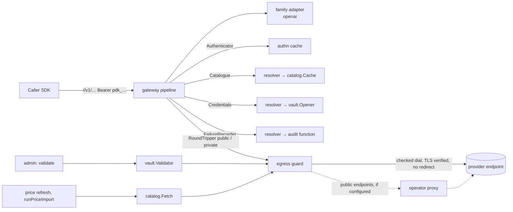

# Sprint 3.1 — Authenticated passthrough

- Epic: [3 — Gateway](../epic.md)
- Implementation plan: [plan.md](plan.md)
- Previous sprint: [2.2 — Catalogue and prices](../../02-vault-and-catalogue/2.2-catalogue-and-prices/sprint.md)
- Decisions implemented: ADR [0009](../../../../docs/adr/0009-native-passthrough-by-api-family.md)
  and [0020](../../../../docs/adr/0020-error-contract.md) (primary),
  [0035](../../../../docs/adr/0035-catalogue-and-model-access.md) (the model check in the request
  path), [0033](../../../../docs/adr/0033-vault-formats-and-key-identifiers.md) and
  [0034](../../../../docs/adr/0034-credential-model-and-platform-oversight.md) (the credential in
  the request path, validation), [0030](../../../../docs/adr/0030-keys-format-storage-lookup.md)
  and [0031](../../../../docs/adr/0031-authorization-core-and-provisioning.md) (principal,
  decision), [0010](../../../../docs/adr/0010-usage-extraction.md) and
  [0024](../../../../docs/adr/0024-openai-stream-usage-option.md) (unchanged behaviour, behind an
  interface), [0027](../../../../docs/adr/0027-database-roles-and-session-context.md) and
  [0032](../../../../docs/adr/0032-audit-log-first-version.md) (one definer function for the
  gateway role), [0036](../../../../docs/adr/0036-prices-costs-and-importer.md) (the download
  behind the guard), [0019](../../../../docs/adr/0019-configuration.md),
  [0015](../../../../docs/adr/0015-observability.md) (log line only),
  [0013](../../../../docs/adr/0013-ledger-and-audit.md) (audit part)
- New decision records written by this sprint: **0037** (request pipeline and resolution) and
  **0038** (egress guard, upstream TLS and proxy); an amendment of 0020 (two codes); history
  lines on 0009, 0027, 0032, 0034, 0036. Text in [plan.md](plan.md), part E.

This document is the design. The implementer follows [plan.md](plan.md); a gap in either document
is raised as a question, not filled silently ([planning/README.md](../../../README.md)).

Maintainer decisions of epics 1 and 2 taken as given, and what this sprint does with each item
they carried forward:

| Carried item | Where it is decided here |
|---|---|
| `HTTPS_PROXY` for provider traffic, with the egress guard (1.1 O-2) and for the price download (2.2 O-5) | D-9, §5.5, O-1 |
| ADR 0020 amendment: a `bad_request`-like code (1.1 O-5) | D-12, §5.8 |
| OPS-12 and GW-16 completion (1.1 O-6) | D-14, §3, §5.7, O-9 |
| Auditing of inference authentication failures (1.3 O-3) | D-15, §5.10, O-2 |
| Endpoint, model check and credential from catalogue and vault; removal of `skeleton.openai.*` | D-1 to D-5, D-16, §5.1 to §5.4, §5.11 |
| Credential validation on catalogue endpoints, behind the guard, per family | D-10, §5.6 |
| The pin rule of a key (2.1 D-6, O-6) | D-6, O-4 |
| What a key scoped to `model:invoke` alone may do; the pair with `credential:use` (2.1 O-4) | D-4, §5.2 |

## 1. Outcome

A call to `/<provider>/v1/chat/completions` with a virtual key goes through one pipeline: the
provider name selects a catalogue provider and its API family; the key is read from the family's
native header and becomes a principal; the principal must hold `model:invoke` and
`credential:use` in an active tenant; the body is read within the size and time limits and only
`model` and `stream` are parsed; the model must be allowed for the tenant and the key; the
tenant's own credential for that provider is opened; the request is forwarded to the provider's
default catalogue endpoint through the egress guard, with the caller's key removed and the
tenant's credential attached. The hard-wired route and the operator's single key of sprint 1.1
are gone, with the `skeleton` configuration section.

Outbound connections of the product (provider calls, credential validation, the price download)
leave through one package that checks the address actually dialled, never follows a redirect,
always verifies certificates (with an optional private CA) and uses a proxy only when the
operator configures one. Every refusal by Pandokos has a stable code in `x-pandokos-error` and
the error shape of the family being called.

Streaming keeps working exactly as in sprint 1.1 (same reader, same usage option, usage in the
log line); the ledger, traces and cancellation records are sprint 3.2.

At the end of the sprint the exit conditions of the epic hold: a non-streaming call succeeds with
a tenant's key and credential (T-451); a call for a model not granted, to an unsupported path,
or from a suspended tenant is refused with the documented code (T-451); attempts to reach an
internal address through a crafted endpoint or a redirect fail (T-452, T-433, T-434).

## 2. Scope

### In scope

- `internal/egress` (new): address classification, dial-time check, two transports (public and
  private endpoints), upstream TLS with optional private CA, optional configured proxy.
- `internal/family`: the `Adapter` interface, four new error codes; `internal/family/openai`:
  the adapter, request parsing (`model`, `stream`) with refusal of ambiguous bodies, replacement
  of the model name by the upstream identifier.
- `internal/gateway`: the pipeline of §5.1 over three interfaces (catalogue, credentials,
  authentication-failure recorder); routing by provider name; header rules; 3xx handling; the
  request log line; removal of `transport.go`.
- `internal/resolver` (new): the adapters from `catalog.Cache`, `vault.Opener` and the audit
  function to the gateway's interfaces.
- Migration `0005_gateway_auth_failures`: one `SECURITY DEFINER` function, executable by the
  gateway role, that writes an `auth.failure` row in the session's tenant log.
- `internal/vault`: one validator for the families `openai` and `anthropic`, against a target
  given per call; `internal/admin`: the target comes from the catalogue; `internal/catalog`:
  `Fetch` takes its transport, `Snapshot` exposes provider and default endpoint.
- Configuration: `skeleton.*` removed; `upstream.tls.ca_file`, `upstream.proxy.url` added.
- Tests of §9, documentation (`docs/operations/gateway.md` and the changed pages), ADR 0037 and
  0038, the amendment of ADR 0020.

### Not in scope

| Item | Sprint |
|---|---|
| Usage ledger, cost on the record, estimation, time to first byte as a measured value, caller metadata headers, cancellation records, OTLP traces and W3C Trace Context, fuzzing beyond the request parser | 3.2 |
| The operations `responses` and `embeddings` of the `openai` family (they need their usage readers; O-6) | 3.2 |
| The `anthropic` adapter (the provider is seeded: its route answers 404 until then), OpenAI-compatible providers verified against real services, the capability endpoint, the SDK suite in Python and TypeScript, Compose | 3.3 |
| The unified `/v1/…` endpoint (GW-15, S, R4): `v1` stays a reserved provider name and answers 404 | R4 |
| JWT authentication on the same pipeline | 4.1 |
| Rate limits, quotas, per-tenant concurrency (the rest of GW-16) | 5.1, 5.2 |
| Metrics for refusals and egress blocks | 6.1 |
| Platform-funded credentials and the funding mode as data | 7.1 |
| Proxy authentication; per-endpoint CA; mutual TLS towards providers; tenant-supplied endpoints | not scheduled (O-1), R4 |
| Reload of `upstream.tls.ca_file` without restart | 8.2 (with listener certificates) |

## 3. Requirements claimed

Wording quoted from [docs/requirements](../../../../docs/requirements/README.md).

| ID | Requirement (quoted) | What this sprint delivers | Claim |
|---|---|---|---|
| GW-01 | "Provider-native endpoints are forwarded as they are, preserving the semantics of request and response" | Native path appended to the catalogue endpoint; body forwarded byte for byte except the two documented splices (usage option, upstream model); response untouched | `openai` family, chat completions |
| GW-02 | "Stock provider SDKs work by changing only the base URL and the API key. The Pandokos credential is accepted in the authentication header native to each API family" | `Authorization: Bearer pdk_…` on `/<provider>/v1`; the Go SDK suite runs on the new pipeline | `openai` family |
| GW-05 | "Requests go only to destinations in the catalogue. The caller cannot influence host or URL, redirects are not followed, and a provider credential is sent only to the host it is registered for" | URL built from the default endpoint and a constant path; query dropped; 3xx never followed and answered as an error; the credential of provider P is opened for P and attached to P's endpoint only | full |
| GW-06 | "Outbound connections to private, loopback and link-local addresses are refused unless the endpoint is explicitly marked private, and the check is made on the address actually dialled" | `internal/egress`: check in the dialer's control hook, after resolution, per connection attempt | full |
| GW-07 | "Request headers are forwarded from an allow-list. Inbound credentials and hop-by-hop headers are removed. HTTP parsing is strict" | Outbound header built from an empty one; allow-list per family; headers named in `Connection` dropped even when allow-listed | full |
| GW-08 | "The provider credential is injected by the proxy and never reaches the caller, including through errors and echoed headers" | Injection from the vault; response header allow-list; fixed error messages; canary tests | full (a provider that echoes the key in a response **body** is passed unchanged: R-6) |
| GW-09 | "Each API family exposes an allow-list of endpoints that Pandokos can meter. Other paths are rejected with a clear error" | `family.Adapter.Operations`; 404 `endpoint_not_supported` | `openai`: one operation |
| GW-10 | "Provider errors are returned unchanged, except for sensitive headers. Errors raised by Pandokos use the error shape of the API family being called, plus a stable machine-readable code in a response header" | §5.8: thirteen codes, each with a test | full for the codes this sprint can raise |
| GW-11 | "Pandokos does not retry, fall back, or balance across providers, models or credentials" | One endpoint, one credential, one attempt; the transport cannot replay a body | full |
| GW-12 | "Every request gets a request ID, returned to the caller. W3C Trace Context from the caller is honoured" | Request ID on every response, in every log line, passed to the vault and the audit row | request ID (trace context 3.2) |
| GW-16 | "Request size, header size, duration and per-tenant concurrency are limited" | §5.7: body and header size, body read time (now answered 408), total duration, connect time, provider header size | size and duration (R1); concurrency 5.1 |
| OPS-12 | "On shutdown, in-flight streams are drained up to a configurable deadline" | The drain of sprint 1.1, proven on the new pipeline, including a request waiting in resolution | full (D-14); 3.2 adds the flush of the ledger buffer, which is ADR 0013's rule |
| FND-01 | "The funding mode is explicit for each tenant and provider: BYOK or platform-funded. Resolution is deterministic and never falls back from one mode to the other" | One mode exists, BYOK; it is named on the log line; resolution is the pin or the tenant's default, else 409 | BYOK (R1) |
| FND-02 | "Under BYOK only the tenant's own credential is used. Costs are estimates, marked informational and non-billable" | Only `vault.Opener` in the tenant's session supplies the credential | the credential part; cost 3.2 |
| SEC-01 | "Every listener can serve TLS natively or run behind a terminating proxy. Certificates of upstream providers are always verified" | No code path disables verification; TLS 1.2 or later; `upstream.tls.ca_file` | the upstream part (listeners: 1.3) |
| SEC-02 | "The replay exposure of each authentication mechanism is documented. Bearer credentials rely on TLS and short lifetimes; sender-constrained options are IAM-15 and IAM-16" | Section "Replay exposure" of the security model, for virtual keys | virtual keys (tokens 4.1) |
| CAT-06 | "A request for a model that is not allowed is rejected before it is forwarded, whatever identifier the caller uses" | `Resolve` called in the path; a body with two `model` members is refused | enforcement (the rule: 2.2) |
| VLT-05 | "A credential can be checked against the provider when it is written, without being logged" | Validation against the provider's catalogue endpoint, per family, behind the guard | full |
| VLT-06 | "A secret is decrypted only by the data plane, only after the request is authenticated and authorized, and only for the time needed to call the provider plus a bounded cache lifetime" | Order of §5.1, proven by T-426 | the order in the request path |
| AUD-01 | "Pandokos audits authentication failures and every creation, change, …" | Failures on the inference listener that name a key of a tenant are recorded in that tenant's log, bounded | inference listener (D-15) |

Touched, not claimed: **GW-03, GW-04, GW-14** (streaming, cancellation and usage reading keep
their 1.1 behaviour behind the adapter; 3.2 claims them), **VLT-15** (`credential_id` on the log
line; the usage record is 3.2), **SEC-03** (fixed messages), **TEN-09** (suspension refuses
calls), **IAM-04** (scopes and model list act in the request path), **PRV-02** (the gateway guide
lists what reaches a provider; 3.2 completes it).

## 4. Repository layout

```
internal/egress/                 new, leaf (standard library only)
  classify.go    Classify: public, private, forbidden
  guard.go       Guard, Options, Transport(private), BlockedError
internal/family/
  family.go      + four codes
  adapter.go     new: Operation, Request, StreamReader, Adapter, ErrInvalidRequest
internal/family/openai/
  adapter.go     new: the Adapter of the family
  request.go     Parse, (*Request).Prepare; PrepareRequest kept on top of them
  route.go       native paths ("/v1/chat/completions"); header lists
internal/gateway/
  handler.go     pipeline; proxy.go: rewrite, response, errors; ports.go: interfaces and errors
  transport.go   removed
internal/resolver/               new: catalog.Cache, vault.Opener, audit -> gateway interfaces
  catalogue.go   credentials.go   failures.go
internal/vault/validate.go       Validator with a target; families openai and anthropic
internal/catalog/                access.go: Provider, DefaultEndpoint; fetch.go: Transport
internal/audit/audit.go          + RecordAuthFailure
internal/store/migrations/sql/0005_gateway_auth_failures.sql
internal/store/queries/sql/audit.sql   + RecordAuthFailure
internal/config/                 - skeleton.*; + upstream.tls.ca_file, upstream.proxy.url
internal/server/server.go        receives the gateway's dependencies and the guard
cmd/pandokos/serve.go            builds guard, resolver, validator, fetch
docs/operations/gateway.md       new
```

Import rules (T-R25): `internal/egress` imports the standard library only. `internal/gateway`
may import `authz`, `family` and its adapters, `secret`, `tenant`, `requestid`; it still cannot
reach `store`, `vault`, `catalog`, `authn`, `admin`, `config`, `server`, and now neither
`resolver` nor `egress` (it receives two `http.RoundTripper`). `internal/resolver` imports
`gateway`, `catalog`, `vault`, `audit`, `authz`, `store`, `tenant`; only `cmd/pandokos` and
tests import it. `internal/vault` and `internal/catalog` gain no product import (they receive
round trippers). Under `cmd/` and `internal/`, a composite literal of `http.Transport` or
`net.Dialer`, and any use of `http.DefaultClient`, `http.DefaultTransport`, `http.Get`,
`http.Post` or `http.Head`, exists only in `internal/egress` and `internal/cli` (the CLI is the
operator's client of the administration API, not an outbound path of the server). (Amended at
review: T-R25 also exempts `internal/adminapi`, the runtime of the CLI client, which keeps a
pre-existing `http.DefaultClient` fallback, and generated files.)

## 5. Architecture



### 5.1 The pipeline

Steps run in this order; the first refusal ends the request. "Shape" is the error shape of the
family; before a family is known it is the shape of `Options.DefaultFamily` (`openai`).

| # | Step | Refusal |
|---|---|---|
| 1 | **Request ID**: 32 hexadecimal characters, generated, never taken from the caller; set on the response before anything else | — |
| 2 | **Route**: the path is `/<segment>/<rest>`. `Catalogue.Provider(segment)` returns the family of an enabled provider; the family must have an adapter; `adapter.Match(method, "/"+rest)` must return an operation | 404 `endpoint_not_supported` (unknown, disabled or reserved name, family without adapter, path or method not on the allow-list); 503 `unavailable` when the catalogue cannot be loaded |
| 3 | **Authenticate**: `adapter.InboundCredential(header)`, then `Authenticator.Authenticate` | 401 `unauthenticated` (uniform); 503 `unavailable`. A failure that names a key of a tenant goes to the recorder (§5.10) |
| 4 | **Authorize**: `authz.Decide(p, model:invoke, own tenant)`, then `authz.Decide(p, credential:use, own tenant)` (D-4) | 403 `tenant_suspended`; 403 `forbidden` |
| 5 | **Body**: `Content-Length` over the limit is refused before reading; the body is read through `http.MaxBytesReader` under the read deadline | 413 `request_too_large`; 408 `request_timeout` (deadline); connection aborted when the caller went away |
| 6 | **Parse**: `adapter.ParseRequest(op, body)` reads `model` and `stream` and nothing else | 400 `invalid_request` |
| 7 | **Model**: `Catalogue.Resolve(p, provider, model)` | 403 `model_not_allowed`; 404 `endpoint_not_supported` (`ErrProviderUnavailable`); 503 `unavailable` |
| 8 | **Credential**: `Credentials.Open(p, requestID, provider)` | 409 `no_credential`; 403 `forbidden`; 503 `unavailable` |
| 9 | **Forward**: `request.Prepare(target.UpstreamModel)`; URL = endpoint base URL + `op.Path`, no query; headers of §5.3; credential attached by the adapter; the round tripper of the endpoint's class; deadline `limits.max_request_duration` from here | 502 `upstream_unreachable`; 504 `upstream_timeout` |
| 10 | **Response**: a 3xx is not followed and not passed on (D-8); otherwise status and body pass unchanged, headers through the allow-list, the body through the usage reader as in 1.1; the log line is written when the handler ends | 502 `upstream_unreachable` for a 3xx |

Rules that hold across steps:

- Nothing of the body is read before step 5, and no credential is opened before step 8: a
  caller that fails authentication or authorization costs no body read, no model lookup and no
  decryption (T-426).
- The snapshot used in step 2 and the one used in step 7 may differ by a cache refresh; step 7
  decides.
- The outbound request has no `GetBody` and never carries `Idempotency-Key`: the transport
  cannot send a body twice (GW-11, T-435).
- Step 9 uses only values from the catalogue for scheme, host, port and path. The caller's
  path was matched exactly against a constant and is not copied.
- A panic is recovered as in 1.1: 500 `internal` when nothing was written.
- Extension points for later sprints are listed in §11.

### 5.2 Permissions: `model:invoke` and `credential:use` (D-4)

Under BYOK, the only funding mode of v0.1, a call needs both permissions and both are checked in
step 4. The built-in roles `inference` and `tenant-admin` hold both. A key whose `scopes` leave
only `model:invoke` authenticates and is refused with 403 `forbidden` before its body is read:
it cannot call a model and cannot learn which models it would be allowed. The pair stays two
permissions (2.1 O-4) because a platform-funded call (7.1) will need `model:invoke` without
`credential:use`; step 4 then asks the funding mode which second permission applies.
`vault.Opener.Open` keeps its own check of `credential:use` (ADR 0034, point 5).

### 5.3 Headers

**Outbound request.** The header is built from an empty one:

1. the names listed in any `Connection` header of the inbound request are collected (tokens,
   case-insensitive);
2. for each name of `adapter.RequestHeaders()` not in that set, the inbound values are copied;
3. `adapter.AttachCredential` sets the provider credential;
4. `Host` is the endpoint's host; `Content-Length` is the prepared body's length.

`openai.RequestHeaders`: `Accept`, `Content-Type`, `User-Agent`, `OpenAI-Organization`,
`OpenAI-Project`, `OpenAI-Beta` (D-13). Everything else is dropped, in particular the inbound
`Authorization`, `Cookie`, `X-Api-Key`, `Proxy-Authorization`, `Forwarded`, `X-Forwarded-*`,
`Accept-Encoding` (compression is not requested: the usage reader sees plain bytes),
`Idempotency-Key`, `X-Stainless-*`, `Traceparent`, `Tracestate` (3.2 decides them), and every
hop-by-hop header (`Connection`, `Keep-Alive`, `Proxy-Connection`, `Te`, `Trailer`,
`Transfer-Encoding`, `Upgrade`).

**Response.** Unchanged from 1.1: `Content-Type`, `Content-Length`, `Retry-After`,
`X-Request-Id`, `X-Ratelimit-*`, `Openai-*`; trailers and informational responses dropped.
`X-Pandokos-Request-Id` is set by Pandokos; a provider-sent `X-Pandokos-Error` never reaches the
caller.

### 5.4 Interfaces of the gateway and the resolver

```go
package gateway

// Target is where an authorized call goes. Every field comes from the catalogue.
type Target struct {
    Provider, Endpoint string // names
    ModelID, Model     string // catalogue ID and public name
    UpstreamModel      string // what the provider receives as model
    BaseURL            *url.URL
    Private            bool
}

// Catalogue is the gateway's view of the catalogue.
type Catalogue interface {
    // Provider returns the API family of an enabled provider; ok is false for a name that is
    // unknown or disabled. An error means the catalogue could not be read.
    Provider(ctx context.Context, name string) (family string, ok bool, err error)
    // Resolve returns the target for a model. ErrModelNotAllowed and ErrProviderUnavailable are
    // refusals; any other error means the decision could not be taken.
    Resolve(ctx context.Context, p authz.Principal, provider, model string) (Target, error)
}

// Credential is an opened provider credential.
type Credential struct {
    ID     string
    Pinned bool
    Secret secret.Secret
}

// Credentials opens the credential a call is made with.
type Credentials interface {
    // Open returns ErrNoCredential, ErrCredentialDenied, or another error when the credential
    // cannot be verified now.
    Open(ctx context.Context, p authz.Principal, requestID, provider string) (Credential, error)
}

// AuthFailure is a refused credential that names a key of a tenant.
type AuthFailure struct{ RequestID, Reason, KeyID, TenantID string }

// FailureRecorder records authentication failures; it reports whether a record was written.
type FailureRecorder interface {
    Record(ctx context.Context, f AuthFailure) bool
}

var (
    ErrModelNotAllowed     = errors.New("gateway: model not allowed")
    ErrProviderUnavailable = errors.New("gateway: provider unavailable")
    ErrNoCredential        = errors.New("gateway: no usable credential")
    ErrCredentialDenied    = errors.New("gateway: the principal may not use a credential")
)

type Options struct {
    Logger                 *slog.Logger              // required
    Authenticator          Authenticator             // required
    Catalogue              Catalogue                 // required
    Credentials            Credentials               // required
    Failures               FailureRecorder           // optional
    Families               map[string]family.Adapter // required: API family -> adapter
    DefaultFamily          string                    // required, a key of Families
    Public, Private        http.RoundTripper         // required: by endpoint class
    MaxRequestBodyBytes    int64
    RequestBodyReadTimeout time.Duration
    MaxRequestDuration     time.Duration
}
```

`gateway.NewTransport`, `Options.BaseURL`, `Options.ProviderKey` and `Options.Transport` are
removed. `gateway.Routes() []Route` (`Method`, `Path` as `/{provider}` + native path,
`Permissions []string`) lists, for every operation of every family, the two permissions of
§5.2; the isolation test that checks "every route declares a permission" reads it.

```go
package resolver

func NewCatalogue(c *catalog.Cache, log *slog.Logger) *Catalogue // implements gateway.Catalogue
func NewCredentials(o *vault.Opener) *Credentials                // implements gateway.Credentials
func NewFailureAuditor(db *store.DB, log *slog.Logger, now func() time.Time) *FailureAuditor
```

- `Catalogue.Provider`: `cache.Snapshot`, then `Snapshot.Provider`; disabled is `ok=false`.
- `Catalogue.Resolve`: `cache.Resolve`; `catalog.ErrModelNotAllowed` →
  `gateway.ErrModelNotAllowed`; `catalog.ErrProviderUnavailable` →
  `gateway.ErrProviderUnavailable`. The endpoint's `BaseURL` is checked again with
  `catalog.ValidateEndpointURL(url, private)` and parsed; a stored URL that fails is logged at
  error (`endpoint unusable`, provider and endpoint names, never the URL) and is
  `ErrProviderUnavailable`.
- `Credentials.Open`: `opener.Open(vault.Use{Principal, RequestID, Provider})`;
  `vault.ErrNoCredential` and `*vault.NotUsableError` → `ErrNoCredential`; `vault.ErrDenied` →
  `ErrCredentialDenied`; `vault.ErrUnavailable`, `vault.ErrUndecryptable` and anything else are
  returned wrapped (the gateway answers `unavailable`), as 2.1 §11 fixed.
- New in `catalog`: `func (s *Snapshot) Provider(name string) (Provider, bool)` and
  `func (s *Snapshot) DefaultEndpoint(provider string) (Endpoint, bool)` (the enabled default
  endpoint; `Resolve` uses it).

**The pin rule (D-6).** Confirmed as 2.1 D-6 and ADR 0034 point 2: a pinned key uses its pin for
the pin's provider and the tenant's default credential for any other provider; nothing falls
back. With the model check in the path, a tenant that wants a key bound to one provider gives it
a model list of that provider (`virtual_key.models`); the pin chooses a credential, not a
provider.

### 5.5 Egress guard (`internal/egress`)

```go
type AddrClass int // AddrPublic, AddrPrivate, AddrForbidden
func Classify(a netip.Addr) AddrClass

type Options struct {
    ConnectTimeout time.Duration  // required, > 0
    RootCAs        *x509.CertPool // nil: the system roots
    Proxy          *url.URL       // nil: direct; used for public endpoints only
}
type Guard struct{ /* two transports */ }
func New(o Options) (*Guard, error)
// Transport returns the round tripper for endpoints of one class; both live as long as the Guard.
func (g *Guard) Transport(private bool) http.RoundTripper
func (g *Guard) CloseIdleConnections()

// BlockedError is a request the guard refused. Error() gives the reason and never the address.
type BlockedError struct {
    Reason string     // scheme, user_info, private_address, forbidden_address, not_tcp, unparsable
    Addr   netip.Addr // zero when the refusal came before an address was known
}
// BlockedReason and BlockedAddr let a package that may not import egress (the gateway)
// recognize a refusal through an interface of its own.
func (e *BlockedError) BlockedReason() string
func (e *BlockedError) BlockedAddr() string // "" when Addr is the zero value
```

**Classification** (after `Unmap`, zone removed):

| Class | Addresses |
|---|---|
| forbidden | unspecified (`0.0.0.0`, `::`), `0.0.0.0/8`, multicast (`224.0.0.0/4`, `ff00::/8`), `240.0.0.0/4` (broadcast included), and the instance-metadata addresses `169.254.169.254`, `169.254.170.2`, `100.100.100.200`, `fd00:ec2::254` |
| private | loopback (`127.0.0.0/8`, `::1`), `10.0.0.0/8`, `172.16.0.0/12`, `192.168.0.0/16`, `100.64.0.0/10`, link-local (`169.254.0.0/16`, `fe80::/10`), unique-local `fc00::/7`, `fec0::/10`, `192.0.0.0/24`, `198.18.0.0/15`, the documentation ranges (`192.0.2.0/24`, `198.51.100.0/24`, `203.0.113.0/24`, `2001:db8::/32`), `2001::/32` (Teredo), `64:ff9b:1::/48` |
| forbidden, amended at review | the deprecated IPv4-compatible `::/96` and IPv4-translated `::ffff:0:0:0/96`, for every class (`::` and `::1` keep their classes above) |
| embedded | `64:ff9b::/96` (NAT64) and `2002::/16` (6to4) take the class of the IPv4 address they embed |
| public | everything else |

**Two transports.** One for endpoints with `private = false`, one for `private = true`. They
never share a connection: a connection made under the private rule cannot serve a public
endpoint with the same host and port.

| | public endpoint | private endpoint |
|---|---|---|
| scheme | `https` only | `https` or `http` (2.2 D-4) |
| dialled address must be | public | public or private |
| forbidden addresses | refused | refused |
| proxy (`upstream.proxy.url`) | used when configured | never |
| TLS | verified, TLS 1.2 or later, roots = system + `upstream.tls.ca_file` | the same, when `https` |

**Where the check happens.**

1. *Before dialling* (in `RoundTrip`): scheme by class; no user information in the URL; a host
   that is an address literal is classified and refused by the table. This gives a clear error
   without a connection attempt.
2. *At dialling*: `net.Dialer.Control` runs after name resolution, for every connection attempt
   (each address of a name, both families), with the literal address about to be connected. It
   parses it with `netip.ParseAddrPort`, requires `tcp4` or `tcp6`, classifies, and returns a
   `*BlockedError`. This is the address "actually dialled": a name that passed validation when
   the endpoint was written and now resolves to a private or forbidden address (DNS rebinding,
   split-horizon DNS, an IPv4-mapped answer) is refused here. A kept-alive connection keeps
   the address that was checked.
3. *With a proxy*, the connection that is dialled goes to the proxy. The control hook then
   accepts public and private addresses (the proxy is the operator's and is usually internal)
   and still refuses forbidden ones; the target is checked by rule 1 when it is a literal, and
   when it is a name its resolution is the proxy's (documented; O-1). Only `CONNECT` is used,
   since public endpoints are `https`; no header of the caller and no credential is in the
   `CONNECT` request.

**Other properties.** `http.Transport.RoundTrip` never follows a redirect; no `http.Client` is
used. `Proxy` is `nil` or the configured URL, never `http.ProxyFromEnvironment`.
`DisableCompression` is true. `ForceAttemptHTTP2` is true. `MaxResponseHeaderBytes` is 262144.
`TLSClientConfig.InsecureSkipVerify` is never set and there is no option for it. Idle pool
values are those of 1.1 (256 connections, 90 s).

**Proxy and environment (D-9).** The variables `HTTPS_PROXY`, `HTTP_PROXY`, `ALL_PROXY` and
`NO_PROXY` are never read for outbound traffic. An operator who needs a proxy sets
`upstream.proxy.url`; it then applies to provider calls, credential validation and the price
download for public endpoints and public URLs. If one of the variables is set and the key is
not, `serve` logs a configuration warning that names the variable (not its value).

### 5.6 Credential validation and the price download

```go
package vault

// ValidationTarget is the endpoint a credential is presented to. It comes from the catalogue.
type ValidationTarget struct {
    Family  string // "openai", "anthropic"
    BaseURL string // the endpoint's base URL
    Private bool
}
type Validator interface {
    Validate(ctx context.Context, t ValidationTarget, s secret.Secret) (v Verdict, upstreamStatus int)
}
// NewValidator returns the validator of every family in ValidatorFamilies. public and private
// are the round trippers of the two endpoint classes; timeout bounds one validation (10 s when
// not positive).
func NewValidator(public, private http.RoundTripper, timeout time.Duration) Validator
func ValidatorFamilies() []string // sorted
```

| Family | Request | Credential |
|---|---|---|
| `openai` | `GET <base>/v1/models` | `Authorization: Bearer <secret>` |
| `anthropic` | `GET <base>/v1/models` | `x-api-key: <secret>`, `anthropic-version: 2023-06-01` |

Verdicts are those of 2.1 §5.8: 2xx accepted; 401 and 403 rejected; everything else, a 3xx
(never followed), a timeout, a network error, a guard refusal and an unknown family are
indeterminate. At most 64 KiB of the response is read and discarded; neither the body nor the
error text is logged, returned or stored. `NewOpenAIValidator` is removed.

`admin.Options.Validators` becomes `Validator vault.Validator` (nil: validation unavailable).
For `validate: true` the handler loads the catalogue (`catalog.LoadSnapshot` on the admin pool,
before any transaction of the write), takes the provider of the credential, its family and its
enabled default endpoint, and calls the validator. `invalid_request` on `validate` ("is not
available for this provider") when there is no validator, the provider is disabled or has no
enabled default endpoint, or its family is not in `ValidatorFamilies`. The codes
`credential_rejected` (422) and `validation_unavailable` (502) and the OpenAPI document do not
change. A server that accepts any key (a self-hosted endpoint without authentication) validates
every secret: the guide says so.

`catalog.FetchOptions` gains `Transport http.RoundTripper` (required; `Fetch` no longer builds
one). `serve` passes `guard.Transport(false)`, so the price download obeys the same rules and
the same proxy (2.2 O-5 is closed). `Fetch` keeps its own limits (https, no redirect, 16 MiB,
60 s).

### 5.7 Limits (GW-16) and draining (OPS-12)

| Limit | Key (default) | When exceeded |
|---|---|---|
| Request headers | `listeners.inference.max_header_bytes` (65536), `read_header_timeout` (10 s) | 431 or closed connection by `net/http` (no Pandokos body: the request never reaches the handler) |
| Request body size | `limits.max_request_body_bytes` (10485760; 1 to 104857600) | 413 `request_too_large`, checked on `Content-Length` first, then while reading |
| Request body time | `limits.request_body_read_timeout` (30 s) | 408 `request_timeout` with `Connection: close` (new; 1.1 closed the connection silently) |
| Connect and TLS handshake | `upstream.connect_timeout` (10 s) | 502 `upstream_unreachable` |
| Whole forwarded request, stream included | `limits.max_request_duration` (10 m), from the end of the body read | before the provider's headers: 504 `upstream_timeout`; after: the response is cut, outcome `timeout` |
| Provider response headers | 262144 bytes (constant) | 502 `upstream_unreachable` |
| Parsed part of the body | the whole body is scanned once; nothing but `model` and `stream` is decoded | — |

The catalogue and vault lookups of steps 2, 7 and 8 run under the request context: a caller
that disconnects or a forced shutdown ends them. Per-tenant concurrency is sprint 5.1.

**Draining.** Unchanged from 1.1: on a signal readiness goes down, listeners stop accepting,
in-flight requests and streams continue for `shutdown.drain_timeout` (30 s), then the base
context is cancelled with `gateway.ErrShutdown` and what remains ends with outcome
`shutdown_aborted`. New here: a request still in steps 2 to 8 when the deadline passes is not
forwarded (T-450); idle upstream connections are closed through `Guard.CloseIdleConnections`.

### 5.8 Error contract

| Code | Status | Raised when | New |
|---|---|---|---|
| `unauthenticated` | 401 | step 3 | |
| `tenant_suspended` | 403 | step 4, tenant not active | |
| `forbidden` | 403 | step 4 (either permission); step 8 `ErrCredentialDenied` | |
| `model_not_allowed` | 403 | step 7 | in code (ADR 0020 had it) |
| `endpoint_not_supported` | 404 | step 2; step 7 `ErrProviderUnavailable` | |
| `no_credential` | 409 | step 8 | in code (ADR 0020 had it) |
| `invalid_request` | 400 | step 6 | **ADR 0020 amendment** |
| `request_timeout` | 408 | step 5, read deadline | **ADR 0020 amendment** |
| `request_too_large` | 413 | step 5 | |
| `upstream_unreachable` | 502 | step 9: connection, TLS, guard refusal; step 10: a 3xx | |
| `upstream_timeout` | 504 | step 9, deadline before headers | |
| `unavailable` | 503 | catalogue, principal or credential cannot be verified | |
| `internal` | 500 | recovered panic | |

Messages are constants (`family.ErrorCode.Message`); new ones:

- `model_not_allowed`: "Pandokos: the model is not available to this credential."
- `no_credential`: "Pandokos: no usable provider credential for this provider."
- `invalid_request`: "Pandokos: the request body must be a JSON object with one string member \"model\"."
- `request_timeout`: "Pandokos: the request body was not received in time."

Every Pandokos error carries `X-Pandokos-Error`, `X-Pandokos-Request-Id` and a body in the
family's shape (OpenAI: `{"error":{"message","type":"pandokos_error","param":null,"code"}}`). A
provider error passes unchanged and never carries `X-Pandokos-Error`. No message contains a
model name, a provider name, an address, a URL or the text of an underlying error.

**Parsing (`openai`).** `ParseRequest` scans the top-level object once (the scanner of ADR
0024):

```go
package openai
func Parse(body []byte) (*Request, error) // error wraps family.ErrInvalidRequest; Reason() names the row
func (r *Request) Model() string
func (r *Request) Stream() bool
func (r *Request) Prepare(upstreamModel string) (out []byte, strip bool)
```

| Body | Result |
|---|---|
| not exactly one JSON object (array, scalar, trailing data, invalid JSON) | refused, reason `not_object` |
| no top-level member `model` | refused, `model_missing` |
| `model` appears more than once at the top level (compared after JSON unescaping of the key) | refused, `model_duplicate` |
| `model` is not a JSON string, or is the empty string | refused, `model_not_string` |
| otherwise | `Model()` is the decoded string; `Stream()` is true only for the literal `true` of the last `stream` member (ADR 0024) |

A duplicate `model` is refused because parsers disagree on which occurrence counts: Pandokos
could authorize one model and the provider serve another (CAT-06, D-11). `Prepare` applies the
usage splice of ADR 0024 and, when `upstreamModel` is not empty and differs from `Model()`,
replaces the bytes of the `model` value by the JSON string of the upstream identifier (D-7);
every other byte is forwarded as received. With no change it returns the same slice.
`PrepareRequest(body)` stays, defined as `Parse` then `Prepare("")`, returning the body
unchanged when `Parse` fails for a reason other than the model (its tests and fuzz target keep
their meaning).

The response is not rewritten: when names differ, the provider's `model` member shows the
upstream identifier (documented).

### 5.9 The request log line

One `request` line per request, at info, with the fields of 1.1 §5.5 and these changes:

| Field | When | Value |
|---|---|---|
| `route` | always | `POST /{provider}/v1/chat/completions` when an operation matched, else `unmatched` |
| `provider`, `api_family`, `operation` | operation matched | catalogue name, family, `chat.completions` |
| `model`, `model_id`, `endpoint` | step 7 passed | the public name and ID from the catalogue, the endpoint's name |
| `credential_id`, `credential_pinned`, `funding` | step 8 passed | `funding` is `byok` |
| `invalid_reason` | step 6 refused | a reason of §5.8 |
| `upstream_error` | step 9 or 10 failed | `redirect`, `egress`, `connect`, `timeout` |
| `egress_reason` | the guard refused | a `BlockedError.Reason` |
| `upstream_request_id` | the provider sent `X-Request-Id` | the value when it is at most 128 printable ASCII characters |

The model string of the caller is logged only as the catalogue's name after it resolved: an
unresolved value is caller input of unknown content. `authentication failed` (warn) gains
`audited`. `egress blocked` (warn): `request_id`, `provider`, `endpoint`, `reason`, `address`
(operator log only). The `Opener`'s `credential opened` line (debug) is unchanged.

### 5.10 Authentication failures on the inference listener (D-15)

Migration `0005_gateway_auth_failures` (full text in plan.md, appendix A) adds

```sql
pandokos.record_auth_failure(p_key_id text, p_reason text, p_request_id text) RETURNS void
```

`SECURITY DEFINER`, `search_path = pg_catalog, pg_temp`, executable by `pandokos_gateway` only.
It inserts one row into `audit_event` for `pandokos.current_tenant_id()` with fixed
`actor_type = 'anonymous'`, `action = 'auth.failure'`, `resource_type = 'virtual_key'`,
`outcome = 'failure'`, and `detail = {"reason": …, "listener": "inference"}`; it checks the
format of its three arguments. The gateway role gets no privilege on `audit_event`: it can write
that one kind of row, in the tenant of its session, and nothing else. Outside a tenant session
the forced policy refuses the row.

`resolver.FailureAuditor.Record` writes through `audit.RecordAuthFailure` in
`db.WithTenant(tenant)`, with a 2 s limit detached from the request, and only when:

- the failure carries a tenant (reasons `wrong_secret`, `revoked`, `expired`,
  `service_account_disabled`, `service_account_not_valid`); failures without a tenant
  (`malformed`, `unknown_key`, `kind_not_accepted`) are logged only: there is no tenant log to
  write and anyone can cause them;
- the same key ID and reason were not recorded in the last 10 minutes by this instance (a map
  of at most 4096 entries, emptied when full);
- a token is available: 60 at once, one more each second, per instance (the numbers of the
  admin listener, ADR 0032).

The 401 response is the same whether or not a row was written.

### 5.11 Configuration

Removed: `skeleton.openai.base_url`, `skeleton.openai.api_key_file` and the `skeleton` section.
As when the access token went away (1.3): a file that still has the section is refused with
`file: line N: unknown key skeleton`; the two environment variables give the warning `unknown
variable … ignored`. `serve` needs no provider key any more.

| Key | Environment variable | Type | Default | Validation |
|---|---|---|---|---|
| `upstream.tls.ca_file` | `PANDOKOS_UPSTREAM_TLS_CA_FILE` | path | none | when set: readable PEM with at least one certificate; its certificates are added to the system roots for every outbound TLS connection of the server (providers, validation, price download, an `https` proxy) |
| `upstream.proxy.url` | `PANDOKOS_UPSTREAM_PROXY_URL` | URL | none | when set: scheme `http` or `https`, a host, no user information, no query, no fragment, path empty or `/` |

Both are read for the purpose *serve* only. `config.Upstream` gains `TLS UpstreamTLS{CAFile
string; RootCAs *x509.CertPool}` and `Proxy UpstreamProxy{URL string; ParsedURL *url.URL}`
(the parsed forms filled by `Load`). Warning, key `upstream.proxy.url`: "HTTPS_PROXY is set in
the environment and is not used; set upstream.proxy.url to send provider traffic through a
proxy" (the name of the variable found, never its value), when one of `HTTPS_PROXY`,
`https_proxy`, `HTTP_PROXY`, `http_proxy`, `ALL_PROXY`, `all_proxy` is set and the key is empty.

**Upgrade note** (in the gateway guide): the operator's single provider key no longer exists.
Before upgrading, remove `skeleton` from the file; after `pandokos migrate`, point the endpoint
of `openai` elsewhere if `skeleton.openai.base_url` was not the default (`pandokos endpoint
update`; the base URL is now written **without** `/v1`), and have each tenant register its own
credential (`pandokos credential create --provider openai`). No release contains the `skeleton`
section, so there is no compatibility window.

### 5.12 Wiring (`cmd/pandokos`, `internal/server`)

`serve` builds one `egress.Guard` from `upstream.connect_timeout`, `upstream.tls.RootCAs` and
`upstream.proxy.ParsedURL`, and gives: both transports to the gateway (through
`server.Options`), `vault.NewValidator(guard.Transport(false), guard.Transport(true), 10 s)` to
the admin handler, `guard.Transport(false)` to `catalog.Fetch` for the refresher and for
`runPriceImport`. `server.Options` gains `Catalogue`, `Credentials`, `Failures`, `Egress
*egress.Guard` (all but `Failures` required) and builds the gateway with
`Families: {"openai": openai.Adapter()}`, `DefaultFamily: "openai"`.

## 6. Isolation harness

- `Spec.SecurityDefiner` gains `record_auth_failure`; the grants matrix does not change (the
  gateway still holds nothing on `audit_event`): T-140 reports zero findings.
- T-443 proves the function's bounds for every runtime role.
- The inference route is checked for tenant isolation by T-441 (a key of B never opens a
  credential of A, by ID or by default) and T-451 (the provider sees each tenant's own
  credential); cross-tenant model access is 2.2's T-398, now also reached through the route.
- `gateway.Routes()` feeds the "every route declares a permission" test.

## 7. Test infrastructure and CI

- `test/fakeprovider`: `URL()` is the endpoint base URL (`BaseURL()`, which ended in `/v1`, is
  removed); new model names select behaviours `fake-redirect` (307 to a URL set with
  `RedirectTo`), `fake-echo-auth` (echoes the received `Authorization` in response headers
  `X-Echo-Authorization` and `Www-Authenticate`), `fake-close` (closes the connection without
  answering); `ModelsBehaviour` gains the `anthropic` header check.
- `test/testutil`: `StaticCatalogue(targets …)` and `StaticCredentials(secret)` implementing
  the gateway interfaces (for the server, SDK and gateway tests); `ConnectProxy(tb)` (a CONNECT
  proxy on loopback that records the requests it received); `TestGuard(tb)` (a real
  `egress.Guard` with a 2 s connect timeout).
- `test/e2e`: `proc.useFakeProvider(t, platformFile, provider, up)` points a provider's default
  endpoint at a fake (`private: true`); `proc.addCredential(t, adminFile, provider, secret)`.
  Every e2e and container test that made an inference call uses them instead of the two
  `PANDOKOS_SKELETON_…` variables.
- No new Go dependency; no new CI job. `make fuzz` gains `FuzzParseRequest`.

## 8. Decisions

| # | Decision | Reason |
|---|---|---|
| D-1 | **One pipeline with the fixed order of §5.1; route, then authenticate, then authorize, then body** | The family must be known to find the credential header (GW-02); refusing before the body is read and before any decryption bounds what an unauthenticated or unauthorized caller costs (VLT-06, GW-16). The existence of a provider name is visible without a key: O-3 |
| D-2 | **The gateway sees catalogue, vault and audit through three interfaces with its own types; `internal/resolver` adapts** | 1.3 and 2.x keep `internal/gateway` away from `store`, `vault` and `catalog` (T-R13). The adapter is the "resolver" of the architecture overview and is tested against the database on its own |
| D-3 | **An API family is a `family.Adapter`; providers map to adapters by their catalogue family; unknown provider, disabled provider and family without adapter are the same 404 in the default shape** | ADR 0009: the unit of implementation is the family. 3.3 adds `anthropic` by registering an adapter. One answer for every "not here" case reveals nothing about disabled providers |
| D-4 | **Under BYOK a call needs `model:invoke` and `credential:use`; both are decided in step 4** | 2.1 O-4. Checking the second permission only inside the vault would let a key without it read its body in, run the model check and learn which models are allowed |
| D-5 | **`ErrProviderUnavailable` after authentication is 404 `endpoint_not_supported`; vault errors map as 2.1 §11 fixed** | 2.2 §11 asked for the family's not-found shape; a provider without an enabled default endpoint is, for a caller, a route that is not served |
| D-6 | **The pin rule of 2.1 D-6 is confirmed** | The pin picks a credential; restricting a key to a provider is the job of the key's model list, which now acts in the path |
| D-7 | **The public model name is replaced by the upstream identifier when they differ, by a byte splice; the response is not rewritten** | ADR 0009 lists it among the changes the proxy makes; without it a model whose name differs from its upstream identifier cannot be called |
| D-8 | **A 3xx from a provider is never followed and is answered as 502 `upstream_unreachable`** | GW-05. Passing a redirect to an SDK would invite it to follow, with the caller's Pandokos key in the request; the `Location` is not on the allow-list anyway. A redirect means the endpoint's base URL is wrong, which is the operator's to fix: the log says `upstream_error: redirect` |
| D-9 | **Outbound traffic never reads proxy variables from the environment; the operator sets `upstream.proxy.url`, which applies to public endpoints of provider calls, validation and the price download; private endpoints go direct** | ADR 0019: settings are `PANDOKOS_…` keys, validated at start; an ambient variable set for other tools would silently move credentials through a proxy. With a proxy the dialled address is the proxy's, so the guard states exactly what it still checks (§5.5, rule 3) |
| D-10 | **Validation moves to the default endpoint of the credential's catalogue provider, behind the guard, with one validator that knows the families `openai` and `anthropic`** | 2.1 D-10 tied it to `skeleton.openai.base_url`. The family decides how a key is presented; the catalogue decides where. Both families answer `GET /v1/models` (verified: §12) |
| D-11 | **A body is refused with 400 when it is not one JSON object with exactly one top-level string `model`** | 1.1 O-5: the model is needed to authorize. Refusing duplicates removes the parser disagreement that would defeat CAT-06 |
| D-12 | **ADR 0020 gains `invalid_request` (400) and `request_timeout` (408)** | 1.1 O-5 named both gaps. `invalid_request` is already the administration API's code for a bad request; 408 is what clients expect when a body stalls, and the connection is closed after it |
| D-13 | **`OpenAI-Organization`, `OpenAI-Project` and `OpenAI-Beta` join the request allow-list; `Idempotency-Key` does not** | Under BYOK the credential is the tenant's, so which of its organizations and projects is billed is the tenant's choice (1.1 excluded the first because the key was the operator's). Go's transport treats a request carrying `Idempotency-Key` as replayable: not forwarding it keeps "one attempt" simple (GW-11) |
| D-14 | **This sprint claims OPS-12 and GW-16 (size, duration) in full** | 1.1 O-6. The mechanisms exist since 1.1; here they are proven on the final pipeline, and the last gap (a stalled body had no answer) is closed. The epic file listed OPS-12 under 3.2: it is corrected (plan.md E4); 3.2 flushes the ledger buffer on shutdown under ADR 0013 |
| D-15 | **Attributable authentication failures on the inference listener are audited in the tenant's log, through a definer function and a bounded recorder; unattributable ones are logged only** | 1.3 O-3. A revoked or expired key that is still presented is exactly what a tenant must be able to see (AUD-01). A function that can write one kind of row keeps the gateway role without any privilege on the audit table (data model) and leaves the canonical policy alone (lint L-09). Suppression per key and a token bucket bound what a looping client or an attacker can write |
| D-16 | **`skeleton.*` is removed without a compatibility window; old file keys are an error, old variables a warning** | The precedent of 1.3 (`skeleton.access_token_file`); no release contains the section |
| D-17 | **Two long-lived transports, chosen by the endpoint's `private` flag, instead of one transport with a per-request policy** | A connection pool keyed by host and port would let a connection opened under the private rule serve a public endpoint of the same host. Two pools make that impossible by construction |
| D-18 | **Instance-metadata addresses, unspecified, multicast and reserved addresses are refused even for private endpoints** | No model endpoint lives there; the metadata service is the classic target of request forgery, and a private endpoint's name can be made to resolve to it |
| D-19 | **Streaming requests keep the behaviour of sprint 1.1 unchanged** (usage option, in-line reader, usage in the log line) | The walking skeleton already forwards streams event by event with the reader, the fuzz targets and the benchmark of ADR 0024; removing that until 3.2 would break the SDK suite for no gain. 3.2 adds the ledger, time to first byte and cancellation records around it |
| D-20 | **Only `chat.completions` is on the allow-list in this sprint** | GW-09: an operation is exposed when it can be metered. `responses` and `embeddings` need their own usage readers, which belong with 3.2's readers and fuzzing (O-6) |

## 9. Tests

Levels: U unit, I in-process with local sockets, D database (`make db-up`), A in-process API
(`test/apitest`), E end-to-end with the built binary, S SDK module, C container, R repository.
IDs continue after T-412 and T-R24.

### New tests

| ID | Test | Level | Proves | Requirement |
|---|---|---|---|---|
| T-413 | `egress.TestClassify` | U | Every range of §5.5 at its first and last address and one inside; IPv4-mapped forms; NAT64 and 6to4 by embedded address; an address with a zone; a public sample of both families | **GW-06** |
| T-414 | `egress.TestDialControl` | U | The control hook of each transport: public refuses private and forbidden; private accepts private, refuses forbidden; the proxy dial accepts private, refuses forbidden; `udp4`, `unix` and an unparsable address are refused; every refusal is a `*BlockedError` with the reason and the address | **GW-06** |
| T-415 | `egress.TestDialledAddressIsChecked` | I | A server on loopback: the public transport refuses `localhost` (a name that resolves at dial time), `127.0.0.1`, `[::1]`, `[::ffff:127.0.0.1]`; the server accepted no connection; the private transport reaches it. `errors.As` finds the `BlockedError` through the transport's error | **GW-06**, exit 3 |
| T-416 | `egress.TestPreflight` | U | `http` on the public transport, user information, a forbidden literal on the private transport, a private literal on the public one: refused with zero dial attempts (counting hook); `Error()` of every refusal contains no address | GW-05, GW-06 |
| T-417 | `egress.TestTLS` | I | Server certificate of an unknown CA refused; accepted with `RootCAs` holding the CA; wrong host name refused; a TLS 1.1-only server refused; both transports have `InsecureSkipVerify` false and `MinVersion` TLS 1.2; the private transport verifies too | **SEC-01** |
| T-418 | `egress.TestNoRedirectNoEnvironmentProxy` | I | A 302 is returned as a 302 and the redirect target receives nothing; with `HTTPS_PROXY`, `HTTP_PROXY` and `ALL_PROXY` pointing at a recording proxy, no request reaches it | **GW-05** |
| T-419 | `egress.TestProxy` | I | With `Options.Proxy`: the public transport sends `CONNECT host:port` and nothing of the request's headers to the proxy and completes TLS with the target through it; the private transport does not use it; a private literal target on the public transport is refused before the proxy is contacted; a proxy on a forbidden address is refused | GW-05, GW-06 |
| T-420 | `egress.TestClassesDoNotShareConnections` | I | After the private transport used a connection to host H, the public transport's request to H is refused; closing idle connections closes both pools | GW-06 |
| T-421 | `openai.TestParse` | U | Every row of the table of §5.8 with its reason; escaped key (`"model"`) counted as `model`; nested `model` members ignored; escapes in the value decoded; `stream` per ADR 0024 | **CAT-06**, GW-16 |
| T-422 | `openai.TestPrepare` | U | Exact output bytes: model replaced alone, with each usage splice row, with white space around the value; same name or empty upstream: same slice; an upstream identifier with `"` and `\` is encoded as JSON | GW-01 |
| T-423 | `openai.FuzzParseRequest` | U | Never panics; when `Parse` succeeds, `encoding/json` reads the same `model` from the body; the output of `Prepare(x)` decodes to model `x` and to the same other members | CAT-06 |
| T-424 | `openai.TestAdapter` | U | The adapter's operations, `Match` on native paths only (`/v1/chat/completions`; not `/chat/completions`, not a trailing slash, not `GET`), header lists of §5.3, error body for each code of §5.8 | **GW-09**, GW-10 |
| T-425 | `gateway.TestRouteByProvider` | I | Two providers of the family, one with a path in its base URL: each call reaches its own endpoint at base + native path with no query; unknown, disabled, reserved (`v1`, `healthz`) and adapter-less (`anthropic`) names, `//openai/…`, a missing segment: identical 404 in the default shape, nothing forwarded, no `provider` field logged; catalogue error: 503 | **GW-01**, **GW-09**, GW-05 |
| T-426 | `gateway.TestPipelineOrder` | I | Counting fakes and a body that fails the test when read: for a refusal at each of steps 2, 3, 4 (each permission, suspended tenant), 5, 6, 7, 8, no later step ran; in particular no body read before step 5, no `Resolve` before a valid body, no `Open` before `Resolve` succeeded | **VLT-06**, **CAT-06**, GW-16 |
| T-427 | `gateway.TestModelCheck` | I | `ErrModelNotAllowed` gives 403 `model_not_allowed`; the response is byte-identical (but for the request ID) for an unknown name, another provider's model and an upstream identifier; `ErrProviderUnavailable` 404; another error 503; the provider received nothing | **CAT-06** |
| T-428 | `gateway.TestInvalidRequest` | I | Each refusal row of §5.8: 400 `invalid_request`, `invalid_reason` logged, nothing forwarded; a canary placed in the body is in no log line and not in the response | GW-10 |
| T-429 | `gateway.TestCredentialResolution` | I | The provider receives the secret returned by `Credentials` and never the caller's key; `Open` got the request ID of the response header and the provider name of the path; `ErrNoCredential` 409, `ErrCredentialDenied` 403 `forbidden`, another error 503; `credential_id`, `credential_pinned`, `funding: byok` on the log line | **GW-08**, **FND-01**, **FND-02**, VLT-15 |
| T-430 | `gateway.TestUpstreamModel` | I | Name differs from upstream identifier: the provider's body has the identifier and is otherwise byte-identical; streaming with the usage splice too; the response passes unchanged | GW-01 |
| T-431 | `gateway.TestRequestHeaders` | I | The lists of §5.3: each allowed header forwarded with all its values; each named dropped header absent; `Connection: User-Agent, X-Custom` removes `User-Agent`; `Host` is the endpoint's; `Content-Length` is the prepared length | **GW-07** |
| T-432 | `gateway.TestCredentialNeverReachesCaller` | I | With `fake-echo-auth`: the echoed headers do not reach the caller; for every Pandokos error of T-439 and for a transport error whose text quotes the URL, the credential canary, the endpoint host and the port are absent from status line, headers and body | **GW-08**, SEC-03 |
| T-433 | `gateway.TestRedirectNotFollowed` | I | 301, 302, 307, 308 towards a second listener: it receives nothing; the caller gets 502 `upstream_unreachable` without `Location`; the log has `upstream_status` and `upstream_error: redirect` | **GW-05**, exit 3 |
| T-434 | `gateway.TestEgressClassFollowsEndpoint` | I | With a real guard: a target with `Private: false` and a loopback literal or `localhost` gives 502, `egress blocked` logged with the reason, the listener accepted nothing, the response holds no address; the same target with `Private: true` succeeds | **GW-06**, exit 3 |
| T-435 | `gateway.TestNoRetry` | I | The upstream closes a reused connection without answering (`fake-close`): one attempt, 502; the same when the caller sent `Idempotency-Key` (which is also not forwarded) | **GW-11** |
| T-436 | `gateway.TestRequestTimeout` | I | Headers and half a body, then silence: 408 `request_timeout` with `Connection: close` after the read timeout, nothing forwarded; a caller that closes mid-body: nothing written, outcome `client_error` | **GW-16** |
| T-437 | `gateway.TestAuthFailureRecorded` | I | A failure with a tenant calls the recorder once with reason, key ID, tenant and request ID, and `audited` follows its answer; failures without a tenant and a nil recorder do not; the 401 is byte-identical in every case | **AUD-01** |
| T-438 | `gateway.TestRequestLogFields` | I | The exact field set of §5.9 for a success, a stream, and a refusal at each step; `model` absent until step 7 passed; no canary | GW-12 |
| T-439 | `gateway.TestErrorContract` | I | Each code of §5.8 is produced by its condition with the stated status, both headers, the family's body and the constant message; a provider 429 and 500 pass unchanged without `X-Pandokos-Error`, also when the provider sends that header | **GW-10** |
| T-440 | `resolver.TestCatalogue` | D | On a migrated database: `Provider` for a seeded, a disabled and an unknown name; `Resolve` returns base URL, class, endpoint name, model ID and upstream identifier; both refusals map; with the database stopped the error is neither refusal; a snapshot whose endpoint URL fails validation gives `ErrProviderUnavailable` and logs no URL | CAT-06, GW-05 |
| T-441 | `resolver.TestCredentials` | D | No credential, disabled, revoked → `ErrNoCredential`; a principal without `credential:use` → `ErrCredentialDenied`; database stopped → another error; a pinned key gets the pin for its provider and the default for another provider; a key of tenant B pinned (by a forged principal) to a credential of A gets `ErrNoCredential` | **FND-01**, **FND-02**, VLT-06, VLT-07 |
| T-442 | `resolver.TestFailureAuditor` | D | One `auth.failure` row with `listener: inference` in the tenant's log; the same key and reason again within the window: no row; another reason: a row; an exhausted bucket: no row; a full map is emptied; the database stopped: false within 3 s; a failure without tenant: no row | **AUD-01** |
| T-443 | `isolation.TestRecordAuthFailure` | D | The gateway role executes the function in a tenant session and the row is that tenant's; without a tenant session it is refused; the admin and worker roles and `PUBLIC` cannot execute it; malformed arguments are refused; the gateway role still cannot insert into or read `audit_event`; the lint has zero findings | TEN-06, AUD-01 |
| T-444 | `vault.TestValidator` | I | Per family: method, path (also under a base URL with a path), credential header, `anthropic-version`, and nothing of the request or the tenant; verdict table of §5.6 including a 302, a stall, a refused connection, a guard refusal and an unknown family (no request sent); `Private` selects the round tripper; a 1 MiB body is not read past 64 KiB; no error text returned | **VLT-05** |
| T-445 | `admin_test.TestValidationUsesTheCatalogue` | A | `validate: true` for a second provider of family `openai` reaches that provider's default endpoint; a disabled provider, one without enabled default endpoint and a family without validator: `invalid_request` on `validate`; a public endpoint named `localhost`: 502 `validation_unavailable` and the fake received nothing; the secret canary is in no log and no response | **VLT-05**, GW-06 |
| T-446 | `catalog.TestSnapshotAccessors`, `catalog.TestFetch` (extended) | U, I | `Provider`, `DefaultEndpoint`; `Fetch` refuses a nil transport and uses the one given; no redirect followed | CAT-09 |
| T-447 | `config.TestUpstreamConfiguration` | U | Defaults; `upstream.tls.ca_file` missing, empty, without certificate (problems that quote no content) and valid (a leaf of the test CA verifies against `RootCAs`); the validation table of `upstream.proxy.url`; the environment warning for each variable name, naming the variable and not its value, absent when the key is set | SEC-01, OPS-08 |
| T-448 | `config.TestSkeletonRemoved` | U | A file with `skeleton:` is refused with `unknown key skeleton`; each old variable gives the warning without its value; a valid *serve* configuration needs no provider key file | OPS-08 |
| T-449 | `audit.TestRecordAuthFailure` | D | The query writes the row through the function; an argument with a sensitive-looking value is refused by the function's format check | AUD-01 |
| T-450 | `server.TestShutdownDuringResolution` | I | A request blocked in `Catalogue.Resolve` when shutdown starts: it completes when released within the deadline; when the deadline passes it ends with outcome `shutdown_aborted` and nothing is forwarded | **OPS-12** |
| T-451 | `e2e.TestGatewayExitScenario` | E | The built binary, PostgreSQL, a fake provider as the endpoint of `openai`: tenant A (key, credential) completes a non-streaming and a streaming call and the provider saw A's credential; tenant B with its own credential: the provider saw B's and never A's; a model with availability `selected` and no grant: 403 `model_not_allowed`; `/openai/v1/embeddings`: 404; a key scoped to `model:invoke`: 403 `forbidden`; tenant C without credential: 409; A suspended: 403 `tenant_suspended` within the bound; each response has both headers and the OpenAI shape | exits 1 and 2, **GW-02**, **FND-02** |
| T-452 | `e2e.TestEgressAttacks` | E | (a) the endpoint is changed to `https://localhost:<port>` with `private: false`: 502, the listener on that port accepted nothing; (b) the fake answers 307 to an internal listener: it receives nothing, 502; (c) an endpoint `http://169.254.169.254` with `private: true`: 502 with `egress_reason: forbidden_address`; (d) `validate: true` against (a): 502 `validation_unavailable`. `egress blocked` is logged each time | exit 3, **GW-05**, **GW-06** |
| T-453 | `e2e.TestGatewayCanaries` | E | At `info` and `debug`, after a success, a stream, every refusal of T-451, a provider 401 whose headers echo the key, an egress block and a validation: the prompt, the completion, every form of the virtual key and of the credential secret are absent from stdout, stderr, the bodies and headers of Pandokos-raised errors, `audit_event` and `platform_audit_event` | **VLT-14**, **GW-08**, SEC-03 |
| T-454 | `e2e.TestUpstreamCAAndProxy` | E | A TLS fake under the test CA as a private endpoint: 502 without `upstream.tls.ca_file`, success with it; with `upstream.proxy.url` on a recording CONNECT proxy and a public endpoint: the call succeeds, the proxy saw one `CONNECT` and no credential; the price refresh reaches its server through the same proxy; `HTTPS_PROXY` in the process environment is not used and gives the warning | **SEC-01**, GW-05 |
| T-455 | `e2e.TestAuthFailureAudit` | E | A revoked key presented three times on the inference listener: one `auth.failure` row with `listener: inference` in its tenant's log; an unknown key: none; the log lines carry `audited` | **AUD-01** |
| T-R25 | `repo.TestPlanesDoNotImportEachOther` (extended), `repo.TestOutboundHTTPInOnePlace` | R | The import rules of §4; the literal and identifier scan of §4 | GW-05 |
| T-R26 | `repo.TestGatewayGuide` | R | `docs/operations/gateway.md` names every code of `family` with its status, every header of the adapter's lists, both new keys, every range of the classification table, and the upgrade note; `docs/reference/permissions.md` states the pair of §5.2; the security model has "Replay exposure" | SEC-02, PRV-02 |
| T-R27 | `repo.TestNoSkeleton` | R | No file under `cmd/`, `internal/`, `test/`, `deploy/`, `Dockerfile` or `docs/operations/` contains `skeleton` in any case, except the upgrade note of the gateway guide and the two tests that prove the removal | — |

### Changed tests of epics 1 and 2

- **Replaced**: T-44 by T-436; T-49 by T-431; T-57 by T-438; T-307 (`vault.TestOpenAIValidator`
  and its proxy child) by T-444 and T-418.
- **Adapted to the new harness** (fakes for catalogue and credentials, native paths, a private
  target): T-23, T-36, T-37 to T-43, T-45 to T-48, T-50 to T-56, T-58 to T-60 (the OPS-12
  tests), T-267, T-274; the SDK suite T-67 to T-71; T-65, T-66 and every e2e test that calls the
  inference listener (T-162, the exit scenario and revocation tests of 1.3, the vault and
  catalogue e2e tests); T-72 (container).
- **Changed expectations**: T-04 to T-15 (keys, defaults, validation: no `skeleton`, two new
  keys); T-22 (codes); T-46 (a closed port on a private target); T-52 (the list of refused
  paths now includes `/openai/chat/completions`); T-63, T-64; T-140 (lint, with the function);
  the 2.1 validation tests of the admin API (`TestValidationAtWrite`: target from the
  catalogue); the 2.2 fetch and refresh tests (transport injected); T-R5, T-R13/T-R20, T-R14,
  T-R22 (vault guide §8).

### Requirement coverage

| Requirement | Tests |
|---|---|
| GW-01 | T-425, T-430, T-37 |
| GW-02 | T-451, T-67 to T-71 |
| GW-05 | T-418, T-425, T-433, T-452, T-R25 |
| GW-06 | T-413 to T-415, T-420, T-434, T-452 |
| GW-07 | T-431 |
| GW-08 | T-429, T-432, T-453 |
| GW-09 | T-424, T-425 |
| GW-10 | T-439, T-54 |
| GW-11 | T-435 |
| GW-12 | T-438, T-55 |
| GW-16 | T-436, T-53, T-43 |
| OPS-12 | T-450, T-59, T-60 |
| FND-01, FND-02 | T-429, T-441, T-451 |
| SEC-01 | T-417, T-454 |
| SEC-02 | T-R26 |
| CAT-06 | T-421, T-423, T-426, T-427, T-451 |
| VLT-05 | T-444, T-445 |
| VLT-06 | T-426, T-441 |
| AUD-01 | T-437, T-442, T-443, T-455 |

## 10. Definition of done for this sprint

**Requirements and tests**

- [ ] Every test of section 9 exists under the stated name and passes; the changed tests pass.
- [ ] The tests-first record exists: the commit of part B precedes the implementation commits
      and the pull request quotes its failing output.
- [ ] The coverage table is repeated in the pull request with links to the CI run.

**Isolation and permissions**

- [ ] `record_auth_failure` is in `Spec.SecurityDefiner`; the grants matrix is unchanged; T-140
      reports zero findings; T-443 passes for every runtime role.
- [ ] `gateway.Routes()` names both permissions for every operation; T-441 and T-451 prove
      that a tenant's key never uses another tenant's credential.

**Exit conditions of the epic**

- [ ] A non-streaming call succeeds with a tenant's key and credential (T-451).
- [ ] A model not granted, an unsupported path and a suspended tenant are refused with the
      documented codes (T-451).
- [ ] A crafted endpoint and a redirect do not reach an internal address (T-452, T-433, T-434).

**Security**

- [ ] The canary tests pass (T-428, T-432, T-453); no log line, error body or audit row holds a
      key, a credential, a prompt or a completion.
- [ ] `git grep -n InsecureSkipVerify -- cmd internal` prints nothing; `ProxyFromEnvironment`
      likewise.
- [ ] T-R25: no outbound HTTP outside `internal/egress` (and the CLI client).

**Quality gates**

- [ ] `make check` passes locally and in CI; `make image` and `make test-container` pass;
      `make fuzz FUZZTIME=30s` passes with the new target.
- [ ] `go.mod` and `go.sum` are unchanged.

**Documentation and decisions**

- [ ] `docs/operations/gateway.md` exists; configuration, container, vault, catalogue, TLS,
      permissions, data model, security model and overview pages are updated (plan.md part E).
- [ ] ADR 0037 and 0038 are added; ADR 0020 is amended; ADR 0009, 0027, 0032, 0034 and 0036
      carry history lines; the index lists the new records.
- [ ] `migrations.sum` has the line of `0005_gateway_auth_failures.sql`.
- [ ] The epic file lists OPS-12 under 3.1 and the operations `responses` and `embeddings`
      under 3.2 (if O-6 and O-9 are confirmed); `status:` of this file is `done`; the review
      records the answers to section 12.

## 11. Consequences for later sprints

- **3.2 (streaming, usage, ledger)** plugs into the pipeline at fixed points: after step 4 a
  principal exists, and from there every outcome must produce one usage record (the handler's
  `finish` already runs for every outcome and holds principal, target, credential ID, usage and
  outcome: it is where the ledger writer is called); caller metadata headers are read in step 3
  and never forwarded (they are not on the allow-list); the server span starts at step 1 and
  the provider span wraps step 9 (`Traceparent` then joins the allow-list only when the
  operator enables propagation); time to first byte is already measured in the response hook.
  It adds the operations `responses` and `embeddings` as rows of the `openai` adapter with
  their `ReadUsage` and `NewStreamReader` cases (`family.Operation` is the switch), and
  computes cost with `pricing.CostOf` from `Target.ModelID`. It records refusals after
  authentication (steps 4 to 8), which the log line already distinguishes by `error_code`.
- **3.3** registers `anthropic.Adapter()` in `Families` (`x-api-key`, its own header lists,
  error shape and parser); `/anthropic/…` then stops answering 404. It builds the capability
  endpoint on `Catalogue.Resolve` and `Credentials.Open` (the two answers it needs), verifies
  OpenAI-compatible providers (a provider row with family `openai`; base URLs with a path are
  covered by T-425), and decides the error shape per family for the cases that today use the
  default shape. The validator already knows `anthropic`.
- **4.1** adds a second mechanism behind `Authenticator`; steps 4 to 10 do not change. A
  principal from a token has no pin and no key model list.
- **5.1** inserts *reserve* between steps 7 and 8 and *settle* in `finish`; adds the 429 codes
  and per-tenant concurrency (the rest of GW-16).
- **6.1** counts refusals by `error_code`, egress blocks by reason and authentication failures
  (including those not audited).
- **6.2** reads `auth.failure` rows of both listeners; `detail.listener` tells them apart.
- **7.1** makes the funding mode data: step 4 asks it which permission pairs with
  `model:invoke`; step 8 opens a platform credential instead; `OpenAI-Organization` and
  `OpenAI-Project` must then **not** be forwarded for platform-funded calls (the caller would
  choose the operator's billing organization).
- **8.2** reloads `upstream.tls.ca_file` with the listener certificates; in separate processes
  the admin process keeps a guard of its own for validation and the worker for the download.
- **R4** (tenant endpoints, CAT-03 S) reuses the guard: a tenant-supplied endpoint is always of
  the public class.

## 12. Risks and open points

### What was verified while designing

- On the test PostgreSQL 16 of `make db-up` (a migrated scratch database of `test/dbtest`): the
  function of appendix A is created by the owner; the gateway role inserts one `auth.failure`
  row with it in a tenant session and the detail reads `{"reason": …, "listener":
  "inference"}`; a malformed reason is refused (`23514`); outside a tenant session the forced
  policy refuses the row (`42501`); the gateway role still cannot insert into `audit_event`
  directly (`42501`); the admin role cannot execute the function (`42501`); the schema lint
  reports the function only as "not listed in Spec.SecurityDefiner". The key ID pattern of the
  function is the check constraint of `virtual_key.key_id` (migration 0002).
- `sqlc` v1.31.1, run on a copy of the schema and query directories with appendix A and B
  added, generates `RecordAuthFailure(ctx, RecordAuthFailureParams{KeyID, Reason, RequestID})
  error`.
- With Go 1.25.0 (the floor of `go.mod`): `net.Dialer.Control` sees the literal address after
  resolution (`localhost` → `127.0.0.1:port`, `[::ffff:127.0.0.1]` → `127.0.0.1:port`), its
  error stops the connection, and `errors.As` finds it through the error of
  `http.Transport.RoundTrip`; `RoundTrip` returns a 302 without following it; non-canonical
  IPv4 forms (`0x7f.1`, `2130706433`, `127.1`) are not addresses for Go's resolver (they fail
  as unknown host names).
- `go doc net/http.Transport`: a request is replayed only when it is idempotent "and either has
  no body or has its Request.GetBody defined", and a request with an `Idempotency-Key` header
  counts as idempotent — the basis of the rule in §5.1.
- `https://api.openai.com/v1/models` and `https://api.anthropic.com/v1/models` (with
  `anthropic-version: 2023-06-01`) both answer 401 without a key (observed 2026-11-14): the
  path exists for both families.
- The seed's endpoints are `https://api.openai.com` and `https://api.anthropic.com` (migration
  0004): base URL + `/v1/chat/completions` is the address the skeleton used.
- Lint rule L-09 refuses a second policy on a tenant-scoped table: a restrictive policy for the
  gateway role on `audit_event` was therefore not chosen.

**Not verified**: the Go code (not written); the behaviour of real provider endpoints behind an
operator proxy; HTTP/2 through a `CONNECT` proxy with the test proxy of T-419 (the test decides
whether the proxy helper needs to speak only HTTP/1.1 to the client side).

### Risks

| # | Risk | Mitigation |
|---|---|---|
| R-1 | **The sprint rewires every inference test**: gateway, server, SDK, e2e and container harnesses change together | Part B first builds the shared fakes and helpers; the 1.1 tests keep their names and assertions; steps C4 and C7 are the only ones that touch harnesses |
| R-2 | **With a proxy, the address check for host names is the proxy's** | Stated in the guide and in ADR 0038; literals are still checked; private endpoints never use the proxy; the proxy is the operator's own control point |
| R-3 | **An operator marks an endpoint private and names a host an attacker controls in DNS** | Forbidden addresses are refused for every class (D-18); marking private is a platform-admin act that is audited (2.2); the guide warns that `private` means "may resolve inside" |
| R-4 | **A legitimate public provider resolves to an address the table calls private** (a provider reached over a private link, CGNAT, NAT64 without the well-known prefix) | The endpoint is declared `private: true`, which is the truth of that deployment; the `egress blocked` line names reason and address |
| R-5 | **Refusing duplicate `model` members breaks a client that sends them** | No SDK does; the refusal has its own `invalid_reason`; the alternative is a silent bypass of the model check |
| R-6 | **A provider echoes part of the credential in an error body**, which passes unchanged (GW-10) | It is the tenant's own credential, returned to a caller of that tenant; providers mask it; documented. Headers are filtered |
| R-7 | **The gateway role can now write to the audit log** | One function, one kind of row, the session's tenant, fixed columns, format-checked arguments; bounded by suppression and a token bucket; no table privilege |
| R-8 | **Validation shares the gateway's connection pools** (2.1 used a connection per validation) | Same destination and same guard; a validation is one `GET`; noted in ADR 0034's history |
| R-9 | **A stale catalogue entry routes to a changed endpoint for up to `cache.catalog_ttl`** | Bounded and documented since 2.2; the guard still checks what is dialled |
| R-10 | **SDKs retry 408 and 409**: a call without credential is tried three times by the OpenAI SDK | Two cheap refusals; the code and header tell the caller why (O-7) |

### Open points (raised to the maintainer; none blocks the sprint)

| # | Point | Recommendation |
|---|---|---|
| O-1 | Proxy (D-9): an explicit key `upstream.proxy.url`; ambient `HTTPS_PROXY` ignored with a warning; no proxy authentication; with a proxy, host names are resolved by the proxy, not checked by the guard. Alternatives: honour `HTTPS_PROXY` and `NO_PROXY` as other tools do; add `upstream.proxy.password_file` | Keep D-9; add proxy authentication when an operator asks (it is a secret file and a `Proxy-Authorization` on `CONNECT`, with canary tests) |
| O-2 | Authentication failures (D-15): audited now for attributable failures through a definer function, bounded. Alternatives: logged only, with a metric in 6.1; or through the ledger writer of 3.2 | Keep D-15: small, and it is the case a tenant must see |
| O-3 | The route is resolved before authentication (D-1), so an unauthenticated caller can tell a served provider name (401) from an unserved one (404). Alternative: try every family's header first and answer 401 before 404 | Keep: provider names are not secrets of a tenant, and the order of the architecture overview is route, then authenticate |
| O-4 | The pin rule (D-6): confirmed. Alternative: a pinned key may call only its credential's provider | Confirm D-6; a model list on the key restricts providers |
| O-5 | `OpenAI-Organization`, `OpenAI-Project`, `OpenAI-Beta` are forwarded (D-13). Alternative: keep the three-header list of 1.1 | Forward: with BYOK they select within the tenant's own account; 7.1 excludes the first two for platform-funded calls |
| O-6 | Only chat completions in 3.1 (D-20); `responses` and `embeddings` move to 3.2 with their usage readers. Alternative: add them here without metering | Move to 3.2 and add the line to the epic file; GW-09 ties the allow-list to metering |
| O-7 | `no_credential` stays 409 (ADR 0020) and `request_timeout` is 408, although the OpenAI SDK retries both. Alternative: 403 for `no_credential` | Keep the ADR: the status says "the state of the resource prevents this", and the retries are harmless |
| O-8 | Forbidden addresses (D-18) cannot be reached even by a private endpoint | Keep; nobody serves models from a metadata address |
| O-9 | OPS-12 is claimed here in full (D-14), and the epic file is corrected | Confirm; 3.2 names it as touched for the ledger flush |
| O-10 | A provider 3xx becomes 502 `upstream_unreachable` (D-8). Alternatives: a new code `upstream_redirect`; pass the 3xx without `Location` | Keep: no new code for an operator-side misconfiguration; the log line names it |
| O-11 | A key scoped to `model:invoke` alone is refused before its body is read (D-4), so it cannot even learn which models it may use | Keep; `model:read` on the administration API is the way to list models |

### Maintainer decisions on the open points (2026-11-14)

| # | Decision |
|---|---|
| O-1 | Confirmed D-9: an explicit `upstream.proxy.url`, ambient proxy variables ignored with a warning, no proxy authentication until an operator asks |
| O-2 | Confirmed D-15: attributable authentication failures on the inference listener are audited now, bounded |
| O-3 | Confirmed: the route is resolved before authentication |
| O-4 | Confirmed: the pin rule of 2.1 D-6 stands; a model list on the key restricts providers |
| O-5 | Confirmed: `OpenAI-Organization`, `OpenAI-Project` and `OpenAI-Beta` are forwarded; 7.1 excludes the first two for platform-funded calls |
| O-6 | Confirmed: only chat completions in 3.1; `responses` and `embeddings` move to 3.2 with their usage readers, and the epic file says so |
| O-7 | Confirmed: `no_credential` stays 409 and `request_timeout` is 408 |
| O-8 | Confirmed: forbidden addresses are unreachable for private endpoints too |
| O-9 | Confirmed: OPS-12 is claimed by 3.1 in full; 3.2 names it as touched for the ledger flush; the epic file is corrected |
| O-10 | Confirmed: a provider 3xx is answered 502 `upstream_unreachable`, no new code |
| O-11 | Confirmed: a key scoped to `model:invoke` alone is refused before its body is read |

### Amendments at review

1. The container test's step 1 of plan part D (`endpoint update --base-url <fake URL> --private=false`) was unsatisfiable as written: the administration API refuses an `http` URL, and a loopback literal, on a public endpoint. The test updates the endpoint to `https://localhost:<port of the fake>` instead; it passes `catalog.ValidateEndpointURL` and the guard refuses the resolved loopback address at dial time (`private_address`, 502 `upstream_unreachable`), before any TLS handshake; the test also looks for the `egress blocked` log line.
2. A request cancelled before forwarding (steps 2 to 8, including a forced shutdown) now aborts the connection (`http.ErrAbortHandler`) instead of returning without a write, which let net/http send an empty 200.
3. The suppression of repeated authentication failures reserves the key under the lock, so concurrent identical failures write one row.
4. The outbound path of the gateway keeps the escapes of the endpoint's base path, as the credential validator does, including a base path that starts with two slashes (it is not re-parsed as a URL reference).
5. The forbidden table of 5.5 gains `::/96` and `::ffff:0:0:0/96` (amended at review); the import rule of section 4 names `internal/adminapi` (amended at review).
