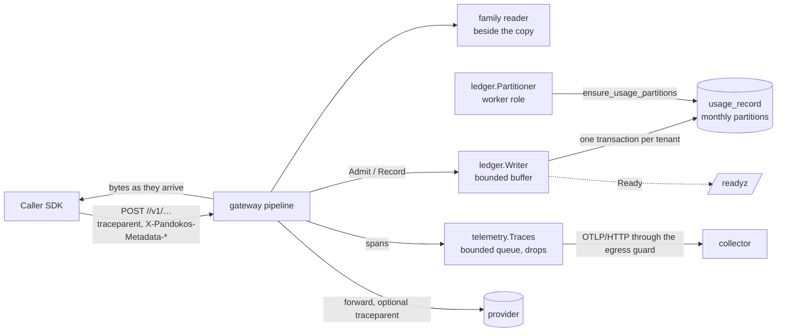

# Sprint 3.2 — Streaming, usage and ledger

- Epic: [3 — Gateway](../epic.md)
- Implementation plan: [plan.md](plan.md)
- Previous sprint: [3.1 — Authenticated passthrough](../3.1-authenticated-passthrough/sprint.md)
- Risk class: **high** (streaming, concurrency, append-only data, readiness)
- Decisions implemented: ADR [0010](../../../../docs/adr/0010-usage-extraction.md),
  [0013](../../../../docs/adr/0013-ledger-and-audit.md) (ledger part) and
  [0015](../../../../docs/adr/0015-observability.md) (traces) as primary;
  [0024](../../../../docs/adr/0024-openai-stream-usage-option.md) (confirmed, chat streams only),
  [0009](../../../../docs/adr/0009-native-passthrough-by-api-family.md) (two more operations),
  [0036](../../../../docs/adr/0036-prices-costs-and-importer.md) (cost at the version in force),
  [0037](../../../../docs/adr/0037-request-pipeline-and-resolution.md) (three attachment points),
  [0038](../../../../docs/adr/0038-egress-guard-upstream-tls-and-proxy.md) (the collector is
  reached through the guard), [0027](../../../../docs/adr/0027-database-roles-and-session-context.md)
  and [0004](../../../../docs/adr/0004-postgresql-and-rls.md) (table, roles, one definer
  function), [0029](../../../../docs/adr/0029-static-sql-sqlc.md),
  [0019](../../../../docs/adr/0019-configuration.md),
  [0018](../../../../docs/adr/0018-supply-chain.md) (new direct dependencies, justified),
  [0020](../../../../docs/adr/0020-error-contract.md) (no new code)
- New decision records written by this sprint: **0039** (usage record, admission and the ledger
  writer) and **0040** (traces: SDK, span model, sampling, propagation); history lines on 0009,
  0010, 0013, 0015, 0018, 0019, 0020, 0024, 0027, 0037. Text in [plan.md](plan.md), part E.

This document is the design. The implementer follows [plan.md](plan.md); a gap in either document
is raised as a question, not filled silently ([planning/README.md](../../../README.md)).

Items carried into this sprint, and where each is decided:

| Carried item | Where it is decided here |
|---|---|
| The usage record carries `credential_id` (VLT-15; epic 2 record) | §5.5, T-485 |
| Cost with `pricing.CostOf` at the price version in force at the request time; prices keep their currency, never converted (2.2 O-6, 2.2 §11) | D-9, §5.4 |
| Operations `responses` and `embeddings` with their usage readers (3.1 O-6) | D-1, §5.2 |
| The ledger flush inside the shutdown sequence of OPS-12 (3.1 O-9) | D-14, §5.8 |
| Estimation, storing original provider values, confirming 1.1 D-5 (no compression) and D-9 (inclusive totals) (1.1 §11) | D-6, D-7, §5.4; D-5 and D-9 of 1.1 are confirmed unchanged |
| Request metadata (GW-13) and W3C Trace Context (GW-12, OBS-02) (1.1 non-scope) | D-10, D-15 to D-18, §5.3, §5.9 |
| Same request ID on audit row, log line and usage record (1.3 §11, AUD-07) | §5.5, T-485 |
| Canaries in traces (2.1 §11) | T-497, T-513 |
| Streaming unchanged since 1.1 (3.1 D-19); a request cancelled before forwarding aborts the connection (3.1 review, amendment 2) | §5.3, §5.5 (outcome `cancelled`), T-484 |

## 1. Outcome

Every authenticated call on the inference listener leaves exactly one row in `usage_record`:
who called, what was called, how it ended, the tokens the provider reported (or an estimate,
marked as such, when it reported none), the cost at the price version in force, and the
metadata the caller attached. Refusals after authentication and cancellations leave a row too.
The row holds no prompt, no completion and no secret.

The `openai` family serves three operations: chat completions, `responses` and `embeddings`,
streaming where the provider streams. Stream events reach the caller as they arrive; the usage
reader sits beside the copy and can never alter or break it.

Rows are written by a batching writer over a bounded buffer. A request is admitted only while
the buffer has room for its record: when the database is away long enough to fill it, the
instance reports not ready and answers 503 instead of serving calls it could not record. On
shutdown the buffer is flushed inside a stated bound.

Each admitted request produces a server span, and each provider call a client span, joined to
the caller's trace when the caller sent W3C Trace Context, exported over OTLP when the operator
configures a collector. A slow or absent collector costs nothing but the spans.

Exit conditions of the epic: a streamed call delivers events without added buffering and
produces one record with provider-reported tokens and cost (T-489, T-509); a cancelled stream
produces a record marked cancelled (T-492, T-509); with the database stopped, records are
buffered and then the instance reports not ready (T-473, T-510); no content appears in the
ledger, the logs or the spans (T-497, T-513).

## 2. Scope

### In scope

- `internal/family`: `Usage.Reported`, `StreamReader.Deltas`, `Adapter.EstimateUsage`,
  `FlattenUsage`; `internal/family/openai`: operations `responses` and `embeddings`, their
  request rules, usage readers and stream reader; estimation.
- `internal/usage` (new, leaf): the usage record, outcomes and sources, record IDs, caller
  metadata parsing.
- `internal/ledger` (new): the batching writer with admission, the readiness check, the flush,
  the partition keeper.
- Migration `0006_usage_ledger`: the partitioned table, its protection, the function that
  creates partitions; one query file; the isolation harness and a lint rule for partitions.
- `internal/telemetry`: traces (SDK tracer provider, OTLP/HTTP exporter, sampler, resource).
- `internal/gateway`: admission, metadata, the record in `finish`, usage sources and cost, time
  to first byte, spans and propagation, a stream wrapper that fails soft.
- `internal/resolver`: price versions on the target. `internal/config`: keys `ledger.*` and
  `telemetry.*`. `internal/server`, `cmd/pandokos`: wiring, readiness, shutdown.
- Tests of §9; guides `docs/operations/usage.md` and `docs/operations/telemetry.md`, the data
  flow reference (PRV-02), changed pages; ADR 0039 and 0040.

### Not in scope

| Item | Sprint |
|---|---|
| Any API, CLI command or console page that **reads** usage (USE-06, USE-07); `usage:read` permission; rollups; export (O-3) | 3.3 (minimal list, if O-3 is confirmed), 6.2 |
| Retention and the audited function that drops partitions (USE-08); pseudonymization at tenant deletion | 6.2, 6.3 |
| `usage_correction` (USE-05, the R3 part), rating rule columns, billable events, the durable intent row for platform-funded calls | 7.x |
| Outcome `rejected_limit`, reserve and settle, the request-side estimate used for reservation | 5.1 |
| Metrics, the Prometheus endpoint, `gen_ai.*` attributes and token counts on spans (OBS-03, OBS-06; O-16) | 6.1 |
| OTLP over gRPC (O-2); trace export of the administration API and of background jobs | when asked; 6.1 |
| A tenant restricting metadata keys (PRV-03, R2) | 6.x |
| The `anthropic` family; a per-provider switch for the usage option; the unified `/v1/…` endpoint | 3.3; R4 |
| JWT principals on the record (`principal_kind` gains a value) | 4.1 |
| Reading usage from JSON responses larger than 4 MiB without buffering (O-14); the model name as reported by the provider | not scheduled; 6.1 |
| Batch, file and background (`background: true`) processing, whose usage arrives out of band (D-3) | open question 3 of the architecture overview |

## 3. Requirements claimed

Wording quoted from [docs/requirements](../../../../docs/requirements/README.md).

| ID | Requirement (quoted) | What this sprint delivers | Claim |
|---|---|---|---|
| GW-03 | "Streaming responses are forwarded event by event, without buffering the whole response" | The copy flushes after every read; the reader observes and returns the provider's bytes; only when a usage-only event must be removed is an event held until its blank line. Proven per operation with a gated provider | full, `openai` family |
| GW-04 | "When the caller disconnects the upstream request is cancelled. Timeouts are configurable. Nothing stays reserved or locked afterwards" | The 1.1 cancellation, now with a record marked `cancelled`, its ledger slot released and no goroutine left | full (limit reservations: 5.1) |
| GW-12 | "Every request gets a request ID, returned to the caller. W3C Trace Context from the caller is honoured" | `traceparent` of an authenticated caller parents the server span; the trace ID is on the record and the log line | the trace context part (request ID: 3.1) |
| GW-13 | "The caller can attach a bounded set of metadata to a request for attribution. Metadata is recorded with the usage, never used in a security decision and never forwarded to the provider" | `X-Pandokos-Metadata-<key>` headers, at most 8, bounded in size and character set, stored on the record, read after authentication, never on a forwarding list | full |
| GW-14 | "Usage is extracted from streaming and non-streaming responses. Any change to a request needed for this is documented and invisible to the caller" | Readers for the three operations, streaming and not; the one change (ADR 0024) stays limited to chat streams | full, `openai` family |
| GW-09 | "Each API family exposes an allow-list of endpoints that Pandokos can meter. Other paths are rejected with a clear error" | Two operations join the list with their readers | `openai`: three operations |
| USE-01 | "Every authenticated inference request produces exactly one usage record in both funding modes, whether it succeeded, failed, was cancelled, was refused for a limit or was never forwarded" | Admission after authentication, one `Record` call in `finish` for every outcome, idempotent insert | BYOK; every outcome that exists today. One stated exception: a request refused because the ledger buffer is full has no record (ADR 0013; §5.6) |
| USE-02 | "The ledger holds no prompt, completion or media content" | No column can hold content: every text column is format-checked, JSON columns hold numbers or bounded caller metadata; canary tests | full |
| USE-03 | "A record holds: record ID, request ID, trace ID, tenant, caller, virtual key or token subject, credential ID, funding mode, provider, model, endpoint, streaming flag, timestamps and duration, outcome, token counts by category (input, output, cached, provider-specific), other billed units, estimated cost, currency, price version and caller metadata" | The columns of §5.5 | full (token subject: 4.1) |
| USE-04 | "Values reported by the provider, values estimated by Pandokos and values produced by rating rules are stored separately" | Separate columns for reported and estimated counts, a source per value, check constraints that forbid both | provider and estimated (rating: 7.1) |
| USE-05 | "The ledger is append-only. A correction is a new record that references the original" | No runtime role can update, delete or truncate; triggers stop the owner too | append-only (R1); corrections R3 |
| OBS-01 | "Pandokos is instrumented with OpenTelemetry and exports traces and metrics over OTLP. Logs are structured and written to standard output" | OpenTelemetry SDK, traces over OTLP/HTTP | traces (R1) |
| OBS-02 | "Each provider call produces one span, attached to the caller's trace through W3C Trace Context. Trace headers are never used for authentication or authorization" | One client span per forwarded call under a server span; context read only after authentication | full |
| OBS-04 | "Telemetry holds no content and no secrets" | A fixed attribute list; canary tests on spans and on the bytes sent to the collector | traces |
| OBS-05 | "Endpoint, protocol, headers, sampling and resource attributes are configurable. A failing collector never blocks or slows inference" | Keys `telemetry.*`; asynchronous export with a bounded queue that drops | full for traces; `protocol` accepts `http/protobuf` only (O-2) |
| PRV-02 | "The documentation states what data is sent to providers, telemetry collectors and billing destinations" | `docs/reference/data-flows.md` | providers and collectors (no billing destination exists) |
| VLT-15 | "Each use of a credential is attributable to a request, tenant and caller" | `credential_id` on the record | full (completes 2.1) |
| FND-02 | "Under BYOK only the tenant's own credential is used. Costs are estimates, marked informational and non-billable" | Cost on the record with its price version and status; documented as informational | the cost part (completes 3.1) |
| CAT-08 | "… The cost of a request uses the price in force when it was made. When no price is known the usage is recorded with an unknown cost, …" | `cost_status` `unknown` with the reason of `pricing.CostOf` | recording (the rule: 2.2) |

Touched, not claimed: **OPS-12** (claimed by 3.1; the flush is added to the sequence, §5.8),
**OBS-08** (a `ledger` readiness check), **TEN-06, TEN-07** (isolation of the new table and of
the writer), **AUD-07** (shared request ID and trace ID), **OPS-11** (the instance stops
serving when it cannot record).

## 4. Repository layout

```
internal/family/
  family.go      Usage.Reported; headers constant X-Pandokos-Metadata-Dropped
  adapter.go     StreamReader.Deltas; Evidence; Adapter.EstimateUsage
  flatten.go     new: FlattenUsage
internal/family/openai/
  route.go       three operations; adapter.go: switch on the operation
  request.go     ParseOperation; usage.go: ReadUsageOf; estimate.go: Estimate
  stream.go      chat reader (+Deltas); stream_responses.go: responses reader
internal/usage/                  new, leaf
  record.go      Record, Outcome, Source, Validate;  id.go: NewID;  metadata.go: ParseMetadata
internal/ledger/                 new
  writer.go      Writer: Admit, Record, Run, Close, Ready, Stats;  rows.go: JSON form of a record
  partitions.go  Partitioner
internal/telemetry/traces.go     new: Traces (provider, exporter, shutdown)
internal/gateway/
  ports.go       Recorder; Target.Prices;  handler.go: admission, attribution, finish
  record.go      new: outcome mapping, sources, cost, the record;  spans.go: new
  body.go        stream wrapper that fails soft; first-byte time
internal/resolver/catalogue.go   Target.Prices
internal/catalog/access.go       (unchanged API: Snapshot.Versions is used)
internal/config/                 + ledger.*, telemetry.*
internal/server/server.go        Options: Recorder, Tracer, PropagateTrace
cmd/pandokos/serve.go            writer, partitioner, traces, readiness, shutdown order
internal/store/migrations/sql/0006_usage_ledger.sql
internal/store/queries/sql/usage.sql
test/otlptest/                   new: a fake OTLP/HTTP collector
test/isolation/                  spec, lint rule L-20, usage tests
docs/operations/usage.md, telemetry.md;  docs/reference/data-flows.md      new
```

Import rules (T-R28). `internal/usage` imports the standard library, `tenant`, `family` and
`pricing` only. `internal/ledger` imports `usage`, `store`, `store/queries`, `tenant`; it is
imported by `cmd/pandokos` and tests only (the gateway sees it as `gateway.Recorder`).
`internal/gateway` may now import `usage`, `pricing` and, of OpenTelemetry, only the API
packages `go.opentelemetry.io/otel/trace`, `/attribute`, `/codes` and `/propagation`. The SDK
(`go.opentelemetry.io/otel/sdk/...`), the exporter and `github.com/go-logr/logr` are imported by
`internal/telemetry` only. `internal/family` stays a leaf.

## 5. Architecture



### 5.1 The pipeline, as changed

Steps 1, 2 and 4 to 10 are those of 3.1 §5.1. What is added:

| # | Step | Refusal |
|---|---|---|
| 3 | **Authenticate** (unchanged) | 401; 503 |
| 3a | **Admit**: `Recorder.Admit()` reserves room for this request's usage record | 503 `unavailable`, log field `ledger: full`; no record is written for it (§5.6) |
| 3b | **Attribute**: caller metadata is read from the headers (§5.3); the caller's trace context is extracted and the server span is started with the start time of step 1 (§5.9); the record ID is generated | — |
| 9 | **Forward** (as 3.1) inside a client span; when propagation is on, `traceparent` and `tracestate` of that span are set on the outbound header | as 3.1 |
| 10 | **Response** (as 3.1); the time of the first body byte is taken; the body passes the stream wrapper of §5.3 | as 3.1 |
| 11 | **Finish** (`finish`, for every way the handler ends): outcome; usage and its sources (§5.4); cost; the client span ends; `Recorder.Record`; the server span ends; the log line | — |

Rules that hold:

- **One `Admit`, one `Record`.** A request for which `Admit` returned true calls `Record`
  exactly once, whatever happens after: refusal at steps 4 to 8, error, cancellation, timeout,
  forced shutdown, panic. If building the record itself panics, a minimal record (attribution,
  outcome `internal_error`) is recorded and the panic is logged. A request that fails step 2
  or 3 calls neither.
- Nothing new runs before authentication: no metadata is parsed, no trace header is read, no
  span is started and no slot is reserved for an anonymous caller (T-498).
- `Record` never blocks and never fails: it hands the record to the writer and returns.
- T-426 (order of steps) is extended: `Admit` comes after `Authenticate` and before the first
  `authz.Decide`.

### 5.2 Operations of the `openai` family

| Operation | Method and native path | Streams | Usage option spliced | Usage in the answer |
|---|---|---|---|---|
| `chat.completions` | `POST /v1/chat/completions` | when `stream: true` | yes (ADR 0024) | JSON: `usage`; stream: a chunk with non-null `usage` |
| `responses` | `POST /v1/responses` | when `stream: true` | no: the provider always reports | JSON: `usage`; stream: `response.usage` of the event whose `type` is `response.completed`, `response.incomplete` or `response.failed` |
| `embeddings` | `POST /v1/embeddings` | never | no | JSON: `usage` |

**Request rules.** `ParseOperation(operation, body)` applies the table of 3.1 §5.8 (one JSON
object, exactly one top-level string `model`) to all three, and:

- `responses`: `Stream()` as for chat. A body whose last top-level `background` member is the
  literal `true` is refused, reason `background_not_supported` (D-3): the answer would carry no
  usage and the result would be fetched from a path that is not served. A body without `model`
  (a stored prompt that names the model at the provider) is refused as `model_missing`: the
  model check needs it.
- `embeddings`: `Stream()` is always false, whatever the body says.
- `Prepare` splices the usage option for `chat.completions` only; the model replacement of 3.1
  D-7 applies to all three.

The message of `invalid_request` becomes: `Pandokos: the request body is not accepted: it must
be a JSON object with one string member "model", and must not ask for background processing.`

**Normalization** (totals inclusive, 1.1 D-9, confirmed):

| Operation | `InputTokens` | `OutputTokens` | `CacheReadTokens` | `ReasoningTokens` |
|---|---|---|---|---|
| `chat.completions` | `prompt_tokens` | `completion_tokens` | `prompt_tokens_details.cached_tokens` | `completion_tokens_details.reasoning_tokens` |
| `responses` | `input_tokens` | `output_tokens` | `input_tokens_details.cached_tokens` | `output_tokens_details.reasoning_tokens` |
| `embeddings` | `prompt_tokens` | 0 | 0 | 0 |

`Extra` keeps the names of 1.1 for chat. A negative count anywhere makes the usage unusable (as
in 1.1). `Usage.Reported` holds the provider's own figures (D-7): the integer members of the
`usage` object, keyed by their path with dots (`prompt_tokens`,
`prompt_tokens_details.cached_tokens`), produced by `family.FlattenUsage`: at most 32 entries,
depth at most 3, keys of `[a-z0-9_.]{1,64}`, non-negative integers that fit 63 bits; anything
else in the object (strings, arrays, booleans, fractions, other keys) is dropped. A provider
cannot put text into the ledger through its usage object.

**The responses stream reader** never strips. It keeps one incomplete event (at most 4 MiB, the
size bound of a buffered JSON answer: the terminal event repeats the whole response) and reads
`type` and `response.usage` from complete events. `Deltas()` counts events whose `type` ends in
`.delta`; for chat it counts chunks with a non-empty `choices`.

### 5.3 Streaming, the stream wrapper and caller metadata

**No added buffering.** The proxy copies with `FlushInterval: -1`: each read from the provider
is written and flushed before the next read. The wrapper (`streamBody`) adds no wait of its own:

| Mode | What the caller gets | What the reader does |
|---|---|---|
| observe (chat when the caller asked for usage; `responses`) | exactly the bytes read from the provider, in the same writes | sees a copy; whatever it does, returns or panics cannot change the stream |
| strip (chat, usage option added by Pandokos) | the reader's output: every complete event except the usage-only one, as soon as its terminating blank line arrives | holds one incomplete event, at most 1 MiB |

In observe mode the gateway forwards the provider's slice itself and ignores the reader's return
value (today the reader returns its input; the wrapper no longer depends on it). In strip mode
the reader fails open as in ADR 0024. **A panic** in `Filter`, `Flush`, `Usage`, `Deltas` or
`ReadUsage` is recovered: the reader is abandoned, the current chunk and everything after it
are forwarded unchanged, the request is recorded with estimated usage, and one error line
`usage reader failed` is logged with the panic type and no data. In strip mode the bytes of an
incomplete event the abandoned reader was holding are lost; the fuzz targets exist so that this
path is never taken.

**Edge cases the readers must pass** (fixtures and T-460, T-491): comment and keep-alive events
(`: ping`), `event:` and `id:` lines, CRLF line endings, several `data:` lines in one event, an
error object sent as an event in the middle of a stream, tool-call deltas, the `[DONE]`
sentinel, a stream that ends without a final blank line, an event larger than the bound, and
every split of the byte stream into chunks, including inside a UTF-8 sequence and inside
`\r\n`. The reader works on bytes and never decodes text outside a complete event's JSON.

An error object inside a 200 stream does not change the outcome (`ok`, or what the connection
did); the reader finds no usage, so the record is estimated.

**Time to first byte** (D-13) is the time from step 1 to the first body byte read from the
provider, for streams and plain answers alike; it is absent when no body byte arrived. The log
field `ttfb_ms` takes this meaning (in 3.1 it was the arrival of the headers).

**Cancellation.** Unchanged mechanics: the outbound request runs under the caller's context, so
a disconnect cancels the provider call; `limits.max_request_duration` bounds it. New: the
record (outcome `cancelled` or `timeout`, estimated usage for what was streamed), the ledger
slot released when the row is written, the spans ended.

**Caller metadata (GW-13).** After authentication, headers whose canonical name starts with
`X-Pandokos-Metadata-` are read:

| Rule | Value |
|---|---|
| Key | the rest of the header name, lower-cased; must match `[a-z0-9][a-z0-9_-]{0,31}` |
| Value | one value per key; 1 to 128 bytes of printable ASCII (`0x20` to `0x7E`), surrounding spaces trimmed |
| Count | at most 8 entries, taken in ascending key order |
| An entry that breaks a rule (bad key, bad or empty value, two values for one key, ninth and later keys) | dropped and counted; the request proceeds |

The kept entries go to `usage_record.metadata`, the count of dropped ones to
`metadata_dropped` and, when not zero, to the response header `X-Pandokos-Metadata-Dropped` and
the log field `metadata_dropped`. Metadata values are never logged and never put on a span.
They are not on any forwarding list, so they cannot reach a provider; no decision reads them
(T-488). The guide warns that metadata is stored as sent: it is the caller's to keep free of
personal data and content.

### 5.4 Usage sources, estimation and cost

Each of the two totals has a source: `provider`, `estimated` or `none`.

| What happened | Input | Output |
|---|---|---|
| Not forwarded (refusal at steps 4 to 8, cancellation before step 9) | none | none |
| Forwarded, no answer (guard refusal, connection error, timeout or cancellation before the headers), a 3xx, or a status that is not 2xx | none | none |
| 2xx and the reader found usage | provider | provider |
| 2xx and no usage was read: the provider sent none, the stream was cut, cancelled or timed out, the reader gave up (event over the bound, JSON answer over 4 MiB, invalid JSON, negative count, panic) | estimated | estimated |

A status that is not 2xx is recorded without usage (D-6): nothing was generated that Pandokos
observed, and a provider does not bill a refused request. This narrows ADR 0010, which named
"an error before generation" among the estimated cases; ADR 0039 records it (O-4).

**Estimates** come from `Adapter.EstimateUsage(op, Evidence{RequestBytes, ResponseBytes,
Deltas, Stream})`. For the `openai` family (D-8):

| Value | Rule |
|---|---|
| input | `ceil(RequestBytes / 4)` (the body as received) |
| output, stream | `Deltas` (one token per content event) |
| output, not a stream | `ceil(ResponseBytes / 4)`; `embeddings`: 0 |

Estimates are coarse by design (ADR 0010: no tokenizer). They are stored in their own columns
and never in the provider's.

**Cost.** `pricing.CostOf(u, v, found)` with `v, found = pricing.VersionAt(target.Prices,
start)`, where `start` is the time of step 1 and `target.Prices` are the model's versions from
the catalogue snapshot that resolved the model (D-9). `u` is the provider's usage when both
sources are `provider`, otherwise the estimate. The record keeps amount, currency, price
version, the categories priced by fallback, and:

| `cost_status` | When |
|---|---|
| `known` | `Cost.Known` |
| `unknown` | usage exists and `CostOf` could not price it; `cost_reason` is `no_price`, `category_unpriced` or `inconsistent_usage` |
| `none` | both sources are `none` |

Amounts are exact (`numeric(38,18)`), in the currency of the price version, never converted
(2.2 O-6). Under BYOK the cost is informational (FND-02): the guide says so.

### 5.5 The usage record

`internal/usage`:

```go
type Outcome string // OutcomeOK "ok", OutcomeUpstreamError "upstream_error", OutcomeCancelled "cancelled",
                    // OutcomeTimeout "timeout", OutcomeRejectedPolicy "rejected_policy",
                    // OutcomeInternalError "internal_error"; OutcomeRejectedLimit "rejected_limit" (unused until 5.1)
type Source string  // SourceProvider "provider", SourceEstimated "estimated", SourceNone "none"

// Record is one row of the usage ledger. It holds no content.
type Record struct {
    ID        string    // UUIDv7 made by NewID(StartedAt)
    TenantID  tenant.ID
    StartedAt time.Time // step 1, UTC; the partition key
    RequestID, TraceID string // TraceID "" when the request has none

    PrincipalKind, PrincipalID, KeyID string // "service_account", its ID, the virtual key ID
    CredentialID  string // "" until step 8 passed
    Funding       string // "byok"

    Provider, APIFamily, Operation string
    Endpoint, Model, ModelID, UpstreamModel string // "" until step 7 passed
    Stream *bool // nil until step 6 passed

    Outcome        Outcome
    ErrorCode      string         // the Pandokos code, "" when none
    UpstreamStatus int            // 0 when the provider did not answer
    TTFB           *time.Duration // nil when no body byte arrived
    Duration       time.Duration
    RequestBytes, ResponseBytes *int64

    InputSource, OutputSource Source
    Usage     family.Usage // the provider's figures; read according to the sources
    Estimated family.Usage // InputTokens and OutputTokens only; read according to the sources

    Cost       pricing.Cost
    CostStatus string // "known", "unknown", "none"

    Metadata        map[string]string
    MetadataDropped int
}

func NewID(t time.Time) string    // UUID version 7: 48 bits of t in milliseconds, 74 random bits
func (r *Record) Validate() error // the constraints of the table, checked in Go; names the field, never a value
func ParseMetadata(h http.Header) (kept map[string]string, dropped int)
```

Columns of `pandokos.usage_record` (full SQL: plan.md, appendix A):

| Group | Columns |
|---|---|
| Attribution | `tenant_id`, `id`, `started_at`, `recorded_at`, `request_id`, `trace_id`, `principal_kind`, `principal_id`, `key_id`, `credential_id`, `funding`, `metadata`, `metadata_dropped` |
| What was called | `provider`, `api_family`, `operation`, `endpoint`, `model`, `model_id`, `upstream_model`, `stream`, `outcome`, `error_code`, `upstream_status`, `ttfb_ms`, `duration_ms`, `request_bytes`, `response_bytes` |
| Measured by the provider | `input_source`, `output_source`, `input_tokens`, `output_tokens`, `cache_read_tokens`, `cache_write_tokens`, `reasoning_tokens`, `other_units` (`Usage.Extra`), `provider_usage` (`Usage.Reported`) |
| Estimated by Pandokos | `estimated_input_tokens`, `estimated_output_tokens` |
| Cost | `cost_status`, `cost_reason`, `cost`, `currency`, `price_version_id`, `cost_fallbacks` |

`model` is the catalogue name and `upstream_model` what the provider received; the caller's
string is stored only once it resolved (3.1 §5.9). No column is a foreign key except
`tenant_id`: a record outlives the key, the credential, the model and the price it names.
Provider columns are `NULL` unless the source is `provider`, estimate columns unless it is
`estimated`; check constraints enforce it (USE-04).

**Outcome of a request** (first match):

| Condition | `outcome` | `error_code` |
|---|---|---|
| Pandokos refused with `tenant_suspended`, `forbidden`, `model_not_allowed`, `endpoint_not_supported`, `no_credential`, `invalid_request`, `request_too_large` | `rejected_policy` | the code |
| `request_timeout`, `upstream_timeout` | `timeout` | the code |
| `upstream_unreachable` | `upstream_error` | the code |
| `unavailable` (steps 7 and 8), `internal` | `internal_error` | the code |
| the caller went away (while sending the body, before or after forwarding), or the server was forced down | `cancelled` | — |
| `limits.max_request_duration` passed after the headers | `timeout` | — |
| the provider cut the answer | `upstream_error` | — |
| the provider answered 4xx or 5xx | `upstream_error` | — (`upstream_status` says which) |
| otherwise | `ok` | — |

The log line keeps its own `outcome` vocabulary of 3.1 (`client_cancelled`, `shutdown_aborted`,
…), which tells a caller's disconnect from a forced shutdown; the ledger's `cancelled` covers
both (O-17).

**The request log line** gains `record_id`, `trace_id` (when the request has one), `cost_status`
and, when known, `cost` and `currency`, `metadata_count`, `metadata_dropped` (when not zero),
`usage_reader: failed` (when the reader gave up or panicked), `ledger: full` (step 3a
refused). `usage_source` becomes `provider`, `estimated` or `none`; the `usage` group shows the
figures the cost was computed on.

### 5.6 The ledger writer (`internal/ledger`)

```go
type Options struct {
    DB            *store.DB     // the gateway role; required
    Logger        *slog.Logger  // required
    BufferSize    int           // records admitted and not yet written; > 0
    BatchSize     int           // records per flush; > 0
    FlushInterval time.Duration // how long a record waits for company; > 0
}
func New(o Options) (*Writer, error)

func (w *Writer) Admit() bool           // gateway.Recorder
func (w *Writer) Record(r usage.Record) // gateway.Recorder
func (w *Writer) Run(ctx context.Context)             // the writing loop; returns after Close, or when ctx ends
func (w *Writer) Close(ctx context.Context) (unwritten int) // flush; see §5.8
func (w *Writer) Ready(ctx context.Context) error     // health.Check
func (w *Writer) Stats() Stats // InUse, Queued, Written, Rejected, Unwritten
```

**Admission.** The buffer is a count of *slots*, `BufferSize` of them. `Admit` takes a slot or
returns false; the slot is held while the request runs, while its record waits, and is freed
when the row is committed (or the record is rejected or declared unwritten). So the records of
admitted requests always fit, memory is bounded by `BufferSize` records (a record is at most a
few kilobytes), and a request that cannot be recorded is refused before it costs anything.
`ledger.buffer_size` is therefore also the number of admitted requests an instance runs at once
(O-6; default 10 000).

**Writing.** One goroutine. It waits for a record, then up to `FlushInterval` or until
`BatchSize` records are waiting, and writes what it has: the records are grouped by tenant, in
arrival order, and each group is inserted in one transaction of that tenant
(`db.WithTenant(tenant)`, statement `InsertUsageRecords`, 5 s limit) (D-11). The statement takes
the tenant from the session, not from the record, and ends with `ON CONFLICT DO NOTHING`: the
primary key `(tenant_id, started_at, id)` makes a batch that is sent twice (a commit whose
answer was lost) insert each row once.

| A group's insert fails with | Then |
|---|---|
| an availability error (`store.IsUnavailable`) | the group and everything after it stay queued in order; the loop waits 100 ms, doubling to 5 s, and tries again; `ledger write failing` is logged at warn when the state begins and once a minute, `ledger write recovered` at info when it ends |
| anything else (a constraint, a refusal by the policy) | each record of the group is inserted alone; one that still fails is **rejected**: an error line `usage record rejected` with the SQLSTATE, the constraint name and the record's fields without metadata values; its slot is freed. Other records and other tenants are not held up |

`Record.Validate` runs in `Record` and applies the table's constraints first, so a rejection by
the database means the two disagree, which T-469 and T-475 guard.

**Readiness.** `Ready` fails with `ledger: buffer full` from the moment an `Admit` is refused
until the slots in use fall to half of `BufferSize`. `serve` registers it as the health check
`ledger`. While it fails, `/readyz` answers 503 and step 3a answers 503: the instance has
stopped serving calls it cannot record (ADR 0013). With the database stopped the checks
`database-*` fail first, as since 1.2; requests then continue from the caches until they expire
or the buffer fills.

**The loss window** is what ADR 0013 states: a process that dies loses the records in memory
(at most `BufferSize`, normally those of the last `ledger.flush_interval`). The guide documents
it.

**Partitions.** `ledger.Partitioner{DB (worker role), Logger, Interval: 1 h, Ahead: 3}` calls
`pandokos.ensure_usage_partitions(3)`: once when `serve` starts (10 s limit, before listening;
a failure is logged at warn and is not fatal, because rows without a partition go to the
default partition) and then every hour. It logs `usage partitions created` with the count when
not zero, and warns `usage records in the default partition` once per start when the function
reports it.

### 5.7 The table, its roles and its partitions

- `usage_record` is partitioned by range on `started_at`, one partition per calendar month in
  UTC, named `usage_record_yYYYYmMM`, plus `usage_record_default`.
- Tenant-scoped under the canonical policy, forced. Grants: `pandokos_gateway` `INSERT` on the
  listed columns and nothing else (it cannot read a row); `pandokos_admin` and
  `pandokos_worker` `SELECT` (the tenant's rows in a tenant session, none without one). No
  runtime role holds `UPDATE`, `DELETE` or `TRUNCATE`; the `append_only` triggers stop the
  owner as well.
- **Who reads.** In this sprint no API, command or page reads the ledger: the `SELECT` grants
  exist so that the isolation harness proves them now and 3.3 or 6.2 needs no migration. An
  operator inspects rows with SQL (the guide shows how, as the database owner or a tenant
  session). O-3.
- **Partitions are reached through the parent only.** No runtime role holds any privilege on a
  partition. As defence in depth each partition has forced row-level security with the
  canonical policy and its own `BEFORE TRUNCATE` trigger, set by
  `pandokos.protect_usage_partition` (owner only).
- `pandokos.ensure_usage_partitions(p_ahead integer, OUT created integer, OUT default_in_use
  boolean)`: `SECURITY DEFINER`, executable by `pandokos_worker` only; creates the partitions
  from the month before the current one to `p_ahead` (1 to 12) months after it, under an
  advisory lock and a 5 s lock timeout; skips a month whose rows are already in the default
  partition; reports whether the default partition has ever held a row. It takes no name and
  no date from its caller. The migration calls it once.
- Retention (dropping partitions) is 6.2. Rows in the default partition stay there; 6.2
  decides their retention.

**Isolation harness.** `Spec.Grants`, `Spec.Fixtures` and `Spec.AppendOnly` gain
`usage_record`; `Spec.SecurityDefiner` gains `ensure_usage_partitions`. New lint rule **L-20**,
for every relation with `relispartition`: (a) owned by `pandokos_owner`; (b) no runtime role
and not `PUBLIC` holds a table or column privilege; (c) if the parent is tenant-scoped: row-level
security enabled and forced, and exactly one policy, the canonical `tenant_isolation`; (d) if
the parent is in `Spec.AppendOnly`: an enabled `BEFORE TRUNCATE` trigger that executes
`append_only()`. The lint's count of rules becomes twenty.

### 5.8 Shutdown (OPS-12, touched)

1. Signal: readiness goes down, listeners stop accepting (unchanged).
2. In-flight requests and streams drain for `shutdown.drain_timeout`; what remains is cancelled
   with `gateway.ErrShutdown` (unchanged). Every handler that ends calls `Record`.
3. **New.** `Writer.Close(ctx)` and `Traces.Shutdown(ctx)` run together under one context of
   `ledger.shutdown_flush_timeout`. `Close` refuses further `Admit`, keeps writing until no
   slot is in use (queued records written, late handlers recorded) or the context ends, and
   returns the number of records it could not write. Each of those is logged at error as
   `usage record not written` with the record's fields (no metadata values), so that an
   operator can rebuild the rows from the log; a last line gives the count.
4. Idle provider connections are closed; database pools close; exit.

The process ends within `shutdown.drain_timeout + ledger.shutdown_flush_timeout` plus about a
second, plus up to 5 s (`handlerWait`, amended at review) that `Serve` waits after the forced close
for the cancelled handlers to record. The container guide tells operators to give the container at least that long to stop.
A second signal still ends the process at once, losing what is in memory.

### 5.9 Traces (`internal/telemetry`)

```go
type TracesOptions struct {
    Endpoint       *url.URL          // nil: nothing is exported
    Headers        map[string]string // sent with every export; values are secrets
    Timeout        time.Duration     // one export
    SampleRatio    float64           // 0 to 1
    Attributes     map[string]string // extra resource attributes
    ServiceVersion string
    Transport      http.RoundTripper // required when Endpoint is set
    Logger         *slog.Logger      // required
}
type Traces struct{ /* … */ }
func NewTraces(o TracesOptions) (*Traces, error)
func (t *Traces) Provider() trace.TracerProvider
func (t *Traces) Shutdown(ctx context.Context) error
```

- **SDK and exporter** (D-15): OpenTelemetry Go v1.46.0, the newest release line whose modules
  still declare `go 1.25.0`, the floor of `go.mod` (v1.47.0 needs 1.26). Exporter
  `otlptracehttp` (`http/protobuf`), traces sent to `<telemetry.otlp.endpoint>/v1/traces`, no
  compression, no retry inside the exporter. The exporter's HTTP client uses
  `guard.Transport(true)`: `http` or `https`, private addresses allowed (a collector is
  normally inside), instance-metadata and other forbidden addresses refused, never a proxy,
  certificates verified against the system roots plus `upstream.tls.ca_file`, redirects not
  followed.
- **Never in the way** (OBS-05): spans go to a batch processor with a queue of 2 048, batches
  of 512, a 2 s delay and the export timeout of the configuration. When the queue is full,
  spans are dropped. Ending a span never waits for the network.
- **Without an endpoint** no exporter and no processor exist; the provider samples nothing but
  still produces valid IDs, so the record and the log line carry a trace ID and propagation
  works.
- **Sampling** (D-17): `ParentBased(TraceIDRatioBased(telemetry.traces.sample_ratio))`: a
  caller's sampled flag is followed, a request without context is sampled at the ratio.
- **Resource**: `service.name=pandokos`, `service.version` (build), `service.instance.id` (a
  random UUID per process), then `telemetry.resource.attributes` (which may replace
  `service.name`). Instrumentation scope `github.com/pandokos/pandokos` with the build version.
- **Environment.** Every setting is passed explicitly, so the `OTEL_*` variables do not
  configure Pandokos (endpoint, headers, sampler, limits, `OTEL_SDK_DISABLED`: verified, §12).
  One exception cannot be switched off in the SDK: attributes in `OTEL_RESOURCE_ATTRIBUTES` are
  added to the resource (they never replace those Pandokos sets). `serve` warns when that
  variable is set, and when `OTEL_EXPORTER_OTLP_ENDPOINT` or
  `OTEL_EXPORTER_OTLP_TRACES_ENDPOINT` is set while `telemetry.otlp.endpoint` is empty.
- **SDK diagnostics** go to the product logger: `otel.SetLogger` on the `slog` handler and an
  error handler that logs `trace export failing` at warn at most once a minute with a count
  and the error class, never a header value. Nothing is written to standard error.

**Spans.** Both are created only for admitted requests (D-16):

| Span | Name, kind | Parent | Start, end |
|---|---|---|---|
| server | `POST /{provider}/v1/chat/completions` (the route label), server | the caller's context when `traceparent` is valid, else a new trace | step 1 (explicit timestamp) to finish |
| provider | `<operation> <model>` (catalogue name), client | the server span | step 9 to the end of the response body |

Attributes, the complete list (exported as `gateway.SpanAttributes` for the tests and the
guide):

| Span | Attributes |
|---|---|
| server | `http.request.method`, `http.route`, `http.response.status_code`, `pandokos.request.id`, `pandokos.record.id`, `pandokos.tenant.id`, `pandokos.principal.id`, `pandokos.key.id`, `pandokos.provider`, `pandokos.operation`, `pandokos.outcome`, `pandokos.error.code` |
| provider | `pandokos.provider`, `pandokos.endpoint`, `pandokos.model`, `pandokos.operation`, `pandokos.stream`, `pandokos.credential.id`, `pandokos.funding`, `http.response.status_code`, `pandokos.upstream.error`, `pandokos.ttfb_ms`, `pandokos.usage.source`, `pandokos.cost.status`, `pandokos.cost.amount`, `pandokos.cost.currency` |

Span status is `Error` for outcomes `upstream_error`, `timeout` and `internal_error`, unset
otherwise; no status description, no events, no links. Token counts wait for the `gen_ai.*`
names of 6.1 (O-16). No attribute holds a URL, a host, a header value, caller metadata, a
model string that did not resolve, or anything of a body.

**Propagation** (ADR 0015): off by default. With `telemetry.traces.propagate: true` the
outbound request carries `traceparent` and `tracestate` of the provider span (the caller's
`tracestate` travels with the context). The caller's own `traceparent`, `tracestate` and
`baggage` headers are never copied.

### 5.10 Interfaces of the gateway

```go
package gateway

// Recorder receives the usage record of every admitted request (USE-01).
type Recorder interface {
    // Admit reserves room for the record of one request. When it returns false the request
    // is refused and Record is not called.
    Admit() bool
    // Record takes the record of an admitted request. It does not block.
    Record(r usage.Record)
}

type Target struct {
    // … the fields of 3.1 …
    Prices []pricing.Version // the model's price versions, from the snapshot that resolved it; read-only
}

type Options struct {
    // … the fields of 3.1 …
    Recorder       Recorder             // required
    Tracer         trace.TracerProvider // required
    PropagateTrace bool
}

// SpanAttributes lists every attribute key the gateway sets on a span.
var SpanAttributes []string
```

`family`:

```go
type Usage struct { /* … */ Reported map[string]int64 } // the provider's own counters; nil if none
type StreamReader interface { /* … */ Deltas() int64 }
type Evidence struct {
    RequestBytes, ResponseBytes, Deltas int64
    Stream bool
}
type Adapter interface { /* … */ EstimateUsage(op Operation, e Evidence) Usage }
func FlattenUsage(usageObject []byte) map[string]int64
const HeaderMetadataDropped = "X-Pandokos-Metadata-Dropped"
```

`openai`: constants `OperationResponses`, `PathResponses`, `OperationEmbeddings`,
`PathEmbeddings`; `ParseOperation(operation string, body []byte) (*Request, error)` (`Parse`
stays, meaning chat); `ReadUsageOf(operation string, body []byte) (family.Usage, bool, error)`
(`ReadUsage` stays, meaning chat); `NewStreamReaderFor(operation string, strip bool)
family.StreamReader`; `Estimate(operation string, e family.Evidence) family.Usage`.

`resolver.Catalogue.Resolve` fills `Target.Prices` with `Snapshot.Versions(model.ID)`.
`server.Options` gains `Recorder gateway.Recorder` and `Tracer trace.TracerProvider` (required)
and reads `PropagateTrace` from the configuration.

### 5.11 Configuration

| Key | Type | Default | Validation |
|---|---|---|---|
| `ledger.flush_interval` | duration | `50ms` | 1 ms to 10 s |
| `ledger.batch_size` | integer | `500` | 1 to 5000 |
| `ledger.buffer_size` | integer | `10000` | 100 to 1000000; at least `ledger.batch_size` |
| `ledger.shutdown_flush_timeout` | duration | `10s` | 1 s to 5 m |
| `telemetry.otlp.endpoint` | URL | none | when set: scheme `http` or `https`, a host, no user information, no query, no fragment; `/v1/traces` is appended to its path |
| `telemetry.otlp.protocol` | `http/protobuf` | `http/protobuf` | only that value (O-2) |
| `telemetry.otlp.headers_file` | path | none | when set: readable; lines `Name: value`, blank lines and lines starting with `#` ignored; at most 16 headers; names are HTTP tokens and none of `Host`, `Content-Type`, `Content-Length`, `Content-Encoding`, `User-Agent`; values 1 to 4096 printable ASCII bytes. Problems name the line, never its content |
| `telemetry.otlp.timeout` | duration | `10s` | 1 s to 60 s |
| `telemetry.traces.sample_ratio` | decimal | `1` | 0 to 1 |
| `telemetry.traces.propagate` | boolean | `false` | — |
| `telemetry.resource.attributes` | list | none | `key=value` pairs separated by commas; at most 32; keys `[a-z][a-z0-9._-]{0,62}`, values 1 to 256 printable ASCII bytes without `,` and `=` |

Environment names follow the rule (`PANDOKOS_LEDGER_BUFFER_SIZE`, …). All are read for the
purpose *serve*. Header values are secrets: held as `secret.Secret`, revealed in one place
(the wiring of the exporter). `config.Config` gains `Ledger` and `Telemetry` with the parsed
forms (`ParsedEndpoint *url.URL`, `Headers map[string]secret.Secret`, `SampleRatio float64`,
`ResourceAttributes map[string]string`). Warnings: the two of §5.9. No key is removed or
changes meaning; no upgrade step beyond `pandokos migrate`.

Constants, not keys: the metadata bounds, the event bounds of the readers, the queue sizes of
the span processor, the partition horizon (3 months) and interval (1 h), the write limit (5 s).

### 5.12 Wiring (`cmd/pandokos`, `internal/server`)

`serve`, after the database pools and the guard exist: `telemetry.NewTraces` (endpoint,
headers, ratio, attributes, `guard.Transport(true)`); `ledger.New` on the gateway pool;
`Partitioner.Ensure` on the worker pool; `server.New` with `Recorder: writer`, `Tracer:
traces.Provider()`; `srv.Health().AddCheck("ledger", writer.Ready)`; goroutines `writer.Run`
and `partitioner.Run`. After `srv.Serve` returns: step 3 of §5.8, then the existing cleanup.
`writer.Run` is not stopped by the signal: it ends in `Close`.

## 6. Isolation harness

- The generic negative tests run on `usage_record` through its fixture, for every runtime
  role: a tenant's session sees only its rows, no session without a tenant sees any, no role
  changes a row.
- T-480: the gateway role inserts only for the tenant of its session (the statement cannot
  name another), cannot read; admin and worker read only. T-481: the partition function and
  L-20. T-482: append-only for the owner.
- `gateway.Routes()` lists the two new operations with both permissions; the existing "every
  route declares a permission" test covers them. No route is added to the administration API.
- The writer is a background path that carries the tenant of each record into its own
  transaction (TEN-06): T-471 proves rows land under the right tenant and T-475 that a bad
  record of one tenant does not touch another's.

## 7. Test infrastructure and CI

- `test/fakeprovider`: serves `/v1/responses` and `/v1/embeddings` from fixtures; model names
  select behaviours for all three operations: `fake-no-usage` (2xx without usage),
  `fake-stream-error` (an error event in the middle), `fake-keepalive` (comment events),
  `fake-tools` (tool-call deltas), `fake-tiny-writes` (one byte per write), `fake-cut` (closes
  after half the stream), `fake-crlf`, `fake-big-event` (an event over the bound). The existing
  gate (`Release`) works for every stream.
- `test/fixtures/openai`: `responses.json`, `responses_stream.sse`,
  `responses_stream_incomplete.sse`, `embeddings.json`, `chat_stream_tools.sse`,
  `chat_stream_error.sse`, `chat_stream_keepalive_crlf.sse`. Synthetic, shaped after the
  documented wire format, canaries as the only content (as the README of the fixtures says).
- `test/testutil`: `MemoryRecorder` (a `gateway.Recorder` with `Capacity`, `Records()`,
  `Admits()`), `SpanRecorder(tb)` (an SDK provider with an in-memory recorder),
  `TargetFor` gains a price version.
- `test/otlptest` (new): `Collector` on loopback, HTTP, decoding `ExportTraceServiceRequest`;
  `Spans()`, `Requests()` (headers and raw bodies), behaviours `Stall`, `Fail`, `Close`.
- `test/e2e`: `usageRows(t, d, tenantID)` reads `usage_record` as the superuser of the test
  database; `startBinary` options for the collector and the ledger keys.
- **Dependencies** (D-15; `go.mod` of the product): direct `go.opentelemetry.io/otel`,
  `.../otel/sdk`, `.../otel/trace`, `.../otel/exporters/otlp/otlptrace/otlptracehttp` (all
  v1.46.0), `github.com/go-logr/logr` (the bridge from the SDK's logger to `slog`); direct for
  tests only, already in the exporter's graph: `go.opentelemetry.io/proto/otlp`,
  `google.golang.org/protobuf`. Versions are those `go get` resolves from the four pins; the
  commands are in plan.md part A. `go 1.25.0` stays (amended: floor 1.26.0, SDK v1.47.0 — see O-1). `depguard` and T-R28 hold the new modules
  to `internal/telemetry` (API packages: gateway too) and tests.
- `make fuzz` gains `FuzzResponsesStreamReader`, `FuzzFlattenUsage`, `FuzzParseMetadata`;
  `FuzzStreamReader`, `FuzzReadUsage` and `FuzzParseRequest` cover the new operations. T-R30
  checks that every fuzz function under `internal/` is in the Makefile. `make bench` covers
  both stream readers. No new CI job.

## 8. Decisions

| # | Decision | Reason |
|---|---|---|
| D-1 | **`responses` and `embeddings` are rows of the `openai` adapter; `family.Operation` selects the request rules, the reader and the estimate** | 3.1 O-6 moved them here with their readers; the adapter interface was built for it |
| D-2 | **The usage option is spliced for chat streams only; ADR 0024 is confirmed, with no switch** | The Responses protocol always reports usage and embeddings do not stream. The splice and the removal have run under the SDK suite since 1.1; the fallback named in the epic (leave the stream alone and estimate) is what happens by itself when the reader gives up. A switch per provider, for compatible servers that refuse the option, is 3.3's to decide with real servers (O-18) |
| D-3 | **A `responses` request with `background: true` is refused with `invalid_request`** | Its answer carries no usage and its result is read from a path that is not on the allow-list: it could not be metered (GW-09) and would be a way around limits later |
| D-4 | **The reader observes; in observe mode the gateway forwards the provider's bytes itself; a reader panic is recovered** | "A slow or failing reader cannot hold back the stream" (ADR 0010) becomes a property of the wrapper and no longer of each reader |
| D-5 | **The responses stream reader may hold an event of 4 MiB; the chat reader keeps 1 MiB** | The terminal event of a responses stream repeats the whole response and is where usage is; 4 MiB is the bound already accepted for a buffered JSON answer |
| D-6 | **Usage is estimated only for a 2xx answer without readable usage; no answer and error statuses are recorded without usage** | An estimate on a 401 or a 429 would show cost, and later consume budget, for calls the provider did not serve. Narrows ADR 0010 (O-4) |
| D-7 | **The provider's own counters are stored as a flat map of integers (`provider_usage`), built by a bounded flattener** | ADR 0010 asks for the original values alongside; storing the raw object would let a provider write text into the ledger (USE-02) |
| D-8 | **Estimate: input = request bytes / 4; output = content events for a stream, response bytes / 4 otherwise** | Stream framing is 30 to 50 times the size of a token, so bytes would overstate a cut stream wildly; one content event is about one token for the providers of this family. Cheap, no tokenizer, flagged (O-5) |
| D-9 | **Cost uses the version in force at the request's start, taken from the versions the catalogue snapshot gave with the target** | 2.2 §11. No lookup at the end of the request, so pricing cannot fail or wait when the database is away |
| D-10 | **Metadata is one header per key, `X-Pandokos-Metadata-<key>`; entries that break a bound are dropped and counted, the call proceeds** | Every SDK can add a header per request or per client; a call must not fail for an attribution label. The count on the response and the record makes a mistake visible (O-7, O-8) |
| D-11 | **The writer inserts each tenant's records in that tenant's own transaction; the gateway role has `INSERT` only** | The row is checked by the same canonical policy as every other tenant table and the harness applies unchanged. A definer function that switches tenant inside would be faster and would be a second, special path to the table (O-12) |
| D-12 | **Admission: a request takes a ledger slot after authentication and frees it when its row is written** | It is the only way to keep both promises of ADR 0013 and USE-01: the buffer is bounded, and a served request always has room for its record. Cost: `ledger.buffer_size` also caps admitted requests (O-6) |
| D-13 | **Time to first byte is the first body byte, not the headers** | It is the figure operators mean, and for a stream the headers arrive long before the first token |
| D-14 | **The flush has its own bound, `ledger.shutdown_flush_timeout`, after the drain; unwritten records are logged in full** | The drain deadline is for callers; a database that is slow at that moment should not be given less time because streams used it. Logging turns a loss into a recoverable event |
| D-15 | **OpenTelemetry Go SDK v1.46.0 (amended: floor 1.26.0, SDK v1.47.0 — see O-1) with the OTLP/HTTP exporter; no gRPC exporter; the collector is reached through the guard's private transport** | ADR 0015 and 0002 chose the SDK; 6.1's metrics need it. v1.46.0 keeps the Go floor. HTTP alone keeps the exporter set to one module; the guard gives the collector the TLS and no-proxy rules of every other outbound path (O-1, O-2) |
| D-16 | **Spans exist only for admitted requests; the server span is created after authentication with the start time of step 1** | An anonymous caller cannot make Pandokos emit telemetry or choose a trace ID; "trace headers are never used for authentication" holds by construction |
| D-17 | **Parent-based sampling: the caller's sampled flag is followed** | It is what "attached to the caller's trace" needs: a trace sampled at the caller must contain the provider span. The queue bounds what a caller can cause (O-9) |
| D-18 | **Propagation to the provider is off by default and sends Pandokos's own span context** | ADR 0015; a provider learns trace IDs only when the operator decides |
| D-19 | **A monthly partition per UTC month, a default partition, and a definer function run by the worker to create partitions** | Runtime roles own nothing, so something with the owner's rights must create tables; a default partition means a missing partition can never cost a record (O-13) |
| D-20 | **No route reads the ledger in this sprint; `SELECT` is granted to the admin and worker roles now** | Reports are 6.2. Granting now lets the harness prove isolation of reads on the real grants and spares a migration (O-3) |
| D-21 | **A request refused because the buffer is full has no record** | ADR 0013: it is refused because it cannot be recorded. It has a log line with `ledger: full` |

## 9. Tests

Levels: U unit, I in-process with local sockets, D database (`make db-up`), E end-to-end with
the built binary, S SDK module, C container, R repository. IDs continue after T-455 and T-R27.

### New tests

| ID | Test | Level | Proves | Requirement |
|---|---|---|---|---|
| T-456 | `openai.TestOperations` | U | The adapter lists three operations; `Match` for each native path and method only; `Routes()` of the gateway shows them with both permissions | **GW-09** |
| T-457 | `openai.TestParseOperation` | U | Model rules for all three; `responses`: `background` true refused with its reason, false, null and absent accepted, the last occurrence counts; `embeddings`: `Stream()` false with `stream: true`; `Prepare`: usage splice for chat only, model replaced for all | GW-14, CAT-06 |
| T-458 | `openai.TestReadUsageOf` | U | Each operation's fixture gives the normalized values of §5.2 and the exact `Reported` map; no `usage`: `ok` false; a negative count: error; `embeddings` output 0 | **GW-14** |
| T-459 | `openai.TestResponsesStreamReader` | U | Usage from `response.completed`; from `response.incomplete`; `response.failed` with null usage gives none; `Deltas` counts `.delta` events; `Filter` returns its input | **GW-14** |
| T-460 | `openai.TestStreamEdgeCases` | U | For the chat reader in both modes and the responses reader: each case of §5.3 (comments, `event:` lines, CRLF, multi-line data, error event, tool-call deltas, `[DONE]`, no final blank line); every fixture split at every byte offset gives the same output bytes and the same usage as unsplit; in strip mode only the usage-only event is missing | **GW-03**, GW-14 |
| T-461 | `openai.TestStreamReaderBounds` | U | An event over the bound (1 MiB chat, 4 MiB responses): `Failed`, every byte still forwarded in order in both modes, the reader holds nothing afterwards | GW-03 |
| T-462 | `openai.FuzzStreamReader`, `openai.FuzzResponsesStreamReader` | U | Random bytes, random chunking: no panic; observe mode returns its input; strip mode output is the input with zero or more complete events removed, and equals the input when no usage-only event exists; output and usage do not depend on the chunking | GW-03 |
| T-463 | `openai.FuzzReadUsage` (by operation), `family.FuzzFlattenUsage` | U | No panic; `Reported` within its bounds (count, key pattern, non-negative) for any input; a value that `encoding/json` reads as an integer member is kept or the map is at its bound | USE-02 |
| T-464 | `family.TestFlattenUsage` | U | The table of bounds: nesting, depth 4 dropped, strings, arrays, fractions, exponents, negative and huge numbers dropped, a 33rd entry dropped, a key with a canary dropped | **USE-02** |
| T-465 | `openai.TestEstimate` | U | The table of §5.4 per operation, rounding up, zero sizes | USE-04 |
| T-466 | `usage.TestParseMetadata` | U | Each rule of §5.3: key pattern after lower-casing, value bounds, trimming, non-ASCII and control bytes, duplicates, the ninth key in key order, other `X-Pandokos-*` headers ignored | **GW-13** |
| T-467 | `usage.FuzzParseMetadata` | U | No panic; at most 8 entries; every kept key and value within its bound | GW-13 |
| T-468 | `usage.TestNewID` | U | Version and variant bits; the time of the ID is the given time; 100 000 IDs distinct; IDs of increasing times sort | USE-03 |
| T-469 | `usage.TestValidate` | U | One failing record per constraint of the table (the test lists the constraint names of appendix A and fails on one it has no case for); the error names the field and holds no value | USE-02 |
| T-470 | `ledger.TestAdmission` | U | With a fake store: `BufferSize` admits, then false; a slot is freed only after the write; `Ready` fails from the first refusal until use falls to half, then passes; `Stats` adds up; `Record` without `Admit` is logged and still written | **USE-01** |
| T-471 | `ledger.TestWriterRoundTrip` | D | Records of three tenants, covering every column (nulls, 18 fraction digits, metadata, each source combination): one transaction per tenant and flush; each row read back equals its record; each row is its tenant's | **USE-03**, TEN-06 |
| T-472 | `ledger.TestBatching` | U | A lone record is written after `FlushInterval`; `BatchSize` records are written without waiting; arrival order is kept within a tenant | USE-01 |
| T-473 | `ledger.TestDatabaseDown` | D | Database refusing connections: records wait, `ledger write failing` logged once, retries back off to 5 s; when the buffer fills `Admit` is false and `Ready` fails; database back: every record written exactly once, `Ready` passes | exit 3, **USE-01** |
| T-474 | `ledger.TestIdempotentRetry` | D | A store wrapper that commits and then reports a connection error: the batch is sent again and each row exists once | **USE-01** |
| T-475 | `ledger.TestRejectedRecord` | D | A record the database refuses (forced past `Validate` by the test) among valid ones of the same and of another tenant: the valid ones are written, the bad one is logged as `usage record rejected` with SQLSTATE and constraint, without metadata values, and its slot is freed | USE-01, TEN-06 |
| T-476 | `ledger.TestClose` | D | `Close` writes the queue and waits for a late `Record` of an admitted request; `Admit` after `Close` is false; with the database away it returns at the deadline with the count and logs one `usage record not written` line per record with its fields and no metadata value; `Run` returns | **OPS-12** |
| T-477 | `ledger.TestPartitioner` | D | `Ensure` creates what is missing and logs the count; a second call creates nothing; `default_in_use` is warned once; with the database away `Ensure` returns an error within its limit and `Run` keeps going | USE-05 |
| T-478 | `ledger.TestConcurrency` | U | 64 goroutines admitting and recording under the race detector while the store fails and recovers: written + rejected + in use equals admitted; no goroutine is left after `Close` | USE-01 |
| T-479 | `queries.TestUsageQueries` | D | The generated `InsertUsageRecords` (rows affected, second call zero) and `EnsureUsagePartitions` under their roles | USE-05 |
| T-480 | `isolation.TestUsageRecord` | D | Gateway role: insert in a tenant session lands under that tenant whatever the JSON says; no insert without a tenant; no `SELECT`, `UPDATE`, `DELETE`, `TRUNCATE`; admin and worker: `SELECT` of the session's tenant only, nothing without one, no write; the same ID inserted in two tenants gives two rows and tells neither about the other | **TEN-04**, **TEN-06** |
| T-481 | `isolation.TestUsagePartitions` | D | Only the worker executes `ensure_usage_partitions`; argument 0 and 13 refused; a row at the last microsecond of a UTC month and one at the first of the next land in their partitions; a row five years ahead lands in the default partition and is reported; a month whose rows are in the default partition is skipped without error; two concurrent calls succeed; no runtime role can read or write a partition by name, nor execute `protect_usage_partition`; the lint has zero findings; a partition made by hand without protection gives one L-20 finding per sub-rule | **TEN-07**, USE-05 |
| T-482 | `isolation.TestUsageAppendOnly` | D | The owner cannot update or delete a row through the parent or a partition, nor truncate either; L-17 passes | **USE-05** |
| T-483 | `resolver.TestTargetPrices` | D | `Resolve` returns the model's versions; a model without price returns none; versions changed in the database appear after the cache refresh | CAT-08 |
| T-484 | `gateway.TestOneRecordPerOutcome` | I | A table with one case per row of the outcome table and per step: step 4 (suspended, each permission), 5 (too large, read timeout, caller closes), 6, 7 (three errors), 8 (three errors), cancelled while resolving, guard refusal, connection error, redirect, timeout before headers, 4xx, 5xx, success plain and stream for each operation, caller cancels mid-stream, duration limit mid-stream, provider cuts the stream, panic before and after the first write, forced shutdown: exactly one `Admit` and one `Record`, with the outcome and code of §5.5. Unrouted and unauthenticated requests: zero of both | **USE-01** |
| T-485 | `gateway.TestRecordFields` | I | A plain and a streamed success: every field of §5.5, in particular request ID equal to the response header, credential ID, key and principal, model names and ID, bytes, duration, first-byte time, trace ID; with two price versions around the start time the earlier one prices the request; a model without price: `unknown`, `no_price`; refusals carry attribution only | **USE-03**, **VLT-15**, **FND-02**, CAT-08 |
| T-486 | `gateway.TestUsageSources` | I | Each row of the first table of §5.4, with each cause of the last row (no usage sent, cut, cancelled, timed out, event over the bound, JSON over 4 MiB, invalid JSON): sources, provider and estimate columns never both set, estimates as §5.4, `Reported` kept, cost computed on the estimate | **USE-04**, **GW-14** |
| T-487 | `gateway.TestAdmissionRefused` | I | `Admit` false: 503 `unavailable` with both headers; no decision, no body read, no resolve, no credential, nothing forwarded, no `Record`, no span; the log line has `ledger: full` | USE-01, OPS-11 |
| T-488 | `gateway.TestMetadata` | I | Kept entries on the record; dropped count on the record, the response header and the log; the provider receives no `X-Pandokos-*` header, also when the caller names one in `Connection`; values absent from log and spans; a key that fails authentication or authorization is refused identically with and without metadata | **GW-13** |
| T-489 | `gateway.TestStreamNoAddedBuffering` | I | For chat (observe and strip) and responses, with the provider gated after each event: the caller reads event *n* while the provider has not yet sent *n+1*; in strip mode an event is delivered when its blank line arrives; the usage-only event never arrives | **GW-03**, exit 1 |
| T-490 | `gateway.TestReaderFailsSoft` | I | A test adapter whose reader panics in `Filter`, in `Usage`, returns garbage in observe mode, or whose `ReadUsage` panics: the caller's bytes equal the provider's (observe, plain); in strip mode everything from the failing chunk on is forwarded; status and headers unchanged; record estimated; one `usage reader failed` line without data | **GW-03**, GW-14 |
| T-491 | `gateway.TestStreamEdgeCasesThroughTheGateway` | I | The fake's behaviours `fake-stream-error`, `fake-keepalive`, `fake-tools`, `fake-tiny-writes`, `fake-crlf`, `fake-big-event`, `fake-cut`: the caller's bytes are the provider's (minus the usage-only event in strip mode); usage read or estimated as §5.4 | **GW-03**, **GW-14** |
| T-492 | `gateway.TestCancellation` | I | The caller disconnects mid-stream and before the headers: the provider sees the cancellation within 2 s; one record `cancelled` (estimated output in the first case, no usage in the second); the recorder's slot count returns to zero; the goroutine count returns to its base | **GW-04**, exit 2 |
| T-493 | `gateway.TestFirstByteTime` | I | A provider that sends headers at once and the first byte 200 ms later: `TTFB` is at least 200 ms; no body: nil | OBS-06 (prepared) |
| T-494 | `gateway.TestResponsesAndEmbeddings` | I | Both operations reach base URL + native path with the body unchanged (no usage option), the model replaced when names differ; usage read from JSON and from the stream; `background: true` gives 400 and forwards nothing; `embeddings` with `stream: true` is forwarded unchanged and treated as plain | **GW-09**, GW-01 |
| T-495 | `gateway.TestSpans` | I | With an in-memory span recorder: a forwarded request gives one server and one client span, the client's parent is the server; a valid `traceparent` gives the same trace ID and the caller's span as parent, an invalid one a new trace; a refusal after authentication gives the server span only; unrouted and unauthenticated requests give none; names, kinds, status and the exact attribute set of §5.9 (the test fails on a key outside `SpanAttributes`); the server span starts at the request's start; record, log line and span agree on the trace ID | **OBS-02**, **GW-12** |
| T-496 | `gateway.TestPropagation` | I | Off: the provider receives no `traceparent`, `tracestate` or `baggage`, whatever the caller sent. On: `traceparent` with the trace ID and the client span's ID (not the caller's span ID), the caller's `tracestate`, still no `baggage` | **OBS-02** |
| T-497 | `gateway.TestTelemetryCanaries` | I | After successes, streams, cancellations and refusals with canaries as prompt, completion, key, credential, metadata value and unresolved model string: none is in any span (names, attributes, status), none but the metadata value is in any record, none is in the log | **OBS-04**, **USE-02** |
| T-498 | `gateway.TestNothingBeforeAuthentication` | I | An unauthenticated request with `traceparent` and metadata headers: no `Admit`, no span, no metadata parsed, the 401 is byte-identical to one without them; a sampled `traceparent` on it exports nothing | **OBS-02** |
| T-499 | `telemetry.TestExport` | I | The fake collector receives protobuf on `<endpoint path>/v1/traces` with the configured headers, the resource attributes of §5.9, the scope name and version, uncompressed, through the transport given; a redirect answer is not followed | **OBS-01**, OBS-05 |
| T-500 | `telemetry.TestCollectorNeverBlocks` | I | Collector stalled, answering 500, closed, and refused by the guard: ending 10 000 spans takes under 500 ms; `Shutdown` returns within its context; at most a few `trace export failing` lines, none with a header value | **OBS-05** |
| T-501 | `telemetry.TestEnvironment` | I | With `OTEL_EXPORTER_OTLP_ENDPOINT`, `…_TRACES_ENDPOINT`, `…_HEADERS`, `OTEL_TRACES_SAMPLER=always_off`, `OTEL_SDK_DISABLED=true`, `OTEL_BSP_SCHEDULE_DELAY` and the proxy variables set: spans still reach the configured collector only, with the configured headers only; `OTEL_RESOURCE_ATTRIBUTES` adds its attributes and does not replace `service.name` | OBS-05, OPS-08 |
| T-502 | `telemetry.TestSampling` | U | Ratio 0 and 1; a sampled and an unsampled remote parent; without an endpoint: no processor, valid IDs, not sampled | OBS-05 |
| T-503 | `telemetry.TestDiagnosticsGoToTheLogger` | I | An export failure and an SDK-internal message produce JSON lines on the logger and nothing on the process's standard error | OBS-01 |
| T-504 | `config.TestLedgerConfiguration` | U | Defaults; each bound; `buffer_size` below `batch_size` | OPS-08 |
| T-505 | `config.TestTelemetryConfiguration` | U | Defaults; the endpoint table; `protocol` other than `http/protobuf`; the headers file (each rule; a problem names the line and not the content; a canary value is in no message); ratio bounds; the attribute list syntax; the two warnings, absent when not applicable | **OBS-05**, OPS-08 |
| T-506 | `server.TestReadinessFollowsTheLedger` | I | `/readyz` is 503 while the recorder's check fails and 200 when it passes; the failing check is named in the log | exit 3, OBS-08 |
| T-507 | `server.TestShutdownRecordsEverything` | I | Streams in flight at the signal: those that finish within the drain have a record `ok`; those cut by the deadline have a record `cancelled`; `Serve` returns only after every handler recorded | **OPS-12** |
| T-508 | `e2e.TestLedgerExitScenario` | E | The built binary, PostgreSQL, a fake provider: a streamed chat call whose events are read one by one while the provider is gated, then one row with provider tokens, cost, currency, price version and credential ID; a plain call; `responses` (plain and stream) and `embeddings`; a stream the caller cancels: a row `cancelled`; a model not allowed, no credential and a key scoped to `model:invoke`: rows `rejected_policy` with their codes; an unknown key: no row; tenant B's rows are B's; the number of rows equals the number of authenticated requests | exits 1 and 2, **USE-01**, **GW-03** |
| T-509 | `e2e.TestLedgerDatabaseDown` | E | With `ledger.buffer_size` at its minimum: the database stops accepting connections; calls keep succeeding from the caches and their records wait; when the buffer is full a call answers 503 `unavailable` and the readiness log names the check `ledger`; the database returns: every admitted request has exactly one row, `/readyz` is 200 again | exit 3, **USE-01** |
| T-510 | `e2e.TestLedgerAtShutdown` | E | SIGTERM with streams in flight: after exit every admitted request has a row. With the database away at SIGTERM: the process exits within drain plus flush timeout, with one `usage record not written` line per record | **OPS-12** |
| T-511 | `e2e.TestTraces` | E | With the fake collector: a call carrying `traceparent` yields a server and a client span of that trace, the server's parent being the caller's span, and the row's `trace_id` is that trace; with the collector stopped, calls succeed in the same time and the process stops cleanly; with propagation on the provider received a `traceparent` of the same trace | **OBS-01**, **OBS-02**, **OBS-05** |
| T-512 | `e2e.TestNoContentAnywhere` | E | At `info` and `debug`, after plain and streamed calls of the three operations, cancellations and refusals: prompt, completion, every form of the virtual key, of the credential and of the collector header value are absent from stdout, stderr, every column of `usage_record` cast to text, the raw bodies received by the collector and both audit tables; the metadata canary is in `usage_record.metadata` and nowhere else | exit 4, **USE-02**, **OBS-04** |
| T-513 | `sdk.TestResponses`, `sdk.TestResponsesStream`, `sdk.TestEmbeddings` | S | The official Go SDK calls the two new operations, streaming included, with only base URL and key changed; one record each with provider usage | **GW-02**, GW-14 |
| T-514 | `sdk.TestMetadataAndTraceHeaders` | S | Headers set through the SDK's request options arrive as metadata and trace context on the record and do not reach the provider | GW-13, GW-12 |
| T-R28 | `repo.TestDependencies` (changed), `repo.TestTelemetryImports`, `repo.TestPlanesDoNotImportEachOther` (extended) | R | The exact list of direct requirements of §7 and `go 1.25.0` (amended: floor 1.26.0, SDK v1.47.0 — see O-1); the import rules of §4 | OBS-01 |
| T-R29 | `repo.TestUsageAndTelemetryGuides` | R | `usage.md` names every column of the table (read from the migration), every outcome, source and cost status, the metadata bounds (read from `usage`), the loss window and the four `ledger.*` keys; `telemetry.md` names every key of `gateway.SpanAttributes`, every `telemetry.*` key and the environment rule; `data-flows.md` has a row per destination (provider, collector, database, log) with what is and is never sent; the gateway guide lists the three operations and the metadata header | **PRV-02** |
| T-R30 | `repo.TestFuzzTargetsAreRun` | R | Every `Fuzz…` function under `internal/` appears in the `fuzz` target of the Makefile | — |

### Changed tests of earlier sprints

- **Adapted to the new required options** (`Recorder`, `Tracer`): every test that builds a
  gateway or a server (`gateway`, `server`, `test/sdk`, `test/apitest` where it starts the
  inference side).
- **Changed expectations**: T-424 (three operations), T-426 (`Admit` in the order), T-438 (the
  log fields of §5.5; `ttfb_ms` at the first byte), T-439 and T-22 (the message of
  `invalid_request`), T-451 (`/openai/v1/embeddings` is no longer the unsupported path: it uses
  `/openai/v1/models`), T-52 (list of refused paths), T-R26 (operations and headers in the
  gateway guide), T-140 (lint with twenty rules and the new table), T-04 to T-15 (keys and
  defaults), T-R5 (configuration reference), T-72 (container: a call leaves a row), the
  migration tests that count migrations.
- **Kept as they are**: the 1.1 stream tests T-38 to T-41 and T-45 (they are the base of
  T-489 and T-492), the fuzz targets and the benchmark of 1.1.

### Requirement coverage

| Requirement | Tests |
|---|---|
| GW-03 | T-460 to T-462, T-489 to T-491, T-508 |
| GW-04 | T-492, T-484, T-508 |
| GW-09 | T-456, T-494 |
| GW-12 (trace context) | T-495, T-514 |
| GW-13 | T-466, T-467, T-488, T-514 |
| GW-14 | T-457 to T-459, T-486, T-491, T-494, T-513 |
| USE-01 | T-470, T-473, T-474, T-484, T-508, T-509 |
| USE-02 | T-464, T-469, T-497, T-512 |
| USE-03 | T-471, T-485 |
| USE-04 | T-465, T-486 |
| USE-05 | T-480, T-482 |
| OBS-01 | T-499, T-503, T-511 |
| OBS-02 | T-495, T-496, T-498, T-511 |
| OBS-04 | T-497, T-512 |
| OBS-05 | T-500 to T-502, T-505, T-511 |
| PRV-02 | T-R29 |
| VLT-15, FND-02, CAT-08 | T-485 |
| OPS-12 (touched) | T-476, T-507, T-510 |
| TEN-06, TEN-07 (touched) | T-471, T-475, T-480, T-481 |

## 10. Definition of done for this sprint

**Requirements and tests**

- [ ] Every test of section 9 exists under the stated name and passes; the changed tests pass.
- [ ] The tests-first record exists: the commit of part B precedes the implementation commits
      and the pull request quotes its failing output.
- [ ] The coverage table is repeated in the pull request with links to the CI run.

**Isolation and permissions**

- [ ] `usage_record` is in `Spec.Grants`, `Spec.Fixtures` and `Spec.AppendOnly`;
      `ensure_usage_partitions` is in `Spec.SecurityDefiner`; rule L-20 exists; T-140 reports
      zero findings; T-480 to T-482 pass for every runtime role.
- [ ] The gateway role holds `INSERT` on `usage_record` and nothing else on it; no runtime role
      holds a privilege on a partition.
- [ ] No route was added; `gateway.Routes()` shows both permissions for the two new operations.

**Exit conditions of the epic**

- [ ] A streamed call delivers events without added buffering and produces one record with
      provider-reported tokens and cost (T-489, T-508).
- [ ] A cancelled stream produces a record marked `cancelled` (T-492, T-508).
- [ ] With the database stopped, records are buffered and then the instance reports not ready
      (T-473, T-509).
- [ ] No content appears in the ledger, the logs or the spans (T-497, T-512).

**Security**

- [ ] The canary tests pass (T-464, T-497, T-512); the collector header value is in no log.
- [ ] `git grep -n 'go.opentelemetry.io/otel/sdk\|otlptrace' -- cmd internal` shows
      `internal/telemetry` only.
- [ ] Every text column of the migration has a format or length check (T-469 lists them).

**Quality gates**

- [ ] `make check` passes locally and in CI with both toolchains; `make image` and
      `make test-container` pass; `make fuzz FUZZTIME=30s` passes with the new targets;
      `make vuln` reports nothing for the new modules.
- [ ] `go.mod` has exactly the direct requirements of §7 and still says `go 1.25.0` (amended: floor 1.26.0, SDK v1.47.0 — see O-1); the pull
      request justifies each new direct dependency (ADR 0018) and states the size of the binary
      before and after.
- [ ] `migrations.sum` has the line of `0006_usage_ledger.sql`; `make generate-check` passes.

**Documentation and decisions**

- [ ] `docs/operations/usage.md`, `docs/operations/telemetry.md` and
      `docs/reference/data-flows.md` exist; the gateway, configuration, container and database
      guides, the data model, the overview and the security model are updated (plan.md part E).
- [ ] ADR 0039 and 0040 are added; the ten history lines are written; the index lists the new
      records.
- [ ] `status:` of this file is `done`; the review records the answers to section 12.

## 11. Consequences for later sprints

- **3.3** adds the `anthropic` adapter with its readers behind the same interfaces: input usage
  arrives at the start of a stream and output during it, so its records can have
  `input_source: provider` with `output_source: estimated` (the columns allow it). It decides
  a per-provider switch for the usage option if a compatible server refuses it (O-18), and, if
  O-3 is confirmed, adds the minimal operation that lists a tenant's usage records (permission
  `usage:read`, admin role, the `SELECT` grant exists) for its quick-start. Its SDK suite in
  Python and TypeScript covers `responses`, `embeddings`, metadata headers and cancellation.
- **4.1** adds `principal_kind` `token` and the token subject: a migration widens two check
  constraints; `usage.Record` already separates kind, ID and key.
- **5.1** inserts *reserve* after step 7 and *settle* in `finish`, next to `Record`, using the
  same sources: an estimated record settles with its estimate. It adds the outcome
  `rejected_limit` (the value exists) and takes the request-side estimate from
  `Adapter.EstimateUsage`. Counters are rebuilt from `usage_record` by the worker role.
- **5.2** reads cost and currency per record; several currencies stay unconverted.
- **6.1** adds metrics on the same tracer provider's resource, the `gen_ai.*` attributes and
  token counts on the provider span, counters for dropped spans, refused admissions, rejected
  and unwritten records, and may add the model name reported by the provider.
- **6.2** builds rollups and the report API on the worker's and admin's `SELECT`; adds
  retention through an audited function that drops partitions, and decides what happens to
  rows in the default partition. **6.3** pseudonymizes `principal_id` and `key_id`: that needs
  a definer function, since the table is append-only for every role.
- **7.1** adds the funding mode `platform` (a check constraint widens), the rating columns, and
  writes the billable event with the record: the writer's per-tenant transaction is where the
  outbox row joins. It decides the durable intent row of ADR 0013.
- **8.x**: with several instances each has its own buffer; `service.instance.id` tells their
  spans apart. Separate worker processes run the partitioner.

## 12. Risks and open points

### What was verified while designing

- On the test PostgreSQL 16 of `make db-up`, in a scratch database with migrations 0001 to
  0005 applied as `pandokos_owner`: appendix A applies in one transaction and creates the
  default partition and five monthly ones; the gateway role inserts two rows in a tenant
  session through the statement of appendix B (`INSERT 0 2`), and the same batch again inserts
  none (`INSERT 0 0`); without a tenant the policy refuses (`new row violates row-level
  security policy`); an explicit other tenant is refused; the gateway role cannot `SELECT`,
  `UPDATE`, `DELETE` or `TRUNCATE`, cannot touch a partition by name, cannot execute either
  function; the admin role reads its tenant's rows and none of another tenant or without a
  tenant; each check constraint tried (metadata with a non-string, provider usage with a
  string, source without value, unknown cost without reason, long model, bad outcome) refuses
  the row; the owner cannot update, delete or truncate; a row dated 2031 lands in the default
  partition and the function reports `default_in_use`; a month whose row is already in the
  default partition is skipped while later months are created; two concurrent calls succeed;
  the 18-digit cost reads back exactly; the planner prunes to one partition and uses the
  request index.
- `ON CONFLICT (tenant_id, started_at, id) DO NOTHING` needs `SELECT` on the table and fails
  for the gateway role; `ON CONFLICT DO NOTHING` without a target works with `INSERT` alone.
  The table has one unique constraint, so the two mean the same.
- `sqlc` v1.31.1 on a copy of the schema and query directories with appendices A and B:
  generates `InsertUsageRecords(ctx, records string) (int64, error)` and
  `EnsureUsagePartitions(ctx, ahead int32) (EnsureUsagePartitionsRow, error)`.
- `go list -m -versions go.opentelemetry.io/otel` (2026-11-14): newest v1.47.0; the `go.mod` of
  `otel/sdk` says `go 1.26.0` at v1.47.0 and `go 1.25.0` at v1.42.0 to v1.46.0. In a copy of
  the product's `go.mod`, `go get` of the four modules at v1.46.0 and `go mod tidy` keep
  `go 1.25.0` and resolve `go.opentelemetry.io/proto/otlp v1.11.0`,
  `google.golang.org/protobuf v1.36.12`, `github.com/go-logr/logr v1.4.4`, with thirteen new
  indirect modules (among them `google.golang.org/grpc`, pulled by the HTTP exporter).
- A program against that SDK (Go 1.25.0): with every option passed explicitly, the variables
  `OTEL_EXPORTER_OTLP_ENDPOINT`, `…_TRACES_ENDPOINT`, `…_HEADERS`, `OTEL_TRACES_SAMPLER`,
  `OTEL_SDK_DISABLED`, `OTEL_BSP_SCHEDULE_DELAY`, `HTTP_PROXY` and `HTTPS_PROXY` change
  nothing; `OTEL_RESOURCE_ATTRIBUTES` adds an attribute and does not replace `service.name`;
  `WithEndpointURL(base + "/v1/traces")` posts `application/x-protobuf` there with the given
  header; `trace.WithTimestamp` back-dates the server span; a remote parent gives the same
  trace ID and the caller's span as parent; injection writes `traceparent` with the client
  span's ID and the caller's `tracestate`; an unsampled remote parent and a provider with
  `NeverSample` and no processor both yield valid, unsampled contexts; ending 10 000 spans
  against a stalled collector with a queue of 8 takes under 500 ms and `Shutdown` returns
  within its context; `logr.FromSlogHandler` routes the SDK's logger to `slog`.

**Not verified**: the Go code (not written); the size of the binary with the new modules (part
F measures it); `govulncheck` on the new modules (part F); real provider streams (the fixtures
are synthetic, 1.1 R-4); the Responses wire format against a live account.

### Risks

| # | Risk | Mitigation |
|---|---|---|
| R-1 | **A synthetic Responses fixture differs from the real stream** (event names, where usage sits) | The reader takes usage from any of three terminal events and ignores what it does not know; when it finds none the record is estimated, never lost; 3.3's SDK suite and a recording made with a key replace the fixtures |
| R-2 | **One transaction per tenant per flush is slow with many tenants** (D-11) | Records of a tenant share a transaction; when the database is slower than the arrivals, batches grow and the cost per record falls; the buffer absorbs bursts; the alternative is recorded (O-12) and can replace the statement without touching the gateway |
| R-3 | **`ledger.buffer_size` caps admitted requests** (D-12): an instance with more concurrent calls than slots refuses | Default 10 000; documented with the sizing rule; the refusal is 503 with a log field and, from 6.1, a counter |
| R-4 | **Records are lost when the process is killed** or the database stays away past the flush timeout | ADR 0013's stated window; unwritten records are logged in full at an orderly shutdown; platform-funded calls get the durable intent in 7.x |
| R-5 | **A caller forces sampling** by sending a sampled `traceparent` (D-17) | Only authenticated callers; the queue is bounded and drops; `sample_ratio` does not protect here and the guide says so (O-9) |
| R-6 | **The new dependencies widen the supply chain** (twenty modules in the graph, gRPC among them without being used) | ADR 0015 and 0002 accepted the SDK; Dependabot and `govulncheck` cover them; imports are confined to one package; the alternative is O-1 |
| R-7 | **The SDK reads `OTEL_RESOURCE_ATTRIBUTES`** and a later release may read more | Documented and warned at start; T-501 pins the behaviour and fails on a change |
| R-8 | **A default partition that holds rows blocks the creation of that month's partition** | The function skips the month and reports; rows stay readable through the parent; only a clock far in the future can cause it |
| R-9 | **Creating a partition takes a strong lock on the parent** for an instant | Monthly, three months ahead, 5 s lock timeout, retried hourly; inserts wait at most that long and the buffer holds them |
| R-10 | **Estimates are wrong by a large factor** for some providers (several tokens per event) | Flagged per value, stored apart, never mixed with provider values; under BYOK the cost is informational; 5.1 revisits the rule when it starts to matter for limits (O-5) |
| R-11 | **A JSON answer over 4 MiB loses its exact usage** (large embedding batches) | Estimated and flagged; an incremental reader is O-14 |
| R-12 | **Metadata is free text chosen by the caller** and may hold personal data | Bounded to 8 short ASCII values; stored only in the ledger; documented as the caller's responsibility; tenant-side restriction is PRV-03 (R2) |
| R-13 | **The sprint is large** (reader work, a writer, a table, traces) | Four independent implementation groups behind interfaces fixed in part A; the gateway group starts from fakes (`MemoryRecorder`, span recorder) |

### Open points (raised to the maintainer; none blocks the sprint)

| # | Point | Recommendation |
|---|---|---|
| O-1 | Tracing uses the OpenTelemetry SDK at v1.46.0, the last line that keeps `go 1.25.0` (D-15); twenty modules enter the graph. Alternatives: raise the Go floor to 1.26 and take v1.47.0; or write a small OTLP/HTTP JSON exporter with no dependency and amend ADR 0015 | Keep the SDK at v1.46.0: it is the ADR, and 6.1's metrics need it. Raise the floor when another reason appears |
| O-2 | Only `http/protobuf` is offered; `telemetry.otlp.protocol` exists with one value. Alternative: add the gRPC exporter now (one more direct module; gRPC is in the graph already) | HTTP only until an operator asks; every collector accepts it |
| O-3 | Nothing reads the ledger in 3.2 (D-20): rows are inspected with SQL. Alternatives: a minimal list operation here; or nothing until 6.2 | Add the minimal list operation in 3.3, where the quick-start must show a usage record; reports stay in 6.2 |
| O-4 | An error status or no answer is recorded without usage (D-6), narrowing ADR 0010's "an error before generation". Alternative: estimate input for every forwarded request | Keep D-6; a refused call must not look like consumption |
| O-5 | The output estimate of a stream is its count of content events (D-8). Alternative: bytes streamed / 4, as ADR 0010's wording suggests, which overstates by the framing | Keep D-8; ADR 0039 records the rule; revisit in 5.1 |
| O-6 | Admission by slots (D-12) makes `ledger.buffer_size` the cap on admitted requests. Alternative: bound only finished records and let in-flight requests exceed the bound when the database is away | Keep D-12: a hard bound and no served call without room for its record |
| O-7 | A metadata entry that breaks a bound is dropped and counted (D-10). Alternative: refuse the call with 400 | Drop and count; attribution must not break inference |
| O-8 | Metadata travels as `X-Pandokos-Metadata-<key>` headers, 8 entries, 32-byte keys, 128-byte ASCII values. Alternative: one header with a JSON object | Keep: no parsing ambiguity, works with every SDK's header option |
| O-9 | The caller's sampled flag is followed (D-17). Alternative: ignore it and sample by ratio only, which breaks the caller's trace when the ratio is below 1 | Keep; only authenticated callers can use it and the queue bounds the effect |
| O-10 | `background: true` on `responses` is refused (D-3), and the message of `invalid_request` is reworded | Keep; background and batch processing need out-of-band usage, an open question of the architecture |
| O-11 | A request refused because the buffer is full has no record (D-21); records unwritten at shutdown are logged in full | Confirm; it is ADR 0013 made explicit |
| O-12 | One transaction per tenant per flush (D-11). Alternative: one definer function per batch that sets the tenant itself for each group, with no table privilege for the gateway role | Keep D-11 for v0.1; measure in 8.x and switch if the ledger limits throughput |
| O-13 | A default partition plus a definer function called by the worker (D-19). Alternatives: no default partition (a missing partition rejects rows); partitions created only by `pandokos migrate` | Keep; no record depends on a job having run |
| O-14 | JSON answers over 4 MiB are estimated (R-11). Alternative: an incremental scanner for the top-level `usage` member, which would also remove the 4 MiB buffer per request | Defer; schedule with 5.1 if embeddings batches matter for limits |
| O-15 | `ttfb_ms` now means the first body byte (D-13), on the log line too | Confirm |
| O-16 | Spans carry no token counts until 6.1 pins the `gen_ai.*` names; cost and source are on the provider span under `pandokos.*` | Confirm: avoids emitting names that 6.1 would rename |
| O-17 | The ledger's `cancelled` covers a caller's disconnect and a forced shutdown; the log line distinguishes them | Confirm; add a column only if reports need it |
| O-18 | The usage option stays unconditional for chat streams (D-2). Alternative: a global or per-provider switch now | Decide in 3.3 with the compatible servers it verifies |

### Maintainer decisions on the open points (2026-11-14)

| # | Decision |
|---|---|
| O-1 | Amended after part A: govulncheck reports five vulnerabilities in `golang.org/x/net` v0.58.0, which the OTLP exporter brings in; the fixed v0.60.0 needs Go 1.26, and Go 1.25 is already out of support (the release toolchain is 1.27). The language floor is raised to Go 1.26.0 (ADR 0025 history line) and the OpenTelemetry SDK is taken at v1.47.0, the alternative the design named; behaviour verified by the design for v1.46.0 is re-verified by the tests |
| O-2 | Confirmed: `http/protobuf` only until an operator asks for gRPC |
| O-3 | Confirmed: nothing reads the ledger in 3.2; sprint 3.3 adds a minimal list operation for the quick-start; reports stay in 6.2 |
| O-4 | Confirmed D-6: an error status or no answer is recorded without usage |
| O-5 | Confirmed D-8: the output estimate of a stream is its count of content events; revisited in 5.1 |
| O-6 | Confirmed D-12: `ledger.buffer_size` also caps admitted requests |
| O-7 | Confirmed: a metadata entry that breaks a bound is dropped and counted |
| O-8 | Confirmed: `X-Pandokos-Metadata-<key>` headers with the bounds of D-10 |
| O-9 | Confirmed: the caller's sampled flag is followed |
| O-10 | Confirmed: `background: true` on `responses` is refused as `invalid_request` |
| O-11 | Confirmed: no record for a request refused because the buffer is full; records unwritten at shutdown are logged in full |
| O-12 | Confirmed D-11 for v0.1; measured in epic 8 |
| O-13 | Confirmed: a default partition plus a definer function called by the worker |
| O-14 | Deferred: JSON answers over 4 MiB are estimated; the incremental scanner is considered with 5.1 |
| O-15 | Confirmed: `ttfb_ms` is the first body byte, on the log line too |
| O-16 | Confirmed: no token counts on spans until 6.1 |
| O-17 | Confirmed: `cancelled` covers disconnect and forced shutdown; the log line distinguishes them |
| O-18 | Assigned to 3.3, which decides with the compatible servers it verifies |

### Amendments during implementation

Changes to the design made while building, each declared and documented:

1. **Go floor and OpenTelemetry v1.47.0** (O-1, amended above): `go 1.26.0`, SDK and exporter at
   v1.47.0, `golang.org/x/net` v0.60.0; ADR 0025 and ADR 0040 carry the change.
2. **The cache listener no longer flushes the caches when its connection is lost** (§5.6; accepted by
   the orchestrator). `internal/store/listen.go` calls `OnReset` only when it (re)connects, not when
   the connection is lost, so that calls continue from the caches while the database is stopped
   (T-509, T-510). The documented bound on a revocation or a disable stays the cache lifetimes
   (`cache.principal_ttl` and `cache.credential_ttl`, at most 60 s; `cache.catalog_ttl`). Documented
   in the database, keys and architecture guides; history line on ADR 0030.

3. **A record built by the gateway always passes `Validate` and the table's checks** (at review).
   Bounded values are saturated at the source: the count of dropped metadata entries stops at 1000
   (record, log and response header), a provider status outside 100–599 is recorded as no status
   (the call is still forwarded and logged with what the provider sent), and a cost the column
   `numeric(38,18)` cannot hold is recorded as an unknown cost (`inconsistent_usage`). Migration 0006
   (unreleased) widens `usage_record_model_length` to the columns the values are copied from: `model`
   up to 128 and `upstream_model` up to 256 characters (appendix A of the plan amended); every other
   text bound already covered its source. T-466, T-469, T-485, T-488 and a new table test
   (`TestRecordsAlwaysValidate`) drive the gateway's record builder with adversarial input.
4. **A failure of the partitions at start is a warning** (at review, §5.6): `serve` logs
   `usage partitions not ensured` at warn, with `error_class` (and `sqlstate` when there is one, never the
   text of the error) and continues; the extra 30 s context around `Ensure`, which has its own
   10 s, is gone. The hourly keeper logs the same line.
5. **Refusals of the ledger log the record's fields; busy-database states are retried** (at review,
   §5.6). `usage record rejected` carries `row`: for a refusal of the table, the whole row with the
   metadata values removed (with the SQLSTATE and the constraint); for a record that fails `Validate`,
   only the fields that passed their checks (`usage.Record.Failed` names the others; their values are
   never logged). SQLSTATEs 40001, 40P01, 55P03 and 25006 are classified like an unreachable database:
   the records stay queued and the writer backs off. A record that arrives after `Close` has finished
   is logged as `usage record not written` (with the row, metadata values removed) and counted in
   `Stats.Unwritten`; it is no longer reported as `usage record without admission`.
6. **The wait for cancelled handlers is a named constant and part of the shutdown bound** (at review,
   §5.8): `Serve` waits up to `handlerWait` (5 s) for the handlers it cancelled after the drain, so the
   worst case of a stop is `shutdown.drain_timeout + 5 s + ledger.shutdown_flush_timeout` plus about a
   second (46 s with the defaults). The container and usage guides say so.
7. **A trailing usage-only event is removed in strip mode too** (at review, §5.3): when the stream
   ends in the middle of the usage-only event that Pandokos asked for, `Flush` reads it for its usage
   and does not forward it (T-460).
8. **One snapshot per `Resolve`** (at review): `catalog.Cache.ResolveIn` returns the snapshot the
   resolution used, and the gateway's catalogue adapter takes the price versions from it instead of
   reading a second snapshot that could differ or fail on its own.
9. **The probe-failure path of the cache listener still empties the caches** (at review, decision):
   unlike the loss of an established connection (amendment 2), a listener that cannot prove itself
   fails closed; the next connection resets anyway. A comment in `internal/store/listen.go` and the
   database guide say so.
