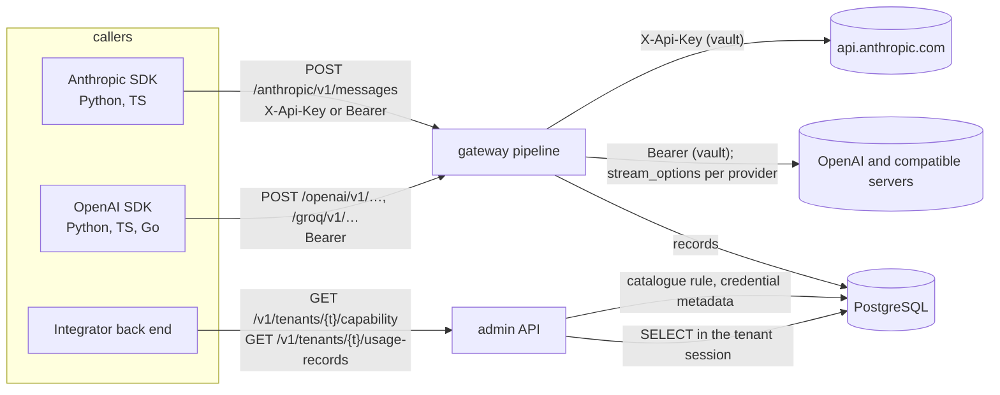

# Sprint 3.3 — Anthropic and OpenAI-compatible providers

- Epic: [3 — Gateway](../epic.md)
- Implementation plan: [plan.md](plan.md)
- Previous sprint: [3.2 — Streaming, usage and ledger](../3.2-streaming-usage-and-ledger/sprint.md)
- Risk class: **medium-high** (a second wire protocol on every path of the pipeline; two new
  administration operations that read tenant data; new language toolchains in CI; a deployment
  artefact that users will copy)
- Decisions implemented: ADR [0009](../../../../docs/adr/0009-native-passthrough-by-api-family.md)
  (second family; provider by configuration), [0010](../../../../docs/adr/0010-usage-extraction.md)
  (usage across stream events), [0020](../../../../docs/adr/0020-error-contract.md) (the Anthropic
  error shape; no new code), [0024](../../../../docs/adr/0024-openai-stream-usage-option.md)
  (amended: a per-provider switch), [0035](../../../../docs/adr/0035-catalogue-and-model-access.md)
  and [0037](../../../../docs/adr/0037-request-pipeline-and-resolution.md) (the rules the capability
  check reuses), [0039](../../../../docs/adr/0039-usage-record-admission-and-ledger-writer.md) (mixed
  sources; the first reader of the ledger), [0040](../../../../docs/adr/0040-traces.md) (one more span
  attribute), [0018](../../../../docs/adr/0018-supply-chain.md) and
  [0023](../../../../docs/adr/0023-test-dependencies-in-nested-modules.md) (Python and Node
  dependencies for tests), [0017](../../../../docs/adr/0017-admin-api-spec-first.md) (three
  operations changed or added in the specification first)
- New decision records written by this sprint: **0041** (the `anthropic` API family), **0042**
  (OpenAI-compatible providers and the per-provider stream usage option; amends 0024), **0043** (the
  tenant capability check and the minimal usage list), **0044** (the SDK compatibility suite in
  Python and TypeScript); history lines on 0009, 0010, 0018, 0020, 0023, 0024, 0035, 0037, 0039,
  0040. Text in [plan.md](plan.md), part E.

This document is the design. The implementer follows [plan.md](plan.md); a gap in either document
is raised as a question, not filled silently ([planning/README.md](../../../README.md)).

Items carried into this sprint, and where each is decided:

| Carried item | Where it is decided here |
|---|---|
| Register `anthropic.Adapter()` in `Families` (`x-api-key`, own header lists, error shape and parser) so that `/anthropic/…` stops answering 404 (3.1 §11) | D-1 to D-6, D-10, §5.2 |
| Build the capability endpoint on `Catalogue.Resolve` and `Credentials.Open` (3.1 §11) | D-14, §5.6 |
| Verify OpenAI-compatible providers: a provider row of family `openai`; base URLs with a path are covered by T-425 (3.1 §11) | D-12, §5.5 |
| Decide the error shape per family for the cases that use the default shape today (3.1 §11) | D-11, §5.3 |
| The vault validator already knows `anthropic` (3.1 §11) | D-4 (the gateway presents the credential the way the validator does) |
| Anthropic readers behind the same interfaces; records with `input_source: provider` and `output_source: estimated` (3.2 §11) | D-7, D-8, §5.4 |
| O-18 of 3.2: a switch for the OpenAI usage option when a compatible server refuses `stream_options` | D-13, §5.5 |
| O-3 of 3.2, confirmed: a minimal list of a tenant's usage records (`usage:read`, admin role, the `SELECT` grant exists) with pagination, isolation and a cross-tenant negative test | D-15, §5.7 |
| The SDK suite in Python and TypeScript covers `responses`, `embeddings`, metadata headers and cancellation (3.2 §11) | D-16, §7, T-555 to T-566 |
| The listeners bind loopback by default; the Compose reference chooses an explicit address and TLS (1.3 O-6, confirmed) | D-17, §5.8 |
| 3.2 review nit: after `Close`, `Writer.Record` logs the full row of a record that failed `Validate` | D-20 |
| Go 1.27: `http.Server.MaxHeaderValueCount` defaults to 500 and the product does not set it (3.2 CI) | D-19 |

## 1. Outcome

The stock Anthropic SDKs, Python and TypeScript, call Claude models through Pandokos by changing
the base URL and the key, streaming included, exactly as the OpenAI SDKs already do. Each call
uses the tenant's own Anthropic credential and leaves one usage record whose input tokens come
from the first event of the stream and whose output tokens come from the last; a stream cut in
between keeps the provider's input figure and estimates the output, and the record says so.

Any server that speaks the OpenAI API becomes a provider by configuration: a provider row of
family `openai`, an endpoint, models and a credential. No code is per vendor. A per-provider
setting stops Pandokos from adding the stream usage option for a server that refuses it.

An integrator asks the administration API whether a tenant can call a provider and model now and
gets the answer with its reasons; a tenant administrator lists the tenant's usage records.

A Docker Compose reference runs one Pandokos container and PostgreSQL with TLS on both listeners,
published on the host's loopback only; its quick-start goes from `docker compose up` to a streamed
Anthropic call and a streamed OpenAI call with BYOK and their usage records.

Exit conditions of the epic: the quick-start takes a new user from `docker compose up` to a streamed
Anthropic and OpenAI call with BYOK and a usage record (T-567); the compatibility suite is green
(T-555 to T-566 in Python and TypeScript, T-513 and T-514 of 3.2 in Go).

## 2. Scope

### In scope

- `internal/family`: shared request scanning (moved from `openai`), `Operation.NoUsage`, usage
  `Parts`, `Preparation`, two adapter methods; `internal/family/sse` (new, moved from `openai`):
  event framing.
- `internal/family/anthropic` (new): operations `messages` and `messages.count_tokens`, credentials,
  header lists, request rules, usage readers, estimate, error shape.
- `internal/family/openai`: uses the shared code; `Prepare` honours the provider's stream usage
  option; compatible-server fixtures.
- `internal/gateway`: `Families()`, the error shape of unrouted requests, the upstream request ID per
  family, mixed usage sources, operations without usage, `Target.StreamUsage`, one span attribute.
- Migration `0007_provider_stream_usage`; `catalog`, `resolver`: the provider's option.
- Administration API: `stream_usage_option` on providers; `getCapability`; `listUsageRecords`;
  permission `usage:read`; CLI commands for both operations.
- `internal/ledger`: the logging nit of the 3.2 review.
- SDK compatibility suite: Python and TypeScript, official OpenAI and Anthropic SDKs, behind a build
  tag of the `test/sdk` module, two CI jobs, hash-locked dependencies.
- `deploy/compose`: compose file, setup script, database initialisation; a CI test of the quick-start.
- Guides: Compose quick-start, compatible providers, gateway (both families, base URLs per SDK,
  supported endpoints, what the proxy changes), usage, administration API reference, permissions,
  data flows; ADR 0041 to 0044.

### Not in scope

| Item | Sprint |
|---|---|
| Message Batches, Files, Models and every other Anthropic path; OpenAI paths other than the three of 3.2 | not scheduled (asynchronous usage: open question 3 of the architecture overview) |
| A capability answer per virtual key (its pin, its model list) (O-3); budget availability in the answer | when asked; 5.1 (the field exists, value `not_enforced`) |
| Usage reports, rollups, export; usage for platform roles (USE-06, USE-07) | 6.2 |
| The unified `/v1/…` endpoint that routes OpenAI-protocol calls by model (GW-15) | R4 |
| Gemini, Azure OpenAI (CAT-02 tier 2) | R4 |
| A Go Anthropic SDK in the Go suite (O-13) | when asked |
| Recording live provider responses in CI; any CI step that reaches a real provider | never (D-12) |
| A Helm chart, Kubernetes manifests | 8.x |
| `pandokos tls` certificate commands (the Compose setup uses `openssl`, O-8) | when asked |
| Setting `http.Server.MaxHeaderValueCount` (D-19) | when asked |

## 3. Requirements claimed

Wording quoted from [docs/requirements](../../../../docs/requirements/README.md). "Second family"
means the `anthropic` family; the `openai` family met each of GW-01 to GW-14 in 3.1 and 3.2.

| ID | Requirement (quoted) | What this sprint delivers | Claim |
|---|---|---|---|
| CAT-02 | "Provider support is tiered. Tier 1: OpenAI, Anthropic, and any endpoint that speaks the OpenAI API (which covers xAI, Mistral, DeepSeek, Groq, Together, Fireworks, Perplexity and self-hosted servers). …" | The `anthropic` family; compatible providers by configuration with a per-provider stream usage option; CI proof over the known variations of the compatible wire; a documented, dated manual check against two public providers and one self-hosted server | tier 1 |
| API-07 | "An integrator can ask whether a tenant is currently able to call a given provider and model (credential present and valid, model allowed, tenant active, budget available)" | `GET /v1/tenants/{tenant}/capability`: provider, model, credential state; tenant state through the authorization rule; budget `not_enforced` | full for R1 (budget: 5.1 fills the field) |
| OPS-02 | "A supported Docker Compose setup runs a single instance with PostgreSQL" | `deploy/compose` with its guide and a CI test of the quick-start | full |
| GW-01 | "Provider-native endpoints are forwarded as they are, preserving the semantics of request and response" | `/anthropic/v1/messages` and `/anthropic/v1/messages/count_tokens` forwarded byte for byte except the model alias | second family |
| GW-02 | "Stock provider SDKs work by changing only the base URL and the API key. The Pandokos credential is accepted in the authentication header native to each API family" | `X-Api-Key` and `Authorization: Bearer` (what the current SDKs send, verified); SDK suite | second family |
| GW-03 | "Streaming responses are forwarded event by event, without buffering the whole response" | Observe mode for every Anthropic stream; gated test | second family |
| GW-04 | "When the caller disconnects the upstream request is cancelled. …" | Same mechanics; record `cancelled` with the input figure when it arrived | second family |
| GW-05 | "Requests go only to destinations in the catalogue. …" | Unchanged pipeline; tested on the new routes | second family |
| GW-06 | "Outbound connections to private, loopback and link-local addresses are refused unless the endpoint is explicitly marked private, …" | Unchanged guard; a self-hosted server is a private endpoint | second family |
| GW-07 | "Request headers are forwarded from an allow-list. Inbound credentials and hop-by-hop headers are removed. …" | The Anthropic lists of §5.2 | second family |
| GW-08 | "The provider credential is injected by the proxy and never reaches the caller, …" | `X-Api-Key` set from the vault; canary tests | second family |
| GW-09 | "Each API family exposes an allow-list of endpoints that Pandokos can meter. …" | Two operations | second family |
| GW-10 | "Provider errors are returned unchanged, … Errors raised by Pandokos use the error shape of the API family being called, plus a stable machine-readable code in a response header" | The Anthropic shape; the shape of an unrouted request chosen by D-11 | second family; closes the default-shape cases |
| GW-11 | "Pandokos does not retry, fall back, or balance across providers, models or credentials" | Nothing added | second family |
| GW-12 | "Every request gets a request ID, returned to the caller. W3C Trace Context from the caller is honoured" | Unchanged; `Request-Id` of the provider logged | second family |
| GW-13 | "The caller can attach a bounded set of metadata to a request for attribution. …" | Unchanged; tested with both SDKs | second family |
| GW-14 | "Usage is extracted from streaming and non-streaming responses. Any change to a request needed for this is documented and invisible to the caller" | Readers of §5.4; no change to an Anthropic body; the option switch for compatible servers | second family |

Touched, not claimed: **USE-01, USE-03, USE-04** (records of the new family, mixed sources),
**USE-07** (a tenant role reads its tenant's records: the minimal list only; R2 claims it),
**TEN-06, TEN-07** (isolation of the two new administration operations), **PRV-02** (data flows for
the second family), **OPS-12** (the Compose stop grace period), **SEC-06** (two package ecosystems in
CI).

## 4. Repository layout

```
internal/family/
  family.go       Operation.NoUsage; Parts; Preparation           (+ moved: Member, ScanObject, …)
  adapter.go      StreamReader.Usage returns Parts; Adapter.Recognizes, Adapter.UpstreamRequestID
  jsonbody.go     new: request scanning moved from openai/request.go
internal/family/sse/              new, leaf (standard library only)
  sse.go          Framing, Data, Name (moved from openai/stream.go)
internal/family/openai/           uses family and sse; Prepare(Preparation); errors unchanged
internal/family/anthropic/        new
  route.go adapter.go request.go usage.go stream.go estimate.go errors.go
internal/gateway/
  families.go     new: Families()
  ports.go        Target.StreamUsage; Routes over Families()
  handler.go      route(): the error shape of an unrouted request
  proxy.go        upstream request ID from the adapter
  record.go       mixed sources; NoUsage
  spans.go        pandokos.usage.output_source
internal/catalog/, internal/resolver/   the provider's stream usage option
internal/admin/
  capability.go   new: GetCapability
  usage.go        new: ListUsageRecords
  providers.go    stream_usage_option
internal/authz/authz.go           usage:read
internal/cli/                     capability check, usage list; provider --stream-usage-option
internal/ledger/writer.go         the after-Close log line
internal/server/server.go         Families: gateway.Families()
internal/store/migrations/sql/0007_provider_stream_usage.sql
internal/store/queries/sql/usage.sql (+ ListUsageRecords), catalog.sql (provider column)
api/openapi/admin.v1.yaml         three operations changed or added
test/fixtures/anthropic/, test/fixtures/compat/          new fixtures
test/fakeprovider/                Anthropic routes, compatible profiles, a base path
test/sdk/external_test.go         new, build tag sdkexternal: runs the Python and TypeScript suites
test/sdk/python/                  requirements.in, requirements.txt (hashes), test_*.py
test/sdk/ts/                      package.json, package-lock.json, *.test.mjs
test/compose/compose_test.go      new, build tag compose
deploy/compose/                   compose.yaml, setup.sh, initdb/10-pandokos.sh, .gitignore
docs/operations/compose.md, providers.md                  new
```

Import rules (T-R35). `internal/family/sse` imports the standard library only. `internal/family`
stays a leaf. `internal/family/anthropic` imports the standard library, `family` and `family/sse`
only, like `openai`. `internal/gateway` imports the two family packages in `families.go` only.
`internal/admin` may import `catalog` (it already does through `convert_catalog.go`) and must not
import `vault.Opener`, `gateway` or `resolver` (T-R35): the admin plane never opens a credential.

## 5. Architecture



### 5.1 The pipeline, as changed

The steps of 3.1 §5.1 and 3.2 §5.1 are unchanged. What differs:

| # | Step | Change |
|---|---|---|
| 2 | **Route** | A request that cannot be routed to a family is answered in the shape chosen by D-11 instead of always the `openai` shape |
| 3 | **Authenticate** | `Adapter.InboundCredential` of the family; for `anthropic`: §5.2 |
| 9 | **Forward** | `Prepare(Preparation{UpstreamModel, StreamUsage: Target.StreamUsage})` |
| 10 | **Response** | The provider's request ID is read by `Adapter.UpstreamRequestID` |
| 11 | **Finish** | Sources per total from the reader's `Parts`; an operation with `NoUsage` records no usage and no cost |

T-426 (order of steps) holds for both families unchanged.

### 5.2 The `anthropic` family

| Operation | Method and native path | Streams | Usage |
|---|---|---|---|
| `messages` | `POST /v1/messages` | when the last top-level `stream` member is the literal `true` | JSON: `usage`; stream: `message_start` then `message_delta` (§5.4) |
| `messages.count_tokens` | `POST /v1/messages/count_tokens` | never | none: `NoUsage` (D-2) |

`Match` accepts exactly these method and path pairs. Both routes need `model:invoke` and
`credential:use`, like every operation (`gateway.Routes()`).

**Inbound credential (D-3).** The caller's virtual key is read from `X-Api-Key` or from
`Authorization: Bearer <key>` (scheme case-insensitive):

| `X-Api-Key` | `Authorization` | Result |
|---|---|---|
| non-empty | absent | that value |
| absent or empty | `Bearer <v>`, `v` not empty | `v` |
| non-empty | `Bearer <v>` with the same value | that value |
| non-empty | anything else (another value, another scheme) | refused, `unauthenticated`, log reason `malformed` |
| absent or empty | absent or not `Bearer <v>` | refused, `unauthenticated`, reason `malformed` |

The official SDKs of this date send `Authorization: Bearer <api_key>` and no `X-Api-Key` (verified
with `anthropic` 2.8.0 for Python and `@anthropic-ai/sdk` 1.8.0 for TypeScript, §12); `curl`
examples and older SDKs send `X-Api-Key`.

**Outbound credential (D-4).** `AttachCredential` sets `X-Api-Key: <secret>`, the header the vault
validator presents to `GET <base>/v1/models` since 2.1. The outbound header is built from an empty
one (3.1 §5.3), so neither inbound header is ever forwarded.

**Header lists (D-5).**

| List | Value |
|---|---|
| Request headers forwarded | `Accept`, `Content-Type`, `User-Agent`, `Anthropic-Version`, `Anthropic-Beta` |
| Response headers passed | `Content-Type`, `Content-Length`, `Retry-After`, `Request-Id`, `X-Should-Retry`, and any header whose canonical name starts with `Anthropic-` |
| Upstream request ID (log field `upstream_request_id`) | `Request-Id` (`openai`: `X-Request-Id`), same bounds as 3.1 |

`Anthropic-Version` is forwarded as the caller sent it and never added: a request without it gets
the provider's own 400, unchanged (GW-01, GW-10). The SDKs send their own version (`2026-10-21`
with the versions above). Dropped like every unlisted header: `X-Stainless-*`,
`Anthropic-Dangerous-Direct-Browser-Access`, `Accept-Encoding`, the credentials.

**Request rules (D-6).** The rules of 3.1 §5.8 (one JSON object, exactly one top-level string
`model`, reasons `not_object`, `model_missing`, `model_duplicate`, `model_not_string`) for both
operations, read with the scanner shared with `openai` (D-9). `Stream()` follows the last `stream`
member for `messages` and is false for `messages.count_tokens`. `Prepare` replaces the value of
`model` by the upstream identifier when they differ (3.1 D-7) and changes nothing else: Anthropic
streams always report usage, so `strip` is always false and the body is returned as received when
the model needs no replacement.

**Error shape (D-10).** A Pandokos error on an `anthropic` route:

```json
{"type":"error","error":{"type":"not_found_error","message":"Pandokos: this endpoint is not supported."}}
```

with `X-Pandokos-Error`, `X-Pandokos-Request-Id`, `Content-Type: application/json` and the status of
the code (ADR 0020, unchanged). `error.type` is the provider's type for that status:

| Status (codes) | `error.type` |
|---|---|
| 400 (`invalid_request`), 409 (`no_credential`) | `invalid_request_error` |
| 401 (`unauthenticated`) | `authentication_error` |
| 403 (`forbidden`, `tenant_suspended`, `model_not_allowed`) | `permission_error` |
| 404 (`endpoint_not_supported`) | `not_found_error` |
| 408 (`request_timeout`), 504 (`upstream_timeout`) | `timeout_error` |
| 413 (`request_too_large`) | `request_too_large` |
| 500 (`internal`), 502 (`upstream_unreachable`), 503 (`unavailable`) | `api_error` |

The SDKs raise their usual exception for the status (T-561). The machine-readable code is in the
header, as for `openai`; the body has no code member because the family's shape has none.

### 5.3 The error shape of a request that reaches no family (D-11)

Today a request whose provider is unknown, disabled, malformed or of a family without an adapter,
and a request refused with 503 while the catalogue is away at step 2, get the `openai` shape. From
this sprint step 2 picks the shape in this order:

1. the provider is known and enabled and its family has an adapter: that family (as today);
2. otherwise the first adapter, in name order, whose `Recognizes(method, nativePath, header)` is
   true: `anthropic` recognizes a method and path it `Match`es or a request that carries
   `Anthropic-Version`; `openai` recognizes a method and path it `Match`es;
3. otherwise `openai`, the default.

`nativePath` is the path after the first segment, or the whole path when there is no second
segment. Nothing else of the request is read before authentication. The rule only chooses a body
shape: status, code and message do not change, so a caller still cannot tell an unknown provider
from an unsupported path (3.1).

### 5.4 Anthropic usage

**Normalization** (totals inclusive, 1.1 D-9; D-7):

| `family.Usage` | Anthropic `usage` member |
|---|---|
| `InputTokens` | `input_tokens` + `cache_creation_input_tokens` + `cache_read_input_tokens` |
| `CacheReadTokens` | `cache_read_input_tokens` |
| `CacheWriteTokens` | `cache_creation_input_tokens` |
| `OutputTokens` | `output_tokens` (thinking included, as the provider counts it) |
| `ReasoningTokens` | 0: the provider does not report it apart |
| `Extra["cache_write_1h_tokens"]` | `cache_creation.ephemeral_1h_input_tokens` (priced by `pricing.CostOf` at `cache_write_1h`) |
| `Extra["web_search_requests"]` | `server_tool_use.web_search_requests` (stored in `other_units`, not priced, O-12) |
| `Reported` | `family.FlattenUsage` of the usage object (3.2 bounds) |

A missing or `null` member counts 0; a negative count makes the usage unusable (as in 1.1). A
response or event whose usage has a non-integer where an integer is expected is unusable.

**JSON answers.** `ReadUsage` reads the top-level `usage` of a `messages` answer; it returns
`ok` false without one. `messages.count_tokens` is never read (D-2).

**Streams (D-8).** The reader observes (it never strips; `Filter` returns its input) and keeps one
incomplete event of at most 1 MiB, using the shared framing (D-9):

| Event (`type` of the data, whatever the `event:` line says) | What the reader does |
|---|---|
| `message_start` | takes `message.usage` as the current usage object; the input part is now reported |
| `message_delta` | each member of its `usage` replaces the member of the same name in the current object (cumulative counts; a nested object is replaced whole); when it holds `output_tokens` the output part is reported |
| `content_block_delta` | counts one delta (the evidence of an output estimate) |
| `ping`, `content_block_start`, `content_block_stop`, `message_stop`, `error`, unknown types | nothing |

`Usage()` returns the normalized current object and its `Parts`: none before `message_start`;
`PartInput` after it; `PartsAll` once a `message_delta` reported `output_tokens`. An `error` event
in a 200 stream changes nothing (3.2 §5.3): the record keeps what was reported before it.

**Sources (gateway, D-8).**

| Parts reported | `input_source` | `output_source` | Cost computed from |
|---|---|---|---|
| all | `provider` | `provider` | the provider's figures |
| input only (stream cut, cancelled or failed after `message_start`) | `provider` | `estimated` | provider input side + estimated output |
| none, 2xx | `estimated` | `estimated` | estimate (3.2) |
| operation with `NoUsage` | `none` | `none` | no cost (`cost_status: none`) |

`EstimateUsage` for `messages`: input = request bytes / 4 rounded up; output = `content_block_delta`
count for a stream, response bytes / 4 otherwise (3.2 D-8, the same rule). The record of the mixed
case stores the provider's input-side columns, `estimated_output_tokens`, `provider_usage` and
`other_units` from the provider object (the ledger rows of 3.2 already do this per source). The log
line keeps `usage_source` (the input source) and adds `usage_output_source` when the two differ; the
provider span gains `pandokos.usage.output_source` (ADR 0040 history line).

The 1.1 rule that only a 2xx answer carries usage (3.2 D-6) is unchanged for both families.

### 5.5 OpenAI-compatible providers (D-12, D-13)

A compatible provider is configuration only:

```
pandokos provider create groq --family openai --display-name Groq
pandokos endpoint create groq default --base-url https://api.groq.com/openai --default
pandokos model create groq/llama-3.3-70b-versatile --upstream-id llama-3.3-70b-versatile --availability all
# self-hosted, on a private network:
pandokos provider create ollama --family openai --stream-usage-option omit   # only if the server refuses the option
pandokos endpoint create ollama default --base-url http://ollama.internal:11434 --private --default
```

The gateway appends the native path to the base URL, path included (T-425). Credential validation
calls `GET <base>/v1/models` with a bearer token. A server that needs no key still needs a
credential of the tenant (BYOK): any non-empty placeholder, stored like a key.

**The stream usage option per provider.** `provider.stream_usage_option` is `add` (default, ADR
0024 as today) or `omit`. With `omit`, `Prepare` never splices `stream_options`; a stream whose caller
did not ask for usage is forwarded in observe mode and recorded with estimated usage unless the
server reports usage anyway (some do on their last chunk; the reader takes it). A caller that asks
for usage itself is unaffected. The setting is read from the catalogue snapshot at step 7
(`Target.StreamUsage`), so a change reaches the gateway within `cache.catalog_ttl`. The `anthropic`
family ignores it; the administration API refuses `omit` for a provider of family `anthropic`
(`invalid_request` on `stream_usage_option`), so no setting is stored that would do nothing.

**What CI proves and what is documented only.**

| Claim | Proved by |
|---|---|
| The `openai` family reads every known variation of the compatible wire: usage on the last content chunk; provider-specific integer members (kept in `provider_usage`) and fractional timing members (dropped); no usage at all (estimated); usage only when asked; an error event mid-stream | CI: compatible profiles of the fake provider, replayed from `test/fixtures/compat` (T-528, T-539) |
| A base URL with a path, a private `http` endpoint, a bearer credential, a model with an upstream identifier | CI (T-425, T-539, T-554) |
| A server that refuses `stream_options` works with `omit` | CI: profile `compat-refuses-option` answers 400 when the body holds `stream_options` (T-538) |
| The official OpenAI SDKs work against a compatible provider's base URL | CI: SDK suite (T-564) |
| Groq and Mistral (public) and Ollama (self-hosted) behave as one of the profiles | **documented only**: the manual check of `docs/operations/providers.md`, run by a maintainer with real keys, recorded in that guide's table with date, server version and result. CI never reaches a provider and holds no provider key |

The fixtures are synthetic, shaped after each wire format as documented, with canaries as the only
content (the rule of `test/fixtures/README.md`). A fixture made from a real response is allowed only
when every string value was replaced by a canary and every identifier by a `synthetic-` value, by
hand, and reviewed; T-R34 scans the fixture directories for key patterns.

### 5.6 The tenant capability check (API-07; D-14)

```
GET /v1/tenants/{tenant}/capability?provider=anthropic&model=claude-sonnet-4-5
```

Permission `model:read` (tenant scope; `tenant-admin` holds it). Answer 200:

```json
{
  "provider": "anthropic",
  "model": "claude-sonnet-4-5",
  "callable": false,
  "reasons": ["credential_disabled"],
  "checks": {
    "provider_available": true,
    "model_allowed": true,
    "credential": "disabled",
    "credential_id": "0190…",
    "credential_validated": true,
    "budget": "not_enforced"
  },
  "checked_at": "2026-11-20T10:00:00Z"
}
```

The rules are the gateway's own, evaluated in the admin plane without opening a credential:

| Check | Rule (the same code or the same rule as the gateway) | Reason when it fails |
|---|---|---|
| tenant active | the authorization rule: a tenant that is not `active` is refused 403 `tenant_suspended` before the handler, like every tenant operation | (the 403 is the answer) |
| provider available | `catalog.Snapshot.Resolve`, the function behind `gateway.Catalogue.Resolve`: provider exists, enabled, enabled default endpoint | `provider_unavailable` |
| model allowed | the same call: model of that provider with that public name, not retired, available to all or granted, inside the tenant's restriction; evaluated for a principal of the tenant without a key model list | `model_not_allowed` (one value for every cause, as in the gateway) |
| credential | the resolution rule of `vault.Opener.Open` for a key without a pin: the tenant's default credential of the provider; read from `provider_credential_metadata` (never the sealed secret) | `no_credential`, `credential_disabled`, `credential_revoked` |
| budget | none until 5.1 | — (`budget: not_enforced`) |

`callable` is true when `reasons` is empty. `reasons` lists every failing check in the order of the
table, except that `model_not_allowed` is not evaluated when the provider is unavailable (`model_allowed`
is then false and only `provider_unavailable` is listed), exactly as the gateway would refuse first
with `endpoint_not_supported`. `credential_validated` is whether `validated_at` is set; it never
blocks (the gateway does not check it). `credential_id` is absent when there is no default.

`provider` and `model` are required (`invalid_request` naming the missing member; the generator
accepts optional query parameters only, so the handler checks presence). The catalogue is read with
`catalog.LoadSnapshot` and `catalog.LoadTenantAccess` on the admin pool for each call, so the answer
reflects committed state and needs no cache in the admin plane. The answer can differ from a call
made at the same moment by at most the gateway's cache lifetimes (`cache.catalog_ttl`,
`cache.credential_ttl`); the guide says so. Nothing is audited (a read).

What the answer does not cover (documented): a virtual key's pin and model list (O-3); whether the
provider accepts the key (validation is the `validate` option of credential writes); the vault key
material (an undecryptable credential is a platform failure, reported as 503 by the gateway).

### 5.7 Listing usage records (O-3 of 3.2; D-15)

```
GET /v1/tenants/{tenant}/usage-records?from=2026-11-19T00:00:00Z&to=2026-11-20T00:00:00Z&provider=anthropic&limit=50&cursor=…
```

Permission `usage:read`, new, tenant scope, granted to `tenant-admin` only. Rules:

| Parameter | Rule |
|---|---|
| `from`, `to` | RFC 3339 instants; `to` defaults to now, `from` to `to` minus 24 hours; `from` < `to`; the window is at most 31 days (`invalid_request` on `from` otherwise). Records with `from` ≤ `started_at` < `to` |
| `provider` | optional exact provider name |
| `limit`, `cursor` | the common pagination (1 to 200, default 50); the cursor holds the `started_at` and `id` of the last item and is valid only with the same `from`, `to` and `provider` (it carries them; a mismatch is `invalid_request` on `cursor`) |
| order | newest first: `started_at` descending, then `id` descending |

The query runs as the admin role in the tenant's session (`store.WithTenant`): the canonical policy
returns only the tenant's rows and the `started_at` bounds prune partitions (verified, §12). Each
item is the record's columns in the representation of §5.7a. Nothing is audited (a read).

**§5.7a Representation.** The generator has no maps and no nullable integers (internal/apigen), so:

| Column(s) | Member |
|---|---|
| `other_units`, `provider_usage` | arrays of `{"name": …, "value": …}` sorted by name |
| `metadata` | array of `{"key": …, "value": …}` sorted by key |
| token columns | integers, 0 when the matching source is not `provider` (input side: `input_source`; output side: `output_source`) |
| `estimated_input_tokens`, `estimated_output_tokens` | integers, 0 when the matching source is not `estimated` |
| `ttfb_ms`, `upstream_status`, `request_bytes`, `response_bytes` | integers, 0 when unknown |
| `stream` | boolean, false when unknown |
| `cost` | decimal string, `null` unless `cost_status` is `known` |
| text columns that may be absent (`trace_id`, `key_id`, `credential_id`, `endpoint`, `model`, `model_id`, `upstream_model`, `error_code`, `cost_reason`, `currency`, `price_version_id`) | `""` when absent |

The members, and the full schema, are in plan.md part A (OpenAPI). Content never exists in the
ledger (USE-02), so the list returns none; `metadata` values are the caller's labels of this tenant.

### 5.8 Docker Compose reference (OPS-02; D-17, D-18)

Files under `deploy/compose/` (content in plan.md part D):

| File | Role |
|---|---|
| `compose.yaml` | services `postgres`, `migrate` (one-shot), `pandokos` |
| `setup.sh` | creates `./secrets`: five database passwords and the key-encryption key (32 random bytes, base64), and a self-signed TLS certificate and key (P-256, one year, CA, names `localhost`, `pandokos`, `postgres`, `127.0.0.1`, `::1`) with `openssl`; never overwrites a file |
| `initdb/10-pandokos.sh` | at first start of the data directory: `deploy/postgres/roles.sql`, the four privilege roles as login users with the generated passwords ("Shortest" setup of the database guide), the database |
| `.gitignore` | `secrets/` |

Choices:

| Concern | Choice |
|---|---|
| Listeners | `0.0.0.0:8080` (inference) and `0.0.0.0:8081` (admin) inside the container, both with TLS from the generated certificate; published as `127.0.0.1:8080` and `127.0.0.1:8081` on the host only |
| Database | PostgreSQL 16 (the digest the test database uses) on a network marked `internal` (no route out, not published); TLS on, `database.tls.mode: verify-full` with the generated certificate as CA, host name `postgres` |
| Egress | `pandokos` is also on a second, ordinary network to reach providers |
| Hardening | `read_only`, `cap_drop: [ALL]`, `no-new-privileges`, user of the image (65532); secrets as files from `./secrets`, mode 0444 in a 0700 directory (the containers run as other users; the KEK warning of the vault guide is expected and documented) |
| State | named volumes `pgdata` and `cli` (mounted at `/home/nonroot`, the image user's home, so that the CLI can write keys) |
| Order | `migrate` after PostgreSQL is healthy; `pandokos` after `migrate` completed successfully |
| Stop | `stop_grace_period: 45s` (drain 30 s plus the ledger flush, 3.2) |
| Image | `${PANDOKOS_IMAGE:-ghcr.io/pandokos/pandokos:0.1}`; until v0.1 is released the guide says `make image` and `PANDOKOS_IMAGE=pandokos:dev` |
| CLI | `PANDOKOS_CLI_SERVER=https://localhost:8081` and `PANDOKOS_CLI_CA_FILE` set in the service, so `docker compose exec pandokos /pandokos …` works |

The quick-start (`docs/operations/compose.md`):

```sh
cd deploy/compose && ./setup.sh && docker compose up -d --wait
curl --cacert secrets/tls_cert https://localhost:8080/readyz    # repeat until 200
docker compose exec pandokos /pandokos init --key-out /home/nonroot/bootstrap.key
docker compose exec -e PANDOKOS_CLI_KEY_FILE=/home/nonroot/bootstrap.key pandokos \
  /pandokos tenant create demo --admin-key-out /home/nonroot/demo-admin.key
pdk() { docker compose exec -T -e PANDOKOS_CLI_KEY_FILE=/home/nonroot/demo-admin.key pandokos /pandokos "$@"; }
printf %s "$OPENAI_API_KEY"    | pdk credential create --tenant demo --provider openai    --secret-file /dev/stdin openai-main
printf %s "$ANTHROPIC_API_KEY" | pdk credential create --tenant demo --provider anthropic --secret-file /dev/stdin anthropic-main
pdk service-account create --tenant demo --role inference app
KEY=$(pdk key create --tenant demo --service-account app)
pdk capability check --tenant demo --provider anthropic --model claude-sonnet-4-5
# Python, with the generated CA:
SSL_CERT_FILE=$PWD/secrets/tls_cert python stream_anthropic.py   # base_url https://localhost:8080/anthropic
SSL_CERT_FILE=$PWD/secrets/tls_cert python stream_openai.py      # base_url https://localhost:8080/openai/v1
pdk usage list --tenant demo
```

The provider keys go through standard input and are never written to disk by the reference. Node uses
`NODE_EXTRA_CA_CERTS`, curl `--cacert`. The guide warns: the certificate is self-signed and for this
host; to serve other hosts replace `secrets/tls_cert` and `tls_key` with a certificate of a real CA and
publish the ports on another address; do not set `allow_plaintext`.

### 5.9 Interfaces

```go
package family

type Operation struct {
    Name, Method, Path string
    // NoUsage marks an operation that consumes no tokens (token counting): its records carry no
    // usage, no estimate and no cost.
    NoUsage bool
}

// Parts says which totals of a Usage the provider reported.
type Parts uint8

const (
    PartInput Parts = 1 << iota // InputTokens, CacheReadTokens, CacheWriteTokens
    PartOutput                  // OutputTokens, ReasoningTokens
    PartsAll = PartInput | PartOutput
)

// Preparation is what Prepare needs from the catalogue.
type Preparation struct {
    UpstreamModel string // replaces the model when not empty and different from Model()
    StreamUsage   bool   // the provider accepts the stream usage option (openai family only)
}

type Request interface {
    Model() string
    Stream() bool
    Prepare(p Preparation) (body []byte, strip bool)
}

type StreamReader interface {
    Filter(p []byte) []byte
    Flush() []byte
    Usage() (Usage, Parts) // was (Usage, bool); the openai readers return PartsAll or 0
    Failed() bool
    Deltas() int64
}

type Adapter interface {
    // … the methods of 3.2 …
    // Recognizes reports whether a request that reached no provider looks like a call of this
    // family (section 5.3). It reads the method, the native path and the header only.
    Recognizes(method, nativePath string, h http.Header) bool
    // UpstreamRequestID returns the provider's request ID header value, unchecked; "" if none.
    UpstreamRequestID(h http.Header) string
}

// Request scanning shared by the families (moved from openai, behaviour unchanged).
type Member struct {
    Key        string
    Start, End int // byte range of the value
}
func ScanObject(b []byte) (members []Member, closeIdx int, err error)
func LastMember(ms []Member, key string) (Member, bool)
// ParseModel applies the model rules of 3.1 section 5.8 and returns Invalid(reason) errors.
func ParseModel(body []byte, ms []Member) (model string, m Member, err error)
func IsLiteral(body []byte, m Member, lit string) bool
func Splice(b []byte, start, end int, ins string) []byte
func EncodeString(s string) string
```

```go
package sse // internal/family/sse: framing of server-sent events, moved from openai

type Framing struct{ Max int /* unexported state */ }
func (f *Framing) Split(p []byte, each func(ev []byte)) (overflow []byte)
func (f *Framing) Take() []byte
func (f *Framing) Failed() bool
func Data(ev []byte) []byte // the data lines of an event, joined with "\n"
```

```go
package anthropic

const (
    Name                 = "anthropic"
    OperationMessages    = "messages"
    PathMessages         = "/v1/messages"
    OperationCountTokens = "messages.count_tokens"
    PathCountTokens      = "/v1/messages/count_tokens"
    HeaderVersion        = "Anthropic-Version"
)

func Adapter() family.Adapter
func Match(method, path string) (operation string, ok bool)
func InboundCredential(h http.Header) (string, bool)
func AttachCredential(h http.Header, key string)
var RequestHeaders []string
func AllowResponseHeader(canonicalName string) bool
func ParseOperation(operation string, body []byte) (*Request, error)
func ReadUsageOf(operation string, body []byte) (family.Usage, bool, error)
func NewStreamReader() *StreamReader // implements family.StreamReader
func Estimate(operation string, e family.Evidence) family.Usage
func ErrorType(code family.ErrorCode) string
func WriteError(w http.ResponseWriter, code family.ErrorCode)
```

```go
package gateway

// Families returns a new map of the adapters this build serves, by family name.
func Families() map[string]family.Adapter

type Target struct {
    // … the fields of 3.2 …
    StreamUsage bool // the provider's stream_usage_option is "add"
}
```

`catalog.Provider` gains `StreamUsageOption string`; `resolver.Catalogue.Resolve` sets
`Target.StreamUsage` from the snapshot's provider. `server.New` passes `gateway.Families()` and
`openai.Name` as the default. `openai.Request.Prepare(p)` splices the option only when
`p.StreamUsage`; `openai.PrepareRequest` (1.1) keeps its behaviour (option always added).

### 5.10 Administration API changes (spec first, ADR 0017)

| Operation | Method and path | Permission | Errors |
|---|---|---|---|
| `getCapability` (new) | `GET /v1/tenants/{tenant}/capability` | `model:read` | 400 `invalid_request` (`provider`, `model` missing or malformed), 401, 403 `forbidden` or `tenant_suspended`, 404 (other tenant), 500, 503 |
| `listUsageRecords` (new) | `GET /v1/tenants/{tenant}/usage-records` | `usage:read` | 400 (`from`, `to`, `cursor`, `provider`), 401, 403, 404, 500, 503 |
| `createProvider`, `updateProvider`, `getProvider`, `listProviders` (changed) | as today | as today | 400 on `stream_usage_option` (unknown value; `omit` for family `anthropic`) |

CLI: `pandokos capability check --tenant T --provider P --model M` (prints the answer; exit status
0 whether or not callable), `pandokos usage list --tenant T [--from --to --provider --limit --all]`,
`provider create|update … --stream-usage-option add|omit`. The audit detail of provider writes gains
`stream_usage_option`.

### 5.11 Configuration

No new key. The Compose reference uses existing keys through environment variables.

## 6. Isolation harness

- `provider` grants change: `Spec.Grants` adds `INSERT (stream_usage_option)` and `UPDATE
  (stream_usage_option)` for the admin role; T-140 (lint) passes with the new column.
- `usage_record`: the admin role's `SELECT` (granted in 0006) is now used by a route. T-547 is the
  cross-tenant negative test of `listUsageRecords`; T-544 that of `getCapability`; the generic
  "every operation declares a permission" and "every tenant operation refuses another tenant" tests
  of `test/apitest` cover both through `CallFor`.
- `gateway.Routes()` lists five routes (three `openai`, two `anthropic`), each with both permissions.
- The capability handler reads `provider_credential_metadata` only; T-R35 forbids `vault.Opener` in
  `internal/admin`; the admin role has no privilege on the sealed secret (0003), and T-543 asserts
  that the handler calls no credential query but `ListCredentials`.

## 7. Test infrastructure and CI

- **Fixtures.** `test/fixtures/anthropic/`: `message.json`, `message_cache.json` (cache read, cache
  write with a 1-hour part, server tool use), `message_stream.sse`, `message_stream_cumulative.sse`
  (`message_delta` repeating input-side members), `message_stream_tools.sse` (`input_json_delta`),
  `message_stream_error.sse` (`event: error` after two deltas), `message_stream_ping_crlf.sse`,
  `count_tokens.json`, `error_401.json`, `error_429.json`, `error_529.json`. `test/fixtures/compat/`:
  `chat_stream_usage_last_content_chunk.sse`, `chat_stream_extra_usage.sse` (integer and fractional
  provider members), `chat_stream_no_usage.sse`, `chat_completion_extra_usage.json`,
  `error_400_stream_options.json`. Synthetic, canaries as the only content.
- **Fake provider.** `/v1/messages` and `/v1/messages/count_tokens` (credential in `X-Api-Key`,
  checked against the keys given to `Accept`), Anthropic errors in the provider's shape with `request-id`; the model
  behaviours of 3.2 for both families plus `fake-cache`, `fake-cut-after-start` (closes after
  `message_start`), `fake-stall-after-first` (sends the first event, then waits for cancellation);
  compatible profiles selected by model: `compat-usage-last-chunk`, `compat-extra-usage`,
  `compat-ignores-option`, `compat-refuses-option`; `SetBasePath(p)` serves every route under a path
  prefix.
- **SDK suite (D-16).** `test/sdk/external_test.go`, build tag `sdkexternal`, in the `test/sdk`
  module: `TestPythonSDK` and `TestTypeScriptSDK` start the in-process server of `sdk_test.go` with
  providers `openai`, `anthropic` and `compat` (family `openai`, base path `/compat-base`,
  `stream_usage_option` `omit`) and a control server on loopback, then run the suite as a
  subprocess with `PANDOKOS_BASE_URL`, `PANDOKOS_KEY`, `PANDOKOS_CONTROL_URL`, `NO_PROXY` set and the
  proxy variables removed; the Go test fails when the suite fails or when its interpreter variable is
  missing (`PANDOKOS_SDK_PYTHON`, `PANDOKOS_SDK_NODE`): the tag is set only by the make targets and CI
  jobs that provide them. The control server (`GET /records?request_id=`, `GET /upstream/last`,
  `GET /upstream/cancelled?wait=`) answers JSON built from the `MemoryRecorder` and the fake
  provider, holding counts and names only.
- **Pinned versions** (verified 2026-11-14, §12): Python 3.13; `openai==3.51.0`, `anthropic==2.8.0`,
  `pytest==9.2.0`, locked with hashes by `pip-compile` (pip-tools 7.6.2) into `requirements.txt`;
  Node 22; `openai` 7.57.0 and `@anthropic-ai/sdk` 1.8.0 as exact `devDependencies`, locked in
  `package-lock.json` (nine packages). Installed with `pip install --require-hashes --no-deps
  --only-binary :all:` and `npm ci --ignore-scripts`.
- **CI jobs** (plan.md part D): `sdk-python` and `sdk-ts`: checkout, setup-go (release toolchain),
  setup-python 3.13 or setup-node 22, install from the lock, `make test-sdk-python` /
  `make test-sdk-ts`. Network: the package registries during installation only; the tests use
  loopback. Actions pinned to commit hashes (`actions/setup-python` v7.1.0, `actions/setup-node`
  v7.1.0, hashes in plan.md, verified with `git ls-remote`).
- **Compose test** (`test/compose`, build tag `compose`): in the `image` job after the image is
  loaded; copies `deploy/compose` to a temporary directory, runs `setup.sh`, applies an override
  that sets the image under test and `extra_hosts: host.docker.internal:host-gateway`, follows the
  quick-start with the fake provider (endpoints of `openai` and `anthropic` updated to
  `http://host.docker.internal:<port>` as private endpoints, the only deviation from the guide).
- **Dependabot**: `pip` for `/test/sdk/python`, `npm` for `/test/sdk/ts`, `docker-compose` for
  `/deploy/compose`.
- `make fuzz` gains `FuzzAnthropicStreamReader`, `FuzzAnthropicReadUsage`, `FuzzAnthropicParseRequest`
  (`./internal/family/anthropic/`), `FuzzFraming` (`./internal/family/sse/`); T-R30 covers them.

## 8. Decisions

| # | Decision | Reason |
|---|---|---|
| D-1 | **`gateway.Families()` is the one list of adapters: `openai` and `anthropic`; `server.New` and `gateway.Routes()` both use it** | 3.1 §11. Two lists (today `knownAdapters` and the server's literal) could disagree about what is served and what is declared |
| D-2 | **The `anthropic` family serves `messages` and `messages.count_tokens`; token counting is an operation without usage (`Operation.NoUsage`)** | ADR 0009 names messages and token counting. Counting is free at the provider: an estimate would show cost for nothing (O-2) |
| D-3 | **The virtual key is accepted in `X-Api-Key` or as `Authorization: Bearer`; both present must carry the same value** | GW-02: the SDKs of this date send Bearer with `api_key`; tools and older SDKs send `X-Api-Key`. Two different values would make "which key was used" ambiguous |
| D-4 | **The provider credential is sent as `X-Api-Key`; `Anthropic-Version` and `Anthropic-Beta` are forwarded as sent, never added** | It is the header the validator already presents, documented by the provider for every API version; adding a version would change the request's semantics (GW-01) (O-1) |
| D-5 | **Header lists of §5.2; the upstream request ID is read through the adapter** | Each family names its own; `Request-Id` is Anthropic's (`X-Request-Id` would log nothing) |
| D-6 | **Anthropic bodies are forwarded as received except the model alias; nothing is spliced** | The provider reports usage in every stream, so there is nothing to ask for and nothing to strip |
| D-7 | **Anthropic input is normalized inclusive of both cache counts; the 1-hour cache write goes to `cache_write_1h_tokens`; server tool requests to `other_units`** | 1.1 D-9 (totals inclusive) and `pricing.CostOf`'s categories, which already price `cache_write_1h` |
| D-8 | **`StreamReader.Usage` returns which parts were reported; a stream with only `message_start` is recorded with provider input and estimated output** | 3.2 §11: the provider's input figure is exact and arrives first; discarding it for an estimate would lose information the columns can hold |
| D-9 | **The event framing and the request scanner move to `internal/family/sse` and `internal/family`, unchanged** | The second family needs exactly the same code; the existing openai tests and fuzz targets prove the move |
| D-10 | **The Anthropic error shape uses the provider's `error.type` for the status; the code stays in the header** | ADR 0020: the SDK raises its usual exception; the family's shape has no code member |
| D-11 | **An unrouted request gets the shape of the family that recognizes its path, or its `Anthropic-Version` header, else `openai`** | 3.1 §11. An Anthropic SDK with a misspelled provider gets an error it can parse; nothing about the catalogue is revealed |
| D-12 | **Compatible providers need no code; CI proves the family against compatible profiles; real servers are checked by hand and the result is dated in the guide** | CI holds no provider key and reaches no provider (ADR 0018, SEC rules); the profiles turn each known deviation into a regression test (O-7) |
| D-13 | **`provider.stream_usage_option`, `add` or `omit`, per provider; `omit` refused for `anthropic`** | 3.2 O-18: a global switch would cost every other provider its exact stream usage; per endpoint would split one server's behaviour (O-6). ADR 0042 amends 0024 |
| D-14 | **The capability check is an administration operation that evaluates the gateway's rules on committed state without opening a credential** | API-07 is an administration requirement and integrators use the administration API (API-06); the admin plane must not decrypt (ADR 0034, epic 2 §carried); the rules are shared (`catalog.Snapshot.Resolve`, the Opener's resolution rule) so the answers agree (T-545) (O-4, O-5) |
| D-15 | **`listUsageRecords` with `usage:read`: a window of at most 31 days, newest first, keyset cursor, provider filter** | 3.2 O-3. The window keeps every query on few partitions; reports remain 6.2 (O-9) |
| D-16 | **The Python and TypeScript suites run as subprocesses of Go tests behind the build tag `sdkexternal`, against the in-process server and the fake provider; dependencies are exact pins locked with hashes; tests are `.py` and `.mjs`** | One harness for four SDKs; nothing to deploy; `go test ./...` of the module stays Go-only; no TypeScript compiler in the graph (O-10). ADR 0044 |
| D-17 | **The Compose reference serves both listeners with TLS from a generated self-signed certificate, publishes them on the host loopback only, and runs PostgreSQL on an internal network with verified TLS** | 1.3 O-6 asked for an explicit address and TLS; a copied reference must be safe as it is; the database connection is verified like any other (O-8) |
| D-18 | **The quick-start is tested in CI with the image, the fake provider standing in for the providers** | The exit condition must be a test, not a reading; the only deviation is the endpoint of the two providers |
| D-19 | **Go's limit of 500 header values per request is documented, not configured** | The limit is a sound default; a request over it is answered 431 by `net/http` before Pandokos sees it, with no record (§5 of the gateway guide) |
| D-20 | **After `Close`, `Writer.Record` logs a record that failed `Validate` without its failed fields** | The same rule as the normal rejection path (3.2 review) |
| D-21 | **No new error code and no new configuration key** | The Anthropic family maps onto ADR 0020; the provider option is catalogue data |

## 9. Tests

Levels: U unit, I in-process with local sockets, D database (`make db-up`), E end-to-end with the
built binary, S SDK suites, C container or Compose, R repository. IDs continue after T-514 and
T-R30. S tests exist in Python (`test/sdk/python/test_*.py`) and in TypeScript
(`test/sdk/ts/*.test.mjs`) under the same ID; each runs against both SDK families where it says so.

### New tests

| ID | Test | Level | Proves | Requirement |
|---|---|---|---|---|
| T-515 | `sse.TestFraming`, `sse.FuzzFraming` | U | The moved framing: events at every split offset, LF and CRLF, the bound and the overflow, `Take`; fuzz: no panic, output independent of chunking | GW-03 |
| T-516 | `family.TestScanObject`, `family.TestParseModel` | U | The moved scanner: the table of 3.1 §5.8 with its reasons; last occurrence wins; splice and string encoding | GW-01 |
| T-517 | `anthropic.TestOperations` | U | Two operations, `Match` for exact method and path only, `NoUsage` on counting only; `gateway.Routes()` lists five routes with both permissions | **GW-09** |
| T-518 | `anthropic.TestInboundCredential` | U | Each row of the table of §5.2, scheme case, whitespace, empty values | **GW-02** |
| T-519 | `anthropic.TestHeaders` | U | `RequestHeaders` exactly; `AttachCredential` sets `X-Api-Key` only; `AllowResponseHeader` for each listed name, the prefix, and refused names (`Set-Cookie`, `X-Api-Key`, `Authorization`, `Via`); `UpstreamRequestID` reads `Request-Id`; `Recognizes` | **GW-07**, GW-08 |
| T-520 | `anthropic.TestParseRequest` | U | Model rules and reasons; `stream` literal true only, last occurrence; counting never streams; `Prepare` returns the input slice without replacement and replaces only the model's value otherwise; `strip` always false | GW-01, **GW-14** |
| T-521 | `anthropic.TestReadUsage` | U | `message.json` and `message_cache.json` give the table of §5.4 and the exact `Reported`; null members are 0; no `usage`: `ok` false; negative or fractional count: error | **GW-14** |
| T-522 | `anthropic.TestStreamReader` | U | Every stream fixture: parts and figures after each event; cut after `message_start` gives `PartInput`; cumulative `message_delta` replaces; `Deltas` counts `content_block_delta`; ping, error event, `event:` lines that disagree with `type`, CRLF; every split offset gives the same usage; `Filter` returns its input | **GW-03**, GW-14 |
| T-523 | `anthropic.TestStreamReaderBounds` | U | An event over 1 MiB: `Failed`, every byte forwarded, nothing held | GW-03 |
| T-524 | `anthropic.FuzzAnthropicStreamReader`, `FuzzAnthropicReadUsage`, `FuzzAnthropicParseRequest` | U | No panic; `Filter` returns its input; usage independent of chunking; `Reported` within bounds | GW-03, USE-02 |
| T-525 | `anthropic.TestWriteError` | U | For every code of `family`: status, `X-Pandokos-Error`, content type, body decodes to the shape with the `error.type` of the table and the code's message; no other member | **GW-10** |
| T-526 | `anthropic.TestEstimate` | U | Messages stream and JSON; counting gives zero | USE-04 |
| T-527 | `openai.TestPrepareStreamUsage` | U | `StreamUsage` false: body unchanged and `strip` false for every row of ADR 0024's table, model replacement still applied; true: as before | GW-14 |
| T-528 | `openai.TestCompatProfiles` | U | The readers over every `test/fixtures/compat` file: usage on the last content chunk read and the chunk not stripped; provider integer members kept in `Reported`, fractions dropped; no usage gives none | **CAT-02**, GW-14 |
| T-529 | `gateway.TestFamilies` | U | `Families()` holds both adapters and returns a new map; `server.New` serves `/anthropic/v1/messages` (no longer 404) | GW-09 |
| T-530 | `gateway.TestAnthropicPassthrough` | I | Plain and streamed: outbound URL, method, header set exactly the allow-list plus `X-Api-Key` with the tenant's secret; no inbound credential, no metadata, no `X-Stainless-*` upstream; body identical except the model; response headers filtered; `upstream_request_id` logged; canary key absent from response and logs | **GW-01**, GW-05, **GW-07**, **GW-08** |
| T-531 | `gateway.TestAnthropicErrors` | I | Each refusal on an `anthropic` route in the Anthropic shape (401 without key, with two different keys; 403 tenant, permission, model; 404 path; 409; 400; 408; 413; 502 guard and redirect; 504; 503); provider errors (401, 429, 529 fixtures) pass unchanged without `X-Pandokos-Error` | **GW-10**, GW-11 |
| T-532 | `gateway.TestUnroutedErrorShape` | I | Unknown provider with `/v1/messages`: Anthropic shape; with `Anthropic-Version` on another path: Anthropic; otherwise OpenAI; catalogue away: same choice with 503; status, code and message identical across shapes | **GW-10** |
| T-533 | `gateway.TestAnthropicUsageRecord` | I | One record per case of §5.4: complete stream; `fake-cache` (inclusive input, `cache_write_1h_tokens`, cost with that rate); cut after start (input provider, output estimated, cost from both, log `usage_output_source`, span attribute); JSON; counting (sources and cost none); error event | **GW-14**, USE-04 |
| T-534 | `gateway.TestAnthropicNoBuffering` | I | With the gate, event n+1 is not sent until the caller read event n; bytes equal the provider's | **GW-03** |
| T-535 | `gateway.TestAnthropicCancellation` | I | Disconnect after the first event (`fake-stall-after-first`): provider request cancelled, record `cancelled` with input from the provider, slot freed, no goroutine left | **GW-04** |
| T-536 | `gateway.TestAnthropicMetadataAndTrace` | I | Metadata recorded, never forwarded; caller `traceparent` parents the span; propagation sends Pandokos's own | GW-12, GW-13 |
| T-537 | `gateway.TestAnthropicGuard` | I | A private-address endpoint of an `anthropic` provider not marked private is refused (`upstream_unreachable`); redirects not followed; no retry | GW-05, GW-06, GW-11 |
| T-538 | `gateway.TestStreamUsageOption` | I | Provider with `omit`: body byte-identical, observe mode, `compat-refuses-option` answers 200; usage estimated with `compat-ignores-option`, provider with `compat-usage-last-chunk`; the same request to an `add` provider of `compat-refuses-option` gets the provider's 400 unchanged | **GW-14**, CAT-02 |
| T-539 | `gateway.TestCompatibleProvider` | I | A provider `compat` of family `openai` with base path: every profile through all three operations; records with the provider's name and family | **CAT-02** |
| T-540 | `resolver.TestStreamUsageTarget` | D | `Target.StreamUsage` follows the provider row; a change is seen after the catalogue cache expires | CAT-02 |
| T-541 | `queries.TestProviderStreamUsageOption` | D | Default `add`; the check constraint refuses other values; the admin role can set it in platform scope; the gateway role reads it | CAT-02 |
| T-542 | `admin.TestProviderStreamUsageOption` | D | Create, update, get and list carry the member; `omit` refused for an `anthropic` provider; audit detail holds it; CLI flag | CAT-02 |
| T-543 | `admin.TestCapability` | D | Each row of §5.6: callable; provider unknown, disabled, without default endpoint; model unknown, retired, not granted, outside the restriction (one reason); no default credential, disabled, revoked; `credential_validated`; `budget`; missing or malformed `provider` or `model`; the handler calls no credential query but `ListCredentials` | **API-07** |
| T-544 | `admin.TestCapabilityIsolation` | D | Another tenant's admin key: 404; platform key: 403; suspended tenant: 403 `tenant_suspended`; `inference` role: 403 | API-07, TEN-06 |
| T-545 | `e2e.TestCapabilityAgreesWithGateway` | E | For a matrix of catalogue and credential states, `callable` is true exactly when a call with an unpinned, unlisted key of the tenant passes steps 7 and 8 | **API-07** |
| T-546 | `admin.TestListUsageRecords` | D | Records written by the ledger writer: newest first; every member of §5.7a equals its record (both source mixes, cost null and known, metadata, provider usage); three pages by cursor; `from`, `to`, `provider`; defaults; 31 days; bad times, inverted window, foreign or tampered cursor: 400 | USE-03, USE-07 |
| T-547 | `admin.TestListUsageRecordsIsolation` | D | Tenant B's admin key on A: 404; B's list shows none of A's rows, also with a cursor taken from A's list; platform key: 403; `inference` role: 403 | **TEN-06**, USE-07 |
| T-548 | `authz.TestUsageRead` | U | `usage:read` in the catalogue, tenant scope, held by `tenant-admin`, not by `inference` or platform roles | USE-07 |
| T-549 | `cli.TestCapabilityAndUsageCommands` | U | The two commands call their operations with the parsed inputs; `--all` follows cursors; output names no secret | API-03 |
| T-550 | `queries.TestListUsageRecords` | D | The generated query under the admin role in a tenant session: tenant isolation, bounds, order, keyset; the plan scans only the partitions of the window | USE-03 |
| T-551 | `ledger.TestRecordAfterCloseOmitsFailedFields` | U | A record that fails `Validate` after `Close`: `usage record not written` without the failed fields | USE-02 |
| T-552 | `e2e.TestAnthropicEndToEnd` | E | Binary and database: tenant, credential of `anthropic` (fake), streamed call through `/anthropic/v1/messages` with `X-Api-Key` and with Bearer; one row each with provider input and output and cost; `usage list` shows them; `capability check` says callable | **GW-02**, GW-14, API-07 |
| T-553 | `e2e.TestCompatibleProviderByConfiguration` | E | Through the CLI only: provider, private endpoint with a base path, model, grant, credential; streamed chat call recorded; `--stream-usage-option omit` then takes effect | **CAT-02** |
| T-554 | `e2e.TestUnsupportedAnthropicPaths` | E | `/anthropic/v1/messages/batches`, `/anthropic/v1/models`, `GET /anthropic/v1/messages`: 404 `endpoint_not_supported` in the Anthropic shape, no record for an unauthenticated caller | GW-09 |
| T-555 | `TestPythonSDK`, `TestTypeScriptSDK` (Go, tag `sdkexternal`) | S | The harness: fails when the interpreter variable is missing or the suite fails; passes the suite's output through; control server returns no content | — |
| T-556 | OpenAI chat | S | Plain; stream without `include_usage` (the SDK sees no usage chunk) and with it (the SDK sees usage); records with provider sources | **GW-02**, GW-14 |
| T-557 | OpenAI responses | S | Plain and streamed through the SDK's event types; records | GW-14 |
| T-558 | OpenAI embeddings | S | The SDK decodes the vectors; record | GW-14 |
| T-559 | Anthropic messages | S | Plain; streamed with the SDK's stream helper: text equals the canary, the final message's usage equals the fixture; record with provider input (cache inclusive) and output | **GW-02**, **GW-03**, GW-14 |
| T-560 | Anthropic token counting | S | `messages.count_tokens` returns the fixture's count; record with sources `none` | GW-09 |
| T-561 | Errors are SDK errors | S | OpenAI: `AuthenticationError`, `PermissionDeniedError`, `NotFoundError`; Anthropic: the same three plus a `RateLimitError` from the provider's 429; each Pandokos error's response carries `x-pandokos-error`; a mid-stream `error` event raises the SDK's stream error | **GW-10** |
| T-562 | Metadata and trace headers | S | Per-request extra headers of both SDKs: metadata in the record, absent upstream, `x-pandokos-metadata-dropped` for an invalid one; `traceparent` honoured | GW-12, **GW-13** |
| T-563 | Cancellation | S | Both families: the client closes a stream after the first event; the fake reports the upstream request cancelled; record `cancelled` | **GW-04** |
| T-564 | Compatible provider | S | The OpenAI SDK with base URL `/compat/v1`: chat stream and embeddings; option not spliced (`/upstream/last` shows the body unchanged) | **CAT-02** |
| T-565 | Anthropic credential headers | S | `api_key` (Bearer) and `default_headers={"x-api-key": …}` without `api_key` both authenticate; a wrong key is `AuthenticationError` | **GW-02** |
| T-566 | Base URLs as documented | S | Each SDK is built with exactly the base URL the gateway guide gives for it (read from the guide's table by the test) | GW-02 |
| T-567 | `compose.TestQuickStart` | C | `setup.sh` creates the files with their modes and refuses nothing on a rerun; `docker compose up --wait`; ports bound to `127.0.0.1` only, PostgreSQL not published; plain HTTP to 8080 and 8081 fails, TLS verifies with the generated certificate; the server's database sessions use TLS; the quick-start steps; one streamed Anthropic and one streamed OpenAI call with BYOK; `usage list` shows both records with provider sources; `docker compose stop` exits 0 within the grace period; no canary in `docker compose logs` | **OPS-02**, exit condition |

R tests:

| ID | Test | Proves |
|---|---|---|
| T-R31 | `repo.TestGatewayGuideFamilies` | The gateway guide lists every route of `gateway.Routes()`, the request and response header lists of both adapters, the error type table, the base URL table (one row per SDK and family), and the 500 header values limit |
| T-R32 | `repo.TestComposeReference` | `compose.yaml`: the PostgreSQL image has a digest; every published port is `127.0.0.1:`; `read_only`, `cap_drop: [ALL]`, `no-new-privileges`; the database network is `internal`; both listeners have TLS files; no `allow_plaintext`; secrets are files; `deploy/compose/.gitignore` holds `secrets/`; the guide quotes each command T-567 runs; Dependabot covers `/deploy/compose`, `/test/sdk/python` (`pip`) and `/test/sdk/ts` (`npm`) |
| T-R33 | `repo.TestSDKLockfiles` | `requirements.in` pins with `==`; every requirement of `requirements.txt` has `==` and at least one `--hash`; `package.json` versions are exact; `package-lock.json` is version 3 with `integrity` on every package and the same direct versions; CI installs with `--require-hashes` and `npm ci --ignore-scripts`; every `uses:` is pinned to 40 hex characters |
| T-R34 | `repo.TestFixturesHoldNoKeys` | No file under `test/fixtures` matches the key patterns of `.gitleaks.toml` or the prefixes `sk-ant-`, `sk-proj-`, `gsk_`; string values of Anthropic and compat fixtures are canaries or `synthetic-` |
| T-R35 | `repo.TestImportsOfThisSprint` | `family/sse` imports the standard library only; `family/anthropic` stdlib, `family`, `family/sse`; the gateway imports family packages in `families.go` only; `internal/admin` imports neither `internal/gateway` nor `internal/resolver` and never refers to `vault.Opener` |

### Changed tests of earlier sprints

- **Signature changes**: every test that calls `Prepare(upstreamModel)` or `Usage()` of a stream
  reader, or implements `family.Adapter` (T-490's test adapter of 3.2), adopts the new forms.
- **Changed expectations**: T-424 and T-456 (five routes), T-426 (unchanged order, now also on an
  `anthropic` route), T-438 (log field `usage_output_source`), T-451 and T-52 (the refused path list:
  `/anthropic/v1/messages` is now served), T-22 and T-439 (the unrouted shape), T-140 (provider grants),
  the span attribute list of 3.2 (T-496: `pandokos.usage.output_source`), T-219 (two commands), the
  `apitest` tables (two operations), the OpenAPI document tests, the migration count tests, T-R26
  (gateway guide), T-R30 (fuzz targets), T-72 (container: endpoints table in `container.md`).
- **Kept as they are**: every openai reader test and fuzz target (they prove D-9).

### Requirement coverage

| Requirement | Tests |
|---|---|
| CAT-02 | T-528, T-538 to T-542, T-553, T-564 (+ manual check, documented) |
| API-07 | T-543 to T-545, T-552 |
| OPS-02 | T-567, T-R32 |
| GW-01 | T-516, T-520, T-530 |
| GW-02 | T-518, T-552, T-556, T-559, T-565, T-566 |
| GW-03 | T-515, T-522 to T-524, T-534, T-559 |
| GW-04 | T-535, T-563 |
| GW-05, GW-06 | T-530, T-537 |
| GW-07, GW-08 | T-519, T-530 |
| GW-09 | T-517, T-529, T-554, T-560 |
| GW-10 | T-525, T-531, T-532, T-561 |
| GW-11 | T-531, T-537 |
| GW-12, GW-13 | T-536, T-562 |
| GW-14 | T-520 to T-522, T-527, T-533, T-538, T-556 to T-559 |
| USE-03, USE-07 (touched) | T-546, T-547, T-548, T-550 |
| TEN-06 (touched) | T-544, T-547 |

## 10. Definition of done for this sprint

**Requirements and tests**

- [ ] Every test of section 9 exists under the stated name and passes; the changed tests pass; the
      S tests pass in both languages.
- [ ] The tests-first record exists: the commit of part B precedes the implementation commits and the
      pull request quotes its failing output.
- [ ] The coverage table is repeated in the pull request with links to the CI run.

**Isolation and permissions**

- [ ] Both new operations declare a permission and have a cross-tenant negative test (T-544, T-547);
      `usage:read` is in the catalogue and `permissions.md`.
- [ ] `internal/admin` opens no credential (T-R35); the capability handler reads credential metadata only (T-543).
- [ ] T-140 reports zero findings with migration 0007.

**Exit conditions of the epic**

- [ ] The quick-start takes a new user from `docker compose up` to a streamed Anthropic and OpenAI
      call with BYOK and a usage record (T-567).
- [ ] The compatibility suite is green: `sdk`, `sdk-python`, `sdk-ts` jobs.

**Security**

- [ ] Canary tests pass (T-530, T-567); no provider key, real response or registry token is in the
      repository (T-R34, `make secrets`).
- [ ] CI installs Python and Node packages only from the hash-locked files, with install scripts
      disabled; no CI step reaches a provider.
- [ ] The Compose reference publishes nothing beyond the host loopback and serves no plain HTTP.

**Quality gates**

- [ ] `make check` passes locally and in CI with both toolchains; `make image`, `make test-container`,
      `make test-compose`, `make test-sdk-python`, `make test-sdk-ts` and `make fuzz FUZZTIME=30s`
      pass; `make vuln` reports nothing.
- [ ] `go.mod` of the product has no new requirement; `test/sdk/go.mod` has no new requirement.
- [ ] `migrations.sum` has the line of `0007_provider_stream_usage.sql`; `make generate-check` passes.

**Documentation and decisions**

- [ ] `docs/operations/compose.md` and `docs/operations/providers.md` exist; the gateway, usage,
      container, catalogue and keys guides, the administration API reference, permissions, data flows,
      the overview and the security model are updated (plan.md part E).
- [ ] ADR 0041 to 0044 are added; the ten history lines are written; the index lists them.
- [ ] The manual check of `providers.md` has been run by a maintainer and its table filled, or the
      table says "not yet run" and §12 of this file records it as an open action.
- [ ] `status:` of this file is `done`; the review records the answers to section 12.

## 11. Consequences for later sprints

- **4.1** (trusted token issuers): a token principal has no pin and no key model list; the capability
  answer, which already ignores both, applies to it unchanged. A token arrives as `Authorization:
  Bearer` for both families; `anthropic.InboundCredential` already reads it.
- **5.1** (limits): fills `checks.budget` (`available`, `exhausted`) and adds `budget_exhausted` to
  `reasons`; reserves for Anthropic calls from `max_tokens`, which the provider requires in every
  `messages` body (the request-side estimate reads it next to the model; `count_tokens` reserves
  nothing). Settling uses the mixed sources of D-8 like any other record.
- **6.1**: metrics by family and by source mix (`provider`/`estimated` pairs).
- **6.2**: reports and rollups supersede neither the list nor its window; platform roles read
  aggregates; the console's usage page calls `listUsageRecords`.
- **7.1** (platform funding): `Anthropic-*` response headers include the provider's organization
  identifier: for platform-funded calls the allow-list must exclude it (as 3.1 noted for
  `OpenAI-Organization`); the capability answer gains the funding mode.
- **R4**: the unified `/v1/…` endpoint routes by model to providers of family `openai`, compatible ones
  included; the stream usage option applies per resolved provider. Gemini and Azure OpenAI are new
  adapters registered in `gateway.Families()`.
- **8.x**: the Compose reference stays the single-instance path; the Helm chart reuses its choices
  (TLS on both listeners, database TLS verified, read-only container).
- **Maintainers**: rerun the manual check of `providers.md` when an SDK major version or a provider's
  API version changes; Dependabot pull requests of `pip` and `npm` go through the SDK jobs.

## 12. Risks and open points

### What was verified while designing

- **What the SDKs send** (2026-11-14, against a local listener): `anthropic` 2.8.0 (Python 3.13) and
  `@anthropic-ai/sdk` 1.8.0 (Node 22.23) with `api_key` send `Authorization: Bearer <key>`, no
  `X-Api-Key`, `anthropic-version: 2026-10-21`, `x-stainless-*` headers, `accept-encoding: gzip,
  deflate`, and post to `<base_url>/v1/messages` with base URL `http://host/anthropic`; the Python
  client source sends `X-Api-Key` only when given as a header. Both parsed a hand-written stream
  (`message_start` with `usage.input_tokens`, `ping`, `content_block_delta`, `message_delta` with
  `usage.output_tokens`) and reported the usage. `openai` 3.51.0 (Python) and 7.57.0 (Node) send
  `Authorization: Bearer` to `<base_url>/chat/completions` with base URL `…/openai/v1`.
- **Versions**: `pip index versions` gives `openai` 3.51.0, `anthropic` 2.8.0, `pytest` 9.2.0,
  `pip-tools` 7.6.2 as newest; `npm view` gives `openai` 7.57.0 (2026-11-13), `@anthropic-ai/sdk`
  1.8.0 (2026-11-10), `openai` requiring Node ≥ 22. `pip-compile --generate-hashes --allow-unsafe
  --strip-extras` of the three pins produced 22 locked packages (285 hashes) and `pip install
  --require-hashes --no-deps --only-binary :all:` installed them into a fresh Python 3.13 venv;
  `npm install --ignore-scripts` of the two exact pins produced a lock of nine packages.
- **Actions**: `git ls-remote --tags` gives `actions/setup-python` v7.1.0 =
  `6d4fd22b20465ccc0f7354476588e8df7c9ca0e0` and `actions/setup-node` v7.1.0 =
  `949feb2413d6458794dcd2491c4babbbce0c15c1` (lightweight tags: these are the commits).
- **Compose database**: with the draft `setup.sh` (OpenSSL 3.0.13) and `initdb` script of plan.md
  part D on `postgres:16-alpine@sha256:aa6c…9139` under Docker Compose 5.6.1: the init script creates
  the four login roles and the database; `pandokos_gateway` connects with `sslmode=verify-full`,
  `sslrootcert` = the generated certificate and host `postgres`, and `pg_stat_ssl` shows TLS. The image
  has no `openssl`, hence the host-side setup. Python 3.13 (`VERIFY_X509_STRICT` on) and Node 22 both
  verify a TLS server using the generated certificate as their only CA.
- **Migration 0007** applied as `pandokos_owner` on PostgreSQL 16 over 0001 to 0006: the admin role
  sets the option in platform scope, the check constraint refuses `x`, the gateway role reads it.
- **The list query** (appendix of plan.md part A) in a tenant session of `pandokos_admin`: only the
  tenant's rows, newest first, the provider filter, and a plan that scans the one monthly partition's
  primary key backwards with the window in the index condition. `sqlc` v1.31.1 generates
  `ListUsageRecords(ctx, ListUsageRecordsParams{FromAt, ToAt, Provider, After, AfterStartedAt,
  AfterID, PageSize})` with nullable columns as pointers.
- Highest IDs in the repository: T-514 and T-R30.

**Not verified**: the Go code (not written); a live Anthropic or compatible provider (no key in this
environment; D-12); the built image in Compose (`docker build` could not download modules in the design
environment; T-567 runs in CI); `docker compose` on macOS and Windows hosts.

### Risks

| # | Risk | Mitigation |
|---|---|---|
| R-1 | **The SDKs change how they send the key again** (they moved from `X-Api-Key` to Bearer) | Both headers accepted (D-3); T-565 runs the real SDKs on every Dependabot update |
| R-2 | **Synthetic Anthropic streams differ from the provider's** (new event types, usage members moving between events) | Unknown events are ignored; any later `message_delta` member replaces; the record falls back to estimates, marked; the manual check compares a real stream's record; fixtures are replaced when a difference is found |
| R-3 | **A compatible server deviates in a way no profile covers** (usage under another member, non-standard SSE) | Estimation is the floor; `omit` avoids refusals; the provider guide asks operators to report; a new profile is a fixture, not code |
| R-4 | **Two package ecosystems enter CI** (SEC-06) | Exact pins, hashes, `--only-binary`, `--ignore-scripts`, test-only, never shipped, Dependabot; ADR 0044 |
| R-5 | **Compose users struggle with a self-signed certificate**, or have no `openssl` | The guide gives the variable for each SDK and curl; `setup.sh` stops with a clear message without `openssl`; O-8 names the alternative |
| R-6 | **The capability answer and the gateway disagree** | Shared rule code; T-545 compares them over a state matrix; the guide states the cache-lifetime window |
| R-7 | **The usage list is used as a report** and scans large windows | 31-day window, page bound 200, partition pruning; reports are 6.2 |
| R-8 | **The provider deprecates the version an SDK sends** | Pandokos forwards the caller's version and adds none; the provider's answer passes unchanged; the validator's fixed version only affects validation |
| R-9 | **The sprint is wide** (family, admin, CI, deployment) | Four independent groups behind the interfaces fixed in part A (plan.md) |

### Open points (raised to the maintainer; none blocks the sprint)

| # | Point | Recommendation |
|---|---|---|
| O-1 | The outbound credential header: `X-Api-Key` (D-4) or `Authorization: Bearer`, which the current SDKs send | `X-Api-Key`: documented for every API version and used by the validator since 2.1; the manual check confirms it with a live key |
| O-2 | `messages.count_tokens` is served and recorded without usage (D-2). Alternative: not served (404) | Serve it: ADR 0009 lists it, SDK helpers call it, and it costs nothing to meter as "no usage" |
| O-3 | The capability answer is per tenant; a key's pin and model list are not evaluated. Alternative: an optional `key` parameter | Defer until an integrator asks; document that a key can only narrow the answer |
| O-4 | Capability permission: `model:read` (tenant-admin). Alternative: a new `capability:read` granted also to `inference`, so that an application could ask with its own key | `model:read`: the question is an administrator's, and the admin listener is not meant for applications |
| O-5 | The capability check lives in the administration API and reads committed state. Alternative: an endpoint on the inference listener that runs steps 3 to 8 for the caller's key, with the gateway's caches | Administration API: API-07 is an integrator's question, the admin plane must not decrypt, and committed state is the more useful answer after a change |
| O-6 | `stream_usage_option` per provider (D-13). Alternatives: one global key; per endpoint; none until a server is found that refuses | Per provider: a provider is one server software; the cost is one column and one flag |
| O-7 | Servers for the manual check: Groq and Mistral (public), Ollama (self-hosted). Alternatives: DeepSeek, Together, vLLM, llama.cpp | Groq (base URL with a path), Mistral (no path), Ollama (runs on a laptop, private endpoint, no key) |
| O-8 | Compose TLS from a self-signed certificate made by `openssl` in `setup.sh`. Alternatives: plain HTTP published on loopback with a warning; a `pandokos tls generate` command so that only Docker is needed | TLS with `openssl`: the safe default asked for in 1.3 O-6, without new product code |
| O-9 | Usage list: default window 24 hours, maximum 31 days; metadata values returned | Confirm; reports (6.2) cover longer periods |
| O-10 | TypeScript SDK tests are plain ES modules run by `node --test`. Alternative: TypeScript with `tsc` or type stripping | Plain modules: no compiler in the dependency graph; the SDKs' types are not what is under test |
| O-11 | Every `Anthropic-*` response header is passed, the organization identifier included | Pass under BYOK (it is the tenant's own organization); 7.1 narrows it for platform funding |
| O-12 | Server tool requests (`web_search_requests`) are stored in `other_units` and not priced | Confirm; pricing per request is a rating rule (7.x) |
| O-13 | No Go Anthropic SDK in the Go suite | Confirm; the Python and TypeScript SDKs cover the family |
| O-14 | Error types of §5.2: 409 maps to `invalid_request_error`, 502 and 503 to `api_error`, 408 to `timeout_error` (the provider has no type for these statuses) | Confirm; SDKs branch on the status, not the type |

### Maintainer decisions on the open points (2026-11-14)

| # | Decision |
|---|---|
| O-1 | Confirmed: the provider credential is sent as `X-Api-Key`; the manual check confirms it with a live key |
| O-2 | Confirmed: `messages.count_tokens` is served and recorded without usage |
| O-3 | Deferred: the capability answer is per tenant; the guide says a key can only narrow it |
| O-4 | Confirmed: `model:read` |
| O-5 | Confirmed: the capability check lives in the administration API and reads committed state |
| O-6 | Confirmed: `stream_usage_option` per provider |
| O-7 | Confirmed: Groq, Mistral and Ollama for the manual check. It needs real keys and is not run in this sprint: `providers.md` ships its table marked "not yet run", and running it is a maintainer action recorded in the epic record |
| O-8 | Confirmed: TLS in Compose from a self-signed certificate made by `openssl` in `setup.sh` |
| O-9 | Confirmed: default window 24 hours, maximum 31 days; metadata values returned |
| O-10 | Confirmed: plain ES modules run by `node --test` |
| O-11 | Confirmed: every `Anthropic-*` response header is passed under BYOK; 7.1 narrows it |
| O-12 | Confirmed: server tool requests stored in `other_units`, not priced |
| O-13 | Confirmed: no Go Anthropic SDK |
| O-14 | Confirmed: the error type mapping of §5.2 |
