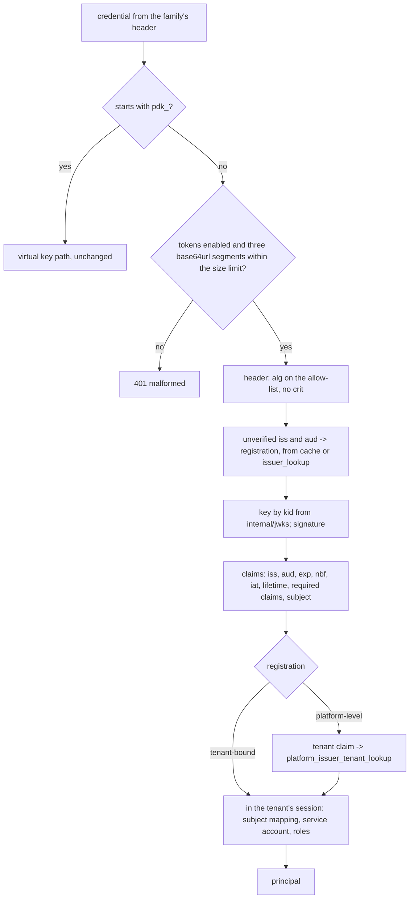

# Sprint 4.1 — Trusted token issuers

- Epic: [4 — Identity federation and RBAC](../epic.md)
- Implementation plan: [plan.md](plan.md)
- Previous sprint: [3.3 — Anthropic and OpenAI-compatible providers](../../03-gateway/3.3-anthropic-and-openai-compatible-providers/sprint.md)
- Risk class: **high** (a second authentication mechanism on the inference listener; the tenant of
  a request derived from a claim signed by a third party; outbound fetches to addresses that tenant
  administrators supply; the first cryptographic third-party dependency of the product; the last
  sprint before the tag `v0.1.0`)
- Decisions implemented: ADR [0005](../../../../docs/adr/0005-data-plane-authentication.md)
  (tokens from trusted issuers), [0007](../../../../docs/adr/0007-authorization-rbac.md) and
  [0031](../../../../docs/adr/0031-authorization-core-and-provisioning.md) (nine permissions, no new
  role), [0020](../../../../docs/adr/0020-error-contract.md) (no new code),
  [0026](../../../../docs/adr/0026-schema-migrations.md) and
  [0027](../../../../docs/adr/0027-database-roles-and-session-context.md) (migration 0008, four
  tables, three definer functions), [0017](../../../../docs/adr/0017-admin-api-spec-first.md) and
  [0028](../../../../docs/adr/0028-admin-api-generator.md) (eighteen operations, specification
  first), [0029](../../../../docs/adr/0029-static-sql-sqlc.md),
  [0032](../../../../docs/adr/0032-audit-log-first-version.md) (ten audit actions),
  [0037](../../../../docs/adr/0037-request-pipeline-and-resolution.md) (step 2 of the pipeline),
  [0038](../../../../docs/adr/0038-egress-guard-upstream-tls-and-proxy.md) (key retrieval through
  the guard), [0039](../../../../docs/adr/0039-usage-record-admission-and-ledger-writer.md)
  (`principal_kind` `token`), [0018](../../../../docs/adr/0018-supply-chain.md) (one new module)
- New decision records written by this sprint: **0045** (trusted token issuers: registration,
  selection and validation; refines 0005), **0046** (retrieval and caching of issuer keys; amends
  0038 rule 7 and the cache table of the overview), **0047** (identity providers in the test
  suite); history lines on 0005, 0018, 0030, 0032, 0038, 0039. Text in [plan.md](plan.md), part E.

This document is the design. The implementer follows [plan.md](plan.md); a gap in either document
is raised as a question, not filled silently ([planning/README.md](../../../README.md)).

Items carried into this sprint, and where each is decided:

| Item | From | Decided in |
|---|---|---|
| Token principals behind `Authenticator` | epic 3 record | §5.2, §5.9, D-1, D-2 |
| `principal_kind` `token`; a migration widens check constraints | 3.2 §11, epic 3 record | §5.7, D-12 |
| A token principal has no pin and no key model list | 3.3 §11 | D-12 |
| A token arrives as `Authorization: Bearer` for both families | 3.3 §11 | §5.2, D-2, O-2 |
| Auditing authentication failures of the inference listener | epic 1 record, 3.1 D-15 | §5.8, D-13 |
| Tenant-supplied addresses reuse the guard as the public class | epic 3 record | §5.5, D-9 |

## 1. Outcome

A workload that already holds a signed token from its identity provider calls a model through
Pandokos with that token as its "API key", and nothing else changes for it or for the pipeline:

1. A tenant administrator registers the issuer of the tenant's identity provider
   (*tenant-bound*: every accepted token acts for that tenant), or the platform administrator
   registers an issuer shared by many tenants (*platform-level*: the tenant is read from one named
   claim and must be in the registration's explicit list). Neither kind has a wildcard.
2. The tenant maps token subjects to its service accounts, one explicit rule per subject. A token
   whose subject has no rule is refused.
3. The gateway verifies a token offline, with the keys the issuer publishes: signature, algorithm,
   issuer, audience, validity in time, required claims. Keys are cached, so a short outage of the
   identity provider does not stop calls.
4. The principal is a service account of one tenant with its roles, exactly as for a virtual key.
   Authorization, the model check, the vault, the usage record, the spans and the audit log do not
   know which mechanism was used, except for one field that says so.
5. The acceptance criteria of release R1 are checked against the repository, one by one, and what
   the tag `v0.1.0` needs is in place. Pushing the tag is the maintainer's action.

## 2. Scope

### In scope

- Migration `0008_trusted_issuers`: tables `trusted_issuer`, `subject_mapping` (tenant-scoped),
  `platform_issuer`, `platform_issuer_tenant` (global with policies), `issuer_directory` (global, no
  grant); three definer functions; `usage_record.principal_kind` gains `token`.
- Administration API, specification first: tenant-bound registrations, subject mappings,
  platform-level registrations and their tenant lists (18 operations, 9 permissions); the CLI
  commands that wrap them.
- Package `internal/jwks`: OpenID Connect discovery, JWKS retrieval through the egress guard,
  cache, bounded refetch, bounded staleness.
- Token validation in `internal/authn` behind the existing `gateway.Authenticator` interface;
  caches invalidated by the existing notification channel.
- Audit of registration and mapping changes; audit of token authentication failures that name a
  tenant; log lines for the others.
- Tests: an in-process issuer with keys generated at run time; the isolation harness; end to end
  with the binary; Keycloak and Ory Hydra in containers; canaries for tokens.
- Documentation: an operations guide for tokens, the revocation table, the threat model, the
  permission and API references.
- Release R1: the acceptance check, the roadmap and README status, the release note page.

### Not in scope

| Item | Where |
|---|---|
| Tokens on the administration listener (O-1) | 4.2, with users and sessions |
| Mapping subjects to users (the "or users" of IAM-08) | 4.2 |
| Subject rules by pattern, prefix or claim expression (O-4) | not scheduled; exact match only |
| Mapping claims to roles or scopes; scopes, model lists or pins per mapping (O-5) | 4.3 at the earliest |
| Token introspection (RFC 7662), revocation lists, `jti` replay tracking | not planned; lifetime bounds the exposure (§5.10) |
| Opaque tokens, encrypted tokens (JWE), nested tokens | not planned |
| Certificate-bound tokens (IAM-16), mutual TLS (IAM-15) | later releases |
| An operation that tests a registration or a token from the administration API (O-7) | not scheduled |
| Metrics for token authentication and key retrieval | 6.1 |
| Reading `auth.failure` rows | 6.2 |
| Private-network issuers approved per registration (O-6) | not scheduled; `tokens.private_hosts` is the mechanism |

## 3. Requirements claimed

Meanings quoted from [docs/requirements](../../../../docs/requirements/README.md).

| ID | Requirement | Claim |
|---|---|---|
| **IAM-06** | "Pandokos accepts signed access tokens (JWT) from registered trusted issuers and validates signature, issuer, audience, expiry and required claims" | full |
| **IAM-07** | "A trusted issuer is either bound to one tenant, or registered at platform level with the tenant read from a configured claim and limited to an explicit list of tenants. There is no implicit wildcard" | full |
| **IAM-08** | "Token subjects map to service accounts or users by explicit rules. An unmapped subject is rejected" | service accounts; users come with 4.2 |

Touched, already claimed by earlier sprints, and kept true for the new mechanism:

| ID | Requirement | What this sprint adds |
|---|---|---|
| TEN-01 | "Every tenant-owned resource carries its tenant. Platform-global data is stored separately and governed by explicit policies" | two tenant-scoped tables, three global ones |
| TEN-02 | "The tenant of a request derives only from the verified credential or a server-side association. A tenant identifier supplied by the caller neither establishes nor overrides it" | the tenant comes from the registration, or from a signed claim through the registration's list |
| TEN-03 | "A missing or unverifiable tenant context rejects the request. There is no default or global fallback" | every path without a tenant is a refusal (T-581) |
| TEN-04 | "Tenant data is protected by row-level security in the database, in addition to application checks…" | policies and isolation fixtures for the new tables |
| GW-02 | "Stock provider SDKs work by changing only the base URL and the API key. The Pandokos credential is accepted in the authentication header native to each API family" | a token is accepted wherever a key is (T-596) |
| AZ-01, AZ-02 | "Every request is authorized after it is authenticated… The default is deny"; "Permissions are `resource:action` pairs…" | nine permissions; `Decide` unchanged |
| AUD-01 | "Pandokos audits authentication failures and every creation, change, disabling, revocation and deletion of tenants, identities, keys, roles, catalogue entries, credentials and limits" | registrations and mappings are identities; token failures |
| AUD-02, AUD-03 | record content; "written atomically with the change it describes" | same helpers, same transaction |
| API-02, API-03, API-04 | specification as source of truth; CLI wraps the API; pagination and one error format | 18 operations |
| SEC-02 | "The replay exposure of each authentication mechanism is documented…" | §5.10 and the guide |
| SEC-03 | "Error messages reveal no secrets, internal configuration or data of other tenants" | one uniform 401; conflict without detail (D-5) |
| SEC-04 | "Defaults are secure. At start-up Pandokos validates its configuration and refuses or warns about weak settings" | §5.11 |
| SEC-05 | threat model | the identity-provider boundary is written out |
| OPS-11 (R2) | "Behaviour on failure of each dependency is defined. If authorization or the credential cannot be verified the request is not forwarded" | defined for the identity provider (§5.5); not claimed |

## 4. Repository layout

New:

```
internal/jwks/                    discovery, retrieval, cache (imports go-jose, egress types only through options)
internal/authn/token.go           parsing and validation of a compact JWT
internal/authn/tokens.go          registration lookup, tenant, mapping, principal; caches
internal/admin/token_issuers.go   tenant-bound registrations
internal/admin/subject_mappings.go
internal/admin/platform_issuers.go
internal/cli/issuers.go
internal/store/migrations/sql/0008_trusted_issuers.sql
internal/store/queries/sql/issuers.sql
test/fakeidp/                     in-process issuer: keys made at start, discovery, JWKS, signer, faults
test/idp/                         Keycloak and Hydra: compose.yaml, up.sh, tests behind the tag `idp`
docs/operations/tokens.md
docs/releases/v0.1.0.md
docs/adr/0045-…, 0046-…, 0047-…
```

Changed: `internal/authz/authz.go` (permissions, two principal fields), `internal/authn/authn.go`
and `cache.go`, `internal/gateway/{handler,ports,record}.go`, `internal/resolver/failures.go`,
`internal/audit/audit.go`, `internal/usage/record.go`, `internal/config/*`, `cmd/pandokos/serve.go`,
`internal/vault/opener.go` and `internal/catalog/cache.go` (one ignored payload),
`api/openapi/admin.v1.yaml`, generated code, `test/isolation/spec.go`, `Makefile`,
`.github/workflows/ci.yml`, `.github/dependabot.yml`, `go.mod`, `go.sum`, documentation.

## 5. Architecture

### 5.1 The pipeline, as changed

Only step 2 of the pipeline of ADR 0037 changes, and only inside `Authenticator.Authenticate`.
Steps 1 (route), 3 (admit, attribute), 4 (authorize) and everything after are untouched: they
receive an `authz.Principal` of kind `service_account`.



Nothing read from a token is trusted, logged, audited or cached before the signature is verified,
with one exception: `iss` and `aud` select the registration whose keys verify the token, and are
compared again after verification.

### 5.2 Telling a token from a key (D-2)

`InboundCredential` of each family is unchanged: the OpenAI family reads `Authorization: Bearer`;
the Anthropic family reads `X-Api-Key` or `Authorization: Bearer` with the rules of 3.3 §5.2. The
value goes to `Authenticate`, which decides by shape:

| Value | Path |
|---|---|
| starts with `pdk_` | virtual key (a malformed key is `malformed`, never retried as a token) |
| otherwise, tokens enabled, at most `tokens.max_token_bytes`, exactly three non-empty segments of the unpadded base64url alphabet separated by `.` | token |
| anything else | `malformed` |

A JWT starts with the encoding of `{"`, never with `pdk_`, so the two cannot be confused. A token
is therefore accepted in `X-Api-Key` too: the Anthropic SDKs send their `api_key` there and their
`auth_token` as a bearer, and both work (O-2). The inbound credential is removed before forwarding
by the existing code, whichever header carried it (T-596).

### 5.3 Registrations

Two kinds, in two tables, because TEN-01 keeps platform data apart from tenant data.

| | Tenant-bound (`trusted_issuer`) | Platform-level (`platform_issuer`) |
|---|---|---|
| Created by | a principal of the tenant with `token_issuer:write` | a platform principal with `platform_issuer:write` |
| Tenant of a token | the tenant that owns the registration | the value of the claim named by `tenant_claim`, looked up in the registration's list |
| Tenants it can act for | one | those in `platform_issuer_tenant`, each with the claim value that designates it |
| Subject mappings | of the owning tenant | of each listed tenant, made by that tenant |

Common fields:

| Field | Rule | Default |
|---|---|---|
| `name` | the `Name` of the API (`^[a-z0-9]([a-z0-9-]{0,61}[a-z0-9])?$`), unique per tenant, or per installation for platform-level | required |
| `issuer` | `https` URL, no query, no fragment, no user information, at most 255 bytes, compared byte for byte with `iss` | required |
| `audience` | 1 to 255 characters, compared byte for byte with the entries of `aud` | required; there is no way to skip the audience check |
| `jwks_uri` | `https` URL; empty means OpenID Connect discovery under `issuer` | empty |
| `algorithms` | 1 to 10 of `RS256 RS384 RS512 PS256 PS384 PS512 ES256 ES384 ES512 EdDSA` | `[RS256, ES256]` |
| `subject_claim` | name of the string claim that identifies the caller | `sub` |
| `required_claims` | object of at most 16 members, claim name to string; the token's claim must be that string, or an array of strings that contains it | `{}` |
| `enabled` | a disabled registration refuses every token | `true` |
| `description` | at most 200 characters | empty |

Platform-level only: `tenant_claim` (required, a claim name; the claim must be a non-empty
string). Each entry of the tenant list is `(tenant, claim_value)`; `claim_value` defaults to the
tenant's ID and is unique within the registration, so the identity provider can use its own
identifiers for organisations and nobody depends on tenant names, which can change. A tenant that
is not in the list cannot be reached through the registration by any claim value (IAM-07).

Claim names are top-level members of the payload, matched exactly, 1 to 64 characters of
`[A-Za-z0-9_.:/-]`; there are no paths into nested objects.

**Selection by issuer and audience (D-4, D-5).** The pair (`issuer`, `audience`) is unique across
the installation, over both kinds. The table `issuer_directory`, on which no runtime role has any
privilege, holds one row per registration and enforces it; triggers of the two tables maintain it.
A token selects the registration whose issuer equals its `iss` and whose audience is one of its
`aud` entries. If two registrations match (a token with several audiences), the token is refused:
the tenant is never chosen among candidates. Creating a second registration with a taken pair
answers `409 conflict`, with the same body as a name conflict.

Why the pair, and what it implies, is in the threat notes of §5.10: when several tenants trust one
issuer (a public workload-identity issuer, a company-wide realm), the audience is what tells their
tokens apart, and the guide tells tenants to use an audience that names the installation and the
tenant.

**Subject mappings.** One row maps one subject of one registration to one service account of the
tenant: `(issuer, subject) → service_account`. The subject is compared byte for byte, 1 to 255
characters. A mapping is immutable (the admin role has no `UPDATE` on the table); it is deleted and created again. Deleting a registration
deletes its mappings. A mapping to a platform-level registration can be created only while the
tenant is in its list; if the tenant is later removed, the mapping stays and is inert.

### 5.4 Token validation (D-6, D-7)

In this order; the first failure ends the request with the reason shown (§5.8). All reasons give
the same answer to the caller.

| # | Check | Reason on failure |
|---|---|---|
| 1 | Size, three segments, base64url without padding, header and payload are JSON objects | `malformed` |
| 2 | Header: `alg` is a string on the product's allow-list (§5.3). `none`, every `HS*` and anything else are refused here. A `crit` member is refused. `jwk`, `jku`, `x5c`, `x5u` are never read | `algorithm_not_allowed` |
| 3 | Unverified `iss` (string) and `aud` (string or array of at most 16 strings) select one registration | `unknown_issuer`, `ambiguous_audience` |
| 4 | The registration is enabled; `alg` is in its `algorithms` | `issuer_disabled`, `algorithm_not_allowed` |
| 5 | A verification key: the JWKS entry whose `kid` equals the header's; without a header `kid`, the only usable key for the algorithm, if there is exactly one. Usable means: public; `use` absent or `sig`; `alg` absent or equal to the token's; type and size fit the algorithm (RSA of 2048 bits or more for `RS*`/`PS*`; P-256, P-384, P-521 for `ES256`, `ES384`, `ES512`; Ed25519 for `EdDSA`) | `unknown_signing_key`; keys not obtainable: 503 |
| 6 | Signature over the first two segments as received | `bad_signature` |
| 7 | `iss` equals the registration's issuer; `aud` contains its audience | `issuer_mismatch`, `wrong_audience` |
| 8 | `exp` is a number and `now < exp + skew`; `nbf`, when present, `now ≥ nbf − skew`; `iat`, when present, `iat ≤ now + skew` | `expired`, `not_yet_valid` |
| 9 | Lifetime: `exp − iat` (or `exp − now` without `iat`) at most `tokens.max_lifetime` | `lifetime_too_long` |
| 10 | Every member of `required_claims` | `required_claim_missing` |
| 11 | The subject claim is a string of 1 to 255 characters without control characters | `subject_missing` |
| 12 | Platform-level: the tenant claim is a non-empty string of at most 255 characters and designates a listed tenant | `tenant_claim_missing`, `tenant_not_listed` |
| 13 | In the tenant's session: the registration still exists there or lists the tenant; a mapping exists for the subject | `subject_not_mapped` |
| 14 | The service account is active and within its validity dates | `service_account_disabled`, `service_account_not_valid` |

Numbers are JSON numbers; a numeric claim given as a string is a failure of its check. Time claims
may have a fractional part. Duplicate member names at the top level of the header or the payload are
refused as `malformed` by Pandokos's own decoding, before and after the signature check (T-570). The signature is
verified on every request: no token and no digest of a token is ever stored, in memory or
elsewhere.

A suspended tenant is not an authentication failure: the principal carries the tenant's state and
`Decide` answers `tenant_suspended`, as for a key.

### 5.5 Keys of an issuer: retrieval, cache, outage (D-8 to D-11)

`internal/jwks` holds one entry per key source, where a source is the pair (`issuer`, `jwks_uri`)
of a registration; registrations with the same source share the entry.

- **Where from.** With an explicit `jwks_uri`, that URL. Otherwise
  `GET <issuer>/.well-known/openid-configuration` (one trailing `/` of the issuer removed first),
  whose `issuer` member must equal the registered issuer byte for byte and whose `jwks_uri` must
  be an `https` URL without user information; then that URL. Both are fetched at every refresh.
- **How.** Through `egress.Guard.Transport`, never another transport (ADR 0038 rule 1): `https`
  only, certificates verified against the system roots and `upstream.tls.ca_file`, no redirect
  followed, the proxy of `upstream.proxy.url` for public addresses. The public transport is used
  unless the URL's host is listed in `tokens.private_hosts`, in which case the private transport
  is used, restricted here to `https` as well. Forbidden addresses stay unreachable. Limits: 5 s
  for the whole exchange (`tokens.jwks.fetch_timeout`), 64 KiB for a discovery document, 256 KiB
  for a key set, 32 usable keys kept, status 200 only. Nothing of a response is logged or returned
  to anyone; a failure is logged with its class (`blocked`, `timeout`, `status`, `too_large`,
  `invalid_document`, `issuer_mismatch`, `no_usable_key`, `network`) and the registration's ID.
- **When.** Lazily: the first token for a source fetches, and callers that arrive meanwhile wait
  for that one fetch. After `tokens.jwks.refresh_interval` (15 min) the next use starts a refresh
  in the background and is itself served from the keys in memory. Cache headers of the issuer are
  not read (D-10).
- **Unknown key ID.** If the last fetch attempt for the source is older than
  `tokens.jwks.min_refetch_interval` (10 s), one fetch is made, shared by the waiting callers, and
  the key is looked up again; otherwise the token is refused at once. So an identity provider that
  rotates its keys is followed within 10 s, and no flow of forged tokens causes more than one
  outbound request per source per 10 s.
- **Outage.** A failed refresh keeps the keys and is retried at the next use after
  `min_refetch_interval`. Keys are used for at most `tokens.jwks.max_stale` (6 h) after the last
  successful fetch; then the source has no keys. A source without keys answers 503 `unavailable`
  with `Retry-After`, as a database that cannot answer does: the credential cannot be verified
  now, which is not a statement about the credential (OPS-11).
- **Memory.** At most 1024 sources; over that, the entry least recently used is dropped.

What a tenant administrator can make the gateway do with a registration is therefore: one `GET`
of two fixed-shape URLs on a public address (or a host the operator listed), at most every 10 s,
with nothing of the answer observable except whether tokens verify.

### 5.6 Caches and propagation (D-11)

| Cache (gateway only) | Key | Lifetime | Dropped by |
|---|---|---|---|
| Registration | (`iss`, audience) | `cache.principal_ttl` (30 s); 5 s for "none" | `tenant:<id>` for that tenant's registrations; `issuers` for platform-level ones; a reset flushes |
| Token principal | (registration, tenant claim value, subject) | `cache.principal_ttl`; 5 s for "not listed" and "not mapped" | `tenant:<id>` for that tenant; `issuers` for every entry of a platform-level registration; a reset flushes |
| Issuer keys | (`issuer`, `jwks_uri`) | §5.5 | not by notifications |

The two first caches live in `internal/authn` next to the key cache, with the same size bound
(10 000 entries each, flushed when full) and the same rule that a lifetime counts from the start
of the lookup. `trusted_issuer` and `subject_mapping` notify `tenant:<id>` through the existing
`notify_cache('scoped')`; service accounts, role assignments and tenant state already do.
`platform_issuer` and `platform_issuer_tenant` notify the new payload `issuers`, which the key
cache, the vault opener and the catalogue cache ignore.

| Change | Takes effect on the inference listener |
|---|---|
| A mapping is deleted; a registration is disabled, changed or deleted; a tenant leaves a platform-level list; a service account is disabled or loses a role | at once where notifications arrive, at most `cache.principal_ttl` otherwise |
| A tenant is suspended | as for keys |
| A token expires | at `exp`, plus `tokens.clock_skew` |
| The identity provider withdraws a signing key | at most `tokens.jwks.refresh_interval`; at most `tokens.jwks.max_stale` while its key endpoint cannot be reached |
| A single token is to be revoked before it expires | not possible: there is no revocation list. Delete the mapping, or wait for `exp` |

A request already being served is not interrupted, as for keys.

### 5.7 The principal (D-12)

```go
// authz.Principal for a token: Kind is KindServiceAccount.
ID, Name      // the service account the subject is mapped to
KeyID         // the ID of the subject mapping: what is deleted to end this access
IssuerID      // new: the ID of the registration that accepted the token; empty for a key
Subject       // new: the verified subject; empty for a key
TenantID, TenantName, TenantState, Roles  // as for a key
Scopes, Models: nil; CredentialID: ""     // a token has no scope list, no model list, no pin
```

`Decide`, `Effective`, the catalogue's `Resolve` and the vault's `Open` read what they read today.
A token principal with the role `inference` can call every model the tenant may call, with the
tenant's default credential of the provider.

The usage record takes `principal_kind` `token` when `IssuerID` is set, `principal_id` the service
account's ID and `key_id` the mapping's ID. The existing format check of `key_id` already admits a
UUID, so the migration widens one constraint of `usage_record`, not two as 3.2 foresaw; reports
that group by `principal_id` see one service account whichever mechanism it used. Spans and the
`request completed` log line carry the same values, plus `issuer_id` on the log line. The usage
list of the administration API returns `principal_kind` as stored (its schema is already a string).

### 5.8 Failures, errors, logs, audit (D-13, D-14)

- **Answer.** Every refusal of §5.4 is `401 unauthenticated` in the shape of the family, byte for
  byte the answer to an unknown key. Keys that cannot be obtained, and a database that cannot
  answer, are `503 unavailable`. No new error code (ADR 0020).
- **Log.** `authentication failed` at `warn` with `listener`, `request_id`, `reason`, and, when
  known, `issuer_id`, `tenant_id`, `audited`; `subject` only for failures after check 11. Never
  the token, a segment, the header, an unverified claim or the unverified `iss`.
- **Audit.** A failure that names a tenant is written to that tenant's audit log by the existing
  bounded recorder (60 records of burst, one per second, one per key and reason in ten minutes):
  action `auth.failure`, `resource_type` `token_issuer`, `resource_id` the registration's ID,
  `detail` `{reason, listener: "inference", issuer_scope}` plus `subject` after check 11. The row
  is written by the new definer function `record_token_auth_failure`; the gateway role still has
  no privilege on `audit_event`.

  | Failure | Tenant known | Audited |
  |---|---|---|
  | checks 1 to 3 | no | no (log only) |
  | checks 4 to 11 on a tenant-bound registration | yes, from the registration | yes |
  | checks 4 to 12 on a platform-level registration | no | no (log with `issuer_id`; O-8) |
  | checks 13, 14 | yes | yes, with `subject` |

  The suppression key is the registration, the reason and the subject, so one unmapped subject
  cannot hide another, and a flow of forged tokens for a known issuer and audience writes at most
  one row per reason in ten minutes.

### 5.9 Interfaces

```go
// internal/authn
const KindToken Kind = 'j' // a JWT of a registered issuer; gateway only

type TokenOptions struct {
	Keys        KeySource     // required when KindToken is accepted
	MaxBytes    int           // tokens.max_token_bytes
	ClockSkew   time.Duration // tokens.clock_skew
	MaxLifetime time.Duration // tokens.max_lifetime
}
// Options gains: Tokens TokenOptions. KindToken needs the pool of the gateway role.

// KeySource gives the verification key of a token. ErrKeyNotFound is a refusal; an error that
// wraps authz.ErrUnavailable means the keys cannot be obtained now.
type KeySource interface {
	Key(ctx context.Context, src jwks.Source, kid, alg string) (crypto.PublicKey, error)
}

// Failure gains IssuerID, IssuerScope ("tenant", "platform") and Subject. Detail returns a struct:
type FailureDetail struct{ Reason, KeyID, TenantID, IssuerID, IssuerScope, Subject string }
func (f *Failure) Detail() FailureDetail

// internal/jwks
type Source struct{ Issuer, JWKSURI string } // JWKSURI empty: discovery
type Options struct {
	Transport          func(private bool) http.RoundTripper // egress.Guard.Transport
	PrivateHosts       []string
	FetchTimeout, RefreshInterval, MinRefetchInterval, MaxStale time.Duration
	Logger             *slog.Logger
	Now                func() time.Time
}
func New(o Options) (*Cache, error)
func (c *Cache) Key(ctx context.Context, src Source, kid, alg string) (crypto.PublicKey, error)
var ErrKeyNotFound = errors.New("jwks: no usable key for this token")

// internal/gateway: AuthFailure gains IssuerID, IssuerScope, Subject; the handler reads
// FailureDetail. gateway.Authenticator is unchanged.
// internal/audit
func RecordTokenAuthFailure(ctx context.Context, tx store.Tx, scope, issuerID, reason, subject, requestID string) error
```

SQL contracts (full text in plan.md, appendix A1, run on PostgreSQL 16 while designing): `pandokos.issuer_lookup(p_issuer text,
p_audiences text[])` returns `(scope, tenant_id, issuer_id)` rows for the exact pairs, at most 16
audiences; `pandokos.platform_issuer_tenant_lookup(p_issuer_id uuid, p_claim_value text)` returns
one tenant ID or NULL; `pandokos.record_token_auth_failure(p_scope, p_issuer_id, p_reason,
p_subject, p_request_id)`. Each takes single values and cannot list.

### 5.10 Threat notes

| Threat | Answer |
|---|---|
| Algorithm confusion: `none`, HMAC with the public key as secret, a key of another type | The allow-list has only asymmetric algorithms and is applied before any key is looked up; the library is given exactly the one algorithm of the header; a key is used only if its type fits (check 5). T-571 |
| Key injection through the header (`jwk`, `jku`, `x5u`) or a forged `kid` | Keys come only from the registration's source; header key material is never read. T-571 |
| A token minted for another relying party of the same issuer | The audience is mandatory and compared exactly. T-572 |
| Tenant B registers the issuer tenant A uses | B's registration must have another audience (D-5), so A's tokens never select it. If A's workloads present tokens whose audience A has not registered, or no longer registers, and B registers that pair and maps the subject, those calls run as B's service account with B's provider credential. The guide therefore requires an audience that names the installation and the tenant whenever the issuer is shared, and says to stop the workloads before deleting a registration. O-3 offers the stricter alternative |
| A platform-level issuer asserts any tenant | Only those in its list, by the listed value; the list is edited by the platform administrator only and audited. The identity provider is trusted for exactly that (security model, boundary 6) |
| A caller supplies a tenant (header, body, path) | Nothing but the registration and the signed claim is read. T-581 |
| Server-side request forgery through `issuer` or `jwks_uri` | §5.5: public addresses only unless the operator lists the host; fixed method; no redirect; nothing of the answer returned |
| A hostile key endpoint (slow, huge, endless) | Time and size limits; one fetch per source per 10 s; callers wait for the fetch at most the fetch timeout |
| Forged tokens used to flood logs, audit or the identity provider | Bounded recorder; one row per reason per ten minutes; refetch bound |
| Replay of a captured token | Not prevented: a token is a bearer credential valid until `exp`. TLS on the listener, short lifetimes at the identity provider, and `tokens.max_lifetime` bound it (SEC-02); sender-constrained tokens are IAM-15 and IAM-16 |
| A token in a log, an error, a record or a span | No code path formats one; canary tests T-597 |
| Timing differences between reasons | Not equalized: a refusal before the signature check is faster than one after it. This reveals at most that an issuer and audience pair is registered, which D-5 already reveals to a tenant administrator. Stated in the guide |

### 5.11 Configuration

A new top-level section; environment names follow the existing rule (`PANDOKOS_TOKENS_…`).

| Key | Type | Default | Bounds and meaning |
|---|---|---|---|
| `tokens.enabled` | boolean | `true` | `false`: every value that is not a virtual key is `malformed`, and no key is ever fetched |
| `tokens.max_token_bytes` | integer | `8192` | 1024 to 16384; `serve` refuses to start unless it is at most half of `listeners.inference.max_header_bytes` |
| `tokens.clock_skew` | duration | `60s` | 0 to 5 m |
| `tokens.max_lifetime` | duration | `24h` | 1 m to 720 h |
| `tokens.private_hosts` | list of strings | `[]` | at most 32 lower-case DNS names, no address literal, no wildcard: hosts whose issuer and key URLs may resolve to private addresses |
| `tokens.jwks.fetch_timeout` | duration | `5s` | 1 s to 30 s |
| `tokens.jwks.refresh_interval` | duration | `15m` | 1 m to 1 h |
| `tokens.jwks.min_refetch_interval` | duration | `10s` | 1 s to 5 m |
| `tokens.jwks.max_stale` | duration | `6h` | at least twice `refresh_interval`, at most 72 h |

`serve` warns at start when `tokens.private_hosts` is not empty (naming the hosts) and when
`tokens.max_stale` is above 24 h. `config check` validates the section.

### 5.12 Administration API (specification first)

| Operation | Route | Permission | Audit action |
|---|---|---|---|
| `listTokenIssuers` | `GET /v1/tenants/{tenant}/token-issuers` | `token_issuer:read` | |
| `createTokenIssuer` | `POST /v1/tenants/{tenant}/token-issuers` | `token_issuer:write` | `token_issuer.create` |
| `getTokenIssuer` | `GET /v1/tenants/{tenant}/token-issuers/{issuer}` | `token_issuer:read` | |
| `updateTokenIssuer` | `PATCH …/token-issuers/{issuer}` | `token_issuer:write` | `token_issuer.update` |
| `deleteTokenIssuer` | `DELETE …/token-issuers/{issuer}` | `token_issuer:delete` | `token_issuer.delete` |
| `listTenantPlatformIssuers` | `GET /v1/tenants/{tenant}/platform-issuers` | `token_issuer:read` | |
| `listSubjectMappings` | `GET /v1/tenants/{tenant}/subject-mappings` | `subject_mapping:read` | |
| `createSubjectMapping` | `POST /v1/tenants/{tenant}/subject-mappings` | `subject_mapping:write` | `subject_mapping.create` |
| `getSubjectMapping` | `GET …/subject-mappings/{mapping}` | `subject_mapping:read` | |
| `deleteSubjectMapping` | `DELETE …/subject-mappings/{mapping}` | `subject_mapping:delete` | `subject_mapping.delete` |
| `listPlatformIssuers` | `GET /v1/platform-issuers` | `platform_issuer:read` | |
| `createPlatformIssuer` | `POST /v1/platform-issuers` | `platform_issuer:write` | `platform_issuer.create` |
| `getPlatformIssuer` | `GET /v1/platform-issuers/{issuer}` | `platform_issuer:read` | |
| `updatePlatformIssuer` | `PATCH /v1/platform-issuers/{issuer}` | `platform_issuer:write` | `platform_issuer.update` |
| `deletePlatformIssuer` | `DELETE /v1/platform-issuers/{issuer}` | `platform_issuer:delete` | `platform_issuer.delete` |
| `listPlatformIssuerTenants` | `GET /v1/platform-issuers/{issuer}/tenants` | `platform_issuer:read` | |
| `putPlatformIssuerTenant` | `PUT /v1/platform-issuers/{issuer}/tenants/{tenant}` | `platform_issuer:write` | `platform_issuer.tenant_add` |
| `deletePlatformIssuerTenant` | `DELETE /v1/platform-issuers/{issuer}/tenants/{tenant}` | `platform_issuer:write` | `platform_issuer.tenant_remove` |

- The six tenant permissions have scope `tenant` and are added to the role `tenant-admin`; the
  three `platform_issuer:*` have scope `platform` and are added to `platform-admin`. A mapping
  gives an external identity the roles of a service account, so `subject_mapping:write` is as
  sensitive as `virtual_key:write` and is described so in the permission reference.
- `{issuer}` and `{mapping}` are IDs, as every path parameter of the API; lists filter by `name`.
- Tenant operations run in the tenant's session; another tenant's resource is `404 not_found`
  (the rule of `Decide`). Platform operations run in platform scope. `listTenantPlatformIssuers`
  runs in the tenant's session and returns the registrations that list the tenant, with the
  tenant's `claim_value`, and nothing of the other tenants of the list.
- Tenant audit rows go to the tenant's log; platform rows to the platform log only, as model
  grants do (2.2 O-7). `detail` holds the changed field names and the non-secret values (name,
  issuer, audience, algorithms, claim names, enabled, subject, service account); a registration
  has no secret.
- Enabling and disabling is `PATCH {enabled}`; the audit detail says `enabled`.
- Validation errors are `400 invalid_request` with the field name. A mapping to a platform-level
  registration that does not list the tenant is `404 not_found` for the issuer.
- The administration plane never fetches an issuer's documents (O-7).

CLI: `pandokos token-issuer list|create|get|update|delete|platform`, `pandokos subject-mapping
list|create|get|delete`, `pandokos platform-issuer list|create|get|update|delete|tenants|add-tenant|remove-tenant`,
with the flags of the request bodies (appendix A3 of the plan).

## 6. Isolation harness

`DefaultSpec` gains:

- fixtures for `trusted_issuer` and `subject_mapping` (tenant-scoped: policy `tenant_isolation`,
  the negative tests as every runtime role);
- global tables: `platform_issuer` (restricted; read by the gateway and the admin role, written in
  platform scope), `platform_issuer_tenant` (restricted; a tenant's session sees its own rows),
  `issuer_directory` (no privilege for any runtime role);
- grants per role (the worker role has none on any of the five tables);
- definer functions: `issuer_lookup`, `platform_issuer_tenant_lookup`,
  `record_token_auth_failure`, `issuer_directory_sync`.

New negative tests: T-585 to T-588 (§9).

## 7. Test infrastructure and CI

- **`test/fakeidp`** (root module, test code only): an HTTPS server on loopback with a
  certificate from `test/testcert`, RSA, P-256 and Ed25519 keys generated at start, the discovery
  document and the key set, a signer for arbitrary headers and claims (including hand-built `none`
  and `HS256` tokens), and faults: refuse, delay, oversize, rotate keys, count requests. Used by
  unit, integration and end-to-end tests. No key or token is stored in the repository.
- **`test/idp`** (root module, build tag `idp`; needs Docker): `compose.yaml` with
  Keycloak 26.8.2 and Ory Hydra v26.2.0, images pinned by digest, both serving HTTPS on loopback
  with a certificate generated by `up.sh`, which also generates the client secrets and writes
  `local/idp/env`. `make idp-up`, `make test-idp`, `make idp-down`, after the pattern of `make
  db-up`. Keycloak carries the platform-level scenario (a hard-coded claim mapper asserts the
  organisation; an audience mapper sets the audience), Hydra the tenant-bound one (the caller asks
  for the audience). Both issue tokens by the client-credentials grant. A test behind the tag
  fails, never skips, when a provider is missing.
- **CI**: one new job `idp` (release toolchain, `make db-up`, `make idp-up`, `make test-idp`);
  `vuln` is unchanged and now covers `go-jose`; Dependabot watches `test/idp` (`docker-compose`).
  The release workflow reuses `ci.yml`, so a tag runs the job too.
- **The module**: `github.com/go-jose/go-jose/v4` v4.1.9, imported by `internal/authn`,
  `internal/jwks` and `test/fakeidp` only (T-R36); added to the allow-list of direct
  dependencies.

## 8. Decisions

| # | Decision |
|---|---|
| D-1 | Tokens are validated inside `authn.Authenticator`, behind `gateway.Authenticator`, on the inference listener only. The admin authenticator does not accept `KindToken` (O-1) |
| D-2 | A value starting with `pdk_` is a key; any other value of JWT shape is a token, in whichever header the family reads (O-2) |
| D-3 | Two registration tables: `trusted_issuer` (tenant-scoped, managed with `token_issuer:*`) and `platform_issuer` with `platform_issuer_tenant` (global, managed with `platform_issuer:*`). The tenant list maps a claim value to a tenant; the default value is the tenant ID |
| D-4 | A registration has exactly one mandatory audience. There is no installation-wide audience setting and no way to accept any audience |
| D-5 | The pair (issuer, audience) is unique across the installation, enforced by `issuer_directory`; a token that matches two registrations is refused; a taken pair is `409 conflict` without detail (O-3) |
| D-6 | Algorithms: an allow-list of ten asymmetric algorithms in code, narrowed per registration, default `RS256` and `ES256`; applied before key lookup; key type and size must fit |
| D-7 | `exp` is required; `nbf` and `iat` are honoured when present; skew 60 s; lifetime at most 24 h; signature verified on every request; no token or digest stored |
| D-8 | JOSE library: `github.com/go-jose/go-jose/v4`, core package only (compact JWS and JWK). Claims are decoded and checked by Pandokos. Not `go-oidc` (its own HTTP client and cache), not `golang-jwt` (no JWK), not `jwx` (larger graph) |
| D-9 | Issuer documents are fetched through the egress guard: public class by default; a host in `tokens.private_hosts` may be private; `https` always; `upstream.tls.ca_file` and `upstream.proxy.url` apply. Only the gateway fetches |
| D-10 | Keys: lazy fetch, refresh every 15 min in the background, one refetch per source per 10 s on an unknown key ID, use for at most 6 h after the last success, then 503. Cache headers are not read; the overview's cache table is amended |
| D-11 | Registration and token-principal caches in `authn`, lifetime `cache.principal_ttl`, invalidated by `tenant:<id>` and the new payload `issuers` |
| D-12 | A token principal is a service account: `KeyID` is the mapping's ID, `IssuerID` and `Subject` are new fields; no scopes, no model list, no pin. The usage record says `principal_kind` `token` |
| D-13 | Token failures that name a tenant are audited through a second definer function with the existing bounds; platform-level failures before the tenant is known are logged only (O-8) |
| D-14 | Every refusal is `401 unauthenticated`; unobtainable keys are `503 unavailable`; no new code in ADR 0020 |
| D-15 | Subject mapping is exact match on one claim (`sub` unless the registration names another), one service account per subject and registration, immutable (O-4) |
| D-16 | Registrations are deleted for real (their mappings with them); `enabled` is the reversible switch. Audit rows keep the ID |
| D-17 | The second and third identity providers of the tests are Keycloak and Ory Hydra in containers, in the root module behind the build tag `idp`; the in-process issuer covers everything that needs faults or forged tokens (O-9) |
| D-18 | The release page is `docs/releases/v0.1.0.md`; the release workflow is not changed in this sprint (O-10) |

## 9. Tests

Levels: **U** unit; **D** needs the test database; **I** in-process gateway or admin handler with
the fake issuer; **E** the built binary, end to end; **X** external identity providers (tag
`idp`); **R** repository test. IDs continue from T-567 and T-R35.

### New tests

| ID | Test | Level | Proves | Requirement |
|---|---|---|---|---|
| T-568 | `authn.TestCredentialShape` | U | The table of §5.2: `pdk_` values never reach the token path; segment count, alphabet, padding, size limit at the boundary; tokens disabled | GW-02 |
| T-569 | `authn.TestTokenValid` | U | For each of the ten algorithms a token signed by the fake issuer yields the verified claims; with and without `kid`; `aud` as string and as array | **IAM-06** |
| T-570 | `authn.TestTokenMalformed`, `authn.FuzzParseToken` | U | Not JSON, arrays for objects, duplicate members, numbers as strings, `aud` of 17 entries, oversized segments; fuzz: no panic, never a principal without a valid signature | IAM-06 |
| T-571 | `authn.TestTokenAlgorithmAttacks` | U | `none` (all letter cases) with empty and non-empty signature; `HS256` keyed with the PEM and the DER of the public key; `RS256` token against an EC key and the reverse; `ES256` with a P-384 key; RSA of 1024 bits; `alg` absent, not a string, not in the registration's list; `crit`; embedded `jwk`, `jku`, `x5u`, `x5c` pointing at an attacker's key; a `kid` of another source | **IAM-06** |
| T-572 | `authn.TestTokenClaims` | U | Each row of checks 7 to 12 at its boundary with a fixed clock: `exp` at `now − skew`, `nbf` at `now + skew`, `iat` in the future, missing `exp`, lifetime one second over, audience missing, different, prefix of the registered one, among several; issuer differing by a trailing slash or by case; required claim as string, in an array, missing, of another type; subject missing, empty, 256 characters, another `subject_claim` | **IAM-06** |
| T-573 | `authn.TestSignatureOnEveryRequest` | U | A token accepted once and then altered in its payload or signature is refused; the token cache holds no token and no digest (the cached types have no such field; the altered token fails with a warm cache) | IAM-06 |
| T-574 | `jwks.TestDiscovery` | U | Discovery path with and without a trailing slash; `issuer` mismatch; `jwks_uri` with `http`, with user information, relative; explicit `jwks_uri` skips discovery; status 404 and 500; redirect not followed | IAM-06 |
| T-575 | `jwks.TestKeySelection` | U | Usable keys only: private keys, `oct` keys, `use: enc`, a mismatching `alg`, short RSA are dropped; duplicate `kid` keeps none; more than 32 keys; no `kid` in the token with one and with two candidates | IAM-06 |
| T-576 | `jwks.TestLimits` | U | A document of 64 KiB + 1 and a key set of 256 KiB + 1 are refused without being read to the end; a response that never ends is cut at the timeout; the failure classes of §5.5 | SEC-04 |
| T-577 | `jwks.TestRefreshAndRefetch` | U | With a fake clock: one fetch for 50 concurrent first callers; refresh in the background after the interval while callers are served; an unknown `kid` refetches once and finds a rotated key; 1 000 unknown `kid` in 10 s cause one fetch; a failed fetch is not repeated before the interval | IAM-06 |
| T-578 | `jwks.TestOutage` | U | The issuer stops answering: keys serve until `max_stale`, then `ErrUnavailable`; it comes back: the next use after the interval restores the keys; a source that never answered is `ErrUnavailable`, not a refusal | OPS-11 |
| T-579 | `jwks.TestTransportClass` | U | Public transport for an unlisted host, private for a listed one, host match exact and case-insensitive; `http` refused for both; with the real guard, an issuer on loopback is `blocked` unless listed, and a forbidden address is blocked even when listed | SEC-04 |
| T-580 | `authn.TestTokenPrincipalTenantBound` | D | A mapped subject yields the service account's principal: tenant, roles, `KeyID` the mapping, `IssuerID`, `Subject`, no scopes, models or pin; unmapped subject; disabled and not-yet-valid service account; disabled registration; suspended tenant gives a principal with that state | **IAM-06**, **IAM-08** |
| T-581 | `authn.TestTokenPrincipalPlatform` | D | Tenant A's claim value acts for A; the same subject with B's value acts for B's mapping; a value of an existing tenant outside the list, an unknown value, the tenant's name instead of the listed value, an empty, numeric or array claim, a missing claim: refused; a tenant in the list but without a mapping: refused; nothing but the claim selects the tenant | **IAM-07**, TEN-02, TEN-03 |
| T-582 | `authn.TestIssuerSelection` | D | Two tenants register the same issuer with different audiences: each token reaches its own tenant only; a token with both audiences is `ambiguous_audience`; an unknown pair is `unknown_issuer` and cached for 5 s | **IAM-07**, TEN-02 |
| T-583 | `authn.TestTokenCacheInvalidation` | D | With a lifetime of one minute: deleting the mapping, disabling the registration, changing its audience, removing the tenant from a platform list, disabling the service account, removing its role each take effect on the next call after the notification; payload `issuers` leaves key entries alone; a reset flushes; without notifications the lifetime bounds it | IAM-05, IAM-07 |
| T-584 | `store.TestIssuerSchema` | D | Constraints of migration 0008: formats, the directory's uniqueness across both tables and across tenants, update of issuer or audience moves the directory row, delete removes it, mapping needs exactly one issuer reference, cascade on delete, `principal_kind` `token` accepted and another value refused | IAM-07 |
| T-585 | `isolation.TestIssuerTables` | D | The harness's negative tests on the two tenant-scoped tables for every runtime role; lint (T-140) reports nothing with migration 0008 | **TEN-04** |
| T-586 | `isolation.TestIssuerFunctions` | D | `issuer_lookup` returns only exact pairs, and nothing for NULL, an empty list, more than 16 audiences or pattern characters; `platform_issuer_tenant_lookup` returns one ID or NULL; `record_token_auth_failure` writes only into the session's tenant, refuses bad formats and fails outside a tenant session; the worker and admin roles cannot execute the gateway's functions | TEN-04 |
| T-587 | `isolation.TestPlatformIssuerVisibility` | D | In tenant A's session, as gateway and as admin role: `platform_issuer_tenant` shows A's rows only; no runtime role reads or writes `issuer_directory`; the gateway role cannot write any of the five tables | TEN-01, TEN-04 |
| T-588 | `isolation.TestIssuerAPI` | D | Each of the ten tenant operations with tenant B's key on tenant A's path: 404; with a key lacking the permission: 403; each of the eight platform operations with a tenant key: 403; a mapping in A naming B's registration, B's service account or a platform registration that does not list A: 404 or 400 without revealing existence; `listTenantPlatformIssuers` shows nothing of other tenants | **TEN-04**, AZ-01 |
| T-589 | `admin.TestTokenIssuers`, `admin.TestSubjectMappings`, `admin.TestPlatformIssuers` | D | Every operation: creation with defaults, each validation rule of §5.3 with its field, pagination and sorting, the `name` filter, the conflict on a taken pair (same body as a name conflict), delete cascades, the tenant list with default and explicit claim values | API-04, IAM-07 |
| T-590 | `admin.TestIssuerAudit` | D | Each of the ten actions writes one row in the right log, in the transaction of the change (a failing change writes none), with actor, resource and the detail of §5.12 | **AUD-01**, AUD-03 |
| T-591 | `authz.TestIssuerPermissions` | U | Nine permissions with their scopes; `tenant-admin` and `platform-admin` hold theirs; `inference` holds none; `permissions.md` lists them | AZ-02 |
| T-592 | `cli.TestIssuerCommands` | U | Every new operation has a command; flags map to the bodies; output never differs from the API's | API-03 |
| T-593 | `gateway.TestTokenAuthentication` | I | A token on an `openai` route and on an `anthropic` route (bearer, and `X-Api-Key`): 200; each refusal reason gives the same 401 body as an unknown key in the family's shape; keys unobtainable: 503 with `Retry-After`; the forwarded request holds no inbound credential | **IAM-06**, GW-02 |
| T-594 | `gateway.TestTokenFailureAudit`, `resolver.TestTokenFailureAuditor` | D | The table of §5.8: which failures write a row, its content, `subject` only after check 11; 100 forged tokens for one registration write one row per reason; two unmapped subjects write two rows; platform-level failures before the tenant write none and log `issuer_id` | **AUD-01** |
| T-595 | `gateway.TestTokenUsageRecord` | I | The record of a token call: `principal_kind` `token`, `principal_id` the service account, `key_id` the mapping; the span attributes and the log line agree; a key call still says `service_account` | USE-01, AUD-07 |
| T-596 | `e2e.TestTokenCall` | E | The binary, the fake issuer on a listed private host: tenant-bound and platform-level calls, streaming and not, through both families; the usage row in the right tenant; the usage list of the API shows it | **IAM-06**, **IAM-07**, **IAM-08** |
| T-597 | `e2e.TestTokenCanary`, `gateway.TestTokenCanary` | E, I | For accepted and refused tokens at log level `debug`: no segment of any presented token appears in the process output, a response body or header, an audit row, a usage row, an exported span, the forwarded request or CLI output; the same for the fake issuer's key-set body | SEC-03 |
| T-598 | `e2e.TestTokenIssuerOutage` | E | With a warm cache the issuer is stopped: calls keep succeeding; a new process without keys answers 503, never 401, and never forwards; the issuer returns: calls succeed again within the refetch interval | OPS-11 |
| T-599 | `e2e.TestTokenRevocation` | E | Deleting the mapping, disabling the registration and removing the tenant from the list each refuse the next call within the bounds of §5.6, with notifications and, through PgBouncer in transaction mode without the direct address, within `cache.principal_ttl` | IAM-05, R1 (9) |
| T-600 | `e2e.TestTokenSSRF` | E | A tenant-bound registration whose issuer resolves to loopback, to a private range and to the metadata address: the call is 503, the log says `blocked`, the target received no request; listing the host admits the private ones only | SEC-04 |
| T-601 | `config.TestTokens` | U | Defaults, every bound of §5.11, the header-size rule, host syntax, the two warnings | SEC-04 |
| T-602 | `idp.TestKeycloakPlatformIssuer` | X | **Exit condition.** A Keycloak token whose claim designates tenant A calls a model and the usage row is A's; a token whose claim designates a tenant outside the list is refused; a token of the client with another audience is refused | **IAM-06**, **IAM-07** |
| T-603 | `idp.TestHydraTenantIssuer` | X | A Hydra client-credentials token with the registered audience acts for the tenant through the mapping of its client ID; another audience, an unmapped client: refused | **IAM-06**, **IAM-08** |
| T-604 | `idp.TestProviderOutage` | X | **Exit condition.** Keycloak is stopped: a token issued before keeps working; Keycloak restarts with the same realm keys: new tokens work | OPS-11 |
| T-605 | `idp.TestProviderDocuments` | X | The discovery document and key set of each provider at the pinned version pass `internal/jwks` unchanged (algorithms, `use`, key sizes), and the default `algorithms` of a registration accept each provider's default tokens | IAM-06 |
| T-R36 | `repo.TestJOSEImports` | R | `go-jose` is imported only by `internal/authn`, `internal/jwks`, `test/fakeidp`; only its root package; the allow-list of direct dependencies has exactly one more entry | SEC-06 |
| T-R37 | `repo.TestNoKeyMaterial` | R | No file of the repository holds a PEM block, a JWK with private members or a string of JWT shape, outside the generated-at-run-time paths under `local/` | SEC-06 |
| T-R38 | `repo.TestIDPImagesPinned` | R | Every image of `test/idp/compose.yaml` is pinned by digest; Dependabot covers the directory | SEC-06 |
| T-R39 | `repo.TestReleaseR1` | R | `docs/releases/v0.1.0.md` names each of the eleven R1 criteria with a test ID that exists in the repository; the roadmap and the README agree on the status | R1 |

### Changed tests of earlier sprints

| Test | Change |
|---|---|
| T-140 (schema lint) | new tables, functions and grants in `DefaultSpec` |
| the authn failure tests of 1.3 and 3.1 | `Detail()` returns a struct |
| `usage.TestValidate` (3.2) | `principal_kind` `token` is valid |
| the cache tests of the vault opener and the catalogue | payload `issuers` is ignored |
| the permission matrix and `permissions.md` test | nine more permissions |
| the OpenAPI and CLI coverage tests (T-R series) | eighteen more operations |
| `repo` allow-list of direct dependencies | one more module |

### Requirement coverage

| Requirement | Tests |
|---|---|
| IAM-06 | T-569 to T-578, T-593, T-596, T-602, T-603, T-605 |
| IAM-07 | T-581, T-582, T-584, T-589, T-596, T-602 |
| IAM-08 | T-580, T-589, T-596, T-603 |
| TEN-02, TEN-03, TEN-04 | T-581, T-582, T-585 to T-588 |
| AUD-01, AUD-03 | T-590, T-594 |
| SEC-03, SEC-04 | T-597, T-576, T-579, T-600, T-601 |
| R1 acceptance | T-R39 and §10 |

## 10. Definition of done for this sprint

**Requirements and tests**

- [ ] Every test of §9 exists under the stated name and passes; the changed tests pass; `make
      check`, `make test-idp`, `make test-container` and `make test-compose` pass.
- [ ] The tests-first record exists: the commit of part B precedes the implementation commits and
      the pull request quotes its failing output.
- [ ] The coverage table is repeated in the pull request with links to the CI run.

**Isolation and permissions**

- [ ] The two tenant-scoped tables have the policy `tenant_isolation` and fixtures; the three
      global tables are in `DefaultSpec` with their reasons; T-140 reports nothing.
- [ ] Each of the eighteen operations declares a permission and has a cross-tenant or
      cross-scope negative test (T-588).
- [ ] The gateway role can write none of the new tables; no runtime role can read
      `issuer_directory` (T-587).

**Secrets and content**

- [ ] T-597 passes at log level `debug`; T-R37 passes; `make secrets` passes.
- [ ] No fixture, test or document holds a token, a private key or a client secret.

**Exit conditions of the epic's sprint**

- [ ] A token from a platform-level issuer with tenant A in its claim acts for tenant A and cannot
      act for a tenant outside the registration's list (T-581, T-602).
- [ ] A token with the wrong audience is refused (T-572, T-602, T-603).
- [ ] The gateway keeps working through a short outage of the identity provider (T-578, T-598,
      T-604).
- [ ] Two different open-source identity providers are in the suite and in CI (T-602 to T-605).

**Release R1**

- [ ] `docs/releases/v0.1.0.md` exists; each of the eleven criteria of requirements §7 has its
      evidence, and every gap found by part F is closed or listed there as a known limit accepted
      by the maintainer.
- [ ] Roadmap, README and the Compose guide say what is true once the tag exists.

**Documentation and decisions**

- [ ] `docs/operations/tokens.md`; the revocation table of `keys.md`; `configuration.md`;
      `gateway.md`; `permissions.md`; `admin-api.md`; overview, data model and security model.
- [ ] ADR 0045, 0046, 0047 with status `proposed`; history lines on 0005, 0018, 0030, 0032, 0038,
      0039; the index of `docs/adr/README.md`.
- [ ] `status:` of this file is `done`; the review records the answers to §12.

## 11. Consequences for later sprints

- **4.2** (users and sessions): decides whether tokens are accepted on the administration
  listener (O-1) and adds user mappings (IAM-08, "or users"); a mapping row then names a user
  instead of a service account. The relying-party sign-in reuses `internal/jwks` for ID tokens.
- **4.3** (roles): custom roles apply to token principals unchanged, since the principal is a
  service account. Scopes per mapping, if wanted, are a nullable column of `subject_mapping`.
- **5.1** (limits): limits keyed by service account apply to both mechanisms; a limit per key has
  the mapping ID as its key for tokens.
- **6.1** (metrics): token authentications by reason and registration scope; key fetches by
  class; staleness of each source; refused refetches.
- **6.2** (audit reading): `auth.failure` rows of `resource_type` `token_issuer` next to those of
  keys; platform-level failures before the tenant is known, if O-8 is decided that way.
- **6.3** (tenant deletion): registrations, mappings and list entries of the tenant are removed
  with it (the data model already says so); `usage_record.key_id` of token rows is a mapping ID
  and is pseudonymized with the others.
- **8.2** (separate processes): only the gateway process holds `internal/jwks`; each instance has
  its own key cache, so the bounds of §5.6 hold per instance.
- **Later**: mutual TLS (IAM-15) is a third path behind the same interface.

## 12. Risks and open points

### What was verified while designing

- `github.com/go-jose/go-jose/v4` v4.1.9 (published 2026-11-05) is the latest version on the Go
  module proxy; its `go.mod` requires no module and declares `go 1.24.0`. `govulncheck` v1.9.0 on
  a module importing it reports no vulnerability (run with Go 1.26.11, not with the release
  toolchain 1.27.4: part A repeats it with `make vuln`). Commands in plan.md, part A.
- Latest versions seen on the proxy of the alternatives: `golang-jwt/jwt/v5` v5.3.1,
  `lestrrat-go/jwx/v3` v3.4.0, `coreos/go-oidc/v3` v3.21.0 (which itself requires go-jose).
- Images, digests read from the registries on 2026-11-15: `quay.io/keycloak/keycloak:26.8.2`
  `sha256:c68e286cacd87b942ac1939a0a1481461109d6acd3a57dc496969a319a76bbf0`;
  `oryd/hydra:v26.2.0` `sha256:ff67c7fb5f95074fa53374d41151713554960504b340cd3f95b09e65deaea2a9`.
  Part D repeats the commands before writing them.
- Migration 0008 as written in the plan was applied after 0001 to 0007 on the test PostgreSQL 16,
  and exercised as each runtime role: the directory's conflict across tenants and across kinds, the
  three functions, the cascades, the denied statements. The six authentication queries of appendix
  A2 were prepared as the gateway role. `sqlc` was not run on them, nor the schema lint.
- The format check of `usage_record.key_id` (`^[A-Za-z0-9_-]{0,64}$`) admits a UUID; the check of
  `principal_id` admits a service account ID. Only `usage_record_principal_kind_valid` changes.
- The key cache of `authn`, the catalogue cache and the vault opener each flush on an unknown
  payload; the new payload `issuers` therefore needs an explicit case in each (part C). The opener
  drops a tenant's cached credentials on `tenant:<id>`, so a mapping change costs that tenant one
  vault read; accepted.
- `egress.Guard.Transport(private bool)` is the only outbound path and is what `internal/catalog`
  uses for the price download; `internal/jwks` is built the same way.

**Not verified** (the implementer verifies in the part named, and stops if it does not hold):

- The exact start options and import format of Keycloak 26.8.2 and the settings of Hydra v26.2.0
  for HTTPS with a supplied certificate, JWT access tokens and a requested audience (part D). The
  containers were not run while designing.
- The exact behaviour of go-jose v4.1.9 on unusual inputs (unprotected headers, several
  signatures, duplicate members): the design does not rely on it, and T-570 and T-571 pin what
  Pandokos accepts.
- That Dex has no client-credentials grant: checked by searching two source files of v2.45.1
  only (O-9).
- `sqlc` generation for appendix A2 and the generator's support for a map-valued schema
  (`required_claims`); part A stops if either fails.
- The size of the binary with the new module (recorded in the release page).

### Risks

| # | Risk | Answer |
|---|---|---|
| R-1 | A validation step is skipped or ordered wrongly and a forged token is accepted | One function, one order (§5.4), a test per row and per attack (T-570 to T-573), fuzzing, review by a second pair of eyes; the library receives exactly one algorithm |
| R-2 | The tenant is derived wrongly for a platform-level issuer | The lookup is a definer function that takes one registration and one value; T-581 enumerates the wrong values; the principal query runs in the tenant's session under RLS, so a wrong tenant finds no mapping |
| R-3 | Two tenants share an issuer and a token reaches the wrong one | D-5 and its test T-582; the residual case of §5.10 is documented; O-3 |
| R-4 | Outbound fetches become a way into the internal network | §5.5, T-579, T-600; the default admits public addresses only |
| R-5 | The identity provider is down and calls stop | Keys are cached for 6 h; T-578, T-598, T-604; the bound is documented as the price of following key withdrawal |
| R-6 | A withdrawn signing key keeps being trusted | At most 15 min, or 6 h while the endpoint is unreachable; both configurable downwards; stated in the guide |
| R-7 | The container tests are slow or flaky (Keycloak takes tens of seconds to start) | One job, started once per run, readiness awaited by `up.sh`; everything that needs faults uses the in-process issuer; the X tests are four |
| R-8 | A new cryptographic dependency | One module without dependencies, confined to two packages (T-R36), covered by `govulncheck` and Dependabot; used for signature verification and key parsing only |
| R-9 | The release is tagged with a criterion of R1 unmet | Part F checks each criterion against a named test before the status changes; T-R39 keeps the page honest |
| R-10 | Identity providers differ in which claim identifies a workload | `subject_claim` per registration; T-605 pins the two providers' shapes; the guide has a table for common providers, marked as not tested where it is not |

### Open points (raised to the maintainer; none blocks the sprint)

| # | Question | Recommendation |
|---|---|---|
| O-1 | Should the administration listener accept tokens too (the overview's diagram says "keys or tokens")? | No in 4.1: inference only. It halves the new attack surface and keeps the admin process free of outbound fetches; 4.2 decides with sessions. The overview is corrected to say so |
| O-2 | Epic 3 recorded that a token "arrives as `Authorization: Bearer` for both families". Accept it in `X-Api-Key` too? | Yes: accept wherever the family reads a credential. It needs no code in the families and lets `api_key=<token>` work in the Anthropic SDKs; refusing it would need a rule the key path does not have |
| O-3 | Uniqueness of (issuer, audience) with a free audience (D-5), or an audience assigned by Pandokos that contains the tenant ID for tenant-bound registrations? | D-5. The assigned audience closes the residual case of §5.10 but excludes identity providers whose audience cannot be chosen (fixed client IDs); the guide requires a tenant-specific audience for shared issuers |
| O-4 | Subject rules by exact match only? | Yes for v0.1. Patterns (SPIFFE trust domains, Kubernetes namespaces) are the usual source of over-broad trust; they can be added as a second rule type without changing the table's meaning |
| O-5 | A token principal gets all roles of the service account, with no scope list. Add scopes per mapping? | Not now: create a service account with the role `inference` for workloads. Revisit with custom roles in 4.3 |
| O-6 | Private-network issuers: an operator's host list (`tokens.private_hosts`), or a flag per registration set by the platform administrator? | The host list: one place, decided by whoever controls the network, no new operation. A tenant whose identity provider is internal asks the operator |
| O-7 | An operation that fetches an issuer's documents and reports whether a registration works? | Not in 4.1: it makes the admin plane fetch tenant-supplied URLs and report on them. The gateway's log line with the failure class is the diagnosis; revisit when operators ask |
| O-8 | Audit platform-level failures that happen before the tenant is known (bad signature, tenant not listed) in the platform log? | Log only in 4.1, as failures that name no tenant are for keys (3.1 D-15). The gateway role cannot write the platform log; 6.2 decides with audit reading |
| O-9 | Keycloak and Ory Hydra, or Keycloak and Dex? | Hydra: it issues client-credentials tokens with a requested audience, which is the workload case. Dex has no such grant in the version checked and would need a scripted browser flow |
| O-10 | Release notes: a page in `docs/releases/` with the workflow unchanged, or the workflow publishing that page as the release text? | The page only. Changing the release workflow in the commit that is tagged is a risk without a rehearsal; the maintainer can paste the page into the release |
| O-11 | Defaults: skew 60 s, lifetime 24 h, refresh 15 min, stale 6 h, default algorithms `RS256` and `ES256` | Confirm. `EdDSA` and `PS256` are one flag away per registration |
| O-12 | Should `tokens.enabled` default to `true`? | Yes: without a registration nothing is accepted and nothing is fetched, and tenants can register without a restart. An operator who wants the mechanism off sets it to `false` |

### Maintainer decisions on the open points (2026-11-16)

| # | Decision |
|---|---|
| O-1 | Confirmed: tokens on the inference listener only in 4.1; 4.2 decides for the administration listener with sessions. The overview is corrected |
| O-2 | Confirmed: a token is accepted wherever the family reads a credential, `X-Api-Key` included |
| O-3 | Confirmed: D-5, a free audience unique installation-wide. The operations guide requires an audience that names the installation and the tenant whenever the issuer is shared, and states the residual case of §5.10 |
| O-4 | Confirmed: exact subject match only |
| O-5 | Confirmed: no scopes per mapping; revisited with custom roles in 4.3 |
| O-6 | Confirmed: the operator's host list `tokens.private_hosts` |
| O-7 | Confirmed: no check operation in 4.1 |
| O-8 | Confirmed: log only for failures before the tenant is known; 6.2 decides |
| O-9 | Confirmed: Keycloak and Ory Hydra |
| O-10 | Confirmed: release page `docs/releases/v0.1.0.md`, release workflow unchanged |
| O-11 | Confirmed: skew 60 s, lifetime 24 h, refresh 15 min, stale 6 h, default algorithms `RS256` and `ES256` |
| O-12 | Confirmed: `tokens.enabled` defaults to `true` |
