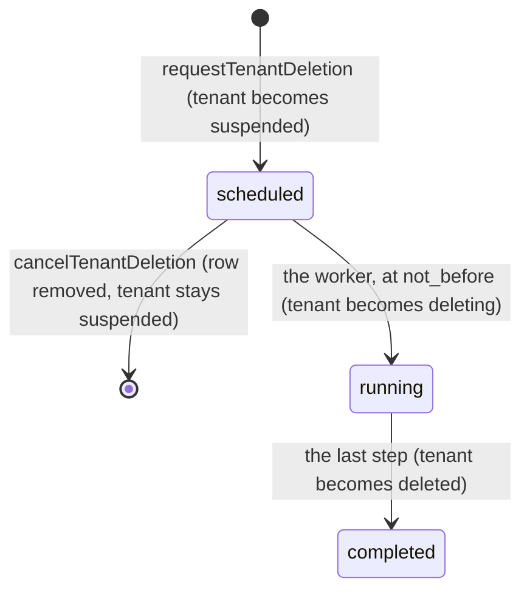

# Sprint 6.3 — Tenant deletion and key rotation

- Epic: [6 — Observability, reports and lifecycle](../epic.md)
- Implementation plan: [plan.md](plan.md)
- Previous sprint: [6.2 — Reports and audit reading](../6.2-reports-and-audit-reading/sprint.md)
- Scope: the epic file, section 6.3, with the items carried forward to 6.3 by the closed epics
  ([epic 2](../../../../docs/history/epic-02-vault-and-catalogue/README.md),
  [epic 3](../../../../docs/history/epic-03-gateway/README.md),
  [epic 4](../../../../docs/history/epic-04-identity-and-rbac/README.md),
  [epic 5](../../../../docs/history/epic-05-limits-and-budgets/README.md)), by section 11 of sprints
  1.2, 1.3, 2.1, 2.2, 3.2, 4.1 to 4.3, 5.1 to 5.4 and 6.2, and by open point O-8 of sprint 2.1.
- Risk class: **high** (the first functions that remove a tenant's rows from every table; an update
  of append-only tables; a rewrite and re-seal of an audit chain; destruction of key material; a
  change of which key wraps every data key; a trigger on the insert path of every tenant table, the
  ledger included; a migration that changes how `serve` starts)
- Decisions implemented: [ADR 0008](../../../../docs/adr/0008-vault-envelope-encryption.md)
  (rotation and erasure), [0033](../../../../docs/adr/0033-vault-formats-and-key-identifiers.md)
  (key identifiers, the registry of versions), [0013](../../../../docs/adr/0013-ledger-and-audit.md)
  and [0065](../../../../docs/adr/0065-the-audit-hash-chain-reading-and-retention.md) (the retention
  switch, the chain), [0054](../../../../docs/adr/0054-usage-data-is-the-tenants.md) (the platform
  reads no usage, in a deletion too), [0055](../../../../docs/adr/0055-operational-telemetry-holds-no-tenant-data.md),
  [0062](../../../../docs/adr/0062-metrics-instruments-attributes-cardinality-and-scrape.md) (five
  instruments), [0063](../../../../docs/adr/0063-the-log-redaction-and-the-log-reference.md) (eight
  log lines), [0019](../../../../docs/adr/0019-configuration.md) (three keys),
  [0020](../../../../docs/adr/0020-error-contract.md) (no new code),
  [0023](../../../../docs/adr/0023-test-dependencies-in-nested-modules.md) (a schema validator for tests),
  [0026](../../../../docs/adr/0026-schema-migrations.md), [0027](../../../../docs/adr/0027-database-roles-and-session-context.md).
- Decision records changed by this sprint: new **ADR 0067** (tenant deletion: stages, the closed
  tenant, pseudonymized records, the completion record; amends ADR 0013 "rows are never updated"),
  **ADR 0068** (key-encryption key versions: states, activation, re-wrap, retirement, erasure and
  backups; amends ADR 0008 on erasure and ADR 0033 point 5) and **ADR 0069** (the tenant data export
  and its schema); history lines on 0008, 0013, 0023, 0027, 0033, 0054, 0062, 0063 and 0065. Text in
  [plan.md](plan.md), part E.

This document is the design. The implementer follows [plan.md](plan.md); a gap in either document is
raised as a question, not filled silently ([planning/README.md](../../../README.md)).

| Given by the epic and the closed sprints | Designed in |
|---|---|
| Staged deletion run by the worker: suspension, removal of access, destruction of the data key, removal of configuration, pseudonymized retention of records, completion record | §5.1, §5.3 to §5.5, D-1 to D-11 |
| Resumable, idempotent steps with recorded progress (epic risk) | §5.3, §5.7, D-6, D-13 |
| The states `deleting` and `deleted` get their operation; worker grants (1.2, 1.3) | §5.1, §6, D-6 |
| `EnsureDataKey` must not recreate a data key; order of data key and credentials (2.1 §11, D-16, R-9) | §5.2, §5.3, D-5, D-7 |
| What erasure means for backups taken before; the wording of ADR 0008 and VLT-11 (2.1 O-8) | §5.10, D-17, O-8 |
| `model_tenant_grant` and restriction rows (2.2); registrations, mappings, list entries (4.1); memberships, member roles, idempotency keys, managed users with accounts and sessions (4.2); custom roles and support actions (4.3); `limit_rule`, `platform_limit_rule`, `limit_event` (5.1, 5.2); price versions with their rates (5.4) | §5.3 (every table, in the order of the foreign keys) |
| One mechanism for the append-only tables and the guard on started price versions (5.4 §11; 6.2 D-17) | §5.3, D-7 |
| Pseudonymize `principal_id` and `key_id` of the ledger through a definer function (3.2, 4.1) | §5.4, D-8 |
| What pseudonymization means for the audit chain (6.2 §11) | §5.4, D-9, D-10 |
| The deletion removes a tenant's usage without the platform reading it (5.4 §11, ADR 0054) | §5.5, §6, D-11 |
| Deleting or anonymising a platform-managed user; the actor of a support action (4.2, 4.3) | D-22 (not deleted; pseudonymized in the tenant's kept log), O-9 |
| Rotation of the key-encryption key: new version, re-wrap job of the worker, retirement (VLT-10; 2.1 §11) | §5.8, §5.9, D-14 to D-16 |
| Tenant data export in a documented format; it holds the price lists (5.4 §11); it can reuse the exports of 6.2 | §5.11, D-18, D-19 |
| Backup and restore guide including the key; dependency-failure reference | §5.17, D-20, D-21 |
| Retention of `limit_event` and `price_import` (deferred from 6.2) | §2 (removed with the tenant; retention for living tenants deferred), O-12 |
| Exit: after deletion, a backup taken before it cannot yield the tenant's credentials with the current keys | T-1006 |
| Exit: after rotation every credential still works and no data key is wrapped by the old version | T-1007 (and T-989) |
| Exit: a tenant export can be read with the published schema | T-1003 |

## 1. Outcome

1. A platform administrator **requests the deletion of a tenant**, with a reason and the tenant's
   name as confirmation. The tenant is suspended at once and the deletion is scheduled after a grace
   period, during which the request can be cancelled.
2. When the period ends the worker **deletes the tenant in steps**, each one transaction, recorded
   and safe to repeat: the tenant is closed to new rows; every identity, key, mapping, registration,
   membership and session goes; the data key is destroyed and the sealed credentials with it; the
   configuration goes; the ledger and the audit log are kept **pseudonymized**, the log sealed again
   as an ordinary chain; a **completion record** in the platform's chain says what was removed and
   carries the heads of the tenant's log.
3. A deletion touches nothing global and nothing of another tenant, and the platform reads no usage
   while doing it.
4. The **key-encryption key is rotated** by configuration: a new key file becomes the active
   version at start, the worker re-wraps every data key, and the old version is retired when none is
   wrapped by it. Credentials are not touched and tenants do nothing.
5. Erasure is stated exactly: a deleted tenant's credentials are gone from the database at once, and
   from **backups taken before** once the key version that wrapped its data key is retired and its
   file destroyed. The administration API shows which deletions still wait for that.
6. A tenant **exports its data** as a directory of newline-delimited JSON files with a manifest,
   described by a published JSON Schema that the binary also prints.
7. Operators have a **backup and restore guide** that includes the key files, and a **reference of
   the behaviour on failure** of each dependency.

## 2. Scope

### In scope

- Migration `0016_tenant_deletion_kek_rotation` (plan appendix A1, run on PostgreSQL 16.15 while
  designing) and the statements of plan A2.
- New packages `internal/lifecycle` (the deletion job) and `internal/tenantexport` (the export and
  its schema).
- `internal/vault` (several key files, activation, the re-wrap job), `internal/admin` (seven
  operations, §5.12, and the mapping of §5.16), `internal/authz` (two permissions),
  `internal/reports` (retention for deleted tenants; the tenant list of the rollup),
  `internal/apigen` (the schema generator), `internal/cli`, `internal/config` (three keys),
  `internal/telemetry` (five instruments), `cmd/pandokos` (wiring, `tenant-export schema`).
- Tests at every level, the guides and references of §5.17 and plan part E, ADR 0067 to 0069, the
  draft release notes.

### Not in scope

| Item | Where |
|---|---|
| A restore that is tested (OPS-10, second half), a restore drill, the loss of the key as a drill | sprint 12.3 |
| A key-encryption key held by an external service (transit API) | sprint 12.1; `KeyProvider` keeps its four methods |
| The event "tenant deleted" and the external reference of a tenant | sprint 6.4 (§11) |
| Deletion requested by the tenant itself (self-service) | not planned; O-4 |
| A deletion that removes the ledger and the audit log at once instead of keeping them pseudonymized; a choice per request | not planned; O-1 |
| Deleting or anonymising a user the platform manages; rewriting the platform's chain | epic 10 (privacy review), if wanted; D-22, O-9 |
| An export made by the platform for a tenant, or of a suspended tenant | never (ADR 0054); the tenant exports before the request (§5.11) |
| Importing a tenant data export into another installation | not planned; `pandokos apply` covers configuration (ADR 0066) |
| Retention of `limit_event` for living tenants and of `price_import` | 6.4 for limit events (they become outbox events and are retained with them); `price_import` not planned (platform rows, a few per day); O-12 |
| Rotation of a tenant's data key (a second `tenant_data_key.version`) | not planned; nothing requires it |
| Automatic rotation after a deletion, or on a schedule | never for the local provider (a new key file is an operator's act); the guide gives the rule; revisit in 12.1 |
| Failure injection for every dependency as a suite; published figures | sprint 10.1 |
| Separate processes for the worker and the gateway | sprint 8.2 (§11) |

## 3. Requirements claimed

The meaning is quoted from [docs/requirements](../../../../docs/requirements/README.md).

| ID | Meaning | Delivered here | Extent |
|---|---|---|---|
| TEN-11 | "Deletion is a staged process: suspension, revocation of access credentials, cryptographic erasure of secrets, removal of tenant data according to the retention policy, and a verifiable completion record. It never touches global data or other tenants" | The request and the steps of §5.1 to §5.5; `tenant deletion verify` (§5.5); retention of the kept records (§5.6) | full |
| TEN-12 | "A tenant's data can be exported in a documented format before deletion" | `pandokos tenant-export` and the schema `docs/reference/tenant-export.v1.schema.json` (§5.11) | full |
| VLT-10 | "The key-encryption key can be rotated by re-wrapping data keys, with no action by tenants. Key versions are recorded" | `vault.kek.local.unwrap_key_files`, activation at start, the re-wrap job, `kek_version.state` and its times, `listKEKVersions` (§5.8, §5.9) | full |
| VLT-11 | "Deleting a tenant destroys its data key, so residual ciphertext, including in backups, can no longer be decrypted" | The step `secrets` (§5.3); for backups, the rule of §5.10, with the wording amended (O-8) | full, with the amended wording |
| OPS-10 | "Backup and restore, including keys, are documented, and a restore is tested" | `docs/operations/backup-and-restore.md` (§5.17) | the R2 part (documented); tested in 12.3 |
| OPS-11 | "Behaviour on failure of each dependency is defined. If authorization or the credential cannot be verified the request is not forwarded" | `docs/reference/failure-behaviour.md`, each row citing the test that holds it (§5.17); the two new jobs under failure (T-990, T-995) | full |
| TEN-09 | "A tenant has a lifecycle: provisioning, active, suspended, deleting, deleted. …" | Touched: `deleting` and `deleted` get their operation; reactivation is refused while a deletion is requested | touched |
| AUD-01 | "Pandokos audits … every creation, change, disabling, revocation and deletion of tenants, …" | Touched: seven new actions (§5.5) | touched |
| USE-07 | "… Platform roles read no usage of a tenant …" | Touched: the erasure functions return no usage figure and the completion record holds none (D-11) | touched |
| TEN-06 | "… A job carries the tenant and the identity that originated it; there is no unscoped system identity" | Touched: every step runs in the session of the tenant being deleted; the record names who requested it | touched |

## 4. Repository layout

New: `internal/store/migrations/sql/0016_tenant_deletion_kek_rotation.sql`,
`internal/store/queries/sql/lifecycle.sql`, `internal/lifecycle/`, `internal/tenantexport/`,
`internal/vault/{activate,rewrap}.go`, `internal/admin/{tenant_deletion,kek_versions}.go`,
`internal/cli/{lifecycle,tenant_export}.go`, `internal/store/migrations/upgrade_0016_db_test.go`,
`test/e2e/{deletion,rotation,tenant_export}_test.go`, `test/sdk/tenant_export_test.go`,
`test/repo/lifecycle_test.go`, `docs/operations/{tenant-deletion,backup-and-restore,tenant-export}.md`,
`docs/reference/{failure-behaviour.md,tenant-export.v1.schema.json}`,
`docs/adr/0067-…`, `0068-…`, `0069-…` (names in plan E2).

Changed: `internal/store/queries/sql/{vault,reports,audit}.sql` and the generated package,
`internal/store/migrations/migrations.sum`, `internal/vault/{local,check,sealer,opener}.go`,
`internal/reports/{rollup,retention}.go`, `internal/apigen/main.go`, `api/openapi/admin.v1.yaml`,
`internal/adminapi` (generated), `internal/authz/{authz,roles}.go` and `testdata/roles.golden`,
`internal/admin/{problem,tenants}.go`, `internal/config/{config,keys,validate}.go`,
`internal/telemetry/{instruments,sources}.go`, `cmd/pandokos/{main,serve,metrics,kek}.go`,
`internal/cli/{cli,commands}.go`, `test/isolation/{spec,lint}.go`, `test/dbtest`, `test/sdk/go.mod`,
`.github/workflows/ci.yml`, `deploy/postgres/recover-lost-kek.sql`, the tests of §9 "Changed tests",
the documents of plan part E.

## 5. Architecture

### 5.1 The request, the grace period and the cancellation (D-1 to D-4)

A deletion is a row of the global table `tenant_deletion` (one per tenant) and three states of it:



- **Request** (`requestTenantDeletion`, platform permission `tenant:delete`, held by
  `platform-admin` only): body `reason` (required, 1 to 500 characters) and `confirm_name`, which must
  equal the tenant's name (`400 invalid_request` on `confirm_name` otherwise: a guard against the
  wrong ID). In one transaction in platform scope: an `active` tenant becomes `suspended` (the
  existing transition, with its effect within the bound of TEN-10); the row is inserted with
  `not_before` = now + `tenant_deletion.grace_period`; the platform log gets `tenant.delete_request`
  (reason, `from`, `not_before`). A tenant that is `provisioning`, `deleting` or `deleted` answers
  `409 invalid_state`. A second request while one is scheduled or running answers `200` with the
  existing deletion and writes nothing.
- **While scheduled** nothing is removed. `reactivateTenant` answers `409 invalid_state` with one
  `errors` entry (`state`: "the deletion of the tenant is requested; cancel it first"): a trigger on
  `tenant` holds it, whoever updates.
- **Cancel** (`cancelTenantDeletion`, `tenant:delete`, reason required): removes a `scheduled` row
  and writes `tenant.delete_cancel`. The tenant stays `suspended`; reactivating it is the existing
  operation. A deletion that started cannot be cancelled (`409 invalid_state`): `deleting` cannot be
  undone (1.2 §5.3).
- **Start**: at `not_before` the worker runs the first step, which moves the tenant to `deleting`.
- Who requested it (actor type, ID, name, request ID) and why are kept in the row and in the platform
  log; the tenant's own log is closed by the worker (§5.4), not written by the request.

The request is not written to the tenant's log, and `tenant:delete` is not `InTenant`: like
`tenant:suspend`, it changes the platform's record of a tenant.

### 5.2 A closed tenant takes no new row (D-5)

When the deletion starts, the tenant's ID is inserted in the global table `tenant_closed`
(identifiers only; it never leaves). From that commit on:

- every tenant-scoped table (the 21 tables with the policy `tenant_isolation`) and `idempotency_key`
  refuse an `INSERT` in the session of that tenant, by a `BEFORE INSERT … FOR EACH STATEMENT` trigger (`tenant_open`): one
  primary-key lookup per statement, which on the ledger is one per batch of the writer;
- the five global tables that name a tenant in a row written in platform scope (`app_user`,
  `model_tenant_grant`, `platform_issuer_tenant`, `platform_limit_rule`, `support_action`) refuse the
  row, by a row trigger (`tenant_open_row`);
- the refusal is `restrict_violation` with the constraint name `tenant_open`.

A row passes only when the statement runs **as the owner** and under the setting
`pandokos.erasure = on`: that is, inside a function of migration 0016. A runtime role that sets the
setting gains nothing (T-977), and the gateway's own definer functions (`record_auth_failure`,
`record_unlimited_traffic`), which run as the owner without the setting, are refused like anybody.

So no data key can reappear (2.1 R-9): `tenant_data_key` is one of those tables, and a second
trigger on it refuses a key wrapped by a version that is not the active one (§5.8). Updates are not
refused: they create no row, and the rows they touch are removed anyway.

**What still reaches a closed tenant, and what happens to it.** A request that was in flight when
the tenant was closed ends and its usage record is refused: the ledger writer logs the existing line
`usage record rejected` with `constraint: tenant_open` and frees the slot (the record is not kept;
with the default grace period no such request exists, since the tenant has been suspended for days).
A transaction that began before the closing and commits after a step removed its table leaves a row
behind: the last step counts what is left and, if anything is, runs the removal again (§5.3).

### 5.3 The steps, and every table (D-6, D-7)

The worker calls one function, `tenant_erasure_step(batch)`, in the session of the tenant, until it
answers `done`. A call locks the `tenant_deletion` row, runs the step the row is at, advances it and
answers the step that comes next; each call is one transaction. A step that ran is never run again;
two workers serialize on the row; a call that fails changes nothing.

| Step (answer after it) | What it does |
|---|---|
| `begin` → `access` | Only at or after `not_before` (before: answers `scheduled`, does nothing). The tenant must be `suspended`. Tenant → `deleting`; `tenant_closed` row; a random 32-byte salt for the pseudonyms; `started_at`; platform log `tenant.delete_start` |
| `access` → `secrets` | Removal of access (table below, group A) |
| `secrets` → `configuration` | Cryptographic erasure: notes the key-encryption key versions that wrap the tenant's data keys, deletes `tenant_data_key`, then `provider_credential` |
| `configuration` → `usage` | Removal of configuration and derived data (group C) |
| `usage` → `usage` or `audit` | One batch of ledger records pseudonymized, by key order from a cursor kept in the row; `audit` when none is left |
| `audit` → `complete` | Closing row, pseudonymization and re-seal of the tenant's chain (§5.4) |
| `complete` → `done` | Not before `settle_at` (two minutes after the start: answers `settling`). Counts the rows left in every table of groups A to C; if any, sets the step back to `access` and a new `settle_at` (the second pass skips `usage` and `audit`, which took no row since the start). Otherwise: the completion record in the platform log, tenant → `deleted`, the salt destroyed, the row `completed` |

**Every table that holds a tenant's data**, in the order the foreign keys impose within each step
(T-979 checks the list against the catalogue of the database: a table with a tenant column that is
in none of these groups fails the build):

| Group | Order | Table | Why here |
|---|---|---|---|
| A access | 1 | `limit_rule` | references `subject_mapping`, `virtual_key`, `service_account` with `RESTRICT` (5.3) |
| | 2 | `subject_mapping` | references `trusted_issuer`, `service_account` |
| | 3 | `trusted_issuer` (and its `issuer_directory` rows, by its trigger and explicitly) | |
| | 4 | `platform_issuer_tenant` (the tenant's entries; the issuer is the platform's and stays) | |
| | 5 | `virtual_key`, then `virtual_key_directory` | references `service_account` |
| | 6 | `role_assignment` | references `service_account` |
| | 7 | `idempotency_key` (the tenant's) | |
| | 8 | `support_action` (the tenant's; the platform log keeps who opened what) | |
| | 9 | `membership_role`, `membership` (and `membership_directory`) | a member the platform manages loses the membership and stays a user |
| | 10 | `user_session`, `local_account`, `user_identity` of the users the tenant manages, then those `app_user` rows | reference `app_user` |
| | 11 | `service_account` | after everything that references it |
| | 12 | `tenant_role` | its trigger refuses a role still assigned |
| B secrets | 1 | `tenant_data_key` | the erasure; no foreign key from a credential (2.1 D-16) |
| | 2 | `provider_credential` | the ciphertext, now unreadable, and its metadata |
| C configuration | 1 | `platform_limit_rule` (the tenant's ceilings) | |
| | 2 | `model_tenant_grant` (the tenant's) | |
| | 3 | `tenant_model_restriction`, `metadata_key_policy` | |
| | 4 | `tenant_price_version` (its `tenant_price_rate` rows cascade) | started versions too: under the retention switch |
| | 5 | `limit_event` | append-only: under the retention switch |
| | 6 | `usage_rollup`, `usage_rollup_state` | derived from the ledger |
| Kept | | `usage_record` (pseudonymized), `audit_event` and `audit_chain` (pseudonymized, re-sealed) | §5.4 |
| Kept | | `tenant` (the row, `deleted`, with its name; the name can be reused, 1.2), `tenant_deletion`, `tenant_closed` | the platform's record |
| Not the tenant's | | `signin_throttle` (digests, expire by themselves), `oidc_login` (sign-in transactions, minutes), `platform_role_assignment` (a managed user holds none), the catalogue, catalogue prices, `price_import`, platform users, platform keys, the platform log | untouched (T-979) |

**One mechanism for what was never to be removed** (5.4 §11, 6.2 D-17): `append_only` keeps
admitting a `DELETE` only under `pandokos.retention = on`, and now admits an `UPDATE` only under
`pandokos.erasure = on`; the guard of `tenant_price_version` admits the removal of a started version
under `pandokos.retention = on`. Only functions of migrations 0015 and 0016 set the two settings, each
around its own statements; no runtime role holds `UPDATE` or `DELETE` on an append-only table.
`TRUNCATE` stays refused for everybody.

**Global tables under forced row-level security.** The erasure functions run as the owner, which
the policies bind like any role. For the tenant-scoped tables the session of the tenant is enough.
For each global table of the list there is one new policy for the owner: the rows of the tenant of
the session, under `pandokos.erasure = on`, and nothing else; for `tenant`, select and update under
the same setting. The owner still sees no tenant outside those functions (T-148 unchanged).

### 5.4 The records that are kept (D-8 to D-10)

The ledger and the audit log of a deleted tenant are kept, without anything that names a person or
a workload, until the installation's retention removes them (§5.6). They stay attributable to the
tenant (the organisation), which is what an operator's own obligations ask for; the directory that
could resolve the identifiers is gone, and the pseudonyms cannot be recomputed.

**The pseudonym** of an identifier `v` is the text of a UUID made of the first 16 bytes of
`SHA-256(salt ‖ UTF-8(v))`; the empty text stays empty. The salt is 32 random bytes made at the start
of the deletion, kept in `tenant_deletion.salt` (which no runtime role can read) and destroyed with
the completion. Within one tenant equal identifiers get equal pseudonyms, in the ledger and in the
log alike, so "one caller made these calls" survives; across tenants and after the completion
nothing links a pseudonym to a value. The UUID shape satisfies the checks of both tables.

**Ledger** (`usage_record`, every partition, in batches of 5000 by `(started_at, id)`):
`principal_id` and `key_id` (for a token row, the mapping ID, 4.1) become pseudonyms and `metadata`
becomes `{}`. Every other column stays: times, provider, model, outcome, tokens, cost, currency,
`request_id` and `trace_id` (they name a request, not its owner, ADR 0055), `credential_id` and
`price_version_id` (random identifiers of rows that no longer exist). Nobody reads these rows through
the product: the tenant has no identity left and the platform reads no usage (ADR 0054). They are the
operator's evidence at the database, and they leave with their monthly partition.

**Audit log** (`audit_event` of the tenant). In one transaction:

1. a closing row is appended, `tenant.delete` (actor `platform`, resource the tenant);
2. the head before the rewrite is noted (`original_head`);
3. for every row from the anchor on, in `seq` order: `actor_id`, `key_id` and `resource_id` become
   pseudonyms (a `resource_id` equal to the tenant's ID stays), `actor_name` and `reason` become
   empty, `detail` becomes `{}`; `prev_hash` and `hash` are computed again with `audit_row_hash`
   (encoding v1 of ADR 0065, unchanged); `seq`, `id`, `occurred_at`, `actor_type`, `action`,
   `resource_type`, `outcome`, `request_id` and `support_action_id` stay;
4. the head takes the last hash (`resealed_head`); the anchor does not move.

The result is an ordinary chain: `auditchain.Verify` and `pandokos audit verify` check it with no
change, and nothing in a row says it was rewritten. What says so is the platform's chain, which is
never rewritten: the completion record holds `anchor_seq`, `last_seq`, the row count, `original_head`
and `resealed_head` (§5.5). A tenant that exported its log before the deletion holds rows that end
before `original_head`; the export is its own evidence, anchored by the head it read then.

Emptying `detail`, `reason` and `actor_name` is what makes the log pseudonymized and not merely
renamed: they hold sign-in names, e-mail addresses, labels and free text. The log keeps who (as a
pseudonym), when, which action on which kind of resource, and the outcome.

**Reading the kept log.** Two platform operations under `platform_audit:read`, available only for a
tenant that is `deleted` (`409 invalid_state` before): `getDeletedTenantAuditHead` and
`exportDeletedTenantAuditEvents` (NDJSON, the schema of `exportAuditEvents`). The rows hold no
price, no amount and no person, which is what kept `audit:read` out of the platform's reach while the
tenant lived (ADR 0061 point 3).

### 5.5 The completion record and its verification (D-11)

The last step writes `tenant.delete_complete` in the platform log (actor `platform`, name
`deletion`, the request ID of the request), with the detail:

```json
{"name": "acme", "requested_at": "…", "started_at": "…", "passes": 1,
 "removed": {"limit_rule": 4, "service_account": 3, "virtual_key": 5, "tenant_data_key": 1, "provider_credential": 2, "…": 0},
 "kek_versions": ["local-0123456789abcdef"],
 "usage": "pseudonymized",
 "audit": {"anchor_seq": 1, "last_seq": 912, "rows": 912, "original_head": "…", "resealed_head": "…"},
 "residue": 0}
```

`removed` has one count per table of groups A to C, **except** `limit_event`, `usage_rollup` and
`usage_rollup_state`, and there is no count of ledger records: those are figures of the tenant's
usage, which the platform does not read (ADR 0054). `residue` is the number of rows the database
found left in the tables of groups A to C just before writing the record; the record is written only
when it is 0. `tenant_deletion.completion_seq` holds the row's place in the platform's chain.

The audit actions of this sprint, all in the platform log: `tenant.delete_request`,
`tenant.delete_cancel` (admin role, with the actor and the reason), `tenant.delete_start`,
`tenant.delete_complete`, `tenant.records_retention` (§5.6), `kek.activate`, `kek.retire` (§5.8); and
`tenant.delete` in the tenant's log.

**`pandokos tenant deletion verify TENANT`** makes the record verifiable by whoever holds
`tenant:read` and `platform_audit:read`:

1. reads the deletion (`getTenantDeletion`): it must be `completed`;
2. reads the platform row of the record (`listPlatformAuditEvents` with the action
   `tenant.delete_complete` and the tenant as resource), checks that its `seq` is `completion_seq` and
   that its detail equals the deletion's fields, and verifies the platform chain up to its
   head as `platform-audit verify` does;
3. reads the kept log (`exportDeletedTenantAuditEvents`) and verifies it with the expected head
   `resealed_head` and the expected last row `tenant.delete`; a log that retention has emptied
   verifies as empty when the anchor is `last_seq + 1`;
4. prints `deletion of <tenant id> verified: record at seq <n>, <m> audit rows kept, head <hash>` and
   exits 0; or one line per failure and exit 1 (`record_missing`, `record_mismatch`,
   `platform_chain_break`, `tenant_chain_break`, `head_mismatch`).

### 5.6 Retention of the kept records (D-12)

`ListTenantsForWorker` now lists `active` and `suspended` tenants only: the rollup and
`tenant_retention` do not run for a tenant being deleted or deleted (they would insert). The
retention job gains a third pass, for `deleted` tenants, each in its session:
`deleted_tenant_retention(usage_months, audit_months)` removes the tenant's rows of the default
partition of the ledger before the usage cut (its rows in monthly partitions leave when
`platform_retention` drops them), and the oldest rows of its log before the audit cut, moving the
anchor as `tenant_retention` does. The closed chain takes no row: the removal is recorded in the
**platform** log (`tenant.records_retention`: the cut, the audit rows removed, first and last `seq`,
the last hash; no usage figure). With both keys 0, nothing is ever removed, as for living tenants.

### 5.7 The deletion job (D-13)

`lifecycle.Deleter` (worker role), every `tenant_deletion.interval` (1 min):

1. in platform scope, `ListOpenTenantDeletions`: the IDs of the deletions that are `running`, or
   `scheduled` and due (the worker reads seven columns of the table — state, step, two times, the request
   ID, the key versions — and nothing else of a tenant);
2. for each, calls `tenant_erasure_step(5000)` in the tenant's session, in a loop, until the answer
   is `done`, `scheduled` or `settling`, or 30 s have gone for this tenant (the next tick continues);
3. a call that fails is counted and logged (at most one line a minute) and the next tenant goes on;
   the step is tried again at the next tick. Nothing is ever skipped: the order is in the database.

The job holds no statement that deletes or updates a tenant's row (T-R77). Its crash at any point
leaves a deletion that the next start continues (T-994). A deletion that keeps failing shows in
`pandokos.tenant_deletion.open` and in `tenant deletion get` (`step`, `passes`).

### 5.8 Key versions: one active, by configuration (D-14, D-15)

`kek_version` gains `state` (`active`, `retiring`, `retired`), `activated_at` and `retired_at`; at
most one row is active (a unique index). Migration 0016 marks the version registered last as active
and any other as retiring.

**Configuration.** `vault.kek.local.key_file` is the key that wraps (as today).
`vault.kek.local.unwrap_key_files` (new, a list of up to 8 files) are keys the instance can also
unwrap with: a version being retired, or a new version that other instances already use. The version
of a key is derived from the key (ADR 0033), so no file can be taken for another; the same key in two
files is refused at start.

**At start**, with the admin or worker role, `serve`:

1. retires what can be retired (`kek_retire`, below), so that an unused old version never blocks a
   start;
2. checks, as today, that every version the database still needs — now: `active` or `retiring` —
   belongs to this provider and is available in the configuration; a `retired` version is not needed;
3. **activates** the configured key (`kek_activate(version, provider)`, admin role, platform scope):
   - the active version: nothing changes;
   - a version the database does not know: it is registered as active and the active one becomes
     `retiring`; the platform log gets `kek.activate` (actor `host`, name `serve`, detail `previous`);
   - a `retiring` or `retired` version: refused, and `serve` does not start: "the configured
     key-encryption key version X was replaced by Y; set vault.kek.local.key_file to the key of Y". A
     replaced key never comes back;
4. logs `vault ready` with `kek_version`, `kek_activation` (`activated` or `unchanged`) and
   `kek_unwrap_versions` (a count).

**The database refuses a data key under any other version**: a trigger on `tenant_data_key` requires
`kek_version` to be the active one on insert and on re-wrap. An instance still running with the
replaced key therefore cannot create a data key (the write answers `503 unavailable`, cause
`kek_replaced`); it opens existing credentials as before. Versions are registered by `kek_activate`
only: the admin role loses its `INSERT` on `kek_version`, and `EnsureDataKey` no longer registers.

**With several instances** the guide gives the order: first give every instance the new key as an
unwrap key and restart them; then make it `key_file` (and the old one an unwrap key) and restart
them. With one instance (the only supported deployment until epic 8) the second step alone is the
rotation.

### 5.9 Re-wrap and retirement (D-16)

`vault.Rewrapper` (worker role) runs at start and every minute; a tick reads the versions (for M50
and M51) and does nothing more while none is `retiring`:

1. lists the tenants in platform scope (`ListTenantsForRewrap`: IDs of the tenants that are not
   `deleted`);
2. for each, in its session, in one transaction: locks the data key rows whose `kek_version` is not
   the active one (`FOR UPDATE`); for each, unwraps with the old version, wraps with the active one
   under the same associated data (tenant ID and data key version, ADR 0033 point 3), unwraps the new
   value and compares, then updates `kek_version` and `wrapped_key` where the row still has the old
   version. The plaintext key is cleared after the transaction. The worker role gains `SELECT` on
   `tenant_data_key` and `UPDATE` of those two columns, in the tenant's session only;
3. when a pass met no failure, calls `kek_retire()` in platform scope: for each `retiring` version it
   deletes the row and inserts it again as `retired` in a subtransaction. The **foreign key** of
   `tenant_data_key` decides: it sees the rows of every tenant whatever the policies, and it waits
   for an insert in flight, so a version is retired exactly when no data key is wrapped by it. Each
   retirement writes `kek.retire` in the platform log and the line `key rotation complete`.

A credential is never read or written: its associated data name the data key version, not the
key-encryption key (ADR 0033), so every sealed secret opens as before (T-989). The update notifies
`vault:<tenant>`; a gateway drops that tenant's cached data key and reads the row again. A tenant
whose key does not unwrap (damaged) keeps its version `retiring` and is logged; the others go on.
A tenant being deleted is included until its data key is gone.

### 5.10 Erasure and backups (D-17)

What the product can and cannot promise, stated in ADR 0068, the vault guide, the deletion guide and
the security model, and what O-8 of sprint 2.1 asked to settle:

1. **In the database**, at the commit of the step `secrets`, the tenant's wrapped data keys and
   sealed secrets no longer exist. Gateways forget the data key within `cache.data_key_ttl` plus
   `cache.credential_ttl` at most, at once with notifications (ADR 0033 point 6; the tenant's keys
   were removed a step earlier, so nothing can ask for it).
2. **A backup taken before** still holds the wrapped data key and the sealed secrets. Whoever holds
   that backup **and** a key file of the version that wrapped the data key can open them. Deleting a
   tenant does not change that; only two things do: the backup expires, or the key version is
   **retired and its file destroyed**, every copy of it.
3. The deletion records the versions concerned (`kek_versions`). `getTenantDeletion` and
   `listTenantDeletions` show `backup_erasure`: `pending` with the versions not yet retired, or
   `complete`; `listKEKVersions` shows, per version, how many completed deletions wait for it
   (`erasures_pending`), and `pandokos.vault.erasures.pending` counts them. "Retired" is a fact of
   the database; destroying the file is the operator's act, which the product cannot see.
4. **The rule for operators**: after a deletion, rotate the key (§5.8) within the time you promise
   erasure in, wait for `key rotation complete`, take a new backup, then destroy the old key file
   and its copies. Or keep no backup longer than that time.
5. **The price of it**: a backup taken before a rotation opens no credential once the old key is
   destroyed. Everything else in it restores; the tenants' credentials are then revoked with
   `recover-lost-kek.sql` and entered again. An operator who keeps the old key to keep old backups
   whole keeps the deleted tenants' credentials recoverable from them: the guide makes the choice
   explicit.
6. **A restored backup brings deleted tenants back**, with their state of that time, and takes the
   platform log back with it. The restore guide tells the operator to keep the list of completed
   deletions outside the database (the output of `tenant deletion list`, later the events of 6.4) and
   to request those deletions again after a restore.

### 5.11 The tenant data export (D-18, D-19)

`pandokos tenant-export --tenant ID --out DIR [--usage-from T]` is run by the tenant, with a key or
a session that holds every read permission of the tenant (`owner` does). It reads through the
administration API only and writes `DIR` (through `DIR.partial`, renamed at the end):

| File | Content (one JSON object per line unless noted) | Read with |
|---|---|---|
| `manifest.json` | one object: `format` (`pandokos-tenant-export`), `version` (1), `tenant_id`, `created_at`, `pandokos_version`, `files` (name, kind, `records`, `sha256`), `audit_head`, `usage_from`, `usage_to` | — |
| `settings.json` | one object: time zone (in force and pending), active currency (in force and pending), metadata keys, model restriction | `getTenantTimeZone`, `getActiveCurrency`, `getMetadataKeys`, `getModelRestriction` |
| `service_accounts.ndjson` | service accounts with their roles | `listServiceAccounts` |
| `virtual_keys.ndjson` | keys, metadata only | `listVirtualKeys` |
| `credentials.ndjson` | provider credentials, metadata only (fingerprint, hint; never the secret, VLT-04) | `listCredentials` |
| `token_issuers.ndjson`, `subject_mappings.ndjson`, `platform_issuers.ndjson` | registrations, mappings, the platform-level issuers that list the tenant | `listTokenIssuers`, `listSubjectMappings`, `listTenantPlatformIssuers` |
| `limits.ndjson`, `platform_limits.ndjson`, `limit_events.ndjson` | rules, the ceilings that apply, limit events | `listLimits`, `listTenantPlatformLimits`, `listLimitEvents` |
| `price_list_versions.ndjson` | every version of every list with its rates | `listPriceListVersions` |
| `members.ndjson`, `roles.ndjson`, `support_actions.ndjson` | members with their roles, custom roles, support actions | `listMembers`, `listRoles`, `listSupportActions` |
| `usage_records.ndjson` | the ledger, oldest first | `exportUsageRecords`, in windows of 31 days from `--usage-from` (default: 60 months ago) to now |
| `audit_events.ndjson` | the audit log from its anchor to the head named in the manifest | `getAuditHead`, `exportAuditEvents` |

Each line is the object the API returns, unchanged. The export therefore holds what the tenant may
read and nothing else: no secret of a credential, no secret of a key, no password hash, nothing of
another tenant. A `403` on any read stops the export with the missing permission named, and no
manifest is written; an interrupted export leaves `DIR.partial` without a manifest.

**The schema** is `docs/reference/tenant-export.v1.schema.json` (JSON Schema, draft 2020-12): the
manifest at the root, and one entry of `$defs` per file kind (`settings`, `service_account`, …), each
the schema of the corresponding API object. It is **generated** from `api/openapi/admin.v1.yaml`
(OpenAPI 3.1 schemas are JSON Schema 2020-12) by `internal/apigen -export-schema`, committed, checked
for drift by `make generate-check`, embedded in the binary and printed by
`pandokos tenant-export schema`. A line of a file of kind `k` validates against `#/$defs/k`; the
manifest's `files[].kind` names it. The format version changes when a member is removed or changes
meaning; added members do not change it.

**Before a deletion.** The request suspends the tenant at once, and a suspended tenant reads nothing
(TEN-10): the export is taken before the request. The deletion guide puts it in the procedure
(announce, let the tenant export, then request); a tenant suspended for another reason is reactivated
for the export. The platform cannot make the export for the tenant: it reads no usage (ADR 0054).

### 5.12 Operations added to the OpenAPI document

Seven operations (full text in plan A3); 160 become 167.

| Operation | Method and path | Permission | Answer |
|---|---|---|---|
| `requestTenantDeletion` | `POST /v1/tenants/{tenant}/deletion` | `tenant:delete`, reason required | `200` `TenantDeletion` |
| `getTenantDeletion` | `GET /v1/tenants/{tenant}/deletion` | `tenant:read` | `200` `TenantDeletion`; `404` when none was requested |
| `cancelTenantDeletion` | `POST /v1/tenants/{tenant}/deletion/cancel` | `tenant:delete`, reason required | `200` `Tenant` |
| `listTenantDeletions` | `GET /v1/tenant-deletions` | `tenant:read` | a page, newest request first; filter `state` |
| `getDeletedTenantAuditHead` | `GET /v1/tenants/{tenant}/deletion/audit-head` | `platform_audit:read` | `200` `AuditHead` |
| `exportDeletedTenantAuditEvents` | `GET /v1/tenants/{tenant}/deletion/audit-events/export` | `platform_audit:read` | NDJSON stream of `AuditEvent` |
| `listKEKVersions` | `GET /v1/kek-versions` | `kek:read` | every version: `id`, `provider`, `state`, `created_at`, `activated_at`, `retired_at`, `erasures_pending` |

`TenantDeletion`: `tenant_id`, `state`, `step`, `reason`, `requested_by` (`type`, `id`, `name`),
`request_id`, `requested_at`, `not_before`, `started_at`, `completed_at`, `passes`, `removed` (object
of counts), `kek_versions`, `backup_erasure` (`state`: `not_applicable` before the step `secrets` ran,
`pending`, `complete`; `pending_kek_versions`), `audit` (the five members of §5.5, absent before the
step ran) and `completion_seq`. The salt is in no answer.

Two permissions: **`tenant:delete`** (platform; "Requesting and cancelling the deletion of a tenant,
with a reason"; `platform-admin`) and **`kek:read`** (platform; "Reading the versions of the
key-encryption key and their state"; `platform-admin` and `platform-auditor`). `tenant:read` gains
"and the deletion of a tenant" in its description. No tenant role holds any of them, and no support
action carries one (they are platform permissions).

### 5.13 Command line

| Command | Operation |
|---|---|
| `tenant delete TENANT --reason R --confirm-name NAME` | `requestTenantDeletion` |
| `tenant deletion get TENANT`, `tenant deletion cancel TENANT --reason R`, `tenant deletion list [--state S]` | the three operations |
| `tenant deletion audit-head TENANT`, `tenant deletion audit-export TENANT [--out FILE]` | the two operations of the kept log |
| `tenant deletion verify TENANT` | composite (§5.5) |
| `kek-version list` | `listKEKVersions` |
| `tenant-export --tenant ID --out DIR [--usage-from T]` | composite (§5.11) |
| `tenant-export schema` | prints the embedded schema; needs no server |

`pandokos kek generate` is unchanged. The composites join `internal/cli.composites` (T-219 unchanged).

### 5.14 Metrics and logs

Five instruments, no tenant attribute (ADR 0062), added to `telemetry.Catalogue()` and the metrics
reference, read at collection from `lifecycle.Deleter.Stats()` and `vault.Rewrapper.Stats()`; the three gauges
are refreshed by the jobs' ticks (a scrape runs no statement):

| # | Name | Kind | Unit | Attributes | Source |
|---|---|---|---|---|---|
| M47 | `pandokos.tenant_deletion.steps` | OC | `{step}` | `pandokos.deletion.step` (`begin`, `access`, `secrets`, `configuration`, `usage`, `audit`, `complete`), `pandokos.result` (`ok`, `failed`) | one per call of the step function that did or failed a step |
| M48 | `pandokos.tenant_deletion.open` | G | `{deletion}` | `pandokos.deletion.state` (`scheduled`, `running`) | `CountTenantDeletions`, at each tick of the deletion job |
| M49 | `pandokos.vault.rewraps` | OC | `{key}` | `pandokos.result` (`ok`, `failed`) | one per data key the job re-wrapped or failed to |
| M50 | `pandokos.vault.kek.versions` | G | `{version}` | `pandokos.kek.state` (`active`, `retiring`, `retired`) | `ListKEKVersions`, at each tick of the re-wrap job |
| M51 | `pandokos.vault.erasures.pending` | G | `{deletion}` | — | completed deletions with a version of `kek_versions` not retired (`CountPendingErasures`, same tick) |

`pandokos.retention.kind` (M44) gains `deleted_tenant_usage_record` and `deleted_tenant_audit_event`;
`pandokos.export.kind` (M46) gains `deleted_tenant_audit`.

Log lines (rows of `docs/reference/logs.md`; T-930 and T-R66 enforce them):

| Message | Level | Fields | When |
|---|---|---|---|
| `tenant deletion ready` | info | `grace_period`, `interval` | at start, with the worker role |
| `tenant deletion started` | info | `request_id` | the step `begin` ran |
| `tenant deletion completed` | info | `request_id`, `duration_ms` | the step `complete` answered `done`; the time since the start |
| `tenant deletion failing` | warn | `step`, `error_class`, `sqlstate`, `failures` | a step failed; at most once a minute |
| `tenant deletion recovered` | info | `failures` | the first step that succeeds after failures |
| `key rewrap failing` | warn | `cause`, `error_class`, `failures` | a tenant's data key was not re-wrapped; at most once a minute. `cause` as in the vault lines |
| `key rotation complete` | info | `kek_version`, `rewrapped` | a version was retired; `rewrapped` counts the keys this process re-wrapped for it |
| `vault ready` (changed) | info | `kek_provider`, `kek_version`, `kek_activation`, `kek_unwrap_versions` | at start |

`request_id` is the ID of the request that asked for the deletion: it names a request, not a tenant
(ADR 0055). No line names a tenant, a count of one tenant or a step's row counts.

### 5.15 Configuration

| Key | Environment | Type | Default | Rule |
|---|---|---|---|---|
| `tenant_deletion.grace_period` | `PANDOKOS_TENANT_DELETION_GRACE_PERIOD` | duration | `168h` | 0 to `2160h` (90 days); `serve` only. Read when a deletion is requested |
| `tenant_deletion.interval` | `PANDOKOS_TENANT_DELETION_INTERVAL` | duration | `1m` | `10s` to `1h`; `serve` only |
| `vault.kek.local.unwrap_key_files` | `PANDOKOS_VAULT_KEK_LOCAL_UNWRAP_KEY_FILES` | list | empty | up to 8 paths, separated by commas in the environment; each file as `key_file` (one base64 line of 32 bytes); a duplicate of `key_file` or of another entry is an error; the permission warning of `key_file` applies to each; `serve` only |

A grace period of 0 starts the deletion at the worker's next tick; the request then also ends, for
the tenant, every call still in flight without a record (§5.2).

### 5.16 What the database's refusals become

| Refusal (constraint) | Where | Answer |
|---|---|---|
| `tenant_open` | any platform operation that writes a row for a tenant being deleted or deleted (`grantModel`, `createPlatformLimit`, `putPlatformIssuerTenant`, `openSupportAction`, creating a user managed by it, …) | `409 invalid_state`, one `errors` entry (`tenant`: "the tenant is being deleted or is deleted") |
| `tenant_open` | a principal of the tenant | never reached: `403 tenant_suspended` at authorization, then `401` once its identities are gone |
| `tenant_open` | the ledger writer | `usage record rejected` (existing), the record dropped |
| `tenant_deletion_holds` | `reactivateTenant` | `409 invalid_state`, `errors` entry on `state` |
| `tenant_deletion_suspended` | `requestTenantDeletion` racing a reactivation | `409 invalid_state` |
| `tenant_data_key_kek_active` | a credential write on an instance with a replaced key | `503 unavailable`; `credential cannot be sealed` with `cause: kek_replaced` |
| `kek_version_replaced`, `kek_version_provider` | `serve` at start | `startup failed`, exit 1, with the message of §5.8 |

One mapping in `internal/admin` (`problemOf`) for `tenant_open`, so that every present and future
platform write gets it. No new error code (ADR 0020).

### 5.17 The two documents of OPS-10 and OPS-11 (D-20, D-21)

**`docs/operations/backup-and-restore.md`** (OPS-10, documented):

- *What to back up*: the database (a physical base backup with WAL archiving for point-in-time
  recovery, or `pg_dump` of the Pandokos database with the roles of `deploy/postgres/roles.sql`); the
  key file of every version that is `active` or `retiring` (`kek-version list`), **separately** from
  the database, in a store its administrators cannot read; the configuration; outside the database, the heads of
  the audit chains (`audit head`, 6.2) and the list of completed deletions.
- *What is not backed up and why it does not matter*: caches, limit counters (rebuilt from the
  ledger, ADR 0051), the ledger's memory buffer (lost with the process, 3.2), sessions if one accepts
  that people sign in again.
- *When*: after every rotation, a new backup before the old key is destroyed (§5.10).
- *Restore*, step by step: roles, database, `pandokos migrate status` (the binary must not be older
  than the schema), key files, `serve`; then the checks: `vault ready` names the expected version;
  `platform-audit verify --expect-head` and `audit verify --expect-head` against the heads kept
  outside; a call with a tenant's key reaches the provider.
- *After a restore*: request again the deletions completed after the backup; expect the usage
  recorded after the backup to be missing; rotate nothing until the checks pass.
- *The four cases of the key*: backup and its key (everything); backup older than a rotation with
  the old key kept (start with it in `unwrap_key_files`; the worker re-wraps again); the same without
  the old key (`recover-lost-kek.sql`, tenants enter credentials again); the key lost entirely (vault
  guide §5).
- What 12.3 adds: the drill that tests all of it.

**`docs/reference/failure-behaviour.md`** (OPS-11): one table per dependency — PostgreSQL (through
the pooler; the direct notification connection), the key file and its versions, the identity
provider (token keys, sign-in), the OTLP collector, the provider, the price dataset source — with one
row per part of Pandokos it touches (inference; administration; and each worker job: ledger writer,
partitions, rollup, retention, limit reconciler, event writer, deletion, re-wrap, price refresh). A
row says what the caller gets (status and code), what is kept or lost, the log line and the
instrument that show it, how it recovers, and **the test that holds it**. The rule stays the one of
the overview §9, which now points here: when Pandokos cannot verify that a request is allowed, or
cannot open the credential, it does not forward it. T-R80 fails when a row cites a test, a log line,
an instrument or a key that does not exist, or when a dependency or a worker job has no row.

### 5.18 Requirements, records and plans that change

- Requirements: **VLT-11** is reworded (O-8): "Deleting a tenant destroys its data key, so residual
  ciphertext can no longer be decrypted: in the database at once, and in backups once the
  key-encryption key version that wrapped the data key is retired". TEN-11, TEN-12, VLT-10, VLT-11
  and OPS-11 are marked delivered, OPS-10 for its R2 part, when the epic closes.
- `docs/architecture/data-model.md` ("Tenant deletion" rewritten from this design; `kek_version`;
  the two new tables), `overview.md` (§9 points to the reference; the worker's jobs),
  `security-model.md` (the paragraph "Backups and erasure" from §5.10; the rows "A tenant leaves" and
  "The key-encryption key leaks").
- `docs/operations/vault.md` (sections 2, 4, 6, 9 and a new "Rotating the key"), `database.md` (grants
  and functions of 0016), `usage.md` and `audit.md` (records of a deleted tenant), `configuration.md`,
  `docs/reference/{logs,metrics,permissions,admin-api,data-flows}.md`.
- The epic file: the deferrals of §2 under 6.3; 6.4's note on the event and the external reference.

## 6. Isolation and permissions

| Table / function | Scope | Gateway | Admin | Worker |
|---|---|---|---|---|
| `tenant_deletion` (new) | global, policies | — | platform scope: `SELECT` of every column but `salt` and the cursor; `INSERT` of the request columns, only as `scheduled`; `DELETE` of a `scheduled` row | platform scope: `SELECT (tenant_id, state, step, request_id, not_before, started_at, kek_versions)` |
| `tenant_closed` (new) | global, policies | `SELECT`: the row of the session's tenant, or all in platform scope | same | same |
| `kek_version` | global | `SELECT` | `SELECT` (**`INSERT` revoked**) | `SELECT` |
| `tenant_data_key` | tenant | `SELECT` | `SELECT`, `INSERT` (as before) | **`SELECT`, `UPDATE (kek_version, wrapped_key)`** |
| `tenant_erasure_step(integer)` | definer, tenant session | — | — | `EXECUTE` |
| `deleted_tenant_retention(integer, integer)` | definer, session of a deleted tenant | — | — | `EXECUTE` |
| `kek_activate(text, text)` | definer, platform scope | — | `EXECUTE` | — |
| `kek_retire()` | definer, platform scope | — | — | `EXECUTE` |
| `tenant_deletion_holds()` | definer, trigger only | — | — | — |
| `tenant_erasure_access`, `…_secrets`, `…_configuration`, `…_usage`, `…_audit`, `…_state`, `tenant_residue`, `pseudonym`, `jsonb_counts_add`, `tenant_open`, `tenant_open_row`, `tenant_data_key_kek_guard`, `tenant_deletion_guard` | invoker; the first nine callable by the owner only | — | — | — |

- **Nothing but a requested deletion can be erased.** `tenant_erasure_step` works only for the tenant
  of the session, only when a `tenant_deletion` row exists, starts only at `not_before` from
  `suspended`, and the row is created by the admin role in platform scope only for a suspended
  tenant. The worker role alone cannot delete a tenant; the admin role alone cannot start one
  early (it cannot update the row) nor run a step.
- **Nothing of another tenant.** Every statement of the steps on a tenant-scoped table runs under
  that tenant's policy; every statement on a global table names the tenant and runs under a policy
  that admits its rows only (T-979 compares every table of another tenant and every global table
  before and after).
- **The platform reads no usage in a deletion** (ADR 0054): the step function answers a step name;
  `deleted_tenant_retention` answers two counts to the worker, which adds them to M44 without a
  tenant; the completion record holds no usage figure (T-979, T-747 changed, T-R77).
- **The tenant's kept log** is read in the tenant's session by two platform operations, for a deleted
  tenant only (§5.4); the kept ledger by none.
- **Every new route declares its permission** and is covered by the cross-tenant harness: T-997 for
  every built-in role; T-270 classifies the seven as platform operations; a tenant principal gets the
  same `403` for its own tenant, another tenant and an unknown one.
- `tenant_deletion` and `tenant_closed` are restricted global tables in `Spec.Global`; the lint gains
  **L-21**: every table with the policy `tenant_isolation`, and `idempotency_key`, has the trigger
  `<table>_tenant_open`, and the five global tables of §5.2 the row trigger.

## 7. Test infrastructure and CI

- `dbtest` activates a test key version when it creates a database (`kek_activate` as the admin
  role), since data keys now need an active version; gains `PopulatedTenant` (a tenant with a row in
  every table of §5.3, the foreign-key cases included: a key-scoped and a mapping-scoped rule, a
  started price version, a platform issuer entry, a managed user with account, identity and session, a
  member the platform manages), `TableDigests` (a digest per table of a tenant's rows and of the
  global tables, for before/after comparisons), `RequestDeletion` and `AgeDeletion` (the owner moves
  `not_before` or `settle_at` into the past: no test waits two minutes).
- `test/e2e`: `startBinary` gains `kekFiles` (active and unwrap), `gracePeriod` and
  `deletionInterval`; a helper copies a database (`CREATE DATABASE … TEMPLATE`) as "the backup".
- `test/sdk` (the nested module of ADR 0023) gains `github.com/santhosh-tekuri/jsonschema/v6` at
  `v6.0.3` (the newest version `go list -m -versions` showed while designing) for T-1003, and its CI
  job gains the step that starts PostgreSQL, as the other jobs have. No module is added to the
  product.
- Nothing else changes in CI; the new tests run in the existing jobs.

## 8. Decisions

| # | Decision |
|---|---|
| D-1 | A deletion is a row of `tenant_deletion` with the states `scheduled`, `running`, `completed`; the request suspends the tenant and schedules the deletion after `tenant_deletion.grace_period` (7 days by default, installation-wide) |
| D-2 | `tenant:delete`, a platform permission of `platform-admin`, requests and cancels; a reason and the tenant's name as confirmation are required; a repeated request changes nothing |
| D-3 | A scheduled deletion can be cancelled (the row is removed, the tenant stays suspended) and holds off reactivation; a deletion that started cannot be cancelled |
| D-4 | The request and the cancellation are audited in the platform log; the tenant's log is written by the worker only, when it closes it |
| D-5 | A tenant whose deletion started is in `tenant_closed`; every table that takes a tenant's rows refuses an insert for it, by a statement trigger on the tenant-scoped tables and a row trigger on five global ones, except for the owner under `pandokos.erasure` |
| D-6 | The worker deletes through one definer function, `tenant_erasure_step`, called in the tenant's session: one step or one batch per transaction, the progress in the row, every call idempotent; steps `begin`, `access`, `secrets`, `configuration`, `usage`, `audit`, `complete` |
| D-7 | The order inside the steps is the one the foreign keys impose (§5.3); the data key is destroyed before the credentials, in one transaction; `append_only` admits `DELETE` under `pandokos.retention` (6.2) and `UPDATE` under `pandokos.erasure`; started price versions go under the retention setting |
| D-8 | The ledger is kept with `principal_id` and `key_id` as pseudonyms and `metadata` emptied; a pseudonym is a UUID-shaped truncation of SHA-256 over a per-deletion salt that is destroyed at completion |
| D-9 | The audit log is kept: closed with `tenant.delete`, then `actor_id`, `key_id`, `resource_id` as pseudonyms, `actor_name`, `reason` and `detail` emptied, and the chain sealed again from its anchor with encoding v1; it stays an ordinary chain and the verifier does not change |
| D-10 | The platform reads a deleted tenant's kept log (head and export, `platform_audit:read`); nobody reads its kept ledger through the product |
| D-11 | The completion record is a row of the platform's chain with the counts by table, the key versions, both heads of the tenant's log and a residue of 0 counted by the database; it holds no usage figure; `tenant deletion verify` checks it against both chains |
| D-12 | Retention applies to a deleted tenant's kept records through `deleted_tenant_retention`, recorded in the platform log; the rollup and `tenant_retention` skip tenants that are `deleting` or `deleted` |
| D-13 | `lifecycle.Deleter`: every `tenant_deletion.interval`, due deletions by ID in platform scope, steps in the tenant's session, 30 s per tenant and tick, failures retried at the next tick |
| D-14 | `kek_version` has a state; exactly one version is active; a data key is created and re-wrapped under the active version only (a trigger) |
| D-15 | The active version is the key of `vault.kek.local.key_file`, activated by `serve` at start through `kek_activate`; other keys the instance may unwrap with are in `vault.kek.local.unwrap_key_files`; a replaced version is refused and never comes back |
| D-16 | `vault.Rewrapper` re-wraps every data key in its tenant's session and retires a version through `kek_retire`, where the foreign key of `tenant_data_key` proves that nothing is wrapped by it; credentials are untouched |
| D-17 | Erasure is immediate in the database and, for backups, complete when the key versions recorded with the deletion are retired and their files destroyed; the API shows which deletions wait; ADR 0008 and VLT-11 are reworded |
| D-18 | The tenant data export is a composite command run by the tenant through the API: a directory of NDJSON files, one per kind, with a manifest (counts, SHA-256, the audit head) |
| D-19 | Its schema is JSON Schema 2020-12, generated from the OpenAPI document, committed, embedded and printed by the binary; tests validate an export with a third-party validator in the nested test module |
| D-20 | `docs/operations/backup-and-restore.md` is the guide of OPS-10 (R2), key files included; the tested restore is 12.3 |
| D-21 | `docs/reference/failure-behaviour.md` defines the behaviour per dependency and per part; each row cites its test, and a repository test keeps it true |
| D-22 | A user the platform manages is not deleted or anonymised by a tenant's deletion (it loses the membership); in the tenant's kept log its ID is a pseudonym like any other; the platform's chain is never rewritten |
| D-23 | No new error code; two permissions; three keys; seven operations; one migration; five definer functions; one test-only module in `test/sdk`; no new module in the product |

## 9. Tests

Levels: U unit, I integration (in-process, may use the test database), D database (the isolation
harness and the schema), E end to end (the binary), R repository.

### New tests

| ID | Test | Level | Asserts | Requirement |
|---|---|---|---|---|
| T-977 | `isolation.TestTenantOpenGuard` | D | For a tenant that is `deleting` and one that is `deleted`: every table with an `INSERT` grant, taken from the catalogue, refuses an insert by each runtime role in the tenant's session (23001, `tenant_open`), the five global tables in platform scope too, `record_auth_failure` and `record_unlimited_traffic` too; a runtime role that sets `pandokos.erasure` is still refused; a suspended tenant with a scheduled deletion and another tenant accept; `tenant_closed` shows a session its own row only, platform scope all, and no runtime role writes it; the lint rule L-21 and its detection of a table without the trigger | **TEN-11**, VLT-11 |
| T-978 | `isolation.TestTenantDeletionTable` | D | The admin role in platform scope inserts a request only for a suspended tenant, cannot set `state`, `step` or `salt`, cannot read `salt` or the cursor (42501), cannot update, deletes only a `scheduled` row; a tenant session and the gateway see nothing; the worker reads its seven columns in platform scope only, and not the reason, the requester or the salt; reactivation is refused while a row exists (`tenant_deletion_holds`) and allowed after the cancel | TEN-11 |
| T-979 | `isolation.TestTenantErasureSteps` | D | **The table of §5.3.** With `dbtest.PopulatedTenant` twice: every table of the database with a tenant column is in exactly one group of §5.3 (a new table fails here); the answers of the steps in order; after each step exactly the tables of that step are empty for the tenant; at the end only `usage_record`, `audit_event`, `audit_chain`, `tenant`, `tenant_deletion`, `tenant_closed` hold its ID; the digests of every table of the other tenant and of every global table (catalogue, catalogue prices, platform users and keys, the platform issuer) are unchanged; the member the platform manages is still a user, without membership; the completion record has the members of §5.5 and no key `usage_record`, `limit_event`, `usage_rollup`, `usage_rollup_state`; the tenant is `deleted` and immutable, its name reusable; the salt is null | **TEN-11**, TEN-06, USE-07 |
| T-980 | `isolation.TestTenantErasureIdempotent` | D | `scheduled` before `not_before` and `settling` before `settle_at` change nothing; two sessions calling a step at once: one runs it; a transaction rolled back after a step leaves the step and the rows as before; a row inserted by the owner after `configuration` makes `complete` answer `access`, the second pass skips `usage` and `audit`, the counts add up and `passes` is 2; a call after `done` answers `done`; a batch of 99 or 50001, the platform scope, no session, a tenant without a request, a tenant that is not `suspended` at `begin`, and the admin and gateway roles are refused | **TEN-11** |
| T-981 | `isolation.TestErasurePseudonymizesLedger` | D | 260 records over three monthly partitions and the default one, batches of 100: `principal_id` and `key_id` become UUID-shaped values that are not the originals; equal values give equal pseudonyms inside the tenant and different ones in a second tenant deleted with the same identifiers; an empty `key_id` stays empty; `metadata` is `{}`; every other column of every row is unchanged; the cursor advances and the last call answers `audit`; the other tenant's rows are untouched | TEN-11 |
| T-982 | `isolation.TestErasureResealsAuditChain` | D | A chain with a moved anchor (retention ran) and rows of every writer, with names, e-mail addresses and canaries in `actor_name`, `reason` and `detail`: after the step the last row is `tenant.delete`; the columns are as §5.4 says, the others unchanged; an identifier that is both a ledger principal and an audit actor has one pseudonym; `auditchain.Verify` passes from the anchor with the head `resealed_head`; `original_head` is the head read before the step; no original identifier, name, address or canary is in any column of the tenant's rows; the platform chain verifies and no earlier row of it changed | **TEN-11**, AUD-04 |
| T-983 | `isolation.TestAppendOnlyUnderErasure` | D | With `pandokos.erasure` and `pandokos.retention` set by each runtime role, `UPDATE`, `DELETE` and `TRUNCATE` on the five append-only tables are refused (no privilege); the owner without a setting is refused; the owner under `erasure` updates and cannot delete, under `retention` deletes and cannot update, and never truncates; a started `tenant_price_version` is removed only under `retention`; L-17 holds | AUD-04, USE-05 |
| T-984 | `isolation.TestDeletedTenantRetention` | D | For a deleted tenant with rows made old: the default-partition rows before the usage cut and the chain prefix before the audit cut go, the anchor moves, the head stays `resealed_head`, the chain verifies from the anchor (and as empty when everything went); the platform log gets `tenant.records_retention` without a usage figure; a second run does and writes nothing; a tenant that is not deleted, the admin role and bad months are refused | TEN-11, AUD-06 |
| T-985 | `isolation.TestKEKVersionLifecycle` | D | `kek_activate`: the first version, the same again (`unchanged`, no audit row), a new one (the old `retiring`, `kek.activate` with `previous`), a retiring and a retired one (`kek_version_replaced`), another provider's name, without the platform scope, by the worker and gateway roles; one active at most; a data key inserted or re-wrapped under a version that is not active is refused; `kek_retire` answers 0 while a data key of **any** tenant has the version (asked from a session that sees none of them) and retires it when none has, keeping `created_at` and `activated_at`; an insert in flight under the old version makes it wait and then keeps the version; the worker updates only `kek_version` and `wrapped_key`, only in its session's tenant, and neither inserts nor deletes; the admin role cannot insert a version | **VLT-10** |
| T-986 | `migrations.TestUpgrade0016` | D | A database at 0015 with two versions, data keys, credentials, audit rows and tenants in every state: after 0016 the version registered last is active and the other retiring; every existing row of every table is unchanged; the triggers of L-21 exist; forced row-level security on the two new tables; the tests of 0015 migrate to their own version | VLT-10, TEN-11 |
| T-987 | `vault.TestLocalProviderSeveralKeys` | U | A provider with an active key and two unwrap keys wraps with the active one and unwraps each by its version; the same key twice, nine files, and an invalid file are refused with errors that quote no content; every formatting path prints the redaction marker | VLT-10 |
| T-988 | `vault.TestActivateAtStart` | I | An empty database: activated; the same key again: unchanged; a new key with the old as unwrap key: activated, the old retiring; the old key as `key_file` afterwards: `ErrKeyReplaced` naming both versions, nothing written; a retiring version with data keys and no key file: the check fails as before; a retiring version without data keys and no key file: retired first, the start succeeds; a retired version is not needed | **VLT-10** |
| T-989 | `vault.TestRewrap` | I | **Exit (in process).** 40 tenants (active, suspended, one being deleted) with credentials sealed under version 1; version 2 activated; one pass: every `tenant_data_key` has version 2, none version 1 (counted by the superuser); every credential opens through `vault.Opener` to the plaintext it had; every `provider_credential` row and each data key's `id` and `version` are byte-equal; version 1 is `retired`; the platform log has `kek.activate` and `kek.retire`; a second pass changes nothing; a provider holding only version 2 then opens everything | **exit**, **VLT-10** |
| T-990 | `vault.TestRewrapFailureAndResume` | I | A provider that fails for one tenant: the others are re-wrapped, that one keeps version 1, version 1 stays `retiring`, `key rewrap failing` once, M49 `failed`; the next pass with the fault removed completes; a pass cancelled between wrap and update leaves the row as it was; two jobs at once never wrap a key twice; the database out of reach is retried at the next tick | VLT-10, **OPS-11** |
| T-991 | `vault.TestOpenDuringRewrap` | I | 8 goroutines open credentials of 20 tenants through the gateway's opener while a rotation runs: no error at any moment; the cached data key of a tenant is dropped by `vault:<tenant>` | VLT-10 |
| T-992 | `vault.TestNoDataKeyForAClosedTenant` | I | `EnsureDataKey` and `Seal` in the session of a `deleting` and of a `deleted` tenant fail and leave no row (2.1 R-9); with a provider whose active key was replaced, `Seal` fails with the cause `kek_replaced` and the API answers 503 | **VLT-11** |
| T-993 | `lifecycle.TestDeleterLoop` | I | Due deletions are listed in platform scope by the columns the worker may read; every other statement is the step function in that tenant's session (a statement recorder); the loop stops at `done`, `scheduled`, `settling` and at the 30 s budget; a tenant whose step fails does not stop the others; M47, M48 and the five lines, none with a tenant | TEN-11, TEN-06 |
| T-994 | `lifecycle.TestDeleterCrashResume` | I | The job is stopped after each step and in the middle of the ledger batches, and started again: the deletion completes; the tenant's kept rows, the counts of the record and the result of the chain verification equal those of an uninterrupted run on an identical tenant | **TEN-11** |
| T-995 | `lifecycle.TestDeleterDatabaseOutage` | I | Injected unavailability and a serialization failure in each step: nothing is half done, the step is tried again at the next tick, `tenant deletion failing` then `tenant deletion recovered` | **OPS-11** |
| T-996 | `admin.TestTenantDeletionRequest` | I | An active tenant becomes suspended and scheduled at now + the grace period; a suspended one is scheduled; `provisioning`, `deleting`, `deleted`: 409; no reason, a wrong `confirm_name`: 400 on that field; a repeat: 200, the same deletion, one audit row in all; the row `tenant.delete_request`; reactivation: 409 with the `errors` entry; cancel: the row is gone, `tenant.delete_cancel`, the tenant suspended and then reactivable; cancel of a running deletion: 409; get and list (filter, paging, every member); no answer holds the salt | **TEN-11**, AUD-01 |
| T-997 | `admin.TestLifecycleRoutes` | I | For the seven operations: allowed exactly to the platform roles that hold the permission (`tenant:delete` to `platform-admin` only); a platform key scoped without it: 403; every built-in tenant role gets the same 403 for its own tenant, another one and an unknown one, also under an open support action; T-270 classifies the seven | TEN-11, TEN-08 |
| T-998 | `admin.TestDeletedTenantAudit` | I | Head and export answer 409 until the tenant is `deleted`; then the head is the resealed one and the export, NDJSON, verifies with `auditchain.Verify`; M46 counts the kind | TEN-11, AUD-05 |
| T-999 | `admin.TestKEKVersions` | I | The list during and after a rotation: states and times; `erasures_pending` is 1 for the version of a deletion completed before the rotation and 0 after its retirement, and `backup_erasure` of the deletion goes from `pending` to `complete` | **VLT-10**, VLT-11 |
| T-1000 | `admin.TestWritesRefusedForAClosedTenant` | I | For a `deleting` and a `deleted` tenant, each platform operation that would write a row for it answers 409 `invalid_state` with the `errors` entry and writes nothing (the list of operations is derived from the specification: every platform operation with a `{tenant}` parameter or a tenant in its body); a principal of the tenant gets 403 then 401; a key of the tenant on the inference listener is refused and no record is written; a record offered to the ledger writer after the closing is rejected with `constraint: tenant_open` and frees its slot | **TEN-11** |
| T-1001 | `tenantexport.TestWriter` | U | Against a fake client: the files of §5.11 with every item of every page; the manifest's counts and SHA-256 equal the files; the order is the API's; 70 days of usage are three requests; the directory appears only at the end; a 403 names the permission and leaves no manifest; a failure in mid-stream leaves `DIR.partial` | **TEN-12** |
| T-1002 | `tenantexport.TestSchema` | U | The committed schema equals what the generator makes from the OpenAPI document; it has a `$defs` entry for every kind the writer writes and no other; every `$ref` resolves inside the file; `pandokos tenant-export schema` prints the same bytes | **TEN-12** |
| T-1003 | `sdk.TestTenantExportReadsWithSchema` | E | **Exit.** The binary, a tenant with at least one row of every kind and calls through the fake provider: `pandokos tenant-export` with an owner key; the schema printed by the binary is compiled by `jsonschema/v6`; the manifest validates against the root and every line of every file against the `$defs` entry of its kind; the counts and digests match; a line with a required member removed, and one with a wrong type, fail validation | **exit**, **TEN-12** |
| T-1004 | `e2e.TestTenantExportHoldsNoSecretOrForeignData` | E | The export of tenant A holds none of `fixtures.Canaries()`, no key secret, no password hash, no session token, and no ID, name, key ID or metadata canary of tenant B; a `usage-viewer` key fails with the missing permission named | TEN-12, OBS-04 |
| T-1005 | `e2e.TestDeletionEndToEnd` | E | Two tenants in use. Through the CLI: export A, `tenant delete` A with grace 0; the worker completes (the test ages `settle_at`); A's key gets 401 on both listeners; `tenant deletion get` is `completed` with the record's fields; `tenant deletion verify` and `platform-audit verify` exit 0; after the owner changes one kept audit row, `tenant deletion verify` exits 1 with `tenant_chain_break`; B's calls, report and audit verification are unaffected throughout; a new tenant takes A's name | **TEN-11** |
| T-1006 | `e2e.TestBackupBeforeDeletionYieldsNothing` | E | **Exit.** Tenant A with a credential whose secret is a canary, sealed under version 1. A copy of the database is taken (the backup). A is deleted; the key is rotated to version 2 and version 1 retired; the instance is restarted with the key of version 2 only. Then, against the **backup**: `serve` with the current configuration refuses to start, naming version 1; `vault.Opener` with the current provider fails for A's credential with `kek_unavailable`; with the backup's row altered to claim version 2 it fails with `data_key_unwrap`; the canary is in no output. The control: with the key of version 1 the backup does open the credential — the reason the file must be destroyed | **exit**, **VLT-11** |
| T-1007 | `e2e.TestKEKRotationEndToEnd` | E | **Exit.** Two tenants with credentials, calls to the fake provider succeed. Restart with a new `key_file` and the old key in `unwrap_key_files`: calls keep succeeding while the job runs, the provider receives the same secrets; `kek-version list` shows the old version `retired`; no `tenant_data_key` row has it (counted by the superuser). Restart with the new key only: it starts and every credential of both tenants works. Restart with the old key as `key_file`: it refuses, naming both versions | **exit**, **VLT-10** |
| T-1008 | `config.TestLifecycleKeys` | U | The three keys: types, defaults, bounds, environment names, `serve` only; unwrap files are read as secrets, with the permission warning; a duplicate, a ninth file and an unreadable file are errors that quote no content | VLT-10 |
| T-1009 | `telemetry.TestLifecycleInstruments` | U | M47 to M51 with their kinds, units and closed attribute values; the new values of M44 and M46; T-900 extended | — |
| T-1010 | `cli.TestLifecycleCommands` | U | Every new command sends the flags it is given; `tenant deletion verify` reads the deletion, the platform row and the kept log, prints the line of §5.5 and exits 1 with each reason; `tenant-export schema` needs no server; composites are outside `commands` | — |
| T-1011 | `e2e.TestLifecycleOutputsHoldNoTenantData` | E | Over a deletion and a rotation: the process log and the scrape contain no tenant ID or name, no key ID, no version of a key other than in the fields of §5.14, none of the canaries; the kept log's export contains none of the tenant's original identifiers | OBS-04, TEN-11 |
| T-1012 | `reports.TestJobsSkipClosedTenants` | I | The rollup and `tenant_retention` are not called for a `deleting` or `deleted` tenant; the third pass calls `deleted_tenant_retention` for deleted tenants only, in their session; M44 with the two new kinds | TEN-11 |

Repository tests:

| ID | Test | Asserts |
|---|---|---|
| T-R77 | `repo.TestErasureOnlyInTheDatabase` | `pandokos.erasure` and `pandokos.retention` appear in migrations 0015 and 0016 only, never in Go; `internal/lifecycle` holds no statement but `ListOpenTenantDeletions`, `CountTenantDeletions` and `TenantErasureStep`; no platform-scoped handler runs a statement of the kept log but the two of §5.4 |
| T-R78 | `repo.TestKEKOneWriter` | Only `kek_activate` and `kek_retire` write `kek_version` (no `INSERT` or `UPDATE` of it in `queries/sql`); only `internal/vault` calls `KeyProvider.Wrap` or `Unwrap`; `RegisterKEKVersion` is gone |
| T-R79 | `repo.TestLifecycleRecords` | ADR 0067, 0068, 0069 exist and are indexed; history lines naming them on 0008, 0013, 0023, 0027, 0033, 0054, 0062, 0063, 0065; VLT-11 has the wording of §5.18 |
| T-R80 | `repo.TestLifecycleDocuments` | The deletion guide names the permission, the grace period, the steps, the kept records, `tenant deletion verify` and the rule of §5.10; the vault guide has the rotation procedure for one and for several instances; the backup guide has the sections of §5.17; in the failure reference every dependency and every worker job has a row, and every test function, log message, instrument and key a row cites exists; the export guide names every file of §5.11 and the schema path; the configuration reference has the three keys; the draft release notes announce the permissions, the keys, the operations, migration 0016 and the reworded VLT-11 |

### Changed tests of earlier sprints

| Test | Change |
|---|---|
| T-961 `isolation.TestAppendOnlyUnderRetention` | Unchanged assertions; T-983 adds the second setting |
| `isolation.TestSchemaLint`, `TestSchemaLintDetects` and the tests that run the lint | `Spec`: the two global tables, the grants of §6, five definer functions, the fixture of `tenant_data_key` (it uses the active version), L-21 (plan A4) |
| T-747 `isolation.TestPlatformSeesNoTenantUsage` (definer functions pinned) | Adds `tenant_erasure_step` (`text`), `deleted_tenant_retention` (`bigint, bigint`; may name `usage_record`: it returns counts), `kek_activate` (`text`), `kek_retire` (`integer`), `tenant_deletion_holds` (trigger); the owner-only functions of the erasure are listed with their result types and none returns a ledger row |
| T-148 `isolation.TestOwnerIsSubjectToPolicies` | Unchanged: the owner sees no tenant without `pandokos.erasure` |
| T-146 `isolation.TestTenantLifecycle` | Adds: `suspended` to `active` is refused while a deletion is requested |
| `vault` tests (`TestSealerDB`, `TestCheck`, `TestLostKeyRecovery`, `TestOpenerDB`, the revocation tests), `isolation.TestVaultColumnPrivileges`, `TestCredentialGuards` | The version is activated before the first seal; "registered once" becomes "active once"; `recover-lost-kek.sql` leaves no active version and the next start activates the new key |
| Every admin and e2e harness that builds a `Sealer` | Activates the test key first (`dbtest`, plan B1); no assertion changes |
| `queries.TestEveryStatement` | `RegisterKEKVersion` removed; the statements of plan A2 exercised |
| T-953, T-963 (`reports`) | `ListTenantsForWorker` lists `active` and `suspended` |
| T-846, T-847 (golden of roles) | `tenant:delete` on `platform-admin`; `kek:read` on both platform roles |
| T-219, T-270 | The new commands; the seven operations classified |
| T-R71 `repo.TestPlatformReadsNoTenantReports` | The two operations of the kept log may call `GetAuditHead` and `ExportAuditEvents`, for a deleted tenant; nothing else changes |
| `repo.TestConfigurationReference`, `TestLogReference`, `TestMetricsReference` | Three keys, eight lines (one changed), five instruments |
| `migrations.TestUpgrade0015` | Migrates to its own version |
| `e2e.TestUpgrade…` (upgrade from v0.1.x) | Ends at 0016; `vault ready` reports `kek_activation: unchanged` |

### Requirement coverage

| Requirement | Tests |
|---|---|
| TEN-11 | T-977 to T-984, T-993 to T-998, T-1000, T-1005, T-1011, T-1012 |
| TEN-12 | T-1001 to T-1004 |
| VLT-10 | T-985 to T-991, T-999, T-1007, T-1008 |
| VLT-11 | T-977, T-992, T-999, T-1006 |
| OPS-10 (documented) | T-R80 |
| OPS-11 | T-990, T-995, T-R80 (every row cites a test that exists) |
| Exit | T-1006; T-1007 (T-989 in process); T-1003 |
| Canary and isolation | T-979, T-982, T-997, T-1004, T-1011; the two new tables through L-13 and T-978 |

## 10. Definition of done for this sprint

- [ ] Every test of §9 exists under its name, failed before its implementation, and passes; the
      changed tests are changed as listed.
- [ ] TEN-11, TEN-12, VLT-10, VLT-11 and OPS-11 are met and covered; OPS-10 is documented (§9).
- [ ] Every table with a tenant column is in one group of §5.3 and T-979 proves it against the
      catalogue; every new route declares a permission and has its cross-tenant negative test.
- [ ] No secret, key material, content or tenant data appears in a log line, a metric, a kept record
      or an export beyond what §5.4, §5.11 and §5.14 say (T-982, T-1004, T-1011, T-930).
- [ ] The three exit tests pass (T-1006, T-1007, T-1003).
- [ ] Migration 0016 is applied by `pandokos migrate` on a copy of a database of v0.1.x upgraded to
      0015 with data, the binary starts on it with its existing key (`kek_activation: unchanged`), and
      a deletion and a rotation then complete on it (T-986; part F records it).
- [ ] `make check` passes (lint, vet, generated code and schema, vulnerability check on both modules,
      secret scan, the full suite with the race detector), and the `sdk` job with its database.
- [ ] The deletion, backup and export guides, the failure reference, the vault, database, usage,
      audit and configuration guides, the data model, the security model, the overview, the log,
      metrics and permissions references, ADR 0067 to 0069 with their history lines, the reworded
      VLT-11 and the draft release notes of v0.2.0 are current.

## 11. Consequences for later sprints

- **6.4 (events).** The event "tenant deleted" is written by `tenant_erasure_step` in the transaction
  of the completion record (the function is the place: an outbox insert joins the platform row), with
  the tenant's ID and the **external reference** that 6.4 adds to a tenant; the reference must be
  copied into `tenant_deletion` at the request, because the event is produced after the tenant's
  configuration is gone. The outbox table of a tenant is one more table for §5.3 and for T-979, and
  needs the `tenant_open` trigger (L-21 will ask for it); events of a closed tenant still waiting for
  delivery are 6.4's decision (deliver, then remove). "Deletion requested" and "key rotated" can be
  events of the platform. Limit events gain their retention there (§2). The list of completed
  deletions that a restore needs (§5.10) can come from those events.
- **Epic 8.** Several workers can run the deletion and the re-wrap at once: the row lock of
  `tenant_deletion` and of each data key serialize them. Sprint 8.2: the worker process needs the key
  files (it re-wraps); the gateway process only checks that its versions are available and does not
  activate; activation belongs to the admin or worker process; the chart mounts
  `unwrap_key_files` and documents the two restarts of §5.8.
- **Sprint 10.1.** Load tests measure the statement trigger on the ledger's insert path, a deletion
  of a tenant with 10⁷ ledger records (batches, bloat, the vacuum that follows), a re-seal of a log of
  10⁵ rows in one transaction, and a rotation over 10⁴ tenants. Failure injection for every
  dependency uses the failure reference as its list.
- **Sprint 12.1 (external key-encryption key).** `KeyProvider` is unchanged; a transit provider maps
  its own key versions onto `kek_version` and `kek_activate`; "destroying the file" becomes deleting
  a key version in the external service, which can be automated — then a deletion may trigger a
  rotation by itself (O-8).
- **Sprint 12.3 (restore drill).** Follows `backup-and-restore.md` as written, including the four
  cases of the key and a deletion replayed after the restore; marks OPS-10 fully delivered.
- **Epic 10 (hardening).** The privacy review decides on deleting a user the platform manages (D-22)
  and on scrubbing a deleted tenant's name (O-6); the security assessment reviews the erasure
  functions and the two settings.
- **Release v0.2.0.** The notes announce the two permissions, the three keys, the seven operations
  and the commands, migration 0016 (not compatible with earlier binaries, like 0011 to 0015), the
  changed start of `serve` (activation, the `vault ready` fields), and the reworded VLT-11.

## 12. Risks and open points

### What was verified while designing

| Fact | How |
|---|---|
| Migration 0016 (plan appendix A1) applies after 0001–0015 on PostgreSQL 16.15, on an empty database and on one with two key versions, a data key and audit rows (the newest version becomes active, the other retiring and then retired by `kek_retire`) | two scratch databases on the test server, `psql` as `pandokos_owner` |
| A tenant filled from every fixture of the isolation harness, plus a key-scoped rule, a started price version, a platform issuer entry, a managed user with account and session and a member the platform manages, is deleted by ten calls of `tenant_erasure_step(100)` as the worker role: the answers are those of §5.3 (`usage` four times for 253 records); every table of groups A to C is empty for it and unchanged for a second tenant; the platform-managed user remains; the ledger and the log are pseudonymized as §5.4 says; all rows of the re-sealed chain match `audit_row_hash` and link; the completion record has the content of §5.5 | the first database |
| The request path as the admin role: refused for an active tenant, accepted after suspension, the salt unreadable, no update, cancel and a new request, reactivation refused; a tenant session sees no deletion; the admin role cannot run a step | the same |
| The guards: for the closed tenant, inserts by the admin role (with and without `pandokos.erasure` set), by the gateway into the ledger, and in platform scope into `model_tenant_grant`, `platform_limit_rule`, `support_action` and `app_user` are refused; another tenant's ledger insert succeeds; runtime roles cannot update append-only tables under the setting; the owner cannot without it; the owner sees no tenant without it | the same |
| A row left behind (inserted by the superuser) makes `complete` answer `access`; the second pass skips `usage` and `audit` and ends `done` with summed counts; `deleted_tenant_retention` removes an aged prefix, moves the anchor and writes its platform row; a non-deleted tenant and the admin role are refused | the same |
| `kek_activate` and `kek_retire` as §5.8 and §5.9 say: activation, repetition, replaced versions refused, the wrong role and scope refused, the data key trigger, the worker's column grants, retirement refused by the foreign key while a key of another tenant remains and done when none does | the same |
| `sqlc` v1.31.1 compiles migration 0016; the module builds with the regenerated models; the schema lint reports only missing `Spec` entries for the new objects (no finding of L-08, L-09 on existing tables, L-17 or L-20); `TestOwnerIsSubjectToPolicies` passes | a scratch copy of the repository |
| With 0016 and no code change, the failing tests are those of "Changed tests": the vault and admin tests fail on the revoked `INSERT` of `kek_version`, the lint tests on `Spec`, T-747 on the pinned function list | the same copy, `go test` on the packages concerned |
| A first design gave the owner a `SELECT` policy on `tenant`; it broke T-148, hence `tenant_closed` and the policies under the setting. A state change of `tenant` in a tenant session is refused by `tenant_time_zone_guard`, hence `tenant_erasure_state`. `INSERT … RETURNING` into the platform log is refused to the owner by its select policies, hence the read of the head | the first database |
| `github.com/santhosh-tekuri/jsonschema/v6` exists up to `v6.0.3` | `go list -m -versions` through the module proxy |

Not verified: the Go code of every part; the multi-key `LocalProvider`; the schema generator of
apigen and that every schema of the document converts (T-1002, T-1003); the re-wrap under real
concurrency (T-990, T-991); the cost of the statement trigger on the ledger and of a large deletion
(10.1); `pg_dump` and physical backups as the guide describes them (12.3).

### Risks

| # | Risk | Mitigation |
|---|---|---|
| R-1 | A deletion removes the wrong tenant | The ID plus the name as confirmation; a grace period with the tenant suspended (visible to its users at once); cancellation; the request audited with its actor |
| R-2 | The erasure misses a table added later | T-979 reads the catalogue: a table with a tenant column that is in no group fails the build; L-21 asks every tenant table for the guard |
| R-3 | A long transaction that began before the closing commits after the completion and leaves a row | The completion waits two minutes after the start and counts what is left; the admin listener's requests are bounded by its timeouts and the ledger writer's by 5 s; a transaction opened by hand for longer is not supported (the database guide says so). A row left after `deleted` holds no secret (no data key can be created) and is found by the residue query the guide gives |
| R-4 | The pseudonymized ledger is a large update: bloat and write-ahead log on a big tenant | Batches of 5000, each a transaction, 30 s per tick; autovacuum reclaims; measured in 10.1; O-1 offers removal instead |
| R-5 | The re-seal of a large log holds the chain's head lock in one transaction | The tenant is closed, so nothing else writes its chain; other tenants and the platform chain are not locked |
| R-6 | An operator destroys the old key before the rotation is complete | `serve` refuses to start while a `retiring` version is needed; the guide waits for `key rotation complete` and `kek-version list`; the lost-key procedure remains |
| R-7 | An operator keeps the retired key, so deleted tenants' credentials stay recoverable from old backups | Stated in the guides and the security model; `erasures_pending` tells what still depends on a version; the product cannot destroy a file it does not own |
| R-8 | An instance with a stale configuration during a rotation of several instances | It keeps opening credentials; it cannot create a data key (503) and refuses to start again; the guide's two restarts avoid it |
| R-9 | A setting (`pandokos.erasure`) that any role can set | The guards let a row through only for the owner; append-only tables need a privilege no runtime role has; T-977, T-983 |
| R-10 | The kept log shows the platform which kinds of action a tenant took, and when | Accepted (D-10): no person, no value, no price; it is the record the retention keeps; O-3 |
| R-11 | Refusing the usage record of a request in flight at the closing loses that record | Only with a grace period shorter than the longest request; documented with the key; the line `usage record rejected` shows it |
| R-12 | The schema generated from OpenAPI does not express a constraint the API enforces | The schema describes the shape; T-1003 validates real output; the format is versioned |

### Open points (raised to the maintainer; none blocks the sprint)

| # | Question | Recommendation |
|---|---|---|
| O-1 | The ledger and the audit log of a deleted tenant are kept pseudonymized until the installation's retention removes them (forever with the default `0`). Or remove them at the deletion, or let the request choose? | Keep, as the epic and the data model say; an operator who must erase everything sets the retention keys. A `records: remove` choice can be added later on the same steps |
| O-2 | Pseudonymized audit rows lose `detail`, `reason` and `actor_name`, not only the identifiers. Confirm? | Confirm: they hold names, addresses and free text; anything less is not pseudonymization |
| O-3 | The platform may read a deleted tenant's kept log (`platform_audit:read`); nobody reads its kept ledger. Confirm? | Confirm: the log holds no price or person once rewritten, and a record nobody can read cannot be verified; the ledger stays out of the platform's reach (ADR 0054) |
| O-4 | Only the platform requests a deletion; a tenant's owner cannot delete its own tenant. Confirm? | Confirm (UC-11); self-service can be an operation of the tenant later, on the same request row |
| O-5 | A grace period of 7 days, installation-wide, with the tenant suspended; 0 allowed. Confirm the default and that it is not chosen per request? | Confirm; a per-request `not_before` is easy to add if operators ask |
| O-6 | The `tenant` row keeps its name and display name after the deletion (the name becomes reusable). Or replace them with a placeholder at completion? | Keep: the platform log names the tenant in any case and is never rewritten; revisit in the privacy review of epic 10 |
| O-7 | The key is rotated by configuration and a restart (`serve` activates the new version), not by an operation of the API. Confirm? | Confirm: the key file is configuration; an API operation could only point at a key the instance already holds. The activation is audited with the actor `host` |
| O-8 | VLT-11 and ADR 0008 are reworded: backups stop being readable when the key version is retired and its file destroyed (§5.10); the product does not rotate by itself after a deletion. Confirm the wording and the operator's rule? | Confirm; automatic rotation becomes possible with an external key service (12.1) |
| O-9 | A user the platform manages is never deleted or anonymised in this sprint, and the platform's chain is never rewritten. Confirm the deferral? | Confirm; audit retention bounds how long the platform log names a person; decide in epic 10 |
| O-10 | The tenant makes its own export, before the deletion is requested; the platform cannot make it and a suspended tenant cannot. Confirm, or add a notice state before suspension? | Confirm; the guide gives the order. A notice state would be a sixth lifecycle state |
| O-11 | A JSON Schema validator as a test-only dependency in `test/sdk` (`santhosh-tekuri/jsonschema/v6`), and PostgreSQL in the `sdk` job. Confirm? | Confirm (ADR 0023): the exit criterion asks for a reading with the schema, and a validator written here would prove less |
| O-12 | Retention of `limit_event` for living tenants and of `price_import`, deferred from 6.2 to here, is deferred again: limit events to 6.4, `price_import` not planned. Confirm? | Confirm: limit events become outbox events in 6.4 and need one retention for both; `price_import` is a few platform rows a day |
| O-13 | The completion record omits the counts of ledger records, limit events and rollup rows (ADR 0054). Confirm? | Confirm: they are usage figures; the record says `usage: pseudonymized` |
| O-14 | Migration 0016 revokes the admin role's `INSERT` on `kek_version`, so a binary of 6.2 cannot create a first data key against it. Confirm (as for 0011 to 0015: stop, migrate, start)? | Confirm |

### Maintainer decisions on the open points (2026-11-23)

| Open point | Decision |
|---|---|
| O-1 | Confirmed: ledger and audit records of a deleted tenant are kept pseudonymized until retention removes them |
| O-2 | Confirmed: pseudonymized audit rows also lose `detail`, `reason` and `actor_name` |
| O-3 | Confirmed: the platform may read the kept log of a deleted tenant; no reader for the kept ledger |
| O-4 | Confirmed: only the platform requests a deletion; no self-service |
| O-5 | Confirmed: grace period 7 days, installation-wide, tenant suspended meanwhile, 0 allowed |
| O-6 | Kept: the `tenant` row keeps its name and display name; revisited in epic 10 |
| O-7 | Confirmed: rotation by configuration and restart, not by an API call |
| O-8 | Confirmed: VLT-11 and ADR 0008 reworded — backups stop yielding a deleted tenant's credentials once the recorded key versions are retired and their files destroyed; no automatic rotation |
| O-9 | Confirmed: deleting platform-managed users is deferred to epic 10 |
| O-10 | Confirmed: the tenant exports its data before the request; the platform cannot export for it |
| O-11 | Confirmed: `santhosh-tekuri/jsonschema/v6` v6.0.3 as a test-only dependency in `test/sdk`, and PostgreSQL in the `sdk` CI job |
| O-12 | Confirmed: retention of `limit_event` for living tenants goes to 6.4; `price_import` retention is not planned |
| O-13 | Confirmed: the completion record omits counts of ledger records, limit events and rollup rows (ADR 0054) |
| O-14 | Confirmed: migration 0016 is incompatible with earlier binaries, stated in the v0.2.0 release notes |
